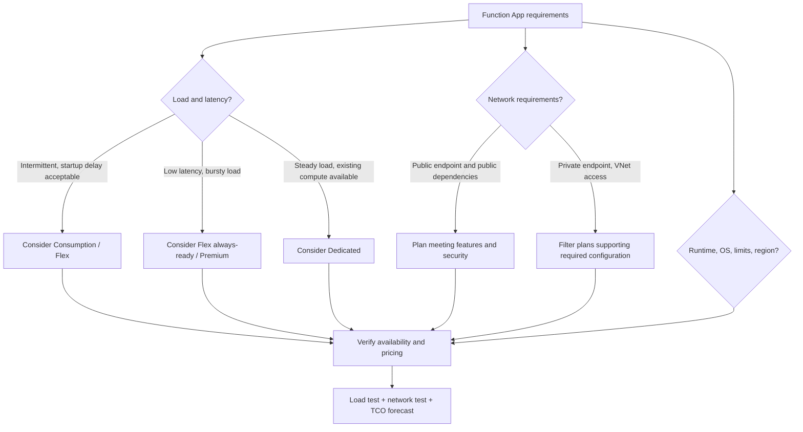
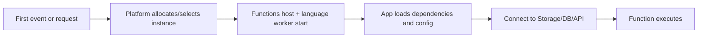
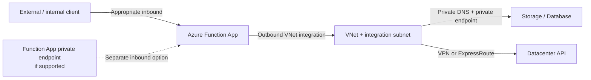
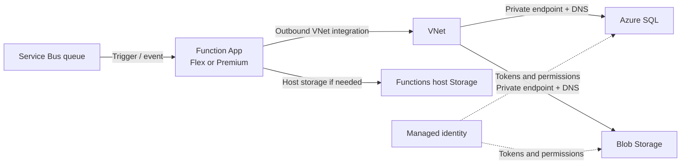

# Choosing a Hosting Plan Based on Load and Network Requirements

An Azure Function might be triggered a few times a day to send notifications, or it might need to process hundreds of thousands of events during peak hours. Some Functions serve HTTP APIs that require fast responses, while others run overnight batch jobs and can tolerate slow startup. Some systems are allowed to call services over the Internet, while others must connect to Azure SQL, Storage, or internal APIs over a private network. **Choosing an Azure Functions hosting plan is a decision about performance, latency, scalability, networking, operations, and cost**, not simply picking the lowest unit price.

In the **CLOUD_PROVIDERS_AZURE** module, you explore the Microsoft Azure ecosystem from subscriptions, resource groups, and Microsoft Entra ID to virtual networks, compute, storage, data, deployment, monitoring, security, and cost control for an application architecture. This lesson belongs to the **Serverless with Azure Functions** chapter and guides you through choosing a hosting plan based on **load characteristics** and **network connectivity requirements**, complete with hands-on scenarios and operational checklists.

## 1. Learning Objectives

After this lesson, you will be able to:

- Explain how a hosting plan affects instance count, cold starts, execution duration, and billing.
- Distinguish between **Flex Consumption**, classic **Consumption**, **Elastic Premium**, **Dedicated (App Service Plan)**, and running Functions on **Azure Container Apps**.
- Analyze load across HTTP latency, event volume, concurrency, execution time, memory, and warm-instance requirements.
- Distinguish between **inbound private endpoints** and **outbound VNet integration**; design private access to Storage, databases, and internal APIs.
- Identify configuration requirements for **AzureWebJobsStorage**, dependent services, DNS, firewalls, and managed identities.
- Estimate relative costs based on traffic and always-ready resources without treating outdated price tables as final decisions.
- Inspect hosting plans using the Azure portal and Azure CLI, build a selection matrix, and run pre-production validation tests.

## 2. What Is a Hosting Plan?

A **Function App** is the resource containing one or more functions along with their runtime, configuration, identity, and related deployment artifacts. The **hosting plan** determines the compute resources, scaling model, and infrastructure capabilities allocated to the Function App.

Depending on the plan type, a Function App can:

- Scale instances up or down based on triggers and platform-managed scaling rules.
- Maintain or omit always-ready compute capacity to mitigate cold starts.
- Use different CPU/memory allocations and concurrency levels.
- Support different networking, deployment, and security capabilities.
- Be billed per execution/consumed resources or by provisioned capacity.

A **Trigger** such as HTTP, Timer, Azure Queue Storage, or Service Bus determines *when a function is invoked*. A **Hosting plan** determines *what resources the function has and how it scales*. The two are related but not interchangeable: moving a Queue-triggered Function onto Premium will not fix buggy message-handling logic or missing queue permissions.

### Decision Factor Diagram



This is a **candidate** filtering diagram, not an automatic plan selection formula. A plan that fits the load profile must still be disqualified if it does not support the required runtime version, deployment model, networking requirements, or operational limits.

## 3. Common Azure Functions Hosting Options

| Option | Usage Model | Key Characteristics | Typical Candidate Workloads |
|---|---|---|---|
| **Flex Consumption** | Serverless, event-driven scaling, optional always-ready | Designed for new Functions apps on Linux in supported regions/runtimes; offers VNet integration and configurable concurrency/instances where supported | Bursty queue/event processing, HTTP APIs, event-driven workloads needing private networking |
| Classic **Consumption** | Event-driven serverless, pay-per-use | Can scale to zero; networking capabilities and limits differ from Flex/Premium; watch cold starts and execution limits | Small workflows, intermittent events, compatible existing apps |
| **Elastic Premium** | Minimum warm capacity maintained, elastic scaling | Prewarmed/always-ready capacity, VNet integration, higher configuration and feature limits than Consumption per plan rules | Critical APIs needing consistent latency, bursty events, private connectivity |
| **Dedicated / App Service Plan** | Pay for provisioned compute, shareable plan | Runs on provisioned App Service instances; scales by plan and app rules; not event-driven by default | Relatively steady load, existing App Service capacity, explicit sizing management |
| **Functions on Azure Container Apps** | Run Functions inside a Container Apps environment | Containerized; leverages Container Apps environments, revisions, scaling, and networking | Microservices/container architectures needing orchestration/customization |

Additionally, strict network isolation or compliance mandates may point toward **App Service Environment** options when configuration and plan fit. Do not treat this as a default serverless plan: deployment scope, management overhead, and cost for an isolated environment differ significantly.

**Important:** SKU names, supported runtimes, scaling limits, execution timeouts, regional availability, and networking features can change. Look up current capabilities for the **exact plan, region, OS, and language runtime** before deciding; do not copy a support matrix from a previous year across all subscriptions.

## 4. Flex Consumption: First Choice to Evaluate for Many New Workloads

**Flex Consumption** delivers a serverless Azure Functions model with configurable resource/scaling options and virtual network integration support per current capabilities. It is typically the first candidate for **new** Function Apps requiring event-driven scaling and connectivity to private services, provided the runtime and region are compatible.

Key characteristics to understand:

1. **Event-driven scaling:** the platform adds or removes instances based on trigger activity, within the limits and scaling groups of each trigger type.
2. **Instance memory size:** choose memory/CPU configurations across plan-supported tiers; do not treat memory size as just application heap RAM.
3. **Per-instance concurrency:** the number of requests/events processed simultaneously per instance impacts throughput and scaling behavior; tunability varies by trigger and runtime.
4. **Always-ready instances:** can maintain minimum warm capacity to reduce cold-start impact for supported functions/groups, in exchange for baseline always-ready charges.
5. **VNet integration:** lets the Function App send outbound traffic into a virtual network per plan terms, enabling access to services behind private endpoints or internal networks.
6. **Packaging/deployment rules:** differ from classic Consumption/Premium; follow the deployment model supported by Flex.

### Flex Does Not Mean Zero Possibility of Cold Start

If a workload has scaled to zero and receives a new event, the platform may need to allocate an instance or initialize the runtime. If many libraries must be loaded, or a Java runtime or container starts slowly, first-request latency can increase. **Always-ready** reduces latency for configured scopes, but does not guarantee zero latency or eliminate all application startup time.

### When Might Flex Not Be Suitable Yet?

- The runtime, deployment architecture, or region does not yet support your required options.
- An operational feature available on Premium/Dedicated is unavailable on Flex for your specific configuration.
- The workload has specialized resource, timeout, or connectivity requirements that are incompatible.
- You already run a Dedicated environment with spare compute where incremental cost is lower than Flex.

For apps currently on classic Consumption or Premium, evaluate **workload migration** using compatibility documentation rather than assuming an in-place SKU swap will complete the transition.

## 5. Classic Consumption: Minimalist Option for Intermittent Load

Classic **Consumption** fits supported scenarios requiring event-driven scaling with pay-per-use billing. When idle, dedicated compute for the app can scale down; execution limits and networking features must be checked individually.

**Advantages:** no fixed VMs to maintain yourself, convenient for short tasks and low or unpredictable traffic.

**Limitations to evaluate:**

- **Cold start:** the app may incur startup time after periods with no requests.
- **Execution timeout:** maximum function execution duration depends on configuration and trigger type; do not assume unbounded runtime.
- **Network:** VNet/private endpoint capabilities do not match Flex and Premium; do not pick this plan if the architecture mandates private connectivity that is unsupported here.
- **Runtime/OS/support lifecycle:** verify support status for the specific platform, especially for new Linux deployments.
- **Concurrency/resource ceilings:** scaling out to many instances does not allow a single invocation to exceed per-instance resource limits.

For long-running workflows, consider breaking work into steps, using **Durable Functions** where appropriate, or another batch/queue architecture. Durable Functions helps coordinate state, yet remains subject to hosting, storage, and recovery constraints of the runtime model.

## 6. Elastic Premium: Low Latency, Flexible Scaling, and Private Networking

**Elastic Premium** is a primary choice for Function Apps requiring **warm capacity** and is frequently used in architectures needing virtual network integration. Unlike Consumption, the plan maintains a minimum compute baseline that you must budget for even during low traffic.

Benefits to evaluate:

- **Always-ready/minimum instances** capacity to reduce cold starts.
- Trigger/load-based scaling within Premium limits and app settings.
- Outbound connectivity via **VNet integration**; inbound/private endpoint features supported per applicable configuration.
- Performance tuning, extended timeouts, deployment slots, or other operational features depending on SKU/OS/runtime.
- Multiple compatible Function Apps can share a Premium plan, though co-located apps compete for shared capacity and must be measured.

**Do not equate Premium Functions with an unlimited VM.** Instances still have finite resources; watch CPU/RAM, instance limits, concurrency, network egress, and database connection pools. If a dependency only allows 100 DB connections, scaling Functions to hundreds of instances can slow the system down further.

### Why Does Premium Have a Baseline Cost?

Because the plan keeps at least one instance ready, that compute unit consumes billable resources even when the app receives zero calls. Optimize Premium through **right-sizing instance size**, minimum instance count, and workload distribution, not just monthly invocation count.

## 7. Dedicated / App Service Plan: Leveraging Existing Compute

**Dedicated** runs Azure Functions on an **App Service Plan** with provisioned capacity. It is worth considering when an organization already operates App Service instances with sufficient headroom, or when steady resource utilization makes provisioned compute cost-effective.

### Key Points

- You pay for the provisioned plan capacity over time, not just when a Function executes.
- Function Apps and web apps sharing a plan can **compete for CPU, RAM, disk, and network**.
- Scaling instance count via **App Service autoscale/manual scale** differs from the event-driven automatic scaling of dedicated Functions plans.
- **Always On** configuration is often important to prevent Functions from idling under Dedicated per plan behavior; if the app is not kept active, some triggers may behave unexpectedly.
- VNet integration, inbound private endpoints, and advanced capabilities depend on the **App Service Plan tier, OS, deployment region, and configuration**.

**Dedicated is not automatically cheap just because there is no per-invocation fee.** It makes sense when compute is already paid for or load is steady, but is wasteful if you provision a dedicated plan for a Function running a few times a month.

### When Should You Consider App Service Environment?

If strict infrastructure isolation, specialized inbound/outbound networking, or rigorous enterprise compliance policies apply, evaluate Azure Functions on a supported App Service Environment. This is a **distinct architectural decision** requiring compatibility, capacity, and environment cost checks; do not adopt it merely to use a connection string to a private database.

## 8. Running Azure Functions on Azure Container Apps

Azure Functions can be deployed in an **Azure Container Apps** environment using supported methods and features. This option fits organizations already running microservices on Container Apps, needing custom container packaging with native libraries, or wanting to leverage Container Apps networking and revisions.

Differences to weigh:

- **Container images** and CI/CD/registry pipelines become part of the app lifecycle.
- Scaling depends on **triggers, event sources, and integrated/supported scaling mechanisms**; do not assume every Function trigger behaves identically to Flex/Premium.
- Networking relies on the **Container Apps environment**, ingress, VNet, and associated app constraints.
- Image security, runtime patching, network routing, and observability require container-oriented operations.

Do not pick Container Apps simply because the name sounds "serverless." If you only need standard HTTP/Queue Functions, Flex or Premium can drastically reduce setup effort; if you need a unified microservices platform, Container Apps is worth benchmarking.

## 9. Choosing a Plan by Load: Which Metrics Actually Matter?

Before comparing SKUs, characterize a **typical operating day** and the **peak load scenario**. Key metrics to gather:

| Question | Metric or Finding Needed | Impact on Plan |
|---|---|---|
| Where do invocations come from? | HTTP, Timer, Storage Queue, Service Bus, Event Hubs... | Scaling mechanism and trigger support |
| Is traffic continuous? | Requests/events per second or hour, idle periods | Scale-to-zero vs. always-ready capacity |
| What latency is acceptable? | p95/p99 latency, cold-start budget | Always-ready, Premium, dedicated capacity |
| How long does each run take? | p50/p95 runtime, long tasks, timeout risk | Execution limits, Durable Functions, or other architecture |
| What does each run consume? | CPU, memory, I/O, network connections | Instance memory, concurrency, and SKU |
| What is peak concurrency? | Concurrent invocations, backlog, arrival rate | Max instances, per-instance concurrency, downstream quotas |
| How are failures handled? | Retries, idempotency, queue TTL, dead-letter, RPO/RTO | Priority on resilience and warm capacity |
| Is private connectivity required? | Storage/SQL/Key Vault via private endpoint, VPN/ExpressRoute | Plan type and outbound networking |
| Who calls the HTTP endpoint? | Internet, internal APIM, VNet, private endpoint | Inbound access and network controls |

### 9.1. Low-Latency APIs

For example, a pricing lookup endpoint requires p95 below 200 ms. If a Java app takes several seconds to load its runtime and libraries on cold start, the first request after an idle period can violate the SLO.

**Candidates:** Flex with appropriate always-ready, Elastic Premium, or Dedicated with existing capacity. Run load tests **after idle periods**, during traffic spikes, across new revision deployments, and during instance replacement—not only while the runtime is warm.

### 9.2. Queue Workers with Traffic Spikes

A Service Bus-triggered Function receives 10 messages/minute normally, but surges to 10,000 messages/minute during campaigns. If traffic is low most of the time, event-driven scaling on Flex/Consumption/Premium can fit well.

Evaluate:

- Messages processed per instance per minute and trigger concurrency.
- Maximum acceptable backlog or queue message age.
- Scale-out speed, max instances, and broker quotas.
- Database capacity to handle concurrent connections when many instances run at once.
- Idempotency, Service Bus message locks, retries, and dead-lettering.

**Scaling out does not multiply processing speed infinitely.** If downstream only handles 500 messages/second, scaling instances 10x can cause throttling and cascading retries.

### 9.3. Long Batch Jobs and Heavy Processing

A Function generates a large report taking 45 minutes, consuming heavy RAM and temporary files. Check execution time and memory limits for the plan and trigger. If the work can be split into steps, **queues + smaller tasks**, Durable Functions, or a dedicated batch service is far more reliable than holding an HTTP connection open for 45 minutes.

**Execution timeout is not the same as HTTP timeout.** Allowing a Function to run longer does not guarantee HTTP clients, load balancers, or gateways will wait that long. Return a job ID and process asynchronously for long tasks.

## 10. Cold Start, Concurrency, and Scale-Out

### What Steps Make Up a Cold Start?

Depending on the plan, when a Function App lacks a ready worker, the platform may allocate compute, start the Functions host, load the language runtime, initialize dependency injection, load configuration/secrets, and establish backend connections. All of these affect completion time for the first request.



**Code optimization remains essential on every plan.** Premium/always-ready reduces platform-level cold start factors, but cannot fix startup code that opens hundreds of connections or loads massive models unnecessarily.

### Instance Count and Per-Instance Concurrency

Suppose one instance processes 20 events/second within acceptable latency. Peak demand reaches about 140 events/second:

\[
\text{Ideal instances} =
\left\lceil \frac{140}{20}\right\rceil = 7
\]

This is a **capacity planning calculation**, not the exact number of instances Azure guarantees to spin up instantaneously. Per-instance concurrency, sampling/scaling decisions, startup time, and resource limits cause actual counts to vary. If an app needs 2 GiB RAM while the instance size is smaller, adding more instances will still fail to run stably.

**Do not conflate "monthly invocations" with "concurrent requests per instance" into a single number.** One million 30 ms calls can be far cheaper and lighter on resources than one hundred thousand 2-minute calls, depending on CPU/memory and plan.

### Keep Always-Ready Instances?

| Requirement Level | Recommendation |
|---|---|
| Events can wait briefly upon arrival | Scale-to-zero; measure cold starts and queue age |
| User-facing HTTP needing steady latency | Flex always-ready or Premium; Dedicated if cost-effective |
| Steady 24/7 load requiring fixed capacity | Compare Dedicated/Premium vs. Flex using benchmarks and pricing |
| Hourly spikes with mostly low daily traffic | Serverless elastic scaling with max instance caps |

Flex and Premium differ in how warm instances are configured and billed; never apply parameters or billing assumptions from one plan to another.

## 11. Network Requirements: Distinguishing Inbound and Outbound

This is an easy area to misunderstand when choosing a hosting plan. A Function App can **call a private database** while **its HTTP endpoint remains publicly reachable**, or vice versa.

### 11.1. Inbound: Clients Reaching the Function App

**Inbound access** controls who can invoke HTTP-triggered Functions or management endpoints exposed over the network.

- **Public endpoint:** `https://<function-app>.azurewebsites.net` is routable over the Internet, with access governed by access restrictions, App Service Authentication, function keys, or other controls.
- **Function App private endpoint:** when supported by the plan and config, clients in permitted networks reach the app via a private IP; requires private DNS and appropriate public network access settings.
- **API Management / Application Gateway / Front Door:** can sit in front of the Function App for API policies, WAF, or routing. Upstream connectivity to the Function App must be supported; do not assume a public front-end automatically reaches a private-IP-only backend.

**VNet integration does not automatically make the HTTP endpoint private.** If the requirement is "only internal APIs may call it," design **inbound** controls separately: private endpoints, network restrictions, gateways, or compatible access components.

### 11.2. Outbound: Function App Calling Other Services

**VNet integration** enables **outbound traffic from the Function App** to enter a VNet per hosting plan capabilities. From there, the app can reach:

- Azure SQL/PostgreSQL or Storage over **private endpoints**.
- An API hosted inside the VNet via appropriate routing.
- On-premises datacenter services over VPN/ExpressRoute when routing and DNS are configured properly.

VNet integration **does not automatically create** Storage private endpoints, grant database permissions, or fix DNS. Having a private endpoint for a database while DNS still resolves to a public IP causes traffic to bypass the intended path.

### Bidirectional Connectivity Diagram



### 11.3. Network Components That Must Work Together

| Component | What It Solves | What It Does Not Solve Automatically |
|---|---|---|
| **VNet integration** | Outbound path from Function App to VNet | Does not lock down HTTP inbound |
| **Target service private endpoint** | Private IP for Storage/SQL/Key Vault | Does not replace identity/RBAC |
| **Function App private endpoint** | Inbound via private IP where plan supports it | Does not configure outbound to databases |
| **Private DNS zone** | Resolves service hostnames to private IPs | Does not open NSGs/firewalls or grant permissions |
| **NAT Gateway** | Stable outbound public IP model when network/routing supports it | Does not fix private endpoint access if routes/DNS are wrong |
| **NSG/UDR/Azure Firewall** | Controls and routes traffic | Does not replace application-level authentication |
| **Managed identity** | Issues tokens for supported services/roles | Does not create network connectivity |

**Requiring a static outbound public IP** is also distinct from "private networking." When an external partner allowlists a single IP, verify NAT/routing options and outbound behavior of the hosting plan; never rely on default outbound IP lists assuming they will never change.

## 12. Private Networking for Azure Functions Also Depends on Host Storage

This is frequently overlooked: beyond business databases and Storage, the **Functions runtime typically requires host storage** to manage state, triggers, leases, checkpoints, and internal operations. A Function App may have VNet integration configured yet fail to start if its host storage is unreachable.

**`AzureWebJobsStorage`** is a critical host storage configuration for many Functions models. Whether you can use a connection string or an **identity-based connection** depends on the runtime, extensions, and plan. If the Storage account restricts access to private endpoints only, ensure **connectivity from the Functions host** reaches all required Storage endpoints.

### Endpoints to Review

- **Blob:** package data or state, triggers, and app operations depending on configuration.
- **Queue:** certain internal operations and triggers require Queue Storage.
- **Table:** depends on Functions runtime/extensions and active features.
- **File share/content storage:** some classic Premium/Dedicated setups use an Azure Files content share with specific networking needs; do not generalize this to the Flex deployment model.

### Private Host Storage Access Checklist

1. Confirm the **hosting plan supports VNet integration** for your OS and region.
2. Create the integration subnet per **exact plan requirements and delegation**, reserving enough IP addresses for scaling; do not assume Flex and Premium share identical subnet guidance.
3. Create private endpoints and private DNS for **the Storage sub-services actually required**.
4. Verify Function App DNS resolves endpoints to the expected private IPs.
5. Check routing, NSGs, firewalls, network security policies, and data-plane permissions.
6. Verify **runtime startup**, trigger processing, and **deployment** all work; build/deploy paths may have separate network requirements.
7. Document how failures are handled if storage or DNS becomes unreachable.

Across plans, **content shares, package deployment, and host storage** have different network requirements. Do not apply legacy app settings as a universal recipe across every Functions plan; follow guidance specific to your current plan and runtime version.

## 13. Selection Matrix by Load and Network Requirements

The table below provides an **initial candidate guide**, not a substitute for verifying SKU/runtime/region support:

| Scenario | Primary Candidates to Evaluate | Rationale and What to Test |
|---|---|---|
| Timer Function sending reports a few times/day, no private network | Flex Consumption; Consumption if existing compatible app | Scale-to-zero, pay-per-use, acceptable cold start |
| Bursty queue worker accessing Azure SQL via private endpoint | Flex Consumption, Elastic Premium | Event scaling paired with outbound VNet integration and private DNS |
| Java HTTP API needing low p95 with highly variable load | Flex with always-ready, Elastic Premium | Warm capacity, scale-out, cold-start testing |
| Steady 24/7 HTTP API with an existing App Service Plan | Dedicated or Premium/Flex based on numbers | Compare provisioned compute cost against actual utilization |
| Function calling internal network and clients restricted to private IP | Plan supporting both outbound VNet integration and inbound private endpoint | Do not conflate the two features; verify OS/region/tier |
| Container workload with custom native libraries, already on Container Apps | Azure Functions on Container Apps or suitable container platform | Verify trigger/scaling support and image maintenance responsibility |
| Very long batch, GPU needs, or thousands of distributed tasks | Evaluate Azure Batch, AKS, or other compute services first | Function timeouts, memory, networking, and orchestration may not fit |
| High-isolation workloads with strict dedicated network/resource mandates | Premium/Dedicated with supported architecture, possibly App Service Environment | Evaluate isolation level, capacity, governance, and TCO |

### Elimination Rules Before Comparing Price

1. **Eliminate plans that do not support your runtime, OS, region, or deployment model.**
2. **Eliminate plans that fail mandatory network needs:** inbound private endpoints, outbound VNet integration, DNS, or routing.
3. **Eliminate plans that fail tested timeout, memory, concurrency, and scaling limits.**
4. Only then compare **TCO + reliability + operations** among remaining candidates.

This rule prevents the common mistake of picking the lowest price first, only to discover the Function cannot reach private Storage or cold-start latency violates the SLO.

## 14. Example A: HTTP API Needing Fast Responses Under Uneven Load

An e-commerce application has a Function App serving pricing quote requests. Business hours bring 50–200 requests/second, while nights see almost none. Requirements:

- Low p95 latency and no slow initial requests right after quiet periods.
- Public HTTPS access allowed through API Management.
- Backed by a database requiring connection limits.
- Heavy traffic spikes expected on promotional days.

**Candidates:** Flex Consumption with always-ready vs. Elastic Premium. Dedicated may also qualify if the organization already has spare plan capacity.

### Step-by-Step Evaluation

1. Measure **startup time** of the runtime and dependencies, especially Java apps with large libraries.
2. Determine requests handled **per instance** within the target p95 latency.
3. Test minimum always-ready instances to curb cold starts without overpaying during idle hours.
4. Cap scale-out limits to align with database connection pools, throughput, and backend APIs.
5. Test burst loads, scale in/out, version deployments, and single-dependency failures.
6. Compare total monthly cost of Flex always-ready vs. Premium minimum instances vs. Dedicated with shared compute.

**Never conclude Premium is always faster than Flex** or Flex is always cheaper than Premium from the plan name alone. Actual cost and latency depend on invocation frequency, memory size, warm instance counts, network paths, and caching.

## 15. Example B: Queue Worker with Private-Endpoint-Only Storage and SQL

A system ingests events into a Service Bus queue. A Function reads messages, queries Azure SQL, and writes output files to Blob Storage. Security policy forbids data-plane access to databases and Storage over the public Internet.

**Requirements:**

1. The Function must process the queue elastically with retries and dead-lettering.
2. Outbound traffic from the Function routes via VNet integration to private endpoints.
3. DNS for SQL and Blob resolves to the proper private IPs.
4. The Function host can still reach the host storage required by the Functions runtime.
5. The Function authenticates using managed identity and least-privilege data roles.

### Illustrative Architecture



**Common pitfall:** creating a private endpoint for Azure SQL and assuming the Function App automatically routes through the VNet. Or enabling VNet integration successfully while **`AzureWebJobsStorage`** remains blocked by the Storage firewall, preventing the Functions host from starting and stopping the Service Bus trigger.

### Verification Plan

1. Provision a test environment matching the target hosting plan, OS, and region.
2. Verify integration subnet and private DNS resolution for each dependency.
3. Confirm the runtime host starts cleanly and registers the Function trigger.
4. Send test messages; verify the Function receives messages, SQL queries succeed, and Blob uploads succeed.
5. Intentionally revoke permissions or block the network in the lab to observe error messages and recovery behavior.
6. Ramp up message volume to measure scale-out, queue drain time, queue age, retries, and dead-lettering.
7. Inspect logs to ensure no tokens, account keys, connection strings, or sensitive data leak.

If **HTTP inbound must also be private**, add the corresponding inbound private endpoint or gateway design; a Queue trigger alone does not lock down the Function App's HTTP endpoint.

## 16. Example C: Long-Running, RAM-Intensive Nightly Job

A Function generates end-of-day summary reports. Each job processes 3 million records, runs 40–60 minutes, and peaks high on memory, with no live user requests waiting during execution.

**Decision to avoid:** upgrading from Consumption to Premium just to let a single invocation run for an entire hour.

Instead:

- Check whether the workload can be partitioned by customer, date, or shard.
- Push work chunks onto a queue and process them concurrently with bounded limits.
- Consider **Durable Functions** if multi-step orchestration and state tracking are needed; verify hosting plan and state-backend limits.
- If the job requires specialized compute or very long durations, compare against **Azure Batch**, Container Apps jobs, or VM/AKS jobs.
- Set explicit timeouts, checkpoints, durable outputs, and safe retries.
- Track **total batch completion time** and **cost per valid report** rather than single-invocation duration.

If code currently holds an HTTP connection open for an hour, refactor to **submit job → return job ID → poll status → download result**. That architectural choice is independent of the hosting plan.

## 17. Inspecting Hosting Plans in the Azure Portal

For a running Function App:

1. Open the [Azure portal](https://portal.azure.com/) and confirm the right **tenant/subscription**.
2. Go to **Function Apps** and select the app under review.
3. Check **Overview / Properties / Hosting / Scale** (depending on the current portal layout) for hosting plan, SKU, region, OS, and instance configuration.
4. Open the linked **App Service plan** (if the app uses a visible separate plan resource) to inspect tier and capacity.
5. Inspect **Networking**: outbound VNet integration, inbound access restrictions, private endpoint connections, and related DNS/routing.
6. Check **Identity** and connections to Storage/SQL/Service Bus; verify principals and role scopes.
7. Review **Metrics / Application Insights** across at least one representative load cycle to capture throughput, latency, memory, error rates, and scaling limits.
8. Use the **Pricing Calculator / Cost Management** to compare current spend with candidate plans.

If the portal does not allow switching plans directly, do not treat it as a UI bug: some hosting model transitions require **creating a new Function App and deploying/migrating** via a supported workflow. Back up configuration, secret/identity mappings, and traffic cutover steps before making changes.

## 18. Azure CLI: Inspecting the Current Plan and Configuration

Examples using Azure CLI in Bash or Azure Cloud Shell, **read-only**. Replace resource group, Function App, and subscription names with actual values. These commands avoid printing full app settings so connection strings and secrets are not exposed.

```bash
az login
az account set --subscription "<subscription-id>"
az account show \
  --query "{subscription:id,tenant:tenantId,name:name}" \
  --output table

RG="rg-functions-lab"
APP="func-orders-lab"

# List Function Apps in the resource group
az functionapp list \
  --resource-group "$RG" \
  --query "[].{name:name,kind:kind,location:location,state:state}" \
  --output table

# Read kind, plan resource ID, region, and public access of the app
az functionapp show \
  --resource-group "$RG" \
  --name "$APP" \
  --query "{name:name,kind:kind,location:location,plan:serverFarmId,publicAccess:publicNetworkAccess}" \
  --output json

# Retrieve plan resource ID when the hosting plan uses a plan resource
PLAN_ID=$(az functionapp show \
  --resource-group "$RG" \
  --name "$APP" \
  --query serverFarmId --output tsv)

# Read SKU/tier/capacity of the App Service plan if PLAN_ID exists
az appservice plan show \
  --ids "$PLAN_ID" \
  --query "{name:name,sku:sku.name,tier:sku.tier,capacity:sku.capacity,kind:kind}" \
  --output json
```

**Note:** `kind`/`sku` values help identify the plan but do not expose every plan-specific setting such as always-ready counts, scale rules, and practical limits. For Flex/Consumption, returned plan metadata can differ by API/CLI version; if querying the plan resource does not apply, inspect the Function App resource directly in the portal or via commands tailored to your current plan.

### Checking VNet Integration and Available Metrics

```bash
# Inspect outbound VNet integration if supported by the CLI command and plan
az functionapp vnet-integration list \
  --resource-group "$RG" \
  --name "$APP" \
  --output json

APP_ID=$(az functionapp show \
  --resource-group "$RG" \
  --name "$APP" \
  --query id --output tsv)

# List actual Azure Monitor metrics available for the app
az monitor metrics list-definitions \
  --resource "$APP_ID" \
  --output table
```

Commands may require specific Azure CLI/extension versions and resource read permissions. If a command group does not support your hosting plan, check `az functionapp --help` or `az functionapp vnet-integration --help`. Never create resources or modify production networks just to test a CLI flag.

### When Provisioning a New Plan

Creating a Function App requires parameters that read-only lookup examples **do not include**: Storage account, supported region, runtime/version, OS, network configuration, and deployment model. Provisioning Flex Consumption differs from Premium/Dedicated, and Azure CLI parameters can evolve across versions.

In a lab, start with **Create Function App** in the portal, select your desired hosting plan, review properties supported for your runtime/region, and then codify the configuration using **Bicep/ARM/Terraform** per project standards. For CLI usage, consult `az functionapp create --help` and plan-specific docs; never take a Premium creation command, change only the SKU name, and assume it creates Flex.

## 19. Cost Estimation: Compare Only Identical Workloads

Depending on the plan, an Azure Functions bill may reflect **execution count**, **memory/CPU consumption**, **compute time**, **always-ready instances**, or **provisioned App Service capacity**. Beyond Functions, costs include Storage, networking, logs, databases, brokers, and private connectivity services.

### Relative Estimation Framework

For consumption-based billing, approximate:

\[
\text{Compute usage} \approx
\text{Executions}\times\text{Duration per run}
\times\text{Billable memory or resource}
\]

This is a **directional model**, not the exact billing formula for every plan. Flex may have distinct rates and always-ready components; verify trigger, request, concurrency, and unit pricing against current Azure Functions pricing tables.

For continuously provisioned compute:

\[
\text{Provisioned compute cost} \approx
\text{Hourly instance rate}\times
\text{Instance count}\times\text{Provisioned hours}
\]

Actual bills also depend on tier, OS, licensing, zone/region, commitment plans, discounts, and resource sharing.

### Two Contrasting Workload Examples

**Workload A:** 2,000 executions/day, 200 ms each, low memory. If private networking and instant post-idle latency are not required, serverless scale-to-zero is usually advantageous since idle compute is minimized.

**Workload B:** 200 requests/second continuously all day, high memory per request, strict p95 latency. Choosing Flex always-ready, Premium, or Dedicated depends on sustained instance count and measured throughput; you **cannot** conclude consumption is always cheaper just because of the word "consumption."

### Frequently Forgotten Costs

| Component | Why Charges Occur |
|---|---|
| Host storage and business storage | Functions runtime, Blob/Queue/Table operations, backups, and retention |
| Azure Service Bus/Event Hubs | Message operations, tier, throughput units, and retention |
| Application Insights / Log Analytics | Telemetry ingestion, retention, and queries |
| VNet integration, private endpoints, and network components | Private Link, NAT/Azure Firewall, public IPs, and data processing depending on model |
| Network egress | Data transfer out of Azure, across regions, or through associated services |
| Cold starts and retries | Extra execution time, compute, storage operations, and SLO impact |
| Warm/minimum capacity | Billed even during zero-call periods under applicable plans |

**Cost per valid transaction** is often more informative than price per million invocations:

\[
\text{Cost per successful operation} =
\frac{\text{Total compute + supporting costs}}
{\text{Completed valid business operations}}
\]

If error rates or retry counts climb, total invocations rise without delivering matching business output. Configure Azure Budgets and Cost alerts, and rely on Cost Management data and benchmarks rather than hardcoding SKU prices.

## 20. Security and Access Control

**A hosting plan does not replace authentication and authorization.** Even if a Function is only reachable through a private endpoint, caller identity and business permissions should still be verified.

### Application Identity

**Managed identity** lets the Function App obtain tokens to access Azure Storage, Service Bus, Key Vault, or databases where supported, avoiding long-lived secrets in repositories. Distinguish between:

1. **Resource management permissions:** Azure RBAC to create/modify the Function App, hosting plan, or networking.
2. **Data-plane permissions:** roles on Blob/Queue/Service Bus/databases matching actual operations.
3. **Function HTTP API permissions:** caller authentication via Microsoft Entra ID, App Service Authentication, API Management, or application-appropriate mechanisms.

Function keys are useful for basic HTTP caller checks, but **do not equate to a user authorization system**. For sensitive data, implement proper authentication and authorization, key/token protection, rotation, and auditing.

### Private Network Connectivity

At minimum, review:

- Storage firewalls and corresponding private endpoints.
- Private DNS zone links and the DNS resolver actually used by the Function.
- VNet integration subnet sized with enough IPs for scale-out and configured for the right plan.
- NSGs/UDRs/Firewalls/NAT aligned so identity endpoints and backends are not accidentally blocked.
- Public network access settings on the Function App and data services; disable public access when policy requires.
- HTTP trigger authentication/authorization independent of network restrictions.
- Secrets protected in Azure Key Vault/app settings; never print full configurations to logs.

**Private networking does not guarantee data backups.** You still need backups/PITR, retention policies, idempotency, and deletion protections for every dependency.

## 21. Observing Performance and Reliability

Before changing plans, pinpoint where the system is actually slow:

| Metric | Potential Measurement Source | Question Answered |
|---|---|---|
| HTTP p50/p95/p99 latency | Application Insights, distributed tracing | Are only first requests slow or all requests? |
| Cold-start latency | Custom telemetry, post-idle tests, startup traces | Is always-ready needed? |
| Execution count/duration | Azure Functions metrics and app telemetry | What are current load and growth trends? |
| Failures/exception rate | Application Insights, logs | Are retries inflating compute or losing data? |
| Queue backlog/oldest message age | Service Bus/Storage queue metrics | Are events processed fast enough? |
| CPU/memory, instance count | Supported plan/hosting metrics | Resource starvation or scaling cap hit? |
| Database throttling/connection failures | Database metrics, dependency traces | Is adding instances overwhelming the backend? |
| DNS/network/connectivity errors | App logs, dependency traces, network diagnostics | Misconfigured private endpoint, route, or permission? |
| Cost per successful operation | Cost Management + business metrics | Is the current plan cost-effective? |

### Measuring Cold Starts Properly

A meaningful test compares:

1. The first request after the Function has been idle long enough to scale down.
2. Subsequent requests once an instance is warm.
3. Traffic ramping from low to peak and the time taken for additional instances to appear.
4. Recovery time after deployments or instance restarts.

On some plans, detailed startup/instance data is not emitted by default; add custom telemetry in application code if needed. If p95 latency spikes due to slow SQL queries, upgrading to Premium will not replace database tuning.

### Designing Resilience Beyond the Hosting Plan

- Retry transient failures with **exponential backoff** and bounded attempts.
- Use **idempotency keys** when messages can be redelivered or clients retry.
- Offload long-running work to queues/state stores; avoid relying on long-lived open HTTP requests.
- Set dependency timeouts, circuit breakers, or graceful degradation where needed.
- Persist state durably before acknowledging completion; define dead-letter/poison-message strategies.
- Test failure behavior when Storage is unreachable, identity tokens fail, or private DNS breaks.

## 22. Troubleshooting Common Plan and Network Misconfigurations

| Symptom | Possible Cause | Inspection and Remediation |
|---|---|---|
| First request after idle is slow | Cold start, heavy runtime/Java startup | Measure startup; consider always-ready/Premium and optimize code |
| HTTP Function times out while code runs | HTTP/client/gateway timeout, not just function timeout | Move long tasks to queues/jobs; return an operation ID |
| Function fails to keep up with queue backlog | Max instances, trigger concurrency, backend throttling | Inspect metrics, scale rules, per-instance throughput |
| Function scales out instances but SQL errors | Database connection limits or rate limits | Cap concurrency/pool size, optimize SQL and scale limits |
| Function cannot reach private Storage | Missing VNet integration, public DNS resolution, route/firewall | Inspect outbound network, Private DNS, and Storage rules |
| HTTP inbound remains public despite VNet integration | VNet integration only handles outbound traffic | Configure private endpoint/access restrictions for inbound |
| Function host fails to start after disabling public Storage | `AzureWebJobsStorage` or content storage cannot reach required endpoints | Check host storage, private endpoints, DNS, and plan-specific settings |
| Plan refuses private endpoint addition | SKU/region/OS unsupported or misconfigured | Verify plan capabilities; choose a supported configuration |
| Private connectivity flaps during scale-out | Subnet out of IPs, unstable DNS/routes, firewall/SNAT exhaustion | Reserve sufficient IPs, inspect logs and network diagnostics |
| Upgraded plan blows past budget | Always-ready/minimum instances, Storage/monitoring/network | Break down Cost Management by component |
| Migrated app from Consumption to Flex fails to run | Deployment/runtime/configuration differences | Follow dedicated migration guide; verify storage/trigger/identity |
| HTTP API returns 401/403 | App auth/function key, access restrictions, or backend RBAC | Separate inbound authorization errors from dependency failures |

### Six-Step Diagnostic Workflow

1. **Identify the exact plan, region, and runtime** running; do not guess from the Function App name.
2. **Classify the issue:** cold start, timeout, backlog/scale, memory, inbound auth, or outbound private networking?
3. **Read matching metrics and traces:** invocation duration, p95, queue age, external dependencies, instance/scale counts.
4. **Inspect networking by direction:** inbound endpoints/private access vs. outbound VNet integration/DNS?
5. **Check host storage, identity, and dependencies**, including Storage/Service Bus/SQL and quota/connection limits.
6. **Validate fixes in staging/lab**, re-measure SLOs and cost, then deploy with a rollback plan.

## 23. Practice Exercises

### Exercise A: Selecting Plans for Three Apps

A company operates:

- **App 1:** A Timer Function running 10 times/day, no private data, slow startup acceptable.
- **App 2:** A Java HTTP Function needing low p95, traffic ranging 20–500 requests/second, calling Storage over a private endpoint.
- **App 3:** A continuously running Function on a Dedicated App Service Plan with ample spare CPU/RAM and steady load.

Choose 1–2 candidates per app and state what conditions would change your recommendation.

*Hint:* (1) Compatible Flex or Consumption; (2) Flex always-ready or Premium with required networking; (3) evaluate incremental cost on the existing Dedicated plan vs. Flex/Premium, while ensuring no resource contention hurts co-hosted apps.

### Exercise B: Two Networking Questions

A Premium Function has VNet integration enabled and successfully calls a private database, yet external Internet users can still hit its HTTP endpoint. Is this a contradiction?

*Hint:* No. Outbound VNet integration and inbound private access are separate controls. If inbound must be private, configure an appropriate private endpoint/access restriction.

### Exercise C: Estimating Required Instances

Under realistic load, one instance handles at most 15 events/second within latency limits. Peak demand hits 110 events/second. How many ideal instances are required assuming linear throughput?

*Hint:* `ceil(110/15) = 8` instances. This is a baseline estimate; add headroom and account for quotas and scale-out latency.

### Exercise D: Function Host Fails to Start

After enabling a firewall blocking public access on the Storage account, the Function App stops processing Service Bus messages and logs show host storage connection failures. What should you inspect?

*Hint:* `AzureWebJobsStorage`, required Blob/Queue/Table endpoints, VNet integration, private endpoints, private DNS, routing, and identity/connection settings. Do not reopen public Storage unconditionally as a production workaround.

### Exercise E: Cost Comparison by Measurement

In a lab environment:

1. Pick a representative HTTP Function and Queue Function.
2. Choose two **available, supported** hosting plans for your target runtime and region.
3. Generate synthetic load covering idle, burst, and steady phases; never use real production data.
4. Measure p95/p99 latency, scale-out time, invocation count, memory, error rate, and queue age.
5. Calculate projected compute and supporting costs for the exact same completed work volume.
6. Test private networking if required by the app, documenting DNS/endpoint/identity results.
7. Write up the decision and rollback plan; clean up **only** the lab resources you created.

## 24. Checklist Before Finalizing a Hosting Plan

### Load and Performance

- [ ] Identified which HTTP/Timer/Queue/Service Bus/other triggers will run.
- [ ] Collected peak, idle, execution duration, concurrency, and p95/p99 SLO metrics.
- [ ] Measured cold starts, scale-out latency, and memory/CPU per invocation.
- [ ] Verified timeouts, max instances, concurrency, and runtime/OS support.
- [ ] Capped connections and load sent to downstream databases/Storage/APIs.

### Networking and Security

- [ ] Clarified inbound public/private requirements and outbound VNet integration needs.
- [ ] Confirmed the selected plan supports private endpoints/VNet integration for the target OS and region.
- [ ] Designed subnet, IP capacity, private DNS, NSGs/UDRs, and routing.
- [ ] Verified `AzureWebJobsStorage` and content/package storage are reachable over the intended network.
- [ ] Scoped RBAC/identities for business data and host functions with least privilege.
- [ ] Ensured public network access, HTTP auth, and gateways comply with organizational policy.

### Operations and Cost

- [ ] Compared Flex, Consumption/Premium/Dedicated/Container Apps where compatible.
- [ ] Reviewed current features and support lifecycles for the plan, runtime, and region.
- [ ] Forecasted compute, always-ready, Storage, broker, network, logging, and backup costs.
- [ ] Configured Azure Monitor/Application Insights, alerts, and SLO dashboards.
- [ ] Tested cold starts, unreachable private Storage, retries, and burst scaling.
- [ ] Prepared deployment/migration, rollback, cost budget, and operational ownership.

## Conclusion

Choosing an **Azure Functions hosting plan** must start with **realistic load, latency requirements, and network topology**, and only then weigh pricing. **Flex Consumption** fits many new serverless workloads needing event scaling and VNet integration when features align; classic **Consumption** serves short, low-traffic apps within its support limits; **Elastic Premium** excels when warm capacity and advanced networking are required; **Dedicated** fits steady loads or spare existing compute; and **Container Apps** suits architectures managing Functions inside a container platform. Regardless of plan, separate **inbound private access** from **outbound VNet integration**, ensure host storage and dependencies have working DNS/networking/identity, and benchmark cold starts, scale-out, and costs on representative workloads before going to production.
