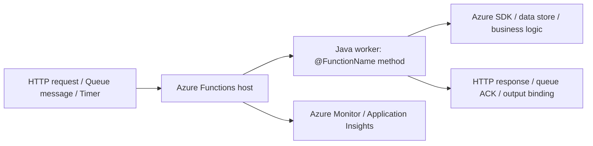
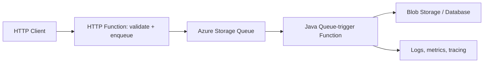
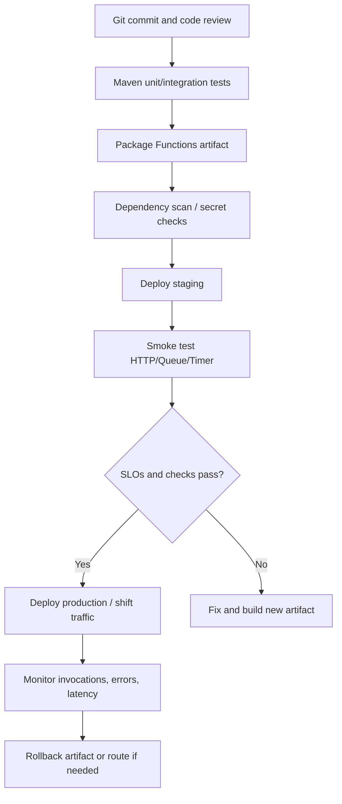

# Developing Azure Functions with Java

A Java application does not always need a continuously running VM or container. Some tasks only run when a user sends an HTTP request, a file is uploaded, a message arrives in a queue, or a scheduled timer fires. **Azure Functions** is Microsoft Azure's *serverless/event-driven* platform that lets you deploy event-handling functions without managing individual application servers.

With **Java**, development teams can use Maven or Gradle, the Azure Functions Java library, annotations such as `@FunctionName`, `@HttpTrigger`, and `@QueueTrigger`, and test locally using Azure Functions Core Tools before deploying to a Function App.

This lesson belongs to the **Serverless with Azure Functions** chapter in the **CLOUD_PROVIDERS_AZURE** module. It connects Java skills to resource groups, subscriptions, Microsoft Entra ID, Azure Storage, private networking, monitoring, security, and cost control for applications on Azure.

> **Scope:** the primary examples use Java 17 and Azure Functions runtime v4 to illustrate the annotation-based programming model. For production deployments, verify the supported JDK/runtime versions, Azure Functions Maven plugin, binding extensions, and hosting plan options for your current timeframe, region, and environment.

## 1. Learning Objectives

After this lesson, you will be able to:

1. Explain Function App, function, trigger, input/output binding, and execution context.
2. Initialize an Azure Functions project with Java/Maven and recognize the required file structure.
3. Write an HTTP-trigger function with proper data types, response status codes, and logging.
4. Write Queue-trigger or Timer-trigger functions and understand how the runtime invokes them.
5. Distinguish between `host.json`, `local.settings.json`, application settings, and secrets.
6. Test locally using Azure Functions Core Tools, Maven, and HTTP tools; design automated tests.
7. Deploy a Function App and manage identity, Azure Storage, monitoring, and network dependencies.
8. Mitigate retry/duplication failures using idempotency, queues, timeouts, and exception handling.
9. Select a hosting plan and scaling strategy based on SLA, cold starts, concurrency, Java performance, and cost.

## 2. What Is Azure Functions?

A **function** is a unit of code invoked by the runtime when a matching event occurs. Functions within the same **Function App** can share runtime configuration, deployment packages, identity, and hosting resources. A Function App is the Azure resource that manages those functions; it is not equivalent to an individual JVM instance.

Key components:

| Component | Role | Example |
|---|---|---|
| Function App | Deployment and management unit for multiple functions | `orders-functions-prod` |
| Function | Registered event-handling method | `submitOrder`, `processOrder` |
| Trigger | Determines when a function is invoked | HTTP, Queue, Timer |
| Input binding | Supplies input data from a supported service | Blob/document read by binding |
| Output binding | Writes data to a supported service | Message sent to Queue, Blob output |
| Azure Functions host | Discovers functions, receives events, manages bindings, logging, and execution | Functions runtime v4 |
| Java worker | Process executing Java code for the host | JVM hosting Java functions |
| Application settings | Runtime environment configuration | Endpoints, resource names, connection settings |

A **Trigger** is generally required for every function; other bindings are optional. Not every Azure operation needs a binding: in Java, you can also use the **Azure SDK** to call services directly when you need finer control or complex interaction patterns.

### Event Lifecycle Diagram



This diagram is a logical model: how message completion, retries, timeouts, and outputs behave depends on the trigger type, extension, and hosting plan. Not every function returns an HTTP response.

### Serverless Does Not Mean Servers Do Not Exist

Azure still runs your application on compute infrastructure; the difference is that you manage **code, configuration, resource sizing, access permissions, and limits** rather than individual VMs directly. Increasing events can trigger the platform to scale out instances within the hosting plan's capabilities, though scale-out is neither instantaneous nor infinite.

## 3. When Are Java Functions a Good Fit?

| Requirement | Why Functions Fit | Conditions to Evaluate |
|---|---|---|
| Lightweight HTTP endpoint | Deploy small event-driven APIs/handlers | Auth, latency, cold start, timeout |
| Queue message processing | Decouple fast requests from slow work | Retries, poison queues, idempotency |
| Scheduled jobs | Timer trigger replaces a cron server | Timezones, duplication, storage/coordination |
| Event-driven file processing | Trigger/Event Grid/Queue drives pipeline | Large files, rate limits, duplicate events |
| Small data synchronization | Call Azure SDK in response to an event | Execution time, network resources, quotas |
| System integration webhooks | Fast HTTP endpoint forwarding jobs to a queue | Signature/webhook validation, replay, throttling |

Do not assume Functions are better than every alternative in all cases. If a service must hold very long-lived connections, guarantee ultra-low consistent latency, use a custom runtime, or run continuous multi-hour compute, compare against **Azure Container Apps, AKS, App Service, Azure Batch**, or a queue-backed architecture.

### One Way to Organize an Application

- **HTTP Function** receives orders, validates payloads, and pushes messages onto a queue.
- **Queue Function** processes orders and calls databases or partner APIs.
- **Timer Function** cleans up expired records, syncs reports, or checks stuck jobs.
- **Blob Storage/Database** stores durable state; never rely on the JVM instance's temporary filesystem.

When CPU/memory runs tight or events burst, the system needs **backpressure and scaling**, not just spawning more threads inside a function.

## 4. Java Model and Tooling Ecosystem

An Azure Functions Java project typically uses:

1. A **JDK** compatible with the chosen runtime.
2. **Maven** or Gradle with supported plugins/toolchains.
3. **Azure Functions Java library**: annotations and interfaces for handling requests, responses, and context.
4. **Azure Functions Maven plugin**: packages and supports deploying functions.
5. **Azure Functions Core Tools**: runs the Functions host on your development machine.
6. **Azure CLI**: signs in, inspects subscriptions, and manages Azure resources.
7. **Azurite** or a test Azure Storage account if triggers/runtime require Storage.
8. An IDE such as IntelliJ IDEA or VS Code (optional) and a test framework.

### Version Compatibility

Functions runtime v4 and the Java worker maintain a support matrix across JDKs, operating systems, hosting plans, and lifecycles. **Do not choose Java 21 merely because that JDK is installed locally** if the target Function App does not yet support that runtime/plan combination. For existing systems, check the Function App configuration before upgrading the JDK.

In this lesson, Java 17 is an **illustrative baseline**. If your environment supports Java 21 or another version, adjust the Maven compiler, `JAVA_VERSION`/runtime, and test all triggers, native libraries, startup, and test suites.

## 5. Maven Project Structure

A minimal project can be organized as follows:

```text
orders-functions/
  pom.xml
  host.json
  local.settings.json              # local only, DO NOT commit
  .gitignore
  src/
    main/
      java/
        com/example/functions/
          HelloFunction.java
          OrderQueueFunction.java
          CleanupTimerFunction.java
    test/
      java/
        com/example/functions/
          ...
  target/
    azure-functions/                # package output
```

Projects generated by a Maven archetype may have a slightly different layout. What matters is that **Maven packages cleanly, the plugin discovers `@FunctionName` methods, and generates the corresponding binding metadata**. Do not hand-edit plugin-generated function metadata files unless you know exactly why.

### Maven Archetype

Azure provides archetypes or project templates to scaffold the structure. Because plugin and archetype versions evolve over time, pull the commands and versions from official documentation for the toolchain version approved by your organization. A typical workflow looks like:

```text
Install JDK + Maven + Functions Core Tools
    -> Generate project with appropriate archetype/template
    -> Open pom.xml and verify Java version and plugin versions
    -> Write @FunctionName + trigger annotations
    -> mvn clean package
    -> mvn azure-functions:run
    -> Test
    -> Deploy to Function App
```

This lesson also shows a minimal `pom.xml` so you understand every piece instead of blindly following a wizard.

## 6. Example `pom.xml` for Java Functions

This is a learning template; specific versions should align with the libraries and plugins used by your team. The Function App name must be **available and valid under Azure naming rules**—do not reuse the sample name verbatim in real deployments.

```xml
<project xmlns="http://maven.apache.org/POM/4.0.0"
         xmlns:xsi="http://www.w3.org/2001/XMLSchema-instance"
         xsi:schemaLocation="http://maven.apache.org/POM/4.0.0 https://maven.apache.org/xsd/maven-4.0.0.xsd">
  <modelVersion>4.0.0</modelVersion>

  <groupId>com.example</groupId>
  <artifactId>orders-functions</artifactId>
  <version>1.0.0</version>
  <packaging>jar</packaging>

  <properties>
    <project.build.sourceEncoding>UTF-8</project.build.sourceEncoding>
    <maven.compiler.release>17</maven.compiler.release>
    <functions.java.library.version>3.1.0</functions.java.library.version>
    <functions.maven.plugin.version>1.34.0</functions.maven.plugin.version>
    <functionAppName>orders-java-functions-lab</functionAppName>
    <functionResourceGroup>rg-functions-lab</functionResourceGroup>
    <functionRegion>southeastasia</functionRegion>
  </properties>

  <dependencies>
    <dependency>
      <groupId>com.microsoft.azure.functions</groupId>
      <artifactId>azure-functions-java-library</artifactId>
      <version>${functions.java.library.version}</version>
    </dependency>
  </dependencies>

  <build>
    <plugins>
      <plugin>
        <groupId>org.apache.maven.plugins</groupId>
        <artifactId>maven-compiler-plugin</artifactId>
        <version>3.13.0</version>
        <configuration>
          <release>${maven.compiler.release}</release>
        </configuration>
      </plugin>
      <plugin>
        <groupId>com.microsoft.azure</groupId>
        <artifactId>azure-functions-maven-plugin</artifactId>
        <version>${functions.maven.plugin.version}</version>
        <configuration>
          <appName>${functionAppName}</appName>
          <resourceGroup>${functionResourceGroup}</resourceGroup>
          <region>${functionRegion}</region>
          <runtime>
            <os>linux</os>
            <javaVersion>17</javaVersion>
          </runtime>
        </configuration>
        <executions>
          <execution>
            <id>package-functions</id>
            <goals>
              <goal>package</goal>
            </goals>
          </execution>
        </executions>
      </plugin>
    </plugins>
  </build>
</project>
```

### Why Are Two Plugins Needed?

- `maven-compiler-plugin` compiles the Java source for the chosen Java target.
- `azure-functions-maven-plugin` scans annotations, packages artifacts required by the Functions host, and provides goals such as `azure-functions:run` and `azure-functions:deploy`.

**What to verify:** the plugin may require additional deployment configuration (hosting plan, resource group, runtime, `stagingDirectory`, `appSettings`) depending on how the project is structured. Pre-provisioning the Function App via the Azure Portal/IaC and deploying to that existing resource is usually easier to govern in production; do not rely on the plugin to auto-provision everything while bypassing networking, identity, or cost policies.

### Managing Dependencies with Maven

In real projects, use dependency management/BOMs when pulling multiple Azure SDKs, pin dependency versions, and run vulnerability scans. Avoid `LATEST`, unbounded version ranges, or dynamically loading JARs at startup.

## 7. HTTP Trigger: Your First Java Function

Create `src/main/java/com/example/functions/HelloFunction.java`:

```java
package com.example.functions;

import java.util.Optional;

import com.microsoft.azure.functions.AuthorizationLevel;
import com.microsoft.azure.functions.ExecutionContext;
import com.microsoft.azure.functions.HttpMethod;
import com.microsoft.azure.functions.HttpRequestMessage;
import com.microsoft.azure.functions.HttpResponseMessage;
import com.microsoft.azure.functions.HttpStatus;
import com.microsoft.azure.functions.annotation.FunctionName;
import com.microsoft.azure.functions.annotation.HttpTrigger;

public class HelloFunction {

    @FunctionName("hello")
    public HttpResponseMessage hello(
        @HttpTrigger(
            name = "request",
            methods = {HttpMethod.GET},
            authLevel = AuthorizationLevel.ANONYMOUS,
            route = "hello"
        ) HttpRequestMessage<Optional<String>> request,
        final ExecutionContext context
    ) {
        String rawName = request.getQueryParameters()
            .getOrDefault("name", "world");
        String name = rawName.trim();

        if (name.isEmpty() || name.length() > 80) {
            return request.createResponseBuilder(HttpStatus.BAD_REQUEST)
                .body("name must contain 1-80 characters")
                .build();
        }

        context.getLogger().info("Handling hello request");

        return request.createResponseBuilder(HttpStatus.OK)
            .header("Content-Type", "text/plain; charset=utf-8")
            .body("Hello, " + name + "!")
            .build();
    }
}
```

### Explanation

- `@FunctionName("hello")`: registers a function named `hello` with the Functions host.
- `@HttpTrigger`: instructs the runtime to invoke the method on HTTP GET requests to the route.
- `AuthorizationLevel.ANONYMOUS`: allows calling the endpoint without a Functions key per the trigger's auth level mechanism; **use only in labs or public endpoints protected by an appropriate upstream layer**.
- `HttpRequestMessage<Optional<String>>`: HTTP request with an `Optional<String>` body type if the app needs to read a body; this example only reads a query parameter.
- `ExecutionContext`: supplies the logger and invocation metadata.
- `HttpResponseMessage`: sets the HTTP status, headers, and body.
- `trim` and length checks: minimal input validation example; production requires full business validation.

**Never log full requests, tokens, cookies, or personal information.** Logging a static message as shown above helps trace execution flow without leaking data.

### Function Keys Are Not Complete Security

In production, consider Entra ID/App Service Authentication, Azure API Management, private networking, or a suitable gateway. If using `AuthorizationLevel.FUNCTION`, clients must provide a function key per runtime rules; keys must be managed securely and never replace business-level authentication and authorization.

## 8. Running the HTTP Function Locally

### `host.json`

Create `host.json` at the project root:

```json
{
  "version": "2.0",
  "extensionBundle": {
    "id": "Microsoft.Azure.Functions.ExtensionBundle",
    "version": "[4.*, 5.0.0)"
  },
  "logging": {
    "logLevel": {
      "default": "Information"
    }
  }
}
```

`version: "2.0"` is the `host.json` schema version for Functions runtime v2 and later, **not "Java runtime v2."** The extension bundle lets the runtime load bundled binding extensions. Do not guess bundle versions; confirm compatibility with your triggers, plan, and current Functions host.

### `local.settings.json`

Local-only file for development:

```json
{
  "IsEncrypted": false,
  "Values": {
    "FUNCTIONS_WORKER_RUNTIME": "java",
    "AzureWebJobsStorage": "UseDevelopmentStorage=true",
    "ORDERS_API_BASE_URL": "http://localhost:9000"
  }
}
```

`UseDevelopmentStorage=true` assumes **Azurite** or a compatible emulator is running on the local endpoints. In some HTTP-only setups, the host may run with different storage requirements, while Queue/Timer and many host features require active storage. When using this `local.settings.json`, start Azurite before running all triggers.

**Do not commit `local.settings.json` with credentials** to a repository. Add it to `.gitignore`, provide a secret-free sample file, and keep dev environments separate.

### Build and Run

In the project directory:

```bash
mvn clean package
mvn azure-functions:run
```

If the toolchain is installed properly, the Functions host prints the function list and endpoints. Typical URL for the lab HTTP trigger:

```text
http://localhost:7071/api/hello
```

`api` is the default route prefix unless modified in `host.json`; the actual port and prefix may vary.

Testing:

```bash
curl -i "http://localhost:7071/api/hello?name=Mai"

curl -i "http://localhost:7071/api/hello?name="
```

Expected output: the first request returns HTTP 200 with a greeting; the second returns HTTP 400 due to an empty name. Check local logs to confirm the invocation appears and no secrets are printed.

### Common Errors

- `mvn: command not found`: Maven is not installed or missing from `PATH`.
- Incompatible Java release: local JDK and Maven compiler configuration mismatch.
- `func` not found: Functions Core Tools is not installed or not on `PATH`.
- Cannot connect to Storage/Azurite: `AzureWebJobsStorage` points to the emulator, which is not running.
- Functions missing from host logs: annotation error, Maven plugin packaging issue, or class scanning failure.
- HTTP 404: wrong route, prefix, function name, or path.

## 9. Queue Trigger: Decoupling Fast HTTP from Slow Processing

Suppose an HTTP endpoint receives thumbnail creation requests; instead of downloading and processing the image inline during the HTTP request, the app pushes a message to a Queue. Another function triggers when a message arrives and handles it asynchronously.



### Java Queue Trigger Example

Create `OrderQueueFunction.java`:

```java
package com.example.functions;

import com.microsoft.azure.functions.ExecutionContext;
import com.microsoft.azure.functions.annotation.FunctionName;
import com.microsoft.azure.functions.annotation.QueueTrigger;

public class OrderQueueFunction {

    @FunctionName("processOrder")
    public void processOrder(
        @QueueTrigger(
            name = "message",
            queueName = "orders",
            connection = "OrdersStorage"
        ) String message,
        final ExecutionContext context
    ) {
        if (message == null || message.isBlank()) {
            throw new IllegalArgumentException("Empty queue message");
        }

        // TODO: Deserialize, validate, use a stable orderId for idempotency.
        // TODO: Persist business result before marking processing successful.
        context.getLogger().info("Processing an order message");
    }
}
```

This example focuses on the **trigger and Java structure**, not a full production order processor. If the function returns normally, the runtime marks the message completed per the Queue extension's mechanics. If it throws an exception, the system handles retries, dequeueing, and poison queues per the active extension policy.

### Connection Setting

`connection = "OrdersStorage"` references an **app setting prefix/name**, not a connection string hard-coded inside the annotation. For a local lab environment, you can use:

```json
{
  "IsEncrypted": false,
  "Values": {
    "FUNCTIONS_WORKER_RUNTIME": "java",
    "AzureWebJobsStorage": "UseDevelopmentStorage=true",
    "OrdersStorage": "UseDevelopmentStorage=true"
  }
}
```

This local config uses a supported emulator and requires creating the `orders` queue beforehand if it does not exist yet. In production, prefer **identity-based connections** when supported by the Queue extension, runtime, and hosting plan; in that setup, app settings can use keys like `OrdersStorage__queueServiceUri` paired with appropriate RBAC instead of an account key. Check extension schema requirements before applying.

### Why Must a Queue Function Be Idempotent?

Messages can be redelivered after a function timeout, worker restart, or runtime error. If an order was already written to the database but the function failed before the message was acknowledged, a subsequent run will process it again.

A safe mechanism:

1. Parse and validate `orderId` from the message.
2. Look up processing status by `orderId`.
3. If already completed, exit without creating new side effects.
4. If not yet completed, execute operations using a transaction, conditional write, or idempotency key.
5. Persist completion state before letting the runtime acknowledge the message.
6. Monitor repeated failures and the poison queue.

**Exactly-once business effects** do not come automatically from a queue trigger. They require transactional or idempotent design in your application or data store.

## 10. Timer Trigger: Scheduled Processing

Azure Functions supports **Timer triggers** using Functions' NCRONTAB-compatible schedule format, typically **six fields** with seconds first.

Example function running every 5 minutes:

```java
package com.example.functions;

import com.microsoft.azure.functions.ExecutionContext;
import com.microsoft.azure.functions.annotation.FunctionName;
import com.microsoft.azure.functions.annotation.TimerTrigger;

public class CleanupTimerFunction {

    @FunctionName("cleanupExpiredOrders")
    public void cleanupExpiredOrders(
        @TimerTrigger(
            name = "timerInfo",
            schedule = "0 */5 * * * *"
        ) String timerInfo,
        final ExecutionContext context
    ) {
        context.getLogger().info("Running scheduled cleanup");

        // TODO: Load due records, use bounded batches and idempotent updates.
        // TODO: Persist checkpoint and report result to monitoring.
    }
}
```

### Avoiding Schedule Misunderstandings

`0 */5 * * * *` means every 5 minutes at second 0 in the time context used by the Functions runtime. Schedules, timezones, DST shifts, and `WEBSITE_TIME_ZONE` support depend on OS and hosting plan; never assume every Function App uses your local development machine's timezone.

Timer triggers can use Storage to coordinate schedules and locks, preventing scale-out from naively firing duplicate scheduled runs. However, **do not treat that as an exactly-once guarantee** for side effects: an invocation can still fail, repeat, or run late. Cleanup jobs still need idempotency, pagination, and checkpointing for large datasets.

### Long-Running Scheduled Tasks

If cleanup takes several hours, do not cram everything into a single Timer invocation. Have the Timer split data into batches and enqueue messages so Queue Functions can process them in parallel. This enables retries, load management, and staying within hosting plan execution limits.

## 11. Triggers, Input Bindings, and Output Bindings

Azure Functions Java annotations declare **how the runtime passes data into a function**. When needed, output bindings can write results back to a service.

| Type | Example | Watch Out For |
|---|---|---|
| HTTP trigger | Receives GET/POST, returns status/body | Auth, input validation, timeout |
| Queue trigger | Receives Storage Queue message | Retries, poison queue, idempotency |
| Timer trigger | Fires on schedule | Timezone, schedule drift, execution duration |
| Blob trigger | Reacts to new/updated blobs per binding mode | Event model, file size, duplicate handling |
| Event Grid trigger | Handles events pushed by Event Grid | Subscription, validation, replay |
| Service Bus trigger | Processes queue/topic messages | Locks, dead-lettering, concurrency, identity |
| Input binding | Runtime injects source data into parameter | Binding extension, serialization, permissions |
| Output binding | Runtime writes data from return/collector | Output semantics, error handling, transaction boundaries |

A function can combine a **trigger + Azure SDK** instead of bindings whenever the app needs conditional logic, transactions, custom metadata, or complex pagination.

### Do Not Assume a Binding Works Just Because Java Imports Compile

Annotations like `@QueueTrigger` require the Functions host to load the matching extension and valid connection settings. Maven can compile cleanly while the Functions host still fails to load the extension, leaving the function inactive. When troubleshooting binding errors, inspect `host.json`, the extension bundle, runtime version, and app settings—not just Java code.

## 12. Azure SDK Inside a Java Function

For data operations, use the Azure SDK just like in any Java application—for instance, accessing Blob Storage via Entra ID/managed identity instead of an account key.

This illustration requires `azure-identity` and `azure-storage-blob` with compatible versions managed in Maven:

```java
import com.azure.identity.DefaultAzureCredentialBuilder;
import com.azure.storage.blob.BlobServiceClient;
import com.azure.storage.blob.BlobServiceClientBuilder;

public final class BlobClients {

    private BlobClients() {}

    public static BlobServiceClient create(String accountName) {
        String endpoint =
            "https://" + accountName + ".blob.core.windows.net";

        return new BlobServiceClientBuilder()
            .endpoint(endpoint)
            .credential(new DefaultAzureCredentialBuilder().build())
            .buildClient();
    }
}
```

`DefaultAzureCredential` can use a developer identity locally and managed identity or another supported credential in Azure. **The credential chain varies by environment**; confirm which actual identity is selected and avoid letting production inadvertently fall back to developer credentials.

### Least-Privilege Permissions

If a function only reads Blobs, grant an appropriate data-plane role such as **Storage Blob Data Reader** at the narrowest scope needed. Resource group Contributor does not automatically grant all Storage data-plane read rights where separate data-plane authorization applies.

For Queue, Service Bus, or Key Vault, each service has distinct roles and scopes. Never assign Subscription Owner just so a function can write a blob.

### Configuring Endpoints and Secrets

Storage account names, API endpoints, and feature flags can live in app settings. Account keys, SAS tokens, or API keys belong in managed secret stores—prefer managed identity or Key Vault references where supported.

**Never pass secrets in query parameters**, log them in HTTP logs, or print all environment variables. Never embed secrets in function names or routes.

## 13. `host.json`, `local.settings.json`, and Azure Configuration

These three scopes are commonly confused:

| Config | Stored Where | Purpose |
|---|---|---|
| `host.json` | In source package | Global Functions host settings, logging, extensions, retry/concurrency as supported |
| `local.settings.json` | Dev machine, never commit secrets | `Values` for local execution |
| Function App Application settings | Azure resource | Environment variables and connection settings when deployed |

### Do Not Automatically Copy `local.settings.json` to Production

In standard deployments, `local.settings.json` is a local-only file and **should not be treated as the source of truth synced to Azure**. Production settings should be managed via IaC, deployment environments, Key Vault references, or secure pipelines.

Example runtime settings:

```text
FUNCTIONS_WORKER_RUNTIME = java
FUNCTIONS_EXTENSION_VERSION = ~4
ORDERS_API_BASE_URL = https://internal-api.example.com
```

These are illustrative settings, not secrets. For host storage, exact names and identity-based setting formats depend on what your Functions runtime and extensions support.

### `host.json` and Retries

Some triggers allow tuning retries or concurrency in `host.json` or via attributes/extensions. **There is no single universal retry setting that applies identically to HTTP, Queue, Service Bus, and Timer.** Read each extension's behavior and implement idempotency in application code.

## 14. Error Handling, Timeouts, and Retries

### HTTP Function

For synchronous requests, return status codes reflecting the true outcome:

- `200 OK`: read/processing succeeded.
- `201 Created`: resource created with an appropriate reference.
- `202 Accepted`: request accepted and queued into an asynchronous pipeline.
- `400 Bad Request`: malformed syntax or failed validation.
- `401/403`: invalid authentication or unauthorized per policy.
- `404 Not Found`: resource does not exist.
- `409 Conflict`: duplicate or state conflict.
- `429 Too Many Requests`: back off/pause per rate limiting if applicable.
- `500/503`: system or dependency error; include a log/correlation ID as appropriate.

Do not return HTTP 200 if the system has not actually persisted required data. If a job was placed into a Queue and is not yet finished, `202 Accepted` with a job ID or status endpoint is far more accurate.

### Queue Function

Queue triggers use dequeue, visibility, retry, and poison message mechanics. For transient errors, you can let the runtime retry per policy; for permanent data errors, route or handle them cleanly so the poison queue does not grow unbounded and waste compute.

Handlers should:

1. Classify transient vs. permanent errors.
2. Log error codes, invocation ID, and stable job ID; avoid sensitive data.
3. Retry with backoff/jitter if the SDK or extension does not already handle it.
4. Never produce duplicate side effects.
5. Define an operational process for terminally failed messages.
6. Alert when backlog, poison queue depth, or message age increases.

### Timeouts and Long-Running Workflows

Maximum invocation duration depends on the hosting plan and current runtime/configuration. For HTTP, gateway and client timeouts apply in addition to the function timeout. **Do not hold an HTTP request open for hours waiting on processing**; use Queue/Service Bus with status polling, or orchestration like Durable Functions when appropriate.

In Java, JVM startup, class loading, framework initialization (such as Spring, if used), and dependency connections all impact cold start. Measure actual timings from both the client and Application Insights.

## 15. Java Cold Start, Concurrency, and Performance

### Cold Start

When no warm instance is running the app, the platform allocates an instance/worker, starts the JVM, loads classes, and initializes clients. Therefore, the first request after an idle period can be slower than subsequent requests on a warm instance.

Common causes:

- Oversized JARs/dependencies.
- Excessive framework auto-configuration or reflection.
- Recreating SDK clients on every invocation.
- Reading too many secrets or network metadata at startup.
- CPU/memory sizing misaligned with the workload.
- Creating a fresh database connection per request.

### Improvements

- Keep startup logic minimal.
- Reuse **thread-safe** clients appropriately; avoid creating a new `HttpClient` or `BlobServiceClient` per request unless necessary.
- Configure explicit connection pools and timeouts.
- Do not cache secrets in ways that break rotation or leak data across tenants.
- Prune unused dependencies and configure sensible log levels.
- Measure cold/warm latency on the real hosting plan, not just locally.

### Concurrency

A Function App can process multiple invocations concurrently depending on the trigger, worker process, host settings, and hosting plan. Never store mutable per-request state in a shared static field without thread safety.

**Unsafe** example:

```java
public class UnsafeFunctionState {
    private static String currentOrderId;
    // Every invocation overwrites the shared variable, causing a race condition.
}
```

Keep request data in local variables or properly synchronized structures. Static clients can be reused when thread-safe per library docs, provided you manage lifecycle, connection pools, and credential refresh.

### Memory

The JVM heap is not the entire process memory. Metaspace, direct buffers, JIT, thread stacks, and native libraries all consume RAM. Load test with actual instance memory limits to avoid OOM crashes and restarts.

## 16. Choosing the Right Hosting Plan

Azure Functions offers hosting models with distinct billing, scaling, networking, and cold-start profiles. For new architectures, evaluate current options such as **Flex Consumption**, **Premium**, and **Dedicated/App Service plan** against Java/runtime/region support; older environments may use Consumption or other models.

| Hosting Group | When to Evaluate | Key Considerations |
|---|---|---|
| **Flex Consumption** | Serverless event-driven scaling under supported plans | Billing model, instance memory, scaling/concurrency, networking, always-ready if available |
| **Premium** | Workloads needing pre-warmed capacity, private networking, or higher stability/performance scaling per config | Baseline capacity cost, instance size, VNet, deployment slots where supported |
| **Dedicated/App Service plan** | Existing App Service capacity or steady provisioned capacity needs | Always On where needed, scaling, resource contention, plan cost |
| **Consumption (legacy in some contexts)** | Existing systems or matching regions/features | Execution limits, scaling, networking, and support lifecycle |

Never treat a fixed price sheet or cold-start second count as a permanent guarantee. Limits and costs change by **runtime, region, plan, instance count, execution duration, memory, requests, and supporting services**.

### Selection Questions

1. Does cold-start latency violate the SLO?
2. Is the workload primarily HTTP, Queue, or Timer?
3. Does it need to reach Private Endpoints/databases via a VNet?
4. What are peak requests/s and message batch rates?
5. How much CPU/memory does each invocation need and how long does it run?
6. Do you need deployment slots, zero-downtime rollouts, or always-ready capacity?
7. Can long-running tasks be offloaded to queues?
8. What is the total cost of compute + Storage + monitoring + networking + egress?

Select a plan based on **measured requirements** rather than assuming serverless is always cheaper than VMs/containers at every load level.

## 17. Deploying a Function App to Azure

There are two separate tasks:

1. **Provision infrastructure:** Function App, hosting plan, supporting storage, identity, Application Insights, networking, and RBAC.
2. **Deploy Java code:** build/package and release the artifact to the configured Function App.

In production, infrastructure should be managed with **Bicep/ARM/Terraform or equivalent IaC workflows**. The Maven plugin is a build/deploy tool, not a substitute for network, subscription, security, budget, and production approval reviews.

### Preparing with Azure CLI

```bash
az login

az account show \
  --query "{name:name,subscriptionId:id,tenantId:tenantId}" \
  -o table
```

Set the authorized subscription before deploying if needed:

```bash
az account set --subscription "<SUBSCRIPTION_ID>"
```

Once the Function App exists, verify its baseline configuration:

```bash
RG="rg-functions-lab"
APP="<EXISTING_FUNCTION_APP_NAME>"

az functionapp show \
  --resource-group "$RG" \
  --name "$APP" \
  --query "{name:name,kind:kind,state:state,location:location}" \
  -o json
```

**Do not print full production application settings**, as output can contain secrets or connection strings. If settings inspection is needed, output only non-sensitive metadata using approved tools and permissions.

### Deploying with the Maven Plugin

Once `pom.xml` targets the prepared Function App and plan, run from source:

```bash
mvn clean package
mvn azure-functions:deploy
```

**Prerequisite:** app name, resource group, Java runtime, OS, and hosting plan in the plugin config must match the real resource. Some plugin versions attempt to create a Function App if one does not exist; organizations should verify beforehand to avoid out-of-process provisioning.

After deploying, verify:

- Function App is running and lists all expected functions.
- Runtime/JDK and extensions loaded cleanly.
- HTTP endpoints respond properly and enforce security policies.
- Queue/Timer triggers connect to their target services.
- App settings and managed identity match the target environment.
- Logs, metrics, and alerts are working.
- Zero secrets exist in source, packages, or deployment logs.

### Do Not Configure Production Like Local

Never use `UseDevelopmentStorage=true` in Azure to talk to real Storage. Production requires proper Storage account or identity-based settings. If using connection strings in a lab, manage them as secret settings or in Key Vault rather than committing them to the repository.

## 18. Securing Java Azure Functions

### Authentication and Authorization

For HTTP triggers, the auth level controls how the runtime validates keys where applicable. For production APIs, enforce real identity authentication such as **Microsoft Entra ID** via Function App authentication, APIM, or an appropriate gateway. Even after authentication, Java code must still verify **business authorization**: is this user allowed to view or edit this order?

`AuthorizationLevel.ANONYMOUS` does not mean a production API should sit unprotected on the Internet. Use it only when an endpoint is intentionally public and abuse, rate limiting, and data exposure have been evaluated.

### Managed Identity

Managed identity lets a Function App call Azure services supporting Entra authentication without storing long-lived client secrets in code. Enable the identity and assign least-privilege RBAC:

- Read Blobs: `Storage Blob Data Reader` or equivalent role.
- Write Blobs: appropriate data-write role.
- Queue/Service Bus: specific send/receive permissions per service.
- Key Vault: specific secret-read permissions under the active access model.

Enabling managed identity **does not automatically grant** permissions on Storage or Key Vault. Always test with the Function App's real identity, not just a developer's credential.

### Networking

- Verify VNet integration for outbound/private dependencies against your hosting plan and region.
- Inbound Private Endpoints to the Function App and outbound access to Storage/Databases are separate configurations and network paths.
- If a partner API allowlists IPs, design proper outbound NAT/Firewall egress; never treat your local machine or another VM's IP as the Function App's egress IP.
- When restricting public access, verify paths for deployment pipelines, the Functions runtime, DNS, routing, and storage/registry endpoints.

### Secrets and Sensitive Data

- Never hard-code account keys, SAS tokens, or JWT secrets in annotations or Java classes.
- Avoid logging raw HTTP headers, request bodies, queue payloads, or tokens.
- Use application settings/Key Vault references or identity-based connections where supported.
- Assign ownership for secret rotation and auditing.
- Never store sensitive customer data on a Functions instance's temporary filesystem.

## 19. Monitoring, Tracing, and Diagnostics

**Azure Monitor** and **Application Insights** can track requests, dependencies, exceptions, latency, and invocations for a Function App as configured. For Java, log/trace collection depends on the runtime, SDK/agent, and monitoring setup.

### Signals to Track

| Signal | Question Answered |
|---|---|
| Invocation count | Are triggers firing at the expected rate? |
| Success/failure | Do functions complete or throw exceptions? |
| Duration | Is p50/p95/p99 execution time rising? |
| Cold start | How long do new instances take to start? |
| Queue backlog | Are messages piling up or aging? |
| Retry/poison | Are messages failing repeatedly? |
| Dependencies | Are Storage, databases, or HTTP APIs timing out or throttling? |
| Memory/CPU | Is the JVM hitting OOM or long GC pauses? |
| Cost | Execution count, compute, storage, logs, networking |

### Correlation and Invocation IDs

`ExecutionContext` exposes invocation metadata such as `getInvocationId()`. You can log correlation/invocation IDs to link HTTP requests, queue messages, and dependency calls without exposing sensitive data.

```java
context.getLogger().info(
    "Invocation ID: " + context.getInvocationId()
);
```

Never use a random invocation ID as a business idempotency key for messages: on retry, a new invocation can receive a new ID. Use a **stable `orderId` or `jobId`** from the business payload.

### Diagnostic Workflow

1. Trigger not firing: check trigger metadata, extensions, app settings, and service connectivity.
2. Invocations running but failing: inspect exceptions, dependencies, and processed inputs.
3. Functions running slow: check cold starts, JDK startup, GC, networking, SDK retries, and database latency.
4. Duplicate invocations: check retries, queue leases, duplicate events, and idempotency.
5. Scaling up does not raise throughput: inspect CPU/memory, concurrency, downstream services, and throttling.
6. Deployed but endpoint missing: check app state, Java version, Maven package, function discovery, and auth level.

### Alerts

Alerts should map to clear actions: failure rates above baseline, rising p95 latency, queue backlog past SLA deadlines, new poison messages, abnormal invocation counts, Storage/API throttling, or unexpected cost spikes.

A single successful retry can be normal behavior, whereas **sustained retries** inflate backlogs and increase the risk of duplicate side effects.

## 20. Automated Testing for Java Azure Functions

Split tests into three layers:

1. **Business unit tests:** extract Java domain logic away from annotations and test with JUnit/Mockito or an approved framework.
2. **Integration tests:** run the Functions host locally with an emulator/test service to verify triggers, bindings, serialization, status codes, and retries.
3. **End-to-end tests:** deploy to staging and exercise HTTP/Queue/Timer flows against real identity, networking, and data stores.

### Separating Handlers from Domain Logic

Instead of placing all calculations and storage calls directly inside the `@HttpTrigger` method, extract an independent service class:

```java
package com.example.functions;

public final class GreetingService {
    public String greet(String name) {
        if (name == null || name.isBlank()) {
            throw new IllegalArgumentException("name is required");
        }
        return "Hello, " + name.trim() + "!";
    }
}
```

JUnit 5 unit test once the project includes the test dependency:

```java
package com.example.functions;

import static org.junit.jupiter.api.Assertions.assertEquals;
import static org.junit.jupiter.api.Assertions.assertThrows;

import org.junit.jupiter.api.Test;

class GreetingServiceTest {

    private final GreetingService service = new GreetingService();

    @Test
    void returnsGreeting() {
        assertEquals("Hello, Mai!", service.greet(" Mai "));
    }

    @Test
    void rejectsEmptyName() {
        assertThrows(
            IllegalArgumentException.class,
            () -> service.greet(" ")
        );
    }
}
```

These examples are **two illustrative classes**; place them in the proper source/test directories and add the JUnit Jupiter dependency and compatible Maven Surefire configuration. The HTTP handler can delegate to `GreetingService` and map validation exceptions to HTTP 400.

### What Integration Tests Should Verify

- Triggers are discovered by the host with the intended routes.
- Valid HTTP GETs, invalid inputs, auth enforcement, and status codes.
- Queue messages arrive in the target queue, and workers process and complete them.
- Failing messages retry and dead-letter/poison cleanly; outputs are never duplicated.
- Timers align with the intended timezone and avoid duplicate side effects.
- Credentials/managed identity and private networking work end-to-end in staging.
- Shutdown/scale-in does not drop in-flight work.

Never run integration tests against production accounts or queues without explicit authorization and strict sandboxing.

## 21. Controlled Deployment and Rollback

A Java Functions deployment pipeline can follow this sequence:



### Key Guardrails

- Promote the exact artifact tested in staging to production when the pipeline allows.
- Keep app settings environment-specific; never rebuild a JAR just to swap endpoints or secrets.
- Maintain backward-compatible database schemas so rolling back function code does not break data.
- Watch triggers right after deployment: Queue and Timer triggers may begin consuming events immediately upon startup.
- Consider deployment slots or blue/green strategies depending on hosting plan support; never assume all plans support slots identically.
- Maintain a governed mechanism to disable/throttle traffic or pause triggers during a bad release.
- Retain previous artifacts/digests/versions long enough to roll back safely.

**Rolling back Java code does not automatically undo side effects** already written to databases, queues, Blobs, or external systems. Design transactions, versioning, or compensating business workflows accordingly.

## 22. Common Issues and Troubleshooting

| Symptom | Common Cause | Investigation Path |
|---|---|---|
| `mvn package` fails | Wrong JDK, dependency/plugin version, compile error | Check `java -version`, `mvn -version`, POM, and stack trace |
| Functions host finds no functions | Wrong annotations, plugin packaging, missing metadata | Inspect package output and function discovery logs |
| `func` not recognized | Core Tools missing or not on `PATH` | Verify tool installation and version |
| HTTP 404 after startup | Wrong route/prefix/function name | Check host endpoints and `host.json` |
| HTTP 401/403 | Function key, Entra auth, network restrictions, policy | Check auth level and gateway without logging secrets |
| Queue trigger does not fire | Wrong queue name, connection setting, extension, Storage permissions | Check binding, `OrdersStorage`, roles, and runtime logs |
| Timer runs at wrong time | Bad NCRONTAB schedule, timezone/DST, Storage/host issue | Verify six-field expression, timezone, and runtime |
| Function fails with `UseDevelopmentStorage=true` | Azurite not running or wrong endpoint | Check emulator, local settings, and connectivity |
| Function times out | Task too long, slow downstream, plan/runtime cap | Offload to queue, set deadlines/retries |
| High Java cold start | Heavy JVM/classloading/dependencies, plan scale behavior | Measure warm vs. cold duration, trim startup work |
| OOM or process exit | Memory limit, heap/native buffers, concurrency | Monitor memory/GC, cap concurrent requests |
| Message processed twice | Retry/redelivery, worker crash after side effect | Idempotency, conditional commits, stable job ID |
| Storage 403 despite managed identity | Missing data-plane role or firewall rule | Verify RBAC, active identity, private DNS/network |
| Deployment succeeds but Function App fails | Java version/OS/plan mismatch or missing app settings | Check platform config, host logs, deployment logs |
| Cannot reach private API | VNet integration, private DNS, routing, firewall | Inspect DNS, network path, identity, and ports |
| Cost climbs despite lower request volume | Premium/Dedicated baseline, log ingestion, or storage | Inspect Cost Management, plan capacity, retention |

### Recommended Investigation Order

1. **Code and package:** were functions discovered?
2. **Runtime:** are Functions host and JDK compatible?
3. **Trigger/binding:** are extensions and app settings valid?
4. **Identity/network:** can the runtime connect and authenticate to dependencies?
5. **Business logic:** what exception occurred, is the payload valid, are duplicates handled?
6. **Performance:** cold start, memory, CPU, concurrency, and downstream latency.
7. **Operations:** alerts, logs, deployed version, and cost.

Do not change the POM, app settings, roles, firewall, and hosting plan all at once before isolating the root cause.

## 23. Cost and Architecture Choices

Azure Functions cost is more than Java method invocation counts. Depending on hosting plan and workload, costs can include:

- Execution count, duration, and memory consumption under the plan's billing model.
- Always-ready capacity or Premium/Dedicated baseline instances.
- Azure Storage for the Functions host, queues, checkpoints, and business data.
- Application Insights/Log Analytics ingestion volume in GB and retention.
- Data transfer, NAT Gateway, Azure Firewall, Private Endpoints, or VNet integrations.
- Databases, Service Bus, Event Grid, and event-producing services.
- Retries, duplicate processing, cold starts, and wait time caused by slow dependencies.

### Comparison Example

An API receiving 100 requests/day taking tens of milliseconds each with relaxed latency tolerances fits a consumption-based model well. By contrast, a 24/7 CPU-bound pipeline or an API that must stay continuously warm warrants comparing Premium, Dedicated, and Container Apps by total cost.

**Measure cost per successful transaction/job**, not just price per million calls, especially when Queue retries are frequent or invocations make many dependency calls.

### Budget Governance

1. Apply owner/project/environment tags to supported resources.
2. Configure budgets and alerts in Azure Cost Management.
3. Monitor log ingestion and strip unnecessary debug logs.
4. Enforce bounded timeouts/retries and poison queue handling.
5. Match autoscaling and hosting plans to real requirements.
6. Audit idle resources, staging apps, and leftover test Storage accounts.
7. Compare cost before and after optimization against completed work throughput.

## 24. Comprehensive Lab: Order Processing with Java Functions

### Scenario

An application receives orders from clients. The system requires:

- An HTTP endpoint that accepts requests and responds quickly.
- A Queue for asynchronous processing tasks.
- A Java Function consuming queue messages and persisting durable state.
- A Timer running every 5 minutes to audit overdue jobs.
- Controlled secrets and access permissions.
- Observability over errors, retries, duration, and cost.

### Part A — Create the Project

1. Set up a compatible JDK, Maven, and Azure Functions Core Tools.
2. Scaffold a Java Functions project using a supported archetype/template.
3. Verify `pom.xml`, `host.json`, `local.settings.json`, plugin versions, and Java release.
4. Implement the `hello` HTTP-trigger function and call it locally with `curl`.
5. Test both HTTP 200 and HTTP 400 on empty input.
6. Extract validation/greeting logic into a service class for standalone unit testing.

### Part B — Asynchronous Flow and Data

1. Create the `orders` queue in Azurite or a lab Storage account.
2. Add `OrderQueueFunction` referencing the `OrdersStorage` setting.
3. Build an HTTP handler that pushes messages containing a stable `orderId` onto the queue via a supported SDK or binding.
4. Implement idempotency when the same message is redelivered.
5. Simulate interrupting the worker after writing business output but before runtime completion acknowledgment.
6. Observe retries, queue backlog, and the poison queue (by simulating continuous errors).
7. Add a Timer function to check overdue jobs, ensuring cleanup logic is idempotent.

### Part C — Azure and Operations

1. Provision a resource group, Function App/hosting plan, Storage, and Application Insights within permitted scopes.
2. Configure managed identity and least-privilege roles to access Storage via supported mechanisms.
3. Deploy through the Maven plugin or an approved CI/CD pipeline.
4. Verify the HTTP endpoint and auth configuration before allowing Internet access.
5. Enqueue test messages and watch the Queue Function process them.
6. Inspect App Insights logs, failure rates, durations, invocation IDs, and downstream latency.
7. Configure alerts when queue backlogs grow or function failures exceed baseline.
8. Evaluate cold starts and why Java apps can take longer to initialize than local runs.
9. Document how to roll back an artifact without creating duplicate orders.
10. Clean up the lab resource group or individual lab resources per procedure, confirming shared resources remain untouched.

### Self-Check Questions

**Question 1.** How do Function App, Function, trigger, and output binding differ?

**Question 2.** Why should an HTTP Function handling multi-hour work consider returning `202 Accepted` and enqueueing a job?

**Question 3.** What roles do `@FunctionName` and `@HttpTrigger` play? Why does a successful Maven build not prove a trigger works?

**Question 4.** Should `local.settings.json` be committed to Git or used as a production secret store?

**Question 5.** What information does Java Azure Functions retrieve from `ExecutionContext`? Should you log entire messages or JWTs?

**Question 6.** A queue message is reprocessed after a timeout; how do you prevent duplicate order records?

**Question 7.** How does the `0 */5 * * * *` schedule differ from a standard five-field cron expression?

**Question 8.** If a Function App has managed identity enabled yet still receives Storage 403, which layers should you inspect?

**Question 9.** How do cold start, memory limits, and concurrency affect Java Functions?

**Question 10.** Why is `AuthorizationLevel.ANONYMOUS` not the default choice for sensitive production APIs?

**Question 11.** Which hosting plans should you evaluate if you need private dependency access, steady latency, and baseline capacity? Why can't you pick solely by execution count?

**Question 12.** Why does rolling back Function App code not automatically revert data that was already processed?

**Completion criteria:** the learner can explain the Java Azure Functions model, package and run an HTTP trigger, implement Queue/Timer triggers, separate config from code, deploy safely, monitor failures, and build duplicate/timeout handling suited to Azure.

## Conclusion

**Azure Functions with Java** combines familiar Java ecosystem tooling with Azure's **event-driven/serverless** model. Using trigger and binding annotations, Maven, Functions Core Tools, and the Azure SDK, you can build lightweight HTTP APIs, queue workers, timer jobs, and event handlers without managing per-instance servers.

A reliable production application demands more than a function that runs once: **compatible JDK/runtime versions, secure environment configuration, managed identity/RBAC, idempotent trigger retries, durable data handling, health/monitoring, informed hosting plan selection, and cold-start/cost optimization**. Getting those foundations right lets Java Functions integrate cleanly into an Azure architecture spanning subscriptions, identity, networking, storage, data processing, and operations.
