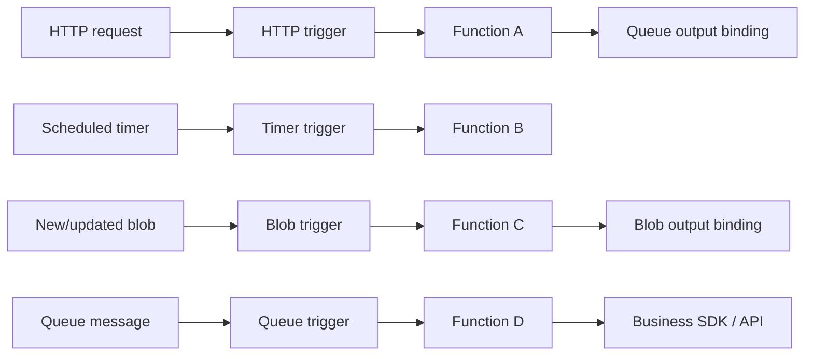
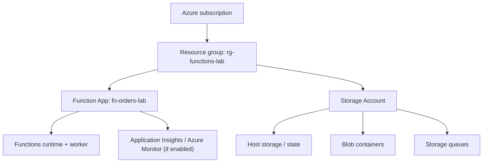
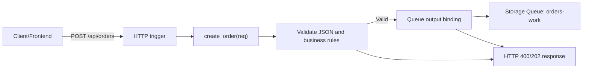
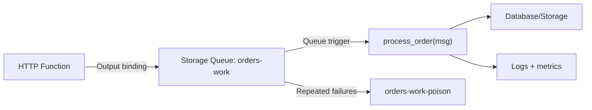
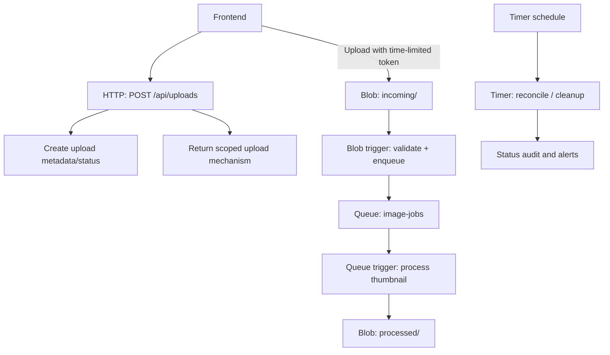
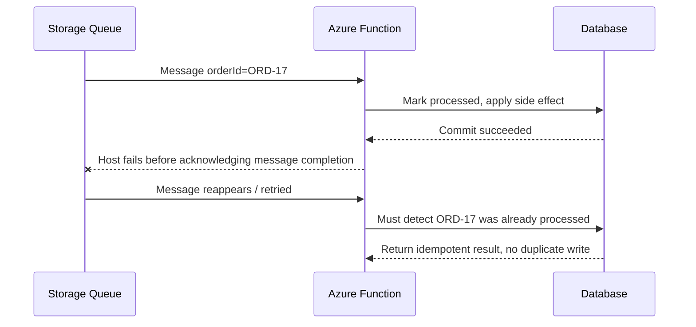
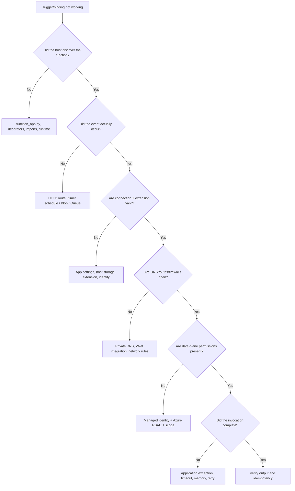

# Triggers and Bindings for HTTP, Timer, and Storage

An e-commerce application needs to accept orders over an API, run a nightly data aggregation job, and automatically process files when customers upload images to Azure Storage. If the development team provisions a dedicated server to continuously wait for these three event types, they must manage machine lifecycles, schedules, queue polling, and resource scaling themselves. **Azure Functions** provides an *event-driven serverless* compute model so you can focus on handler code; a **trigger** defines when a function runs, while **bindings** help the function receive and send data without writing all service-connection boilerplate yourself.

This lesson belongs to the **Serverless with Azure Functions** chapter of the `CLOUD_PROVIDERS_AZURE` module. Along your journey across Microsoft Azure—from subscriptions, resource groups, and Microsoft Entra ID to virtual networks, compute services, storage, data, deployment, monitoring, security, and cost—you will build a solid mental model for **HTTP triggers**, **timer triggers**, **Blob/Queue Storage triggers**, and **input/output bindings**.

The hands-on examples use the **Python programming model v2** with decorators on the 4th-generation Azure Functions runtime. Other languages such as C#, Java, and JavaScript/TypeScript differ in syntax but follow the same trigger and binding principles. Always verify configuration samples against the runtime, extensions, hosting plan, and SDK versions supported in your target environment.

## Learning Objectives

After this lesson, you will be able to:

1. Distinguish between **trigger**, **input binding**, and **output binding**, along with the limits of each role.
2. Explain how a Function App can contain multiple functions while **each function has only one trigger**.
3. Create an **HTTP trigger** with appropriate routes, methods, function key authentication, and HTTP responses.
4. Define a **timer trigger** using a six-field NCRONTAB expression, understanding UTC, `is_past_due`, and scheduled execution during scaling.
5. Build flows using **Blob trigger**, **Queue trigger**, and **Blob/Queue input-output bindings** for Azure Storage data.
6. Manage `AzureWebJobsStorage`, app settings, `connection` names, and Microsoft Entra/managed identities without hardcoding secrets.
7. Test Functions locally with Azure Functions Core Tools and Azurite, inspect logs, and verify data in Storage.
8. Design **idempotency, retries, poison messages, cost control, security, and observability** for event-driven systems.

## 1. Core Concepts: One Function Reacts to One Event

Azure Functions consists of the following components:

| Component | Meaning | Example |
|---|---|---|
| **Function App** | Management/deployment unit containing one or more functions sharing a runtime and app configuration | `fn-orders-lab` |
| **Function** | A function handling one type of event | `create_order` |
| **Trigger** | The event source that causes the function to execute | HTTP request, timer schedule, queue message, blob change |
| **Input binding** | Supplies data from a supported service into the function without manual SDK calls for basic reads | Read blob contents by path |
| **Output binding** | Writes data produced by the function to a supported destination | Send a message to a Storage Queue |
| **Binding extension** | Integrates the runtime with a specific service/binding type and schema | Azure Storage Blob/Queue extension |
| **App settings** | Configuration for connection names, feature flags, endpoints, and secret references | `AzureWebJobsStorage`, `JobsStorage` |
| **Host/runtime** | Listens for triggers, dispatches invocations, manages logging, extensions, and retries/scaling per hosting capabilities | Azure Functions runtime 4.x |

A Function App can host **multiple functions with different triggers**. However, **each function has exactly one trigger**; you may attach additional input/output bindings where supported by the model and extension.



The diagram emphasizes **event flow**. An output binding **does not trigger a function**; it emits data when an invocation executes. Conversely, a trigger can also pass the event payload directly into the function, such as `HttpRequest` or `QueueMessage`.

### How Does a Trigger Differ from an Input Binding?

Suppose a client calls `POST /api/orders` and the function needs to read a JSON template from a Blob:

- **HTTP trigger** is why the function is invoked.
- **Blob input binding** can supply the blob contents identified via route or binding expression.
- **Queue output binding** writes a job message to a queue after the function accepts the request.

You do not add a Blob trigger to that same function. If you want to react whenever a new Blob arrives, create **a separate function with a Blob trigger**.

### Do Bindings Completely Replace the Azure SDK?

No. Bindings work well for simple single-object reads/writes or messages. When you need:

- paginated listing of many blobs;
- multi-container operations or transactional/conditional updates;
- streaming large file uploads with fine-grained tuning;
- explicit control over batching, retries, leases, metadata, tags, or ETags;
- dynamically targeting multiple Storage accounts based on business logic;

then the **Azure Storage SDK** is usually the better fit. Triggers/bindings and the SDK can be combined, provided you manage credentials, permissions, and commit ordering across business steps cleanly.

## 2. Selecting a Hosting Plan and Defining Deployment Scope

Azure Functions supports several hosting options; scaling, timeouts, networking, billing, and specific features vary by plan.

| Option | Mental Model | Key Points to Evaluate |
|---|---|---|
| **Flex Consumption** | Serverless with dedicated scaling and configuration options | Regional support, memory/instances, networking, trigger behavior, and billing |
| **Consumption** (previous generation where still supported) | Pay-per-execution with certain runtime/timeout limits | Support lifecycle, scaling limits, and cold starts |
| **Premium** | Pre-warmed/always-ready capacity and SKU-level networking | Baseline cost, VNet, scaling, and performance |
| **Dedicated / App Service Plan** | Shares capacity with an App Service Plan | Instance count, Always On where needed, fixed compute billing |
| **Container-based / other supported models** | Package worker to match deployment mandates | Networking, container images, runtime/extensions, and ownership |

**Not every trigger scales identically across every plan.** For instance, queue/blob triggers depend on extensions and hosting scaling controllers; a timer trigger aims to run on schedule rather than distributing a single timer tick concurrently across every instance.

For learning exercises, select a plan that **supports Python and Storage bindings** in a region allowed by your subscription. Never provision production resources based solely on a plan summary without verifying current pricing, versions, and policies.

### Minimal Resources



**`AzureWebJobsStorage`** is typically the storage connection used by the Functions host for management state, trigger receipts, coordination, and runtime operations. An application connection like `JobsStorage` can point to a separate Storage account to isolate business data. In a lab, both can point to Azurite; in production, separate permissions and configurations according to security goals.

## 3. Preparing the Python Functions Environment

Required tools:

- A Python version supported by the **Azure Functions runtime/worker** and hosting plan.
- **Azure Functions Core Tools v4** to run the host locally.
- Azure CLI (`az`) if interacting with an Azure subscription.
- **Azurite** (or an approved lab Storage account) to test Blob/Queue Storage.
- An IDE and Git; exclude configuration files containing secrets from source control.

Illustrative check commands in Bash:

```bash
python --version
func --version
az version

az login --tenant "<tenant-id>"
az account set --subscription "<subscription-id>"
az account show --query "{name:name,id:id,tenant:tenantId}" --output json
```

**Do not run Azure resource creation commands without checking your subscription and budget first.** Running Azure Functions Core Tools locally does not require signing in to Azure if you only use the emulator and test HTTP locally.

### Creating the Local Project

In a dedicated learning directory, you can run:

```bash
mkdir functions-trigger-lab
cd functions-trigger-lab

func init . --python
python -m venv .venv
```

Then activate the Python environment for your shell:

```bash
# Bash or zsh
source .venv/bin/activate

# Install dependencies after activating venv
python -m pip install azure-functions
```

On PowerShell/Windows, the activation script path may be `.venv\\Scripts\\Activate.ps1`. If your organization uses Core Tools or IDE templates, let the tool scaffold the standard structure and compare it with the examples; **you do not have to run `func new` for every example**.

### Sample Project Structure

```text
functions-trigger-lab/
├── function_app.py
├── host.json
├── local.settings.json        # local secrets, DO NOT commit
├── requirements.txt
├── .funcignore
└── .venv/                     # local virtual environment
```

Minimal `requirements.txt`:

```text
azure-functions
```

In production products, pin dependency versions per your organization's update policy and use lockfiles/build pipelines. The snippets below use the Python v2 decorator model inside `function_app.py`, with **a single `FunctionApp` object**:

```python
import azure.functions as func

app = func.FunctionApp(http_auth_level=func.AuthLevel.FUNCTION)
```

The `@app.route`, `@app.timer_trigger`, `@app.blob_trigger`, and `@app.queue_trigger` snippets in the following sections are **functions appended to that same file**. Do not re-instantiate `app = func.FunctionApp()` between functions if you want them registered in the same Function App.

## 4. Configuring `host.json` and `local.settings.json`

### `host.json`: Host Behavior

A starter configuration:

```json
{
  "version": "2.0",
  "logging": {
    "applicationInsights": {
      "samplingSettings": {
        "isEnabled": true,
        "excludedTypes": "Request"
      }
    }
  },
  "extensions": {
    "queues": {
      "maxDequeueCount": 5,
      "visibilityTimeout": "00:00:30",
      "batchSize": 4
    }
  }
}
```

`version: "2.0"` is the `host.json` schema format used by modern Functions runtimes, **not an indication that you are running Functions runtime v2**. The `extensions.queues` fields configure the Queue Storage extension; verify extension version and actual concurrency plans.

### `local.settings.json`: Development Machine Configuration

```json
{
  "IsEncrypted": false,
  "Values": {
    "AzureWebJobsStorage": "UseDevelopmentStorage=true",
    "JobsStorage": "UseDevelopmentStorage=true",
    "FUNCTIONS_WORKER_RUNTIME": "python"
  }
}
```

**Warning:** `UseDevelopmentStorage=true` only works when Azurite is running and the worker/extension supports the emulator model. It is **not a production Azure connection string**. `local.settings.json` can contain secrets when pointing to real cloud Storage; never commit it to Git or paste its contents into logs or tickets.

Entries inside `Values` become app settings when running locally. On Azure, configure the equivalent in **Function App → Environment variables / Configuration → Application settings** or via IaC/secret references.

### Connection Names in Decorators

Example:

```python
@app.queue_trigger(
    arg_name="msg",
    queue_name="orders-work",
    connection="JobsStorage"
)
```

`connection="JobsStorage"` is a **configuration name/connection prefix**, not a password and not a storage account name. The runtime resolves app settings matching that connection name. Avoid writing:

```python
# Conceptually wrong: do not hardcode secrets in decorators
connection="DefaultEndpointsProtocol=https;AccountName=...;AccountKey=..."
```

In production, you can use **identity-based connection settings** where supported by extensions instead of storing Shared Keys. RBAC roles granted to the Function App's identity must cover both Blob/Queue data and host storage as required.

## 5. HTTP Trigger: Receiving Client Requests

HTTP triggers are the standard model for APIs and webhooks. They accept HTTP requests matching a route, method, and authorization level, run Python code, and return an HTTP response.



### Routes and Methods

Using the Python v2 programming model:

```python
import json
import azure.functions as func

app = func.FunctionApp(http_auth_level=func.AuthLevel.FUNCTION)

@app.route(
    route="hello/{name}",
    methods=["GET"],
    auth_level=func.AuthLevel.FUNCTION
)
def hello(req: func.HttpRequest) -> func.HttpResponse:
    name = req.route_params.get("name", "").strip()
    if not name:
        return func.HttpResponse("Missing name", status_code=400)

    return func.HttpResponse(
        json.dumps({"message": f"Hello, {name}!"}, ensure_ascii=False),
        status_code=200,
        mimetype="application/json"
    )
```

In this standalone snippet, `app = ...` is declared to show a **complete file**. When combining examples in a single `function_app.py`, declare `app` once and attach decorators to that instance.

Local URL format:

```text
GET http://localhost:7071/api/hello/An
```

The default prefix is typically `/api`, though it can be changed via HTTP extension/host settings. When deployed to Azure, the hostname becomes the Function App hostname or configured custom domain.

### Auth Level: Anonymous, Function, and Admin

| Value | Practical Meaning | Recommendation |
|---|---|---|
| `ANONYMOUS` | The HTTP trigger does not require a function key from the runtime | Use only when the endpoint is intentionally public; add app auth or API gateway if needed |
| `FUNCTION` | Requires a valid function/host key in supported configurations | Fits simple machine-to-machine integrations; the key is still a secret |
| `ADMIN` | Requires a high-privilege admin/master key | Do not use to protect ordinary business HTTP endpoints |

Function keys can be passed via the `x-functions-key` header or supported query parameters. **Function keys are not complete user authentication**: they provide neither individual user identity, business roles, nor token lifecycles like Microsoft Entra ID. For sensitive APIs, use **App Service Authentication / Microsoft Entra ID**, API Management, and application-level authorization as appropriate.

With local Core Tools, auth level enforcement can differ from Azure; **never conclude an Azure endpoint is public just because a local request succeeded without a key**.

### HTTP Semantics and Status Codes

| Code | When to Use | Example |
|---|---|---|
| `200 OK` | Synchronous processing succeeded with a result | GET details |
| `201 Created` | Resource created successfully | Created and persisted entity |
| `202 Accepted` | Request accepted for asynchronous processing | Job enqueued |
| `400 Bad Request` | Invalid JSON/schema/field | Missing `orderId` |
| `401 Unauthorized` | Authentication required or invalid token | API requires sign-in |
| `403 Forbidden` | Identity authenticated but lacks permission or blocked by policy | Missing business role |
| `429 Too Many Requests` | Rate limit/throttle threshold exceeded per design | Client throttling |
| `500/503` | Processing error or dependency unavailable | Storage unavailable |

Returning `202` after queueing a message **does not mean the job has finished**. Return an ID/correlation ID so the client can poll status via an API or receive a callback. For long tasks, evaluate **Durable Functions** or queue/workflows rather than holding an HTTP request open until frontend timeouts expire.

## 6. HTTP Trigger Combined with Queue Output Binding

Practical example: receive an order JSON payload, validate `orderId`, push a message to Storage Queue, and return `202 Accepted`.

Add the following to the same `function_app.py` that already defines `app = func.FunctionApp(...)`:

```python
import json
import logging
import azure.functions as func

@app.route(
    route="orders",
    methods=["POST"],
    auth_level=func.AuthLevel.FUNCTION
)
@app.queue_output(
    arg_name="order_message",
    queue_name="orders-work",
    connection="JobsStorage"
)
def create_order(
    req: func.HttpRequest,
    order_message: func.Out[str]
) -> func.HttpResponse:
    try:
        payload = req.get_json()
    except ValueError:
        return func.HttpResponse(
            '{"error":"Invalid JSON"}',
            status_code=400,
            mimetype="application/json"
        )

    if not isinstance(payload, dict):
        return func.HttpResponse(
            '{"error":"Body must be a JSON object"}',
            status_code=400,
            mimetype="application/json"
        )

    order_id = str(payload.get("orderId", "")).strip()
    if not order_id:
        return func.HttpResponse(
            '{"error":"Missing orderId"}',
            status_code=400,
            mimetype="application/json"
        )

    message = json.dumps(
        {"orderId": order_id, "eventType": "OrderSubmitted"},
        ensure_ascii=False
    )
    order_message.set(message)
    logging.info("Accepted order for asynchronous processing")

    return func.HttpResponse(
        json.dumps(
            {"orderId": order_id, "status": "accepted"},
            ensure_ascii=False
        ),
        status_code=202,
        mimetype="application/json"
    )
```

**Effect of the decorators:**

- `@app.route` registers the **HTTP trigger** and HTTP response path.
- `@app.queue_output` binds an **output binding** to Queue Storage `orders-work`.
- `order_message.set(...)` hands the message payload to the runtime to enqueue after the function returns per the binding lifecycle.

**Important constraint:** output bindings are flushed by the host when the invocation finishes, so if writing the message fails, the response and invocation outcome depend on the runtime/extension; **do not treat HTTP 202 as a distributed transaction across the HTTP response and Storage Queue**. For workflows that cannot afford lost messages, design idempotency/outbox or proper transactional stores, monitor errors, and build replay procedures.

### Local Testing

After starting the Functions host:

```bash
func start
```

In another terminal:

```bash
curl -X POST "http://localhost:7071/api/orders" \
  -H "Content-Type: application/json" \
  -d '{"orderId":"ORD-1001"}'
```

If the local emulator is running and the queue has been created in a supported way, the Function writes the message for the Queue trigger step to consume. Do not test with real payment or customer data; this sample omits user authentication, signature verification, and full schema validation.

## 7. Timer Trigger: Scheduled Execution

A **Timer trigger** invokes a function on a schedule rather than waiting for HTTP or Storage events. Good use cases:

- Generating nightly summary reports.
- Cleaning up expired records under an approved retention workflow.
- Periodically checking batch pipeline status.
- Refreshing caches or aggregating metrics over time windows.

### Six-Field NCRONTAB Syntax

Azure Functions timer schedules typically use a **six-field NCRONTAB** expression, adding a leading **seconds** field compared to standard five-field cron:

```text
{second} {minute} {hour} {day} {month} {day-of-week}
```

Examples:

| Expression | Meaning |
|---|---|
| `0 */5 * * * *` | Every 5 minutes, at second 0 |
| `0 0 * * * *` | Every hour at minute 0, second 0 |
| `0 0 2 * * *` | Daily at 02:00 in the runtime's timezone |
| `0 30 8 * * 1-5` | 08:30 on weekdays per supported day-of-week numbering |
| `0 0 0 1 * *` | 00:00 on the first day of every month |

**Default to thinking in UTC** unless your hosting plan and timezone configuration support running schedules in another timezone. Vietnam uses UTC+07:00 without daylight saving time, so **02:00 UTC equals 09:00 Vietnam time**. Do not deploy `0 0 9 * * *` to Azure assuming it automatically runs at 09:00 Vietnam time.

Some plan/OS combinations do not support or restrict `WEBSITE_TIME_ZONE`. When exact local-time scheduling is required, check plan/OS support and timezone rules; a durable approach is **storing schedules in UTC** and converting timezones at application boundaries.

### Python Timer Trigger Example

```python
import datetime
import logging
import azure.functions as func

@app.timer_trigger(
    schedule="0 0 2 * * *",
    arg_name="schedule_timer",
    run_on_startup=False,
    use_monitor=True
)
def summarize_daily(schedule_timer: func.TimerRequest) -> None:
    utc_now = datetime.datetime.now(datetime.timezone.utc)

    if schedule_timer.past_due:
        logging.warning("Timer invocation is past due")

    logging.info(
        "Starting scheduled aggregation at %s",
        utc_now.isoformat()
    )
    # TODO: invoke aggregation service via controlled API/SDK
```

`run_on_startup=False` prevents unintended execution on host start/restart or scale events per configuration. `use_monitor=True` persists schedule tracking state where supported by the runtime/host storage, helping handle certain host restart cases.

### Does It Run Exactly Once Across All Instances?

The runtime coordinates timer schedules so scaled-out instances do not all naively fire on the same tick. **However, a timer trigger is not an end-to-end business exactly-once guarantee.** Restarts, timeouts, network faults, downstream retries, and state transitions can cause re-execution or missed ticks under specific conditions.

For financial or billing jobs:

- Use a **business key** such as `reportDate=2026-11-20`.
- Record execution status and check whether that date already aggregated successfully.
- Use optimistic concurrency, leases, or transactions in an appropriate data store.
- Support safe re-runs without duplicating reports or corrupting state.
- Maintain a **backfill** procedure for missed dates after prolonged outages.

### Do Not Use Timers for Unnecessary Continuous Polling

If the goal is "process immediately when a new blob appears," a Blob trigger or Event Grid is far better than a timer listing millions of blobs every few seconds. Timers fit **periodic schedules**; event triggers fit **data changes**.

## 8. Which Triggers and Bindings Does Azure Storage Provide?

Within this lesson's scope, **Azure Storage** covers the two groups most commonly paired with Azure Functions:

- **Blob Storage:** stores object data such as images, PDFs, logs, or JSON files; Blob triggers and input/output bindings work with blob content.
- **Queue Storage:** stores messages for asynchronous task coordination; Queue triggers and output bindings work with queue messages.

| Component | Trigger? | Input Binding? | Output Binding? | Use Case |
|---|---|---|---|---|
| HTTP | Yes | Request payload provided by trigger | HTTP response | APIs, webhooks |
| Timer | Yes | Timer metadata provided by trigger | No common "timer output" | Aggregation/scheduled jobs |
| Blob Storage | Yes | Yes | Yes | File processing, reading templates, writing outputs |
| Queue Storage | Yes | SDKs/APIs can read queues, though bindings are mainly trigger/output | Yes | Background workers, task decoupling |

**Do not confuse Queue Storage with Azure Service Bus.** The two services have distinct triggers/extensions, delivery semantics, dead-letter/retry mechanics, and messaging features. The examples below use **Azure Storage Queues**.

## 9. Blob Trigger: Reacting to New or Updated Blobs

Suppose a user uploads a file:

```text
Storage account: stfunctionslab001
Container: incoming
Blob name: 2026/11/invoice-001.pdf
```

The app wants to run when an eligible blob is detected. In Python v2:

```python
import logging
import azure.functions as func

@app.blob_trigger(
    arg_name="incoming_blob",
    path="incoming/{name}",
    connection="JobsStorage"
)
def on_blob_uploaded(incoming_blob: func.InputStream) -> None:
    logging.info(
        "Blob trigger received %s; size=%s bytes",
        incoming_blob.name,
        incoming_blob.length
    )
    # Do not read entire large blobs into RAM unnecessarily.
    # For real processing, use SDK streaming and an appropriate retry flow.
```

### `path` and Binding Expressions

`incoming/{name}` consists of:

- `incoming`: the **container** name.
- `{name}`: a binding expression capturing the matching blob name/path for the runtime to pass into the invocation.
- `connection="JobsStorage"`: the Storage connection setting name.

Do not treat `{name}` as protection against path traversal or automatic input validation. Blob names can contain `/` and characters allowed by Blob rules; handler code must validate names, types, sizes, metadata, and contents before writing to downstream systems.

### Does Blob Trigger Use Polling or Event Grid?

Different versions of the Azure Functions Storage Blob extension support different trigger source mechanisms, including **Storage-based detection** and **Event Grid-based** models on compatible configurations/hosting plans.

| Mechanism | High-Level Characteristics | What to Verify |
|---|---|---|
| **Polling/log-scanning** per Blob extension mechanics | Host tracks Storage changes and processed receipts | Latency, storage transaction costs, scaling behavior, receipts |
| **Event-driven via Event Grid** | Blob events pushed via eventing infrastructure to Functions | Extension/source setting, subscription/endpoint, hosting support, dead-letter/retry |

Do not assume a plain `blob_trigger` decorator on every plan automatically uses Event Grid or fires instantaneously. When low latency or high file volume matters, check the trigger source mode, extension version, and current scaling limits.

### Blob Receipts and Idempotency

The runtime can maintain receipts/state to avoid reprocessing changes already handled by the trigger mechanism. Yet error handling, blob version updates, retries, and partial failures can still produce duplicate invocations. **Receipts are not distributed transactions guaranteeing exactly-once effects on target systems.**

For example, when processing invoices, instead of creating a new payment record every time the Blob trigger runs, use an idempotency key combining **account/container/blob name + version/ETag/transaction ID** and check/write atomically in the business store.

### Large Blobs Require Controlled Processing

`func.InputStream` provides a convenient API, but calling `incoming_blob.read()` on a multi-gigabyte video can trigger memory exhaustion or plan timeouts. For large payloads, consider SDK chunked downloads/streaming, batch jobs, splitting work, and matching memory/timeout settings. Always document maximum supported file sizes.

## 10. Blob Input Binding: Reading Data When Invoked by Another Trigger

Suppose an application exposes an API:

```text
GET /api/documents/guide
    └── reads Blob documents/guide.txt
```

The function still has an **HTTP trigger**; the Blob input binding simply supplies the blob content to the function:

```python
import azure.functions as func

@app.route(
    route="documents/{id}",
    methods=["GET"],
    auth_level=func.AuthLevel.FUNCTION
)
@app.blob_input(
    arg_name="document",
    path="documents/{id}.txt",
    connection="JobsStorage"
)
def get_document(
    req: func.HttpRequest,
    document: func.InputStream
) -> func.HttpResponse:
    content = document.read()
    return func.HttpResponse(
        body=content,
        status_code=200,
        mimetype="text/plain"
    )
```

### What to Know When the Blob Does Not Exist

If the target blob does not exist, the **input binding may fail during the binding phase** before the function body executes, so a `try/except` inside the function **will not always catch it to return HTTP 404**. For production APIs requiring clean 404s or conditional reads, use the **Azure Blob SDK** inside the function body to control exceptions and responses.

### Safety with Route Parameters

Never concatenate `id` from a URL into arbitrary internal/object paths. Validate length, format, ownership, and resource scope. A Blob input binding does not check whether the caller is authorized to read that document; it executes with the Function App connection's permissions.

## 11. Blob Output Binding: Creating a Destination Object

A Blob trigger can pair with an output binding to write a processed copy to another container. This is a **separate** function; do not deploy it simultaneously with `on_blob_uploaded` above unless you intend both triggers to process the same blobs.

```python
import azure.functions as func

@app.blob_trigger(
    arg_name="source_blob",
    path="incoming/{name}",
    connection="JobsStorage"
)
@app.blob_output(
    arg_name="processed_blob",
    path="processed/{name}",
    connection="JobsStorage"
)
def copy_small_blob(
    source_blob: func.InputStream,
    processed_blob: func.Out[bytes]
) -> None:
    data = source_blob.read()
    processed_blob.set(data)
```

This sample is for **small lab blobs only**. It loads the entire blob into memory and omits file-type validation, malware scanning, content transformation, size limits, retention, and business error handling.

### Avoiding Trigger Loops

If a trigger watches container `incoming` and the output binding writes back into the same set of blobs watched by the trigger, each write can emit a new event and cause an **infinite processing loop**. Simply separate `incoming` and `processed` containers, enforce idempotency, and constrain outputs.

Do not assume an output binding manages business transactions automatically. When you must write a Blob and update a database/Queue with no lost or duplicate updates, design an appropriate **state machine, outbox, or compensation** flow.

## 12. Queue Trigger: Asynchronous Message Processing

A Queue trigger runs a function when a message arrives in the matching Azure Storage Queue. It suits work that does not need to keep an HTTP request open, such as:

- Sending order confirmation emails.
- Generating thumbnails after file uploads.
- Running background calculations that do not need immediate responses.
- Coordinating workers reading from Blob/SQL in response to an event.



### Python v2 Example

```python
import json
import logging
import azure.functions as func

@app.queue_trigger(
    arg_name="order_message",
    queue_name="orders-work",
    connection="JobsStorage"
)
def process_order(order_message: func.QueueMessage) -> None:
    raw = order_message.get_body().decode("utf-8")
    payload = json.loads(raw)

    order_id = payload.get("orderId")
    if not isinstance(order_id, str) or not order_id:
        raise ValueError("Queue message missing valid orderId")

    logging.info("Processing schema-validated order")
    # TODO: call business service with idempotency key orderId.
    # If processing fails, raise an exception so the runtime records the failure.
```

For this function to run, the `orders-work` queue must exist and the connection must hold read/receive permissions per the supported model. Workers should verify JSON schemas, publisher signatures/auth, and business permissions rather than checking a single field.

### Queue Visibility Timeout and Reprocessing

When a worker receives a message, it becomes temporarily hidden from other consumers per Queue Storage/extension mechanics. If the invocation fails or the host is interrupted, the message can **reappear** and be processed again.

**Azure Storage Queue does not guarantee exactly-once business execution.** You need:

1. An **idempotency key** (such as `orderId` + event type).
2. State checks in a data store with transactions or conditional writes.
3. Backoff retries distinguishing transient errors from permanent data errors.
4. Dead-letter/poison workflows and alerts when messages fail processing.
5. Guards against duplicate side effects (sending emails or charging payments) upon redelivery.

### Poison Queues

With the Queue Storage trigger, host/extension configs commonly support `maxDequeueCount`. When failed dequeue attempts exceed the limit per extension rules, the message can be moved to a queue named:

```text
<source-queue-name>-poison
```

For example, `orders-work-poison`. **A poison queue does not fix messages automatically.** An owner must inspect the cause, classify the error, fix the root cause, and replay cleanly. Before replaying, verify the message did not already leave partial side effects to prevent duplicates.

### Message Encoding

Message encoding across the Azure Storage Queues SDK and Functions Queue extension can depend on version, defaults, and config (such as Base64 vs. unencoded). If the producer uses the Python Azure Storage Queue SDK while the consumer uses Functions bindings, **ensure both sides agree on encoding**. Check the `host.json` `messageEncoding` option and SDK policy for your actual extension and SDK versions. Decode failures are sometimes an **encoding mismatch**, not corrupted JSON.

## 13. Queue Output Binding: Offloading Work to Workers

An HTTP `POST` creating an order and queueing a message is one example. A Timer function can also use a Queue output binding to emit scheduled jobs:

```python
import datetime
import json
import azure.functions as func

@app.timer_trigger(
    schedule="0 0 2 * * *",
    arg_name="timer",
    run_on_startup=False,
    use_monitor=True
)
@app.queue_output(
    arg_name="job_out",
    queue_name="daily-jobs",
    connection="JobsStorage"
)
def enqueue_daily_job(
    timer: func.TimerRequest,
    job_out: func.Out[str]
) -> None:
    today_utc = datetime.datetime.now(
        datetime.timezone.utc
    ).date().isoformat()

    job_out.set(json.dumps({
        "jobType": "DailySummary",
        "businessDate": today_utc
    }))
```

This is a **separate timer function**; do not deploy it alongside `summarize_daily` if both perform the same aggregation without coordination. A helpful pattern is **timer enqueues messages** while a **queue trigger executes the heavy work**, separating execution timeouts, retries, and concurrency controls.

**Production improvement note:** `today_utc` at execution time does not always match the **target business date** if a timer runs late or requires backfilling. Derive the date from the schedule occurrence/business calendar and persist an exact idempotency key.

## 14. Coordinating HTTP, Timer, Blob, and Queue Architecture

A file-processing application might combine four functions:



In this design:

- **HTTP trigger** avoids buffering multi-gigabyte videos in memory. It creates metadata and issues a scoped upload mechanism, such as a user delegation SAS for Blob where supported.
- **Blob trigger** detects uploaded blobs, validates file type/size, and enqueues messages using a supported mechanism.
- **Queue trigger** generates thumbnails or extracts metadata, writes Blobs to `processed`, and updates business state.
- **Timer trigger** periodically detects stuck jobs, orphaned records, or backfill needs.

Never pass **connection strings, account keys, or long-lived SAS tokens** inside Queue messages. Messages should carry only object IDs, validated blob paths, and correlation IDs; workers use managed identity to fetch data.

### Correctness Conditions at Each Step

| Step | Expected Behavior | Control Mechanism |
|---|---|---|
| HTTP ingestion | Verify request and caller | Entra/API auth, schema, rate limits, input validation |
| Blob upload | Least-privilege container/blob access and short expiry | Managed identity/user delegation SAS where supported |
| Blob trigger | Reject malformed or oversized files | Size/type/content validation, quarantine |
| Queue output | Avoid duplicate jobs on trigger retries | Idempotency key and outbox |
| Queue worker | Safe reprocessing | Deduplication, retries, checkpoints, poison queue |
| Blob output | Avoid overwriting processed outputs improperly | Versioning/ETag and conditional writes via SDK if needed |
| Timer reconcile | Detect failed or stuck steps | Status queries, backfill, and auditing |

**Architectural takeaway:** triggers and bindings cut boilerplate code, yet **do not solve multi-service transactions automatically**. Business steps still require explicit state, idempotency, retries, and observability.

## 15. Connecting to Storage Using Managed Identity Instead of Account Keys

### Two Storage Connections to Distinguish

1. **Host storage** (`AzureWebJobsStorage`): typically used by the Functions runtime to coordinate operations and store trigger/extension state such as locks, receipts, or timer schedules.
2. **Application storage** (`JobsStorage`): the connection referenced by `connection="JobsStorage"` decorators to read and write business data.

In a lab, both can point to the same Azurite endpoint. In production, organizations can separate accounts and apply **least privilege** so one workload identity does not gain unnecessary access to unrelated data.

### Identity-Based Connection Settings

With modern Storage extensions supporting identity-based connections, instead of:

```text
JobsStorage=<storage-account-connection-string-with-key>
```

you can configure app settings using the **connection prefix**, for example:

```text
JobsStorage__blobServiceUri=https://stjobsprod001.blob.core.windows.net
JobsStorage__queueServiceUri=https://stjobsprod001.queue.core.windows.net
JobsStorage__credential=managedidentity
```

These values are a **configuration template to verify against your extension version, identity type, and hosting plan**, not a complete `local.settings.json` file. With a system-assigned managed identity, some setups pick the default identity automatically; with a user-assigned identity, you may need `clientId` or resource ID per runtime contract.

In many cases, if an app setting with the **exact name** `JobsStorage` holds a connection string, the runtime may prefer it over prefixed settings. When migrating to identity, audit and remove legacy connection strings in a controlled way, then verify every trigger and binding post-deployment.

**Never replace `AzureWebJobsStorage` with an empty string** just because application connections use managed identity. Host storage has distinct requirements that vary by plan, triggers, and deployment model. Identity-based host storage must satisfy exact Functions host and extension documentation.

### Blob and Queue Permissions

| Operation | Typical Data Permissions to Evaluate | Notes |
|---|---|---|
| Read Blob via SDK/binding | `Storage Blob Data Reader` or higher as needed | Depends on how bindings/triggers use state and extra actions |
| Write Blob output | `Storage Blob Data Contributor` at appropriate scope | Higher roles may be needed for specific lease/metadata operations |
| Blob trigger with identity | Roles such as `Storage Blob Data Owner` and `Storage Queue Data Contributor` may be needed per extension | Verify exact requirements of the Blob extension, receipts, and poison handling |
| Queue output | `Storage Queue Data Contributor` at supported scope | Assign at the narrowest scope |
| Queue trigger | Permissions to receive/delete/update messages and handle poison queues per extension | Verify extension-required roles, not just send permissions |
| Host `AzureWebJobsStorage` | Blob/Queue/Table roles suited to triggers and host mechanics | Never assume business connection permissions cover host needs |

**The Azure RBAC `Reader` role on a Storage account does not grant Blob/Queue data-plane read/write access.** Assign data-plane roles and allow time for role assignment propagation. When multiple functions live in one Function App, they share the app's identity; if strict isolation is required, split into separate Function Apps.

### Combining with Private Networking

If the Storage Account accepts private endpoint traffic only:

- The Function App must have plan-supported **outbound networking/VNet integration**.
- DNS for `stjobsprod001.blob.core.windows.net` and `stjobsprod001.queue.core.windows.net` must resolve to the corresponding private IPs from the runtime context.
- If both Blob and Queue are used, evaluate **both `blob` and `queue` private endpoints** and their Private DNS zones.
- NSGs, routes, firewalls, and outbound dependencies must permit traffic both to data storage and to components needed by the Functions host and scaler.
- Managed identity solves **authentication**, not network routing. Private endpoints solve the **network path**, not Blob/Queue authorization.

A Blob trigger can fail even when the Storage SDK works from your laptop, because the trigger listener runs **inside the Function App** with different DNS, identity, and host storage. Test directly from the host environment using mechanisms supported by the hosting plan.

## 16. Local Execution: Running Functions Core Tools and Azurite

### Step 1 — Prepare the Environment

Create a dedicated lab folder, check Python and Core Tools versions, install dependencies, and prepare `function_app.py` with your selected functions. Avoid copying **every example at once** if they share overlapping schedules or read the same container, as that causes duplicate runs and confusing logs.

A clean lab setup includes:

- One HTTP function `create_order` writing messages to a queue.
- One Queue trigger `process_order` reading from that queue.
- One simple Timer trigger logging periodically.
- One separate Blob trigger watching the `incoming` container.

**When using Python v2**, declare only one `app = func.FunctionApp(...)` across `function_app.py` and attach decorators to it.

### Step 2 — Start Azurite

If Azurite is installed and permitted locally:

```bash
azurite --silent
```

Azurite emulates core Azure Blob/Queue/Table Storage APIs for development. **It does not emulate all cloud features**, private endpoints, RBAC managed identities, scaling behavior, or Azure Storage SLAs. Check your Azurite version and default listener ports; avoid binding public interfaces that expose an unprotected emulator.

In another terminal:

```bash
func start
```

If Core Tools fails to discover functions, inspect `function_app.py`, decorators, Python worker version, `requirements.txt`, and import errors. If triggers need containers or queues, create them in the emulator using Azure Storage Explorer or an approved tool/SDK.

### Step 3 — Test HTTP

```bash
curl -i "http://localhost:7071/api/hello/Binh"

curl -i -X POST "http://localhost:7071/api/orders" \
  -H "Content-Type: application/json" \
  -d '{"orderId":"ORD-LOCAL-001"}'

curl -i -X POST "http://localhost:7071/api/orders" \
  -H "Content-Type: application/json" \
  -d '{"badField":"missing-order-id"}'
```

Expected results: hello returns `200`, valid order returns `202`, missing `orderId` returns `400`. Queue output success also requires the Storage emulator, connections, and queue to be ready.

### Step 4 — Observe the Queue Trigger

Use Azure Storage Explorer or Azurite logs to check:

- Whether the `orders-work` queue exists and is configured properly.
- Whether messages were enqueued and picked up by the worker.
- Whether `process_order` logs show matching invocations.
- How invalid JSON messages behave—whether they error, retry, or move to the poison queue.

With fast handlers, messages can be consumed almost immediately after being written. **Seeing an empty queue does not prove the output binding failed to write**; correlate logs, metrics, and business state.

### Step 5 — Test the Blob Trigger

In the emulator, create the `incoming` container and upload a small `sample.txt` file. Observe the blob name, size, and invocation timestamp in logs. Retest by updating the blob if supported by the trigger model and inspect processing status. Never use sensitive files or huge payloads in a lab.

### Step 6 — Test the Timer Trigger

To observe ticks easily in a lab, temporarily adjust the schedule to:

```python
@app.timer_trigger(
    schedule="0 */1 * * * *",
    arg_name="timer",
    run_on_startup=False,
    use_monitor=True
)
```

This is a **shortened decorator snippet**—update your existing timer function rather than creating a duplicate function. This schedule fires every minute; **do not** leave it running permanently for heavy real workloads since every tick can trigger work and cost.

Check logs at each tick; when finished, restore the intended schedule. There is no need to invoke admin endpoints with a master key just to force a timer run.

## 17. Deploying to an Azure Function App

### High-Level Steps

1. Create a Resource Group in an approved subscription.
2. Create or select an appropriate Storage Account for host, triggers, and data.
3. Create a Function App with a supported Python runtime and hosting plan.
4. Configure `AzureWebJobsStorage`, `FUNCTIONS_WORKER_RUNTIME`, `JobsStorage`, and production app settings.
5. Enable system-assigned or user-assigned managed identity if using identity-based connections, and assign data-plane RBAC at the right scope.
6. Configure networking, DNS, private endpoints, and outbound paths if Storage restricts network access.
7. Configure Application Insights or Azure Monitor per policy.
8. Publish code and verify functions and trigger listeners are registered.
9. Test HTTP, timer, and Storage with lab data, monitoring logs and execution health before routing real traffic.

### Safe Read-Only Inspection Commands

```bash
az account show \
  --query "{subscription:id,tenant:tenantId,name:name}" \
  --output json

az functionapp show \
  --resource-group "rg-functions-lab" \
  --name "<function-app-name>" \
  --query "{name:name,state:state,location:location,kind:kind,host:defaultHostName}" \
  --output json

az functionapp function list \
  --resource-group "rg-functions-lab" \
  --name "<function-app-name>" \
  --output table
```

Listing functions only confirms which functions Azure discovered; it **does not prove** each trigger successfully connected to Storage or that timers are firing on schedule.

### Controlled Code Publishing

Once the Function App exists and you have verified the exact name and subscription, you can deploy from the local project root:

```bash
func azure functionapp publish "<function-app-name>"
```

This command **replaces running code** and can restart the host, affecting active triggers; never run it manually against production outside approved CI/CD. Different plans and build modes may require remote build, zip deploy, or container deployment depending on support.

**Never manually copy `local.settings.json` containing secrets to Azure.** Manage production app settings via IaC, secret references/Key Vault, or controlled configuration pipelines. Verify build artifacts and `.funcignore`/exclusions so `.venv`, caches, or credential files are never uploaded to the cloud.

### Do Not Rely Solely on "Deployment succeeded"

After publishing, verify:

- The host indexes every expected function with its trigger.
- `AzureWebJobsStorage` has valid connectivity and permissions.
- HTTP endpoints accept valid requests and return expected status codes.
- Timer logs show scheduled ticks or `past_due` warnings.
- Blob/Queue listeners report no storage or extension binding errors.
- Storage data-plane outputs are accurate, with no duplicates or missing items.
- Application Insights/logs capture correlation IDs, latency, failures, and traces.

## 18. Retries, Idempotency, and Job State

**Event-driven does not mean events are processed exactly once.** Events can repeat on host restarts, consumer failures, queue visibility expirations, SDK retries, or external webhook redeliveries.

### Failure Scenario



Without an idempotency check, a single event can trigger two emails, two invoices, or duplicate transactions.

### Where Should Idempotency Keys Live?

| Trigger | Suggested Key | Controls Needed |
|---|---|---|
| HTTP POST | Client-supplied `Idempotency-Key` or business request ID | Scope by user/API and TTL; validate key |
| Timer | `jobName + scheduled business date/time` | Do not blindly substitute execution time for scheduled occurrence |
| Blob | `account/container/blob + version/ETag` per business rules | Blobs can be overwritten; distinguish target versions |
| Queue | `eventId` or `orderId + eventType` | Queue message IDs do not always uniquely identify business operations |

Idempotency must be enforced by a **durable state store using conditional writes, unique constraints, or transactions**, never by an in-memory `set` inside the Function App (since Functions scale out and restart).

### Trigger Retries Are Not Whole-Workflow Retries

Storage Queue triggers have visibility/dequeue/poison mechanics. Other triggers have different retry policies and capabilities. **Do not assume a single global retry configuration applies uniformly across HTTP, timer, Blob, and Queue triggers.**

- **Transient failures:** 429, 503, network glitches, brief quota exhaustion — apply backoff and bounded retries.
- **Permanent failures:** invalid JSON schema, invalid domain object, missing permissions from misconfiguration — route to error/poison handling instead of looping forever.
- **Partial side effects:** DB updated without enqueueing downstream work — use outbox or compensation.
- **Poison messages:** record sanitized failure reasons, fix root cause, and replay under approval rather than blindly auto-requeueing.

Specifically for Queue Storage, **duplicate deliveries** can occur and strict sequential ordering is not guaranteed like an append-only log. If business rules require strict ordering, sessions, or advanced messaging features, evaluate **Azure Service Bus** instead of assuming Storage Queue covers it.

## 19. Concurrency, Scaling, Timeouts, and Cold Starts

### Triggers Shape Workload Scaling

| Trigger | Common Scaling/Coordination Signals | Risks |
|---|---|---|
| HTTP | Request rate/concurrency, plan-specific trigger scaling | Cold starts, timeouts, bursts, connection exhaustion |
| Timer | Schedule and single-invocation coordination per tick where supported | Does not scale concurrency per event; long runs overlap next tick |
| Blob | Blob event source/volume, extension, and plan | Latency, backlogs, large files, memory pressure |
| Queue | Queued message count, batch/prefetch/visibility, and scale controller | Duplicate processing, backend connection spikes |

**Adding more Function instances does not guarantee linear throughput scaling.** Database connections, API rate limits, Storage throttling, DNS, NAT, distributed locks, and downstream services can become bottlenecks.

### Queue Batching and Backend Limits

In `host.json`, options like `batchSize`, `newBatchThreshold`, `visibilityTimeout`, and `maxDequeueCount` tune parts of Queue extension concurrency and retries. When the Functions host scales across many instances, **aggregate concurrency** can vastly exceed a single host's `batchSize`.

For example, if each invocation opens a database connection and the app scales out across many instances, the database may exhaust its connection pool even while each Function App instance looks healthy. Plan capacity, pool reuse, throttling, queue buffering, and scale bounds to match your hosting plan.

### HTTP Timeouts

HTTP triggers are meant for short tasks with crisp responses. Even though function timeouts vary by plan, frontends and network proxies enforce their own HTTP timeouts. Never hold an HTTP request open for minutes to export a report. A better pattern:

```text
POST /api/reports
  -> 202 Accepted + jobId
  -> Queue trigger / Durable orchestration
  -> persist Completed/Failed status

GET /api/reports/{jobId}
  -> return status or authorized result URL
```

### Cold Starts and Timers

On scale-to-zero plans, the first invocation after idle periods incurs runtime and dependency initialization overhead. Never abuse Timer triggers as a "ping every minute to keep the app warm" trick if it conflicts with plan design and cost goals. When latency matters, choose plans or always-ready/pre-warmed instances suited to your budget instead of generating synthetic invocations.

## 20. Security for HTTP, Timer, and Storage

### HTTP Protection Checklist

1. **Authentication:** use Entra ID/Easy Auth or an API gateway with real identity verification; function keys are only a coarse boundary.
2. **Authorization:** verify the user or service principal is authorized for the specific order or document.
3. **Input validation:** enforce JSON schemas, max payload sizes, content types, and route/query constraints.
4. **Rate limiting:** enforce throttling at API Management, WAF, or application level per design.
5. **Secrets:** never place function keys in shared public URLs or logs; rotate keys on schedule.
6. **Networking:** use private endpoints, access restrictions, and VNet integration when aligned with plan and access goals.
7. **Observability:** avoid logging request bodies containing sensitive data without explicit approval.

### Timer Protection Checklist

- Schedule in UTC or explicitly verified timezones.
- Avoid `run_on_startup=True` in production unless genuinely necessary.
- Keep tasks idempotent and support backfilling missed runs.
- Guard against concurrent jobs mutating the same dataset if business logic requires exclusion.
- Alert on late, failed, or missed executions.
- Avoid hardcoding unchangeable cron strings if operational flexibility is needed; use controlled app settings where supported.

### Storage Protection Checklist

- Disable public anonymous access unless explicitly approved.
- Use managed identity and least-privilege data-plane Azure RBAC where supported.
- Protect `AzureWebJobsStorage` and trigger/binding connections.
- If Storage is private, configure DNS, routes, and private endpoints properly for both host and app.
- Never let callers supply arbitrary blob paths allowing workers to read unauthorized documents.
- Scan files and validate types, sizes, malware, and untrusted contents before processing.
- Govern poison queues/failed records with clear ownership, retention, replay, and purge policies.
- Use soft delete, versioning, and backups for recovery—never treat output bindings as backups.

## 21. Monitoring: Knowing Triggers Fired and Bindings Wrote Successfully

### Minimum Observability Signals

| Target | Signals | Action on Anomaly |
|---|---|---|
| HTTP trigger | Requests, 2xx/4xx/5xx status codes, latency, cold starts | Inspect API/auth errors and downstream dependencies |
| Timer trigger | Scheduled vs. actual invocations, `past_due`, duration | Inspect host health, timezone, and host storage |
| Blob trigger | Blob backlog/processing lag, invocation success/failure | Inspect listeners, receipts, connections, and blob types |
| Queue trigger | Queue length, oldest message age, dequeue/failure/poison counts | Inspect workers, concurrency, retries, and schemas |
| Output binding | Destination write failures, destination item counts | Verify downstream health and app correlation |
| Storage account | Availability, throttling, capacity, transaction metrics | Inspect tier, quotas, networking, and RBAC |
| Function App | CPU/memory, instance count, failures, app restarts | Inspect plan, dependencies, and binding extensions |
| Cost | Invocations, duration/memory, host instances, Storage transactions/logs | Tune batching, retention, and scale bounds |

### Correlation IDs

An HTTP → Queue → Blob workflow should attach a `correlationId` to messages and metadata. Every function logs that ID (without logging secrets), tracing execution from initial request to final output.

Example message:

```json
{
  "eventId": "evt-8041",
  "correlationId": "trace-8041",
  "eventType": "ImageUploaded",
  "blobName": "incoming/2026/11/image-01.png"
}
```

Do not rely solely on Azure Activity Log to diagnose data-plane invocations: Activity Log mainly records **control-plane resource changes**. Function execution logs, Application Insights, Storage diagnostic logs, and metrics are the right telemetry sources.

### Safe Logging

Log function names, status, duration, event types, and error codes. Avoid logging access tokens, full SAS URLs, Queue messages containing PII, Blob contents, connection strings, or function keys. Scrub secrets and PII before sharing logs during incident response.

## 22. Troubleshooting: Inspecting the Right Layer

| Symptom | Possible Cause | Inspection Method |
|---|---|---|
| `No job functions found` | Decorators/`function_app.py` not discovered, import error, missing dependency | `func start` output, Python model, `requirements.txt` |
| HTTP works locally but returns 401 on Azure | Function auth level requires a key, or auth gateway/Easy Auth active | Verify auth level, identity/tokens, and scoped function keys |
| HTTP returns `404` | Wrong route, prefix, or function missing from deployment | Check function list, `@app.route`, and URL |
| HTTP returns `500` | Unhandled exception or downstream binding failure | Check invocation logs, App Insights, Storage connections |
| Timer does not run | Invalid six-field NCRONTAB, timezone, host storage, app disabled | Check timer schedule, runtime logs, app settings |
| Timer runs 7 hours off | Confused UTC with Vietnam time | Adjust schedule/timezone per plan behavior |
| Timer runs late | Host restart, cold start, schedule monitor, or long-running run | Check `past_due`, host logs, invocation history |
| Blob trigger misses files | Wrong container/path/connection, extension, trigger source, host storage | Check binding config, Storage path, listeners/receipts |
| Blob trigger processes twice | Retries, new blob version, receipt state, or partial error | Check version/ETag, idempotency store, logs |
| Large blob causes OOM | Reading entire file into RAM, small plan memory | Check file size, logs, switch to streaming/SDK/chunking |
| HTTP Blob input fails before body runs | Blob does not exist or binding resolution failed | Check path binding; consider SDK for clean 404 |
| Queue trigger does not fire | Missing queue/message, wrong connection, RBAC/network, listener error | Check queue state, app settings, extension logs |
| Queue messages go to poison queue | Repeated exceptions, bad schema, failing dependency | Check dequeue count, exception, poison queue |
| Queue receives garbled content | Base64/UTF-8 encoding mismatch | Check extension `messageEncoding` and producer SDK |
| Output binding fails to write | Connection lacks permissions, destination not ready, quota | Check invocation error, RBAC, network, Storage diagnostics |
| Laptop reads Storage fine, Azure Function fails | Different identity, DNS, firewall, VNet integration, or host storage | Test from the runtime hosting context |
| Some functions work, others do not | Each extension/connection has separate prerequisites | Check function-specific logs and binding metadata |
| High scale-out but queue never drains | Backend throttling, retry loops, database bottleneck | Check queue age, processing duration, downstream metrics |
| Cost climbs rapidly | Continuous polling/retries, log ingestion, Storage transactions | Inspect Cost Management and execution/transaction counts |

### Investigation Flowchart



**Never "quick-fix" issues by enabling public Storage access, handing out broad account keys, or setting every HTTP function to Anonymous.** Those shortcuts widen the attack surface and often mask rather than fix the root cause.

## 23. Cost and Performance in Event-Driven Systems

A flow of 1 million HTTP requests can generate 1 million Queue messages, multiple Blob operations, and substantial log volume. Evaluate the entire architecture rather than just per-invocation compute pricing.

| Component | Cost Driver | Control Measure |
|---|---|---|
| Function execution | Invocation count, duration, and memory/capacity per plan | Optimize code, timeouts, retries, and plan choice |
| Always-ready/Premium/Dedicated capacity | Continuously allocated resources or baseline instances | Size for latency/SLO without over-provisioning |
| Queue Storage | Put/Get/Update/Delete transactions, storage | Batch appropriately and prevent infinite retries |
| Blob Storage | Capacity, tier, read/write/list ops, replication, egress | Lifecycle rules and avoid unnecessary polling |
| Logging/Monitoring | Log/trace volume, sampling/retention, ingestion | Intentional sampling without losing audit trails |
| Networking | Private Link, NAT Gateway, Firewall, VPN, data transfer | Deploy only what security policies require |
| Event Grid / related services | Event deliveries/operations per configuration | Filter events, limit subscriptions, handle duplicates |
| Failure retries | Each retry consumes extra compute and transactions | Dead-letter/poison handling and early alerting |

When choosing a hosting plan, weigh **cold-start latency, burst concurrency, VNet requirements, execution volume, job duration, and operational needs**. Never assume serverless is always cheaper than a continuously running server if load is steady and plans/monitoring carry fixed baseline costs.

## 24. Comprehensive Lab: Order Ingestion, Queue Processing, Scheduled Runs, and Blob Observation

### Context

A team is building an internal `orders-demo` system. An API accepts order creation requests while a Queue worker processes them asynchronously. Every night a timer checks pending jobs; receipt files are saved to Blob Storage and a Blob trigger logs newly uploaded files.

**Environment:** Azure Functions Python v2 + Azurite locally, or an approved Azure sandbox. Never use real order data.

### Design Table

| Function | Trigger | Additional Binding | Output |
|---|---|---|---|
| `create_order` | HTTP `POST /api/orders` | Queue output: `orders-work` | `202 Accepted` + message |
| `process_order` | Queue trigger: `orders-work` | Optional SDK call to update status | Business processing |
| `summarize_daily` | Timer `0 0 2 * * *` | Optional Queue output to `daily-jobs` | Scheduled aggregation |
| `on_blob_uploaded` | Blob trigger: `incoming/{name}` | No output needed for lab | Log new blob |

### Execution Steps

**Step 1.** Scaffold the project with Core Tools, define `requirements.txt`, and configure `local.settings.json` for Azurite. Ensure the emulator is running and create the `incoming` container and `orders-work` queue as supported by the emulator.

**Step 2.** In `function_app.py`, declare **one** `FunctionApp` and add only the selected functions. If you include `summarize_daily`, do not deploy `enqueue_daily_job` on the same schedule simultaneously without a distinct purpose. If you include `on_blob_uploaded`, do not deploy `copy_small_blob` on the same trigger path just to test one file.

**Step 3.** Run `func start` and verify the host lists the expected functions. Send valid and invalid HTTP POST requests and record status codes.

**Step 4.** Observe Queue flow: inspect messages, `process_order` invocations, and handler logs; test a malformed JSON message in the sandbox to observe retry/poison behavior. Never auto-replay poison messages blindly.

**Step 5.** Upload a small blob to `incoming` via Storage Explorer and verify `on_blob_uploaded` fires per extension behavior.

**Step 6.** Temporarily shorten the timer schedule for lab observation, watch invocations in logs, then restore the production schedule. Explicitly note the timezone.

**Step 7.** If you have an Azure Function App sandbox, deploy via an approved method, assign appropriate identity/RBAC, run equivalent tests in the cloud runtime, and inspect Application Insights.

**Step 8.** Stop the local host and emulator when finished; never delete shared cloud data or resources.

### Result Recording Template

```text
Function App: <lab environment name>
Runtime/worker: Azure Functions 4.x / Python
Hosting plan: <plan>
Functions discovered: <list>
HTTP valid request: <status / correlationId>
HTTP invalid request: <status>
Timer expression/timezone: <value>
Timer past_due observed: <true/false>
Blob trigger input: <container/blob>
Blob processing status: <success/error>
Queue source: <queue>
Queue message processing: <success/retry/poison>
Connection model: <local emulator / managed identity>
Azure RBAC/network: <conditions verified>
Monitoring: <invocations/latency/errors>
Estimated cost: <compute/storage/network/logging>
Security concerns: <notes>
Cleanup: <inventoried/stopped/deleted within scope>
```

### Acceptance Criteria

- Valid HTTP requests return the expected response and show evidence that work was enqueued/processed.
- Invalid HTTP requests return clear error messages without enqueueing bad messages.
- Timer runs on the defined schedule with no UTC/Vietnam timezone confusion.
- Blob trigger receives a valid blob and handles errors/blob sizing within limits.
- Queue worker checks idempotency and defines a poison-message strategy.
- No hardcoded account keys or function keys; zero secrets leaked to logs or source.
- Logs and metrics suffice to trace a single event via correlation ID.
- Lab resources and remaining costs are inventoried.

## 25. Common Misconceptions

**"One Azure Function can have both an HTTP trigger and a Blob trigger at the same time."** False. A function has **only one trigger**; it can attach additional input/output bindings.

**"An output binding automatically triggers a function when data changes."** False. Output bindings write data after an invocation; triggers decide when a function is invoked.

**"Setting HTTP auth level to Function provides full user authentication."** False. A function key is a shared endpoint credential; applications need Entra ID/tokens and authorization to identify users and enforce business permissions.

**"HTTP 202 means the queued job has already finished."** False. It only indicates the request was accepted for asynchronous processing per design.

**"Timer cron has five fields like Linux."** Azure Functions NCRONTAB expressions commonly have **six fields**, including seconds.

**"A 02:00 schedule runs at 02:00 in Vietnam."** Not by default. If the runtime uses UTC, 02:00 UTC is 09:00 Vietnam time.

**"A Timer trigger only runs once, so idempotency isn't needed."** Never infer business exactly-once guarantees from timer monitoring. Jobs may still re-run or need backfills.

**"Blob triggers always fire instantaneously on every plan."** False. Latency and scaling depend on the trigger source, extension, and hosting plan.

**"Adding a Blob input binding automatically returns HTTP 404 when the Blob is missing."** Not reliably; binding errors can happen before the function body executes. Use the SDK when exact HTTP error logic is needed.

**"Enabling a Storage private endpoint means the Function App can automatically reach it."** False. You also need outbound network paths, Private DNS, and appropriate identity/RBAC.

**"Queue messages are processed exactly once."** False. Retries, visibility expirations, and host failures can cause reprocessing; idempotency is mandatory.

**"A queue message that disappears after several failures is lost forever."** It may have been moved to the poison queue per extension/config; check it and maintain a replay procedure.

**"Configuring `AzureWebJobsStorage` automatically grants permissions for every binding."** False. Bindings can use separate connections, and host storage has distinct permissions and prerequisites.

**"Managed identity fixes all Storage errors."** False. It only handles authentication; errors can still stem from networking, DNS, extensions, permissions, blob paths, or quotas.

**"Reading a huge file with `InputStream.read()` lets serverless handle all the RAM."** False. Memory and timeouts are bounded by the plan; use streaming or split the work.

**"Every Queue trigger failure should be retried endlessly."** False. Permanent data errors require poison/dead-letter queues, alerting, and controlled handling.

## 26. Self-Check Questions

**Question 1.** How many triggers may a single function have?

**Answer:** One trigger. It may also include input/output bindings where supported by the runtime and extensions.

**Question 2.** How do an HTTP trigger and a Queue output binding work together?

**Answer:** The HTTP request triggers the function; after validating input, code passes a message to the output binding so the runtime writes it to Queue Storage, then returns an HTTP response per the invocation lifecycle.

**Question 3.** Why is `@app.queue_output` not a queue trigger?

**Answer:** It writes messages out to a queue; only `@app.queue_trigger` listens for incoming messages and invokes the corresponding function.

**Question 4.** What configuration makes HTTP accept only POST requests at `/api/orders`?

**Answer:** Use an HTTP route decorator with `route="orders"` and `methods=["POST"]`; the `/api` prefix is the configurable default.

**Question 5.** Can a function key replace Microsoft Entra ID and business authorization?

**Answer:** No. A function key is an endpoint-level secret and provides neither user identity nor fine-grained business resource authorization.

**Question 6.** What does the expression `0 */5 * * * *` mean?

**Answer:** The timer runs every 5 minutes at second 0 according to the host's configured timezone.

**Question 7.** If the host uses UTC, what time in Vietnam does `0 0 2 * * *` correspond to?

**Answer:** 09:00 daily in UTC+07:00.

**Question 8.** Why does a daily report aggregation timer need an idempotency key?

**Answer:** So retries or backfills do not produce duplicate reports or transactions; key by business date and persist durable status.

**Question 9.** What does `path="incoming/{name}"` mean in a Blob trigger?

**Answer:** `incoming` is the container, while `{name}` is a binding expression capturing the blob name; the Storage connection is specified separately via `connection`.

**Question 10.** Why can a Blob trigger process the same object multiple times?

**Answer:** Retries, host failures, version updates, and trigger/state conditions can lead to repeated invocations; idempotency is required.

**Question 11.** When should you use the Blob SDK instead of an input binding in an HTTP function?

**Answer:** When you need clean HTTP 404s for missing blobs, conditional reads/ETags, pagination, streaming, or fine-grained exception/permission control.

**Question 12.** Which trigger does `maxDequeueCount` apply to?

**Answer:** The Azure Storage Queue trigger; it limits dequeue attempts per extension rules before a message moves to the poison workflow.

**Question 13.** If a queue producer and consumer use different encodings, what symptom can appear?

**Answer:** Message content fails to decode or parse as JSON; inspect SDK encoding policies and `host.json`/extension settings.

**Question 14.** Why can HTTP 202 return while the job is still incomplete?

**Answer:** Because the work is executed asynchronously by a Queue trigger, requiring persisted job status and correlation IDs for tracking.

**Question 15.** How do `AzureWebJobsStorage` and `JobsStorage` differ?

**Answer:** `AzureWebJobsStorage` generally serves host/runtime needs; `JobsStorage` is an application connection name referenced by Blob/Queue bindings. They can point to different Storage accounts.

**Question 16.** A Function App has a managed identity and Storage Blob Data Reader, yet still cannot read a Blob through a private endpoint. What should you check?

**Answer:** Outbound VNet integration, Private DNS, routes/firewalls, the blob endpoint, extension/binding requirements, and RBAC scope. Identity alone does not establish network connectivity.

**Question 17.** Why shouldn't a payment-processing Queue worker rely solely on the queue message ID without a business ID?

**Answer:** A single business operation can generate multiple messages or retries; use a meaningful business idempotency key, unique constraints/transactions, and persisted outcomes.

**Question 18.** What should you do when a very large image blob causes a function to run out of memory?

**Answer:** Enforce file size limits, use streaming/chunking or an appropriate SDK, split jobs into smaller steps, and pick a suitable hosting plan/runtime.

**Question 19.** Why should you avoid hardcoding connection strings in decorators?

**Answer:** Secrets can leak via code or logs, rotation becomes difficult, and it breaks the binding model; use app settings, secret references, or identity-based connections.

**Question 20.** Which telemetry sources prove the full HTTP → Queue → Blob pipeline succeeded?

**Answer:** HTTP request logs/status codes, Function invocation traces, queue message metrics/poison counts, Blob destination objects, and business state correlated by correlation ID.

## Summary

In Azure Functions, a **trigger** determines **when** a function executes; **input bindings** supply data to read and **output bindings** provide a write target per runtime/extension settings. **HTTP triggers** fit APIs and webhooks, **timer triggers** drive periodic schedules using six-field NCRONTAB expressions, and **Blob/Queue Storage triggers** power event-driven pipelines and background jobs. Each function has **one trigger**, yet can combine additional bindings to build pipelines.

To deploy safely, distinguish `AzureWebJobsStorage` from business connections, manage settings with app settings and managed identities where supported, design private networking/DNS/RBAC, enforce idempotency instead of assuming exactly-once execution, handle retries/poison queues, cap file sizes and concurrency, and log with correlation IDs. Mastering those fundamentals lets you combine **HTTP → Queue → Blob** with **Timer reconciliation** into a flexible, observable, secure, and cost-controlled serverless architecture on Azure.
