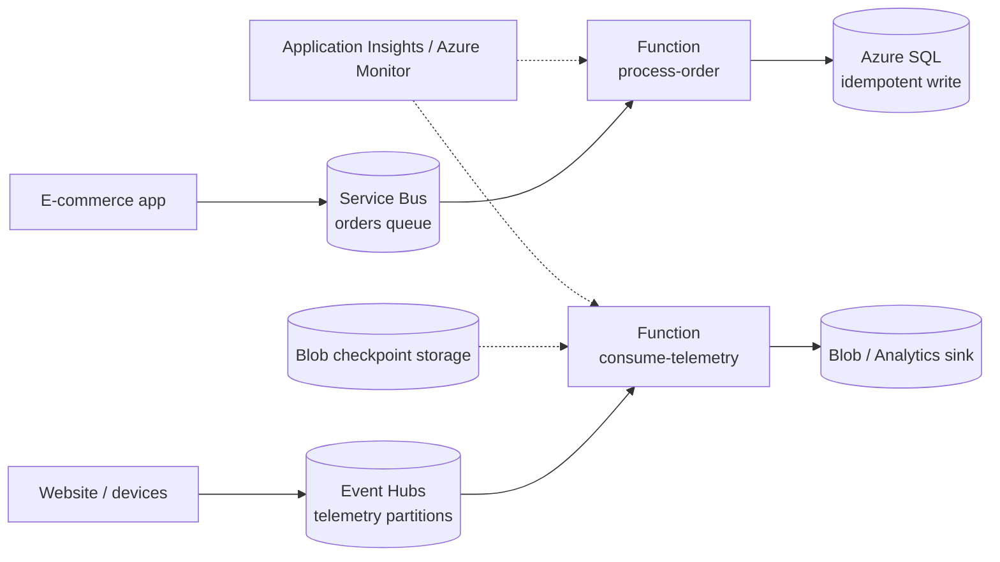
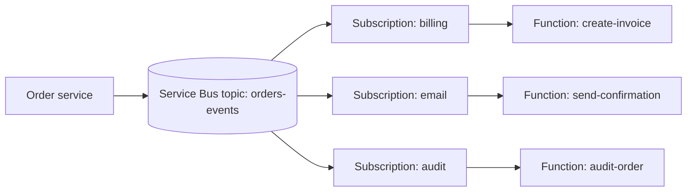
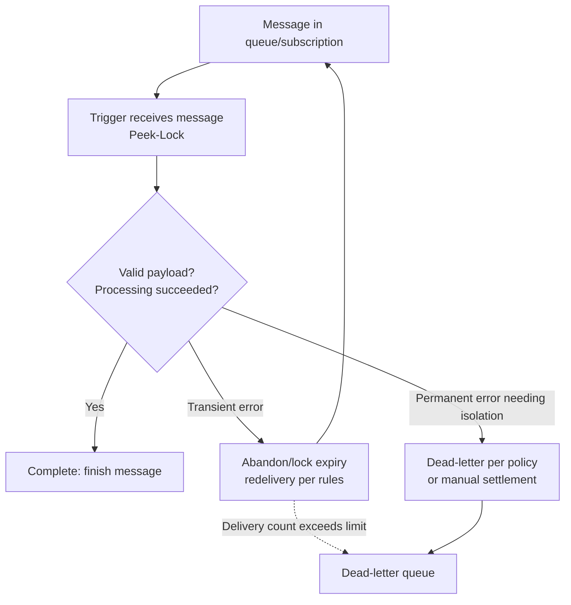
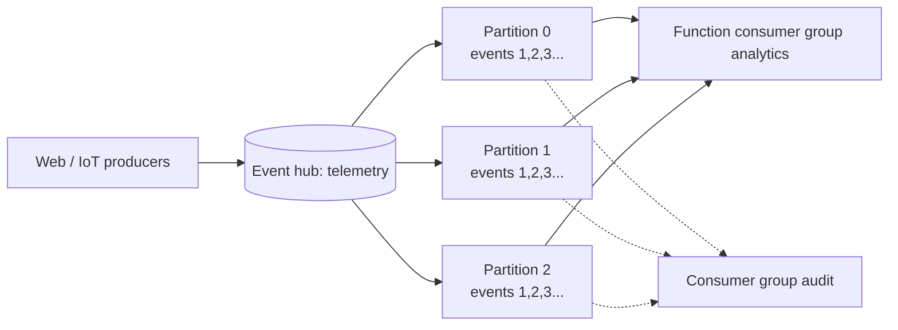
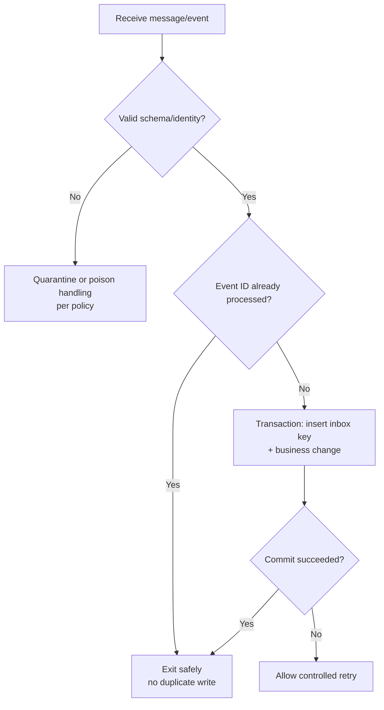
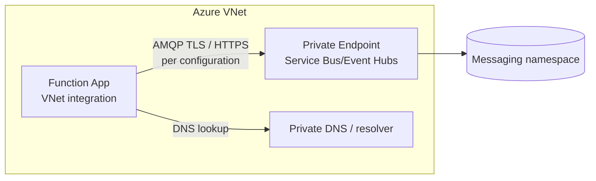
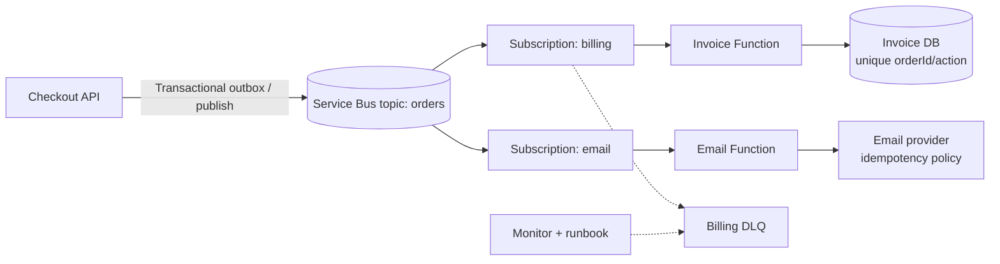
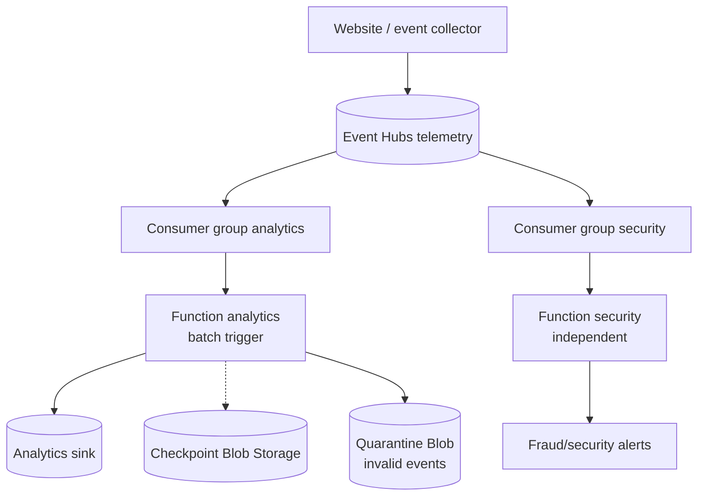

# Integrating Functions with Service Bus and Event Hubs

Suppose an e-commerce platform running on Azure needs to perform two tasks: **reliably process each order** after customer checkout and **analyze streams of millions of clickstream events** sent continuously from the website. Both can trigger **Azure Functions**, yet they should not use the same messaging service merely because both are loosely called "events." Orders require a queue with delivery guarantees, locking, retries, and dead-letter handling for failed messages; behavioral telemetry requires a partitioned stream with offsets, retention, and independent consumer groups.

In Azure, **Service Bus** primarily addresses *enterprise messaging/commands*, whereas **Event Hubs** addresses *event streaming/telemetry*. Azure Functions provides **triggers and bindings** to run code when messages or events arrive, scaling active execution instances with load on supported hosting plans.

This lesson belongs to the **Serverless with Azure Functions** chapter in the **CLOUD_PROVIDERS_AZURE** module. The module explores Azure from subscriptions, resource groups, and Microsoft Entra ID through virtual networks, compute, storage, and data, while teaching how to deploy, monitor, secure, and control application costs. The content below combines message/event design, Python code, identity, networking, reliability, and production operations rather than just presenting trigger syntax.

**After this lesson, you will be able to:**

- Distinguish Service Bus queues/topics/subscriptions from Event Hubs event hubs/partitions/consumer groups.
- Design producer → Azure Functions → database/Storage flows that remain safe under retries and parallel execution.
- Configure Service Bus triggers and Event Hubs triggers using the Azure Functions Python v2 programming model.
- Explain **Peek-Lock, settlement, dead-letter queues (DLQ)**, and **offsets/checkpoints/retention**.
- Understand **at-least-once processing**, idempotency, ordered processing options, and poison messages/events.
- Apply managed identity, Azure RBAC, Private Endpoints, and DNS in deployments.
- Tune scaling, concurrency, batching, and cost while monitoring errors, latency, backlogs, and consumer lag.

## 1. Service Bus and Event Hubs Solve Two Different Classes of Problems

| Aspect | **Azure Service Bus** | **Azure Event Hubs** |
|---|---|---|
| Core nature | Message broker for commands, business workflows, reliable delivery | High-volume event stream ingestion and replay platform |
| Common units | Queue; topic + subscription | Event hub; partitions; consumer groups |
| Consumption model | Consumer receives/locks a message, completes or settles errors | Consumer reads events by offset/sequence within a partition |
| After successful processing | Message is **completed** and leaves the active queue/subscription | Events remain until **retention** expires; checkpoints only record progress |
| Retries | Retries/redelivery, locks, delivery count, DLQ | Re-read from offset/checkpoint with consumer-side retries; no native per-event DLQ |
| Ordering | May require **sessions** to coordinate keyed, ordered processing | Preserves log order **within each partition**; no global hub-wide ordering |
| Independent multi-system reads | Topic subscriptions deliver separate logical message copies | Consumer groups track independent read cursors over the same event stream |
| Typical payloads | Orders, email commands, payment requests, workflows | Telemetry, clickstreams, IoT, logs, analytics pipelines |
| Function focus | Per-message processing and accurate settlement | Event/batch processing, checkpointing, and lag control |

**Quick rule of thumb:** if a business workflow must process **individual requests**, know whether each request succeeded or failed, and isolate bad messages, evaluate **Service Bus** first. If you need to ingest and replay a **large event stream** for multiple analytics applications independently, evaluate **Event Hubs** first. Both services often appear together in the same architecture.

### 1.1. Do Not Confuse Event Hubs with Event Grid

**Azure Event Grid** routes discrete notification events under a publish/subscribe model, whereas Event Hubs excels at **event streaming and partitioned retention**. Event Grid, Service Bus, and Event Hubs can complement one another, but they are not interchangeable in delivery guarantees, retention, ordering, or scaling behavior.

## 2. Overall Architecture: Two Parallel Pipelines



The order pipeline and telemetry pipeline can run in two separate Function Apps. Separating apps lets you tune **scale, timeouts, networking, identity, and deployments** independently; not every trigger belongs in a single Function App.

**Three layers of responsibility:**

1. **Broker/stream:** stores messages/events, distributes them, and tracks delivery or cursor state per service mechanics.
2. **Functions runtime and extensions:** manages listeners, invokes functions, scales instances, and coordinates checkpoints/settlement.
3. **Business code:** validates data, persists results, enforces idempotency, separates transient vs. permanent errors, and emits telemetry.

Never assume a trigger automatically turns database or external API calls into an **exactly-once transaction**.

## 3. Service Bus: Queues, Topics, Subscriptions, and Sessions

### 3.1. Queues — Competing Consumers

A producer sends messages to queue `orders`; one consumer receives each message for processing. Across multiple Function instances, instances compete for messages per broker/trigger rules rather than broadcasting the same message to every instance.

```text
Checkout API --> Queue: orders --> Function replicas --> Database
                      |                |
                      | retry on failure |
                      v                v
                    Active           Complete
                      |
                      +----> Dead-letter queue (when isolation is needed)
```

A well-formed message should carry a **message ID**, correlation ID/trace context, and a versioned payload. IDs support deduplication, investigation, and cross-system reconciliation.

### 3.2. Topics + Subscriptions — Multiple Business Domains Receiving the Same Event

Suppose after an order is placed, three teams act independently:



Each subscription maintains its own **independent message stream and delivery state**, optionally using filters/rules to select relevant messages. If the email Function fails, processing on the billing subscription is unaffected and remains independent. Each subscription can have its own DLQ.

### 3.3. Sessions and Keyed Ordering

Standard queues do not guarantee **completion order** when multiple workers run concurrently. When a sequence of commands for the same `orderId` must run sequentially, **Service Bus sessions** can route and lock messages sharing a session:

```text
SessionId = order-123
  1. OrderCreated
  2. PaymentAuthorized
  3. OrderPacked
```

Sessions must be enabled on the entity, and the consumer/trigger must support session mode. Simply adding a `SessionId` property inside a JSON body does not activate broker sessions. Even within a session, ordering **does not replace state versioning** or guards against redelivery, retries, and external side effects.

## 4. Service Bus Trigger: Receiving, Locking, and Completing Messages

The standard mode is **Peek-Lock**:

1. The runtime receives a message and places a **temporary lock** on it.
2. The function validates and executes business logic.
3. On success, the runtime **completes** the message when auto-completion is enabled.
4. If the function errors or the lock expires, the message becomes eligible for redelivery per policy.
5. After exceeding `MaxDeliveryCount` or meeting other broker conditions, the message moves to the **DLQ**.



**Technical note:** with **auto-complete** enabled, throwing an exception does not immediately move the message to the DLQ; normally it triggers lock/redelivery retries up to `MaxDeliveryCount`. If you need **immediate manual dead-lettering** for business reasons, you must use a trigger/SDK pattern that supports manual settlement and configure it explicitly. Never claim `raise ValueError` alone immediately "dead-letters" a message.

### 4.1. A Lock Is Not a Distributed Transaction

If a Function commits to the database but crashes **before completing** the message, the message returns to the queue. A second invocation will process the same message again. That is why **idempotency** is mandatory:

```text
Receive message-id=abc
  -> INSERT business record succeeds
  -> Process crashes before complete
  -> Message redelivered
  -> Check confirms message-id=abc already committed
  -> Skip duplicate transaction
  -> Complete message
```

Azure Functions triggers do not create a distributed transaction spanning Service Bus and your database. Implement a transactional outbox/inbox, unique constraints, or idempotent destination operations where business rules require it.

### 4.2. Lock Duration and Long-Running Work

Lock duration is configured on the entity; extension auto-lock renewal also has its own limits and max renewal duration. If processing takes longer than the lock or Functions timeout, the message can be redelivered while the first worker is still executing external calls.

For long tasks, split work into smaller steps, use Durable Functions/queue orchestration, or use checkpointed workers. Do not try to solve long jobs simply by stretching lock durations indefinitely.

## 5. Event Hubs: Partitions, Consumer Groups, Offsets, and Retention

An **event hub** holds an event stream divided into **partitions**. Producers send events with a partition key when related events should stay grouped together. Every event occupies a position in its partition, typically identified by **sequence number/offset**.



A **partition key** maps events with the same key to the same partition under broker hashing rules. Ordering is preserved **within each partition** at the log level; Event Hubs provides **no total global order across partitions**. If consumers process concurrently without ordering controls or write asynchronously to a sink, database write order can still differ from read order.

### 5.1. Consumer Groups

A **consumer group** is an independent read view of the event stream. For example:

- `analytics`: Function counting page views.
- `fraud-detection`: another application detecting anomalies.
- `audit`: pipeline archiving raw events.

Each group tracks its own per-partition progress. Separate independent applications into **distinct consumer groups** rather than accidentally sharing `$Default` and fighting over partition ownership and checkpoints.

Within **a single** scaled-out application, multiple instances naturally coordinate partition ownership and checkpoints inside the same group; ensure host/connection/checkpoint storage is configured consistently per the extension.

### 5.2. Offsets and Checkpoints

Consumers read events by offset/sequence and write **checkpoints** to record how far they have processed. With the Azure Functions Event Hubs trigger, the extension coordinates checkpoints and partition ownership via **Azure Storage** according to host/storage configuration and extension version.

**Checkpointing does not delete events.** Events only expire when Event Hubs **retention** elapses or per storage tier policies. Another consumer group can still read events within retention without the first group "releasing" them.

### 5.3. No Native Per-Event DLQ

Unlike Service Bus, Event Hubs **does not provide native per-message broker-settled DLQs**. For permanently malformed payloads, architects must choose a strategy:

- Write bad events and metadata to a **quarantine store** (Blob/queue/database) durably.
- Emit logs/metrics, raise alerts, and follow a runbook.
- Advance the checkpoint only after data governance policies are satisfied.
- Maintain a **replay** pipeline from retention or an external raw event archive when needed.

Simply catching an exception and skipping an event to "unstick the partition" silently drops business data even though the broker still retains it until retention expires.

## 6. Comparing Failure Paths

| Scenario | Service Bus Trigger | Event Hubs Trigger |
|---|---|---|
| Function succeeds | Message can be completed | Progress can be checkpointed per extension |
| Function hits transient error | Message can be redelivered per lock/retry/settlement | Event/batch can be re-read per checkpoint/retry; configure retries carefully |
| Worker crashes after DB write | Redelivery possible | Events before last checkpoint can be reprocessed |
| Malformed payload | Can move to DLQ after policy/limits or manual dead-letter | Must quarantine malformed events yourself; no native equivalent DLQ |
| Need to re-read historical data | Needs a separate copy/store once completed | Can replay within retention from an offset/consumer group |
| Slow consumer | Queue backlog grows; active messages accumulate | Consumer lag behind latest partition offsets increases |

For both services, **at-least-once processing** is a far safer design assumption than "each message/event executes exactly once." Guarantee that **final side effects** (issuing invoices, deducting inventory, recording telemetry) are never applied twice unintentionally.

## 7. Azure Functions Python v2 Project Structure

Examples use the **Python programming model v2** with decorators and compatible current Azure Functions runtime/extensions. Sample layout:

```text
orders-functions/
  function_app.py
  host.json
  requirements.txt
  local.settings.json          # local only, do not commit secrets
```

In `requirements.txt`, pin and test `azure-functions` versions via CI/CD. If functions call Azure SDKs, add the required SDK packages. Triggers and bindings depend on the Functions runtime and configured **extension bundles** or extension packages; installing Python packages alone is not enough.

### 7.1. Minimal `host.json`

```json
{
  "version": "2.0",
  "extensionBundle": {
    "id": "Microsoft.Azure.Functions.ExtensionBundle",
    "version": "[4.*, 5.0.0)"
  }
}
```

This is an example for supported environments, not a promise that every extension version in the bundle shares identical features. When using **identity-based connections**, verify the running Service Bus/Event Hubs extension meets the minimum version required by Azure Functions documentation.

### 7.2. Sample Code Rules

The functions below **illustrate trigger handling only**. They intentionally omit live database writes to avoid presenting an example that pretends to be "exactly-once safe" without real transaction logic. Before moving to production, replace placeholder logic with validated writes, idempotency, and appropriate error policies.

## 8. Example 1: Azure Function Reading a Service Bus Queue

In `function_app.py`:

```python
import json
import logging
import azure.functions as func

app = func.FunctionApp()


@app.service_bus_queue_trigger(
    arg_name="msg",
    queue_name="orders",
    connection="ServiceBusConnection"
)
def process_order(msg: func.ServiceBusMessage) -> None:
    body = msg.get_body().decode("utf-8")
    order = json.loads(body)

    order_id = order.get("orderId")
    if not isinstance(order_id, str) or not order_id:
        raise ValueError("Missing orderId")

    logging.info(
        "Received order event: orderId=%s, messageId=%s",
        order_id,
        msg.message_id
    )

    # PRODUCTION TODO:
    # 1) Validate schema/version and authorization assumptions.
    # 2) Insert messageId/orderId into an idempotency ledger atomically
    #    with the business effect, or use a transactional inbox/outbox.
    # 3) Commit the business change before returning successfully.
    # 4) Surface transient failures instead of silently swallowing them.
```

In this example:

- `service_bus_queue_trigger` listens to the `orders` queue.
- `arg_name` must match the function parameter `msg`.
- `connection="ServiceBusConnection"` references a **connection setting name/prefix**, never an embedded connection string.
- `get_body()` returns a byte payload, so you must know the encoding/schema to decode it properly.
- `message_id` is message metadata set by the producer and can serve as a deduplication key.
- When the function **returns normally**, supported auto-complete mode completes the message. If it throws an exception, redelivery follows binding/lock/retry rules.

**Warning:** `ValueError` in the snippet simulates a payload error; it does not immediately send the message to the DLQ. To handle permanently invalid messages, design **manual settlement or a DLQ/quarantine policy** compatible with your active trigger and runtime.

### 8.1. When Using Topics and Subscriptions

A Function can listen to a Service Bus topic subscription with the corresponding trigger. Conceptually:

```python
@app.service_bus_topic_trigger(
    arg_name="msg",
    topic_name="orders-events",
    subscription_name="billing",
    connection="ServiceBusConnection"
)
def create_invoice(msg: func.ServiceBusMessage) -> None:
    logging.info("Billing subscription received %s", msg.message_id)
    # Write invoice idempotently; do not send duplicate invoices on redelivery.
```

This snippet builds on `app` and `logging` declared above. Queue triggers and topic triggers can live in the same project, provided permissions, scaling, and failure isolation remain controlled.

### 8.2. Auto-Complete vs. Manual Settlement

**Auto-complete** is simpler: the runtime handles settlement based on the function outcome. **Manual settlement** lets code explicitly choose Complete, Abandon, or DeadLetter by error type where supported by the binding/SDK. Never copy C# manual settlement snippets into Python assuming identical APIs.

If you require immediate dead-lettering for invalid payloads, verify your exact binding version and programming model support explicit settlement; otherwise, persist bad messages to a durable quarantine store and let retries/DLQ trigger via configured `MaxDeliveryCount`.

## 9. Example 2: Azure Function Reading Event Hubs in Batches

In a separate Function App or properly configured project:

```python
import json
import logging
import azure.functions as func

app = func.FunctionApp()


@app.event_hub_message_trigger(
    arg_name="events",
    event_hub_name="telemetry",
    connection="EventHubConnection",
    consumer_group="analytics",
    cardinality="many"
)
def consume_telemetry(events: list[func.EventHubEvent]) -> None:
    for event in events:
        payload = json.loads(event.get_body().decode("utf-8"))
        event_id = payload.get("eventId")

        if not event_id:
            raise ValueError("Missing eventId")

        logging.info(
            "Read telemetry eventId=%s sequence=%s",
            event_id,
            event.sequence_number
        )

        # PRODUCTION TODO:
        # Upsert into a sink using an idempotent eventId key,
        # or durably quarantine invalid events with metadata.
```

In this example:

- `event_hub_name="telemetry"` is the Event Hubs entity.
- `consumer_group="analytics"` must exist in the Event Hub for the target environment.
- `cardinality="many"` instructs the runtime to invoke the Function with a batch in compatible programming models/extensions.
- `sequence_number` tracks position within a partition, not a global Event Hub sequence.
- Throwing an exception mid-batch means **earlier events in that batch may be replayed** on retry, restart, or checkpoint recovery. Sink writes must therefore be idempotent even when a single run sees no duplicates.

**Do not use this sample directly for production batches**: a single malformed event can fail the entire batch; to keep progressing safely, define retry, quarantine, and checkpoint policies beforehand. Also avoid logging entire payloads that may hold sensitive data.

### 9.1. Why Shouldn't All Function Apps Share One Consumer Group?

If both `analytics` and `fraud-detection` need to read **all events**, each needs independent cursor progress. Sharing one consumer group across distinct apps causes partition ownership and checkpoint contention, producing incomplete or erratic reads.

Create dedicated groups per processing domain, monitor lag separately, and plan replay behavior. Group counts are also capped by Event Hubs tier; check your SKU before creating many groups.

## 10. Local Settings, Extensions, and Managed Identity

### 10.1. Local Development with Connection Strings

Sample `local.settings.json` for a **developer workstation**—never commit to Git:

```json
{
  "IsEncrypted": false,
  "Values": {
    "AzureWebJobsStorage": "UseDevelopmentStorage=true",
    "FUNCTIONS_WORKER_RUNTIME": "python",
    "ServiceBusConnection": "<SERVICE_BUS_CONNECTION_STRING_FOR_LOCAL_DEV>",
    "EventHubConnection": "<EVENT_HUBS_CONNECTION_STRING_FOR_LOCAL_DEV>"
  }
}
```

`UseDevelopmentStorage=true` requires Azurite or a compatible storage emulator running for host/storage needs. It **does not emulate Service Bus or Event Hubs**. The connection strings above are placeholders; obtain real non-prod credentials through approved channels and never put them in source code, logs, issue trackers, or screenshots.

When using managed identity in Azure, **avoid** leaving a connection-string app setting with the exact same name that might cause identity-based settings to be ignored. Always verify how your active runtime resolves prefixed vs. exact-name connection settings.

### 10.2. Managed Identity in Azure

With extensions supporting **identity-based connections**, a Function App with managed identity can configure app settings like:

```text
ServiceBusConnection__fullyQualifiedNamespace=sb-orders.servicebus.windows.net
EventHubConnection__fullyQualifiedNamespace=eh-telemetry.servicebus.windows.net
```

These are **format examples**, not real namespace names. `ServiceBusConnection` and `EventHubConnection` match the `connection=...` prefix in your decorators. The extension authenticates via identity and connects to the namespace FQDN instead of reading a connection string with a Shared Access Key.

For **user-assigned managed identities**, additional identity-identifying settings may be required per extension connection syntax. For **system-assigned managed identities**, ensure the identity is enabled on the Function App. Do not invent a per-hub custom FQDN when the config expects the **fully qualified namespace**.

### 10.3. Separating Azure RBAC Roles by Direction

| Component | Recommended Least-Privilege Role | Scope |
|---|---|---|
| Function only **receiving** Service Bus queue/subscription | `Azure Service Bus Data Receiver` | Queue/topic/subscription/namespace as supported |
| Function or API **sending** Service Bus messages | `Azure Service Bus Data Sender` | Target entity or namespace |
| Function only **receiving** Event Hubs | `Azure Event Hubs Data Receiver` | Event Hub or namespace as appropriate |
| Producer **sending** to Event Hubs | `Azure Event Hubs Data Sender` | Event Hub or namespace |
| Functions Event Hubs trigger using Storage checkpoints | Azure Storage data-plane roles needed for checkpoints/leases per extension | Checkpoint storage account/container |
| Function writing to Azure SQL/Blob/Key Vault | Corresponding data-plane permission | Narrowest feasible scope |

**Azure RBAC Reader or Contributor at the resource group level does not automatically grant Service Bus or Event Hubs data-plane permissions** under identity-based auth. Also avoid confusing the **Function App identity** with producer or monitoring identities.

For Event Hubs triggers, **`AzureWebJobsStorage`/checkpoint storage** is an independent dependency. If the host uses identity-based Storage, configure matching identity settings and Blob/Queue/Table permissions for actual host operations. Granting Event Hub read access without checkpoint storage permissions can stop the listener from functioning properly.

### 10.4. Networking Must Allow Both Identity and Data Plane

Managed identity answers "**who** is accessing?"—it does not open network paths. Functions still need DNS and connectivity to `*.servicebus.windows.net`, required auth endpoints, host/checkpoint Azure Storage, and target services.

## 11. Reliability: Idempotency, Poison Handling, and Error Classification

### 11.1. Idempotency with Business Keys

Suppose a producer emits an invoice command:

```json
{
  "schemaVersion": 1,
  "eventId": "evt-7931",
  "orderId": "ord-1042",
  "action": "IssueInvoice",
  "occurredAt": "2026-11-20T09:30:00Z"
}
```

A safe consumer design:

1. Validate schema and identifiers; **never blindly trust payloads just because they came from a broker**.
2. In the database, enforce a **unique key** on `eventId`/`orderId + action` or an equivalent ledger.
3. Record processed status and apply business changes **within the same transaction** where supported by the database.
4. If already processed, return success **without re-applying side effects**.
5. Once the transaction commits, let the trigger complete the message or advance the checkpoint per policy.



**Beware of check-then-insert:** two instances can simultaneously read "not found" and both write duplicates. Enforce **unique constraints or atomic conditional writes**, not a naive `SELECT` before `INSERT`.

### 11.2. Transient vs. Permanent Failures

| Category | Examples | Handling Strategy |
|---|---|---|
| Transient | SQL timeout, HTTP 503, 429 throttling | Retry with backoff/jitter, bounded duration, and alerting |
| Permanent payload | Invalid JSON, missing required key, unsupported schema | Quarantine/DLQ, record sanitized reason |
| Business violation | Order already canceled, invoice already issued | Idempotent no-op or business status update; do not retry infinitely |
| Auth failure | Managed identity missing role, Key Vault 403 | Fix IAM/config; endless retries cannot fix missing permissions |
| Network failure | Broken Private DNS, firewall block | Fix network/DNS; never purge messages to "fix" timeouts |

**Never re-call non-idempotent payment APIs or resend emails solely because a trigger retried.** If a downstream system lacks idempotency keys, introduce an outbox, ledger, or conditional orchestration layer.

### 11.3. Service Bus Poison Messages and DLQs

When a message fails processing across delivery attempts, Service Bus can move it to the **dead-letter subqueue** per `MaxDeliveryCount` or broker rules. The DLQ **does not self-heal or clean itself**.

A DLQ runbook should cover:

- Checking DLQ depth per queue/subscription.
- Safely inspecting metadata, message IDs, and dead-letter reasons while masking PII/secrets.
- Classifying failures by code bug, data schema, dependency, or policy.
- Fixing root causes and executing **controlled replay** back to the queue/topic or retiring per policy.
- Enforcing idempotency during replay and auditing who replayed how many messages.

Note: TTL, size limits, duplicate detection, and transactions have **Service Bus SKU** limits; verify them before enforcing policies.

### 11.4. Event Hubs Quarantine and Replay

Event Hubs lacks a native per-event DLQ; you can write failed events to **Blob Storage** capturing event ID, hub, partition, sequence/offset, error category, and timestamp. Confirm the quarantine record is **durably persisted** before skipping a bad event to let the consumer advance.

Replay is only possible within Event Hubs **retention** or from a separate raw archive. An old checkpoint cannot resurrect events whose retention has expired.

## 12. Event Hubs Batching, Checkpoints, and Throughput

### 12.1. Batching Boosts Throughput and Blast Radius Together

Processing one event at a time keeps logic simple; batching reduces overhead at high volume. However:

- Larger batches consume more memory and execution time.
- If one bad event fails an entire batch, previously written events in that batch may repeat.
- Checkpointing too infrequently increases reprocessing after crashes.
- Checkpointing too frequently increases Storage transactions and overhead.

Tune batch size, prefetch, timeouts, and checkpoint frequency using **load tests**, rather than copying one configuration across all workloads.

### 12.2. Partition Count and Scaling Capacity

A single partition is generally handled by **one active owner** per consumer group at a time. Consequently, partition count bounds **partition-level parallelism** within a consumer group; spinning up hundreds of Function instances cannot scale partition concurrency if the event hub has very few partitions.

Inside one Function invocation, you can still process a batch of events and parallelize downstream work appropriately. However, never assume adding instances speeds up a single key or partition indefinitely.

Choose partition keys based on **load distribution and ordering requirements**. Using a single "global" key for all events creates a **hot partition**, overloading one partition while others sit idle.

### 12.3. Replay and Data Loss

Your design must answer:

1. If the Function stops for 4 hours, is retention long enough to catch up on the entire backlog?
2. If checkpoint storage fails, will consumers stall, fight over ownership, or reprocess?
3. If a bad code rollout breaks parsing, how do you pause and replay without losing events?
4. If long-term storage is needed, are you using Event Hubs Capture or another raw sink within service limits?
5. Does every consumer group have lag metrics and a clear owner?

**Retention is a replay window**, not a guarantee that events were processed. Event Hubs Capture (if enabled and supported on your tier) is an archival mechanism, not a replacement for checkpoint management and error handling.

## 13. Functions Scaling and Concurrency

Functions can scale based on message backlogs or partition workload depending on the trigger and hosting plan. Distinguish:

- **Scale out:** adding more Function App/worker instances.
- **Per-instance concurrency:** messages or event batches handled simultaneously inside each worker.
- **Service Bus sessions:** parallelism bounded by active sessions and concurrent session limits.
- **Event Hubs partitions:** partition ownership streams distributed across consumer instances.
- **Downstream capacity:** SQL, Storage, partner APIs, Key Vault, and network links have their own limits.

### 13.1. Service Bus: Higher Concurrency Does Not Always Mean Faster

Hypothetical example:

```text
Queue backlog:                 20,000 messages
Each message needs SQL write:  100 ms (assumed)
Function concurrent handlers:  100
SQL steady capacity:           40 concurrent writes (assumed)
```

Letting 100 handlers write simultaneously causes SQL throttling and timeouts, driving retries and backlogs **higher** even when Functions has plenty of CPU. Cap concurrency and scale capacity around the real bottleneck—never judge solely by queue depth.

### 13.2. Event Hubs: Fast Consumption Must Not Overwhelm the Sink

At high telemetry rates, batch writes into Analytics, Blob, or Cosmos DB. Ensure you:

- Monitor per-partition lag and throughput.
- Size batches and parallelism to match **sink rate limits**.
- Apply retries/backoff and per-event quarantine.
- Isolate consumer groups with different SLAs.
- Size Event Hubs partitions and throughput capacity accordingly.

### 13.3. Example `host.json` for Modern Extensions

```json
{
  "version": "2.0",
  "extensionBundle": {
    "id": "Microsoft.Azure.Functions.ExtensionBundle",
    "version": "[4.*, 5.0.0)"
  },
  "extensions": {
    "serviceBus": {
      "prefetchCount": 0,
      "autoCompleteMessages": true,
      "maxConcurrentCalls": 8,
      "maxAutoLockRenewalDuration": "00:05:00"
    },
    "eventHubs": {
      "maxEventBatchSize": 100,
      "prefetchCount": 300,
      "batchCheckpointFrequency": 1
    }
  }
}
```

These values are **illustrative tuning knobs**, not universally optimal production defaults. Schemas and settings vary across major extension versions, language runtimes, single vs. batch modes, dynamic concurrency, and hosting plans. Before applying them, verify your exact bundle/extension version, setting documentation, and expected load. **Do not place both triggers into the same Function App solely because they appear together in this `host.json` snippet.**

## 14. Hosting Plans, Latency, and Cost

### 14.1. Choosing a Plan by Load Profile

| Requirement | Considerations |
|---|---|
| Low, intermittent traffic | Consumption/Flex Consumption within supported features and regions; evaluate cold starts |
| Strict latency SLA, frequent traffic | Premium or a hosting model offering always-ready instances as needed |
| Custom VNet/private dependencies | Verify **VNet integration** and networking capabilities of the exact chosen plan |
| High-volume streams, long or CPU-heavy runs | Check memory, timeouts, instance caps, batching, and sink throughput |
| Predictable capacity/cost control | Premium/Dedicated or alternatives after TCO analysis |

Do not equate "serverless is low cost" with "every event is cheap." At high event volumes, costs shift to brokers, checkpoint storage, logs, downstream writes, networking, and duplicates/retries.

### 14.2. Two Distinct Cost Models

**Service Bus**: depends on tier (Basic/Standard/Premium as supported), messaging operations, entity features, throughput, and capacity/messaging units on dedicated tiers.

**Event Hubs**: depends on tier, throughput/processing capacity, event ingress, retention, partitions, Capture (if used), and networking features.

**Functions**: depends on hosting plan, executions, resource consumption, instance count, duration, and always-ready capacity. Azure Monitor/Application Insights/Log Analytics and outbound networking can add separate charges.

For high-SLA architectures, budget for **headroom, retry overhead, and operational tooling**, not just raw per-message pricing.

## 15. Networking: Public Endpoints, Private Link, DNS, and Firewalls

A Function App needs **outbound** connectivity to Service Bus or Event Hubs. If the namespace sets **public network access = disabled** or restricts access to private networks, the Function must have a supported network path to a Private Endpoint and proper name resolution.



### 15.1. Conditions That Must Hold

1. The **hosting plan** supports the VNet integration mode your app uses.
2. The Function App has outbound routing and firewall/NSG/UDR rules allowing the connection.
3. **Service Bus Private Link** requires a supported tier/feature; some private networking features have SKU constraints. Check Event Hubs tier/region Private Endpoint support as well.
4. The Function's DNS resolver resolves `<namespace>.servicebus.windows.net` per Private DNS/Private Link config; do not change code to use `privatelink`-prefixed URLs if the SDK expects the standard hostname.
5. Valid Entra data-plane permissions exist; network reachability alone does not authorize reading messages.
6. Connectivity to **`AzureWebJobsStorage`**, checkpoint Storage, and other Azure dependencies still works.

Depending on transport, AMQP over TLS uses its dedicated port or AMQP over WebSockets over HTTPS/443. **Never open ports by guesswork**; verify the actual `transportType` used by your SDK/extension and supported network configurations.

### 15.2. Private Endpoint DNS

Service Bus and Event Hubs use namespace hostnames under `*.servicebus.windows.net`. With a Private Endpoint, DNS must resolve to the private IP via the supported **`privatelink.servicebus.windows.net`** pattern. In hub-spoke or hybrid topologies, verify Private DNS zone links and DNS forwarding/Private Resolvers.

A common failure: administrators see the Private Endpoint marked Approved while the Function still resolves the public IP. When public access is disabled on the namespace, triggers fail repeatedly or refuse to start.

### 15.3. Protecting Secrets and Networks

- Prefer **managed identity** over connection strings and SAS keys when triggers/SDKs support it.
- Separate Sender and Receiver roles with least-privilege scope.
- Use Key Vault/secret references when secrets remain necessary, with clear rotation schedules.
- Avoid logging connection strings, access tokens, payloads containing PII, or full stack traces with sensitive data.
- Protect Function App configuration, deployment credentials, and control-plane Azure RBAC.

## 16. Hands-On Resource Inspection with Azure CLI

The following commands are **read-only** against resource metadata. They do not modify queues, event hubs, app settings, or role assignments.

### 16.1. Inspect Subscription, Function App, and Identity

```bash
RG="rg-serverless-prod"
FUNC="func-orders-prod"

az account show \
  --query "{subscription:name,id:id,tenant:tenantId}" \
  -o table

az functionapp show \
  --resource-group "$RG" \
  --name "$FUNC" \
  --query "{name:name,kind:kind,state:state,location:location,identity:identity.type}" \
  -o json

az functionapp identity show \
  --resource-group "$RG" \
  --name "$FUNC" \
  -o json
```

If no identity or principal ID appears, verify actual configuration and Azure permissions before assuming data-plane access exists.

### 16.2. Inspect Service Bus Queue/Subscription

```bash
RG_MSG="rg-messaging-prod"
SB_NS="sb-orders-prod"
SB_QUEUE="orders"

az servicebus queue show \
  --resource-group "$RG_MSG" \
  --namespace-name "$SB_NS" \
  --name "$SB_QUEUE" \
  -o json

az servicebus topic subscription show \
  --resource-group "$RG_MSG" \
  --namespace-name "$SB_NS" \
  --topic-name "orders-events" \
  --name "billing" \
  -o json
```

Inspect `maxDeliveryCount`, `lockDuration`, `requiresSession`, TTL, and message counts returned by the API. Never rely on a single snapshot of queue depth to declare a consumer healthy: a queue can be empty because producers stopped or messages moved to the DLQ.

### 16.3. Inspect Event Hubs and Partitions

```bash
EH_NS="eh-telemetry-prod"
EH_NAME="telemetry"

az eventhubs eventhub show \
  --resource-group "$RG_MSG" \
  --namespace-name "$EH_NS" \
  --name "$EH_NAME" \
  -o json

az eventhubs eventhub consumer-group list \
  --resource-group "$RG_MSG" \
  --namespace-name "$EH_NS" \
  --eventhub-name "$EH_NAME" \
  -o table
```

Verify `partitionCount`, `messageRetentionInDays` (or the current retention field for your tier/API), consumer groups, entity status, and ingest metrics. Never gauge throughput solely from partition count.

### 16.4. Inspect Role Assignments

```bash
# Replace with the principal ID from the Function App identity.
FUNCTION_PRINCIPAL_ID="<managed-identity-principal-id>"

az role assignment list \
  --assignee "$FUNCTION_PRINCIPAL_ID" \
  --all \
  -o table
```

Verify role names, entity scope, subscription/tenant, and inherited assignments per Azure behavior. Having namespace management permissions (ARM) does not replace the Data Receiver role needed by runtime triggers.

### 16.5. List App Setting Names Without Exposing Values

```bash
# Returns only setting names; avoids printing connection strings/secrets.
az functionapp config appsettings list \
  --resource-group "$RG" \
  --name "$FUNC" \
  --query "[].name" \
  -o table
```

If you need to verify `ServiceBusConnection__fullyQualifiedNamespace`, follow proper config security procedures. Never run a command that dumps **all app settings** and paste it into tickets or chat: that exposes connection strings and secrets.

## 17. Lab Deployment Workflow

A controlled deployment plan:

1. **Provision test environment:** Service Bus namespace/queue (or topic/subscription), Event Hubs namespace/event hub/consumer group, Function App, and host storage on supported tiers.
2. **Select programming model/runtime:** Python v2, supported Python/Functions/extension versions; verify bundle compatibility.
3. **Grant identity:** enable managed identity and assign Data Receiver roles on the exact namespace/entity; grant checkpoint storage permissions as needed.
4. **Configure connections:** use `__fullyQualifiedNamespace` in Azure or non-prod/dev connection strings locally.
5. **Implement triggers:** Service Bus queue/topic and Event Hubs single/batch matching the workload.
6. **Run local/staging tests:** send valid, invalid, and duplicate messages; check logs, retries, and persisted data.
7. **Verify networking:** public/private endpoints, DNS, firewalls, `AzureWebJobsStorage`, and IAM.
8. **Deploy via CI/CD:** release artifact/Function App deployment without accidentally overwriting app settings.
9. **Load test:** measure queue backlog, handler concurrency, Event Hubs partitions/consumer lag, checkpoints, and downstream capacity.
10. **Failure testing:** simulate database timeouts, Function restarts, duplicate events, poison payloads, and unreachable checkpoint Storage.
11. **Phased production rollout:** limit blast radius, monitor telemetry, and keep a rollback plan ready.

Example publish command (modifies Function App state):

```bash
# Run only after the target app exists and is approved in your lab.
func azure functionapp publish <function-app-name>
```

This is not a read-only check; it deploys code/artifacts to the Function App. Never run it outside approved CI/CD on production without verifying subscription, environment, role assignments, settings, and release gates.

## 18. Case Study A: Order Processing via Service Bus

**Business requirements:**

- The checkout API must not wait on PDF generation, email delivery, or reporting.
- One `IssueInvoice` command must never create two invoices even if producers or consumers retry.
- Missing order data and unresponsive accounting systems must be handled differently.
- Maintain a clear audit trail of message ID, order ID, and processing state.

**Recommended design:**



**Billing flow:**

1. The API writes the order and outbox record inside the same database transaction if post-commit publish reliability is required.
2. The publisher sends a message with explicit `MessageId`/`CorrelationId`.
3. The Function receives the message from the subscription, validates schema and idempotency key.
4. It writes the invoice atomically, then returns cleanly so the message completes per config.
5. On SQL timeout, the message redelivers/retries; the unique key prevents duplicate invoices.
6. On structural errors, the message moves to quarantine/DLQ per policy; operations fixes and replays under approval.

**Do not rely on Service Bus duplicate detection alone** for business correctness: broker duplicate detection has time-window and SKU constraints, while redeliveries and external side effects still demand idempotency.

## 19. Case Study B: Website Telemetry via Event Hubs

**Business requirements:**

- Ingest `PageViewed`, `ProductClicked`, and `CheckoutStarted` streams from many clients.
- Analytics computes view counts; security analyzes anomalous behavior.
- If the analytics pipeline pauses, it must catch up on the backlog within retention.
- One malformed event must never drop valid subsequent events.

**Recommended design:**



**Key decisions:**

- Producers attach a stable `eventId`, UTC timestamp, and schema version; partition keys reflect ordering needs while avoiding hot partitions.
- Analytics and security run in **separate consumer groups**.
- Batch Functions write outputs idempotently to survive replays.
- When encountering an invalid event, advance the checkpoint only after durably writing it to quarantine or following an approved data policy.
- Size retention to absorb backlogs across planned deployments or outages; archive raw events separately for longer history.
- Track **event processing lag**, per-partition throughput, and sink cost—not just Function invocation counts.

## 20. Monitoring and Alerting

| Where to Monitor | Metrics/Signals | Action on Anomaly |
|---|---|---|
| Service Bus | Active messages, dead-letter messages, incoming/outgoing, throttling | Inspect consumers, bad payloads, quotas, and DLQs |
| Event Hubs | Incoming/outgoing events/bytes, throttling, throughput capacity | Inspect partitions, producer rates, and consumer lag |
| Function App | Invocations, failures, duration, restarts, cold starts (where observable) | Inspect code exceptions, timeouts, scaling, and runtime |
| Checkpoint storage | Storage access errors, auth failures, latency | Check identity, Private DNS, endpoints, and leases/ownership |
| Database/sink | 429/503, transaction failures, write latency | Tune concurrency/batching, backoff, and capacity |
| Azure Monitor/Application Insights | Correlation IDs, traces, exceptions, sampling | Trace end-to-end without exposing PII or tokens |
| Networking | DNS, private endpoints, firewall denies, outbound errors | Verify routes, NSGs, VNet integration, and transport |
| Cost Management | Broker units/capacity, compute, egress, logs, Storage | Measure cost per message/event and business unit |

### 20.1. Correlation and Structured Logging

Logs should at minimum link:

- `messageId`/`eventId` and `correlationId`.
- Queue/topic/subscription or event hub/consumer group name.
- For Event Hubs: partition and sequence number/offset when available.
- Business key, schema version, and attempt/delivery count when available.
- Outcome: `success`, `duplicate`, `transient_failure`, `quarantined`.
- UTC timestamp, Function invocation ID, and latency.

**Never log full payloads**, access tokens, SAS keys, or unredacted user data violating security policy.

### 20.2. Suggested Alerts

- Service Bus DLQ depth climbing steadily.
- Active messages/backlog rising while successful completions drop.
- Event Hubs lag climbing close to the retention window.
- Function failure rate or p95 duration exceeding SLOs.
- Checkpoint or host storage access failures.
- Sustained downstream throttling or open circuit breakers.
- Log, broker, or compute costs crossing approved budgets.

## 21. Layered Troubleshooting

| Symptom | Possible Cause | Inspection Steps |
|---|---|---|
| Function does not trigger on Service Bus messages | Trigger not indexed, bad connection setting, missing Data Receiver role | Runtime logs, extension version, identity, queue/subscription |
| `ServiceBusConnection` not found | Wrong app setting name/prefix or connection mode | Match decorator and config keys without printing secrets |
| Message keeps returning | Handler exception, lock expired, Function crash, DB timeout | Delivery count, lock renewal, invocations, idempotency |
| DLQ growing | Invalid payloads, `MaxDeliveryCount`, TTL, or prolonged service errors | Dead-letter reason, message metadata, logs |
| Message succeeds yet duplicate invoices created | Missing atomic dedup/transaction; crash before complete | Unique key, message ID, DB transaction/outbox |
| Topic receives messages but Function gets none | Wrong subscription, filter/rules, missing receiver role | Topic/subscription config, IAM, listener logs |
| Event Hub receives events but Function does not run | Wrong hub/consumer group/connection, broken checkpoint storage | Check runtime, group, namespace, `AzureWebJobsStorage` |
| Multiple Functions in same group load-balance erratically | Independent apps sharing a consumer group; checkpoint ownership conflicts | Separate groups, host IDs, storage containers, and ownership |
| Duplicate event processing | Crash before checkpoint, batch retry, or offset reset | Checkpoints, sequence numbers, sink idempotency |
| Event Hubs consumer lag rising | Slow sink, too few partitions, hot partition, failing Function | Per-partition lag, batch settings, throughput/capacity |
| Private Endpoint Approved yet trigger cannot connect | DNS still resolves public IP; route/firewall/NSG block | Test FQDN resolution from Function environment and VNet |
| Managed identity has role yet still gets `403` | Wrong principal, wrong scope, propagation delay, or stale connection string | Object ID, app settings, tokens, data-plane roles |
| Works locally but fails in Azure | Local secrets differ from cloud; incompatible plan/network/storage | Runtime, version, app settings, host storage, DNS |
| Bad events skipped without quarantine | Handler swallows exceptions and advances checkpoint | Audit code and implement poison/quarantine handling |

### 21.1. Short Diagnostic Runbook

1. **Locate the failing path:** Service Bus queue/subscription or Event Hubs partition/consumer group?
2. **Check the source:** Did the producer publish to the right entity? Are queue depth/event ingress rising?
3. **Check the Function host:** Is the trigger indexed, listener started, and app running?
4. **Check configuration:** namespace FQDN, connection prefix, extension version, consumer group, `AzureWebJobsStorage`.
5. **Check identity and networking:** managed identity, Receiver role, firewall, Private DNS, routing, TLS.
6. **Check the handler:** schema validation, retries, idempotency, timeouts, dependencies, exceptions.
7. **Check broker/checkpoints:** DLQ, delivery count, Event Hubs offsets/lag, blob checkpoint ownership.
8. **Recover safely:** throttle concurrency if the sink is overloaded, fix bugs, replay DLQ/event streams per runbook, reconcile data.
9. **Verify end-to-end:** send a tagged test message/event with a dedicated ID, trace from producer to sink, and record timing and outcome.

## 22. Production Checklist

- [ ] Chose Service Bus vs. Event Hubs appropriately for commands vs. event streams.
- [ ] Enforced schema versions, `messageId`/`eventId`, correlation IDs, and PII protection policies.
- [ ] Producer uses outbox/retries to avoid losing messages after business commits.
- [ ] Service Bus queues/topics/subscriptions, filters, TTL, `MaxDeliveryCount`, and sessions are intentionally configured.
- [ ] Consumers process **idempotently** with atomic keys/transactions or equivalents.
- [ ] DLQ/quarantine runbook, owner, and safe replay procedure exist.
- [ ] Event Hub partition count, consumer groups, and retention align with SLAs and expected backlogs.
- [ ] Event Hubs checkpoint storage is healthy with proper permissions and network access.
- [ ] Azure Functions runtime, Python model, extension bundle, and triggers are pinned and tested.
- [ ] Managed identities hold least-privilege Sender/Receiver roles with zero secrets in source.
- [ ] Hosting plan supports required network integration and private dependencies.
- [ ] Verified DNS/Private Endpoints/NSGs/firewalls for both brokers and `AzureWebJobsStorage`.
- [ ] Concurrency, batching, and scaling stay within sink capacity, with backoff and graceful shutdown.
- [ ] Tested duplicates, post-DB-commit crashes, poison payloads, host restarts, and network outages.
- [ ] Metrics, alerts, cost monitoring, retention policies, and on-call ownership are active.

## 23. Self-Check Questions

1. Why is a Service Bus queue better suited for invoice-issuing commands than a telemetry Event Hub?
2. How do topics and subscriptions differ from a single queue when billing, email, and audit all need the same message?
3. Under Peek-Lock, what can happen if a Function writes to the database and then crashes before completing the message?
4. Why do `MaxDeliveryCount` and DLQs not replace idempotent consumer design?
5. When command order per `orderId` matters, what do Service Bus sessions provide—and do they guarantee global system-wide ordering?
6. How do Event Hubs offsets/checkpoints differ from Service Bus `Complete`?
7. Does Event Hubs provide a built-in per-event dead-letter queue like Service Bus?
8. Why should analytics and security use independent consumer groups?
9. An Event Hub has three partitions, yet you scale to twenty Function instances in one consumer group. What limits partition-level parallelism?
10. Why can batch processing and checkpointing cause an event to be written to the database again even if an earlier run already processed it?
11. Is `connection="ServiceBusConnection"` in a decorator a connection string or a configuration name/prefix?
12. With managed identity, how do broker Data Receiver permissions differ from checkpoint Storage permissions?
13. A Private Endpoint is created yet Functions still cannot connect: what DNS, routing, role, and port checks should you run?
14. Why is a large queue backlog alone insufficient reason to increase Function concurrency?
15. A JSON event missing `eventId` repeatedly fails a batch. What quarantine design prevents data loss while letting the consumer move forward?
16. Describe how to test duplicate messages and post-commit crashes in a payment workflow.

## Conclusion

Azure Functions connects serverless code to **Service Bus** and **Event Hubs** via triggers and bindings, yet the two services carry **distinct semantics**. Service Bus manages work delivery with queues, topics, subscriptions, Peek-Lock, settlement, and DLQs; Event Hubs stores partitioned streams allowing independent consumer groups to read via offsets, checkpoints, and retention. Both require **idempotency, retries, poison handling, Entra/managed identity permissions, private networking, and observability**. Choose the service to match the business workload, size concurrency and batching to actual sink capacity, and test failures routinely so your Azure system not only runs fast in steady state, but recovers cleanly across duplicates, network drops, and consumer restarts.
