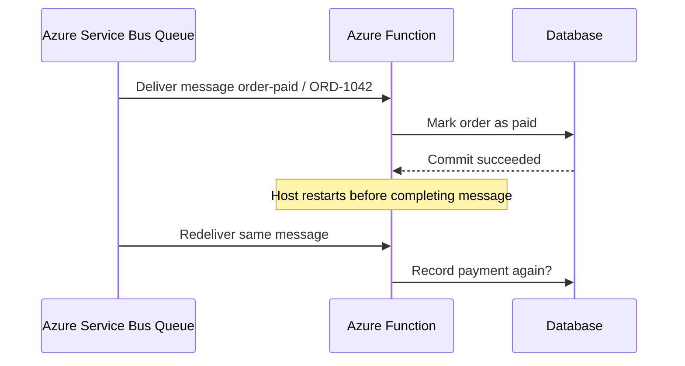
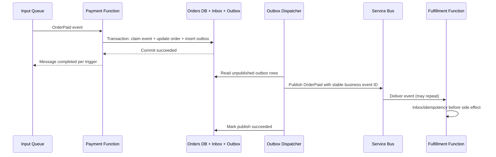
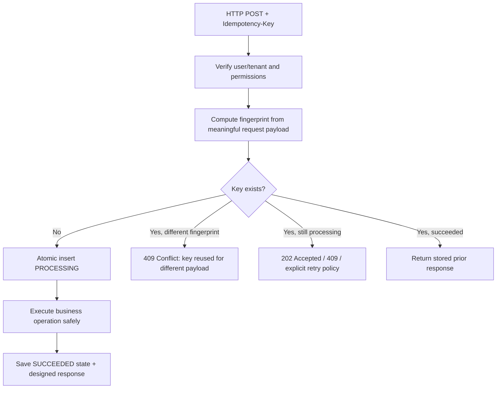
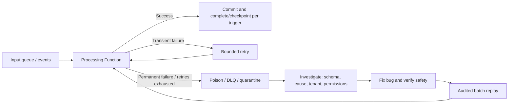
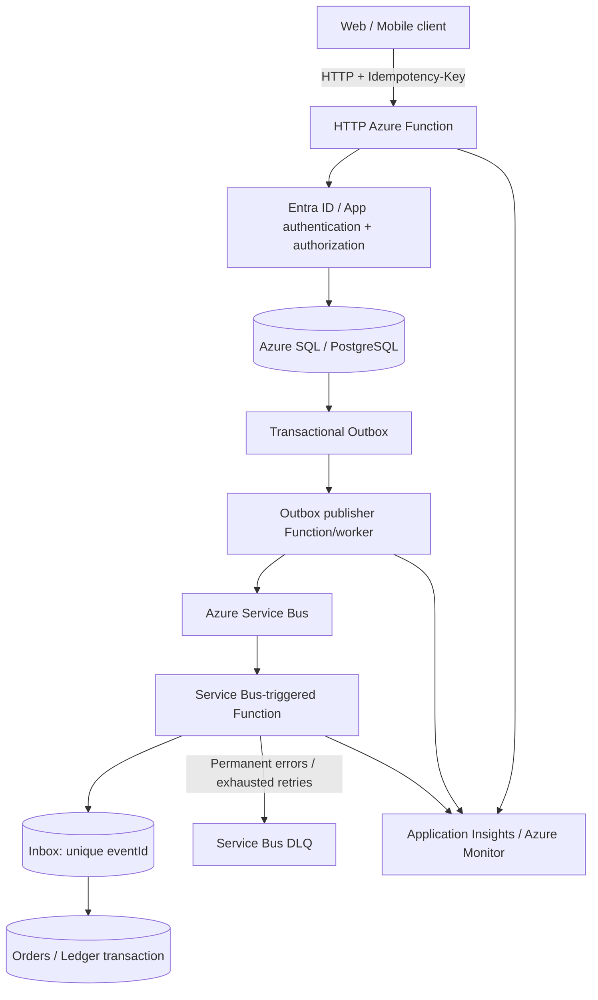

# Retries, Duplicate Handling, and Idempotency

In an **Azure Functions** application, an HTTP request, a queue message, or a Blob Storage event can trigger execution. However, distributed systems never guarantee every step succeeds on the first try: network connections drop, Azure SQL Database transiently refuses connections, a Function restarts or times out, and event sources redeliver messages when no completion acknowledgment arrives. If code blindly repeats every side effect on every invocation, an order can be recorded twice, the same invoice issued twice, or a customer emailed multiple times.

To build reliable Functions, three concepts work together: **retries** (re-attempting after transient errors), **duplicate processing** (the same work item running more than once), and **idempotency** (repeating an execution causes no unintended extra business effects). Retries improve resilience against transient faults; idempotency and durable state modeling ensure retries **do not turn transient faults into corrupted data**.

This lesson belongs to the **Serverless with Azure Functions** chapter in the Microsoft Azure module. It connects Azure Functions with subscriptions/resource groups, Microsoft Entra ID, managed identity, Storage Queues, Service Bus, Event Grid, Event Hubs, Blob Storage, Azure SQL/PostgreSQL, Application Insights, and safe operations. Examples cover Java applications, `host.json` settings, transaction/inbox–outbox patterns, testing strategies, and Azure observability.

## Learning Objectives

After this lesson, you will be able to:

1. Explain the difference between **at-most-once**, **at-least-once**, and **business-level exactly-once effects**.
2. Identify sources of duplicates across HTTP, Storage Queue, Service Bus, Event Grid, Event Hubs, Blob triggers, and Functions replay behavior.
3. Separate **transient** retryable errors from permanent business errors, setting sensible retry counts, backoff, jitter, and timeout bounds.
4. Use **idempotency keys**, unique constraints, and transactions to prevent duplicate database updates when a Function retries or runs concurrently.
5. Design **inbox/deduplication stores**, **transactional outboxes**, message acknowledgment, and poison/dead-letter handling.
6. Understand differences across trigger/runtime retries, Azure SDK retries, application-level retries, and client retries.
7. Apply observability, alerting, and fault-injection drills to prove work is neither **lost** nor **applied twice**.

## 1. The Problem: A Function Wrote Data Before Acknowledging Completion

Suppose an Azure Function processes an `order-paid` message with `orderId=ORD-1042`:



The database write succeeded, yet the message source **never received completion acknowledgment**. Once the message lock or visibility timeout expires, or a retry triggers, another Function invocation receives the same message again. Redelivery is expected behavior—not proof that the queue or Azure Functions is broken.

If the Function executes `balance = balance + 100` on every event without checking an identifier, the balance doubles. If it sets `paymentStatus = PAID` via a suitable conditional update, the status remains stable, yet other side effects such as emails, ledger rows, or bank API calls still need protection.

**Principle:** one Function invocation does not automatically equal one unique business execution. Design for **the same event arriving multiple times**, including two invocations running concurrently.

## 2. Delivery Semantics: At-Most-Once, At-Least-Once, and Exactly-Once

| Model | Meaning | Trade-Offs |
|---|---|---|
| **At-most-once** | Work is delivered/processed at most once within a defined boundary; may be lost on failure. | Reduces duplicates but makes zero data loss hard to guarantee. |
| **At-least-once** | Source may redeliver to raise completion probability; the same event can arrive multiple times. | Requires idempotency/dedup and safe retry handling. |
| **Exactly-once effect** | A business effect is persisted once within the defined contract and boundary. | Typically requires transactions, unique keys, durable state, or idempotent destination APIs. |

Most event sources integrated with Azure Functions exhibit **at-least-once** or replayable semantics. Ordered delivery or broker duplicate-detection features **do not automatically create transactions across databases and third-party APIs**.

### 2.1. Exactly-Once Delivery Differs from Exactly-Once Business Effect

For example, a Service Bus message may be delivered twice, yet the database enforces a unique constraint on `eventId` and commits the business change in the same transaction as the processed marker. That achieves a **single database effect** despite multiple Function invocations.

Conversely, if a Function calls an external payment gateway and crashes before persisting a local record, a retry may call the gateway again. You cannot use a local database transaction alone to make an external payment happen only once. You need a **gateway-supported idempotency key**, or a reconciliation and compensation workflow.

### 2.2. Idempotency Scope Must Be Explicit

Saying "the Function is idempotent" only makes sense when you define:

- **Entity/unit:** one payment, one image conversion, one daily report, or one record update?
- **Key:** `paymentId`, `orderId + eventType + version`, `blobPath + eTag`, or a message/event ID?
- **Time window:** how long must processed keys be retained to detect duplicates?
- **Side effects:** are databases, emails, Blobs, external APIs, and newly emitted events all consistently protected?
- **Partial failures:** what happens if a side effect succeeds while recording status fails?

A handler that deduplicates only within 60 seconds is **not safely idempotent** for a queue that can redeliver hours later. Size deduplication retention to match source replay/retention windows, business mandates, and data policies.

## 3. Sources of Duplicate Processing in Azure Functions

Duplicates do not occur only because code accidentally calls a function twice.

### 3.1. Event Source Retries

Unacknowledged queue messages are redelivered. Event Grid retries delivery when a subscriber fails to acknowledge success per contract. Event Hubs and the Cosmos DB change feed replay events or batches whenever checkpoints or leases have not been persisted. Check the **semantics of your exact trigger and extension version** rather than assuming one universal retry rule.

### 3.2. Multi-Layer Retries

An HTTP client retries on timeout; the Azure SDK inside the Function retries a Storage call; the trigger runtime redelivers the message; and application code has its own retry loop. If each layer retries up to 3 times, downstream sees far more calls than expected. Enforce a **cross-layer retry budget** to prevent retry storms.

### 3.3. Scale-Out and Concurrent Processing

Azure Functions scales out instances on supported hosting plans. Two messages sharing a business key with different message IDs can run **in parallel**, or one message can be redelivered after a lock/visibility error. An in-memory `HashSet` inside Function instance A **cannot stop** instance B from doing the same work, and vanishes on host restart.

### 3.4. Manual Replay and Operations

Operators may replay messages from a dead-letter queue, run backfills, replay streams, or click "retry" in management tools. That is why systems need a **stable business key** rather than relying solely on a Function invocation ID. Re-sending an event on a queue may assign a brand-new `MessageId` while representing the exact same payment.

### 3.5. Examples by Source

| Trigger / Source | How Work Repeats | Primary Protection Mechanism |
|---|---|---|
| **HTTP trigger** | Browser/client/API gateway retries after timeout; webhook provider resends event. | Request `Idempotency-Key`, unique constraints, replaying stored result. |
| **Azure Storage Queue trigger** | Function throws or host restarts; message reappears after visibility timeout; eventually moves to poison queue. | Business key, transactions, tracking dequeue count/poison queue. |
| **Azure Service Bus trigger** | Lock expires, message abandoned, or handler fails; broker increments delivery count. | Timely completion, lock renewal, idempotent handler, DLQ. |
| **Event Grid trigger** | Event redelivered after delivery failure; order/duplicates may vary. | Event ID + resource/version ID; avoid ordering assumptions. |
| **Event Hubs trigger** | Partition re-read from last checkpoint after error or rebalance. | Keyed by event/business sequence; replay-safe batch processing. |
| **Blob trigger** | Detection/event mechanisms and retries can reprocess blobs. | Blob identity + ETag/version ID or business key. |
| **Cosmos DB trigger** | Change feed processor replays batches if lease/checkpoint was not updated. | Key by document ID/version; guard side effects. |
| **Timer trigger** | Manual re-run, deploy/restart, or catch-up/backfill runs. | Business-period key, not just invocation timestamp. |

Not all triggers automatically retry with the same counts, delays, or rules. Throwing an exception in an HTTP Function **does not mean** Azure Functions automatically replays the entire HTTP request; retries come from the client or upstream caller.

## 4. Classifying Errors Before Retrying

Retries only help when the fault may clear or the system can reach a valid state on a subsequent attempt.

| Error Category | Examples | Handling Strategy |
|---|---|---|
| **Transient** | HTTP 429/503, brief DB failover, fleeting DNS/connect timeout. | Bounded retries, exponential backoff, jitter; honor `Retry-After` where supported. |
| **Permanent / invalid business input** | Invalid schema JSON, unauthorized order access, negative amount, missing required fields. | Never retry infinitely; route to error/quarantine flow and alert. |
| **Auth / configuration** | Managed identity missing RBAC, wrong secret URI, nonexistent endpoint. | Fix config/permissions; continuous retries are ineffective. |
| **Concurrency conflict** | Changed ETag, failed optimistic lock. | Re-read latest state, decide whether to retry or return conflict; cap attempts. |
| **Business rule conflict** | Order already canceled while event requests completion. | Decide by business rules—record processed status/audit rather than retrying. |
| **Resource saturation** | Huge queue backlog, exhausted connection pool, high memory. | Backpressure, concurrency caps, scale bottlenecks properly, controlled retries. |

### 4.1. Propagating Failures So the Trigger Knows

A queue-triggered Function that catches exceptions, **logs only**, and returns normally lets the runtime acknowledge the message as processed—losing it from retries despite a business failure. When an error needs trigger retries, never swallow exceptions without persisting durable failure state.

Conversely, for permanently invalid inputs, throwing endlessly cycles the message through retries until it hits the poison/dead-letter queue (where supported). Make a deliberate choice: **persist invalid status durably and ack**, or **throw toward DLQ**—never confuse the two.

### 4.2. Timeouts Are Indeterminate, Not Always Business Failures

If a Function calls a payment API and hits a timeout, the partner **may have processed it successfully** while the response was lost. Retrying with a new `paymentId` can create two charges. In that scenario, **query status using the business/idempotency key** or retry with the **exact same partner-accepted idempotency key** instead of creating a fresh payment request.

## 5. Backoff, Jitter, Timeouts, and Retry Budgets

When many Function instances hit a downstream failure simultaneously, immediate retries worsen overload. A retry policy needs both **timing** and **bounds**.

### 5.1. Fixed Delay vs. Exponential Backoff

**Fixed delay:** attempts are spaced by a nearly constant interval, such as 5 seconds. Simple, yet can synchronize clients into recurring load spikes.

**Exponential backoff:** wait times grow per attempt—such as 1, 2, 4, 8, 16 seconds up to a cap. Suits transient errors and recovering downstream services.

Representative formula:

\[
d_n = \min(d_{max}, d_{base}\cdot 2^{n-1}) + J_n
\]

Where `n` is the retry attempt, `d_base` is the base delay, `d_max` is the cap, and `J_n` is **jitter** chosen by an appropriate algorithm. This formula is a conceptual model; real implementations may use full jitter or tighter total-delay caps. Never let `J_n` push total delay past configured timeouts and deadlines.

### 5.2. Why Add Jitter?

Suppose 1,000 workers call an API and get 429 at 10:00:00. If all wait exactly 5 seconds and retry, the API gets slammed with 1,000 requests again at 10:00:05. Jitter spreads out retries, avoiding **thundering herds**.

### 5.3. `Retry-After` and Circuit Breakers

Downstream services may return `429 Too Many Requests` with a `Retry-After` header. Clients should honor valid values within deadline/timeout limits and SDK policies. During prolonged downstream outages, a **circuit breaker** temporarily pauses new calls so the service can recover and wasteful retries drop. Circuit breakers do not replace durable queues or business state tracking.

### 5.4. Total Time Budget

Suppose a message must complete within 2 minutes, yet you configure 10 SDK retries with 30-second timeouts each: one operation alone can burn several minutes. If the trigger timeout, lock duration, or visibility timeout is shorter, the message redelivers while the first Function is still running. Align everything under **one shared time budget**:

```text
Business deadline
  >= useful processing time
   + total app & SDK retry timeouts/backoffs
   + commit/ack/state persistence time
```

If work cannot finish within one delivery window, split the task, add checkpoints, or use Durable Functions or a stateful pipeline rather than inflating timeouts indefinitely.

## 6. Trigger-Specific Retry Policies in Azure Functions

### 6.1. No Single Retry Setting Covers Every Trigger

Azure Functions supports **runtime retry policies** for **some** triggers and extensions depending on version, typically using **fixed delay** or **exponential backoff**. Queue/broker-based triggers also have **message redelivery, visibility/locks, delivery counts, and poison/dead-lettering** at the source layer. Therefore, you cannot drop a `retry` block into `host.json` and assume all trigger types behave identically.

Before deploying, verify trigger type, Azure Functions runtime version, binding extension, hosting plan, exception behavior, supported retry policy, and final delivery limits. Never infer one trigger's behavior from another trigger's annotations or config.

### 6.2. Storage Queue Trigger and `host.json`

With the **Azure Storage Queue trigger**, when an invocation fails, the message generally reappears after the configured visibility timeout. Queue extension settings include `visibilityTimeout`, `maxDequeueCount`, and batch/concurrency options. Example `host.json` for compatible runtimes/extensions:

```json
{
  "version": "2.0",
  "extensions": {
    "queues": {
      "visibilityTimeout": "00:00:30",
      "maxDequeueCount": 5,
      "batchSize": 8,
      "newBatchThreshold": 4
    }
  }
}
```

`visibilityTimeout` is the wait period before a message becomes visible again after a failed attempt per extension rules; `maxDequeueCount` caps accepted delivery attempts before moving the message to the **poison queue**; `batchSize` and `newBatchThreshold` shape concurrency per host/scale behavior.

**Key points to remember:**

- Setting `maxDequeueCount=5` does not guarantee the Function runs **exactly five times in every scenario**; host crashes, lease/visibility behavior, load, extension versions, and service dynamics affect actual counts.
- Once exceeded, the queue extension can place the message into **`<original-queue-name>-poison`** in the same storage account as supported.
- For long queue processing, consider visibility timeout, runtime renewal behavior, idempotency, and checkpoints; **never** assume a large timeout eliminates all duplicates.
- Version `host.json` alongside source code, test in staging, and monitor production behavior.

### 6.3. Service Bus Trigger and Dead-Letter Queues

Azure Service Bus uses **Peek-Lock**, **Complete**, **Abandon**, **DeadLetter**, and `MaxDeliveryCount`. When a message is not completed before lock expiration or is abandoned, the broker can redeliver it. Once `MaxDeliveryCount` on the entity is exceeded, the message typically moves to the **dead-letter subqueue** (DLQ) rather than looping endlessly.

Key distinctions:

| Storage Queue Trigger | Service Bus Trigger |
|---|---|
| Controlled by visibility and dequeue behavior. | Service Bus message locks, delivery count, settlement, and DLQ. |
| Uses a separate `-poison` queue by convention. | Built-in **dead-letter subqueue** on each queue/subscription entity. |
| `maxDequeueCount` lives in Queue extension config. | `MaxDeliveryCount` lives on the Service Bus entity; distinct from `maxDequeueCount`. |
| Timeout/renewal behavior depends on extension. | Lock duration and auto-lock renewal caps depend on extension/SDK config. |

**Never complete a message before critical side effects have committed.** If a Function runs longer than the lock duration and renewal fails, another processor can receive the message. Thus, even with Service Bus, handlers must be idempotent.

### 6.4. Event Grid, Event Hubs, and Cosmos DB Change Feed

**Event Grid** retries failed deliveries; inspect event schemas, event IDs, subjects, resource versions, and filters. Never rely on event arrival order alone to infer the latest state.

**Event Hubs** uses partition offsets and checkpoints. If business data commits before a checkpoint is persisted, the batch can replay on host restart or partition rebalance. Batch handlers must tolerate replays, and you should never update checkpoints ad hoc outside the extension's contract without understanding its semantics.

**Cosmos DB change feed triggers** can also replay a batch if a lease/checkpoint is not updated yet. Consider document ID, `_etag`, versions, change feed mode, and side effects when selecting keys.

### 6.5. HTTP Triggers, Timer Triggers, and Durable Functions

- **HTTP triggers:** HTTP 500/timeouts may be retried by the **caller**. Design `Idempotency-Key` support and stable responses; never assume the runtime replays HTTP requests itself.
- **Timer triggers:** late runs, manual operator re-runs, or catch-up logic can occur depending on configuration. Key by **business period**, not just `invocationId`.
- **Durable Functions:** orchestrations replay history after restarts to rebuild state, while activities can retry on failure. **Orchestrator code must be deterministic**, placing side effects inside idempotent/transactional activities. Replay means the orchestrator must never send emails or write directly to DBs inside orchestrator code.

## 7. Idempotency: Turning Multiple Calls into One Business Outcome

An operation `f` is idempotent if repeating it against the appropriate state/data produces no additional effect beyond the intended outcome:

\[
f(f(x)) = f(x)
\]

That is the **mathematical ideal**; real implementations must address concurrency, versioning, side effects, and deduplication key retention.

### 7.1. Naturally Idempotent Operations

Example database status update:

```sql
UPDATE orders
SET status = 'PAID'
WHERE order_id = 'ORD-1042' AND status <> 'PAID';
```

Repeating the query does not alter `status` after the first update. Yet if each invocation also inserts a ledger entry or sends an email, **the overall workflow is still not idempotent**. Protect every side effect.

### 7.2. Non-Idempotent Operations

```sql
UPDATE accounts
SET balance = balance + 100
WHERE account_id = 'ACC-8';
```

Running this twice doubles the deposit. Financial operations need a **unique transaction ID** and database constraints ensuring the same transaction applies only once.

### 7.3. Designing an Idempotency Key

A strong key should be:

- **Stable across retries:** the same work item carries the exact same key.
- **Distinct across valid separate events:** two legitimate separate payments never collide.
- **Tenant/entity scoped:** prevents identical IDs from two different customers colliding.
- **Aligned with business semantics:** e.g., `tenantId + reportType + period` for reports, or `tenantId + paymentId` for payments.
- **Protected against payload mutation:** if a client reuses a key with a different payload, detect and reject the conflict instead of silently returning stale output.

| Workload | Candidate Key | Watch Out For |
|---|---|---|
| Payments | `tenantId:paymentId` | Do not use `orderId` if one order allows multiple valid payments. |
| Daily reports | `tenantId:reportType:YYYY-MM-DD` | Align period with business timezone; support versioned intentional re-runs. |
| Blob processing | `storageAccount:container:blobName:ETag` | Blobs can be overwritten; path alone ignores new versions. |
| Event handling | `sourceSystem:eventId` | Event ID must stay stable on provider retries; sometimes needs business ID/version too. |
| Thumbnail generation | `blobVersion:variant:processorVersion` | Upgrading algorithms may legitimately require regeneration. |
| HTTP POST order creation | `tenantId:Idempotency-Key` | Bind key to request payload hash and retention policy. |

**Never use `FunctionInvocationId` as an idempotency key** for cross-retry deduplication: every new invocation can receive a new ID. `InvocationId` is great for tracing, not business identity.

## 8. Why an In-Memory `HashSet` Is Not Enough

A tempting shortcut:

```java
// Illustrates only how NOT to guard against duplicate processing across instances.
private static final Set<String> seen = ConcurrentHashMap.newKeySet();

if (seen.add(eventId)) {
    chargeCustomer();
}
```

This fails in multiple ways:

1. Separate Function instances do not share `seen`.
2. Host restarts wipe in-memory state.
3. Adding the key and crashing before `chargeCustomer()` causes retries on that instance to **skip** unfinished work.
4. There is no transaction tying key insertion to the side effect.
5. There is no eviction/retention aligned with event versions and replay windows.

Use a **durable deduplication store** instead—such as Azure SQL Database, PostgreSQL, Cosmos DB, or storage supporting **atomic conditional create / compare-and-set**. Pick the store based on consistency, latency, throughput, and existing stack components.

## 9. Inbox Pattern and Transactions to Record Effects Once

The **Inbox pattern** persists processed message/event IDs in a durable store alongside business state updates so retries produce zero extra side effects. With a relational database, the cleanest and strongest mechanism is a **unique constraint + transaction**.

### 9.1. Table Design with PostgreSQL

Suppose the system receives `order-paid` events. The inbox table uses a composite key of tenant and event ID:

```sql
CREATE TABLE processed_events (
    tenant_id       text        NOT NULL,
    event_id        text        NOT NULL,
    processed_at    timestamptz NOT NULL DEFAULT now(),
    PRIMARY KEY (tenant_id, event_id)
);

CREATE TABLE orders (
    tenant_id  text NOT NULL,
    order_id   text NOT NULL,
    status     text NOT NULL,
    PRIMARY KEY (tenant_id, order_id)
);
```

Inside a **single database transaction**, the handler runs:

```sql
BEGIN;

-- If event_id already exists, RETURNING returns zero rows.
INSERT INTO processed_events (tenant_id, event_id)
VALUES (:tenantId, :eventId)
ON CONFLICT DO NOTHING
RETURNING event_id;

-- Only if the INSERT above returned a new row:
UPDATE orders
SET status = 'PAID'
WHERE tenant_id = :tenantId
  AND order_id = :orderId
  AND status = 'PENDING';

COMMIT;
```

This SQL illustrates **application-controlled conditional steps**, not a standalone SQL script that automatically skips `UPDATE` based on `RETURNING`. The handler must inspect the `INSERT` result and **execute `UPDATE` only if it claimed a fresh event**. If the order is missing or in an invalid state, decide whether to roll back, log a business error, or mark the event handled per policy—never blindly `COMMIT` success when business updates fail.

### 9.2. Why Concurrent Invocations Remain Safe

If two Function instances simultaneously `INSERT (tenantA, EVT-9)`, the unique constraint lets **at most one transaction** insert the key per PostgreSQL semantics. The second transaction sees a conflict / empty `RETURNING` once the first completes and skips updating the order a second time.

If the first instance crashes **before commit**, the transaction rolls back, no key is saved, and retries can execute from scratch. If it crashes **after commit but before ack**, the inbox row exists, so retries detect the duplicate and return cleanly to complete the message.

### 9.3. Transaction Boundaries

This pattern provides strong guarantees when **inbox writes and order updates share one database transaction**. If the handler also calls an email API, Blob Storage, or an external payment gateway inside the transaction, atomicity **does not extend to those external systems**. Use a **transactional outbox** or provider idempotency keys for external effects.

### 9.4. Claiming `PROCESSING`, Leases, and Crash Recovery

For long-running work that cannot fit inside one transaction, use a state table `PENDING → PROCESSING → SUCCEEDED/FAILED` with `ownerId`, lease expiration, and fencing/version tokens. The **claim** must be atomic (e.g., conditional update checking current state/version). If a worker crashes after claiming, the lease expires so another worker takes over; if the stalled worker wakes up later, the fencing token blocks stale writes.

**Never mark `SUCCEEDED` immediately upon receiving a message.** Writing `processed=true` before performing work causes retries to skip failed work. Conversely, using `PROCESSING` without a lease/timeout leaves stuck jobs forever.

## 10. Transactional Outbox: When a Function Must Emit Events or Call External Services

Extend the example: after updating `orders.status='PAID'`, the app must emit `OrderPaid` so the warehouse ships the order. Updating the database and then calling Service Bus directly risks:

```text
DB commit succeeds
  → Function crashes before sending to Service Bus
  → Order is PAID, but warehouse never receives the event
```

Sending to Service Bus first and then committing the database risks:

```text
Service Bus receives OrderPaid
  → DB commit fails
  → Warehouse ships an unpaid order
```

A **Transactional Outbox** closes this gap by writing business state and the outgoing event record **inside the same single-database transaction**. A separate dispatcher reads the outbox and publishes to the broker; if the dispatcher crashes and republishes, downstream consumers remain safe via idempotency.

### 10.1. End-to-End Flow



This sequence illustrates logical flow, not strict lockstep ordering: the dispatcher can observe rows right after commit, and the Function can crash at any step. Proper design stays safe across all of those failure points.

### 10.2. Simple Outbox Table

```sql
CREATE TABLE outbox_events (
    event_id       text        PRIMARY KEY,
    event_type     text        NOT NULL,
    aggregate_id   text        NOT NULL,
    payload_json   jsonb       NOT NULL,
    created_at     timestamptz NOT NULL DEFAULT now(),
    published_at   timestamptz NULL
);
```

Inside the payment transaction, alongside `INSERT processed_events` and `UPDATE orders`, the handler executes `INSERT outbox_events` with the **same stable business event ID**. The dispatcher sets `published_at` only after the broker confirms publish. If updating `published_at` fails after broker acceptance, the dispatcher republishes; thus the outbox prevents **dropped events after DB commits**, without automatically guaranteeing subscribers see each event only once.

### 10.3. Outbox Dispatchers Must Handle Concurrency

If multiple dispatcher instances poll the table, use **atomic claims/leases** or row-locking batch queries such as PostgreSQL `FOR UPDATE SKIP LOCKED`, paired with claim expiration, retries, and recovery. Never run:

```text
SELECT * FROM outbox_events WHERE published_at IS NULL
for each event: publishToBus(event)
```

across multiple uncoordinated instances if minimizing duplicate publishes matters. Even with claims, keep subscribers idempotent because network/ack failures can still trigger duplicates.

### 10.4. Calling External APIs

An outbox can store a **command** to invoke a payment or email API rather than publishing a broker message directly. The dispatcher calls the API using a **provider-accepted idempotency key**; if the provider lacks one, use business state and reconciliation. Never claim atomic distributed transactions span Azure SQL/PostgreSQL and arbitrary external HTTP APIs.

## 11. Java Azure Function Example: `QueueTrigger` Calling an Idempotent Service

This example shows the **responsibility boundary** of a Java Azure Function receiving events from a Storage Queue. Depending on your Azure Functions Java runtime/extension, trigger connection config and identity-based connections must align with your hosting plan and extension version.

### 11.1. Message Payload

```json
{
  "tenantId": "tenant-A",
  "eventId": "evt-payment-01934",
  "orderId": "ORD-1042",
  "eventType": "OrderPaid",
  "schemaVersion": 1
}
```

`eventId` is the **business work ID**, not the Azure Function invocation ID. If a producer retries publishing, it must reuse `eventId` for the same event. When multiple event types target the same order, include `eventType`/version or distinct identifiers so valid separate transactions never collide.

### 11.2. Java Handler: Validate, `applyOnce`, Throw Retryable Errors

```java
import com.fasterxml.jackson.databind.JsonNode;
import com.fasterxml.jackson.databind.ObjectMapper;
import com.microsoft.azure.functions.ExecutionContext;
import com.microsoft.azure.functions.annotation.FunctionName;
import com.microsoft.azure.functions.annotation.QueueTrigger;

public class ProcessOrderPaidFunction {
    private static final ObjectMapper JSON = new ObjectMapper();

    @FunctionName("ProcessOrderPaid")
    public void run(
        @QueueTrigger(
            name = "message",
            queueName = "paid-orders",
            connection = "OrdersStorage") String rawMessage,
        final ExecutionContext context) {

        try {
            JsonNode event = JSON.readTree(rawMessage);
            String tenantId = required(event, "tenantId");
            String eventId  = required(event, "eventId");
            String orderId  = required(event, "orderId");

            // Service method MUST run in a durable transaction:
            // claim (tenantId,eventId), update order, and insert outbox atomically.
            OrderPaidService.applyOnce(tenantId, eventId, orderId);

            context.getLogger().info("processed eventId=" + eventId);
        } catch (Exception error) {
            // Never log rawMessage, tokens, or PII.
            context.getLogger().warning(
                "order-paid failed: " + error.getClass().getSimpleName());
            throw new IllegalStateException("Processing did not complete", error);
        }
    }

    private static String required(JsonNode event, String field) {
        JsonNode value = event.get(field);
        if (value == null || !value.isTextual() || value.asText().isBlank()) {
            throw new IllegalArgumentException("Missing field: " + field);
        }
        return value.asText();
    }
}
```

This is an **integration skeleton** using Azure Functions Java annotations and Jackson; `OrderPaidService.applyOnce` represents business logic you **must implement** with connection pools, transactions, deduplication, and error handling as shown earlier—it is not a built-in Azure API. Note that the Function does not manually `ACK` the message outside the trigger protocol; returning normally lets the Queue extension complete the message per its semantics.

**Must add for production:** the snippet throws on schema errors as well. For permanently malformed messages, implement poison queue/quarantine routing and alerts instead of endless retries. Duplicates recognized and safely resolved by `applyOnce` should **return normally**, while transient database errors should throw so the trigger retries properly.

### 11.3. Service-Layer `applyOnce` Pseudocode

```text
function applyOnce(tenantId, eventId, orderId):
    beginDatabaseTransaction()
    inserted = insertInboxIfAbsent(tenantId, eventId) // atomic + unique key

    if not inserted:
        commitOrRollbackReadOnlyTransaction()
        return ALREADY_PROCESSED

    order = loadOrderForUpdate(tenantId, orderId)
    if order not found or invalidState(order):
        rollback()
        throw PermanentBusinessError()

    updateOrderState(order, PAID)
    insertOutboxEventWithStableId(eventId, ORDER_PAID, orderId)
    commitTransaction()
    return PROCESSED
```

If inbox writes and order updates sit in separate transactions, you risk "marked processed yet lost update" or "update succeeded yet unmarked." Verify by testing two workers receiving the exact same event **concurrently**, not just running sequentially twice.

### 11.4. Safe Connection Configuration

In the annotation, `connection = "OrdersStorage"` references an Azure Functions **connection setting name**, not a hardcoded password or connection string in source code. Locally, configure it in `local.settings.json` **without committing secrets**; in Azure, prefer identity-based connections/managed identities where supported by the trigger extension, with scoped data-plane RBAC.

The Function's identity needs **Storage Queue** access to receive messages and **database** access to execute transactions, which may use different auth mechanisms. Azure RBAC `Contributor` on the resource group does not automatically grant queue reads or database writes.

## 12. HTTP API: `Idempotency-Key`, Request Fingerprinting, and Response Replay

HTTP clients retry `POST` requests after network timeouts, 502/503 responses, or mobile app re-submissions. If an endpoint creates orders or charges payments, **define a client retry contract**.

Example:

```http
POST /api/payments HTTP/1.1
Host: api.example.com
Content-Type: application/json
Idempotency-Key: 0cf8d6b4-2bb2-4529-9ff0-48d5d2308c3c

{"orderId":"ORD-1042","amount":100000,"currency":"VND"}
```

`Idempotency-Key` is an application-defined contract, **not a header that causes Azure Functions to deduplicate requests automatically**.

### 12.1. Decision Flow



`202`, `409`, and polling semantics are **API design choices**, not fixed Azure Functions behavior. Document them in your API contract and enforce them consistently.

### 12.2. What Belongs in the Idempotency Store?

A record typically contains:

| Field | Purpose |
|---|---|
| `tenantId` + `key` (unique) | Isolate callers and prevent duplicates per tenant. |
| `requestHash` | Detect reuse of the same key with a different payload. |
| `status` | `PROCESSING`, `SUCCEEDED`, `FAILED` state machine. |
| `resultRef` or scrubbed response | Allows returning a consistent response. |
| `createdAt`, `expiresAt` | Retention and cleanup of dedup state. |
| `leaseOwner`, `leaseUntil`, `version` | Recovery for long operations and fencing. |

Never store raw payment card data, secrets, or bearer tokens in the idempotency store. Compute `requestHash` from a **business-canonicalized payload** rather than raw unformatted JSON if field ordering can vary without changing meaning.

### 12.3. Returning Cached Output Does Not Mean Making Data Public

A client presenting a valid idempotency key whose permissions were later revoked should not automatically receive cached data. **Authentication and authorization must still be evaluated per policy** even when replaying a stored response. Scope keys by tenant/user with sensible TTLs; never treat keys as credentials that bypass authorization.

### 12.4. If a Timeout Occurs After Starting Work

If an API returns 504 after creating a payment, a retry with the same key checks existing status. If still in flight, return `202 Accepted` with an operation ID and status endpoint rather than creating a second payment just because the client missed the prior response.

## 13. Blobs, Event Grid, and Out-of-Order Events

Idempotency prevents more than **duplicates of the same event**; event-driven architectures also encounter **older events arriving after newer ones**.

### 13.1. Blob Overwrites and ETags

Suppose an app uploads `photos/user-7/avatar.jpg` twice. Both uploads produce distinct ETags, or distinct version IDs if versioning is enabled and configured. Using only `blobName` as the key processes the first upload and **silently drops all subsequent updates** as duplicates.

A better key is:

```text
storageAccount + container + blobPath + ETag + transformationVersion
```

When handling an event, inspect the blob's ETag/version, check whether processing is still needed, and write outputs conditionally where supported. If the source blob changed between event emission and Function read, pick a clear policy: read the exact version if available, or discard stale events and process only the latest version.

### 13.2. Event Grid Redeliveries and Lack of Ordering Guarantees

A `BlobCreated` event can be redelivered after ack failures, and newer updates can arrive before older events. To prevent overwriting a newer thumbnail with stale output, persist the **processed version or ETag** and use optimistic concurrency/conditional writes.

Never rely solely on `eventTime` as a global clock ordering events across all sources. Account for source sequences/versions, clock skew, and each event schema's semantics.

### 13.3. Cosmos DB / Event Hubs and Watermarks

For streams ordered within a partition, you can track a **checkpoint/watermark** per partition or aggregate, though never equate advancing a checkpoint with committed downstream side effects. Across multiple partitions, total ordering does not exist. Ensure stale events cannot overwrite newer aggregate state by using version checks, optimistic concurrency, or conditional updates.

## 14. Poison Messages, Dead-Lettering, and Reprocessing Strategies

A message with a broken schema, invalid data, or persistent errors must not block the entire queue. After repeated delivery failures, queues provide isolation mechanisms:

- **Azure Storage Queue trigger:** Functions extension **poison queue** named `<queue-name>-poison`, governed by `maxDequeueCount` and runtime support.
- **Azure Service Bus:** queue/subscription **DLQ**, including dead-letter reasons and descriptions where populated.
- **Event Grid:** delivery retries and dead-letter destinations must be enabled/configured per subscription and service capabilities; there is **no** automatic Service Bus–style DLQ by default.
- **Event Hubs:** requires an application-level quarantine store or error sink; do not expect Storage Queue poison behavior on Event Hubs.

### 14.1. Failed Message Handling Flow



Never auto-replay the **entire** DLQ in a tight loop: one poison message can spin endlessly and drive up costs. Classify causes, fix code or data, replay with the **same business event ID**, rate-limit replays, track replay counts, and verify outputs.

### 14.2. A DLQ Is Not Permanent Storage

Define retention periods, read/write/delete permissions, PII controls, queue-length alerts, and post-resolution cleanup procedures. In Service Bus, the dead-letter subqueue has its own retention and semantics; never assume messages expire on a schedule without checking service policy and entity settings.

### 14.3. Handling Permanent Errors Deliberately

For example, `amount=-5` will never become valid through retries. You can:

1. Persist an invalid record with `eventId`, failure reason, schema version, and scrubbed diagnostic details.
2. Route the message to DLQ/quarantine via trigger behavior or explicit settlement where supported.
3. Alert the owning team with the correlation ID.
4. Reprocess only after payload/business rules are fixed and approved.

Never log full credit card details, medical records, or secrets just to debug a poison message. Protect quarantine stores at the same security tier as primary data.

## 15. Durable Functions: Activity Retries and Orchestrator Replay

**Durable Functions** builds stateful multi-step workflows with **orchestrators** and **activity functions**. When an orchestration resumes after a restart, the runtime **replays** history to reconstruct state rather than re-running side effects like a plain script. However, this **does not remove idempotency requirements from activities**: activities can still retry or re-execute on failures at specific points.

### 15.1. Deterministic Orchestrators

Orchestrators must obey determinism rules for your Durable Functions SDK/version: avoid non-deterministic random/system-time calls, direct network I/O, or sending emails/charging payments directly inside orchestrator code outside framework APIs. Put side effects inside **activity functions**, while the orchestrator uses framework-provided replay-safe APIs for timers, history, and task scheduling.

```text
Orchestrator: ProcessOrderWorkflow(orderId)
  1. schedule activity ReserveInventory(orderId)
  2. schedule activity ChargePayment(orderId, paymentId)
  3. schedule activity IssueInvoice(orderId, invoiceId)
  4. if step fails: apply appropriate retry policy or compensation

Each activity:
  - receives stable business key
  - checks state/idempotency
  - applies new side effects only when needed
  - returns durable result so workflow can advance
```

This pseudocode illustrates design—**not exact Java Durable Functions SDK syntax**. Retry and orchestration APIs vary by language and version; use the right runtime/extension versions and check hosting-plan limits.

### 15.2. Replay Must Not Send Emails Twice

If an orchestrator calls `sendEmail()` directly on every replay pass, duplicate emails go out. Instead, wrap it in `SendEmailActivity` with a fixed **`notificationId`** backed by an inbox/outbox or an idempotent mail provider API. Even though the orchestrator tracks history, external email APIs can succeed right before a response drops—so **activities must tolerate retries**.

### 15.3. Business Compensation Differs from Retries

If payment succeeds yet downstream order placement fails permanently, infinite retries cannot resolve the inconsistency. A **saga/compensation** step executes reversing actions—refunding payment, releasing inventory, or flagging manual review. Compensations can also fail and require their own idempotency keys.

## 16. Reference Architecture for an Order System

A practical architecture combining **Azure Functions + Service Bus + database + outbox**:



Participating components:

1. **HTTP API:** authenticates callers, enforces business permissions, tracks idempotency keys/fingerprints, and persists a recoverable transaction.
2. **Database:** guarantees uniqueness via constraints and transactions rather than Function instance RAM.
3. **Outbox:** prevents dropped messages when crashing between DB commit and event publish.
4. **Service Bus:** buffers work, supports redelivery, and isolates failures to DLQ per policy.
5. **Worker Function:** processes inbox dedup, side effects, and timely message completion.
6. **Monitoring:** propagates correlation IDs from HTTP requests through the outbox, Service Bus events, and downstream dependencies.

Use **Managed identity** when Functions access Entra-enabled Azure services, paired with proper data-plane permissions and network routes. A valid token does not fix firewall/Private Endpoint blocks, and management-plane roles do not grant queue reads or database writes. For databases, use supported auth modes and least-privilege accounts rather than admin credentials in Function App settings.

### 16.1. Why Separate Message ID from Business Key?

Suppose an API emits `PaymentConfirmed` with `eventId=EVT-7`. During a backfill, an operator sends a fresh message with Service Bus `MessageId=MSG-90` carrying the same `eventId=EVT-7`. Deduplicating solely on `MessageId` treats it as brand-new and repeats side effects. Deduplicating on the **business event ID** catches the duplicate accurately while retaining `MessageId` for broker tracing.

### 16.2. Safety-First Rule Across Multiple Systems

Never demand "end-to-end exactly-once delivery" across heterogeneous systems as an automatic platform property. Instead, engineer each hop for **at-least-once delivery + one durable keyed effect**; where shared transactions are impossible, combine provider idempotency, outbox/inbox, reconciliation, and compensation. Systems must be **observable, replayable, and repairable**.

## 17. Observability: Measuring Retries, Duplicates, and True Outcomes

Counting successful invocations alone can make a system look healthy while duplicate messages trigger double side effects. Monitor **business outcomes**, **retries**, **queue health**, and **idempotency store state** together.

### 17.1. Metrics to Track

| Signal Group | Metrics / Checks | Suggested Alerts |
|---|---|---|
| **Invocations** | Invocation counts, failures, timeouts, execution duration. | Rising Function failure rate or p95 duration. |
| **Retries** | Attempts per business event, transient error types, retry delays, total retry budget. | Sharp retry spike or retry storm. |
| **Deduplication** | Duplicates skipped, key conflicts, age of `PROCESSING` rows. | Abnormal duplicate rate or stuck claims. |
| **Queue** | Active messages, dequeue/delivery count, oldest message age, poison/DLQ count. | Backlog age breaching SLO; growing DLQ. |
| **Database** | Unique conflicts, transaction aborts, deadlocks, connection saturation. | Rising transaction failures and lock waits. |
| **Downstream** | HTTP 429/503, SQL latency, Storage errors, idempotency key responses. | Retries overloading downstream dependencies. |
| **Business** | Unique paid orders, single invoice per order, reconciliation drift. | Revenue/order mismatches or missing records. |

### 17.2. Correlation IDs and Structured Logging

Include stable fields in every log record to link steps:

```json
{
  "event": "payment_event_processed",
  "businessEventId": "evt-payment-01934",
  "tenantId": "tenant-A",
  "orderId": "ORD-1042",
  "invocationId": "<current-invocation-id>",
  "deliveryAttempt": 3,
  "result": "already_processed",
  "durationMs": 84
}
```

`deliveryAttempt` is an illustrative field populated from trigger metadata (where exposed) or app retry tracking; do not assume **every** trigger exposes it under the exact same name or semantics. `businessEventId` ties retries together across invocations, while `invocationId` isolates each run.

**Never log** access tokens, connection strings, secrets, raw payment data, or full PII payloads. On failures, log sanitized error codes, exception types, request IDs, and masked keys per data policy.

### 17.3. Azure Monitor and Application Insights

Azure Functions integrates with Application Insights/Azure Monitor per telemetry settings, exposing requests, exceptions, dependencies, and traces across the workflow. For KQL queries, verify your **exact workspace/schema**; the example below targets schemas with matching table/column names:

```kusto
// Example for Application Insights contexts with a traces table
traces
| where timestamp > ago(24h)
| where message has "order-paid"
| summarize attempts=count() by operation_Id
| order by attempts desc
```

This query uses `operation_Id` to illustrate telemetry correlation, though **one operation ID does not always map 1-to-1 to one business event ID**. To detect duplicates across invocations, emit `businessEventId` into **custom dimensions** and query that field per your active telemetry schema.

### 17.4. Sampling Can Hide Retries

Application Insights may apply sampling and retention rules. If fewer records appear in queries than actual executions, it does not prove Functions did not retry. For financial audits or exactly-once verification, rely on a **durable business ledger/inbox store** rather than sampled telemetry alone.

## 18. Performance and Cost of Retry Policies

Retries multiply invocations, CPU/memory consumption, database transactions, Storage operations, Service Bus deliveries, and telemetry volume. Actual costs vary by **hosting plan, region, tier, and config**; no single fixed price applies to every Function.

### 18.1. Quantitative Example

Suppose a batch contains 100,000 events:

- **Scenario A:** 1% of events need one extra run → roughly **101,000 invocations** for the batch, before SDK retries and manual replays.
- **Scenario B:** 10% of events average three extra runs → roughly **130,000 invocations**.

Invocation counts do not equal unique business writes. With solid idempotency, extra invocations are caught as duplicates and **produce no extra side effects**, though they still consume compute for state checks and logging.

### 18.2. Retrying Too Fast Costs More Than Waiting

A downstream API throttles traffic for 60 seconds. If 50 instances each retry 10 times/second, retry traffic keeps the service saturated. Capping concurrency, applying exponential backoff/jitter, and honoring `Retry-After` both **lowers total cost** and **raises success probability**.

### 18.3. Deduplication Stores Have Costs Too

Inbox/idempotency tables add reads/writes, unique indexes, storage, retention cleanup, and potential hot-key contention. Partition or shard by tenant/event ID at scale without sacrificing atomicity prematurely. For long-term audit compliance, keep a durable **business ledger** separate from short-TTL deduplication caches so payment proof is never purged accidentally.

### 18.4. Cost Monitoring on Azure

Use **Azure Cost Management** alongside metrics from Function Apps, Storage, Service Bus, databases, and Log Analytics. Alert on DLQ growth, dependency errors, invocation spikes, retry rates, throughput, and budgets—never inspect Functions execution/GB-s pricing while ignoring downstream costs amplified by retries.

## 19. Hands-On Lab: Simulating Duplicates and Mid-Flight Failures

The lab goal is **proving** that delivering the same business event multiple times never corrupts business state. Use a test Java Azure Function, Storage Queue, Azure Database for PostgreSQL (or an equivalent database with unique constraints and transactions), and Application Insights. Never use production accounts, real payment data, or live email APIs.

### 19.1. Setup

1. Create/reuse a lab Function App with a queue trigger using compatible extension versions, identity, and connection settings.
2. Create the `paid-orders` queue with the JSON payload from Section 11.
3. Create `processed_events`, `orders`, and `outbox_events` tables in the test database.
4. Implement `OrderPaidService.applyOnce` following the transactions in Sections 9–10.
5. Configure appropriate retry/poison queue settings and watch invocation logs.
6. Record initial `orders.status` values plus inbox and outbox row counts.

**Operational note:** use synthetic data and resources you are authorized to modify. Never disable deduplication on a live payment system "to see what happens."

### 19.2. Test Suite to Run

| Test | How to Trigger | Expected Proof |
|---|---|---|
| **One valid event** | Send a fresh message once. | One order transition, one inbox row, one outbox row. |
| **Sequential duplicate** | Re-send the same `tenantId,eventId`. | Zero extra side effects; returns success per policy. |
| **Concurrent duplicate** | Send two copies simultaneously / under scale-out. | Unique constraint/atomic claim enforces exactly one effect. |
| **Crash before DB commit** | Inject throw/restart inside transaction before commit. | Transaction rolls back; retry completes from scratch. |
| **Crash after DB commit before ack** | Inject fault after commit but before handler returns. | Event redelivers, inbox catches duplicate, zero duplicate writes. |
| **Transient DB failure** | Simulate transient connect/429/503 or safe failover. | Bounded backoff retries eventually succeed or route to error flow. |
| **Malformed schema payload** | Omit `eventId` or send invalid `amount`. | Data untouched; routed to poison/DLQ or quarantine with alert. |
| **Same key, different payload** | HTTP POST reuses key with changed body. | Explicit conflict returned; never replays stale prior result. |
| **Outbox republish** | Dispatcher publishes then crashes before updating `published_at`. | Idempotent subscriber prevents second side effect. |
| **Long execution** | Simulate processing close to lock/visibility timeout. | Task not lost; lock expiry/replay handled without duplicate effects. |
| **Manual DLQ replay** | Fix synthetic payload and replay under verified business ID. | Full audit trail; already-committed side effects never repeat. |

### 19.3. Pass/Fail Evaluation

A test **PASSES** only when both properties are verified:

1. **Safety:** financial/order state and side effects never duplicate across duplicates, retries, or concurrency.
2. **Liveness:** transient faults recover, tasks never stay trapped in `PROCESSING`, and permanent errors reach DLQ/quarantine for operator handling.

Checking `Function succeeded` is insufficient. Query the database, outbox, downstream outputs, or data manifests using the **business key**.

### 19.4. Post-Lab Cleanup

Delete test messages, tables/dedup rows, and Function resources **only after confirming** no shared data or required audit records are affected. If a resource group contains production resources, never delete the entire group. Check Azure Cost Management afterward since queues, databases, or telemetry can continue accruing charges after lab runs finish.

## 20. Common Pitfalls

| Mistake | Why It Is Dangerous | Prevention |
|---|---|---|
| "Azure Functions runs exactly once, so dedup isn't needed." | Queue/event replays, client retries, and host restarts cause duplicates. | Design for at-least-once + idempotent business effects. |
| Using `invocationId` as the idempotency key. | Retries often create new invocations with new IDs. | Use a stable event/payment/order-operation ID. |
| Using an in-memory `HashSet`/cache to track processed items. | Scale-out and restarts lose/fragment state; mid-step crashes leak work. | Durable store + atomic unique key/transaction. |
| Writing `processed=true` before doing the work. | Crashing after marking causes retries to skip unfinished work. | Commit status and business effect in one transaction, or use leases/fencing. |
| Catching all exceptions and returning success. | Triggers complete messages despite failed business logic. | Complete only on valid success; route invalid messages deliberately. |
| Retrying schema/RBAC errors infinitely. | Causes poison loops and extra cost without fixing root cause. | Classify transient vs. permanent; use DLQ and alerts. |
| Relying solely on broker duplicate detection. | Cannot protect side effects after crashes or re-publishes with new IDs. | Use inbox/outbox and business keys at the destination. |
| Sending emails/payments before committing DB without compensation. | Side effect can succeed while DB fails. | Transactional outbox, provider idempotency, reconciliation. |
| Scaling workers unbounded when queues back up. | Overloads downstream services and multiplies retries. | Backpressure, concurrency caps, retry budgets, DLQs. |
| Monitoring only 5xx/invocation counts. | Hides double charges, duplicate invoices, and stuck states. | Track business ledgers, duplicate counters, and reconciliation metrics. |
| Expiring dedup keys too early. | Late replays after TTL look like brand-new work. | Match retention to business/source windows and audit rules. |
| Assuming timers/events always arrive in order. | Out-of-order events overwrite newer state with stale data. | Version checks, conditional writes, state machines. |

## 21. Design Scenario: Payments and Invoicing

An organization receives `PaymentSucceeded` webhooks from a payment gateway into an HTTP Azure Function. The Function must update the order, trigger invoice generation, and send notifications. The webhook provider retries if HTTP 2xx does not arrive in time; internal background processing uses Service Bus. Business rules mandate **no duplicate payment recording, no duplicate invoices, and no missed invoices**.

### 21.1. Proposed Design

1. **HTTP ingress:** verify webhook signatures and sender auth, validate schema, extract stable `paymentId/eventId`—never trust spoofable client-chosen IDs.
2. **Transaction:** INSERT inbox/payment event with unique `(provider, paymentId, eventType)` per business contract, update the order, and INSERT outbox event `InvoiceRequested` **within the same database transaction**.
3. **HTTP response:** return 2xx only after durable commit per contract; if a timeout occurs post-commit, provider retries hit the existing key and receive safe confirmation.
4. **Outbox dispatcher:** publishes `InvoiceRequested` to Service Bus with a stable event ID, retrying whenever broker confirmation is uncertain.
5. **Invoice Function:** receives the event, uses a **unique `invoiceId`** per eligible order/version, creates the invoice with unique constraints and conditional writes, and returns success once persisted.
6. **Email Function:** triggers notification from a new outbox record after invoicing completes; pass a stable idempotency key if the mail provider supports one, otherwise manage state and reconciliation per policy.
7. **Failure handling:** transient errors use bounded backoff retries; permanent errors move to DLQ/quarantine; operations has dashboards and controlled replay runbooks.
8. **Security:** Functions use managed identity and scoped RBAC for Service Bus/Storage, webhook secrets live in Key Vault or secure stores, and sensitive payment fields are never logged.

### 21.2. Crash-Point Analysis

| Crash Point | Remaining State | Desired Recovery Behavior |
|---|---|---|
| Before transaction commit | No durable DB changes. | Provider/queue retries; transaction executes cleanly from scratch. |
| After DB commit, before HTTP 2xx | Payment/inbox/outbox committed. | Provider resends; duplicate key detected, no double charge/recording. |
| After outbox publish, before marking published | Broker may already hold the message. | Dispatcher republishes same business ID; Invoice Function deduplicates. |
| After creating invoice, before Service Bus Complete | Invoice already exists. | Redelivery happens; unique invoice ID prevents duplicate invoice. |
| After mail provider accepts, before saving status | Email may already be sent. | Check provider status/idempotency or reconcile, managing residual risk per contract. |

### 21.3. Self-Check Questions

1. Why can the same valid webhook arrive multiple times even when the provider has no business bug?
2. Why does simply increasing `maxDequeueCount` fail to eliminate duplicate processing?
3. Should a unique constraint protect `FunctionInvocationId` or a stable business event ID?
4. If a handler commits to the database and crashes before completing the message, is redelivery a broker bug?
5. Which gap does a transactional outbox close, and why do subscribers still need idempotency?
6. If an HTTP POST reuses `Idempotency-Key` with a different amount, how should you respond?
7. Why cannot a static `HashSet` inside a Function instance guarantee idempotency in a scaled-out environment?
8. When a message fails schema validation consistently, will infinite retries ever make it valid?
9. What mechanism prevents an older Blob event arriving after a newer one from overwriting newer output?
10. Why does a drop in Function exception count not prove the business avoided double charges?

**Answer hints:** deliveries/retries repeat after timeouts or ack loss; raising retry counts never creates unique business effects; keys must stay stable across invocations; redelivery is a design assumption; outbox prevents lost events between DB and broker while publishes can still repeat; mismatched payloads for a reused key must return conflict; RAM is neither shared nor crash-recoverable across instances; schema errors belong in quarantine; use ETags/versions/conditional writes; verify business ledgers and actual outcomes rather than technical logs alone.

## 22. Pre-Production Checklist

- [ ] Documented **delivery/retry semantics for each trigger** and active Azure Functions extension/hosting plan versions.
- [ ] Classified transient errors, permanent business errors, config/authorization errors, and concurrency conflicts.
- [ ] Defined a combined retry budget across trigger/runtime, SDK, application, and clients using backoff, jitter, and deadlines.
- [ ] HTTP POSTs and webhooks enforce **`Idempotency-Key`**, payload fingerprinting, tenant scoping, and clear in-flight/completed contracts.
- [ ] Queue/event handlers use **stable business event IDs**, never invocation IDs or RAM caches.
- [ ] Inbox/dedup store enforces **unique constraints or atomic conditional writes** with retention aligned to replay windows.
- [ ] Business state changes and inbox markers share a single transaction when using one database.
- [ ] Long jobs use claims, lease expirations, and fencing to prevent stuck `PROCESSING` rows and stale commits.
- [ ] External side effects are guarded via outbox, provider idempotency, reconciliation, or compensation where supported.
- [ ] Messages are never completed/acked before critical state commits; exceptions are never swallowed into fake successes.
- [ ] Storage Queue poison queues, Service Bus DLQs, or quarantines match the trigger, with owners and replay runbooks.
- [ ] Service Bus message locks/renewals or Queue visibility timeouts exceed function execution and timeout limits.
- [ ] Event versions, ETags, ordering, and batch replays are tested on sources capable of stale deliveries.
- [ ] Function Apps use least-privilege managed identity/RBAC, secure networking, and secret-free/token-free logs.
- [ ] Monitoring tracks retries, duplicates, DLQ depth, backlog age, stuck claims, dependency errors, and business reconciliation.
- [ ] Tested **pre/post-commit crashes, concurrent duplicates, poison messages, timeouts, restarts, and outbox replays** with test data.
- [ ] Estimated costs for retries, database transactions, Service Bus/Storage ops, and telemetry under realistic workloads.
- [ ] Audited code rollback, recovery, and reprocessing procedures exist, with no ad-hoc production replays.

## Conclusion

**Retries** in Azure Functions help systems survive transient faults, yet mean any event can be processed **more than once**. Reliable design therefore starts from **at-least-once delivery**, selects a **stable idempotency key**, and guarantees business effects commit only once within defined boundaries. Within a database, use **unique constraints and transactions**; across multi-service workflows, combine **inbox/outbox, provider idempotency, retry budgets, dead-letter handling, and reconciliation**. Because each trigger has distinct retry, checkpoint, and lock mechanics, a single `host.json` setting cannot substitute for understanding each event source. By testing post-commit crashes, concurrent duplicates, replays, and permanent failures, Azure Functions can scale elastically while protecting data integrity, resilience, and operating costs.
