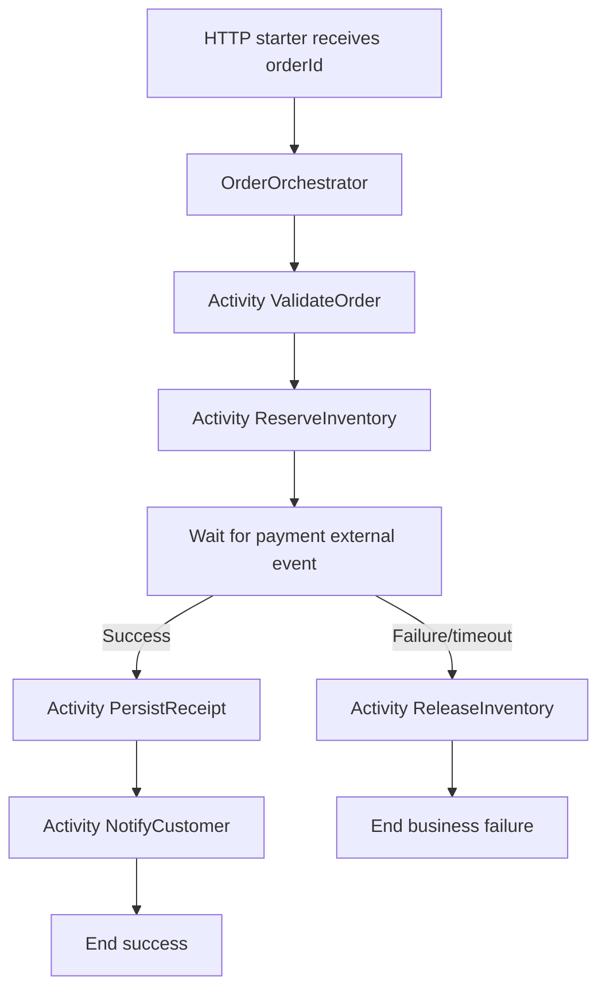
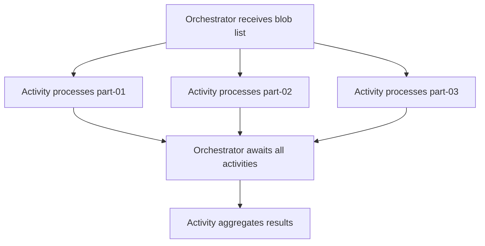
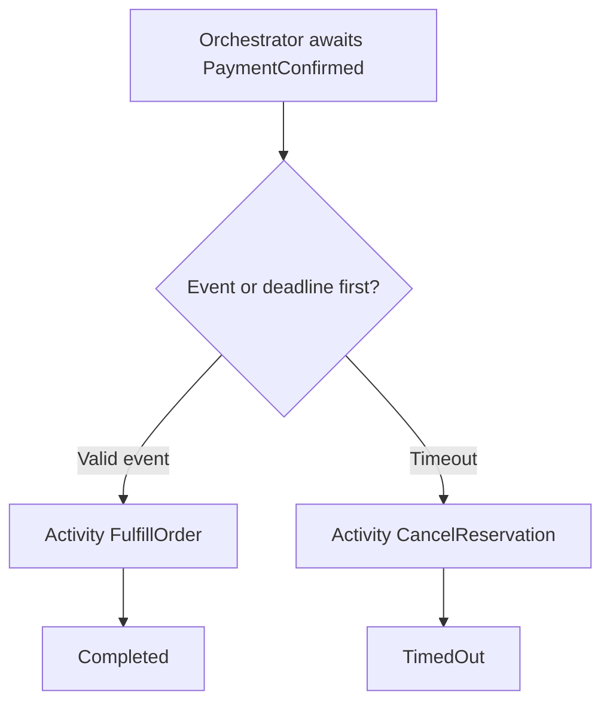
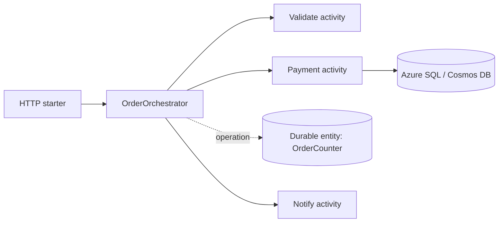
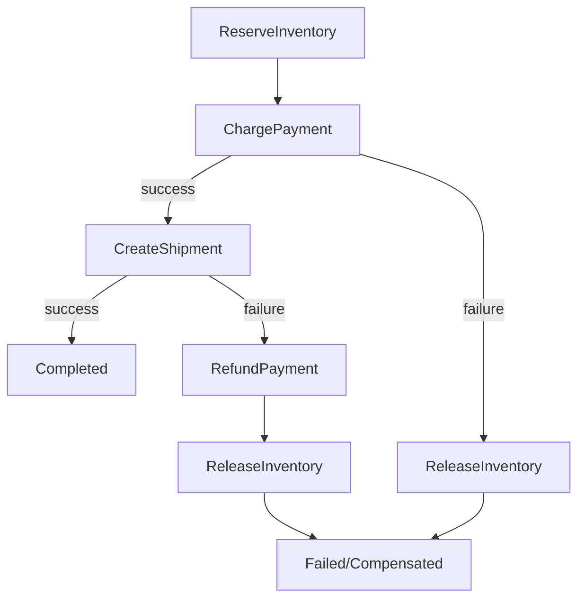

# Durable Functions with Orchestrators, Activities, and Entities

A standard Azure Function triggers, runs a task, and exits. That works well for short tasks, but when a workflow spans multiple steps lasting minutes to days—such as accepting an order, checking inventory, waiting for payment, sending emails, and issuing refunds on failure—tracking state and managing retries manually gets complex.

**Azure Durable Functions** extends Azure Functions with a **stateful workflows** programming model: define business flows, schedule tasks, persist execution progress, recover after process restarts, and resume when external events or timers fire. Three core concepts drive it:

- **Orchestrator function:** defines the **order and relationships** between steps; the engine records history and **replays** it to reconstruct workflow state.
- **Activity function:** performs **real work** such as calling APIs, querying data, writing to Storage, or sending notifications; steps can retry, so idempotency is essential.
- **Durable entity:** holds **durable state keyed by entity ID** and processes operations to read/mutate that state; suited for counters, logical locks, or small coordination states where supported by the SDK.

This lesson belongs to the **Serverless with Azure Functions** chapter in the **CLOUD_PROVIDERS_AZURE** module of the Microsoft Azure ecosystem. It connects with subscriptions, resource groups, Microsoft Entra ID, Azure Storage, virtual networks, security, logging, monitoring, and cost control. Code and CLI snippets are **learning examples**; they do not claim execution or testing against a live Azure account.

> **Important language note:** Durable Functions capabilities and APIs vary across **Functions runtimes, extensions, and programming languages**. This lesson uses **Java** for orchestrator and activity examples. **Entities** are presented conceptually and via language-agnostic pseudocode; do not treat entity pseudocode as compilable Java SDK code. Before adopting entities in a Java project, verify whether Durable Entities are supported by your **exact Java extension/SDK version**. If not, consider implementing entities in a supported runtime or using Storage/Cosmos DB with appropriate concurrency controls for state management.

## Learning Objectives

After this lesson, you will be able to:

1. Explain when a multi-step Azure Functions workflow needs Durable Functions instead of a standard HTTP-triggered Function.
2. Distinguish orchestrators, activities, entities, and the Durable Task client.
3. Understand **durable execution**, checkpointing, event history, replay, and **deterministic orchestrator** requirements.
4. Write a Java flow containing an HTTP starter, orchestrator, and activities with inputs, outputs, and status tracking.
5. Recognize **function chaining, fan-out/fan-in, async HTTP API, monitor, and human interaction** patterns.
6. Design retries, timeouts, durable timers, external events, compensation, and idempotency.
7. Model durable entities with state and operations while understanding language support limits.
8. Select state stores/task hubs and deployment models compatible with networking, identity, and scale.
9. Observe workflow instance IDs, statuses, failures, replay logs, and costs.
10. Troubleshoot common issues: failed activities, stuck orchestrations, nondeterminism, versioning, and entity contention.

## 1. Why Are Standard Functions Insufficient for Long Workflows?

Suppose a store runs this workflow:

1. Receive a new order.
2. Check inventory.
3. Reserve items for the customer.
4. Request payment.
5. **Wait** for payment gateway confirmation, potentially several minutes.
6. Send email and save the invoice.
7. If payment fails, **release the reserved inventory**.

Implementing all of that inside one standard HTTP Function causes problems:

- HTTP clients or frontends may time out before completion.
- Functions processes can restart or scale in.
- You should never block a thread with `Thread.sleep(...)` for minutes.
- Developers must track manually which steps already ran.
- Retrying the entire HTTP request risks charging or reserving inventory twice.
- Across many concurrent runs, inspecting state, history, and recovery becomes difficult.

Durable Functions converts workflows into **durable steps**. The orchestrator specifies what runs next; the engine stores history of completed steps for recovery, while activities perform actual side effects.

### Conceptual Diagram



In reality, steps may execute across separate Functions and host instances. They are **not a single Java call stack sitting intact in RAM throughout the wait**.

## 2. Three Components: Orchestrator, Activity, Entity

| Component | Responsibility | Should It Call HTTP/DB Directly? | Data / State |
|---|---|---|---|
| **Orchestrator** | Decides ordering, branching, waiting on tasks, coordinating retries/events/timers | **No** arbitrary I/O that causes nondeterminism | Progress state reconstructed from durable history |
| **Activity** | Performs I/O, computation, API calls, DB writes, notifications | **Yes**, with error handling and idempotency | Inputs/outputs recorded by orchestration per provider mechanics |
| **Durable entity** | Manages small keyed state, handles operations like Add/Get/Reserve | Avoid unsafe external I/O; focus on state/operations | State persisted; operations serialized per entity |
| **Durable client** | Starts, queries, signals, and manages instances | Can call Durable APIs from appropriate starters/endpoints | Control client, not an orchestrator |

### An Intuitive Analogy

**Orchestrator** is like an order coordinator: "Validate, reserve stock, await payment, issue invoice."

**Activity** is like a worker executing a business step: "Call the Inventory API," "Write invoice to Blob Storage."

**Entity** is like a stateful object with durable memory: "Customer A's cart currently holds 3 items," or "Event X has 125 seats left."

Even though the name "entity" resembles an ORM/database entity, it is a **durable stateful actor** addressed by ID and operations. It does not replace relational databases or complex analytical reporting stores.

## 3. Durable Task Engine, Task Hubs, and Persistence

Durable Functions relies on **Durable Task** to manage history, work-item queues, and instance state. With the common **Azure Storage provider**, the runtime uses Storage resources to back orchestrations; other backends/providers carry their own capabilities and prerequisites per service version.

### Key Concepts

- **Orchestration instance ID:** identifies one workflow execution; typically appears in status URLs and logs.
- **Task hub:** logical namespace holding orchestration queues and state for a group of orchestrations.
- **History:** recorded events such as instance started, activity scheduled/completed, timer created/fired, and external event received.
- **Checkpoint:** engine persists durable progress so workflows resume after host stops or restarts.
- **Status:** states such as Pending, Running, Completed, Failed, Terminated, or Canceled/Suspended depending on API/runtime.
- **Payload:** inputs, outputs, custom status, and event payloads may be persisted in the backend, so avoid putting secrets or unnecessary PII there.

### When a Server Restarts

Suppose `ValidateOrder` finished and the workflow is awaiting the next Activity. After a host restart, the orchestrator may **re-execute code from the top**, yet the engine consults **history** to return previously completed activity results instead of re-invoking already-checkpointed steps like a normal program.

That is the single most critical mechanism to grasp: **orchestrators replay to reconstruct decisions**, while side effects belong in activities or durable-runtime primitives.

### Does Not Mean Exactly-Once

An activity can re-execute on timeouts, retries, worker crashes, or lost result acknowledgments. Durable orchestration does not guarantee external transactions such as **charging cards, sending emails, or writing databases** happen only once.

The solution combines **idempotency keys**, transactions, or conditional updates on target systems. If an API call succeeded right before the activity result failed to persist and the activity retries, the repeated operation must remain safe.

## 4. Replay and Deterministic Orchestrators

**Replay** means the runtime re-executes the orchestrator function against its event history. Therefore, orchestrator logic must be **deterministic**: given the same history, it must make the exact same decisions and schedule tasks in the exact same order.

### Operations Never to Put Directly in an Orchestrator

- `Instant.now()`, `System.currentTimeMillis()`, or arbitrary system clocks.
- `UUID.randomUUID()`, `Math.random()`, or randomness unmanaged by the durable runtime.
- Direct HTTP calls, JDBC/SQL queries, Azure Storage SDK calls, or file reads.
- `Thread.sleep(...)` or thread-blocking polling loops.
- Spawning new threads or parallel tasks outside the Durable Task scheduler.
- Relying on static mutable fields or process-local caches.
- Reading time-varying environment variables to branch scheduled steps if replay could take a different path.
- Logging "new step" blindly without replay awareness, creating duplicate logs and false impressions of repeated activity execution.

### What to Do Instead

| Need | Design Pattern |
|---|---|
| Fetch data from SQL/HTTP | Call an activity |
| Send emails or charge payments | Call an idempotent activity |
| Wait for a duration | Use an SDK-supported **durable timer** |
| Wait for confirmation from another system | Use an SDK-supported **external event** |
| Generate business IDs | Pass from starter or activity; use deterministic ID APIs if provided by SDK |
| Log from orchestrator | Use replay-aware logging or replay checks where supported by SDK |
| Run multiple tasks concurrently | Schedule multiple Durable Tasks and await using SDK primitives |
| Store business state | Activities writing to DB/Storage, or durable entities where supported |

### Flawed Design Example

```java
// PSEUDOCODE: DO NOT place side effects or nondeterminism
// directly inside the orchestrator.
String id = java.util.UUID.randomUUID().toString();
Thread.sleep(60000);
paymentGateway.chargeCard(id);
```

Why: replay can generate a new ID, sleep pins a thread, and payment requests could fire repeatedly unchecked.

### Sound Design Example

```text
HTTP starter receives orderId and idempotencyKey
    -> orchestrator with stable input
       -> activity ValidateOrder(orderId)
       -> activity ChargePayment(orderId, idempotencyKey)
       -> durable timer / external event if needed
       -> activity PersistReceipt(orderId)
```

Never call gateways inside the orchestrator; activities own real transactions and duplicate prevention.

## 5. Common Orchestration Patterns

### 5.1 Function Chaining

Sequential steps where one step's output feeds the next:

```text
Validate -> Reserve -> Charge -> Persist -> Notify
```

Use when later steps depend on earlier results and each step tracks its own state.

### 5.2 Fan-Out / Fan-In

Split 1,000 files into independent parallel activities and aggregate results:



Never stuff 1,000 large files into orchestration history. Pass only **small blob URLs/IDs and metadata**, letting activities read and write large payloads via the Storage SDK.

### 5.3 Async HTTP API

An HTTP request starts a workflow and returns **HTTP 202 Accepted** plus a status URL. Clients poll status instead of holding a long-lived connection open.

### 5.4 Monitor

An orchestrator schedules periodic checks using a **durable timer**, calls an activity to check partner status, and exits upon completion or deadline expiration. Never use `Thread.sleep`.

### 5.5 Human Interaction

A workflow sends an approval request, then waits for an **external event** or a durable timer timeout. Waiting does not pin a live thread like synchronous code.

### 5.6 Sub-Orchestration

A parent workflow invokes child orchestrations to reuse complex flows, isolate responsibilities, and manage grouped fan-out.

### 5.7 Entity-Based Coordination

An entity holds small keyed state for an order or customer; orchestrators or clients **call or signal operations** per supported language and SDK.

## 6. Setting Up a Java Durable Functions Project

This lesson uses **Azure Functions Java** with the Durable Task Java extension supporting **orchestrators and activities**. Required components:

- A JDK compatible with the Functions Java runtime.
- Maven and the Azure Functions Maven Plugin when building/running with Maven.
- Azure Functions Core Tools v4 for local execution, or a configured deployment environment.
- Azure Storage provider or a durable state backend supported by the extension.
- Azurite/Storage emulator when running locally with `UseDevelopmentStorage=true`, or an authorized lab Storage account.
- Compatible Durable Task Java dependency, Functions Java library, and extension bundle/host configuration per the current compatibility matrix.

### Maven Dependencies (Illustrative Snippet)

```xml
<dependencies>
    <dependency>
        <groupId>com.microsoft.azure.functions</groupId>
        <artifactId>azure-functions-java-library</artifactId>
        <version><!-- Pin compatible version --></version>
    </dependency>
    <dependency>
        <groupId>com.microsoft</groupId>
        <artifactId>durabletask-azure-functions</artifactId>
        <version><!-- Pin compatible version --></version>
    </dependency>
</dependencies>
```

This is an **illustrative snippet**, not a complete buildable `pom.xml`: you still need matching Maven plugins/dependencies and verified version numbers instead of placeholders. Avoid blindly picking the newest version if the Azure Functions runtime or extension is not yet compatible.

### `host.json` (Configuration Example)

```json
{
  "version": "2.0",
  "extensionBundle": {
    "id": "Microsoft.Azure.Functions.ExtensionBundle",
    "version": "[4.*, 5.0.0)"
  },
  "extensions": {
    "durableTask": {
      "hubName": "OrdersTaskHub"
    }
  }
}
```

`OrdersTaskHub` is an illustrative logical name. Across multi-app environments or staging slots, plan **task hub isolation** and storage providers so apps/slots never accidentally read or steal each other's workflow queues.

### `local.settings.json` (Local-Only Example)

```json
{
  "IsEncrypted": false,
  "Values": {
    "AzureWebJobsStorage": "UseDevelopmentStorage=true",
    "FUNCTIONS_WORKER_RUNTIME": "java"
  }
}
```

This config works only when **Azurite/Storage emulator** is installed and running as required by the extension. `local.settings.json` can contain secrets; never commit files with credentials to Git. In live Azure, pick connection or identity-based storage config matching backend capabilities and organizational policy.

## 7. Java Example: HTTP Starter, Orchestrator, and Two Activities

This example accepts an `orderId`, validates input, and produces a simulated "receipt." It skips live payment gateways or databases so you can focus on APIs and lifecycles before adding real side effects.

Example `OrderWorkflow.java` inside a properly configured Functions project:

```java
package vn.example.functions;

import com.microsoft.azure.functions.*;
import com.microsoft.azure.functions.annotation.*;
import com.microsoft.durabletask.*;
import com.microsoft.durabletask.azurefunctions.*;

import java.util.Optional;

public class OrderWorkflow {

    @FunctionName("StartOrderWorkflow")
    public HttpResponseMessage start(
        @HttpTrigger(
            name = "req",
            methods = {HttpMethod.POST},
            authLevel = AuthorizationLevel.FUNCTION,
            route = "orders/start")
            HttpRequestMessage<Optional<String>> request,
        @DurableClientInput(name = "durableClient")
            DurableTaskClient client,
        final ExecutionContext context) {

        String orderId = request.getBody()
            .orElse("")
            .trim();

        if (orderId.isEmpty()) {
            return request
                .createResponseBuilder(HttpStatus.BAD_REQUEST)
                .body("orderId is required")
                .build();
        }

        String instanceId =
            client.scheduleNewOrchestrationInstance(
                "ProcessOrder", orderId);

        context.getLogger().info(
            "event=orchestration_started instanceId=" + instanceId);

        return client.createCheckStatusResponse(
            request, instanceId);
    }

    @FunctionName("ProcessOrder")
    public String processOrder(
        @DurableOrchestrationTrigger(name = "ctx")
            TaskOrchestrationContext ctx) {

        String orderId = ctx.getInput(String.class);

        String validated =
            ctx.callActivity(
                "ValidateOrder", orderId, String.class).await();

        return ctx.callActivity(
            "CreateReceipt", validated, String.class).await();
    }

    @FunctionName("ValidateOrder")
    public String validateOrder(
        @DurableActivityTrigger(name = "orderId")
            String orderId,
        final ExecutionContext context) {

        if (orderId == null ||
                !orderId.matches("[A-Za-z0-9-]{1,40}")) {
            throw new IllegalArgumentException(
                "invalid_order_id");
        }

        context.getLogger().info(
            "event=order_validated orderId=" + orderId);

        return orderId;
    }

    @FunctionName("CreateReceipt")
    public String createReceipt(
        @DurableActivityTrigger(name = "orderId")
            String orderId,
        final ExecutionContext context) {

        // Lab: generates only a logical string without backend persistence.
        // Production: every side effect requires idempotency.
        context.getLogger().info(
            "event=receipt_created orderId=" + orderId);

        return "receipt-for-" + orderId;
    }
}
```

**Example scope:** these Durable Task Java APIs and imports represent one supported SDK style; exact overloads, annotations, and dependencies can vary across SDK releases. Align all dependencies and source code with your chosen version before compiling. This lesson does not claim to have executed Maven, Core Tools, or live Azure runs.

### What Happens When a Request Arrives?

1. The HTTP starter reads input and starts a new orchestration instance.
2. Returns **202 Accepted** with status management endpoints per runtime API behavior.
3. The orchestrator schedules `ValidateOrder`.
4. The activity validates the order ID, returning a value or throwing an error.
5. The orchestrator schedules `CreateReceipt` with the validated data.
6. The activity returns the receipt string.
7. The orchestrator completes and returns its output; the caller fetches it via the status URL.

**Both activities are independent functions at runtime**, even though they reside in the same Java class. Orchestration logic stays in `ProcessOrder`, while side effects stay in activities.

## 8. Local Execution and HTTP 202/Status Queries

Once a complete Java Functions project with the Maven plugin is configured:

```bash
mvn -B clean package
mvn azure-functions:run
```

The second command requires the **Azure Functions Maven Plugin** configured in the project. Depending on your environment, you can also run the built Functions artifact directly with Azure Functions Core Tools.

When running with `UseDevelopmentStorage=true`, start **Azurite** and ensure the runtime/extension can reach the backend. Without Azurite or a valid Storage account, the Durable host can fail before the HTTP starter even accepts requests.

### Start Orchestration

Once the local Functions host is listening on the default port and route:

```bash
curl -i -X POST \
  -H "Content-Type: text/plain" \
  --data "ORD-1001" \
  http://localhost:7071/api/orders/start
```

A successful response is typically **202 Accepted** containing the instance ID and status/management URLs (exact JSON field names and routes depend on runtime version).

### Polling Status

Using `statusQueryGetUri` or the corresponding URL from the response:

```bash
curl -i "<STATUS_QUERY_URL_FROM_RESPONSE>"
```

Inspect status values such as Pending/Running/Completed/Failed, output, `createdTime`, and `lastUpdatedTime` per API. Never hardcode full management URLs, as they can contain sensitive tokens, keys, or hostnames.

### Local vs. Cloud Differences

Locally, `AuthorizationLevel.FUNCTION` often does not enforce function keys the same way cloud deployments do. In Azure, production endpoints require **function keys, Microsoft Entra ID/App Service Authentication, API Management**, or an auth layer matching your threat model; function keys never fully replace user authentication and business authorization.

## 9. How Replay Affects Logging and Debugging

Durable orchestrators replay the same code multiple times. If you add:

```java
// Placed directly inside the orchestrator without replay filtering:
System.out.println("Begin ProcessOrder");
```

you can see multiple identical lines even for a single logical workflow run. That does not mean activities actually executed multiple times.

Best practices:

- Use a **replay-safe logger** or check replay state via SDK-supported APIs.
- Log key business milestones inside activities, tagged with `instanceId`/`orderId` or correlation IDs.
- Keep sensitive data out of orchestration inputs, outputs, and logs.
- Distinguish **activity scheduled** from **activity actually executed**.
- Combine history and telemetry rather than just counting log lines.

### Nondeterminism Symptoms

If you change the order of scheduled activities in a new deployment while older instances are still running, replaying older instances can fail to match their saved history. That causes nondeterminism errors or stalled workflows.

Plan **versioning** and upgrade paths for orchestration code—especially for workflows waiting days or weeks.

## 10. Retrying Activities and Idempotency

An activity calling an API may encounter transient 429, 503, or timeout errors. Durable Functions supports task retry policies in compatible SDKs and versions, allowing configurable attempt counts and delays.

### Retry Flow

```text
Orchestrator schedules ChargePayment
    -> Activity calls payment API
    -> Timeout
    -> Durable retry (if configured)
    -> Activity retries with the exact same idempotencyKey
    -> Payment provider recognizes already-processed request
    -> Returns identical result
```

Never retry every error indiscriminately: authentication failures, schema mismatches, or invalid data should halt or route to business error handling rather than retrying endlessly.

### Error Classification

| Error Type | Examples | Strategy |
|---|---|---|
| Transient | HTTP 429, 503, network hiccup | Bounded retries with appropriate backoff and jitter |
| Configuration | Wrong URL, missing Azure RBAC, Key Vault 403 | Stop and alert |
| Data | Invalid Order ID, missing schema field | Reject/quarantine; never retry endlessly |
| Business | Payment declined, out of stock | Run compensation branch or return business result |
| System | Prolonged backend storage outage | Deadline-bounded retries, alerts, and runbook |

### Idempotency Key

Example:

```text
operation = charge-payment
businessKey = ORD-1001
idempotencyKey = charge:ORD-1001:v1
```

The activity sends the same idempotency key across all retries of **one business operation**. The backend or database must enforce matching deduplication; merely assembling a key string that the target ignores solves nothing.

For Blob Storage or Cosmos DB writes, consider conditional writes, ETags, unique keys, or supported transactions. For emails, persist a delivery status table/transaction ID and guard against duplicates rather than assuming mail providers deduplicate automatically.

## 11. Durable Timers, Timeouts, and External Events

### Durable Timers

When a workflow must wait 10 minutes before polling payment status, use a Durable Task SDK timer. **Never use `Thread.sleep(600_000)` or a busy loop inside an orchestrator.**

```text
schedule CheckPayment activity
if not settled:
    create durable timer for the next poll time
    wait until timer fires
    repeat with bounded attempts/deadline
```

Timers are persisted alongside workflow state; the host can unload from memory while waiting and resume when the timer fires.

### External Events

A workflow can wait for a `PaymentConfirmed` event from a webhook. The webhook handler must:

1. Authenticate and verify the provider request signature.
2. Resolve the **exact waiting orchestration instance ID**.
3. Validate payload and business eligibility.
4. Raise the event to the instance via the SDK's Durable client API.
5. Guard against replay/duplicate webhooks and keep an audit trail.

### Racing a Timer Against an Event

For example, wait up to 15 minutes for payment:



Define clear rules if an event arrives **after timeout**: reject, refund, or reconcile per business contract. Timers handle elapsed time—they do not resolve transaction races inside external payment gateways.

## 12. What Is an Entity? The Durable Actor Model

A **Durable entity** has:

- **Entity name/type:** e.g., `InventoryCounter` or `OrderTracker`.
- **Entity key/ID:** unique identifier, e.g., `sku-001` or `tenant-a`.
- **State:** small durable state, such as remaining stock or completion count.
- **Operations:** named actions, e.g., `Add`, `Reserve`, `Release`, `Get`.
- **Serialization:** the runtime dispatches operations per entity ID so each entity processes sequentially per supported model.

### Inventory Entity Example

```text
Entity: InventoryCounter
Entity ID: sku-001
State:
  available = 12

Operations:
  Reserve(quantity):
    if quantity <= 0: reject
    if available < quantity: reject insufficient_stock
    available = available - quantity
    return accepted

  Release(quantity):
    if quantity <= 0: reject
    available = available + quantity
    return available

  Get():
    return available
```

**This is pseudocode depicting a state/operation contract, not runnable Java Durable Entities code.** SDKs that support entities provide their own triggers, dispatchers, proxies/clients, and APIs.

### Why Use Entities Instead of Static Variables?

A static field inside a Functions host:

- Is not guaranteed to survive restarts or scaling.
- Is not shared across separate host instances.
- Does not serialize concurrent updates across machines.
- Creates neither durable history nor a stable logical identity.

Entities leverage durable backends and runtime serialization, making them better suited for small coordinated states.

### When Not to Use Entities

- You need multi-column queries/filters like a relational database.
- A single entity ID receives extreme traffic and becomes a hotspot.
- Large state inflates serialization and persistence costs.
- You need atomic transactions across multiple entities or external databases unsupported by the SDK.
- Ultra-low real-time latency is required, whereas entity operations pass through durable queues/persistence.

When workloads demand high throughput, indexing, or multi-record transactions, **Azure SQL, Cosmos DB, Redis**, or another dedicated datastore is usually better.

## 13. How Orchestrators, Activities, and Entities Interact

In an order flow:

- **Orchestrator** coordinates workflow progress.
- **Activity** calls inventory/payment APIs and writes external results.
- **Entity** may maintain small coordinated state like processing counts or counters if supported by the deployed runtime/SDK.
- **Database** remains the system of record for business data, queries, and transactions.



### Calling an Entity vs. Signaling an Entity

Many Durable Entities SDKs offer two conceptual interactions:

- **Call operation and await result:** the workflow needs the return value to decide the next step.
- **Signal operation:** fire-and-forget message requesting a state update without waiting immediately.

Exact API names, ordering guarantees, locking, and client/orchestrator invocation syntax depend on SDK and language. Never copy an entity API from .NET or JavaScript into Java assuming it exists.

### Are Entities Supported in Java?

Check the exact version and capabilities of your **Durable Task Java SDK**, Azure Functions extension, and runtime before designing around entities. The Java examples in this lesson **implement only orchestrators and activities**. If entity APIs are unavailable in your Java stack, practical options include:

1. Running Durable Entities in a supported Function app/runtime with clean API and ownership boundaries.
2. Using Java activities to update Azure SQL or Cosmos DB with conditional updates, optimistic concurrency, or transactions.
3. Using Azure Storage Queues/Service Bus with a state store for message-driven coordination, implementing idempotency and consistency explicitly.

Never force Entities into a design simply because they appear in the Durable Functions concept model.

## 14. Fan-Out/Fan-In: Processing Many Blobs

A system needs to read 100 CSV files from Azure Blob Storage, process each file, and generate one consolidated report.

### Design

```text
HTTP/Timer starter
   -> Orchestrator receives batchId
      -> Activity ListInputBlobs(batchId)
      -> Schedule N ProcessBlob(blobId) activities
      -> Wait for all activities
      -> Activity MergeResults(batchId, resultIds)
      -> Complete
```

### Never Pass Large File Contents Through History

Each activity receives a **blob name/URL or resource ID** and reads data directly via the Azure Storage SDK with managed identity. Activity return values should be compact metadata (such as `rowsProcessed`, `outputBlobName`), never hundreds of megabytes serialized into orchestration history.

### Bounding Concurrency

Scheduling 100 activities simultaneously can overwhelm database, Storage, downstream API, or plan quotas. Apply controls:

- Chunk into batches, use semaphores/queues, or nested sub-orchestrations as supported by the SDK.
- Tune host/plan concurrency settings.
- Account for downstream retries and rate limiting.
- Measure memory, execution latency, and actual concurrent activities.
- Ensure idempotency and distinct output paths per file.

### What If One Activity Fails?

By default, awaiting a task group fails according to SDK semantics; decide intentionally:

- Abort the entire batch and mark it failed.
- Collect partial successes and per-item errors to produce a partial report.
- Retry transiently failed items.
- Quarantine invalid files instead of looping forever.

Durable Functions coordinates execution—**it does not automatically define what makes a batch "business-successful."**

## 15. Compensation and Sagas for Multi-System Transactions

Durable Functions does not provide a **single ACID database transaction** spanning payment gateways, inventory APIs, email providers, and SQL. When earlier activities succeed and a subsequent activity fails, the workflow must run **compensation**.

Example:



### Designing Compensation Carefully

- `RefundPayment` is its own business operation, not a trivial "undo" button.
- Compensation steps can also fail and require retries and idempotency.
- Persist correlation IDs linking original activities and compensating steps.
- A "partially compensated" state needs alerts or manual operator intervention.
- Never issue refunds blindly before confirming the original payment actually settled.
- Never call payment gateways directly from orchestrator code.

Even if an entity holds coordination state, **entity operations do not form a distributed transaction** across payment APIs and databases. Define transaction boundaries where authoritative business data resides.

## 16. Versioning Long-Running Orchestration Code

Unlike stateless Functions, when you deploy new code, **in-flight orchestration instances may resume running on the new code**. If task scheduling order changes incompatibly with existing history, replay fails.

### Example Breaking Change

Version v1:

```text
ValidateOrder -> ChargePayment -> SendEmail
```

Version v2:

```text
ValidateOrder -> ReserveInventory -> ChargePayment -> SendEmail
```

If a v1 instance recorded `ChargePayment` right after `ValidateOrder` in its history, replaying under v2 tries to schedule `ReserveInventory` there instead, causing a history mismatch.

### Risk Mitigation Strategies

1. **Versioned orchestration names:** e.g., `ProcessOrderV1` and `ProcessOrderV2`, keeping compatible code for older running instances.
2. **Deployment slots/app isolation** with separate task hubs and storage per supported deployment workflow.
3. **Durable Task versioning features** where supported by runtime, backend, and SDK.
4. Keep activities small and maintain backward-compatible input/output schemas whenever possible.
5. Maintain plans to drain, migrate, terminate, or restart stale instances per business rules.
6. Use **continue-as-new** to reset long histories where supported by the SDK.

**Never wipe orchestration history or task hub storage** to "clean up" while instances are still running—that destroys durable workflow state.

## 17. Continue-as-New, Long Histories, and Large Payloads

A monitoring orchestrator running monthly cycles accumulates large event histories. Large histories slow down replay and inflate storage/compute costs.

Common remedies:

- Design **bounded** workflows: one instance per day, batch, or order.
- Use **continue-as-new** where supported by the SDK to continue with fresh input and a clean history.
- Never embed thousands of large records in inputs/outputs.
- Store large payloads in **Blob Storage** and pass references.
- Purge **completed** instance histories under an approved retention policy.
- Monitor instance age, history size, and replay latency.

### Output Size Limits

If an orchestration produces a 100 MB JSON report, never return the entire JSON in orchestration output/history. Instead, have an activity write JSON to Blob Storage and return:

```json
{
  "reportBlob": "reports/ORD-1001.json",
  "recordsProcessed": 45000,
  "checksum": "sha256:<VALUE>"
}
```

Avoid placing long-lived SAS URLs or sensitive payloads inside orchestration outputs or status endpoints.

## 18. Azure Deployment and Security Layers

### Control Plane and Data Plane

- **Azure RBAC:** controls who can create/modify Function apps, Storage accounts, Application Insights, or read configuration.
- **Microsoft Entra ID/managed identity:** app identity calling Blob Storage, Key Vault, SQL, or supported APIs.
- **Durable backend permissions:** read/write permissions required for orchestration history, task hubs, queues, and storage per provider.
- **HTTP endpoint authentication:** protects starter, status query, raise-event, terminate, and purge endpoints.
- **Networking:** VNet Integration, Private Endpoints, DNS, NSGs/firewalls, and outbound connectivity per hosting plan.
- **Kubernetes is not involved directly** unless Functions is explicitly hosted on a Kubernetes model; do not apply pod/node-pool assumptions to standard Function apps.

### Preventing Data Leaks via Management URLs

An HTTP 202 response from a Durable starter can return URLs for querying status or controlling instances. Some URLs embed a **system key/code**, which acts as a bearer credential for anyone holding the URL.

Therefore:

- Never log raw status URLs in public logs, tickets, or broad emails.
- Place API Management or an authenticating gateway in front when external clients poll status.
- Restrict terminate, raise-event, and purge permissions to authorized principals.
- Keep instance IDs and correlation IDs separate from secrets.
- Never trust a caller solely because they know an instance ID.

### Managed Identity and Secrets

Prefer managed identity when activities call Azure Storage or Key Vault where supported. Assign proper data-plane roles; enabling an identity does not grant read access to all Storage accounts.

Never pass secrets in orchestrator inputs or outputs because they are **persisted in durable history**. When an activity needs a secret, fetch it via Key Vault/managed identity at execution time and minimize logging.

### Networking

Function apps connect to Storage via firewall-restricted public endpoints or Private Endpoints/VNets depending on hosting plan and service support. If the durable backend is unreachable, the app may **fail to start or stall orchestrations** even when Java code has zero bugs.

With private endpoints, test DNS resolution from the Function host itself and verify all required Storage provider subresources and ports—never test solely from a developer laptop.

## 19. Hosting Plans, Concurrency, and Scaling

Durable Functions works alongside Azure Functions scaling, though exact behavior depends on **Functions hosting plan**, storage provider, extension version, and quotas.

### Plan Selection Questions

| Need | Factors to Evaluate |
|---|---|
| Workflows with many short activities | Throughput/concurrency, queue latency, storage transactions |
| Workflows waiting days for external events | Durable state retention, backend cost, orphan instance management |
| Compute-heavy activities | CPU/memory, timeouts, and compute plan type |
| Thousands of fan-out tasks | Burst scaling, downstream throttling, and max concurrency |
| Strict private networking | VNet Integration, Private Endpoints, storage reachability |
| High SLOs | Cold starts, scale latency, dependency HA, retry strategies |
| Predictable cost | Plan and storage provider billing, Log Analytics ingestion |

An orchestration **waiting on a durable timer** avoids `Thread.sleep`, yet history, storage, and background services still incur costs. Active activities consume plan compute when running.

### Distinguishing Concurrency Controls

- **Orchestrator concurrency:** concurrent orchestrator executions/replays handled by a host per config.
- **Activity concurrency:** concurrent activities executing on one or more hosts.
- **Scale-out:** number of host instances provisioned by the platform.
- **Downstream capacity:** SQL pools, API quotas, and Storage rate limits—often lower than Functions' scale ceiling.

Cranking concurrency higher will not make a database faster; it triggers 429s, deadlocks, or retry storms.

## 20. Observing and Monitoring Durable Functions

Track two signal dimensions:

1. **Workflow state:** instances Running/Completed/Failed/Terminated, wait times, and which activity/event they are awaiting.
2. **Application telemetry:** activity exceptions, dependency failures, latency, retry counts, memory, and business outcomes.

### Telemetry Sources

| Source | Information Provided |
|---|---|
| Durable client/status API | Instance ID, runtime status, inputs/outputs/custom status per permissions and API |
| Azure Functions execution logs | Triggers, activity invocations, exceptions, and runtime logs |
| Application Insights / Azure Monitor | Traces, dependency durations, failures, dashboards, and alerts |
| Storage provider backend | History and queue/task hub state per provider; never edit directly |
| Azure Activity Log | Changes to Function app, Storage, identity, and settings |
| Business database | Authoritative transaction state, idempotency records, persisted outputs |

### Structured Logging

Example:

```text
event=workflow_started instanceId=inst-123 orderId=ORD-1001
event=activity_started instanceId=inst-123 name=ValidateOrder attempt=1
event=activity_completed instanceId=inst-123 name=ValidateOrder
event=workflow_completed instanceId=inst-123 result=receipt-for-ORD-1001
```

Illustrative data only; populate `attempt` from real context/logging metadata if confirming retries rather than incrementing static counters.

### Recommended Alerts

- Unusual spike in `Failed` instances.
- Workflows staying `Running` past deadlines or stalled awaiting events.
- Rising activity timeouts or retry counts.
- Growing queue backlogs or task hub latency.
- Backend Storage 403/429/5xx errors or network drops.
- Fan-out triggering downstream API throttling.
- Sharp increases in history, storage, log ingestion, or total costs.
- Workflows marked `Completed` while expected business outputs are missing.

**`Completed` does not automatically prove business success:** if an activity returns success before data persists or swallows exceptions, an instance can show `Completed` with no generated report.

## 21. Common Issues and Troubleshooting

| Symptom | Possible Cause | Resolution Path |
|---|---|---|
| HTTP starter returns 500 or host won't start | Misconfigured Durable extension, provider, or storage | Check Functions host logs, `host.json`, storage connectivity |
| Instance created but never progresses | Task hub not draining queues; scaling or storage error | Check runtime status, task hub/extension logs |
| Orchestrator logs repeat many times | Replay | Use replay-safe logging; distinguish history from activity runs |
| Nondeterminism error after deploy | Reordered activities or random/time/I/O inside orchestrator | Compare code versions and history; preserve compatibility for active runs |
| Activity retries send duplicate payments/emails | Missing idempotency | Add idempotency keys and backend deduplication |
| Activity fails with HTTP 429 | Downstream throttling / excessive concurrency | Add backoff retries, cap fan-out/concurrency |
| Instance waits forever for external event | Wrong instance ID/event name, event never sent, API auth error | Check correlation, webhook auth, logs, and timeouts |
| Durable timer doesn't fire "on the dot" | Scaling/queue latency, clock/timezone confusion | Use UTC, monitor provider latency, set realistic deadlines |
| Status query returns 401/403 | Function/system key, auth, or network restrictions | Inspect endpoint auth, gateway, IP allowlists |
| Task hubs collide across environments | Two apps/slots sharing one provider/hub unintentionally | Separate hubs/configs and govern migrations |
| Activity gets Storage 403 | Managed identity missing data role or Storage firewall | Check RBAC, Private DNS, networking |
| Runtime errors on entity APIs | SDK, language, or extension lacks entity support | Verify support matrix; substitute database/queue state |
| Slow entity operations | Hot entity ID with heavy sequential calls | Shard by key; move high-throughput state to DB/queues |
| Bloated history / slow replay | Long-lived workflows or oversized payloads | Use continue-as-new, bounded workflows, Blob references |
| Unexpected cost spike | Excessive Storage transactions, retries, fan-out, and telemetry | Review metrics/cost; cap concurrency and tune retention |

### Recommended Investigation Workflow

1. Identify **Function app, slot, task hub, backend provider, and instance ID**.
2. Query instance status and last updated timestamp.
3. Inspect Functions host logs, activity logs, and Application Insights.
4. Isolate failures across **scheduler/orchestrator**, **activity code**, **external dependencies**, or **storage provider**.
5. If failures follow a deploy, inspect **orchestration code changes and versioning**.
6. Before retrying, check whether external side effects already executed.
7. Recover safely in an authorized environment while watching business outcomes.
8. Document RCA, improve monitoring/idempotency, and add regression tests for the failure.

## 22. Comprehensive Lab: Java Order Workflow

### Scenario

An Azure order system exposes an API accepting order IDs for asynchronous processing:

- The API must not hold HTTP connections waiting for completion.
- `ValidateOrder` and `CreateReceipt` are separate activities.
- Callers poll status from a protected status endpoint.
- Each step is observable via logging.
- The team models an `OrderCounter` entity architecturally without assuming the Java runtime includes entity APIs.

### Step 1: Prepare the Project

- Create an Azure Functions Java Maven project with a compatible runtime and Durable Task dependencies.
- Add `OrderWorkflow.java` from Section 7.
- Configure `host.json` and `local.settings.json` per Section 6.
- Start Azurite if using local development storage.
- Keep `local.settings.json` containing secrets out of Git.

### Step 2: Run Locally

```bash
mvn -B clean package
mvn azure-functions:run
```

Confirm the Functions host lists `StartOrderWorkflow`, `ProcessOrder`, `ValidateOrder`, and `CreateReceipt`. If the build fails, fix imports/SDK API versions before debugging workflow behavior.

### Step 3: Run a Valid Workflow

```bash
curl -i -X POST \
  -H "Content-Type: text/plain" \
  --data "ORD-1001" \
  http://localhost:7071/api/orders/start
```

Record the instance ID and status URL. Poll until `Completed`; expected output:

```text
receipt-for-ORD-1001
```

### Step 4: Run an Invalid Workflow

```bash
curl -i -X POST \
  -H "Content-Type: text/plain" \
  --data "INVALID*ORDER" \
  http://localhost:7071/api/orders/start
```

Because the HTTP starter checks only for **non-empty** input, it returns 202; `ValidateOrder` then rejects invalid characters, failing the activity and marking the workflow `Failed` per SDK behavior. This illustrates how in-workflow failures **differ** from synchronous startup HTTP errors.

### Step 5: Observe Replay

Add replay-safe logging in the orchestrator using your SDK's API or watch runtime logs. Compare orchestrator lines against actual activity executions—never infer activity count from orchestrator log line count.

### Step 6: Design Retries

Assume `CreateReceipt` calls a Storage API that can return 503. Design bounded exponential backoff retries with idempotency key `receipt:ORD-1001:v1`. Distinguish transient 503s from permission-based 403s.

### Step 7: Model the Entity

Define the logical entity:

```text
Entity type: OrderCounter
Entity ID: store-A
State: completedOrders=0

Operation Increment:
  completedOrders += 1

Operation Get:
  return completedOrders
```

Never increment the counter on every orchestrator replay; to count completed orders accurately, tie updates to an **idempotent business event** so retries never double-count. Confirm which SDK/runtime actually supports entities before implementing operations.

### Step 8: Write Report

Document:

- Subscription/resource group or local environment.
- Runtime, Java SDK, and Durable extension versions.
- Task hub and state backend provider.
- Instance ID, input, runtime status, and output or failure details.
- Observed activity invocation counts, exceptions, and retries.
- Mechanisms preventing duplicate side effects.
- Log access controls and retention policies for real data.

### Step 9: Clean Up

Never delete or purge task hubs/storage shared with other instances. Purge only **completed** lab instances using supported APIs and retention rules; before deleting cloud resources, confirm they belong solely to your sandbox resource group.

## 23. Production Operations Checklist

- [ ] Verified the workflow genuinely requires durable state rather than a short Function/queue.
- [ ] Orchestrator is deterministic—no direct time, random, HTTP, or DB calls.
- [ ] Side effects reside inside activities or runtime-supported primitives.
- [ ] Activities implement idempotency keys and tailored retry policies.
- [ ] HTTP starters return 202/status APIs behind approved authentication.
- [ ] Deadlines/timers and handling for late or duplicate external events are defined.
- [ ] Compensation steps handle multi-system failures instead of assuming distributed ACID transactions.
- [ ] Inputs, outputs, and histories exclude secrets and oversized payloads.
- [ ] Versioning strategy protects long-running instances across deployments.
- [ ] Task hubs and backend storage are isolated by app and environment.
- [ ] Azure RBAC, managed identities, networking, and Private Endpoints are configured properly.
- [ ] Entities are used only when runtime/language support exists and state/throughput fit.
- [ ] Fan-out, activity concurrency, and downstream rates are capped.
- [ ] Replay-safe logs, correlation IDs, metrics, and Failed/Stuck instance alerts are active.
- [ ] Tested host restarts, activity retries, storage outages, timeouts, and reprocessing in staging.
- [ ] Retention/purge policies and storage/compute/log cost caps are enforced.
- [ ] Runbooks exist for incident response and protecting status/raise-event/terminate endpoints.
- [ ] Lab cleanup procedures isolate sandbox data without touching other apps' instances.

## 24. Self-Check Questions

1. Why is a standard HTTP-triggered Function unsuitable for holding a connection open for days awaiting human approval?
2. How do orchestrators and activities differ regarding side effects?
3. How does the Durable Task engine use history and replay to recover workflows?
4. Why should `UUID.randomUUID()` and `Thread.sleep()` never appear directly inside an orchestrator?
5. Why can orchestrator logs appear multiple times even though an activity executed only once?
6. Does Durable Functions automatically guarantee emails or payments execute exactly once?
7. What makes a sound idempotency key in a payment or receipt activity?
8. How do HTTP 202 and a status URL help clients track workflows?
9. Distinguish function chaining from fan-out/fan-in with examples.
10. How does a durable timer differ from a sleep loop in the host?
11. If an external event arrives after a timeout has fired, how should business logic handle it?
12. What are the name, key, state, and operation concepts in a durable entity?
13. Why does a stateful entity differ from a static Java field?
14. Can entities completely replace Azure SQL/Cosmos DB and multi-system transactions?
15. Why must you verify SDK support before implementing entities in Java?
16. Why should orchestration history never hold a 100 MB JSON file?
17. If you reorder activities in new code, what can happen to older in-flight instances?
18. What risks arise when staging and production share the same task hub?
19. Does enabling managed identity automatically let every activity read Blobs and Key Vault?
20. Which details do you need when investigating a `Failed` instance?
21. When scaling fan-out from 10 to 1,000 activities, what must you cap?
22. Which costs should you measure beyond activity CPU execution time?

## Conclusion

**Durable Functions** orchestrates stateful serverless workflows. **Orchestrators** define flow and replay history to rebuild decisions; **activities** perform I/O and side effects and must be idempotent; **durable entities** manage small keyed state via operations in supported SDKs and runtimes. Patterns like chaining, fan-out/fan-in, monitoring, async HTTP, and human interaction solve long-running workflows without pinning threads or building a workflow engine from scratch.

To adopt it safely on Azure, design deterministic orchestrations, bounded retries/timeouts/compensations, protected histories and management URLs, isolated task hubs/backends, per-instance observability, and cost controls. In Java projects, check exact **Durable Task Java SDK capabilities** before adopting entity APIs: implement orchestrators and activities cleanly in Java, and pick entities or external databases based on the support matrix and actual state requirements.
