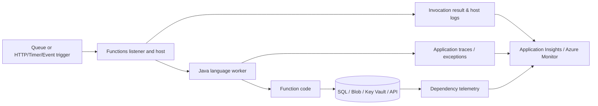
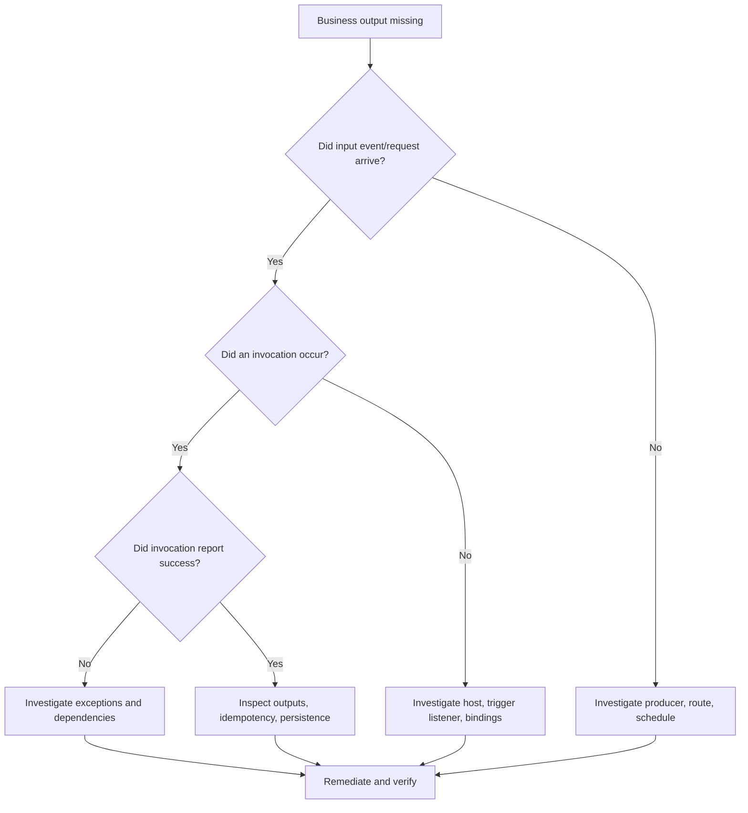
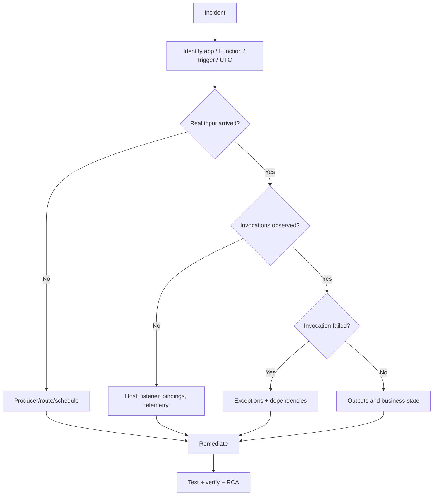

# Observing and Diagnosing Function Execution Failures

An **Azure Functions** app can deploy cleanly yet still fail to process work: an HTTP trigger returns 500, a Queue trigger processes the same message multiple times, a Timer trigger skips its expected time, a Service Bus trigger routes messages to the dead-letter queue, or a Java Function fails when calling Azure SQL, Blob Storage, or Key Vault.

The hardest part of an investigation is rarely finding a "View logs" button—it is **not knowing whether a Function actually triggered, which instance ran it, which step failed, whether it retried, and whether the business outcome was persisted**. You must combine **invocation logs, Azure Monitor metrics, Application Insights, distributed tracing, trigger metadata, platform diagnostics, and source/destination data**.

This lesson belongs to the **Serverless with Azure Functions** chapter of the **CLOUD_PROVIDERS_AZURE** module. It connects Azure fundamentals—from subscriptions, resource groups, Microsoft Entra ID, and virtual networks through storage, data, security, monitoring, and cost control. Commands and code below illustrate diagnostic methods in authorized environments; they are not outputs from a live production deployment.

## Learning Objectives

After this lesson, you will be able to:

1. Distinguish **zero-invocation failures**, **runtime startup failures**, **in-function failures**, and **dependency failures**.
2. Identify Azure Functions telemetry types: invocation results, traces, exceptions, dependencies, metrics, and platform events.
3. Use Azure Portal, Azure CLI, and Azure Functions Core Tools to inspect app state and execution data.
4. Configure `host.json` and log levels properly; understand why sampling or filtering can hide expected logs.
5. Emit Java logs with invocation IDs, correlation IDs, and exceptions without leaking secrets.
6. Query Application Insights/Log Analytics with KQL to pinpoint errors, latency, and slow dependencies.
7. Diagnose HTTP, Storage Queue, Service Bus, Event Hubs, Timer, and Durable Functions triggers individually.
8. Distinguish retries, duplicate delivery, poison queues, and dead-letter queues; design idempotency.
9. Troubleshoot storage connections, managed identities, VNets, private DNS, cold starts, scaling, and deployments.
10. Build an investigation runbook, alerts, evidence preservation, and observability cost controls.

## 1. Mental Model: Which Layers Does a Function Traverse?

Suppose the system receives message `ORD-1001` from Azure Storage Queue. A Java Function reads the message, validates the order, writes a report to Blob Storage, and finishes.



When expected output is missing, isolate these layers:

| Layer | Common Symptom | What to Verify |
|---|---|---|
| **Trigger source** | No request, message, or event | Did the event actually arrive at the right queue/topic/route? |
| **Functions host/listener** | Zero invocations despite queued messages | Is the app running, trigger indexed, and listener active? |
| **Language worker** | Java process fails at startup | Are JDK, runtime, classpath, package, and worker compatible? |
| **Function code** | Exception or wrong output | Inputs, logic, validation, exit/error paths |
| **Dependencies** | Timeouts, 401/403, 429, DNS, or TLS errors | Identity, permissions, networking, quotas, target service |
| **State/output** | Function reports success yet file or record is missing | Did the side effect actually commit? |
| **Telemetry pipeline** | Missing logs despite real executions | Logging config, sampling, retention, workspace, and latency |

**Do not start by restarting the Function App** before capturing evidence. Restarting wipes volatile state, interrupts in-flight work, and hides root causes.

## 2. Which Identifiers Does an Invocation Carry?

An **invocation** is a single execution of a Function by the runtime. Distinguish:

- **Function App:** the Azure resource containing one or more Functions.
- **Function name:** the entry point name, e.g., `ProcessOrder`.
- **Invocation ID:** identifier of **one Function call**. When the same message retries, the new execution can get a new invocation ID.
- **Message ID / Event ID:** data identifier from Queue/Service Bus/Event Hubs; can stay constant across redeliveries.
- **Correlation ID / trace ID:** links steps of the **same business transaction** across multiple Functions or services.
- **Operation ID:** correlation property in Application Insights linking requests, dependencies, and traces.
- **Durable orchestration instance ID:** identifier of a durable workflow, distinct from per-orchestrator/activity invocation IDs.
- **Deployment version/slot:** code version or slot that handled the invocation.

Example:

```text
businessOrderId = ORD-1001
queueMessageId   = msg-8392
invocationId     = inv-23b8
traceId          = trace-7fe4
functionName     = ProcessOrder
deployment       = release-2026-11-20-1
```

This is synthetic data only.

During a retry, `queueMessageId` can stay identical while `invocationId` changes. If logs record only `invocationId` without message/business IDs, you can easily mistake two retries for two different orders.

### Correlation Rules

Useful logs answer **who processed which item, in which execution, on which version, and with what outcome**. Never log PII, passwords, access tokens, SAS URLs, sensitive message payloads, or connection strings just to make searching easier.

## 3. Primary Observability Data Sources

| Source | Strengths | Limitations |
|---|---|---|
| **Functions → Monitor / Invocations** | Inspects executions and outcomes in supported Portal views | Depends on Application Insights, runtime, sampling, and data availability |
| **Application Insights** | Requests, traces, exceptions, dependencies, operation correlation | Contains only instrumented/ingested data; subject to sampling |
| **Azure Monitor Metrics** | Trends for executions, failures, and resource consumption where exposed | Contains no stack traces or business payloads |
| **Azure Monitor Logs / Log Analytics** | KQL queries, historical data, alerts, and dashboards | Requires exact table/schema, destination, retention, and ingestion budget |
| **Live Metrics / Log streaming** | Near-real-time observation while reproducing failures | Not a complete historical audit trail |
| **Functions host/platform logs** | Worker startup, listener, binding, storage, and scaling errors | Access experience varies by hosting plan |
| **Azure Activity Log** | Control-plane changes: app settings, deploys, identity, networking | Does not record individual Java method runs |
| **Trigger backend** | Queue messages, delivery counts, DLQs, Event Hubs lag, schedule state | Does not contain internal app stack traces |
| **Business output** | Blobs, SQL rows, order statuses, or emitted events | Must be verified directly; Function Success alone is insufficient |

Effective investigation **correlates across sources** rather than assuming any single telemetry table tells the whole story.

## 4. First-Five-Minute Scoping Workflow

Before changing any configuration, capture:

1. **Subscription, resource group, Function App, and deployment slot** (if used).
2. Function name and trigger type.
3. Incident start time in **UTC**, duration, and impact scope.
4. Whether input requests, messages, or events arrived—and which IDs are traceable.
5. Available invocation IDs, trace IDs, message IDs, or orchestration instance IDs.
6. Recent deployments, config updates, scaling events, runtime upgrades, or firewall changes near that time.
7. Affected environments: production only, or staging too?
8. Risk of duplicate, lost, or partially written data.

### First Triage Decision Tree



This is a triage flow, not an exact state machine for every trigger. A Function can run while telemetry is dropped, so **"no visible invocations" does not prove zero executions** until logging health is verified.

## 5. Inspecting a Function App in Azure Portal

In the Azure Portal:

1. Navigate to the exact **Subscription → Resource group → Function App**.
2. On **Overview**, verify app state, hostname, hosting plan, runtime stack, and any surfaced platform errors.
3. Open **Functions** and confirm the expected function appears and is enabled.
4. Open the function → **Monitor** or **Invocations** (per your Portal view) and set the time window.
5. Select a failed run to view runtime details and the Application Insights link if configured.
6. Open **Application Insights**, **Metrics**, or **Logs** to inspect exceptions and dependencies.
7. Check **Configuration / Environment variables**, **Networking**, **Identity**, and **Deployment** if config errors appear.
8. Check **Diagnose and solve problems** where available for your plan and resource.

Menu labels and available blades vary by **Windows/Linux, hosting plan, runtime version, and RBAC role**. Do not rely on an outdated screenshot assuming every option sits in the exact same spot.

### If Monitor Shows No Data

Possible reasons include:

- Application Insights is disconnected or its connection string is wrong.
- The Function received zero calls during the selected time range.
- The host failed to index the Function due to runtime or binding errors.
- Sampling or log levels filtered out the expected telemetry.
- You are viewing the wrong app/slot, subscription, or Application Insights resource.
- Telemetry has not finished ingesting yet.
- The Function writes to a different instrumentation table than the one queried.

Verify each hypothesis carefully; never turn on `Debug` logging across all of production immediately.

## 6. Azure CLI: Verify the Right App Before Reading Logs

In Bash using Azure CLI signed into an authorized identity:

```bash
az account show --output table

az account set --subscription "<SUBSCRIPTION_ID>"

RG="<RESOURCE_GROUP>"
APP="<FUNCTION_APP_NAME>"

az functionapp show \
  --resource-group "$RG" \
  --name "$APP" \
  --query "{id:id,name:name,state:state,kind:kind,location:location,httpsOnly:httpsOnly}" \
  --output json
```

These commands are **read-only** and prevent investigating the wrong app.

### List Indexed Functions

```bash
az functionapp function list \
  --resource-group "$RG" \
  --name "$APP" \
  --output table
```

If a Function is absent, inspect deployment artifacts, language worker, function indexing, trigger bindings, and runtime logs. Seeing the Function App resource exist **does not guarantee all Function methods were discovered and triggered cleanly**.

### List Available Metric Definitions

```bash
APP_ID=$(az functionapp show \
  --resource-group "$RG" \
  --name "$APP" \
  --query id --output tsv)

az monitor metrics list-definitions \
  --resource "$APP_ID" \
  --output table
```

Pick **actual metric names** returned for your app and hosting plan before querying. Metrics such as execution count or execution units vary by plan and API; never assume every environment exposes identical metric names or aggregations.

### CLI Limitations

Azure CLI is not meant for reading **all** exceptions and traces. Use Application Insights/Log Analytics with KQL and proper access permissions for deep analysis. Never dump all app settings to a ticket, as output can expose secrets or key references.

## 7. Log Streaming and Live Metrics

**Log stream** displays messages in near real time while reproducing an error. With Azure Functions Core Tools, a supported option on certain hosting/runtime setups is:

```bash
func azure functionapp logstream "<FUNCTION_APP_NAME>"
```

Log streaming availability depends on **hosting plan and OS**; not all Linux Consumption/Flex Consumption apps support the exact same method. Where unavailable, use **Portal → Application Insights → Live Metrics** or **Logs** via supported environment channels.

### How Log Stream Differs from Live Metrics

- **Log stream:** host/worker/app log lines delivered over supported streams; useful while reproducing exceptions.
- **Application Insights Live Metrics:** near-real-time request rates, failures, and sample streams where supported.
- **Historical Logs:** ingested records queryable via KQL, subject to ingestion latency.

Never point to an empty Log stream window as proof of "zero errors." The host may be disconnected, the app may not be logging, you may be watching the wrong slot, filters may be dropping events, or failures occurred before the worker started.

### When Enabling Verbose Logging

- Keep the test window short and actively monitored.
- Never leave trace-level logging on permanently in production.
- Never print `Authorization` headers, SAS URLs, JWTs, raw payloads, or PII.
- Save redacted evidence with sensitive fields masked.
- Restore approved log levels, sampling, and diagnostic settings afterward.

## 8. Configuring `host.json` and Log Levels

`host.json` governs Functions host settings including logging, extension behavior, and runtime policies. Exact fields and behavior depend on Functions runtime and extension versions.

Basic logging configuration example for Functions runtime v4:

```json
{
  "version": "2.0",
  "logging": {
    "logLevel": {
      "default": "Information",
      "Host.Results": "Information",
      "Host.Aggregator": "Information",
      "Function": "Information"
    },
    "applicationInsights": {
      "samplingSettings": {
        "isEnabled": true,
        "excludedTypes": "Request;Exception"
      }
    }
  }
}
```

### Meaning

- `default: Information`: baseline level for categories without explicit overrides.
- `Host.Results`: controls execution result logs emitted by the runtime across supported pipelines.
- `Host.Aggregator`: controls runtime metric aggregation; overly restrictive levels can drop summary data.
- `Function`: log level for Function-related categories.
- `samplingSettings.isEnabled`: enables telemetry sampling in supported pipelines.
- `excludedTypes: "Request;Exception"`: exempts these telemetry types from this sampling rule; **it does not disable collecting requests or exceptions**.

**Warning:** setting `Host.Results` to `Warning` or overly throttling categories can suppress invocation telemetry such as requests/results. When "Functions run yet Monitor looks empty," check `host.json` and app setting overrides before blaming Azure Monitor.

### `host.json` Can Be Overridden

Azure Functions supports `AzureFunctionsJobHost__...` app settings to override host config in supported environments. Thus dev, staging, and production may use different log levels despite shipping identical `host.json` files.

Never print all app settings into logs. Inspect **setting names and config sources** with proper permissions, sharing only non-sensitive values during investigations.

### Sampling and Caveats

Sampling reduces ingestion costs at the expense of omitting individual traces. For rare events or critical transactions, understand which telemetry types are sampled, weighting fields (such as `ItemCount`), and aggregation limits. Never assume row count in a table equals true total executions.

## 9. Writing Java Function Logs with Invocation IDs

In Azure Functions Java, `ExecutionContext` provides the logger and execution metadata. Example for an **Azure Storage Queue-triggered Function** in a configured Java Functions project:

```java
package vn.example.functions;

import com.microsoft.azure.functions.ExecutionContext;
import com.microsoft.azure.functions.annotation.FunctionName;
import com.microsoft.azure.functions.annotation.QueueTrigger;

import java.util.logging.Level;
import java.util.logging.Logger;

public class OrderProcessor {

    @FunctionName("ProcessOrder")
    public void process(
            @QueueTrigger(
                name = "message",
                queueName = "orders",
                connection = "OrdersStorage")
            String message,
            final ExecutionContext context) {

        Logger log = context.getLogger();
        String invocationId = context.getInvocationId();

        // Lab data only; production inputs must be parsed/validated
        // against a schema and sensitive messages must never be logged raw.
        String orderId = message == null ? "" : message.trim();

        log.info("event=order_processing_started" +
                 " invocationId=" + invocationId);

        try {
            if (orderId.isBlank()) {
                throw new IllegalArgumentException("empty_order_id");
            }

            // Controlled fault injection in lab environment.
            if (orderId.equals("FAIL_LAB")) {
                throw new IllegalStateException("simulated_lab_failure");
            }

            // Production: call business processing service and persist
            // durable output with backend idempotency.
            log.info("event=order_processing_completed" +
                     " invocationId=" + invocationId);

        } catch (Exception ex) {
            log.log(
                Level.SEVERE,
                "event=order_processing_failed" +
                " invocationId=" + invocationId +
                " errorType=" + ex.getClass().getSimpleName(),
                ex
            );

            // Do not swallow errors; let runtime/trigger observe failure.
            throw ex;
        }
    }
}
```

### Lessons from This Example

1. **Log start/success/failure** with consistent event names.
2. Include `invocationId` to correlate log lines.
3. Log exceptions using the stack-trace-aware logger API.
4. **Rethrow** errors rather than catching and reporting fake success.
5. Never log message payloads containing PII or tokens.
6. With Storage Queue, trigger config governs retry and poison-message behavior—not merely logging `SEVERE`.
7. When a message retries, link new invocation IDs via **message ID/business key** metadata or logs.

Use `FAIL_LAB` strictly in **sandbox queues and resource groups**, as it intentionally forces failures. Never send it into a production queue.

### Never Swallow Exceptions

This pattern is dangerous:

```java
try {
    performWork();
} catch (Exception ex) {
    context.getLogger().severe("Failed: " + ex.getMessage());
}
// Function exits normally => runtime may treat invocation as succeeded.
```

If business logic did not complete and no durable state was saved, let errors propagate to the runtime or return failure per the trigger contract. When intentionally routing bad records to **quarantine**, persist quarantine state durably before acknowledging rather than faking success.

## 10. Correlating Logs, Traces, and Dependencies

A request may flow through:

```text
HTTP API -> Function -> Azure SQL -> Blob Storage -> Service Bus
```

Application Insights/Distributed tracing links spans, requests, and dependencies using **operation IDs and trace context**, depending on runtime and library instrumentation.

### IDs to Preserve

- **Invocation ID:** one Function execution.
- **Operation ID / trace ID:** distributed trace request.
- **Business ID:** non-sensitive order or batch ID.
- **Message ID:** broker message identifier.
- **Dependency request ID:** returned by target services when headers provide one.

Structured log example:

```text
event=order_started invocationId=i-101 orderKey=ORD-1001
event=blob_write_started invocationId=i-101 blob=reports/ORD-1001.json
event=blob_write_failed invocationId=i-101 status=403 error=AuthorizationPermissionMismatch
```

Synthetic data only. Blob paths may be sensitive in some organizations—truncate or mask as required.

### Application Logs vs. Dependency Telemetry

Not every JDBC or HTTP call appears automatically in Application Insights across all Java setups. Some stacks require **Azure Monitor OpenTelemetry or explicit instrumentation/agents**. If dependencies look empty, check instrumentation support and config before concluding Java never called the dependency.

## 11. Connecting Application Insights and Querying the Right Tables

Application Insights (part of Azure Monitor) typically exposes these data categories:

| Data Type | Meaning |
|---|---|
| **Requests / AppRequests** | Requests or function executions captured by instrumentation |
| **Traces / AppTraces** | Log and trace messages |
| **Exceptions / AppExceptions** | Exception types, messages, and stack telemetry |
| **Dependencies / AppDependencies** | Outbound calls, latency, and outcomes per instrumentation |
| **Custom events / metrics** | Application-emitted telemetry per contract |
| **Live Metrics** | Near-real-time telemetry where supported |

Exact table names depend on **classic vs. workspace-based Application Insights, resource-specific schemas, diagnostic routing, and ingestion modes**. Two common patterns:

- Classic Application Insights exposes `requests`, `traces`, `exceptions`, and `dependencies` with columns like `timestamp`, `operation_Id`, and `success`.
- Direct **Log Analytics workspace** queries commonly expose `AppRequests`, `AppTraces`, `AppExceptions`, and `AppDependencies` with `TimeGenerated` and `OperationId`.

Never run a `requests` query against a workspace containing only `AppRequests` and conclude telemetry is missing.

### Connection String

App settings typically use **`APPLICATIONINSIGHTS_CONNECTION_STRING`** for telemetry routing. Never paste connection strings into training docs, tickets, or logs. Misconfigured instrumentation or resource links can leave Functions running normally while telemetry routes elsewhere or drops silently.

### Accounting for Ingestion Latency

Telemetry does not always appear instantaneously. Widen the UTC time window, check pipeline status, sampling, retention, and verify requests actually ran. A fast Function finishes long before its records surface on a dashboard.

## 12. KQL: Summarizing Invocations and Errors

Example querying a **Log Analytics workspace** with the `AppRequests` table and matching columns:

```kusto
AppRequests
| where TimeGenerated > ago(1h)
| summarize
    Invocations = count(),
    Failed = countif(Success == false),
    P95DurationMs = percentile(DurationMs, 95)
  by bin(TimeGenerated, 5m), Name
| order by TimeGenerated asc
```

Notes:

- `Name` is the telemetry operation/request name; for some Functions it may differ slightly from the Java method name.
- `Success` reflects telemetry rules, not necessarily business outcome.
- `DurationMs` measures duration for that tracked request/operation.
- When sampling is active, `count()` may **not equal true total invocations**. Factor in `ItemCount` and sampling rules when estimating true counts.

### Finding Failed Invocations

```kusto
AppRequests
| where TimeGenerated > ago(2h)
| where Success == false
| project TimeGenerated, Name, ResultCode,
          DurationMs, OperationId, AppRoleName
| order by TimeGenerated desc
```

For non-HTTP Functions, `ResultCode` is not always an HTTP status code. Do not treat every `ResultCode = 500` as a user-facing HTTP response.

### Querying Classic App Insights

```kusto
requests
| where timestamp > ago(1h)
| summarize
    Invocations = count(),
    Failed = countif(success == false),
    P95 = percentile(duration, 95)
  by bin(timestamp, 5m), name
| order by timestamp asc
```

**Always match queries to the real active schema.** If a table is empty or a column is missing, open the resource's schema explorer, check logging/sampling, and adapt the query.

## 13. KQL: Querying Exceptions, Traces, and Dependencies

### Finding Logged Exceptions

```kusto
AppExceptions
| where TimeGenerated > ago(2h)
| summarize Occurrences = count()
  by Type, ProblemId
| top 20 by Occurrences desc
```

Viewing details and correlation:

```kusto
AppExceptions
| where TimeGenerated > ago(1h)
| project TimeGenerated, Type, OuterMessage, OperationId
| order by TimeGenerated desc
```

Columns can vary by pipeline; if `OuterMessage` is missing, inspect the schema for the active message field. Never query `AppRequests` expecting full stack traces there.

### Finding Java Traces

```kusto
AppTraces
| where TimeGenerated > ago(1h)
| where Message contains "order_processing_failed"
| project TimeGenerated, Message, SeverityLevel,
          OperationId, AppRoleName
| order by TimeGenerated desc
```

### Correlating Dependencies by Operation ID

```kusto
let op = "<OPERATION_ID>";
AppDependencies
| where TimeGenerated > ago(2h)
| where OperationId == op
| project TimeGenerated, Name, Target,
          DurationMs, Success, ResultCode
| order by TimeGenerated asc
```

If dependencies are empty, check instrumentation, sampling, and resource correlation. Zero dependency rows **does not prove Java skipped HTTP/SQL/Blob calls**.

### Querying `FunctionAppLogs`

When Diagnostic Settings route resource-specific logs to `FunctionAppLogs`:

```kusto
FunctionAppLogs
| where TimeGenerated > ago(1h)
| project TimeGenerated, FunctionName, Level, Message
| order by TimeGenerated desc
```

Use this table only when it actually exists in your configured workspace. Diagnostic log schemas and categories vary; never assume `FunctionAppLogs` and `AppTraces` always hold identical records.

## 14. Metrics and Alerts: Spotting Trends

Detailed logs answer **"why,"** while metrics surface **"when, how much, and how wide."**

Key metrics and signals to watch:

- Execution/request counts and failure rates.
- Average duration, plus **p95/p99** where exposed.
- Exception counts by type and Function.
- Dependency failure, timeout, and throttling counts.
- Queue backlog growth, message age, and DLQ counts where broker metrics expose them.
- Plan/worker CPU and memory per hosting plan capabilities.
- Restarts, host startup errors, and scale events where available.
- Unprocessed items or "missing scheduled invocations."
- Successful business outputs, not just successful Function invocations.

### Error Rates and Baselines

In 5 minutes with 1,000 invocations and 20 failures, the failure rate is 2%. Yet for a Function running once a day, a single failure matters far more than a 2% transient error rate in a retry-tolerant pipeline.

Effective alerts combine:

1. **Rate/threshold** signals from telemetry.
2. **Absolute count** floors to avoid noisy alerts during low traffic.
3. **Absence detection** for Timers or SLA-bound pipelines.
4. **Business output checks** for deadline-driven jobs.
5. **Severity and runbook links** so responders know the next step.

Azure Monitor alerts use **metrics or log queries** depending on data sources; factor in ingestion delay, evaluation windows, frequency, and query costs.

## 15. HTTP-Triggered Functions: 4xx, 5xx, and Timeouts

HTTP Functions are easy to reproduce with `curl`, yet you must distinguish status codes returned by the **client/gateway, Functions host, or application code**.

### Controlled Testing

```bash
curl -i \
  --connect-timeout 10 \
  --max-time 30 \
  "https://<FUNCTION_APP_NAME>.azurewebsites.net/api/<ROUTE>"
```

If the route requires auth, use approved credentials; never embed function keys in publicly shared URLs or unguarded shell history.

### Common Causes

| HTTP Status / Symptom | Hypothesis | Where to Investigate |
|---|---|---|
| 401 / 403 | Function key, App Service Auth, APIM, IP restrictions | Auth settings, gateway, access policies, logs |
| 404 | Wrong route, unindexed function, wrong slot/hostname | Function list, routes, deployment history |
| 429 | Rate limit at gateway, API, or downstream | Response headers, APIM, dependency logs |
| 500 | Unhandled exception, binding/startup failure | App Insights exceptions, host logs |
| 502 / 503 | Host unavailable, worker crash, backend failure, platform issue | Startup/runtime logs, metrics, diagnostics |
| Client timeout | Slow Function, proxy/frontend timeout, broken network | Request duration, dependency traces, hosting limits |

### Never Hold HTTP Requests Open for Long Batches

HTTP frontends enforce timeouts independent of `functionTimeout`. For long tasks, return **HTTP 202 + Queue/Durable Functions + status endpoint** instead of holding an HTTP request on a multi-hour Java Function.

**Standard HTTP triggers do not automatically replay after a 500** like Storage Queue triggers. If clients retry, enforce idempotency to avoid duplicate orders or payments.

## 16. Azure Storage Queue Trigger: Retries and Poison Queues

With Storage Queue-triggered Functions, messages become **temporarily hidden** while a worker processes them. If the Function fails or does not complete cleanly, the message reappears after the visibility timeout and triggers another invocation.

### Notable Failure Scenarios

- Message fails **deserialization** or binding.
- Function throws an exception or worker loses connectivity.
- Storage Queue or output dependencies return 403/429/5xx.
- Visibility timeout expires, causing redelivery.
- Repeated failures send the message to the **poison queue** per Storage Queues extension settings.

Storage Queue triggers commonly default `maxDequeueCount` to 5 before moving messages to `<queue-name>-poison`. **Never hardcode that number across every extension or `host.json` version**; verify your active config and runtime.

### Example `host.json` for Queues Extension

```json
{
  "version": "2.0",
  "extensions": {
    "queues": {
      "maxDequeueCount": 5,
      "visibilityTimeout": "00:00:30"
    }
  }
}
```

This is an **alternative `host.json` snippet illustrating Queue settings**, not a second file to append verbatim to the logging example. In production, merge these fields into your existing `host.json` and check your Storage Queues extension version.

### Investigating Unprocessed Messages

1. Confirm exact Storage account and queue name.
2. Check whether messages remain in the main queue or moved to the poison queue.
3. Inspect message ID, insertion time, and dequeue count where exposed.
4. Search Java logs by invocation ID and business event.
5. Classify root cause: data, code, permissions, or networking.
6. Fix the root cause **before requeueing**.
7. Reprocess idempotently without losing original message tracking.
8. Monitor queue depth and poison queue after the fix.

**A poison queue is not an infinite automated trash bin.** Assign an owner, retention policy, alerts, and controlled reprocessing/quarantine runbooks.

## 17. Service Bus Trigger: Delivery Counts and Dead-Letter Queues

**Azure Service Bus** implements message settlement and **dead-letter queues (DLQ)** differently from Azure Storage Queue poison queues.

Details to check:

- **Message ID**, session ID (if used), and delivery count.
- **Peek-lock** or settlement mode per trigger/config.
- **`MaxDeliveryCount`** on the queue/subscription.
- **Dead-letter reason/description** when messages enter the DLQ.
- Message lock duration, auto-renewal, concurrency, and transaction behavior.
- Service Bus namespace/queue/topic/subscription and quotas.

### When the Function Fails

In standard peek-lock mode, failed runs or expired locks make messages eligible for redelivery. Once `MaxDeliveryCount` is exceeded or explicit dead-lettering runs, the message moves to the DLQ.

**Do not equate Service Bus DLQs with Azure Storage Queue poison queues.** They differ in schemas, settlement APIs, retry rules, and operational tooling.

### Service Bus Runbook

1. Confirm namespace, entity, and subscription (if using a topic).
2. Inspect Active vs. Dead-letter message counts.
3. Check message IDs, delivery counts, dead-letter reasons, and host logs.
4. Separate schema errors, Java exceptions, identity/network blocks, and lock expirations.
5. Compare execution duration against lock renewal caps and concurrency.
6. Fix the root cause and **re-drive the DLQ** using idempotent tooling/procedures.
7. Never blindly forward all DLQ messages back to the live queue without filtering out poison data or fixing bugs first.

### Multi-Layer Retry Policies

SDKs or application code may retry dependencies while the broker also redelivers messages. Without bounds, downstream load and costs explode. Monitor the **total retry budget**, not `MaxDeliveryCount` alone.

## 18. Event Hubs Trigger: Checkpoints and Reprocessing

Event Hubs is an **event stream**, not a per-message queue with a Storage Queue-style poison queue.

Common issues:

- Events arrive on the wrong consumer group.
- Function Apps improperly share one consumer group, causing partition ownership thrashing.
- Checkpoints fail to persist before a worker crashes.
- An event or batch gets reprocessed.
- Processing lag climbs when partition counts, throughput units, or concurrency fall short.
- `AzureWebJobsStorage`/checkpoint storage, identity, or networking fails.
- Batch handlers lack idempotency and write duplicate records.

### Diagnostic Principles

- Verify exact **Event Hub namespace, hub, consumer group, and partition**.
- Inspect event timestamps, partition IDs, and offsets/sequence numbers where exposed.
- Compare ingress rate, processing throughput, and consumer lag.
- Check host logs for listener health, leases/checkpoints, partition balancing, and exceptions.
- Confirm outputs handle **at-least-once processing** safely by design.

A batch Function returning success does not guarantee all events committed to the database if transaction/checkpoint logic is flawed. Verify outputs per partition or business key.

## 19. Timer Trigger: Late, Duplicate, or Skipped Runs?

Timer triggers run on schedule using six-field NCRONTAB expressions with a **seconds field** where supported, for example:

```text
0 0 2 * * *
```

This runs at **02:00 UTC daily** when the app runs in UTC and the timer is healthy. That is **not 02:00 Vietnam time** (UTC+7); it fires at 09:00 in Vietnam.

### When a Timer Misses Its Schedule

1. Check whether the function is indexed and enabled.
2. Verify the cron expression and how timezones are interpreted.
3. Check host startup, storage schedule monitor, and listener logs.
4. Check deployments, restarts, or scaling around the scheduled tick.
5. Check app settings overriding triggers or disabling the function.
6. Verify the app is not stopped and the hosting plan supports continuous timer scheduling.
7. Inspect `isPastDue` or equivalent metadata where exposed by SDK/bindings to detect late runs.
8. Verify business outputs and guard against duplicates during manual catch-up runs.

### Beware of Timezones

Settings like `WEBSITE_TIME_ZONE` carry **hosting-plan and OS limits**; never assume setting a timezone app setting works identically across every Linux/Flex plan. Prefer scheduling in **UTC**, converting times in dashboards, and checking daylight saving rules if other timezones apply.

**Timer triggers do not offer millisecond-exact SLAs.** Account for startup, distributed coordination, jitter, and catch-up jobs when strict deadlines matter.

## 20. Durable Functions: Replay vs. Execution Retries

With **Durable Functions**, observability adds extra dimensions:

- **Orchestrators** **replay** from history.
- **Activities** execute side effects and can retry.
- **Entities** manage keyed state via operations where supported by the SDK.
- **Orchestration instance IDs** differ from individual Function invocation IDs.
- Workflows can remain `Running` for days while awaiting timers or external events.

### Why Do Logs Repeat?

If an orchestrator logs every time code executes/replays, identical lines appear repeatedly even though **activities did not re-run**. Use replay-safe loggers or check replay status via your Durable SDK's API.

### Durable Runbook

1. Identify **instance ID, task hub, and storage provider**.
2. Query orchestration runtime status and last updated time.
3. Inspect activity failures and orchestration history/events via supported tooling.
4. Verify external event names, timer deadlines, and event sender permissions.
5. If errors follow a deployment, check **orchestrator determinism and version compatibility**.
6. Before retrying activities, check whether database/API side effects already committed.
7. Never manually edit or delete task hub storage to "reset" workflows while valid instances exist.
8. Monitor **business completion**, not just runtime status.

### Nondeterminism

Reordering scheduled activities in new code while older instances remain running causes history mismatches during replay. Maintain versioning and compatibility plans rather than assuming new code fits all in-flight instances.

## 21. Java Worker, Functions Runtime, and Startup Failures

If there are **zero invocations** while the trigger source holds data, the host or Java worker likely failed startup or indexing.

### Inspection Layers

| Component | Failure Signal | Verification Path |
|---|---|---|
| `FUNCTIONS_WORKER_RUNTIME` | Set to something other than `java` | App settings source and permitted names/values |
| Functions runtime | Version incompatible with extensions | Runtime/version and host startup logs |
| JDK | `UnsupportedClassVersionError` or bad class version | Build target vs. runtime Java version |
| Maven artifact | Missing function metadata, dependencies, or classes | Packaging, deployment logs, function indexing |
| Java worker | Startup timeout, OOM, process crash | Worker/platform logs, memory/CPU, startup time |
| Binding extension | Cannot find binding/extension or listener fails | Extension bundle, dependencies, host logs |
| Trigger connection | Cannot reach queue, Service Bus, or Storage | Secret/identity, DNS, firewall, permissions |
| Function disabled | Disabled via app setting or Portal | Function list and configuration |
| Slot/deployment | Deployed to wrong slot or stale artifact | Deployment history, slot config, version |

### Watch Java Versions Carefully

Building with a newer JDK than the Function App runtime supports prevents class loading. A clean Maven build on a developer laptop **does not prove Azure's Functions host can execute the bytecode**.

When diagnosing, record:

- JDK and bytecode target.
- Azure Functions runtime and Java worker versions.
- Extension bundle/trigger extension versions.
- Artifact version or image digest.
- Deployment timestamp.
- Relevant app settings (without printing secrets).
- Host startup and indexing logs.

## 22. Deployments, Trigger Synchronization, and Configuration

Post-deployment, function definitions and bindings must be discovered by the runtime. Common pitfalls:

- Artifact deployed to the wrong app or slot.
- Function name or route changed.
- Deployment package missing metadata or required files.
- Host fails startup due to missing settings.
- Trigger synchronization/indexing incomplete per deployment model.
- A changed setting disconnects listeners from event sources.
- Older version still serving traffic during an incomplete deployment or slot swap.

### Verification Steps

1. Confirm deployment ID and artifact version.
2. Inspect Azure Activity Log and deployment logs.
3. List Functions from Portal or CLI.
4. Inspect host startup and listener logs.
5. Verify each trigger connection.
6. Send test requests/events **in lab or staging**.
7. Compare App Insights before and after deployment.
8. If rolling back, assess impacts on processed events, stateful workflows, and DB schemas.

**Never tweak production app settings or restart blindly to probe** without a recovery plan. Changing runtime config can restart workers and alter trigger behavior.

## 23. Dependency Errors: RBAC, Managed Identity, Networking, and DNS

A Function may run cleanly in Java yet fail when calling Azure SQL, Blob Storage, Key Vault, or APIs due to dependency-layer errors.

### Separating Auth Errors from Network Errors

| Symptom | Likely Cause to Inspect |
|---|---|
| **401 Unauthorized** | Invalid credential/token, wrong audience, or broken OAuth flow |
| **403 Forbidden** | Identity obtained a token yet lacks data-plane role, or blocked by firewall/service policy |
| **Timeout / TCP reset** | Network routing, NSG, firewall, Private Endpoint, or service outage |
| **DNS resolution failed** | Private DNS, VNet link, custom DNS forwarder, or wrong hostname |
| **TLS handshake failure** | Certificate chain, protocol/cipher mismatch, or proxy |
| **429 Throttling** | Quotas/rate limits or excessive concurrency |
| **5xx dependency** | Target service overloaded or transiently failing |
| **Connection pool exhausted** | Excessive concurrent calls or missing connection release/timeouts |

### Azure RBAC and Managed Identity

Managed identity provides an identity; reading Blobs requires a data role like **Storage Blob Data Reader**, and writing Blobs requires a write role (e.g., `Storage Blob Data Contributor`) at the right scope. For Key Vault, check the RBAC/access policy model and secret-level rights.

**Subscription Contributor does not automatically grant data-plane permissions.** Likewise, valid RBAC cannot bypass a Storage firewall.

### VNet Integration and Private Endpoints

- **VNet Integration** sends outbound Function App traffic into a VNet per plan features.
- **Private Endpoints** expose private access for target services/resources.
- **Private DNS** determines whether service hostnames resolve to private IPs.
- **NSGs, UDRs, and Azure Firewall** can block traffic even when auth succeeds.
- Network paths from the **Function host** differ from your laptop or Cloud Shell.

If Functions uses a dedicated Storage account for triggers/state, broken networking to that backend causes **host/listener failures**, unlike errors occurring only when code calls business storage.

### Safe Remediation Path

Never open `publicNetworkAccess` to everyone, fall back to broad account keys, or disable firewalls to mask root causes. Inspect step-by-step: `identity → role → endpoint → DNS → route → firewall → dependency response`.

## 24. Scaling, Cold Starts, Timeouts, and Concurrency

Azure Functions supports multiple hosting plans and scaling engines; never assume identical timeout, instance-count, or cold-start behavior across plans.

### Cold Starts

When the Function App must spin up a new host or Java worker, the first request/event slows down. Contributing factors:

- JAR/dependency size and JVM startup time.
- Dependency initialization, DI containers, or Spring context startup.
- App settings and secret resolution.
- Network latency to Storage and startup dependencies.
- Hosting plan and warm-instance features where supported.
- Container image pull times on container-based hosting models.

**Never diagnose a cold start from a single slow request alone.** Correlate timestamps with host startup logs, instance scaling, and dependency traces.

### Function Timeouts

`functionTimeout` in `host.json` caps execution duration within hosting plan limits:

```json
{
  "version": "2.0",
  "functionTimeout": "00:05:00"
}
```

This is illustrative; minimums, maximums, and rules vary by hosting plan. Beyond host timeouts, HTTP frontends, Service Bus locks, Queue visibility timeouts, and dependency SDKs all enforce their own timeouts.

### Concurrency

Raising concurrency can lift throughput, yet can also:

- Exhaust SQL connection pools.
- Trigger Storage/Key Vault 429s.
- Spike memory/GC pressure and Java worker OOMs.
- Increase broker lock expirations and retries.
- Flood logs and drive up ingestion costs.

With **dynamic concurrency** and supported extensions, the host tunes parallelism automatically. Measure latency, queue age, CPU, memory, retries, and downstream load before tuning.

## 25. Diagnostic Settings, Log Retention, and Security

Function Apps can support **Diagnostic settings** routing platform/resource logs to:

- **Log Analytics workspaces** for KQL queries and alerts.
- **Azure Storage** for retention and lifecycle archiving.
- **Event Hubs** for streaming telemetry into external pipelines.

Available categories and destination tables vary by resource and configuration. Application Insights telemetry typically uses a **separate ingestion path**; enabling Diagnostic settings does not automatically populate `AppRequests` or `AppExceptions`.

### Retention

Define:

- How long raw logs are retained for incident response and RCA.
- Whether long-term audit retention is mandated.
- Who can read logs containing order IDs or identifiers.
- How tokens, PII, payloads, and sensitive paths are masked.
- How evidence is exported without leaking secrets.
- Costs for ingestion, retention, queries, and alerts.

### What Never Belongs in Logs

- `AzureWebJobsStorage` connection strings or account keys.
- `APPLICATIONINSIGHTS_CONNECTION_STRING` and tokens.
- SAS URLs, Service Bus connection strings, and client secrets.
- `Authorization` headers, cookies, or JWTs.
- Raw message payloads containing PII or sensitive business documents.
- Full exception dumps exposing confidential request bodies.

To analyze malformed messages, store them in a restricted-access quarantine store and log only IDs/hashes or sanitized schema-validation errors.

## 26. Runbook for Diagnosing Function Execution Failures

This workflow applies to most production incidents:

### Step 1 — Capture Incident Context

Record UTC timestamp, Function App, Function name, slot, trigger source, error rate, SLA, and blast radius. Capture baseline metrics/health before raising log verbosity.

### Step 2 — Verify Inputs

Confirm real HTTP requests, Queue messages, Service Bus messages, Event Hubs events, Timer ticks, or Durable signals arrived. Record source IDs without copying sensitive payloads.

### Step 3 — Find Invocations or Host/Listener Signals

Check Azure Portal Monitor, Application Insights, or Functions host logs. If no invocations appear, inspect indexing, disabled flags, trigger connections, and the telemetry pipeline.

### Step 4 — Classify the Failing Layer

Pinpoint whether the failure sits in **host startup, bindings, Java worker, function code, dependencies, output persistence, or observability**. Pick the right tool only after identifying the layer.

### Step 5 — Correlate Telemetry

Use invocation ID, operation ID, or message ID to link requests, exceptions, traces, dependencies, and backend metadata within the same UTC window.

### Step 6 — Check Recent Changes

Inspect deployments, Java versions, packages, app settings, identities, Key Vault, firewalls, VNets, DNS, and quotas/capacity.

### Step 7 — Assess Retries and Already-Processed Data

Before requeueing, re-driving, or replaying, check whether side effects already executed. Use idempotency keys or conditional writes to avoid double charges, emails, or reports.

### Step 8 — Fix and Test

Test changes in staging/lab or canary first. In production, enforce approvals, rollback plans, state-preservation steps, and safe processing windows.

### Step 9 — Verify Recovery

Confirm triggers continue pulling work, error rates drop, queue age/DLQ depths return to normal, business outputs exist, and no anomalous duplicates occur.

### Step 10 — Write RCA and Prevent Recurrence

Document root cause, impact window, evidence, fixes, new alerts/runbooks, and follow-up owners.



## 27. Comprehensive Practice: Failing Queue-Triggered Java Function

**Lab scenario:** an Azure Storage Queue named `orders` delivers order IDs. The Java Function `ProcessOrder` reads messages. Valid messages simulate successful processing in the lab; `FAIL_LAB` triggers an exception so learners observe retries and the poison queue.

### Prerequisites

- Authorized lab Azure subscription and resource group.
- A Java Function App and lab Storage account configured per supported Functions runtime requirements.
- Queue `orders` contains synthetic test data only.
- `OrdersStorage` app setting configured cleanly with no committed secrets.
- Application Insights linked if querying invocations/exceptions via KQL.
- Sufficient permissions to view logs and queue metadata; avoid broad Owner roles unnecessarily.

### Step 1 — Deploy Test Code

Build the Azure Functions Java project with `OrderProcessor` from Section 9 using your organization's approved build/deploy workflow. Match runtime/JDK versions and confirm the Function is indexed.

Read-only verification example:

```bash
az functionapp function list \
  --resource-group "<RESOURCE_GROUP>" \
  --name "<FUNCTION_APP_NAME>" \
  --output table
```

### Step 2 — Send a Valid Message

Use Azure Portal, Storage Explorer, or a test producer to push `ORD-1001` onto the queue (no need to embed connection strings in examples).

Observe:

- Queue message is picked up by the Function.
- Logs show `order_processing_started` and `order_processing_completed`.
- Invocation shows success when telemetry is collected.
- Message completes per Queue trigger semantics.

### Step 3 — Send an Intentional Failure Message

Send `FAIL_LAB` into the **lab queue**. Observe:

- Log `order_processing_failed`.
- Exception `simulated_lab_failure` and stack trace in the configured pipeline.
- Invocation marked failed.
- Message redelivers per visibility/retry settings.
- After crossing the failure threshold, the message moves to `orders-poison` per Storage Queues extension settings.

Never count identical log lines to estimate retries without verifying invocation/message metadata.

### Step 4 — Query Application Insights

Example workspace KQL:

```kusto
AppTraces
| where TimeGenerated > ago(1h)
| where Message contains "order_processing_"
| project TimeGenerated, Message, OperationId
| order by TimeGenerated desc
```

And exceptions:

```kusto
AppExceptions
| where TimeGenerated > ago(1h)
| project TimeGenerated, Type, OuterMessage, OperationId
| order by TimeGenerated desc
```

If queries return empty, verify connection strings, target resource, sampling, log levels, ingestion delay, and schemas before concluding the app did not run.

### Step 5 — Inspect the Poison Queue

Use an authorized Storage management tool to inspect `orders-poison` and message metadata once routed there. Never push failing messages back onto the live queue blindly; diagnose the root cause first.

### Step 6 — Simulate a Config Error in Staging (Optional)

In an isolated environment, simulate revoking queue permissions or misconfiguring `OrdersStorage`. Here **the listener fails to start**, unlike a Java method receiving a message and throwing an exception.

Restore configuration immediately afterward. Never run this drill in production, as it can halt the entire pipeline.

### Step 7 — Record Evidence

| Evidence | Expected Result |
|---|---|
| Function indexed | `ProcessOrder` appears and host is running |
| Valid message | Successful invocation and application logs |
| `FAIL_LAB` | Failed invocation and logged exception |
| Retries | Multiple invocations or dequeue attempts observed per settings |
| Poison queue | Poison message routed to `-poison` queue after threshold |
| Monitoring | Queryable by UTC timestamp and IDs |
| Post-fix | Queue drains normally with zero duplicate business records |

### Step 8 — Safe Cleanup

Delete test messages and resources **only when certain they belong to your lab**. If the Function App or Storage account is shared, never delete the resource group, queues, or Application Insights resource. Confirm approved evidence is saved and no `FAIL_LAB` messages remain looping.

## 28. Production Monitoring and Operations Checklist

- [ ] Documented all Functions, trigger sources, owners, schedules, and business SLAs.
- [ ] Versioned Function App, runtime, Java version, extensions, and deployment artifacts.
- [ ] Configured Application Insights/Azure Monitor destinations with clear retention and access controls.
- [ ] Verified `host.json` does not accidentally filter out execution results or critical errors.
- [ ] Accounted for sampling, ingestion delay, and App Insights vs. Log Analytics schema differences.
- [ ] Java logs emit event names, UTC timestamps, invocation/correlation IDs, and severities.
- [ ] Exceptions propagate cleanly; never report fake success when work failed.
- [ ] Zero secrets, Authorization headers, raw sensitive payloads, or connection strings in logs.
- [ ] Dashboards track executions, failures, latency, dependency errors, and queue age/backlogs.
- [ ] Alerts watch failure rates, DLQ/poison counts, missed Timers, stale Durable workflows, and missing outputs.
- [ ] Idempotency keys, retry budgets, backoff, and controlled reprocessing runbooks exist.
- [ ] Evaluated locks/visibility, batching, concurrency, and throughput per trigger.
- [ ] Verified `AzureWebJobsStorage` and trigger connections against real permissions and networking.
- [ ] Configured managed identity, data-plane RBAC, VNet Integration, Private DNS, and firewalls.
- [ ] Runbooks cover debugging host startup, Java worker, bindings, HTTP, Queue, Service Bus, Event Hubs, Timer, and Durable.
- [ ] Staging validation and rollback exist for runtime, extension, and code changes.
- [ ] Business output verification supplements raw invocation status.
- [ ] Budgets and alerts monitor compute, Storage transactions, Application Insights, and Log Analytics costs.
- [ ] Clear ownership exists for poison/DLQ triage so no failed data is forgotten.
- [ ] Practiced simulated incidents and confirmed on-call engineers have access to the right telemetry.

## 29. Self-Check Questions

1. A Function App shows `Running` yet zero invocations appear; which failure layers must you distinguish?
2. How do invocation ID, message ID, trace/operation ID, and Durable instance ID differ?
3. Why does missing data in Monitor not automatically prove a Function never executed?
4. How can `Host.Results` in `host.json` affect telemetry?
5. How does sampling affect counting or finding individual requests?
6. In workspace-based Application Insights, why does `AppRequests` differ from `requests`?
7. What useful logging metadata does Java's `ExecutionContext` provide?
8. Why can catching an exception without rethrowing make a Queue trigger treat a failed run as successful?
9. How do HTTP triggers and Storage Queue triggers differ in retry behavior?
10. How does a Storage Queue poison queue differ from a Service Bus dead-letter queue?
11. What happens when a Service Bus message hits a lock timeout?
12. How do Event Hubs consumer groups and checkpoints relate to duplicate processing?
13. Why does a Timer expression for 02:00 UTC not run at 02:00 in Vietnam?
14. Do repeated orchestrator logs prove an activity ran multiple times?
15. If `ProcessOrder` is missing from the Function list, what should you inspect first?
16. Why can a valid managed identity still receive a Storage 403?
17. Why must Private DNS be tested from the Function host's network rather than just Cloud Shell?
18. How do cold starts differ from dependency timeouts and Java OOMs?
19. When raising concurrency, which downstream limits must you monitor?
20. Why does Function execution success not guarantee a report file exists?
21. Before re-driving a DLQ or poison queue, what must you verify?
22. When logs and metrics disagree, how do you reconcile timestamps, sampling, and schemas?
23. Which evidence must a runbook preserve for a verifiable RCA?
24. Which cost drivers arise from keeping verbose logging enabled long term?

## Conclusion

Observing Azure Functions goes far beyond opening Log stream. Every execution flows through **trigger source → Functions host/listener → language worker → code → dependencies → output**, and any layer can fail in distinct ways. Good diagnostics start by pinning down the **exact app, trigger, timeframe, and identifiers**, then correlating **Application Insights, Azure Monitor, KQL, runtime logs, metrics, and source/destination state** to isolate the root cause.

The key operational rule in production is never confusing **missing telemetry** with **zero execution**, **runtime success** with **business success**, or **retries** with an exactly-once guarantee. With correlated logs, clear retry/quarantine mechanics, properly scoped identity and networking on dependencies, and SLA-driven alerts, Azure Functions systems become easy to diagnose, resilient to recover, and cost-effectively auditable.
