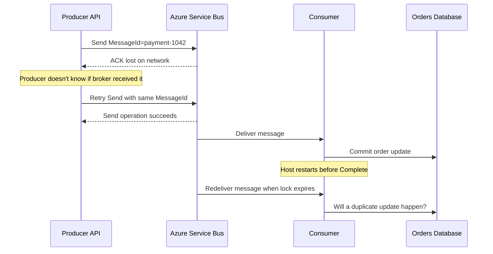
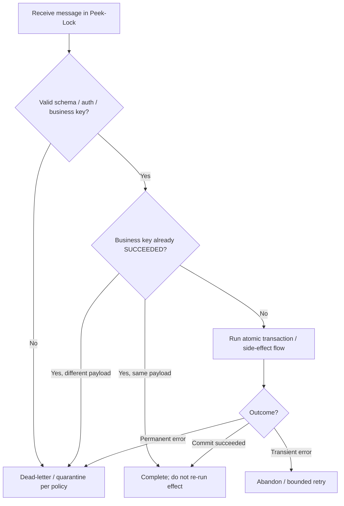
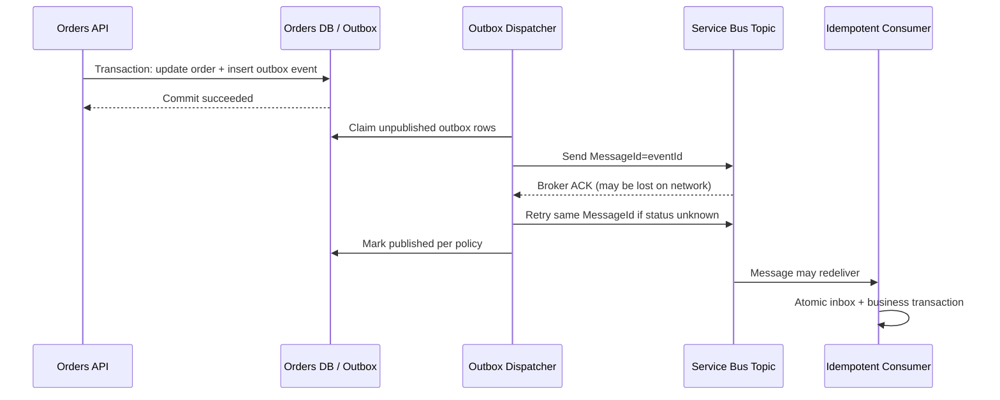

# Duplicate Detection and Idempotent Consumer Design

In a Microsoft Azure application architecture, **queues and messaging systems** decouple work creators (*producers*) from work processors (*consumers*). For instance, a payment API places a `PaymentSucceeded` event into **Azure Service Bus**, while a background worker on Azure Functions, Azure Container Apps, or VMs processes the order. This increases resilience and enables retries when components fail temporarily. Precisely because components operate independently, messages can be **sent twice, redelivered, or reprocessed**, even when every service is working as designed.

A duplicate message can cause **double-posted payments, two invoices, duplicate emails**, or out-of-order data updates. Azure Service Bus provides **duplicate detection** to catch some duplicate *sends* within a time window. However, it **does not prevent every redelivery of a message to consumers**, nor does it create a transaction spanning the broker and database. Consumers must therefore be designed to be **idempotent**: processing the same unit of work again produces no unintended extra business effects.

This lesson belongs to the **Queues and Messaging** chapter of the Azure module, connecting Azure Service Bus, Storage Queue, Event Grid, and Event Hubs with Microsoft Entra ID, managed identities, Azure RBAC, Azure SQL/PostgreSQL, Azure Functions, private networking, monitoring, and cost control. We will build an end-to-end mindset: **producer sets a stable ID → broker filters duplicate sends within bounds → consumer records work atomically → settles message after commit → recovers safely on failure**.

## Learning Objectives

After this lesson, you will be able to:

1. Distinguish **duplicate send**, **redelivery**, **retry**, **replay**, and **same business action with different message IDs**.
2. Explain **Azure Service Bus** duplicate detection based on `MessageId`, the detection history window, and feature limits.
3. Choose an appropriate **business identity**, avoiding confusion among `MessageId`, `SequenceNumber`, `DeliveryCount`, and Function invocation IDs.
4. Design idempotent consumers using **unique keys, transactions, inbox/dedup stores, concurrency handling**, and **TTL/retention**.
5. Compare acknowledgment and redelivery mechanics across Service Bus, Storage Queue, Event Grid, and Event Hubs.
6. Write Java SDK skeletons for producers and consumers using Microsoft Entra ID / managed identities in **Peek-Lock mode**.
7. Combine **transactional outbox**, target-service idempotency, and reconciliation to handle side effects outside the database.
8. Test tricky crash points, monitor DLQ/duplicate rates, secure permissions, and choose cost-effective settings.

## 1. Root Problem: Send Succeeds but Producer Misses Acknowledgment

Suppose the order backend sends a payment message through Service Bus:



There are **two** distinct scenarios here:

- **Duplicate send:** the producer retries `Send` because it never got an ACK. If the Service Bus entity has duplicate detection enabled, `MessageId` matches, and it falls inside the history window, the broker drops the duplicate send.
- **Redelivery:** the consumer updated the database yet did not `Complete` the message. When the lock expires or the broker redelivers, the consumer receives the same message again. **Send-side duplicate detection cannot prevent this.**

You must combine two layers:

```text
Producer                  Broker                    Consumer + Database
stable businessId    →   duplicate detection   →   atomic idempotent processing
retry same MessageId      filters some Sends        redelivery stays safe
```

**Success is not defined by the consumer being invoked strictly once**, but by ensuring that across multiple invocations, **the final business outcome remains accurate with zero duplication**.

## 2. Forms of Duplication to Distinguish

| Phenomenon | Example | Where to Handle It |
|---|---|---|
| **Duplicate send** | Producer resends after `Send` times out. | Broker duplicate detection and producer keeping a stable `MessageId`. |
| **Duplicate delivery** | Message uncompleted, lock expires, broker redelivers. | Consumer idempotency and proper lock/settlement handling. |
| **Duplicate business event** | Two separate requests generate charges for the same `paymentId`. | Business key / unique constraint; broker will not catch differing IDs. |
| **Intentional replay** | Operator moves a message from DLQ back to the active queue. | Idempotent consumer, audit trail, and retention. |
| **Out-of-order delivery** | `OrderUpdated v3` processes before `v2`. | Version checks, partition/session strategy, and state machine. |
| **Concurrent processing** | Two consumer instances encounter equivalent messages at once. | Atomic claim / unique constraint; never rely on in-memory locks. |
| **Retry after partial success** | Database updated, yet external confirmation/event was not sent. | Transactional inbox/outbox, provider idempotency, and reconciliation. |

Note that **a duplicate** differs from **two valid business actions**. One order can have two valid partial payments with two distinct `paymentId`s; using `orderId` alone as the dedup key would wrongly drop the second payment. Your key must represent the exact **unit of work meant to happen once**.

### 2.1. At-Most-Once, At-Least-Once, and Exactly-Once Effect

**At-most-once delivery** risks losing work to prevent redelivery. **At-least-once** avoids dropping work: messages can be delivered repeatedly until processing and settlement succeed. Achieving a **single business effect** requires transactions or conditional writes at the destination store. Never claim the broker gives an exactly-once transaction spanning **Service Bus + Azure SQL + HTTP API** just because duplicate detection is enabled.

## 3. How Does Azure Service Bus Duplicate Detection Work?

**Duplicate detection** is a feature of supporting Service Bus queues and topics. When a **producer sends a message**, the broker can record its `MessageId` (and partition details where applicable) for a configured **history time window**. If another message arrives with the same deduplication identity within that window, the broker **accepts the Send API call as a success without enqueuing a duplicate copy** per duplicate detection behavior.

Characteristics:

1. Applies at **broker message ingestion**, not to how a received message is processed or settled.
2. **The body is not compared for content equality.** Two messages with the same ID but different payloads are still treated as duplicates within the window—risking lost valid actions if IDs are chosen poorly.
3. The history window is **time-bounded**. Once the window expires, reusing the same ID treats the message as brand new.
4. When a received message is **abandoned**, loses its lock, or needs redelivery, duplicate detection **does not suppress broker redelivery**.
5. Duplicate detection **has zero awareness** of database state, emails, payments, or external side effects.
6. The feature **impacts broker throughput and resources** since ID history must be stored and queried, especially with long windows and high message rates.

### 3.1. Supported Tiers and Window Configuration

In standard Azure Service Bus offerings, duplicate detection is available on **Standard and Premium**, not in Basic. Configuration must be planned **when creating the queue/topic**; do not assume an existing deployed entity can freely toggle it on/off without limits. If migrating settings, verify API/tier support and plan a proper migration.

The **duplicate detection history time window** commonly defaults to about **10 minutes** and is configurable within the supported service range (typically **20 seconds to 7 days** per Service Bus specifications). Longer windows catch late duplicate sends, yet increase lookup overhead and can affect throughput. Never pick 7 days just to "play it safe" without estimating how many `MessageId`s must be tracked and actual send rates.

| Setting | Best For | Risk to Account For |
|---|---|---|
| Short window, e.g., 2 minutes | Flows with short send-retry windows. | Retries after 2 minutes are no longer filtered by the broker. |
| Moderate window, e.g., 10 minutes | Standard producer retry windows. | Still does not guard against replays hours or days later. |
| Long window, e.g., 24 hours | Producers capable of resending within a day. | Larger ID history; assess throughput, cost, and tier. |
| Detection disabled | Simplicity/throughput optimization or unsupported sources. | Producer/consumer must supply all dedup protections. |

**Separate the broker window from business retention.** If compliance forbids issuing duplicate invoices for seven years, a 10-minute or 7-day broker duplicate detection window cannot act as a multi-year audit ledger. You need a separately managed **business record / unique key**.

### 3.2. MessageId Is Technical, Yet Should Derive from Business Identity

Producers should assign a **stable `MessageId`** rather than generating a fresh UUID on every retry of the same job:

```text
Logical operation: issue-invoice / tenant-A / payment-1009
MessageId:        invoice:tenant-A:payment-1009

Send attempt #1 → MessageId stays the same
Send attempt #2 → MessageId stays the same
Send attempt #3 → MessageId stays the same
```

If every attempt creates a new `MessageId`, the broker cannot tell those three messages represent the same job. In an outbox-based producer, store the stable `eventId`/`MessageId` in the outbox row so the dispatcher reuses that exact ID on every retry.

**Never embed sensitive data in raw IDs** (emails, card numbers, tokens, PII). Use opaque internal identifiers or carefully designed hashes that cannot collide across distinct business operations. In multi-tenant namespaces, include tenant/scope in your ID strategy.

### 3.3. Partitioning, Sessions, and Deduplication Scope

When a Service Bus entity is **partitioned**, duplicate detection can evaluate the **`MessageId` + `PartitionKey`** pair rather than `MessageId` alone. Thus, retrying the same event with a **different `PartitionKey`** may bypass deduplication. When using **sessions**, `SessionId` groups messages and relates to partition keys under service rules. Producers must keep session/partition values consistent for **the same logical event**.

```text
Retry #1: MessageId=EVT-7, PartitionKey=customer-A
Retry #2: MessageId=EVT-7, PartitionKey=customer-A  → may be deduplicated
Retry #3: MessageId=EVT-7, PartitionKey=customer-B  → should not be assumed deduplicated
```

Exact rules also depend on entity type, tier, and session/partitioning settings. Verify against the **exact target entity** rather than applying conclusions from a non-partitioned queue to a partitioned or session-enabled topic.

### 3.4. Scheduled Messages Also Interact with Detection

Duplicate detection also applies to **scheduled messages** in Service Bus. A scheduled send and a regular send sharing the same dedup identity inside the window can collide; do not assume both enqueue as separate jobs. If the business genuinely wants to run the same operation at **two different times**, assign a distinct logical operation ID per run—such as `report:2026-11-20` and `report:2026-11-21`.

### 3.5. Broker Send Success Does Not Prove a New Copy Was Enqueued

A duplicate `MessageId` send **accepted as successful by Service Bus** may have been discarded by the broker without adding a message to the queue. Therefore, producers **must not infer newly enqueued message counts from non-throwing `sendMessage()` calls**. Track business outboxes and downstream completion separately; reconcile via correlation/billing/ledgers per architecture.

## 4. Configuring Duplicate Detection on a Service Bus Queue

### 4.1. Creating a Queue in the Azure Portal

Logical steps for a namespace supporting duplicate detection:

1. Select the right **subscription**, **resource group**, and **Service Bus namespace** (e.g., Standard or Premium).
2. Under **Queues**, create a new queue such as `orders-paid`.
3. In advanced settings, enable **Duplicate detection** if displayed and supported.
4. Set **Duplicate detection history time window**, e.g., 10 minutes, matching producer retry durations.
5. Configure `Max delivery count`, `Lock duration`, `Message TTL`, and sessions/partitioning to match workload and consistency requirements.
6. Create the queue and verify its settings. Never alter a shared production queue's settings arbitrarily, as that can change how valid traffic behaves.

UI labels and options can evolve. If an existing entity cannot toggle duplicate detection under current API/tier rules, plan a **new queue and controlled producer/consumer migration** instead of deleting a queue holding live data.

### 4.2. Sample Bicep Config for a New Queue

Bicep example for a **new queue** inside an existing Service Bus namespace. This is reference configuration—adjust API versions, deployment permissions, and properties for your environment before deploying:

```bicep
param serviceBusNamespaceName string
param queueName string = 'orders-paid'

resource existingNamespace 'Microsoft.ServiceBus/namespaces@2022-10-01-preview' existing = {
  name: serviceBusNamespaceName
}

resource ordersQueue 'Microsoft.ServiceBus/namespaces/queues@2022-10-01-preview' = {
  parent: existingNamespace
  name: queueName
  properties: {
    requiresDuplicateDetection: true
    duplicateDetectionHistoryTimeWindow: 'PT10M'
    maxDeliveryCount: 10
    lockDuration: 'PT1M'
    defaultMessageTimeToLive: 'P7D'
  }
}
```

Here `PT10M` is 10 minutes, `PT1M` is 1 minute, and `P7D` is seven days in ISO 8601 duration format. **Message TTL** and **duplicate detection history window** are **two separate policies**: one governs message lifetime, while the other governs how long the broker remembers sent IDs. Never use TTL to infer dedup retention.

Whether provisioning via Terraform, ARM, or Portal, the goal stays identical: **enable duplicate detection where supported, set the window, verify the live entity, test retries, and monitor outcomes**.

### 4.3. Reading Back Config via Azure CLI

```bash
az login
az account set --subscription '<subscription-id>'

RG='rg-messaging-lab'
SB_NAMESPACE='sb-orders-lab'
QUEUE='orders-paid'

az servicebus queue show \
  --resource-group "$RG" \
  --namespace-name "$SB_NAMESPACE" \
  --name "$QUEUE" \
  --output json
```

Inspect queue attributes such as `requiresDuplicateDetection`, `duplicateDetectionHistoryTimeWindow`, `maxDeliveryCount`, and `lockDuration` per the live CLI/API schema. **Never assume detection is enabled just from the queue name.** This CLI exercise only reads metadata and sends/receives no messages.

## 5. Choosing the Right MessageId and Business Key

Identity design is one of the most consequential architectural choices: the broker only sees a protocol-level message ID, while the business cares about **a single unique side effect**.

| Task | Suggested `MessageId` | Consumer Dedup Key | Warning |
|---|---|---|---|
| Payment succeeded | `payment:<paymentId>:confirmed` | `(tenantId, paymentId, eventType)` | One order can have multiple valid payments. |
| Issue invoice | `invoice:<tenantId>:<invoiceId>` | `(tenantId, invoiceId)` | Invoice ID must remain stable across producer retries. |
| Image uploaded | `image:<blobVersion>:thumb-v2` | `(storageAccount, blobVersion, transformVersion)` | Same path with a new ETag is a new version—do not skip it. |
| Catalog sync | `catalog:<source>:<batchId>` | `(source, batchId)` | Different batches must not be treated as duplicates. |
| Daily report | `report:<tenantId>:<date>:v1` | `(tenantId, reportType, date, reportVersion)` | Backfills or new report versions may be legitimate runs. |

### 5.1. Do Not Confuse with SequenceNumber and DeliveryCount

- `MessageId`: producer-supplied ID used for broker duplicate detection per config.
- `SequenceNumber`: broker-assigned metadata when accepted into the entity; useful for tracing, **never replaces a business ID**.
- `DeliveryCount`: counts delivery attempts per Service Bus semantics; helps track retries/locks, **never use as an idempotency key**.
- `LockToken`: authorizes settlement during a Peek-Lock receive; **can change across deliveries**.
- `CorrelationId`: links steps across a workflow; usually not unique per logical operation.
- `SessionId`: groups related messages by session; not a unique single-event ID.

If a producer emits two different message IDs carrying the same `paymentId`, broker duplicate detection will not recognize they represent the same business action. Consumers need a **unique business key** independent of transport metadata.

### 5.2. Payload Fingerprints to Catch Accidental Key Reuse

If two messages share the same `MessageId`, yet the first has `amount=100000` and the second has `amount=200000`, the broker may discard the second without comparing bodies. That is a critical ID-design flaw: distinct business updates silently vanish. Producers must guarantee each logical ID maps to an **immutable contract payload**, or store a **canonical payload hash** in the business/outbox store and reject reusing the same key for a different payload. For business adjustments, emit a new event/version rather than reusing an old ID.

## 6. Comparing Service Bus with Storage Queue, Event Grid, and Event Hubs

Although all belong to Azure's messaging/eventing family, they have distinct purposes and semantics. **Never extrapolate Service Bus duplicate detection onto Storage Queue.**

| Service | Typical Use Case | Broker Duplicate Detection | Why Consumer Idempotency Is Still Required |
|---|---|---|---|
| **Azure Service Bus Queue** | Business commands, reliable task queues, sessions, DLQs, scoped transactions. | Supported depending on tier/config, by ID and history window. | Messages can redeliver if `Complete` fails or locks expire. |
| **Service Bus Topic/Subscription** | Event fan-out to multiple subscriber groups. | Detection at **topic** ingestion per config; each subscription tracks its own delivery/settlement. | Subscribers act independently and can retry/replay; each needs its own effect dedup. |
| **Azure Storage Queue** | Simple queues, low-cost asynchronous tasks. | No broker duplicate detection equivalent to Service Bus `requiresDuplicateDetection`. | Visibility timeouts, retries, producer resends, and worker restarts can all cause duplicates. |
| **Azure Event Grid** | Resource event emission, routing, and event fan-out. | Do not treat like Service Bus `MessageId` filtering. | At-least-once delivery and potential redelivery/out-of-order events. |
| **Azure Event Hubs** | High-volume stream ingestion, consumer groups/partitions. | Should not be treated as a `MessageId`-deduped queue. | Checkpoint replays, rebalances, multi-partition reads, and business duplicates. |

### 6.1. Service Bus Topics and Subscriptions

A producer sends `OrderPaid` to a **topic**. Both a fulfillment subscription and an accounting subscription can receive logical copies. That is **intentional fan-out**, not duplication to suppress across consumer groups. Each subscriber should scope its inbox key by consumer—such as `(subscriberName, eventId)`—if subscriptions share one dedup store.

If accounting already processed the event while fulfillment has not, accounting recording `eventId` in a global table must not cause fulfillment to skip its work. Scope **idempotency keys to each business effect**, rather than using a global key that blocks legitimate parallel consumers.

### 6.2. Storage Queue: Visibility Timeout and Poison Queues

In Storage Queue, messages become temporarily hidden once pulled by a worker. If the worker fails to delete using its pop receipt or the visibility timeout expires, the message reappears. With the **Azure Functions Queue trigger**, the extension handles retries and moves messages to a **poison queue** per `maxDequeueCount`. Neither replaces atomic business data updates.

Apps using Storage Queue can implement dedup by `businessOperationId` in a database or Blob metadata. Do not choose Service Bus solely out of fear that Storage Queue "allows duplicates": even with Service Bus duplicate detection, consumers on both services must tolerate redeliveries safely.

### 6.3. Event Grid and Event Hubs

**Event Grid:** can redeliver events during delivery retries, and multiple events on the same resource do not always arrive in creation order. Blob consumers should consider **event ID + Blob ETag/version**, comparing current state so stale events never overwrite newer results.

**Event Hubs:** consumers read partition offsets; if checkpoints lag or partitions rebalance, batches can be re-read. Consumers must write idempotent outputs and track versions/watermarks, especially when events across partitions arrive out of global order.

### 6.4. Do Sessions Guarantee Exactly-Once?

**Service Bus Sessions** group related messages for ordered processing within a session per broker mechanics. This helps orders needing `Created → Paid → Shipped`. Still, session ordering **does not eliminate** duplicate sends, redelivery after lock loss, or double database updates. A session-enabled consumer still requires idempotency keys and **business version / state transition** checks before committing.

## 7. Defining an Idempotent Consumer by Business Effect

An **idempotent consumer** can receive the same logical message more than once while producing the exact intended business outcome. Conceptually:

\[
apply(m, apply(m, state)) = apply(m, state)
\]

In this conceptual model, applying a message twice yields the same state as applying it once. For side effects like emails, payment gateways, or partner APIs, each target system needs an explicit contract. Never assume adding a naive `if (processed)` check makes concurrent execution safe.

### 7.1. Safe vs. Unsafe Examples

```sql
-- Not idempotent if the message is redelivered:
UPDATE accounts
SET balance = balance + 100000
WHERE account_id = 'ACC-8';

-- Keeps state stable on re-execution:
UPDATE orders
SET payment_status = 'PAID'
WHERE order_id = 'ORD-1042' AND payment_status = 'PENDING';
```

The second `UPDATE orders` is **only part** of idempotency: if each run also runs `INSERT ledger_entry`, `sendEmail()`, or `publishInvoice()`, the workflow still duplicates. And if an order allows multiple valid payments, using `orderId` as the sole key for **payment charge** is wrong. Assign distinct identities to payments, invoices, shipments, and email notifications per their domain contracts.

### 7.2. Fundamental Design Requirements

A reliable consumer typically needs:

1. **Stable business key:** identical logical operations keep the same ID across retries and replays.
2. **Durable state:** record completion in a durable DB/store, never only in worker RAM.
3. **Atomic claim/commit:** two concurrent consumers cannot both win.
4. **Transaction boundary:** record completion marker and business updates in the same transaction when possible.
5. **Explicit state machine:** transition `PENDING`, `PROCESSING`, `SUCCEEDED`, `FAILED` conditionally.
6. **Recovery path:** if a worker crashes or loses its lock, work can resume without corrupt effects.
7. **Observability:** surface skipped duplicates, identity conflicts, and stuck jobs.

### 7.3. Why "Check Then Insert" Is Not Enough

A common anti-pattern:

```text
if not database.exists(eventId):
    chargeCustomer()
    database.insertProcessed(eventId)
```

If two instances both see `exists(eventId) == false`, both call `chargeCustomer()` before either records completion. Even with **one** worker, crashing between `chargeCustomer()` and `insertProcessed()` causes the retry to charge again. Use **unique constraints / conditional writes** and place atomicity right where side effects occur.

## 8. The Inbox Pattern: Recording Each Event Once per Consumer

An **Inbox** is a table/store tracking events already applied for a specific consumer effect. With relational databases, a strong technique is combining **event claim and business updates inside the same transaction**.

### 8.1. Illustrative SQL Schema for PostgreSQL

```sql
CREATE TABLE consumer_inbox (
    consumer_name text        NOT NULL,
    tenant_id     text        NOT NULL,
    event_id      text        NOT NULL,
    payload_hash  text        NOT NULL,
    processed_at  timestamptz NOT NULL DEFAULT now(),
    PRIMARY KEY (consumer_name, tenant_id, event_id)
);

CREATE TABLE orders (
    tenant_id      text NOT NULL,
    order_id       text NOT NULL,
    payment_status text NOT NULL,
    PRIMARY KEY (tenant_id, order_id)
);

CREATE TABLE order_ledger (
    tenant_id   text        NOT NULL,
    payment_id  text        NOT NULL,
    order_id    text        NOT NULL,
    amount_vnd  bigint      NOT NULL,
    created_at  timestamptz NOT NULL DEFAULT now(),
    PRIMARY KEY (tenant_id, payment_id)
);
```

`consumer_name` scopes the business effect—such as `accounting` or `fulfillment`—letting two subscriber groups process the same event without blocking each other. `payload_hash` detects incompatible payloads reusing the same `event_id`. The **payment ledger** adds a unique key on `payment_id`, providing defense-in-depth against bugs emitting different IDs for one payment.

### 8.2. Sample Transaction

```sql
BEGIN;

INSERT INTO consumer_inbox
    (consumer_name, tenant_id, event_id, payload_hash)
VALUES
    (:consumer, :tenantId, :eventId, :payloadHash)
ON CONFLICT DO NOTHING
RETURNING event_id;

-- ONLY if INSERT returns a new row does the application execute:
INSERT INTO order_ledger (tenant_id, payment_id, order_id, amount_vnd)
VALUES (:tenantId, :paymentId, :orderId, :amountVnd);

UPDATE orders
SET payment_status = 'PAID'
WHERE tenant_id = :tenantId
  AND order_id = :orderId
  AND payment_status = 'PENDING';

COMMIT;
```

This is an **application-driven sequence of statements**, **not a self-contained SQL script with `IF` branches**. The application **must inspect `RETURNING`** and only execute the two business writes when it claimed a brand-new event. If `INSERT ... ON CONFLICT DO NOTHING` returns zero rows, read the existing row and compare `payload_hash`: if both key and hash match, return `ALREADY_PROCESSED`; if the key matches with a different payload, raise an **identity conflict** for investigation rather than silently treating it as success.

**Important:** if the order does not exist, its status disallows the transition, or the ledger insert fails, the transaction must **roll back** (or take an explicit domain branch) rather than committing the inbox row and losing future retries. Only `COMMIT` once all business invariants pass.

### 8.3. What Happens When Two Consumers Compete?

Two Function instances receive logical event `EVT-7` simultaneously. Both attempt to `INSERT` the same unique key. Under database transaction semantics, only **one transaction** succeeds in inserting that key. The other hits the conflict/waits on commit and returns `ALREADY_PROCESSED` without applying business logic a second time.

| Failure Point | Inbox + Business Data State | Expected Retry Behavior |
|---|---|---|
| Before `BEGIN` | Unchanged. | Runs cleanly from the start. |
| After inbox `INSERT` but before `COMMIT` | Uncommitted transaction rolls back on disconnect. | Retry can claim and apply business logic. |
| After inbox/ledger/order `COMMIT` but before Service Bus `Complete` | DB effects already persisted. | Consumer receives redelivery, detects inbox entry, and `Complete`s safely. |
| Two workers claim concurrently | Unique constraint arbitrates. | One worker processes; the other safely skips. |
| Same key, different payload | Likely producer bug or identity collision. | Raise conflict; do not treat as valid duplicate. |

### 8.4. Claiming Long-Running Work

If processing takes minutes or hours and holding a DB transaction open is undesirable, use a state machine:

```text
PENDING --atomic claim--> PROCESSING(leaseOwner, leaseUntil, version)
PROCESSING --valid owner commit--> SUCCEEDED
PROCESSING --transient error--> RETRYABLE_FAILURE/PENDING
PROCESSING --lease expired--> new worker claims with bumped version
PROCESSING --permanent error--> FAILED_REQUIRES_REVIEW
```

Claims must be **atomic**, enforce **lease expiry**, and update state using **compare-and-set / fencing tokens** so an expired worker cannot overwrite newer results. If external side effects already ran, pair with provider idempotency or reconciliation; an inbox lease **does not automatically make external APIs idempotent**.

## 9. Consumer Settlement: Complete, Abandon, DeadLetter, and Locks

In Service Bus **Peek-Lock receive mode**, the broker delivers a message locked for a bounded duration. The consumer settles based on the processing outcome:

| Action | When to Use | Risk to Watch |
|---|---|---|
| **Complete** | Durably processed, or verified logical event is an already-completed duplicate. | Completing before commit risks losing work if DB fails afterward. |
| **Abandon** | Transient error and you want the message eligible for redelivery. | Can redeliver quickly, causing retry storms if dependencies remain down. |
| **DeadLetter** | Message is unprocessable after policy/retry checks. | Requires capturing reasons, DLQ permissions, and an audited fix/replay flow. |
| **Defer** | Intentionally postpone processing under an explicit deferred-retrieval workflow. | Requires tracking sequence numbers and retrieval; not a general-purpose retry button. |

**`ReceiveAndDelete` is unsuitable for most critical work**: the broker deletes upon delivery per mode semantics, so a crash between receive and commit loses the job. Peek-Lock paired with idempotent processing prevents data loss while requiring lock-expiry and retry management.

### 9.1. Lock Duration and Auto-Lock Renewal

Suppose lock duration is 60 seconds, while work occasionally takes three minutes. Without properly configured **auto-lock renewal** supported by the SDK/trigger, the lock expires mid-flight. The broker redelivers to another worker while the first keeps running and later fails `Complete` due to lock loss. Combine:

- Tuning execution time and lock renewal to fit the workload and service bounds.
- Breaking overly long messages into smaller batches or steps.
- Keeping idempotency and atomic claims, since **lock renewal never replaces deduplication**.
- Handling scale-in/restarts gracefully since workers can still be interrupted mid-flight.

### 9.2. `MaxDeliveryCount` and DLQ

When a message is redelivered repeatedly past the entity's `MaxDeliveryCount`, Service Bus moves it to the **dead-letter subqueue** with a reason like `MaxDeliveryCountExceeded`. Never assume `MaxDeliveryCount` automatically implies exponential backoff retries: retry timing depends on your handler, settlement, lock duration, and upstream policies.

**A DLQ is not a "delayed success" queue.** It needs dashboards, alerts, owners, access controls, error classification, and audited replay procedures. Fix permanent root causes before replaying, and keep business keys stable to avoid unexpected side effects.

### 9.3. Error Classification and Settlement Flow



This diagram shows **design logic**, not built-in automatic SDK behavior. When using triggers that manage settlement automatically (such as default settings in some Azure Functions Service Bus extensions), **do not manually settle again if the runtime owns settlement**. When using the SDK with auto-complete disabled, consumers must explicitly call `Complete`/`Abandon`/`DeadLetter` per policy.

## 10. Java Producer and Consumer with Azure Service Bus SDK

This example uses the **Azure SDK for Java** in a background worker running on Azure Functions, Container Apps, App Service, or VMs. `DefaultAzureCredential` acquires tokens from managed identity in Azure, or developer credentials locally. The sample **neither creates namespaces/queues nor embeds secrets in source code**.

### 10.1. Dependencies and Permissions

```text
com.azure:azure-messaging-servicebus
com.azure:azure-identity
```

Declare these in Maven/Gradle, aligning versions with the Azure SDK BOM where appropriate. Worker identities require **Azure Service Bus Data Sender** to send and **Azure Service Bus Data Receiver** to receive/settle at the permitted scope. Control-plane roles like `Reader`/`Contributor` do not automatically grant broker data-plane rights. Ensure network/DNS/Private Endpoint access when public access is restricted.

### 10.2. Java Producer: Reusing the Same MessageId on Retry

```java
import com.azure.identity.DefaultAzureCredentialBuilder;
import com.azure.messaging.servicebus.ServiceBusClientBuilder;
import com.azure.messaging.servicebus.ServiceBusMessage;
import com.azure.messaging.servicebus.ServiceBusSenderClient;

public class PaymentEventProducer {
    public static void main(String[] args) {
        String namespace = "<namespace>.servicebus.windows.net";

        try (ServiceBusSenderClient sender = new ServiceBusClientBuilder()
                .credential(namespace, new DefaultAzureCredentialBuilder().build())
                .sender()
                .queueName("orders-paid")
                .buildClient()) {

            String eventId = "payment:tenant-A:payment-1009:confirmed";
            String json = "{\"tenantId\":\"tenant-A\",\"paymentId\":\"payment-1009\"}";

            ServiceBusMessage msg = new ServiceBusMessage(json);
            msg.setMessageId(eventId); // Do not generate a new ID when retrying the same event.
            msg.setContentType("application/json");
            msg.setCorrelationId("order-1042");

            sender.sendMessage(msg);
        }
    }
}
```

If `sendMessage` times out after the broker already received it, a retry must reuse **the exact same `eventId` and equivalent payload**. The snippet above demonstrates setting `MessageId` and sending without adding retry loops. In production, use bounded Azure SDK retry policies, persist outbox event IDs durably, and mark published only upon confirmed outcomes per policy.

**Note:** `.credential(namespace, credential)` uses the fully qualified namespace and an Entra ID token. If the tenant, network, or service principal lacks permissions, sending fails even though Java compiles cleanly. Never fix 403 errors by pasting broad Shared Access Keys into code when scoped RBAC can be granted.

### 10.3. Java Consumer: Complete After Commit

```java
import com.azure.identity.DefaultAzureCredentialBuilder;
import com.azure.messaging.servicebus.ServiceBusClientBuilder;
import com.azure.messaging.servicebus.ServiceBusProcessorClient;

public final class PaymentEventConsumer {
    public static void main(String[] args) {
        String namespace = "<namespace>.servicebus.windows.net";

        ServiceBusProcessorClient processor = new ServiceBusClientBuilder()
                .credential(namespace, new DefaultAzureCredentialBuilder().build())
                .processor()
                .queueName("orders-paid")
                .disableAutoComplete()
                .processMessage(context -> {
                    var msg = context.getMessage();
                    try {
                        String json = msg.getBody().toString();
                        // This service must check business key + payload hash,
                        // INSERT inbox, and UPDATE business state in the same transaction.
                        PaymentService.applyOnce(json);

                        // Even for an already-processed duplicate, Complete is safe
                        // AFTER the service verifies durable state.
                        context.complete();
                    } catch (Exception ex) {
                        // Simplified example: transient failure -> let broker redeliver.
                        // Production: classify permanent vs transient and route to DLQ.
                        System.err.println("Processing failed: " + ex.getClass().getSimpleName());
                        context.abandon();
                    }
                })
                .processError(errorContext ->
                    System.err.println("Service Bus consumer error: "
                            + errorContext.getException().getClass().getSimpleName()))
                .buildProcessorClient();

        processor.start();
        Runtime.getRuntime().addShutdownHook(new Thread(processor::close));
        // In a real worker, keep the process alive and manage graceful shutdown.
    }
}
```

`PaymentService.applyOnce(json)` is **business logic you must implement** following Section 8's transaction pattern. When a message is confirmed `ALREADY_PROCESSED`, the service returns cleanly and `Complete`s it. For **permanent** errors, production code should dead-letter/quarantine instead of calling `abandon()`; this condensed example omits error classification to focus on commit-before-Complete ordering.

**Specifically:** `abandon()` can trigger very rapid redelivery. Never build an unbounded retry loop during a database outage or malformed-schema incident; enforce retry budgets, lock renewal, proper backoff, and `MaxDeliveryCount`/DLQ. Production code must also handle **settlement failures** (lock lost) without re-running side effects. Never log raw payloads, tokens, or PII.

### 10.4. Minimum Guarantees Required of `applyOnce`

The following pseudocode captures responsibilities the Java SDK snippet alone cannot enforce:

```text
function applyOnce(json):
    input = validateAndParse(json)
    businessKey = ("accounting", input.tenantId, input.eventId)
    payloadHash = canonicalFingerprint(input)

    beginTransaction()
    inserted = insertInboxIfAbsent(businessKey, payloadHash) // atomic

    if not inserted:
        stored = readExistingInbox(businessKey)
        if stored.payloadHash != payloadHash:
            rollback()
            throw PermanentIdentityConflict()
        commitOrRollbackReadOnly()
        return ALREADY_PROCESSED

    assertBusinessTransitionIsValid(input)
    insertLedgerEntryWithUniquePaymentId(input)
    updateOrderConditionally(input)
    insertOutboxEventIfNeeded(input)
    commitTransaction()
    return PROCESSED
```

**Verify with concurrency tests**: two instances concurrently calling `applyOnce` with the same key must produce exactly one ledger row. Sequential single-threaded tests do not prove race safety.

## 11. Transactional Outbox: Producers Never Lose Events After DB Commits

Duplicate detection and inboxes guard incoming duplicates, yet **producers must also prevent lost events**. Suppose an API marks an order `PAID` and then sends `ShipOrder`. If it crashes after the DB commit and before Service Bus send, the warehouse never receives the shipping command. If it sends before committing, the command could arrive for an order whose DB transaction later rolls back.

A **transactional outbox** stores outgoing events in a table inside the **same DB transaction** as the business update. A dispatcher publishes messages from the outbox after commit. Each event carries a stable ID used as `MessageId` across send retries.



### 11.1. Illustrative Outbox Schema

```sql
CREATE TABLE outbox_events (
    event_id       text        PRIMARY KEY,
    aggregate_id   text        NOT NULL,
    event_type     text        NOT NULL,
    payload_json   jsonb       NOT NULL,
    created_at     timestamptz NOT NULL DEFAULT now(),
    published_at   timestamptz,
    publish_tries  integer     NOT NULL DEFAULT 0
);
```

Inside the transaction creating the fulfillment command, insert an outbox row with a fixed `event_id`. The dispatcher uses that exact `event_id` as the Service Bus `MessageId`, never generating a new random UUID on retry. With multiple dispatchers, **claim rows atomically** (DB row locks, leases, or versions) to avoid continuous parallel duplicate sends. Even with one dispatcher, a failure window still exists between broker ACK and updating `published_at`.

### 11.2. How Broker Detection, Outbox, and Inbox Work Together

| Layer | What It Protects | What It Does NOT Protect |
|---|---|---|
| **Producer outbox** | Prevents forgetting to publish after DB commits. | Dispatcher can still resend on crash/timeout. |
| **Service Bus duplicate detection** | Drops repeated `Send`s with the same `MessageId` inside history window. | Redelivery, sends outside window, or differing IDs for the same business action. |
| **Consumer inbox / unique keys** | Prevents committing business effects twice via keys and transactions. | External side effects outside transaction; badly chosen dedup keys. |
| **Reconciliation / compensation** | Detects and repairs drift across systems. | Does not turn arbitrary API calls into a global transaction. |

**Never treat one layer as a substitute for the others.** For critical data, this combination achieves "at-least-once transport, effectively-once business effect" within defined boundaries—without falsely promising a message only ever exists once across every service.

## 12. Side Effects Outside the Database: Email, Blob, and Payments

A SQL transaction is only atomic **inside that database**. When a consumer updates SQL and also sends an email or calls a payment gateway, those external systems do not commit or roll back with the database transaction.

### 12.1. Calling Payment APIs with an Idempotency Key

Many payment providers accept an `Idempotency-Key` or idempotent transaction reference. Consumers should pass the **same payment operation ID** on every retry, query status when outcomes are uncertain, and never mint a brand-new payment request simply because an HTTP call timed out. If a provider lacks idempotency support, add **reconciliation/compensation**, risk limits, and manual exception handling.

Common failure state:

```text
Consumer -> Payment API: Charge paymentId=PAY-1009
Payment API: executes charge successfully
Network: response lost
Consumer: unsure whether charge succeeded
```

Immediately retrying with `PAY-1010` risks double-charging. The safer behavior is querying or retrying with the **same `PAY-1009`** per provider contract, or placing the record into an uncertain state for reconciliation before triggering new side effects.

### 12.2. Writing Blobs with ETags or Conditional Creates

When generating thumbnails, use deterministic output names tied to `blobVersion + transformationVersion` and use **conditional uploads**, `If-None-Match`, or ETags where supported instead of blind overwrites. If another worker already produced the output, check metadata/checksums to confirm completion and return `ALREADY_PROCESSED`.

Do not assume "same filename" is enough if inputs can be updated: one blob path can hold **a newer data version**. Keys should incorporate ETag/version IDs or business revisions.

### 12.3. Sending Emails and Notifications

Most email services do not provide global exactly-once semantics across every network failure. Use a stable **notification ID**, outbox events, `PENDING/SENT/UNKNOWN` states, and provider-side idempotency where supported. If the response is lost after sending, acknowledge the possibility of **duplicate delivery** and prefer lookup/reconciliation over blind retries.

### 12.4. Multi-Step Work: Sagas

Suppose order fulfillment reserves inventory, captures payment, and creates a shipment. If the final step fails permanently, a **saga** may issue refund and inventory-release commands. Compensating commands **must also be idempotent**. For complex workflows, evaluate Durable Functions or a supported orchestrator—bearing in mind orchestration replays and retries never remove the need for idempotent activities and target services.

## 13. Retention for Dedup Stores and Multi-Day Replays

An easily overlooked decision is **how long to retain inbox records**. If the broker history window is 10 minutes while operators can replay a DLQ 30 days later, a consumer purging cache keys after 15 minutes will fail to recognize the event was already processed on replay.

### 13.1. Distinguish Three Clocks

```text
Broker duplicate history window:   10 minutes (example)
Queue message TTL / DLQ lifecycle: per entity/policy (can be much longer)
Business idempotency retention:    per deduplication / audit obligations
```

These three timelines **must not be conflated**. If financial transactions must reconcile for years, a ledger table with a unique `paymentId` usually needs multi-year retention per legal/business policy, even if a fast **dedup cache** uses a shorter TTL. Never purge ledger records just to slim down an inbox table.

### 13.2. Tiered Retention Design

| Data | Suggested Policy | Warning |
|---|---|---|
| Broker duplicate history | Sized to producer send-retry uncertainty window. | Does not stop redelivery; constrained by tier/window limits. |
| Consumer inbox / dedup marker | At least covers supported replay windows; often longer. | Purging too early turns old events into brand-new work. |
| Business ledger / idempotency contract | Governed by transaction identity and data-retention rules. | Never treat as an arbitrarily evictable cache. |
| Outbox published events | Governed by reconciliation, audit, and controlled cleanup. | Deleting too soon destroys publish evidence. |
| DLQ / quarantine | Governed by failure SLAs, PII rules, and retention policy. | Needs owners, alerts, manual replay, and audits. |

### 13.3. Safe Cleanup

Before purging dedup state, check whether delayed/scheduled sends, DLQ replays, backfills, or partner resends can still arrive from that window. One pattern retains **permanent required business identities** in unique-keyed aggregate/ledger tables while keeping short-window inbox history leaner for performance. When deleting in batches, avoid long table locks and monitor throughput impact.

## 14. Message Ordering, Optimistic Concurrency, and Version Checks

Not every anomaly comes from duplicate sends; **older messages can arrive after newer ones**. Example:

```text
Event A: OrderStatus v2 = PAID
Event B: OrderStatus v3 = SHIPPED

Consumer processes B first -> sets SHIPPED.
Consumer processes A later -> overwrites with PAID if version checks are missing.
```

This is a **stale update**, not a duplicate of the same event. Consumers can guard using:

- **Aggregate version:** apply an event only if its version satisfies expectations (e.g., `currentVersion + 1` for sequential events).
- **Optimistic concurrency / ETag:** update the row only when the expected version still matches.
- **State machine:** reject invalid backward transitions like `SHIPPED` → `PAID` per business rules.
- **Session per aggregate:** group messages by `orderId` when Service Bus sessions fit, while still validating versions and retries.

Conditional SQL update example:

```sql
UPDATE order_projection
SET status = :newStatus,
    version = :eventVersion
WHERE tenant_id = :tenantId
  AND order_id = :orderId
  AND version = :previousVersion;
```

If `UPDATE` affects 0 rows, it could be a **duplicate/stale event, a missing preceding event, or a concurrent state change**. Read current version to classify it—never mark the inbox `SUCCEEDED` for an unapplied event if it must wait for an earlier event to arrive.

### 14.1. Session Ordering Does Not Protect the Entire System

Sessions serialize concurrency for one `SessionId`, yet never replace unique keys, stable message IDs, or session-lock-loss handling. If two sources publish for the same aggregate under different `SessionId`s, or a replay lands on another queue, ordering can still break.

### 14.2. Reconciliation Against Missing or Corrupted Data

Periodically compare **PAID order counts against ledger entries and outbox events**, checking aggregate versions and issued invoices. Reconciliation catches both **silently dropped events** and **duplicated business effects** that watching Service Bus DLQ counts alone would never expose.

## 15. Monitoring: Catching Duplicates and Backlogs Before Incidents

**Healthy broker deduplication does not mean consumers see zero duplicates.** Monitor every layer and business state.

| Source | Signals to Observe | Suggested Alerts |
|---|---|---|
| **Service Bus entity** | Active messages, scheduled, DLQ count, ingress/egress, size, and throttling per supported metrics. | Growing backlog, rising DLQ, namespace throttling. |
| **Producer** | Logical events created, Send attempts, timeouts, outbox backlog, publish status. | Outbox age exceeding SLA or spikes in send retries. |
| **Consumer** | Deliveries, `DeliveryCount`, processed, `ALREADY_PROCESSED`, identity conflicts, failures. | Duplicate/conflict spikes, failure rate, rising lock losses. |
| **Database** | Unique constraint conflicts, transaction errors, deadlocks/lock waits, stale `PROCESSING`. | Stuck idempotency claims or saturated connection pools. |
| **External service** | Idempotency responses, HTTP 429/5xx, reconciliation exceptions. | Duplicate external effects or unresolved ambiguous outcomes. |
| **Cost** | Service Bus tier/capacity, operations, Functions/Container Apps compute, DB, and logs. | Abnormal cost spikes during retry/republish storms. |

### 15.1. Illustrative Structured Log

```json
{
  "component": "accounting-consumer",
  "event": "message_completed",
  "tenantId": "tenant-A",
  "businessEventId": "payment-1009-confirmed",
  "messageId": "payment:tenant-A:payment-1009:confirmed",
  "deliveryCount": 3,
  "outcome": "already_processed",
  "durationMs": 47
}
```

Never log raw messages containing payment details/PII, bearer tokens, SAS URLs, or connection strings. Keep `MessageId` opaque when privacy requires. Propagate correlation IDs across producer sends, broker operations, and consumer runs while preserving **`businessEventId`** across deliveries to measure duplicates accurately.

### 15.2. Azure Monitor and Application Insights

Azure Monitor exposes Service Bus metrics per entity type and tier. For Azure Functions or Container Apps, use Application Insights / Log Analytics or matching telemetry to capture exceptions, dependencies, and business outcomes. **Never infer broker duplicate-detection counts from an unexposed metric**: to count suppressed duplicate sends, instrument logging/correlation in producers, verify downstream state, and check supported metrics for your tier.

### 15.3. Sampling and Business Audits

Application Insights can sample telemetry, so an absent trace does not prove an invocation never ran. For critical money/order flows, rely on **durable ledger and inbox/outbox tables** as the audit source of truth, paired with technical logs for root-cause timestamps.

### 15.4. Critical Signals Worth Alerting On

A consumer hitting repeated `MessageLockLost` or settlement errors may have **committed business writes** yet failed to complete messages, driving up redeliveries. Alerting only on 5xx counts while ignoring duplicate-skip rates misses short locks/timeouts. Conversely, a rising duplicate-skip rate right after a replay campaign may be **expected**—correlate with operational changes before declaring an incident.

## 16. Testing Duplicate Detection and Consumer Idempotency

Testing aims to prove more than the broker dropping one repeated Send. You must prove **data safety** across crash points, concurrent execution, and replays outside the broker history window. Use **authorized test subscriptions, namespaces, databases, and mock data**—never trigger real payments or customer emails to test failure paths.

### 16.1. Test Duplicate Send Inside the Window

1. Create a test queue with duplicate detection enabled and a suitable window (e.g., 10 minutes).
2. Send a message with `MessageId=demo-evt-1` and body `{"orderId":"test-1"}`.
3. Resend the **exact same `MessageId`** inside the window, keeping partition/session properties identical.
4. Check how many messages the broker makes available to consumers and verify processing outcomes via real metadata/telemetry.
5. Confirm both producer send calls succeed while the broker enqueues only one valid copy per detection mechanics.

**Never treat two non-throwing `sendMessage()` calls as proof two messages were queued.** With active consumers, messages can be `Complete`d so fast that queue depth never reflects total enqueues. In labs, pause consumers or capture evidence via correlation-ID logging.

### 16.2. Test Outside the Window

Once the window expires, resend the **same `MessageId`** and verify the broker accepts it as a new message. The consumer must recognize the prior logical event via its **inbox/ledger** and create no second side effect. This key test proves the distinction between broker detection windows and business retention.

### 16.3. Test Concurrent Duplicates

Enqueue two messages with **different `MessageId`s but the same `paymentId`** so the broker does not drop either at send time. Run at least two consumer instances concurrently. Database unique constraints must ensure **only one ledger row can exist**. An in-memory `ConcurrentHashMap` would fail this multi-instance test immediately.

### 16.4. Test Crashes Before and After Commit

| Fault Injection Point | Expected Outcome |
|---|---|
| Before transaction | Retry cleanly restarts work from scratch. |
| After inbox `INSERT` but **before `COMMIT`** | Transaction rolls back; retry can claim the key. |
| After DB `COMMIT` but **before `Complete`** | Message redelivers; consumer sees `ALREADY_PROCESSED` and `Complete`s safely. |
| After outbox `Send` before marking published | Dispatcher resends same ID; broker may drop inside window; consumer still dedups if needed. |
| After external payment succeeds before saving local status | Consumer uses provider idempotency/reconciliation instead of blindly charging again. |
| While two workers race on unique key | One commits; the other safely skips or surfaces conflict. |
| When queue lock expires mid-flight | Stale consumer cannot overwrite newer state; redelivery does not duplicate effects. |

### 16.5. Test Same Key with Different Payload

Send `paymentId=PAY-1` for 100,000, then send another message with the same business event/key for 200,000. The consumer **must detect the conflict** via payload fingerprinting/validation instead of silently treating both as the same successful event. In Service Bus labs, remember broker detection drops matching `MessageId`s inside the window, so test **at the consumer layer** using two messages with different `MessageId`s or invoking the handler directly with the same business key.

### 16.6. PASS Criteria

A test suite earns a **PASS** only when:

- **Safety:** ledger/payment/invoice row counts match **valid business operations**, not delivery counts.
- **Liveness:** transient failures retry and succeed—or move to an error queue for investigation—with zero indefinitely stuck events.
- **Traceability:** you can trace producer event ID → `MessageId` → consumer business key → transaction/side effect → completion state.
- **Recovery:** DLQ replays and backfills run without corrupting data, with clear audit trails of what applied vs. skipped.

## 17. Troubleshooting: Duplicate Invoices, MessageLockLost, and Growing DLQs

| Symptom | Possible Cause | Remediation |
|---|---|---|
| Producer send retry creates two messages. | Detection disabled, outside history window, or differing `MessageId`/`PartitionKey`. | Inspect entity config, compare stable IDs and send timestamps. |
| Send succeeded, yet consumer sees no new message. | Broker dropped duplicate `MessageId`, or message hit TTL/filter/settlement. | Check window, `MessageId`, and subscription rules; never infer from Send ACK. |
| Consumer reprocesses despite detection enabled. | Message redelivered after lock expiry, abandon, or `Complete` failure. | Implement idempotent inbox; inspect `DeliveryCount` and lock telemetry. |
| Database has two ledger rows for one payment. | Missing unique payment ID, check-then-insert race, split transactions. | Add unique constraints, atomic transactions, and concurrency tests. |
| Second valid event gets dropped. | Two distinct business actions shared a `MessageId` or overly coarse key. | Fix key schema and version/scope IDs; plan recovery for dropped events. |
| Frequent `MessageLockLost`. | Handler slower than lock/renewal, host restarts, or network drops. | Shorten processing, tune lock renewal, enforce idempotency. |
| DLQ spikes sharply. | Bad payloads, missing RBAC, schema drift, downstream outage, or retry exhaustion. | Classify DLQ reasons, fix root cause, and run audited replay. |
| Outbox backlog grows. | Dispatcher stopped, broker throttled, or networking/RBAC broken. | Alert on age/attempts, restore dispatcher, bound retries. |
| Rising SQL deadlocks or contention. | Multiple consumers contending on a hot key or long transactions. | Shrink transactions, add indexes, partition load, add backoff. |
| Duplicate emails despite clean inbox. | External side effect outside DB transaction or provider retry. | Use notification IDs, provider idempotency, outbox/reconciliation. |
| Storage Queue causes duplicates despite `dequeueCount`. | No broker dedup like Service Bus; visibility/redelivery behavior. | Enforce app-level dedup and manage visibility/poison queues. |
| Old event overwrites newer state. | Missing aggregate version or ordering policy. | Enforce version checks and state machines; add sessions if helpful. |

### 17.1. Step-by-Step Diagnosis Instead of Broadening Permissions or Retrying Forever

```text
Duplicate or missing business outcome detected
  |
  +-- Did the producer emit the same logical event multiple times?
  |      +-- Inspect eventId, MessageId, PartitionKey, outbox row
  |
  +-- Is broker duplicate detection properly configured?
  |      +-- Tier, requiresDuplicateDetection, history window
  |
  +-- Did the consumer receive a redelivery?
  |      +-- DeliveryCount, Complete/Abandon/LockLost, DLQ
  |
  +-- Are business keys and transactions protecting writes?
  |      +-- Unique index, concurrent claims, inbox, ledger
  |
  +-- Are there external side effects outside the DB transaction?
         +-- Outbox, payment provider, email, conditional Blob writes
```

**Never try to fix duplicate issues just by maxing out the Service Bus detection window.** If the consumer already committed before failing `Complete`, broker detection changes nothing. Worse, if `MessageId`s were poorly chosen, lengthening the window **drops even more** valid messages sharing that ID.

### 17.2. Handling Inbox Conflicts

Same key with a different payload hash signals **broken identity generation** or an unversioned contract change. Never mark it successful and delete the message just to "clear backlog." Park the event for review, contact the producer owner, identify the authoritative record, and resolve via an audited runbook. If financial data is impacted, obtain approval for reconciliation and adjustments.

## 18. Security, Networking, and Operational Cost

### 18.1. Microsoft Entra ID and Managed Identity

For Azure Functions or Container Apps consumers, prefer **managed identities** and Azure RBAC for Service Bus wherever supported, avoiding SAS connection strings in code or manifests. Least-privilege assignments:

- **Producer:** appropriate data-sender role scoped to namespace/entity where supported.
- **Consumer:** data-receiver role, without rights to alter queue settings.
- **DLQ operator:** permissions aligned with operational governance—never grant subscription-wide `Owner` just to read a DLQ.
- **Database:** minimal rights needed for business/inbox/outbox transactions, not default database admin.

Service Bus Azure RBAC is **independent** of Azure SQL/PostgreSQL permissions. A managed identity with a valid token still requires network reachability: VNet Integration, private endpoints, firewalls, DNS, and outbound routes. Never fix `403` or timeout errors by disabling all network rules or over-provisioning roles.

### 18.2. Protecting Payloads and Logs

Messages can carry customer IDs, order details, or transaction data. Never embed payment card numbers, access tokens, passwords, or secrets when IDs can be sent and data fetched via protected APIs. Configure retention, encryption at rest/in transit per service support, audit role assignments, and avoid dumping raw payloads in DLQ replay tools. Design dedup identifiers so they never leak PII into metrics or traces.

### 18.3. Impact of Detection Windows on Throughput

The broker must store and look up ID history throughout the window. Overly long windows, high message rates, and complex partitioning/session configurations can add internal broker overhead and affect throughput. Load-test on your **actual tier and entity**, watching send/receive rates, throttling, and latency rather than assuming one benchmark fits every Standard or Premium namespace.

### 18.4. Total Cost of an Idempotent System

```text
Approximate messaging solution cost
  = Service Bus namespace/tier/capacity and operations at current pricing
  + compute for Functions/Container Apps/VM consumers
  + inbox/outbox database reads/writes, indexes, and retention
  + Azure Monitor / Application Insights / Log Analytics
  + network traffic, Private Endpoints, and dependent services
  + retries, DLQ handling, and backfill/reconciliation effort
```

Duplicate detection can cut **duplicate enqueued messages** within its window, yet does not eliminate all redeliveries or make retries free. Inbox/outbox tables require indexes, transaction logs, and storage retention. Use the **Azure Pricing Calculator** to estimate, **Azure Cost Management** to track actual spend, and alerts for spikes in operations, compute, or logs.

### 18.5. Never Cut Costs by Purging Dedup State Too Early

Purging inbox/dedup records after a few minutes saves database storage, yet a single replay 24 hours later causing a double payment costs far more than gigabyte-months of storage. Choose TTLs based on **risk and compliance**, not storage price alone. Separate long-lived business ledgers from short-window caches that can safely expire.

## 19. Design Case Study: Issuing Invoices After Payment

An e-commerce platform on Azure App Service and Azure Functions uses Azure Service Bus Standard. The payment API can time out while sending events; the invoice processor must insert an invoice row into Azure SQL Database and then send an email. Orders can have multiple valid payments. Support teams may replay DLQs days later. Business requirements:

- Never lose a database-confirmed payment event.
- Never issue **two invoices** for the same payment event.
- Never block a valid second payment on the same order.
- Stay verifiable across network drops, consumer restarts, and email provider timeouts.
- Enforce least privilege, keep payment secrets out of messages, and control costs.

### 19.1. End-to-End Solution

1. **Identity:** each payment has a unique `paymentId`. `PaymentConfirmed` carries stable ID `(tenantId, paymentId, eventType)`; never dedup solely by `orderId`.
2. **Producer outbox:** the API commits payment and outbox event in the same Azure SQL transaction; the dispatcher sends to Service Bus with the **exact same `MessageId`** across retries.
3. **Broker:** a newly created queue/topic enables duplicate detection with a history window sized to actual send retries. Verify tier, sessions/partitioning, and throughput impact.
4. **Consumer inbox:** unique key `(invoiceConsumer, tenantId, eventId)` and business unique constraint `(tenantId, invoiceId/paymentId)`; write inbox and invoice in the same database transaction.
5. **Complete:** call `Complete` only after durable commit; on redelivery, the consumer sees the committed duplicate and `Complete`s safely.
6. **Email:** insert an outbox notification with a stable notification ID; use provider idempotency if available, or reconciliation/status tracking for ambiguous timeouts.
7. **DLQ:** schema/auth errors or exhausted retries follow a DLQ runbook; replays **preserve business event IDs** and leave audit trails.
8. **Security/ops:** managed identities, Service Bus Data Sender/Receiver, private access where needed, monitoring inbox conflicts, outbox lag, DLQs, and business invoice counts.

### 19.2. Verification Data Flow

```text
Payment P-1001 for Order O-55  → Invoice INV-P-1001
Retry same Payment P-1001      → no extra invoice created
Payment P-1002 for Order O-55  → Invoice INV-P-1002 (valid)
DLQ replay Payment P-1001      → no extra invoice created
```

If `orderId=O-55` had been used as the unique key for invoicing, `P-1002` would be wrongly blocked. If a random `MessageId` were generated per `P-1001` retry, the broker could not drop duplicate sends, yet **the right inbox business key still protects the invoice**. Good design uses both layers to reduce redundant work and protect data integrity.

### 19.3. Self-Check Questions

1. Why can Service Bus return Send success on two attempts while enqueuing only one message?
2. Does Service Bus duplicate detection prevent a consumer from receiving an uncompleted message again?
3. A producer sends the same payload with a fresh `MessageId` each time: can the broker tell it is a duplicate?
4. Why is a 10-minute history window insufficient to protect against DLQ replays 7 days later?
5. On a partitioned queue, why must `PartitionKey` stay consistent across retries?
6. What race condition hits two consumers running `if (!exists) insert` concurrently?
7. How does crashing after an inbox insert before `COMMIT` differ from crashing after `COMMIT` before `Complete`?
8. What failure gap does a transactional outbox close, and why do consumers still need an inbox?
9. Do Service Bus Sessions replace version checks and idempotency?
10. Why can using `orderId` as the sole payment key block legitimate business actions?
11. Does `MessageLockLost` prove the database transaction failed?
12. When an email API times out, can you be sure the email was not sent?

**Suggested answers:** the broker can accept a duplicate send while suppressing enqueue; redelivery is independent of detection; a new `MessageId` misses broker detection; broker windows are shorter than replay/business retention; partition keys form part of the dedup scope on partitioned entities; check-then-insert suffers from races; pre-commit crashes roll back while post-commit crashes require dedup; outboxes prevent lost events yet can still resend; sessions do not create exactly-once; one order can have multiple `paymentId`s; lock loss can happen **after** DB commit; email/payment timeouts yield ambiguous states requiring verification by stable keys.

## 20. Production Readiness Checklist

- [ ] Identified whether duplication comes from **send retries**, **redelivery**, **replay**, or distinct business events.
- [ ] Queue/topic uses a Service Bus tier/config supporting duplicate detection, with `requiresDuplicateDetection` verified live.
- [ ] History window sized to send-retry behavior; team understands it does not cover replays outside the window.
- [ ] Producers keep `MessageId`, `PartitionKey`/`SessionId` stable for each logical event.
- [ ] `MessageId`s contain no secrets/PII and are never reused across distinct payloads or operations.
- [ ] Team clearly distinguishes `MessageId`, `SequenceNumber`, `DeliveryCount`, `CorrelationId`, and **business event ID**.
- [ ] Consumers enforce stable business keys and durable inbox/ledger tables with **unique constraints / conditional writes**.
- [ ] Two concurrent invocations cannot commit duplicate business effects: verified via real race-condition tests.
- [ ] Inbox marker and business update commit in the same transaction when sharing a database.
- [ ] `Complete` runs only after durable commit or confirming an already-completed duplicate.
- [ ] Transient errors have a retry budget; permanent errors go to DLQ/quarantine with an owner and runbook.
- [ ] Lock duration/renewal, concurrency, `MaxDeliveryCount`, and message TTL match the workload.
- [ ] External side effects use provider idempotency, outboxes, reconciliation, or compensation.
- [ ] Inbox retention covers replay capabilities; business ledgers are never purged like short-lived caches.
- [ ] Event ordering and state versions are enforced; sessions are not treated as an exactly-once silver bullet.
- [ ] Metrics/logs/alerts cover DLQs, outbox lag, identity conflicts, duplicate skips, lock losses, and business anomalies.
- [ ] Service Bus, databases, and consumers use least-privilege managed identities/RBAC and proper networking/Private Endpoints.
- [ ] Tested duplicate sends inside/outside the window, redelivery, pre/post-commit crashes, payload conflicts, concurrent duplicates, and DLQ replays.
- [ ] Audited rollback/reprocess runbook exists; production data is never replayed blindly.
- [ ] Total cost of broker, compute, database/dedup state, and monitoring is budgeted and tracked.

## Conclusion

Azure Service Bus **duplicate detection** filters **certain duplicate sends** based on `MessageId` and ID history within a time window, yet **never eliminates redeliveries or protects all business side effects**. Consumers must therefore be **idempotent**, backed by **stable business keys, unique constraints / atomic claims, and transactions**, and paired with **transactional outboxes, provider idempotency, reconciliation, and DLQ handling** for external side effects. Architectural reliability is measured not by assuming a message arrives once, but by the ability to **retry and replay without losing work, duplicating outcomes, or losing auditability**. Combining the right messaging service, RBAC, secure networking, telemetry, and cost controls lets Azure systems scale and recover cleanly while preserving business data integrity.
