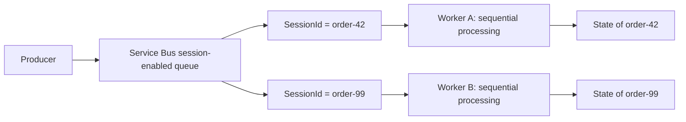
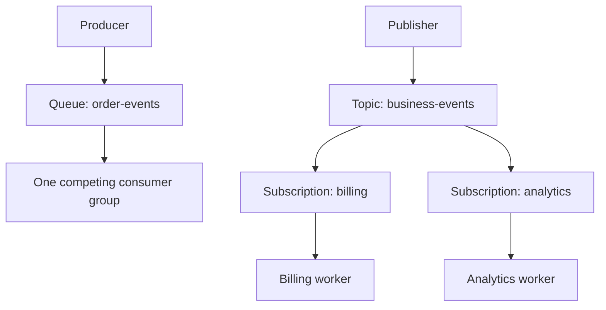
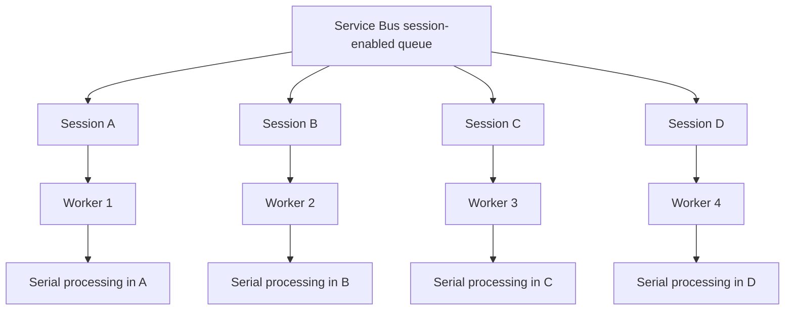
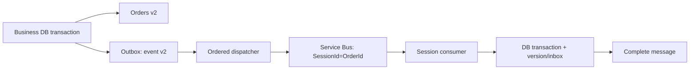
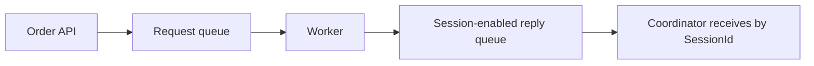
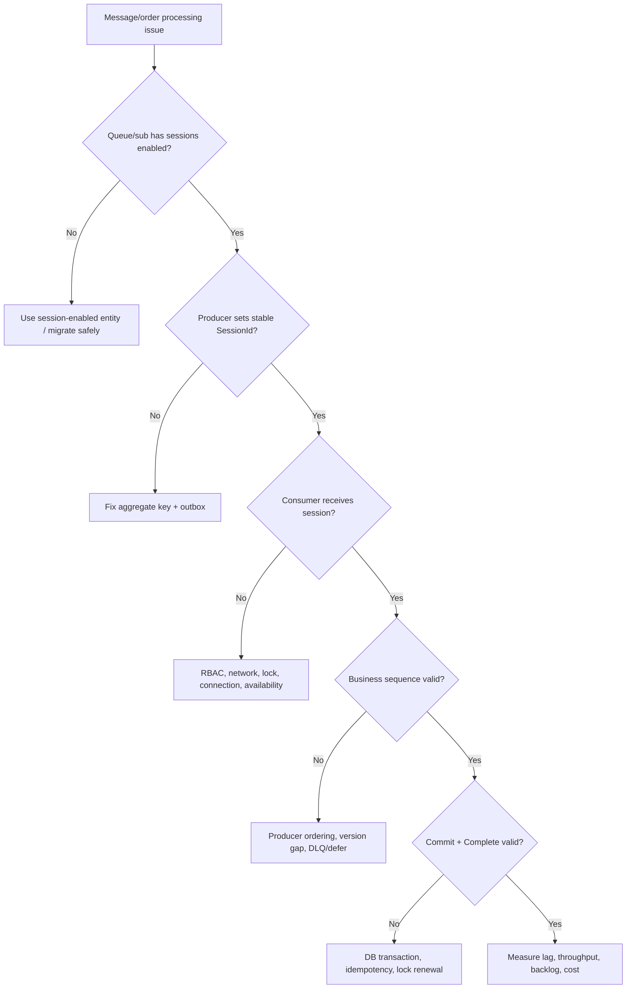

# Message Sessions and Ordered Processing Guarantees

In an e-commerce system, an order can emit events **`OrderCreated → PaymentAuthorized → OrderShipped`**. If a worker processes `OrderShipped` before `PaymentAuthorized`, order state becomes corrupted even though no messages were lost. When thousands of orders run concurrently, the real requirement is rarely **processing the entire system sequentially**, but rather ensuring **events for the same order are processed in order**, while different orders run in parallel.

**Azure Service Bus message sessions** organize related messages into groups keyed by **`SessionId`**, granting one consumer an exclusive lock on a session at a time. Combining sessions with proper publishing strategies, settlement, idempotency, and business state management yields an ordered yet scalable processing pipeline.

This lesson belongs to the **Queues and Messaging** chapter of the `CLOUD_PROVIDERS_AZURE` module. Along the path through Microsoft Azure—from subscriptions, resource groups, and Microsoft Entra ID to virtual networks, compute, storage, data, deployment, monitoring, security, and cost control—this lesson dives into **Azure Service Bus sessions**, the real boundaries of FIFO, and how to operate ordered processing in practice.

> **Scope:** Examples use Azure Service Bus **Standard or Premium**, with **session-enabled queues/subscriptions** and the Python SDK `azure-servicebus`. Azure Storage Queue is a separate queue service and **does not provide the equivalent Service Bus session mechanism**. Commands that create or modify resources can incur charges; run only in an approved lab environment.

## Learning Objectives

After this lesson, you will be able to:

1. Distinguish **system-wide FIFO**, **per-`SessionId` FIFO**, **broker ingest order**, and **business order**.
2. Describe how to configure a **session-enabled queue** or **session-enabled topic subscription** in Azure Service Bus.
3. Explain `SessionId`, session receivers, **exclusive session locks**, message locks, lock renewal, and concurrency limits.
4. Send and receive an ordered event sequence sharing one `SessionId` using the Python SDK and Microsoft Entra ID.
5. Design `Complete`, `Abandon`, `DeadLetter`, and `Defer` settlement without accidentally breaking processing order.
6. Distinguish **broker `SequenceNumber`** from **domain event version/sequence**, while handling gaps and duplicates.
7. Use **idempotency, transactional state, session state, and outboxes** to preserve correctness across retries, lock losses, and crashes.
8. Evaluate multi-session concurrency, hot sessions, partitioning, prefetch, and the Azure Functions Service Bus trigger model.
9. Monitor backlogs, active sessions, dead-letter queues, lock failures, end-to-end lag, throughput, and cost.
10. Run lab exercises and failure-injection tests before designing production workloads.

## 1. The Problem: Per-Entity Ordering, Not Whole-Queue Ordering

Suppose three orders emit the following messages:

| Producer Send Time | `SessionId` | Event | Business Version |
|---|---|---|---:|
| T1 | `order-42` | OrderCreated | 1 |
| T2 | `order-99` | OrderCreated | 1 |
| T3 | `order-42` | PaymentAuthorized | 2 |
| T4 | `order-99` | PaymentAuthorized | 2 |
| T5 | `order-42` | OrderShipped | 3 |
| T6 | `order-99` | OrderCancelled | 3 |

Operations expects:

- Order `order-42`: process **Created before Authorized before Shipped**.
- Order `order-99`: process **Created before Authorized before Cancelled**.
- Both orders can process **concurrently** since they are independent.

If a single-threaded consumer handles all messages, ordering holds yet throughput hits a wall. If ten consumers pull from a **non-session** queue, each consumer runs at a different pace, so business **completion** order can diverge from receive order.



**Core idea:** Service Bus sessions create **one logical processing stream per key**, without forcing unrelated entities to wait on one another. Real systems can host tens of thousands of sessions, though how many run concurrently still depends on compute, receiver concurrency, locks, throughput, and downstream resources.

## 2. What Is "Order"? Clarify the Guarantee

In messaging, "guaranteed order" can mean several different things:

| Type of Order | Meaning | Do Service Bus Sessions Automatically Guarantee It? |
|---|---|---|
| **Producer event creation order** | Event 1 was generated before Event 2 in app logic | **Does not automatically know** order across independent producers |
| **Broker ingest/enqueue order** | Which message Service Bus accepted first within the session | Sessions support **ordered delivery** by ingest order under proper usage |
| **Consumer receive order** | One session receiver reads messages in the broker-supplied stream | Provides an ordered stream model unless app code parallelizes within the session |
| **Business completion order** | DB commits event N before committing event N+1 | **Not automatic**; governed by code, settlement, and storage transactions |
| **Global queue order** | Every customer/event runs in one single global sequence | **Not the goal** of multi-session queues |
| **End-to-end exactly-once** | Each business effect happens strictly once across all failures | **Not automatic**; requires idempotency and transactions |

Suppose two producers nearly simultaneously send version 2 and version 3 for `order-42`. If network jitter delivers version 3 to the broker before version 2, sessions preserve **broker ingest order**, not magical knowledge that "version 2 belongs before version 3." Robust architectures must **coordinate producers** or **validate business sequences**.

### Per-Session FIFO Is Not Sorted-by-Timestamp

Queue ordering is not built by sorting `eventTime`:

- Producer clocks can skew.
- Timestamps can collide or fail to match DB commit order.
- Messages can be resent after transient outages.
- Scheduled messages can enter availability later.
- Old messages can be dead-lettered/deferred and reprocessed later.

Reliable business ordering should rely on a **monotonically increasing sequence/version assigned at the authoritative source** (such as aggregate version or event log offset), never wall-clock timestamps alone.

## 3. Azure Service Bus: Queue, Topic, and Subscription

Azure Service Bus provides both **queue** and **publish/subscribe** models:



### Queue

A queue holds messages for competing consumers. On a **session-enabled queue**, every message requires a valid `SessionId` and receivers must connect as session receivers. A receiver cannot arbitrarily bypass an entity's session requirement.

### Topic and Subscription

A topic fans out **one message** to multiple subscriptions based on filters/rules. **Session support is configured per subscription**—do not assume every subscription on a topic uses sessions identically.

Example:

- Topic `business-events` receives order events.
- Subscription `billing-ordered` enables sessions and processes by `SessionId=orderId`.
- Subscription `analytics` may use a different model depending on requirements.

**Ordering progresses independently per subscription.** Billing completing event N does not imply Analytics has processed N. Never use topic sessions as a cross-subscriber transaction coordinator.

### Supported SKUs

Service Bus sessions are available in supporting tiers like **Standard and Premium**; **Basic** is not an option for session-enabled messaging. Check SKUs, namespace features, throughput/capacity, networking, and regional pricing before provisioning.

Azure **Storage Queues** and **Azure Event Grid** solve different problems; do not assume Service Bus `SessionId` semantics exist on every Azure queue or broker.

## 4. SessionId: The Grouping Key per Entity

Every message sent to a session-enabled queue/subscription must specify a **`SessionId`**. Messages sharing a `SessionId` belong to the same logical stream.

| Use Case | Appropriate `SessionId` | Poor Choice |
|---|---|---|
| Orders | `orderId` | Fresh `requestId` per event |
| Customer account | `accountId` if all account events need ordering | One shared `all-customers` SessionId |
| Import workflow | `importBatchId` or `workflowId` | Function App / worker name |
| Chat | `conversationId` | Timestamp of each message |
| IoT device | `deviceId` when per-device state must serialize | One key shared across all devices |
| Digital wallet | `walletId` to serialize balance updates | One SessionId across the entire wallet system |

### Choosing Session Granularity

**Too coarse** (`SessionId=tenant-1` for millions of messages): only one receiver processes that stream at a time, creating a **hot session**, bottlenecking throughput, and spiking latency.

**Too fine** (a random `SessionId` per message): events for the same order lose ordering ties, defeating the entire purpose.

The practical rule is **`SessionId` = the aggregate/entity key needing serialized mutations**. Architects must define the consistency boundary clearly:

- If only per-order state matters, `orderId` makes sense.
- If all transactions on a wallet must serialize to guard its balance, `walletId` fits better than `transactionId`.
- If one operation touches two wallets at once, a single `SessionId` does not create an atomic cross-wallet transaction; use a proper transactional model or saga.

### Producer Rules

When running multiple producer instances:

1. The same entity must always map to the **exact same `SessionId`** via stable normalization/canonicalization.
2. Producers must never change `SessionId` mid-workflow.
3. Include a separate **business sequence** to check versions if multiple producers emit events.
4. **`MessageId`** identifies the message/operation—it never replaces `SessionId`.
5. On partitioned entities, follow compatibility rules between `SessionId` and `PartitionKey` where applicable.

## 5. Session-Enabled Entities Must Be Configured Before Sending

Regular queues and **requires-sessions** queues behave differently. In Azure Service Bus, session support is configured **when creating the queue/subscription**; do not assume you can toggle it seamlessly on a live queue holding messages without disruption.

### Azure Portal Steps

1. Open **Service Bus namespaces** in the target subscription/resource group.
2. Select a namespace on a session-supporting SKU (Standard or Premium).
3. Go to **Queues → + Queue** and name it `orders-ordered`.
4. Enable **Requires Session / Enable Sessions** per current UI.
5. Configure **Lock duration**, **Max delivery count**, TTL, dead-letter behavior, and duplicate detection as needed.
6. Create the entity, open its properties, and confirm `Requires Session = true`.
7. Assign least-privilege Azure roles for producers and consumers.

For topics, create the topic and then create a **subscription** `billing-ordered` with sessions enabled. When publishing to the topic, producers must include `SessionId` on messages intended for session-enabled subscriptions.

### Never Mutate Live Production Entities Directly

If queue `orders` already runs **without sessions**, a proper migration plan includes:

- Create a new queue `orders-ordered` with `Requires Session` enabled.
- Deploy producers emitting `SessionId` and business sequence.
- Deploy receivers using session semantics.
- Cut over traffic under control while monitoring DLQs/backlogs on both queues.
- Drain or migrate remaining legacy messages per business rules.
- Keep rollback capability and duplicate guards while both paths run.

**Never swap namespaces or delete an old queue just to "turn on sessions" without preserving pending data.**

### Inspecting Configuration via Azure CLI

For a lab queue already created:

```bash
az login --tenant "<tenant-id>"
az account set --subscription "<subscription-id>"

az servicebus queue show \
  --resource-group "rg-messaging-lab" \
  --namespace-name "<servicebus-namespace-name>" \
  --name "orders-ordered" \
  --query "{name:name,requiresSession:requiresSession,lockDuration:lockDuration,maxDeliveryCount:maxDeliveryCount,status:status}" \
  --output json
```

If `requiresSession` does not appear as expected, dump full JSON and check your CLI/API version before concluding. Configuration-read commands do not verify whether messages processed in order.

## 6. Path of a Session Through Service Bus

```mermaid
sequenceDiagram
    participant P as Producer
    participant SB as Service Bus queue
    participant A as Receiver A
    participant B as Receiver B
    P->>SB: Event 1; SessionId=order-42
    P->>SB: Event 2; SessionId=order-42
    P->>SB: Event 3; SessionId=order-99
    A->>SB: Accept Session order-42
    SB-->>A: Session lock for order-42
    B->>SB: Accept Session order-42
    SB-->>B: Cannot acquire concurrently
    B->>SB: Accept Session order-99
    SB-->>B: Session lock for order-99
    SB->>A: Message 1 of order-42
    A->>SB: Complete Message 1
    SB->>A: Message 2 of order-42
    SB->>B: Message 1 of order-99
```

This diagram illustrates **exclusive session locking**. Exact step timing also depends on SDK behavior, receiver timeouts, prefetch counts, and application concurrency.

### Session Receiver

Consumers have two common options:

- **Accept a specific `SessionId`:** fits when you know the exact workflow or customer to process.
- **Accept `NEXT_AVAILABLE_SESSION`:** lets workers dynamically claim whichever session has waiting messages per Service Bus mechanics, ideal for worker pools.

Once a receiver holds a session, it receives messages for that `SessionId` as an ordered stream. Other workers can simultaneously acquire **other** sessions.

### Session Lock vs. Message Lock

On non-session queues, receivers use **Peek-Lock** to lock and settle individual messages. On session-enabled entities, the broker also grants an **exclusive session lock** to one receiver, preventing two independent receivers from owning the same session simultaneously while the lock holds.

**Never treat a session lock as permanent.** When the lock expires, drops due to network/host glitches, or the receiver closes, another receiver can claim the session. Applications must handle:

- session lock renewal;
- keeping processing within lock limits;
- settlement failures caused by lost locks;
- message redelivery and idempotency;
- graceful shutdown/draining to release sessions cleanly.

### Session State

Azure Service Bus can store small **session state** attached to a `SessionId` via supported APIs. It works well for lightweight checkpoints such as workflow stage or correlation metadata.

Example:

```json
{
  "orderId": "order-42",
  "lastAppliedBusinessSequence": 2,
  "workflowStage": "AwaitingShipment"
}
```

**Important:** session state **does not update automatically** on message settlement and **does not share a transaction with your business database**. If code updates the DB, writes session state, and calls `Complete` in three separate steps, crashing mid-way leaves them out of sync. Treat session state strictly as a convenience helper alongside idempotency and your authoritative database.

## 7. Real Boundaries of "Per-Session FIFO"

| Scenario | What Sessions Help With | What the App Must Still Handle |
|---|---|---|
| One producer sends events 1, 2, 3 sequentially and broker ACKs in order | Broker preserves ordered stream per `SessionId` | Consumer processes and commits sequentially |
| Two producers send to the same `SessionId` without coordination | Broker orders by ingest arrival | Assign authoritative versions at source, emit via outbox, or detect gaps |
| Multiple workers listen on the same `SessionId` | Exclusive session lock prevents normal concurrent ownership | Renew locks; stop processing on lock loss |
| Message 2 fails and is Abandoned | Message becomes eligible for redelivery | Do not apply side effects for message 3 before 2 succeeds |
| Message 2 is DeadLettered | Message 3 may still arrive next | Decide whether workflow halts, quarantines, or skips safely |
| Events are scheduled or deferred | Service Bus honors delay/deferral mechanics | Never assume delayed messages automatically preserve domain order |
| One `SessionId` becomes hot | Lock pins processing to one owner | Do not expect extra receivers to parallelize that single session |
| Consumers run during broker/host disconnects | Broker durably retains messages | Idempotency, replay, checkpoints, and lock-loss handling |

**Key boundary:** sessions provide an **ordered delivery framework**; they do not provide **exactly-once business effects**, automatic **transactional DB ordering**, or global ordering.

## 8. Sending Session Messages with the Python SDK

Examples use Python 3 with `azure-servicebus` and `azure-identity`. For production apps, prefer **Microsoft Entra ID / managed identities** over embedded connection strings.

### Preparing the Learner Environment

In a dedicated lab environment, install packages:

```bash
python -m pip install azure-servicebus azure-identity
```

Export two environment variables (illustrative values):

```bash
export SERVICEBUS_FQDN="<your-namespace>.servicebus.windows.net"
export SERVICEBUS_QUEUE_NAME="orders-ordered"
```

With local Azure CLI, verify the right subscription/tenant and run `az login`. Inside Azure Function Apps, VMs, or AKS, `DefaultAzureCredential` uses managed identity or workload identity as configured.

Azure RBAC data plane needs appropriate roles, such as:

- Producer: **Azure Service Bus Data Sender**.
- Consumer: **Azure Service Bus Data Receiver**.

Standard ARM `Reader` or `Contributor` roles do not grant Service Bus data-plane send/receive rights.

### Producer: Sending Three Events for One Order

Sample file `send_order_events.py`:

```python
import json
import os

from azure.identity import DefaultAzureCredential
from azure.servicebus import ServiceBusClient, ServiceBusMessage


namespace = os.environ["SERVICEBUS_FQDN"]
queue_name = os.environ["SERVICEBUS_QUEUE_NAME"]

events = [
    {"sequence": 1, "eventType": "OrderCreated"},
    {"sequence": 2, "eventType": "PaymentAuthorized"},
    {"sequence": 3, "eventType": "OrderShipped"},
]

order_id = "order-42"

with DefaultAzureCredential() as credential:
    with ServiceBusClient(
        fully_qualified_namespace=namespace,
        credential=credential
    ) as client:
        with client.get_queue_sender(queue_name=queue_name) as sender:
            for event in events:
                payload = {
                    "orderId": order_id,
                    "sequence": event["sequence"],
                    "eventType": event["eventType"],
                }

                message = ServiceBusMessage(
                    body=json.dumps(payload),
                    session_id=order_id,
                    message_id=f"{order_id}:{event['sequence']}",
                    content_type="application/json"
                )
                sender.send_messages(message)
                print(
                    "Sent",
                    payload["eventType"],
                    "sequence",
                    payload["sequence"]
                )
```

Run **only after** the namespace and queue exist, sessions are enabled, your identity is authorized, and the lab is approved:

```bash
python send_order_events.py
```

### Why Send Sequentially?

The producer above awaits `sender.send_messages(message)` before sending the next event. This preserves broker-ingest order from **one producer**, rather than firing concurrent network requests and hoping events arrive ordered by `sequence`.

In production, producers must also manage:

- **Outbox:** if events originate from DB transactions, publish only committed events without losing any on crashes.
- **Stable `MessageId`:** supports idempotency/dedup; never mint a random ID per retry of the same event.
- **Immutable `SessionId`** per aggregate.
- **Retries:** never publish version 3 before knowing version 2 succeeded per workflow; if send times out ambiguously, rely on duplicate detection and idempotency.
- **Business version** assigned atomically at the source; never let two producers both emit sequence 2.

This send script **does not create** queues, role assignments, or outboxes; prepare infrastructure and domain workflows beforehand.

## 9. MessageId, SessionId, and SequenceNumber Differ

| Attribute | Set By | Purpose | Interchangeable? |
|---|---|---|---|
| **`SessionId`** | Producer | Groups messages requiring ordered processing | No |
| **`MessageId`** | Producer | Identifies message for tracing/dedup when enabled | No |
| **`SequenceNumber`** | Service Bus broker | Broker-assigned sequence number within the entity per service mechanics | No |
| **`sequence` in payload** | Domain / application | Order/workflow version enforcing commit order | No |
| **`CorrelationId`** | Producer or orchestration layer | Correlates traces/events across a workflow | No |

### Broker SequenceNumber Is Not eventVersion

Broker `SequenceNumber` reflects ingest order at the entity per broker mechanics; it is **not a contiguous per-OrderId counter**. In a multi-session queue, messages for `order-42` interleave with `order-99`. When partitioning or other features are active, understand exact sequence-number semantics per entity/partition.

Do not write logic like:

```python
# Avoid: broker sequence number is not a domain sequence
if message.sequence_number == last_order_version + 1:
    apply_order_event()
```

Instead, read `sequence` from the domain payload and validate against the last committed version:

```python
# Illustrates principle, not a complete DB implementation
if event["sequence"] == last_committed_version + 1:
    apply_in_transaction(event)
elif event["sequence"] <= last_committed_version:
    acknowledge_duplicate(event)
else:
    hold_or_reconcile_gap(event)
```

**Sequence numbers are a business invariant guarded by producers and databases**; adding a `sequence` field without unique constraints or concurrency controls will not guarantee order.

## 10. Receiving a Specific Session and Settling Messages

Learners can start by receiving session `order-42` to keep the flow simple. The code below handles **one message at a time**, uses default Peek-Lock, and exits when no messages arrive within the wait window.

### Minimal Consumer

File `receive_one_session.py`:

```python
import json
import os

from azure.identity import DefaultAzureCredential
from azure.servicebus import ServiceBusClient


namespace = os.environ["SERVICEBUS_FQDN"]
queue_name = os.environ["SERVICEBUS_QUEUE_NAME"]
session_id = "order-42"

with DefaultAzureCredential() as credential:
    with ServiceBusClient(
        fully_qualified_namespace=namespace,
        credential=credential
    ) as client:
        with client.get_queue_receiver(
            queue_name=queue_name,
            session_id=session_id,
            max_wait_time=10
        ) as receiver:
            print("Accepted session:", receiver.session.session_id)

            while True:
                messages = receiver.receive_messages(
                    max_message_count=1,
                    max_wait_time=5
                )
                if not messages:
                    break

                message = messages[0]
                try:
                    # Only for UTF-8 Data bodies produced by the sender.
                    body_bytes = b"".join(message.body)
                    event = json.loads(body_bytes.decode("utf-8"))

                    print(
                        "Process:",
                        event["orderId"],
                        event["sequence"],
                        event["eventType"]
                    )

                    # In production: commit DB/checkpoint/idempotency
                    # before completing the message.
                    receiver.complete_message(message)
                except Exception as exc:
                    print("Processing failed:", type(exc).__name__)
                    receiver.abandon_message(message)
                    # Stop session; do not process later messages creating side effects.
                    break
```

**Demo limitations:** this logs and completes with **no real business transaction** and no session-lock renewal. Use only for brief sandbox exercises. It can still throw if locks expire; handle that via runbooks, retries, and idempotency rather than assuming completion equals permanent success.

### Why `max_message_count=1`?

Reading and settling one message before pulling the next prevents learners from accidentally:

- spawning concurrent worker threads inside one session;
- completing message 3 before message 2;
- swallowing an error on message 2 while still applying event 3;
- confusing a batch received in order with **a batch committed in order**.

Production systems can fetch batches for throughput, provided they **preserve serial processing/settlement** or design explicit workflow ordering. Fetching 10 messages in one session **never permits running 10 parallel mutations** if ordering is a business invariant.

## 11. Receiving Sessions Dynamically with NEXT_AVAILABLE_SESSION

In production, consumers rarely know every `SessionId` ahead of time. The Azure Service Bus SDK lets a worker accept **any session with pending messages**:

```python
from azure.servicebus import NEXT_AVAILABLE_SESSION

# client was created from ServiceBusClient as shown earlier
with client.get_queue_receiver(
    queue_name="orders-ordered",
    session_id=NEXT_AVAILABLE_SESSION,
    max_wait_time=10
) as receiver:
    actual_session_id = receiver.session.session_id
    print("Worker holding session:", actual_session_id)
    # Receive and settle messages sequentially within this session.
```

This is a **fragment** meant to sit inside `with ServiceBusClient(...) as client` with proper permissions and connectivity; it is not a standalone script.

### Worker Pool Model

Suppose four workers run while 12 sessions wait:



Workers pick up additional sessions as they finish current ones. A single worker can also use async/concurrency frameworks across multiple distinct sessions, yet **never execute competing mutations concurrently within the same `SessionId`** when ordering is mandatory.

### Hot Sessions

If Session A holds 10 million messages while every other session holds only a few, scaling from 4 to 40 workers **does not speed up Session A**: Session A still must serialize to protect order.

Mitigations:

1. Evaluate a **finer-grained session key** if the domain allows splitting independent sub-entities.
2. Optimize per-event work: short transactions, fewer DB round-trips, eliminate unnecessary I/O.
3. Offload heavy steps that do not require ordering to separate workloads with correlation/commit barriers.
4. Fan out parallelizable sub-tasks into separate sub-workflows with distinct `SessionId`s and proper join/ordering logic.
5. Monitor backlog **per session**, not just total queue depth.

Never expect cranking up `maxConcurrentSessions` to split one hot `SessionId` across multiple consumers writing the same aggregate while preserving order.

## 12. Session Locks, Lock Expiry, and Auto-Renewal

A session-enabled receiver holds an exclusive lock on a session for a bounded period. If processing exceeds that lock window, the app needs SDK/runtime lock renewal.

### When the Lock Is Lost

```text
Worker A accepts Session order-42
  → processes event sequence=2 for 90 seconds
  → network drops; session lock expires
Worker B acquires session order-42
  → sees unsettled message
  → reprocesses sequence=2
Worker A finishes DB side effect
  → Complete fails because A no longer owns the lock
```

Never assume the broker can abort an in-flight DB transaction on Worker A when a lock expires. Thus, **a session lock is temporary receive ownership**, not an absolute fencing guard for external side effects.

### AutoLockRenewer

The Python SDK supports automatic lock renewal under receiver/session conditions via `AutoLockRenewer` or matching mechanisms. Conceptual snippet:

```python
from azure.servicebus import AutoLockRenewer

# Inside a context where receiver holds an open session
with AutoLockRenewer() as renewer:
    renewer.register(
        receiver,
        receiver.session,
        max_lock_renewal_duration=300
    )
    # Run time-bounded work while monitoring lock/renewal errors.
```

This is an **integration fragment**, not a complete runnable script; verify SDK version APIs and behavior on network drops. Auto-renewal **does not let you hold a session indefinitely**: apps still need timeouts, checkpoints, and safe redelivery handling.

### Business-Layer Fencing

When business rules strictly forbid two writers from mutating the same aggregate:

- Use **optimistic concurrency** with `expectedVersion`/ETags or database unique constraints.
- Use storage-backed leases/fencing tokens where active leases are needed.
- Commit changes transactionally at the source of truth.
- On Service Bus lock loss, the stale worker stops reading new messages, while the database prevents late writes from overwriting newer state.

This separates **single active session receiver at the broker** from **single successful writer on the business entity**.

## 13. Settlement: Complete, Abandon, DeadLetter, and Defer

| Operation | Meaning | Impact on Ordering |
|---|---|---|
| **Complete** | Marks message done and removes from active delivery | Safe once business state committed idempotently |
| **Abandon** | Releases unfinished message for redelivery | Message may return; do not blindly apply subsequent events first |
| **DeadLetter** | Moves message to dead-letter subqueue for separate analysis/handling | Active stream may advance even though prior event was unapplied |
| **Defer** | Postpones processing for explicit retrieval, typically by sequence number | Can create stream gaps if prerequisites are skipped |
| **ReceiveAndDelete** | Deletes on receive without Peek-Lock settlement | **Unsuitable** when worker crashes must not drop events |

### Complete After Commit

For orders, the ideal sequence is:

```text
Receive message #2 of order-42
→ verify #2 is next expected version
→ transaction: update order + insert processed-event ID
→ transaction COMMIT
→ Service Bus Complete message #2
→ receive message #3
```

If a crash happens **after DB commit and before `Complete`**, the broker redelivers #2; the worker checks the processed-events/version table and **completes the duplicate** without repeating side effects.

Calling `Complete` **before DB commit** risks losing the event permanently if a crash occurs before the DB updates.

### Abandon Does Not Mean Immediately Run the Next Message

Suppose event #2 fails due to a temporary DB outage. If you abandon #2 and immediately continue reading #3 to mark `Shipped`, domain invariants break.

Safe design for strict ordering:

1. Log #2's failure and cause.
2. Abandon #2 or let the lock expire per retry policy.
3. **Stop processing subsequent events in that session** until #2 commits or receives an explicit business resolution.
4. Keep unrelated healthy sessions flowing without stalling them.

In multi-receiver fleets, reinforce this with a **business sequence guard** because network timing, deferral, and failover recovery can change redelivery behavior.

### DeadLetter Does Not Fix Ordering Automatically

If #2 moves to the DLQ after repeated failures, message #3 remains in the active queue. Two common business policies exist:

- **Strict stop-the-line:** mark the aggregate `Blocked` and refuse #3 until #2 is repaired/replayed or explicitly compensated.
- **Skip with audit:** explicitly bypass a non-mandatory event per business rules, logging why and advancing the expected sequence.

Never treat dead-lettering as "processed successfully," and never silently skip mandatory financial events.

### Defer and Gap Handling

Deferred messages stay stored for targeted retrieval by `SequenceNumber` and leave normal receive streams. When deferring on unmet prerequisites, persist the identifier and build a retrieval/timeout path—otherwise messages get forgotten.

Account carefully for scheduled/deferred messages and TTLs: **a late-arriving message can still break contiguous domain sequences** even when receivers follow session rules.

## 14. Guaranteeing Commit Order with Business Versions and Idempotency

Separate two concerns:

- **Transport:** Service Bus delivers messages and protects exclusive session receive rights while locked.
- **Business correctness:** the database rejects out-of-order versions or duplicate writes regardless of broker/client faults.

Example order tables:

```sql
CREATE TABLE Orders (
    OrderId VARCHAR(100) PRIMARY KEY,
    CurrentState VARCHAR(50) NOT NULL,
    Version INT NOT NULL
);

CREATE TABLE ProcessedEvents (
    EventId VARCHAR(200) PRIMARY KEY,
    OrderId VARCHAR(100) NOT NULL,
    BusinessSequence INT NOT NULL
);
```

This is an illustrative table model, **not a complete production Azure SQL schema**. Choose column types, constraints, indexes, and transaction isolation to fit your database engine.

### Event Application Algorithm

```text
Inputs: SessionId, EventId, BusinessSequence, EventType

BEGIN TRANSACTION
    Load OrderId state and lock/current version.

    If EventId already exists in ProcessedEvents:
        → treat as already-processed duplicate; COMMIT/close transaction.

    If BusinessSequence == Order.Version + 1:
        → validate business state transition.
        → update order state and Version.
        → insert ProcessedEvents(EventId, OrderId, Sequence).
        → COMMIT.

    If BusinessSequence <= Order.Version:
        → distinguish verified duplicate from conflicting event.
        → apply zero duplicate side effects.

    If BusinessSequence > Order.Version + 1:
        → ROLLBACK / hold event in waiting state.
        → flag version gap and do not commit out-of-order event.

After commit succeeds / duplicate confirmed committed:
    Complete Service Bus message.
If not processed:
    Do not Complete; retry/defer/quarantine per policy.
```

**Concurrency note:** checking `Order.Version` and updating later without locking or conditional updates is insufficient. Two workers can still both read `Version=1` and write `Version=2`. Enforce transaction isolation or optimistic concurrency (e.g., `UPDATE ... WHERE Version=@expectedVersion` and checking affected row count).

### Conditional SQL Version Check Example

```sql
UPDATE Orders
SET CurrentState = @NextState,
    Version = @ExpectedVersion + 1
WHERE OrderId = @OrderId
  AND Version = @ExpectedVersion;
```

If zero rows update, distinguish missing order, stale version, concurrent writer, or wrong order—never blindly assume success.

Updating `Orders` and `ProcessedEvents` must sit **inside one transaction in the same store** for atomic consistency. If your data store lacks multi-record transactions, design equivalents using conditional writes, single-document aggregates, or event sourcing.

### Why Use Both Sessions and Optimistic Concurrency?

Sessions reduce contention and support ordered delivery, yet failure windows remain (lock loss, host crash, uncoordinated producers). Database optimistic concurrency acts as the **final guardrail** protecting each order's invariants.

## 15. Outbox Pattern: Producing Events in Order from the Source Database

A common bug happens **before messages ever reach Service Bus**:

```text
App updates Orders.Version = 2 in database
→ process crashes before sending PaymentAuthorized
→ queue never receives version 2
→ version 3 arrives later from another flow
```

One solution is the **Transactional Outbox**:

1. Within **one database transaction**, update the order and insert an Outbox row containing `OrderId`, `Sequence`, `EventId`, and payload.
2. An outbox dispatcher reads committed events and publishes them in valid order **per aggregate**.
3. Send to Service Bus with `SessionId=OrderId` and `MessageId=EventId`.
4. Mark outbox rows published via idempotent retry handling.
5. Consumers use **Inbox/`ProcessedEvents`** to guard against redelivery duplicates.



### Does an Outbox Solve Everything Automatically?

No. If multiple outbox dispatchers run concurrently, **claim or partition by aggregate** to serialize publish order. If version 3 publishes ahead of version 2—even with the same `SessionId`—the broker sees 3 first. Dispatchers can use `OrderId` partitioning, leases, optimistic concurrency, or ordered log streams.

Outboxes ensure **committed DB updates never lose events**; consumer inboxes guard against **duplicate deliveries**. Paired with sessions and version guards, they form a much sturdier architecture than enabling `Requires Session` alone.

### When to Use Service Bus Transactions?

Azure Service Bus supports specific **transactional operations scoped to the service** under entity/namespace and API rules—such as combining settlement and outbound send in one workflow. However, a Service Bus transaction **never automatically spans** Azure SQL, Cosmos DB, or external HTTP APIs.

For flows combining DB commits and message settlement, rely on outbox/inbox, idempotency, or distributed sagas—never describe a broker transaction as "system-wide exactly-once."

## 16. Session State: Small Checkpoints, Not a Primary Database

Session state lets the broker store a small blob attached to a session, such as:

```json
{
  "lastSeenEventId": "order-42:2",
  "lastAppliedSequence": 2,
  "processingStage": "payment-recorded"
}
```

The Python SDK exposes `receiver.session` when holding a session. Supported read/write methods look like:

```python
# Fragment inside a session-enabled receiver context
state_bytes = receiver.session.get_state()

if state_bytes:
    state = json.loads(state_bytes.decode("utf-8"))
else:
    state = {"lastAppliedSequence": 0}

# Illustrates saving a checkpoint only; not a shared transaction with DB.
state["lastAppliedSequence"] = 2
receiver.session.set_state(
    json.dumps(state).encode("utf-8")
)
```

This snippet requires importing `json` and matching SDK support. Bound state size, serialization format, permissions, and retention. **Session state can persist even after all messages in the session are consumed** per broker rules, so plan cleanup/reset once workflows end and account for storage overhead.

### Beware Two Sources of Truth

Never let the database say `Orders.Version=3` while session state says `lastAppliedSequence=2` and wrongly conclude v3 is unprocessed. When the DB is the source of truth, treat session state strictly as an **advisory checkpoint/cache** and reconcile from committed business records on mismatch.

If storing a **workflow cursor** in session state, you still need:

- database transactions or conditional updates;
- inbox/dedup keyed by `EventId`;
- ability to recompute state if metadata is lost or stale;
- cleanup procedures once a `SessionId` finishes.

## 17. Duplicate Detection, MessageId, and Retries

Service Bus provides **duplicate detection** on supported entities/tiers. When enabled, it detects repeated sends matching `MessageId` (and partition keys where applicable) within a **configured time window**.

### Retry Send Example

```text
Producer sends OrderCreated, MessageId=order-42:1
→ network drops before producer receives ACK
→ producer is unsure whether broker accepted it
→ producer retries same MessageId=order-42:1
→ duplicate detection drops the second copy within the window
```

**Duplicate detection does not replace idempotency** because:

- The window is time-bounded, not infinite.
- `MessageId` must stay **stable** across retries.
- Two messages with distinct `MessageId`s can still carry the same business effect.
- A duplicate might slip through if detection settings changed.
- Long failovers or DLQ replays can reintroduce old events outside the window.

Never generate `MessageId=new UUID` on each retry of the same job if you expect duplicate detection to match IDs.

### PartitionKey and SessionId

On partitioned entities, `SessionId` ties into partition affinity per Service Bus rules. **If also setting `PartitionKey`, it must match `SessionId`** where the entity enforces equality.

Never vary `PartitionKey` across messages in the same `SessionId` and expect them to stay in one ordered stream. Before combining partitioning, transactions, and duplicate detection, verify compatibility for your SKU, namespace, and SDK.

## 18. Concurrency: Many Sessions in Parallel, One Session in Sequence

With 1,000 orders, you can process many independent `SessionId`s concurrently. Watch three common limits:

1. **Concurrent sessions:** how many sessions consumers hold and process simultaneously.
2. **Per-session concurrency:** how many messages **within one session** your code executes concurrently. For strict order, keep serial mutations at **1**.
3. **Downstream capacity:** databases, APIs, queues, thread pools, I/O, quotas, and cost.

### Concurrency Models

| Configuration | Result | When Appropriate |
|---|---|---|
| 1 receiver, 1 session | Clear order, low aggregate throughput | Demos, tiny workloads |
| 8 receivers, 8 sessions | 8 independent streams in parallel | Realistic multi-aggregate workloads |
| 8 receivers on the same `SessionId` | Cannot simultaneously hold valid exclusive lock | Not a way to scale a hot session |
| 1 receiver pulls batch and spawns 8 threads inside one session | Risks out-of-order commits | Unsuitable for strict ordered mutations |
| Serial worker per session; many sessions hitting DB | Higher throughput, can exhaust connection pools | Needs rate limits, backpressure, and metrics |

### Does Prefetch Help?

Prefetch lets clients buffer messages to cut network round-trips, but remember:

- Lock timers keep ticking while buffered in prefetch cache.
- Crashes force buffered batches to redeliver.
- Buffering multiple messages does not permit parallel execution within a session.
- A slow first message can expire locks on later buffered messages.
- Consumers must still enforce business commit ordering.

For strict ordering and slow work, **zero or tiny prefetch** is easier to govern. Tune throughput from measurements rather than blindly setting a huge `prefetchCount`.

### CPU Autoscale Will Not Cure a Hot Session

If a queue holds thousands of messages mostly sharing one `SessionId`, scaling from 2 to 50 worker instances will not clear the bottleneck. Track **per-`SessionId` backlog/age**, redesign aggregate keys where valid, or speed up per-event execution.

## 19. Azure Functions Service Bus Trigger with Sessions

Azure Functions consumes Service Bus via the **Service Bus trigger**. For session-enabled entities, use a **binding extension** version and settings supporting sessions.

### Python v2 Concept

Illustrative function in `function_app.py`:

```python
import json
import logging
import azure.functions as func

app = func.FunctionApp()

@app.service_bus_queue_trigger(
    arg_name="message",
    queue_name="orders-ordered",
    connection="ServiceBusConnection",
    is_sessions_enabled=True
)
def process_order_event(message: func.ServiceBusMessage) -> None:
    event = json.loads(message.get_body().decode("utf-8"))
    logging.info(
        "Received event type=%s",
        event.get("eventType")
    )

    # Production: check business version and commit idempotently.
    # Throw an exception on failure per retry policy.
```

Verify exact decorator names, `is_sessions_enabled`, and message types against your **Python v2 programming model, Functions runtime 4.x, and Service Bus extension version**. This is a **learning snippet**, not a complete ordering-safe handler.

### Binding Configuration and host.json

In compatible extension versions, concurrency and lock settings for the Service Bus trigger may include:

```json
{
  "version": "2.0",
  "extensions": {
    "serviceBus": {
      "maxConcurrentSessions": 8,
      "maxConcurrentCallsPerSession": 1,
      "prefetchCount": 0,
      "maxAutoLockRenewalDuration": "00:05:00",
      "autoCompleteMessages": true
    }
  }
}
```

**Warning:** this config is a conceptual example to illustrate concurrency; **support for individual fields depends on Service Bus extension version and hosting plan**. Check schemas and host logs before deploying. For strict ordering, keep per-session concurrency sequential per extension/runtime behavior.

### Auto-Complete and Error Handling

With `autoCompleteMessages=true` per binding mechanics, the Functions runtime completes messages after successful invocations and settles failures per retry rules. That is convenient, yet does not wrap DB writes and broker settlement in one transaction.

If a handler does:

```python
def process_order_event(message):
    update_database()  # succeeds
    raise RuntimeError("Network error after commit")
```

the invocation fails and the message can be redelivered even though the database changed. **Idempotency / `ProcessedEvents`** remains mandatory.

For ordering-critical workflows, scrutinize runtime settlement and session ownership; sometimes a **Service Bus SDK session processor** managed directly by your platform team fits better than generic Functions bindings.

### Triggers and Protections Required

A Function App needs:

- Identity-based or secret-based Service Bus connection matching policy.
- **Azure Service Bus Data Receiver** at the right namespace/entity scope.
- Extension version supporting sessions.
- Network path to Service Bus endpoints plus DNS/Private Link if private.
- Idempotent application code with version guards.
- Monitoring for session backlogs, retries, DLQs, host restarts, and lock errors.

Azure Functions can scale out instances under load, yet **extra instances never override single-owner session locks** or preserve domain order if code ignores versions.

## 20. Request–Reply, Workflows, and Session Affinity

Service Bus sessions also appear in **stateful workflows** and some **request–reply** patterns:



For example, a Coordinator sends requests with `correlationId` and listens on a session-enabled reply queue using `SessionId` to group correlated replies.

**However:** request–reply does not always require sessions; `CorrelationId` plus message selectors or state stores often work. Choose sessions when you genuinely need a **conversation/workflow** with ordered events pinned to one stateful consumer.

### Session State for Sagas

An order saga might progress:

```text
Created
→ InventoryReserved
→ PaymentAuthorized
→ ShipmentBooked
→ Completed
```

`SessionId` can be `orderId`. Durable workflow state lives in a versioned database; session state can hold lightweight cursors. If `PaymentAuthorized` fails permanently, the workflow initiates **compensating actions** like releasing inventory.

**Sessions are not a saga orchestrator.** You still must build timeouts, compensations, state persistence, retries, and manual exception handling.

## 21. Security and Access for Azure Service Bus Sessions

### Microsoft Entra ID and Azure RBAC

| Component | Example Role | Purpose |
|---|---|---|
| Producer identity | `Azure Service Bus Data Sender` | Send messages |
| Consumer identity | `Azure Service Bus Data Receiver` | Receive and settle messages |
| Entity admin team | Service Bus management role at scoped ARM level | Create queues/subscriptions, configure entities |
| Monitoring team | Metrics/config and log reader roles | Track backlogs/DLQs without sending messages |

**Never grant Data Owner or subscription-wide Owner** to apps needing only send or receive on one queue. Separate producer and consumer identities to shrink blast radius.

### Managed Identities in Azure Compute

Apps on Azure Functions, App Service, AKS, or VMs can use **managed identities** or workload identities to construct `ServiceBusClient` without SAS keys in code. With the Python SDK, `DefaultAzureCredential` selects the environment credential automatically when configured properly.

Security steps:

1. Enable identity on the target compute.
2. Assign scoped Azure RBAC data-plane roles on the Service Bus entity/namespace.
3. Verify the right identity and tenant (especially across multiple subscriptions).
4. Avoid long-lived SAS connection strings; if unavoidable, store in a secret vault and rotate per policy.
5. Never log Authorization headers, SAS keys, JWTs, or full sensitive payloads.

### Private Endpoints and Network Connectivity

If the Service Bus namespace disables or restricts public network access:

- Clients need a VNet/network path via Private Link, VPN/ExpressRoute, or supported routes.
- Private DNS must resolve `<namespace>.servicebus.windows.net` to the private IP from the client runtime.
- NSGs, firewalls, UDRs, and ports for AMQP or AMQP-over-WebSockets per SDK config must be open.
- Azure RBAC is still required; private IPs **do not grant send/receive permissions**.
- Containers or Function Apps can use different DNS/routes than a developer laptop—test from the actual runtime.

Never open public access or hand out `RootManageSharedAccessKey` just to debug timeouts. Distinguish **auth failures**, **network timeouts**, **session-unsupported entities**, and **lost locks**.

## 22. Monitoring: Observing Order, Not Just Empty Queues

A queue can show **low `ActiveMessages`** while workflows are out of order because consumers completed messages prematurely. Conversely, high backlogs might come from one hot session despite dozens of idle workers.

### Minimum Dashboard

| Signal Group | What to Measure |
|---|---|
| **Queue / Sub DLQ** | Active message count, dead-letter count, scheduled/deferred counts per metrics |
| **Age / lag** | Time from enqueue to processing start and to business commit |
| **Per-session lag** | Stuck `SessionId`s, newest queued version vs. committed version |
| **Locks** | Session lock losses, renewal failures, expirations, settlement failures |
| **Throughput** | Messages sent/received/completed per second per entity and workload |
| **Retries** | Delivery count, Abandon rate, dead-letter reasons |
| **Business sequence** | `LastAppliedVersion`, detected gaps, skipped duplicates, out-of-order attempts |
| **Compute** | Worker count, active sessions per instance, CPU/memory, DB connections |
| **Reliability** | Error rates, end-to-end completion rate, replays, compensations |
| **Cost** | Service Bus operations, tier capacity, logs, compute, networking |

Not all metrics—like **per-session lag**—are emitted natively by Service Bus into Azure Monitor. Emit business-level telemetry via Application Insights / OpenTelemetry or your telemetry pipeline.

### Correlation and Structured Logs

Each invocation should log:

```json
{
  "entity": "orders-ordered",
  "sessionId": "order-42",
  "eventId": "order-42:2",
  "messageId": "order-42:2",
  "businessSequence": 2,
  "eventType": "PaymentAuthorized",
  "deliveryCount": 2,
  "processingOutcome": "duplicate-skipped",
  "lastCommittedVersion": 2
}
```

This log is **illustrative**, not default SDK output. Never log payment details, tokens, or PII; pseudonymize or hash `SessionId` per policy if it carries sensitive identifiers.

### Key Alerts

1. DLQ rises or holds messages past SLA age.
2. One or more sessions stay stuck on a business sequence abnormally long.
3. Spikes in session lock losses or renewal failures.
4. Overall queue backlog grows while active sessions stay low.
5. Message delivery counts approach `MaxDeliveryCount`.
6. Outbox backlog/publish lag grows or business sequence gaps appear.
7. Workers scale out without improving hot-session throughput.
8. Azure RBAC/network failures block receivers from accepting sessions.
9. Service Bus, compute, or logging spend exceeds budget.

Exact metrics and APIs vary by tier, SDK, and Azure Monitor integration; verify metric definitions on your live namespace.

## 23. Troubleshooting Common Failures

| Symptom | Causes to Check | What to Inspect |
|---|---|---|
| Sends to session queue rejected | Missing `SessionId` or entity/session mismatch | Queue/subscription `requiresSession`, message properties |
| Regular receiver gets zero messages | Entity requires sessions, client not using session receiver | `get_queue_receiver(session_id=...)` |
| Cannot receive specific `SessionId` | No active messages, held by another receiver, auth/network error | Session lock/receiver state, messages, logs |
| `NEXT_AVAILABLE_SESSION` gets no session | No ready sessions or all sessions locked | Active messages, receiver concurrency, timeout |
| Event 3 commits before Event 2 | Producer emitted out of order, concurrent consumer, or skipped error | Business sequence, logs, outbox, settlement |
| `SessionLockLostError` or settlement error | Slow work, missed renewal, host/network glitch | Lock duration, renewal, execution time |
| One session stalls entire workload | Hot `SessionId`, long task, slow downstream | Per-session backlog, duration, DB metrics |
| DLQ grows continuously | Poison messages, bad schema, permissions, repeated Abandons | `DeadLetterReason`, delivery count, version |
| Scheduled event appears after newer event | Schedule availability differs from domain order | Business version, outbox dispatch policy |
| Consumer gets duplicate after DB commit | Crash before `Complete`, lock loss, or replay | Inbox/`ProcessedEvents`, idempotency |
| Duplicate detection misses duplicate | Window expired, changed `MessageId`, feature disabled | Entity duplicate detection, message identity |
| Service Bus Functions trigger never fires | Wrong extension/session config, connection/RBAC/net error | Functions host logs, binding version, entity |
| Queue deep yet worker CPU low | Waiting on session locks, hot keys, backpressure, or too few workers | Active sessions, lock duration, subscriber logs |
| Adding workers gives zero throughput gain | Same `SessionId` serial bottleneck | Session cardinality and processing duration |
| Producer send succeeds, subscription misses it | Topic filters, session requirements, TTL, DLQ | Subscription rules, dead-letter, entity metrics |
| Works locally, times out in Azure Function | Different identity, network, DNS, or private endpoint | Test from actual runtime path and check RBAC |
| DLQ recovery applies events out of order | Replay ignored `lastAppliedVersion` | Reconciliation, business sequence guard |

### Diagnostic Flowchart



**Never try to fix everything by raising retries, lengthening locks forever, or adding workers.** For strict ordering, failure policies must guard business state, and fixing a broken `SessionId` key may require producer changes and migration.

## 24. Lab: Sending Two Sessions and Proving Independent Processing

### Goal

Inside an authorized **Standard/Premium sandbox** Service Bus namespace:

- Create `orders-ordered` with `Requires Session=true`.
- Send three events for `order-42` and two events for `order-99`.
- Receive each session and verify ordering by business sequence.
- Inject a fault and explain how `Abandon`/DLQ can break business order without version guards.
- Clean up **strictly within scope** and estimate cost.

### Step A. Preparation

Record parameters before running anything:

```text
Subscription: <sandbox subscription-id>
Resource group: rg-messaging-lab
Service Bus namespace: <global-unique-namespace>
SKU: Standard or Premium per budget
Queue: orders-ordered
Requires Session: true
Receiver mode: Peek-Lock
Producer identity: <Azure Service Bus Data Sender>
Consumer identity: <Azure Service Bus Data Receiver>
Processing key: SessionId = orderId
Business sequence: integer starting at 1 per order
```

Verify via Portal/CLI that the entity exists, sessions are enabled, and role assignments are active before sending.

### Step B. Producer Sends Messages

Run `send_order_events.py` from Section 8 for `order-42`. Extend the mock test data (no real data) to also send:

```json
[
  {
    "orderId": "order-99",
    "sequence": 1,
    "eventType": "OrderCreated"
  },
  {
    "orderId": "order-99",
    "sequence": 2,
    "eventType": "OrderCancelled"
  }
]
```

Set `session_id="order-99"` and stable `MessageId`s such as `order-99:1`, `order-99:2`.

Expected record:

| Session | Expected Messages | Order to Verify |
|---|---:|---|
| `order-42` | 3 | 1 → 2 → 3 |
| `order-99` | 2 | 1 → 2 |

### Step C. Consumer Receives Sessions

Run `receive_one_session.py` for `order-42`, noting message order and `Complete` timestamps. Switch `session_id` in the demo or parameter to `order-99` to verify the second stream.

To demonstrate parallel processing, run two consumers on **two different `SessionId`s**, keeping each session sequential. **Do not run two consumers on the same `SessionId` expecting both to process concurrently**: one receiver will not hold the lock simultaneously.

### Step D. Controlled Fault Injection

In a dedicated lab, modify the consumer so event `sequence=2` **throws an exception once** before `Complete`. Observe:

1. The message can be redelivered after `Abandon`/lock expiry.
2. `deliveryCount` increments.
3. The other session keeps running smoothly on its own receiver.
4. If careless code advances to event #3, business state risks overtaking #2.
5. With idempotency/version guards, event #3 must wait until #2 commits or receives an approved business resolution.

Never inject malformed messages into production to test DLQs. In the sandbox, you may send a malformed format to observe `MaxDeliveryCount`/poison behavior, then **do not blindly replay** dead-lettered messages until diagnosing root cause.

### Step E. State Verification and Post-Check

In the Azure Portal:

- Inspect active and dead-letter counts on the queue.
- Check remaining pending/in-flight messages.
- Correlate logs by `SessionId`, `EventId`, and `BusinessSequence`.
- Compare processing timelines across both sessions.
- Document evidence of exclusive session locking.

If duplicate detection is enabled in the lab, resend an event with the **same `MessageId`** inside the window, observe the outcome, and explain why consumer idempotency is still required.

### Step F. Cleanup

After confirming the resource group belongs strictly to the lab and holds no data worth keeping:

- Stop producers/consumers and save needed logs.
- Clean up test messages/queues/entities per approved workflow.
- Inventory namespaces, metrics, diagnostic logs, compute, and private endpoints if used.
- Delete only sandbox resources you own; **never delete a shared Service Bus namespace**.
- Check Azure Cost Management since Premium capacity, networking, or monitoring can continue billing.

## 25. Migrating from a Non-Session Queue to a Session Queue

A live queue carrying 100,000 messages must never be swapped hastily during peak hours. Migration plan:

| Phase | Actions | Exit Criteria |
|---|---|---|
| **Inventory** | Map producers/consumers, schemas, throughput, TTL/DLQ, dependencies | Zero unknown senders/receivers |
| **Key design** | Pick `SessionId` and business version; design idempotency keys | Every aggregate has a stable key |
| **New entity** | Provision dedicated session-enabled queue/subscription | Properties, RBAC, network, monitoring verified |
| **Dual compatibility** | Upgrade consumers to understand old/new schemas/versions if needed | Duplicate deliveries cause no corruption |
| **Controlled cutover** | Switch producers with checkpoints preserving per-aggregate order | Never emit newer version ahead of older event |
| **Drain legacy** | Drain legacy messages while reconciling state | Zero untracked gaps |
| **Validation** | Reconcile DB state, inbox/outbox, lag, DLQ | Zero lost or duplicated business work |
| **Rollback plan** | Maintain controlled fallback/compensation | Can halt rollout on regression |

### Biggest Risk: One Aggregate Split Across Two Queues

If event #2 sits in the old queue while event #3 lands in the new queue, two consumers can apply #3 before #2. **Session locks only guard order inside a single session entity**, never across two separate queues.

Mitigations:

- Cut over **per aggregate** behind a barrier confirming legacy messages drained.
- Route through a single **outbox dispatcher** during transition.
- Briefly pause producer emission for a given aggregate until its old backlog drains, then switch routes.
- Enforce database version guards to reject #3 until #2 commits.

Never treat dual-writing to both old and new queues as safe without idempotency and version enforcement.

## 26. Session Design and Cost

| Decision | Throughput Impact | Cost / Operational Impact |
|---|---|---|
| Fine-grained `SessionId` per aggregate | Many independent sessions; high parallelism | More session states, checkpoints, and metrics to manage |
| Single global `SessionId` for everything | Fully serialized throughput | Extra workers sit idle and waste money |
| Premium tier | Dedicated messaging capacity per config | Baseline provisioned cost; requires sizing and monitoring |
| Standard tier | Fits workloads not needing dedicated capacity | Operation-based pricing and tier limits |
| Long lock renewal | Helps variable processing durations | Holding sessions long can build backlog |
| High prefetch | Cuts round-trips for fast workloads | Risks lock expiry, memory bloat, and redeliveries |
| Duplicate detection | Suppresses send-retry duplicates in window | Needs `MessageId`/window planning; does not replace idempotency |
| DLQ retention / replay | Preserves failure evidence | Needs owners, audits, handling, and monitoring |
| Session state | Lightweight broker checkpointing | Does not replace DB; clean up after completion |

### Capacity Estimation

Suppose each message averages **100 ms** to commit business work (including network/DB) with serial processing per session. Theoretical throughput of a single **hot session** running serially is roughly:

\[
\frac{1}{0.1\,s} = 10\ \text{messages/second}.
\]

With **20 independent sessions** and sufficient workers, DB capacity, and Service Bus throughput, total capacity scales much higher. This is an **illustrative estimate**, not a throughput guarantee: lock renewals, network RTT, retries, batching, throttling, and partitioning alter real numbers.

**Adding workers never breaks the serial limit of a single `SessionId`.** For high-volume workloads, design aggregate keys and latency budgets upfront.

## 27. Anti-Patterns and Pitfalls to Avoid

**"Use `SessionId` = a fresh UUID per message to maximize concurrency."** That destroys ordering across events of the same aggregate.

**"Use one global `SessionId` so everything stays in order."** That serializes the entire system into a severe bottleneck.

**"`MessageId` and `SequenceNumber` can replace `SessionId`."** No—they serve completely different purposes.

**"Enabling sessions guarantees the DB always updates in order."** No—consumers must still commit serially with version guards and idempotency.

**"Sending a failing message to the DLQ won't affect the workflow."** False—subsequent events may depend on the dead-lettered prerequisite.

**"Abandoning and moving to the next event is just sequential retry."** Wrong in most domains—the next event can execute ahead of the failed prerequisite.

**"A session lock is a permanent lock on the business entity."** False—locks expire and can be lost while stale workers still run external I/O.

**"Raising `maxConcurrentSessions` speeds up one hot session."** No—it only parallelizes multiple distinct sessions.

**"Broker `SequenceNumber` equals per-order `EventVersion`."** False—broker sequence numbers span the entity/partition, not individual aggregates.

**"With duplicate detection enabled, `ProcessedEvents` is unnecessary."** False—detection windows are finite and do not prevent redelivery duplicates.

**"Session state shares a DB transaction protecting `Orders`."** False—no default atomic transaction spans Service Bus session state and external databases.

**"Two Service Bus subscriptions mean both finished when Billing finishes."** False—subscriber states and locks are independent.

**"An empty queue means the workflow succeeded."** False—messages may have completed before DB commits, hit DLQ, been deferred, or processed out of order.

**"Enabling a Private Endpoint removes the need for RBAC."** False—networking and data-plane authorization are independent layers.

**"Testing with three messages is enough for production."** No—run fault injection, lock expiry, post-commit crashes, replays, and concurrency tests matching real load.

## 28. Self-Check Questions

**Question 1.** What problem do Service Bus message sessions solve?

**Answer:** They group messages sharing a `SessionId` for ordered processing within a logical stream while allowing many independent sessions to run in parallel.

**Question 2.** Do sessions guarantee global FIFO across every message in a namespace?

**Answer:** No. Ordering applies per session/entity; independent sessions and subscriptions progress concurrently.

**Question 3.** When one order emits multiple events, should `SessionId` be `orderId` or `messageId`?

**Answer:** Typically `orderId` when per-order ordering is needed; `MessageId` identifies individual messages.

**Question 4.** Why shouldn't one shared `SessionId` be used for all customers?

**Answer:** Only one receiver can hold a session at a time, creating a hot session that throttles total system throughput.

**Question 5.** Where must sessions be enabled when using a topic?

**Answer:** On each **subscription** needing session semantics; producers must attach matching `SessionId`s.

**Question 6.** Two producers send `eventVersion=3` and `eventVersion=2` close together for the same `SessionId`. Do sessions reorder them by version?

**Answer:** No. The broker preserves ingest arrival order; producers need outboxes/serialized emission and consumers need version guards.

**Question 7.** Is the broker's `SequenceNumber` a contiguous per-order version counter?

**Answer:** No. It is a broker-assigned entity/partition sequence number, not a per-aggregate domain sequence.

**Question 8.** Should a consumer call `Complete` before committing business data?

**Answer:** No, if losing events is unacceptable. Commit business state and idempotency records first, then `Complete`; redelivery on crash stays safe.

**Question 9.** Why can a message be redelivered even after the database committed?

**Answer:** The host can crash or lose its session lock before `Complete` succeeds, leaving the broker unaware settlement finished.

**Question 10.** If event #2 fails and is Abandoned, can you proceed to commit event #3?

**Answer:** Under strict ordering, no. Wait for #2 to resolve or apply an explicit business skip/compensation policy.

**Question 11.** When does a message enter the DLQ, and why is that dangerous for ordering?

**Answer:** On `MaxDeliveryCount` breaches, explicit dead-lettering, or TTL expiration settings. Subsequent events in the active queue may proceed while the prerequisite sits unapplied.

**Question 12.** Does session state replace `Orders.Version` in the database?

**Answer:** No. Session state is an advisory checkpoint/metadata helper that does not share transactions with the business DB.

**Question 13.** Does `AutoLockRenewer` guarantee exactly-once processing?

**Answer:** No. It helps extend locks within bounds, yet locks can still be lost and external side effects still require idempotency.

**Question 14.** A queue has 10,000 messages, 9,900 with the same `SessionId`. Will scaling workers from 4 to 40 give a 10× throughput boost?

**Answer:** No. A hot session executes serially; re-evaluate key granularity, processing duration, and business independence.

**Question 15.** Why do producers need an outbox?

**Answer:** To tie business updates and event records into one DB transaction and dispatch reliably without losing events on crashes between commit and send.

**Question 16.** Can duplicate detection completely replace idempotency?

**Answer:** No. It has finite windows/keys and cannot guard against redeliveries or post-commit failures.

**Question 17.** When enabling sessions on an active queue, why create a new entity instead of mutating in place?

**Answer:** Session requirements are set at creation time; migrating cleanly preserves live data, coordinates cutover, and avoids splitting an aggregate across two unsynchronized queues.

**Question 18.** In the Python SDK, how does a consumer dynamically accept any session with waiting messages?

**Answer:** Pass `NEXT_AVAILABLE_SESSION` when creating a session-enabled receiver.

**Question 19.** An app holds Azure RBAC `Reader` on a namespace yet cannot receive messages. What might be missing?

**Answer:** Data-plane permissions like `Azure Service Bus Data Receiver`, or check networking, identity, and session-receiver configuration.

**Question 20.** Which failure windows must be tested before claiming ordering is protected in production?

**Answer:** Parallel producers, send timeouts/retries, lock loss, pre/post-commit crashes, `Abandon`, `DeadLetter`, session migrations, scheduled/deferred messages, hot sessions, and replays.

## Summary

**Azure Service Bus message sessions** tag related events with a **`SessionId`** and grant one receiver an **exclusive session lock** to consume an ordered stream. This preserves per-aggregate order while running distinct aggregates in parallel; it **does not guarantee global FIFO or exactly-once business effects** and does not reorder messages by domain version.

To truly safeguard processing order, align **`SessionId` with domain boundaries**, emit ordered versions from producers via a **transactional outbox**, process serially in consumers with **idempotency/inboxes and conditional version updates**, **`Complete` only after commit**, and enforce clear rules for `Abandon`, `Defer`, `DeadLetter`, and replay. Monitor per-session backlogs, lock losses, gaps, DLQs, cost, and end-to-end latency so your Azure messaging pipeline stays ordered, scalable, secure, and resilient.
