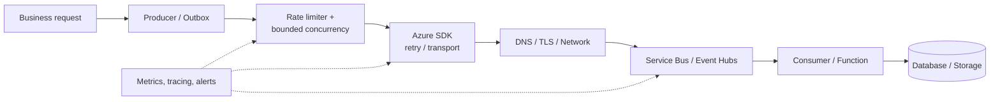
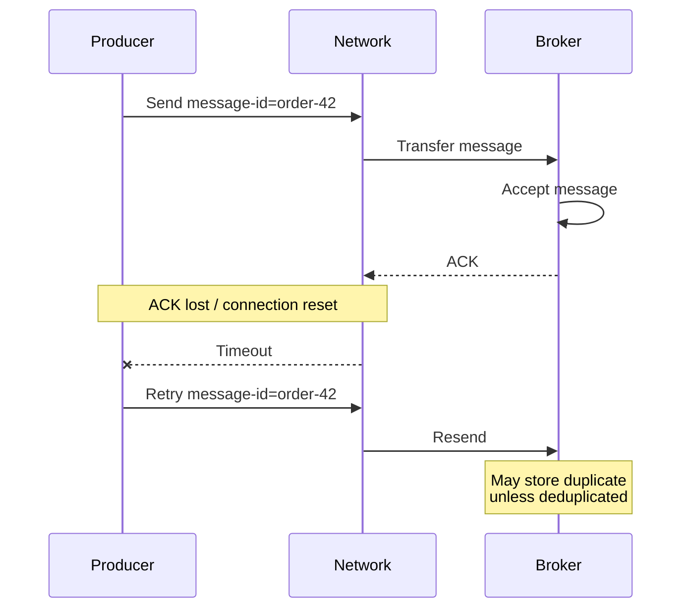
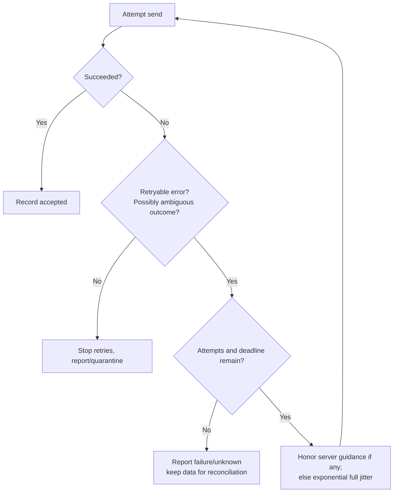
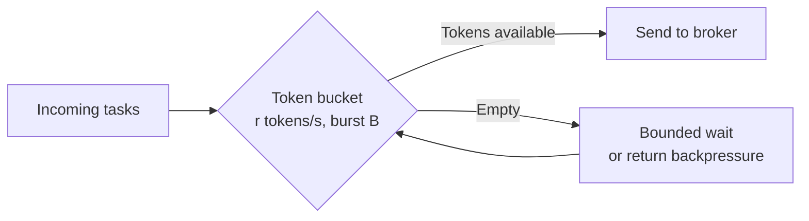
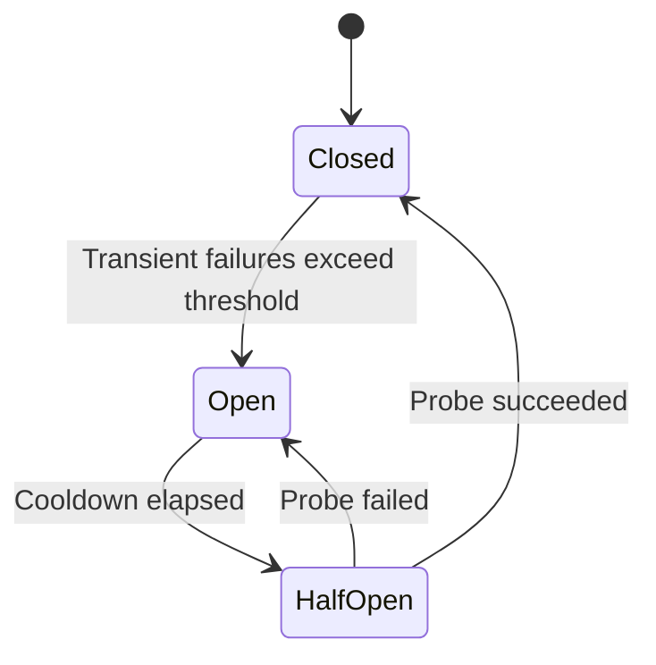
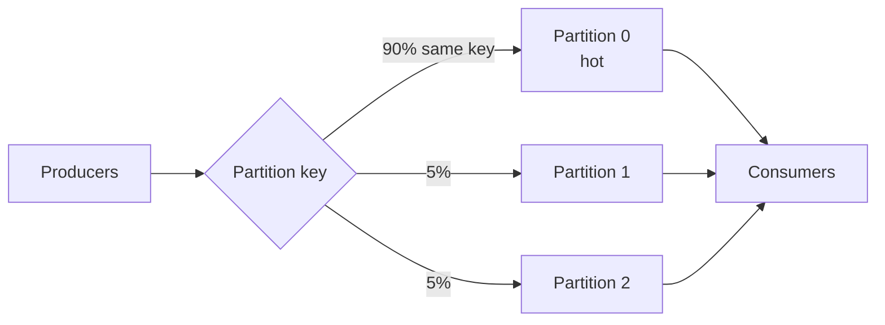
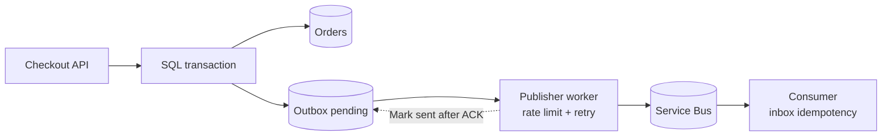
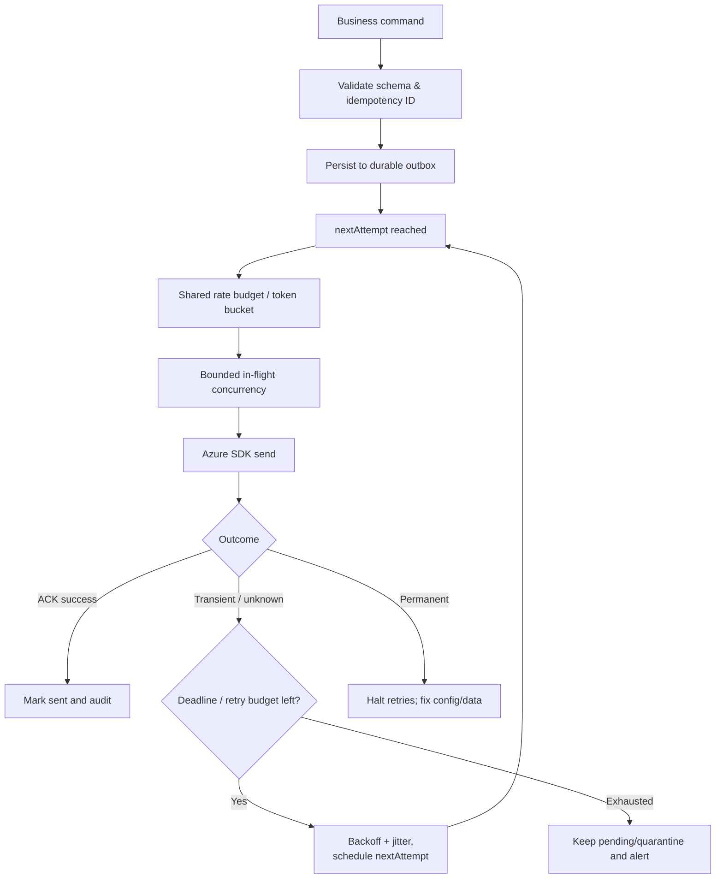

# Retries, Backoff, and Producer Throughput Control

An ordering application sends `CreateInvoice` commands into **Azure Service Bus**. During peak hours, concurrent requests drive the producer faster than the broker or downstream systems can absorb. A send attempt can time out, get throttled, or suffer a network reset. If every server retries immediately, the app creates a **retry storm**: errors trigger extra traffic, slowing recovery even further. Conversely, dropping a message after the first failure risks losing customer orders. The real challenge is therefore not just "how many times to retry," but **conditional, budgeted, spaced-out retries paired with deduplication**, while regulating how fast producers inject messages into the system.

This lesson belongs to the **Queues and Messaging** chapter of the **CLOUD_PROVIDERS_AZURE** module. The module introduces the Microsoft Azure ecosystem from subscriptions, resource groups, and Microsoft Entra ID to virtual networks, compute, storage, and data, along with deploying, monitoring, securing, and controlling costs for Azure architectures. Here we apply reliability and capacity-planning thinking to **Service Bus**, **Event Hubs**, **Azure Queue Storage**, and custom producers. The goal is sending fast enough to meet demand without overwhelming the broker, budget, or downstream sinks.

**After this lesson, you will be able to:**

- Classify send failures into **transient**, **permanent**, and **ambiguous outcome**.
- Design retries with **exponential backoff, full jitter, attempt caps, and deadlines**.
- Explain why post-send timeouts create **duplicate** risks even when the SDK reports an error.
- Apply **idempotency keys**, Service Bus duplicate detection, or transactional outboxes within proper bounds.
- Shape producer throughput using **token buckets, leaky buckets, semaphores, batching, backpressure, and circuit breakers**.
- Distinguish broker throughput from consumer/sink throughput; spot **hot partitions** or key-skew bottlenecks.
- Configure Azure SDKs, identities, networking, monitoring, alerts, and operational runbooks.

## 1. Producers and the Journey of a Send

A **producer** is any component generating messages/events for a queue, topic, or event hub—an API, batch job, Azure Function, IoT app, or integration service.

A send typically crosses multiple layers:



Track **three distinct rates**:

1. **Producer rate:** messages/events or bytes submitted per second.
2. **Broker accepted rate:** messages/events actually accepted and stored by the broker per product semantics.
3. **Consumer completed rate:** pace at which downstream business logic finishes accurately.

These three rates need not match. If producers push 600 messages/second while consumers finish 400 messages/second, the backlog grows by roughly **200 messages/second**—or **12,000 messages per minute**—unless throttling or scaling intervenes. A successful send at the producer does not mean the order was processed.

### 1.1. Broker Acceptance Differs from Business Completion

| Milestone | What It Proves | What It Does NOT Prove |
|---|---|---|
| SDK send function called | Code invoked the call | Network/broker received it |
| SDK returns success | Broker acknowledged the send per protocol | Consumer completed business logic |
| Message sits in queue / event hub | Broker holds data within retention/storage rules | Target database committed |
| Consumer completes / checkpoints | Consumer recorded progress per mechanism | Side effects executed once if code is non-idempotent |
| Database holds valid record | Business outcome committed | All external systems (email, partners) are also synced |

Your design must state explicitly where SLAs are measured. For payment commands, KPIs like "HTTP 202 Accepted" or "send success" **do not replace** completed-transaction metrics.

## 2. Classifying Errors Before Retrying

Not every error should be retried. A policy that catches every exception and sleeps slows down permanent failures while generating useless traffic.

| Category | Examples | Producer Action |
|---|---|---|
| **Transient / retryable** | Network reset, broker temporarily unavailable, server busy/throttling, temporary timeout | Retry with backoff, jitter, deadline, and bounded concurrency |
| **Permanent / non-retryable** | Payload exceeds entity/batch limit, fixed schema error, nonexistent entity, missing sender permission, bad connection string | Do not retry indefinitely; fail fast, fix config, or quarantine |
| **Conditional** | Storage quota full, disabled entity, policy limit, misconfigured DNS | Usually requires ops intervention; conditional retry after root cause changes |
| **Ambiguous outcome** | Broker accepted message yet ACK dropped, SDK timed out after sending | May need retry while **explicitly accounting for duplicate risk** |
| **Client overload** | Local producer buffer full, memory pressure, connection limit reached | Stop intake or apply backpressure; never spawn unbounded retry tasks |

Service Bus and Event Hubs commonly communicate over **AMQP** or AMQP over WebSockets; SDK exceptions do not always map 1:1 to HTTP status codes. Terms like **429 Too Many Requests**, **503 Service Unavailable**, or **Server Busy / throttled** are general examples, not claims that every AMQP send emits HTTP 429.

### 2.1. Honoring Server-Provided Retry-After Guidance

Some APIs/protocols return a wait hint (*Retry-After* or equivalent backoff duration). When surfaced by the SDK, producers should **honor at least the server-requested wait** alongside SDK retry policies. Never assume every Service Bus/Event Hubs failure includes a `Retry-After` header.

Without explicit server guidance, apply **exponential backoff + jitter** with a sensible cap. In both cases, enforce a total deadline.

### 2.2. Why 401/403 Errors Should Not Retry Continuously

Suppose an Azure Function uses a managed identity missing **Azure Service Bus Data Sender**. Retrying 100 times only floods logs and adds latency; it never grants permissions. Fix the principal, role assignment, scope, network rules, and check propagation.

**401** often points to credentials/tokens; **403** can stem from RBAC or network policies. Inspect the exact error message and config before classifying. If the SDK auto-refreshes tokens, brief retries may cover transient token-fetch hiccups, yet never loop forever on missing roles.

## 3. Ambiguous Send Outcomes and the At-Least-Once Principle

One of the trickiest failure modes:



When the SDK times out, the producer **cannot always tell** whether the broker accepted the message. Not retrying risks losing the job; retrying risks creating a duplicate. This is the classic *ambiguous acknowledgement* problem, not a quirk of any single SDK.

**Safe design rule:** design producers for **at-least-once delivery attempts** paired with **idempotent consumer effects**. Never claim "exactly once" just because the producer sets max retries to 3 or the broker offers duplicate detection.

### 3.1. Idempotency Keys

Each business command needs an ID that stays stable across retries:

```json
{
  "schemaVersion": 1,
  "commandId": "cmd-order-42-invoice-v1",
  "orderId": "order-42",
  "action": "IssueInvoice",
  "occurredAt": "2026-11-20T10:00:00Z"
}
```

When retrying the same **logical command**, preserve `commandId` (and `MessageId` / event ID). **Never mint a new UUID per attempt** if you need both attempts recognized as the same command.

At the consumer or database:

- Use unique constraints or atomic conditional writes keyed by business ID.
- Record an *inbox / processed-command ledger* alongside business side effects in one transaction where possible.
- If the ID is already processed, return an idempotent no-op result.
- When downstream services accept idempotency keys (payments, email), forward the stable ID.
- Retain idempotency records long enough to cover real retry and replay windows.

### 3.2. Service Bus Duplicate Detection

Service Bus offers **duplicate detection** when supported and enabled on the entity/SKU. The broker tracks `MessageId` over a configured history window; repeated sends sharing a matching key within that window are accepted without enqueuing a second copy per service semantics.

Remember:

1. Not every tier/entity supports it identically; verify configuration.
2. Deduplication applies only **within the configured window** and corresponding partition/session/entity rules.
3. It never replaces idempotent database transactions or consumer-side deduplication.
4. On Event Hubs, never assume a JSON `eventId` field triggers broker-side deduplication.

**Never generate random new `MessageId`s on retry**, as doing so defeats duplicate detection entirely.

## 4. Exponential Backoff and Jitter

### 4.1. Fixed Delay vs. Exponential Backoff

If every worker retries after an identical 1-second wait, they hammer the broker in synchronized waves:

```text
T=0:    10,000 requests fail together
T=1s:   10,000 requests retry together
T=2s:   10,000 requests retry together
=> Pulsing load spikes prevent service recovery.
```

**Exponential backoff** grows wait times exponentially:

\[
d_n = \min(d_{\max}, d_0 \times 2^n)
\]

Where:

- `d_0`: base delay.
- `n`: zero-based retry index.
- `d_max`: maximum delay cap per wait.

Example with `d_0 = 200 ms`, `d_max = 5 s`:

| Retry # | Exponential Delay Before Jitter |
|---:|---:|
| 1 | 200 ms |
| 2 | 400 ms |
| 3 | 800 ms |
| 4 | 1,600 ms |
| 5 | 3,200 ms |
| 6 and beyond | Capped at 5,000 ms |

These values are **illustrative calculations**, not mandatory Azure SDK defaults.

### 4.2. Full Jitter

**Full jitter** picks a random sleep duration uniformly in:

\[
\mathrm{sleep}_n \sim U\left(0,\,\min(d_{\max},d_0 2^n)\right)
\]

Instead of 10,000 producers waking up together at 800 ms, they spread smoothly across the interval. Variants include equal jitter and decorrelated jitter; **full jitter** is simple and effective for distributed clients.



### 4.3. Jitter Does Not Replace a Rate Limiter

Jitter prevents **retry synchronization**, yet producers can still push 20,000 new messages/second if incoming traffic surges. Rate limiters and bounded concurrency control aggregate pressure; retries and backoff only cope with transient failures.

## 5. Retry Budgets, Deadlines, and Timeouts

A responsible send policy enforces **four limits**:

1. **Max attempts:** total send attempts including the initial try.
2. **Per-attempt timeout:** prevent any single send call from hanging forever.
3. **End-to-end deadline:** total time budget for the entire retry sequence.
4. **Retry budget:** caps the percentage or count of retries across a rolling window to stop retry storms.

Example:

```text
maxAttempts:         4
perAttemptTimeout:   2 seconds (illustrative)
overallDeadline:     10 seconds
backoffBase:         200 milliseconds
backoffCap:          3 seconds
retryBudget:         at most 10% of total attempts in observation window
```

**These are not Azure defaults.** Derive values from SLOs, broker latency, cost, networking, and failure tolerance. An HTTP/Function request with a 3-second budget makes zero sense if the producer retries 10 times over several minutes.

### 5.1. System-Wide Retry Budgets

If four layers (API, integration SDK, job worker, broker adapter) each retry 3 times, actual calls **multiply** into massive amplification. Decide explicitly which layer owns retries:

- The Azure SDK handles brief transport/network errors per SDK policy.
- Producer orchestration governs overall deadlines and business idempotency.
- An outbox publisher owns durable retries after the HTTP request finishes.
- Consumers run their own settlement/retry loops separate from producer retries.

Never blindly wrap **an SDK already configured for 5 internal retries** inside another 5-iteration loop without accounting for total attempts.

### 5.2. Deadlines Differ from Message TTL

- **Producer deadline:** when the producer stops trying to send a request/job.
- **Message TTL:** how long a message survives under broker policy (depends on entity/tier and state).
- **Processing SLA:** elapsed time from business start to consumer completion.

A message reaching the queue before the send deadline yet waiting past TTL still fails business goals. Watch both backlog age and consumer health.

## 6. Python Retry Policy: Classification, Deadlines, and Full Jitter

The snippet below uses only the **Python standard library** to illustrate the algorithm. It takes `send_once` and `is_retryable` from the caller; **never assume every Azure SDK exception is transient**.

```python
import random
import time
from collections.abc import Callable
from typing import TypeVar

T = TypeVar("T")


def send_with_bounded_retry(
    send_once: Callable[[], T],
    is_retryable: Callable[[Exception], bool],
    *,
    max_attempts: int = 4,
    overall_timeout_s: float = 10.0,
    base_delay_s: float = 0.2,
    max_delay_s: float = 3.0,
) -> T:
    if max_attempts < 1 or overall_timeout_s <= 0:
        raise ValueError("Invalid retry budget")

    deadline = time.monotonic() + overall_timeout_s

    for attempt in range(max_attempts):
        if time.monotonic() >= deadline:
            raise TimeoutError("Send deadline exhausted")
        try:
            # SDK must also have a bounded per-attempt timeout.
            return send_once()
        except Exception as exc:
            # Caller must recognize real transient failures; never retry all.
            if not is_retryable(exc):
                raise
            if attempt + 1 >= max_attempts:
                raise

            remaining = deadline - time.monotonic()
            if remaining <= 0:
                raise TimeoutError("Send deadline exhausted") from exc

            ceiling = min(max_delay_s, base_delay_s * (2 ** attempt))
            # Full jitter, bounded by the remaining overall budget.
            time.sleep(min(random.uniform(0, ceiling), remaining))

    raise AssertionError("Unreachable")
```

**Limitations of this snippet:**

- Callers must identify retryable exceptions for their exact Azure SDK: network timeouts, transient/server busy, throttling, etc. **Never** pass `lambda exc: True`.
- The deadline here bounds loop iterations and waits **between** calls; if `send_once()` can hang, configure **timeouts inside the SDK/transport**. This synchronous wrapper cannot interrupt an active blocking call.
- If the SDK already performs internal retries, tune policies to avoid unexpected **nested retries**.
- If the server returns explicit wait guidance, honor that wait while respecting remaining deadline budget.
- If an ACK is lost, this loop can resend duplicates. **Keep idempotency keys stable** and deduplicate at the broker/consumer.
- In async apps, use `asyncio.sleep` and async SDK clients rather than blocking the event loop with `time.sleep`.

### 6.1. Error Classification Requires Discipline

A production policy classifies by SDK exception classes, diagnostic reasons, and error codes for your Azure SDK version:

```text
Retryable:
  - transient network reset / send timeout
  - server busy / throttling / temporary service unavailable

Non-retryable:
  - oversized message/event, invalid batch
  - entity missing or persistently disabled
  - access denied due to wrong role/policy/secret

Ambiguous:
  - timeout after transfer may have reached the broker
  - connection lost prior to confirmation
```

Many **ambiguous** errors are operationally retryable, provided IDs stay fixed and reconciliation/idempotency runs. Log classifications as `unknown` rather than prematurely claiming "the broker never got it."

## 7. Rate Limiting: Token Bucket and Leaky Bucket

Retries help recover from failures, while **rate limiting** stops producers from causing overload-induced failures in the first place.

### 7.1. Token Bucket

A token bucket has:

- **Refill rate** `r`: tokens added per second.
- **Burst capacity** `B`: maximum tokens stored.
- **Operation cost**: commonly 1 token/message, or weighted by bytes/batch size.

With `r = 100 messages/s` and `B = 200`, the producer can send a burst of ~200 messages when full, then settles back to ~100 messages/s steady state.



### 7.2. Leaky Bucket

A leaky bucket smooths outbound flow even further by queuing requests and draining at a steady pace, whereas a token bucket permits bounded bursts. Match to requirements:

| Need | Mechanism |
|---|---|
| Allow small bursts while capping sustained rate | Token bucket |
| Smooth outbound sends to a steady cadence | Leaky bucket / paced queue |
| Cap simultaneous in-flight requests | Semaphore / bounded worker pool |
| Bound RAM and unbounded queuing | Bounded queue + admission control |
| Halt retries when broker is clearly overloaded | Circuit breaker / cooldown |

In practice, teams **combine** token buckets, semaphores, and bounded queues; no single primitive replaces the rest.

### 7.3. Single-Process Python Token Bucket

Example throttling sends using the Python standard library:

```python
import threading
import time


class TokenBucket:
    def __init__(self, rate_per_second: float, burst: int):
        if rate_per_second <= 0 or burst < 1:
            raise ValueError("Invalid token bucket settings")
        self.rate = rate_per_second
        self.capacity = float(burst)
        self.tokens = float(burst)
        self.updated = time.monotonic()
        self.lock = threading.Lock()

    def acquire(self, cost: float = 1.0):
        if cost <= 0 or cost > self.capacity:
            raise ValueError("Invalid cost")
        while True:
            with self.lock:
                now = time.monotonic()
                elapsed = now - self.updated
                self.tokens = min(
                    self.capacity, self.tokens + elapsed * self.rate
                )
                self.updated = now
                if self.tokens >= cost:
                    self.tokens -= cost
                    return
                delay = (cost - self.tokens) / self.rate
            # Sleep outside the lock so other senders can proceed.
            time.sleep(delay)


# Demo only: at most ~20 tokens/second in steady state,
# with a burst capacity of 40 tokens per process.
bucket = TokenBucket(rate_per_second=20.0, burst=40)
# bucket.acquire()
# send_message()
```

**Important:** this limiter only governs **one process**. If 10 instances run with 20 tokens/s each, aggregate traffic reaches **200 messages/s** plus bursts. To cap an **entire app, tenant, or namespace**, partition budgets across instances or use a distributed rate limiter / centralized producer pool.

### 7.4. Throttling by Bytes, Not Just Message Counts

1,000 messages/s of 500 bytes differs drastically from 1,000 messages/s of 200 KB. Brokers can throttle on **operations, ingress bytes, connections, throughput units, processing units**, and SKU-specific limits.

When payload sizes vary widely, compute token cost from **estimated bytes** or **operation counts**, or enforce multiple limiters together. A batch of 100 events cannot be treated identically to one 1 KB message when approaching size caps.

## 8. Bounded Concurrency and Backpressure

### 8.1. Rate and Concurrency Are Not Identical

A rate limiter caps **operations/second**; a concurrency limiter caps **how many operations await ACKs simultaneously**.

Suppose a producer must sustain 100 messages/s with an average ACK latency of 0.2 s. Theoretical minimum concurrent operations:

\[
L \approx \lambda W = 100 \times 0.2 = 20
\]

This applies Little's Law in steady state—**not** a default SDK setting. If p99 latency climbs, required concurrency or buffering grows; measure live workloads rather than using this estimate to spawn unbounded tasks.

### 8.2. Semaphore for In-Flight Sends

In async Python:

```python
import asyncio

semaphore = asyncio.Semaphore(16)


async def bounded_send(send_once_async):
    async with semaphore:
        await send_once_async()
```

This only caps **16 in-flight calls inside one event loop/process**, not across an auto-scaled Function App fleet. Moreover, thousands of coroutines **queued on the semaphore** still consume RAM; place a bounded queue and admission control upstream.

### 8.3. Bounded Queues and Admission Control

When producers receive work faster than sustainable send rates, choose an explicit policy:

| Approach | When to Use | Risks to Manage |
|---|---|---|
| Wait in a bounded local queue | Brief spikes within latency budgets | Queue fills up; adds request latency |
| Return HTTP `429` or backpressure signal | Clients can retry and API contract allows it | Provide retry guidance to avoid client retry storms |
| Write to **transactional outbox** and return accepted | Business requests must never drop | Outbox storage, delivery SLA, and publisher workers |
| Intentionally drop non-essential events | Approved telemetry sampling | Incomplete data; always track drop/sample rates |
| Shard or throttle upstream producers | You control upstream emitters | Cross-team / partner coordination |

**Never use unbounded in-memory queues** for critical business commands. Process restarts lose unsent messages, and slow brokers cause unbounded RAM growth.

## 9. Circuit Breakers and Adaptive Rate Control

### 9.1. Circuit Breaker

A circuit breaker tracks consecutive or windowed errors:

- **Closed:** allows sends normally.
- **Open:** temporarily pauses new sends to a failing dependency.
- **Half-open:** permits a small probe volume to test recovery.



While open, business commands must be **durably persisted** (outbox) or receive a clear error response. A circuit breaker is never an excuse to silently drop data.

### 9.2. Adaptive Rate Control

Beyond static caps, producers can throttle back when:

- Server-busy / throttled rates rise.
- p95/p99 send ACK latency climbs.
- Retry ratios or deadline failures spike.
- Consumer lag/backlog breaches SLOs.
- Downstream databases or storage throttle.

After stabilizing, ramp rate back up **gradually** rather than snapping straight back. Algorithms like **AIMD (additive increase, multiplicative decrease)** cut rates sharply on congestion and recover cautiously when healthy. This is application-level logic, not built-in default behavior across Azure messaging SDKs.

### 9.3. Never Rely on Backlog Depth as the Sole Signal

High backlogs can stem from broken consumers rather than broker limits; pushing producers harder makes things worse. Conversely, low backlogs paired with high send latency can signal broker throttling or network issues even when consumers are fast.

Monitor **accepted ingress, retry rate, send latency, backlog age, consumer egress, and downstream health** together before tuning rates.

## 10. Batching for Higher Send Efficiency

Every network call carries setup, serialization, and ACK overhead. **Batching** groups messages/events to cut round-trips and overhead, yet introduces size caps and larger blast radius on send errors.

### 10.1. Batch Design

| Decision | Trade-Offs |
|---|---|
| Batch size | SDK/entity/SKU enforce hard max sizes; never exceed them |
| Batch fill timeout | Waiting too long to fill a batch inflates latency |
| Batch retries | Ambiguous ACK can force **the entire batch** to resend |
| Ordering | Partition keys / session IDs affect grouping and ordering |
| Memory | Oversized batches spike RAM and GC pressure |
| Downstream | Fast batched ingress can overwhelm consumers/sinks |

**Never confuse a batch send with a cross-entity business transaction.** Atomicity and transaction scopes depend on service, SKU, and API—verify before relying on batching for consistency.

### 10.2. Service Bus Batch Example with the Python SDK

This snippet **illustrates sending** and requires compatible `azure-servicebus` and `azure-identity` versions. The producer needs **`Azure Service Bus Data Sender`** RBAC on the target queue, plus working network/DNS:

```python
import os
from azure.identity import DefaultAzureCredential
from azure.servicebus import ServiceBusClient, ServiceBusMessage

namespace = os.environ["SERVICEBUS_FULLY_QUALIFIED_NAMESPACE"]
queue_name = os.environ["SERVICEBUS_QUEUE_NAME"]

credential = DefaultAzureCredential()
with ServiceBusClient(
    fully_qualified_namespace=namespace,
    credential=credential,
) as client:
    with client.get_queue_sender(queue_name=queue_name) as sender:
        batch = sender.create_message_batch()
        # Keep MessageId stable for the same business command on retry.
        batch.add_message(
            ServiceBusMessage(
                "Invoice request for order-42",
                message_id="cmd-order-42-invoice-v1"
            )
        )
        sender.send_messages(batch)
```

The SDK builds `ServiceBusMessageBatch` within the defined size cap. When adding messages:

- If `add_message` reports the batch is full, send the current batch (under your retry policy) and open a new batch.
- If **one single message** exceeds limits, fail/quarantine it or offload large payloads to Blob Storage and send a reference; **never infinitely retry an oversized payload**.
- Never regenerate `MessageId` when retrying a logical batch. Consumers still need idempotency because broker deduplication is bounded.
- The SDK may have internal retries; check `retry_total` / retry mode before wrapping in another loop.

**This sample includes no rate limiter.** In production, place a token bucket, semaphore, or outbox publisher ahead of `send_messages` to flatten spikes.

## 11. Event Hubs Producers: Throughput, Partitions, and Batches

Event Hubs targets high-frequency telemetry and event streams. Producers face three core decisions:

1. **Events and bytes/sec** sustainable by the namespace/event hub tier.
2. **Partition keys** to spread load while preserving needed entity ordering.
3. **Batching and retries** per SDK policy while keeping event IDs stable on ambiguous outcomes.

### 11.1. Hot Partitions

Sending every event with `partition_key="tenant-big"` funnels load onto one partition. Even with spare namespace headroom, that partition throttles and builds lag.



Pick keys with **high enough cardinality** to distribute load while preserving required ordering. Clickstreams rarely need per-key ordering everywhere; per-order events often do need in-partition order.

### 11.2. Event Hubs Batching with the Python SDK

Example using `azure-eventhub` and `azure-identity`. Requires **`Azure Event Hubs Data Sender`** at the target scope:

```python
import os
from azure.identity import DefaultAzureCredential
from azure.eventhub import EventData, EventHubProducerClient

namespace = os.environ["EVENTHUB_FULLY_QUALIFIED_NAMESPACE"]
hub = os.environ["EVENTHUB_NAME"]

credential = DefaultAzureCredential()
with EventHubProducerClient(
    fully_qualified_namespace=namespace,
    eventhub_name=hub,
    credential=credential,
) as producer:
    batch = producer.create_batch(partition_key="shop-42")
    batch.add(EventData('{"eventId":"evt-9001","type":"PageViewed"}'))
    batch.add(EventData('{"eventId":"evt-9002","type":"Clicked"}'))
    producer.send_batch(batch)
```

`EventDataBatch.add` rejects events that no longer fit. Flush the current batch and start a fresh one—Event Hubs does not expand batch limits dynamically. Avoid mixing distinct keys inside a single batch when explicit partition keys are needed.

**Warning:** if a batch send times out after broker ingestion, retrying the entire batch creates **duplicate events**. Event Hubs does not automatically deduplicate on JSON `eventId` fields; downstream consumers must be idempotent or use equivalent guards.

### 11.3. Throughput Units, Processing Units, and Quotas

Event Hubs capacity depends on tier (Throughput Units, Processing Units, or tier equivalents), bounding ingress bandwidth, events/sec, partitions, and connections. Size against actual tier, region, and quota specs.

**Never multiply partition count by a nominal per-partition number** and claim the entire namespace sustains that rate across every SKU. Namespace capacity, event size, batching, partition skew, and consumer speed jointly determine real throughput.

## 12. Azure Queue Storage: Simple Queuing Still Needs Deduplication

**Azure Queue Storage** suits straightforward task-queue workloads. Though APIs differ from Service Bus, producer principles stay identical:

- A send request can time out after the service persisted the message.
- Retrying sends can enqueue **logical duplicates**.
- Queue Storage uses **visibility timeout / dequeue** mechanics rather than Service Bus Peek-Lock/settlement.
- Do not assume session ordering, broker-side duplicate detection, or Service Bus-style dead-letter subqueues exist.

With Storage Queue, configure Azure Storage SDK retries and account for transaction rates, bandwidth, storage account limits, and **`Storage Queue Data Message Sender`** under Entra auth.

When delayed delivery, TTL, ordering, or poison handling is needed, check **actual Storage Queue features**—never copy Service Bus concepts like `MaxDeliveryCount` assuming identical behavior.

## 13. Transactional Outbox: Never Lose Commands After DB Commits

Suppose a REST API writes an order to SQL and **then** sends `IssueInvoice`. Crashing between SQL commit and broker send leaves an order with zero message.

A **transactional outbox** bridges those two un-atomically-linked steps:

1. In **one database transaction**, insert the business row and an outbox row.
2. A publisher worker polls unconfirmed outbox rows.
3. The publisher uses a rate limiter and bounded retries to send to the broker.
4. Once the SDK ACKs success, mark the outbox row sent.
5. On crash between steps 3 and 4, resend **the exact same `MessageId`**; idempotent consumers block duplicate effects.



### 13.1. Outboxes Do Not Guarantee Single-Publish Transport

If the broker accepts a send whose ACK drops, or the publisher crashes before marking `sent`, retries resend the message. Outboxes guarantee **commands are never lost after DB commit**; consumers/targets guarantee **effects apply at most once**.

### 13.2. Managing Outbox Backlogs

An outbox table needs:

- Unique event ID, transaction timestamp, schema version.
- Retry count, next attempt timestamp, error category, status.
- Lease/claim columns so multiple publishers do not repeatedly send the same row.
- Quarantine/escalation for permanently unsendable rows.
- Retention and cleanup after reconciliation.
- Alerts on oldest pending age, pending row count, and retry storms.

**Never run unbounded retry loops inside an HTTP request** to mask broker outages; persist durably and return per API contract (e.g., accepted/pending).

## 14. Combining Rate Limiters, Retries, and Outboxes in Order

Recommended send pipeline:



Never call `time.sleep` inside a worker holding a database transaction or outbox lease for minutes. Persist `nextAttemptAt`, release the lease cleanly, and let workers pick it up when due.

### 14.1. When to Return Errors Directly to Clients?

| API Style | Options | Constraints |
|---|---|---|
| Sync, requiring broker ACK before HTTP 200 | Wait within a short deadline; return ambiguous/reconcile status on timeout | Client retries must supply idempotency keys |
| Sync DB/outbox commit then async send | Return `202 Accepted` with request ID / pending status | Provide status query endpoint; do not confuse 202 with completed |
| Non-critical telemetry | Sample/drop per data contract | Track drop rates and document limits |
| Critical financial commands | Durable outbox + reconciliation | Never silently drop or retry unboundedly |

## 15. Global Throughput Control in Scale-Out Fleets

Per-instance limiters do not protect shared targets globally. Eight replicas capped at 100 messages/s each can hit 800 messages/s—throttling a broker safe only up to 400 messages/s.

Three patterns:

1. **Budget partitioning:** a controller allocates per-instance quotas updated as replica count changes.
2. **Distributed rate limiter:** a consistent coordinator/state store matched to load and failure modes.
3. **Shared durable queue / outbox publisher:** centralize sending through a bounded-concurrency worker pool.

**No approach is free of trade-offs:** distributed limiters add latency, single publisher pools risk bottlenecks, and static quotas waste idle headroom. Pick based on SLOs, scale, fairness, and cost.

### 15.1. Tenant Fairness and Priorities

If one tenant generates 90% of traffic, others can starve. Consider:

- **Per-tenant / per-producer** rate limits plus a global namespace cap.
- Dedicated queues/publishers for high-priority workloads requiring isolation.
- Weighted fair scheduling or priority lanes in app logic where appropriate.
- Never let bulk telemetry starve payment commands.

Rate limiting can live at API gateways, producer workers, or both. Still, **namespace quotas** remain a shared constraint across workloads sharing a namespace.

## 16. Monitoring: Measuring Real Sends and Pressure

Signals to observe:

| Group | Metrics / Signals | Meaning |
|---|---|---|
| Producer | Send attempts/s, successes/s, failures/s | Separates **attempts** from **accepted messages** |
| Retry | Retry attempts, retry ratio, backoff distribution, deadline timeouts | Detects retry storms |
| Latency | Send ACK p50/p95/p99, outbox age | Slow broker/network or queued commands |
| Rate control | Token wait times, rejected/throttled admissions, local queue depth | Shows how hard limiters are clamping load |
| Service Bus | Incoming/outgoing messages, active/dead-letter counts, server busy/throttled | Checks broker and consumer backlog |
| Event Hubs | Incoming events/bytes, throttled requests, partition lag, outgoing metrics | Detects namespace caps and hot partitions |
| Consumer | Processing completions/s, lag/backlog age, retries/DLQ/quarantine | Measures real business progress |
| Dependency | SQL/Storage 429/503s, timeouts, connection saturation | Prevents producers from drowning sinks |
| Cost | Broker units, operations, logs, egress, Functions/VM compute | Optimizes cost per accepted/business message |

Not every metric name above exists verbatim in Azure Monitor across all tiers/APIs. Map these to real **Azure Monitor metrics, Application Insights custom metrics, SDK traces, and logs**.

### 16.1. Correlation and Structured Logs

A producer log entry should capture:

```json
{
  "operation": "SendBusinessCommand",
  "commandId": "cmd-order-42-invoice-v1",
  "destination": "servicebus:orders",
  "attempt": 2,
  "outcome": "unknown_after_timeout",
  "elapsedMs": 1900,
  "retryable": true,
  "nextDelayMs": 780
}
```

In production, add trace/correlation IDs, producer instance, SDK exception category, and payload size. **Never log connection strings, SAS tokens, bearer tokens, or full PII payloads.**

### 16.2. SLO-Aligned Alerts

Alert when:

- Retry ratio spikes well above baseline.
- Send success rate drops while attempts/s climb.
- Broker throttling persists despite producer backoff.
- Oldest pending outbox age breaches latency budgets.
- Service Bus DLQ or backlog age grows.
- Event Hubs ingress throttles or consumer lag nears retention limits.
- Downstream databases hit rising timeouts or 429s.
- Compute, broker, or logging spend spikes unexpectedly.

**Never alert on absolute queue depth alone** when bursts are normal. Combine **oldest message age**, consumer completion rate, and SLOs to distinguish healthy bursts from stuck backlogs.

## 17. Case Study A: Flash Sale Triggering a Service Bus Retry Storm

**Context:** a site averages 100 orders/minute, then jumps to 10,000 orders/minute during a flash sale. Multiple API instances emit `IssueInvoice` to Service Bus and hit `ServerBusy`/timeouts.

### 17.1. Failure-Prone Design

```text
for each request:
  generate new MessageId
  send()
  on error: immediately retry 10 times, no jitter
  no max concurrency
  no outbox
```

Consequences:

- Retries amplify burst load far above original demand.
- Changing `MessageId`s prevent broker duplicate detection across retries.
- API latency spikes, exhausting threads and sockets.
- Commands vanish on crashes while others duplicate.
- Consumer/billing databases drown under overload.

### 17.2. Resilient Design

1. Assign every order a stable `commandId`.
2. Checkout API commits order + outbox in one transaction.
3. Publisher workers pull outbox rows in bounded batches.
4. Rate limiters cap accepted send rates within global budgets.
5. Semaphores cap in-flight sends.
6. SDK handles bounded transient backoff/jitter; app enforces overall deadline.
7. Ambiguous sends remain pending for reconciliation—never mint new IDs.
8. Idempotent consumers write invoices keyed by unique order/command ID.
9. Monitor oldest pending age, success rates, p95 send latency, and DLQs.

**Verify via load testing:** backlog drains steadily post-peak, business duplicate rate is 0, checkout error budget holds, and broker/sink throttling stays contained.

## 18. Case Study B: Event Hubs Telemetry and a Hot Partition

**Context:** a user-activity platform pushes 50,000 events/second. Producers batch aggressively yet always pass `partition_key="global-web"`. Metrics show Event Hub throttling and consumer lag climbing on one partition.

### 18.1. Analysis

- Shared key hashes route load unevenly onto one partition.
- Adding producer instances cannot fix key skew and only increases retries.
- Batching lowers overhead yet cannot bypass single-partition or quota bottlenecks.
- If consumers fall too far behind on the hot partition, retention expires before catch-up.

### 18.2. Remediation

1. Determine whether global order or per-session/user/device order is actually needed.
2. Pick a higher-cardinality partition key that balances load while keeping needed order.
3. Batch by byte caps and max wait time; never exceed per-event limits.
4. Rate-limit on ingress bytes/sec and events/sec, not calls/sec alone.
5. Monitor per-partition skew, send latency, throttling, and consumer lag.
6. If total namespace capacity is genuinely insufficient, upgrade tier/capacity per service options.
7. Consumers checkpoint idempotently with quarantine handling and retention sized for outages.

**Never change partition keys mid-stream without checking business order impact**: an aggregate can jump partitions during cutover. When strict ordering matters, enforce app-layer versioning/sequences.

## 19. Case Study C: Partner API Requiring Allowlisting and Rate Caps

**Context:** Azure Functions producers send to private Service Bus, and consumers call a partner API capped at 200 requests/s. The Function App scales from 2 to 20 instances.

**Risk:** a local 200 requests/s cap per instance allows 4,000 requests/s globally, crushing the partner cap. Partner `429` errors trigger consumer retries, ballooning backlogs and latency.

**Design:**

- Enforce a global **200 requests/s** (or lower) budget via cross-instance quota distribution.
- Cap concurrent calls to avoid connection floods.
- Honor partner `Retry-After` headers alongside jitter and global budgets.
- Buffer durably in outboxes/queues rather than holding everything in memory.
- Decouple **producer-to-broker** rate from **consumer-to-partner** rate: the broker can ingest bursts while consumers drain at the partner's pace.
- Monitor oldest pending age, DLQs, API throttling, and end-to-end business latency.

## 20. Throttling and Send-Failure Runbook

### Phase 1 — Isolate

1. Confirm **target service**: Service Bus, Event Hubs, or Storage Queue; namespace, entity, and tier.
2. Inspect **underlying SDK error classes/codes**: transient, permanent, ambiguous, or client overload.
3. Compare send attempts/s vs. accepted/s, error rate, retry ratio, and latency.
4. Check namespace ingress, message sizes, quotas, and Azure service health.
5. Check network/DNS, firewalls, managed identities / Data Sender roles, and tokens.
6. Inspect consumer lag/backlogs and downstream health so you do not tune the wrong layer.

### Phase 2 — Stabilize

1. During retry storms, **lower concurrency and rates**, enforce jittered backoff, and cap deadlines.
2. Pause non-critical producers or tighten approved telemetry sampling if needed.
3. Keep critical commands **durable in outboxes**—never drop them on transient broker errors.
4. Honor server wait guidance where exposed by the SDK.
5. For 403 or invalid payloads, fix RBAC or schemas instead of retrying.
6. Never purge pending data or loosen all Azure permissions just to silence transient errors.

### Phase 3 — Recover and Reconcile

1. Send small probe batches to confirm broker recovery.
2. Ramp rates back up gradually while watching throttling and latency.
3. Reconcile `MessageId`/`eventId` across outbox, broker, and sinks where possible.
4. Replay or quarantine invalid items per runbook using idempotency.
5. Verify backlog age and downstream throughput return within SLO.
6. Document root cause, tune quotas/limiters, and add retry chaos tests.

## 21. Common Design Mistakes

| Symptom | Root Cause | Fix |
|---|---|---|
| Adding retries makes errors worse | Synchronized retries, no jitter, or no retry budget | Exponential full jitter, rate limits, deadlines |
| Messages recorded twice | Lost ACK, changing IDs, non-idempotent consumer | Stable `MessageId` + inbox/unique constraints |
| SDK timed out yet broker has message | Ambiguous outcome | Never assume hard failure; reconcile idempotently |
| OOM when broker slows down | Unbounded queues or task spawning | Bounded queues, semaphores, backpressure |
| Rate limiter still blows quota | Per-instance limiter only | Global budget / distributed coordination |
| Low traffic yet high send latency | DNS/TLS/network or recreating clients per call | Reuse SDK clients; profile transport/network |
| Event Hubs hits one hot partition | Skewed partition key | Pick higher-cardinality keys matching ordering needs |
| Large batches rejected | Exceeded max batch/event size | Use SDK batch builders; split batches; quarantine oversized items |
| Bad payload retries forever | Non-retryable error treated as transient | Classify, validate upfront, quarantine |
| Broker ingests fast yet business lags | Consumer/DB bottleneck | Scale consumers/sinks, match rates, watch backlog age |
| Messages lost on API restart | Pending sends stored only in RAM | Transactional outbox / durable queue |
| Function App throws 403 | Missing data-plane role or wrong principal/scope | Verify managed identity and Sender role |
| Private Endpoint fails to connect | Wrong DNS/routing or disabled public access | Check FQDN, private DNS, VNet/firewalls |
| SDK retries + custom retries explode attempts | Nested retry loops | Pick one retry owner; calculate total attempts |

## 22. Production Checklist

- [ ] Distinguished Service Bus, Event Hubs, and Storage Queue by workload semantics.
- [ ] Messages include schema version, stable message/event ID, and correlation ID.
- [ ] Send failures classified into transient, permanent, and ambiguous.
- [ ] Retry policy enforces exponential backoff, jitter, attempt limits, and deadlines.
- [ ] Checked SDK default retries so no unintended nested retry loops exist.
- [ ] Consumer/database idempotency enforced; Service Bus duplicate detection is strictly additive.
- [ ] Transactional outbox or durable persistence protects critical business commands.
- [ ] Token bucket, leaky bucket, or rate shaping limits producer bursts.
- [ ] In-flight concurrency and local pending queues are strictly bounded.
- [ ] Scale-out fleets enforce a **global budget**, not just per-instance caps.
- [ ] Batches stay within size limits and account for full-batch retry duplicates.
- [ ] Event Hubs partition keys evaluated for skew and ordering constraints.
- [ ] Broker capacity, quotas, and SKUs verified; limits track both ops and bytes.
- [ ] Managed identities hold Data Sender roles with verified networking/private DNS.
- [ ] Telemetry tracks send attempts, accepted sends, retry ratios, p95/p99 latency, backlog age, and sinks.
- [ ] Tested post-ACK timeouts, 429/ServerBusy, 403s, invalid payloads, broker outages, and restarts.
- [ ] Runbooks exist for load shedding, reconciliation, replays, and rate/SDK rollbacks.

## 23. Self-Check Questions

1. Why does a `send_messages()` timeout not prove the broker never received the message?
2. Why must `MessageId` remain identical across retries of the same business command?
3. What does Service Bus duplicate detection solve, and what does it NOT replace?
4. Distinguish transient, permanent, and ambiguous errors, giving one example of each.
5. Why do fixed delays cause retry storms when thousands of producers hit an outage together?
6. Write the capped exponential backoff formula and explain full jitter.
7. Why can setting max attempts without a deadline or per-attempt timeout still hang requests?
8. How do a token bucket with `r=100/s` and `B=200` govern bursts and steady-state rate?
9. What does a semaphore of 16 limit, and why is a bounded queue still needed?
10. A Function App scales to 10 instances, each limited to 20/s. How high can aggregate rate climb?
11. Why must Event Hubs producers track bytes/s, partition counts, and partition keys?
12. When `EventDataBatch.add` rejects an event, what should code do instead of retrying forever?
13. The broker ACKs the producer, yet the consumer fails writing to the database: where should business success be measured?
14. How does a transactional outbox prevent lost commands, and why can duplicate sends still occur?
15. A system ingests 600 messages/s and processes 400/s. How does the backlog change over one minute?
16. Why shouldn't 401/403 missing-role errors trigger infinite exponential retries?
17. Why do per-instance rate limiters fail to protect global namespace quotas under autoscaling?
18. Which metrics should you inspect before raising broker capacity or throttling producers?

## Conclusion

**Retries** are never about "retrying as many times as possible." Resilient producers **classify errors**, bound attempt counts and total duration, apply **exponential backoff with jitter**, and handle **ambiguous** outcomes with stable IDs and idempotency. **Rate limiters** curb incoming surges; **semaphores** cap in-flight concurrency; **bounded queues and outboxes** protect memory and durability when brokers slow down; **circuit breakers** prevent piling load onto struggling dependencies. On Azure Service Bus, understand duplicate detection and settlement; on Event Hubs, watch batch bytes, partitions, and hot keys; on Storage Queue, never assume Service Bus settlement features apply. Pairing Azure RBAC, secure networking, monitoring, cost controls, and runbooks keeps messaging pipelines resilient under surges, throttling, and network faults without dropping or duplicating business outcomes.
