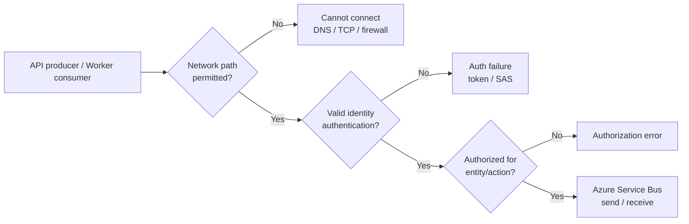
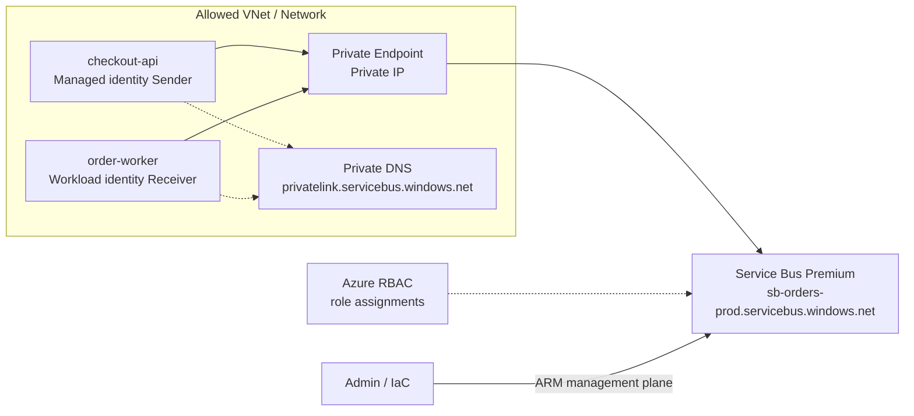
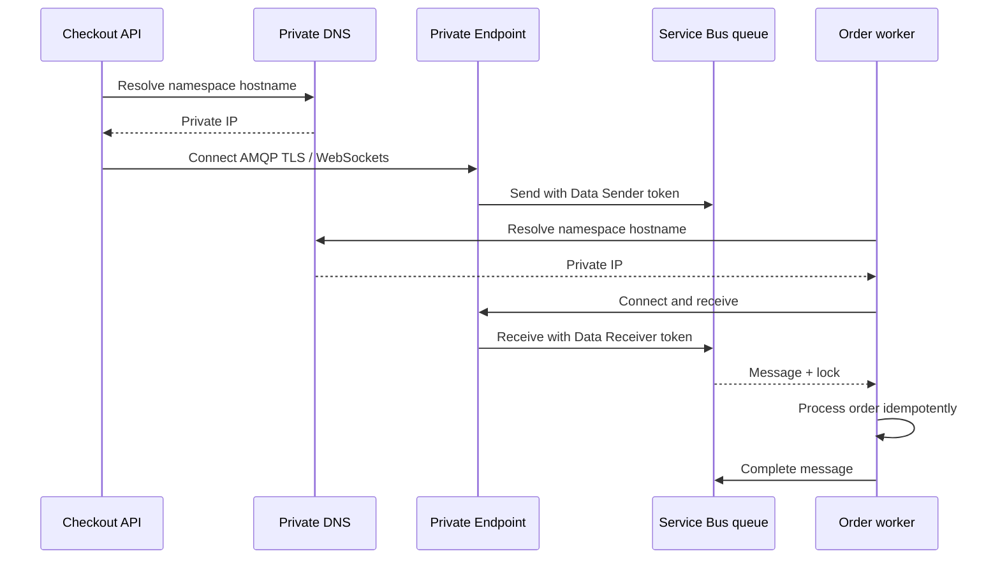

# Authorization and Private Network Access for Service Bus

An order system has three components: an API sending messages into a queue, workers receiving messages for processing, and an operations team administering Azure Service Bus. If all three share a single connection string with `Manage` rights, leaking that key in one worker compromises the entire namespace. If corporate policy mandates that Service Bus be reachable only from the enterprise network while the namespace keeps a public endpoint open, the network posture fails compliance even if code authenticates cleanly.

**Azure Service Bus** enables reliable messaging across **queues** and **topics/subscriptions**. Securing it requires answering two independent questions: **who is allowed to do what?** (Microsoft Entra ID, Azure RBAC, or SAS policies) and **which network paths may reach it?** (restricted public endpoints or Azure Private Link). An authorized identity without network reachability cannot use the service; a reachable network path does not grant permission to send or receive messages.

In the **CLOUD_PROVIDERS_AZURE** module, you explore Microsoft Azure from subscriptions, resource groups, and Microsoft Entra ID through virtual networks, compute, storage, and data—along with deploying, monitoring, securing, and controlling costs. This lesson belongs to the **Queues and Messaging** chapter and covers securing Service Bus from data-plane permissions to private endpoint design, with Azure CLI, Java SDK examples, verification workflows, and troubleshooting.

## 1. Learning Objectives

After this lesson, you will be able to:

- Distinguish the **management plane** from the **data plane** of Service Bus.
- Choose the right roles—**Azure Service Bus Data Sender**, **Data Receiver**, and **Data Owner**—following least privilege.
- Assign roles to users, service principals, or **managed identities** at proper scopes and understand propagation delays.
- Compare **Microsoft Entra ID (OAuth)** with **Shared Access Signatures (SAS)** and explain why shared keys should be minimized.
- Explain differences among **IP firewalls**, **virtual network service endpoints**, and **private endpoints**.
- Design private endpoints for Service Bus Premium, DNS `privatelink.servicebus.windows.net`, network routes, and protocol ports.
- Configure Java applications using `DefaultAzureCredential` without storing connection strings in source code.
- Systematically troubleshoot connectivity, tokens, roles, DNS, and firewalls—never working around failures by opening unrestricted public access.

## 2. Understanding Service Bus Security Architecture

A **Namespace** is the organizational boundary for Service Bus resources and connection endpoints. Inside a namespace sit **queues** and **topics**; each topic can hold multiple **subscriptions** for consumer groups. Apps send and receive through the namespace endpoint, such as `sb-orders-prod.servicebus.windows.net`.

| Component | Role | What to Protect |
|---|---|---|
| Namespace | Service config, tier, networking, and identity | Rights to modify network rules, SAS policies, keys, and identities |
| Queue | Point-to-point send/receive | Producers can only send; consumers can only receive |
| Topic | Broadcast events to multiple streams | Restrict publishers per topic |
| Subscription | Receives copies matching filters/rules | Restrict subscribers to their specific processing scope |
| Client | APIs, workers, Functions, AKS, VMs, or admin tools | Effective identity, tokens, networking, and secret handling |

### Two Control Layers Must Both Pass



Networking does not replace authorization, and vice versa. In production, apps must still validate message contents, handle redeliveries, retries, TTLs, and dead-lettering; RBAC and private endpoints do not solve application-layer reliability by themselves.

## 3. How Does the Management Plane Differ from the Data Plane?

### Management Plane (Azure Resource Manager)

**Infrastructure management** operations include creating namespaces, changing SKUs, configuring networking, creating queues/topics, editing policies, assigning Azure RBAC, and deleting resources. These go through Azure Resource Manager and roles like **Reader**, **Contributor**, **Owner**, or equivalent custom roles.

**Important:** anyone with broad management rights can alter access policies or, in certain configurations, retrieve or rotate SAS keys. Therefore, granting broad management-plane roles is a security risk even when applications normally authenticate with Microsoft Entra ID.

### Data Plane (Sending and Receiving Messages)

**Message usage** operations include:

- Sending messages to a queue or topic.
- Receiving/completing/abandoning/dead-lettering messages in a queue or subscription.
- Other data operations granted by Service Bus data roles.

With **Microsoft Entra ID**, data-plane permissions require dedicated data roles. **Azure RBAC `Reader` on a namespace does not grant message receive access**, and **`Contributor`**—meant for resource management—should not be treated as the proper way to grant OAuth send/receive rights.

| Identity | Desired Business Permission | Typical Role |
|---|---|---|
| Checkout API | Only send order messages | **Azure Service Bus Data Sender** |
| Order worker | Receive and complete messages from queue | **Azure Service Bus Data Receiver** |
| Event-publishing service | Publish to a topic | **Azure Service Bus Data Sender** |
| Notification consumer | Receive events from subscription | **Azure Service Bus Data Receiver** |
| Operational tooling needing full data control | Perform data operations under approved governance | **Azure Service Bus Data Owner** |
| Infrastructure platform team | Create namespaces, manage network/roles | Appropriate ARM management role; do not grant Data Owner by default |

**`Data Owner` is not Azure Resource Manager `Owner`**: similar names hide very different scopes and permissions. Before assigning any role, inspect its exact Azure RBAC `Actions` and `DataActions`.

## 4. Azure RBAC Scopes and Applying Least Privilege

A role assignment binds a **principal**, a **role**, and a **scope**. Scopes typically span subscription, resource group, Service Bus namespace, or entity level where Azure RBAC supports it, depending on feature and API version.

### Scope Hierarchy to Consider

1. **Specific queue or topic/subscription**, when the role and entity support entity-level scoping.
2. **Namespace**, if an app needs access across multiple queues/topics in the same namespace.
3. **Resource group / subscription**, only when broad, audited administrative control is genuinely required.

For example, if a producer only sends to queue `orders`, assigning **Data Sender on the queue** is safer than **Data Owner on the namespace**. If a consumer reads only subscription `email` under topic `events`, verify supported role scopes and grant receive access at the narrowest valid scope. Parent-scope assignments inherit downward; check inherited assignments during access audits.

### Who Can Be a Principal?

- **User:** a developer testing send/receive in a lab or an operator granted temporary access.
- **Service principal:** an automated application using credentials, certificates, or federated identity.
- **System-assigned managed identity:** identity bound to Azure Functions, App Service, VMs, or supported resources, sharing their lifecycle.
- **User-assigned managed identity:** standalone identity assignable to multiple supported resources with its own lifecycle.
- **AKS workload identity:** links a Kubernetes ServiceAccount to a Microsoft Entra identity via federation when supported by environment and SDK.

Never confuse **client ID** with **principal/object ID** when creating role assignments. For managed identities, principal ID normally maps to `--assignee-object-id`, while client ID tells application code which user-assigned identity to pick.

### Propagation Delay and Token Caching

After adding or revoking a role, Azure RBAC can take time to propagate to the data plane. Cached tokens or long-lived clients can continue using earlier credentials. When testing:

1. Verify the assignment uses the right principal, scope, and environment.
2. Allow reasonable propagation time.
3. Refresh tokens or connections per SDK support; never print tokens in logs.
4. Retry a small operation and separate RBAC failures from network failures.

Never panic and grant broader roles simply because a test run seconds after creating a role assignment still throws 403.

## 5. Microsoft Entra ID vs. SAS: Which Should You Choose?

### Authenticating with Microsoft Entra ID

Applications use **OAuth access tokens** from Microsoft Entra ID via the Azure SDK. `DefaultAzureCredential` selects an environment-appropriate token source—developer credentials locally or managed identity on Azure.

Advantages:

- No static connection strings or SAS keys embedded in code.
- Data-plane roles scoped precisely per principal.
- Revoke or adjust access centrally via Microsoft Entra ID and Azure RBAC.
- Integrates cleanly with managed identities, workload identities, and enterprise access policies.

Still, a valid token is **not enough** if data-plane RBAC is missing or networking blocks access.

### Authenticating with Shared Access Signatures

**Shared Access Signatures (SAS)** rely on shared access authorization rules/keys or tokens granting `Send`, `Listen`, or `Manage` rights per SAS policy. Many legacy systems use connection strings containing shared keys.

Risks:

- Keys shared across apps make per-workload attribution difficult.
- A leaked key exposes full policy permissions until rotated or revoked.
- `Manage` policies grant far more privilege than routine send/receive workloads need.
- Connection strings frequently leak into Git repos, logs, CI pipelines, or tickets.

For Azure workloads supporting Microsoft Entra ID, **prefer managed identities + RBAC**. If third-party integrations require SAS, issue least-privilege policies, store them in an approved secret vault, enforce rotation, and restrict networking.

### Should You Disable Local/SAS Authentication?

Service Bus supports **disabling local authentication** under supported service conditions. Once disabled, any client still using SAS/connection strings stops working. Therefore:

1. Inventory every producer, consumer, function trigger, connector, scheduled job, and admin tool.
2. Migrate each client to Entra ID and verify roles and token acquisition.
3. Test workloads running across private networks, retries, and restarts.
4. Only after all clients have migrated—and with a rollback plan—disable local authentication.

**Disabling SAS does not block public networks.** Those are two separate policies that must be configured and verified independently.

## 6. Permissions and Network Architecture for an Ordering System

Suppose:

- `checkout-api` runs on Azure App Service / Functions and must only send messages to queue `orders`.
- `order-worker` runs on Azure Kubernetes Service and must only receive messages from queue `orders`.
- Service Bus namespace is `sb-orders-prod` in an appropriate region.
- Security policy requires **all workload data traffic to traverse a VNet / private endpoint**.



In this design:

- **RBAC** governs who can send and receive.
- **Private Endpoint** gives the Service Bus namespace a private IP address.
- **Private DNS** lets clients keep using the standard namespace hostname while resolving to the private IP inside authorized networks.
- **VNet integration / AKS routing** lets workloads physically reach the private endpoint.
- **Public network access** is tightened per policy once private connectivity is proven end-to-end.

Do not change the SDK hostname to `privatelink.servicebus.windows.net`: clients continue targeting `sb-orders-prod.servicebus.windows.net`, and DNS handles routing to the private IP.

## 7. Service Tiers and Service Bus Networking Capabilities

Azure Service Bus offers Basic, Standard, and Premium tiers with distinct features and limits. **Private Endpoints (Azure Private Link) for a Service Bus namespace normally require the Premium tier**; verify current availability for your region, subscription, and namespace configuration before designing. IP filtering and VNet rules/service endpoints also have tier- and version-specific restrictions.

| Capability | Purpose | What to Verify Before Deployment |
|---|---|---|
| **Public endpoint + authentication** | Access via public endpoint using OAuth token or SAS | Public network policy, identity/role, TLS |
| **IP firewall rules** | Restrict public access by source IP/CIDR where tier supports it | Actual client/NAT egress IPs, limits, and tier |
| **VNet service endpoint rules** | Restrict public service endpoint to allowed subnets | Tier support, service endpoint, and routing |
| **Private Endpoint / Private Link** | Reach Service Bus via private IP inside a VNet | **Premium tier**, private endpoint approval, DNS, and routing |
| **Public network access Disabled** | Block data-plane public endpoint per policy | Valid private paths exist for every client/runtime |

**IP firewalls do not give a namespace a private IP.** Virtual network service endpoints still route to the public service endpoint tagged with VNet/subnet identity; only a Private Endpoint places a dedicated network interface and private IP inside your VNet.

Separate **network reachability**, **network policy**, and **data-plane authorization** rather than expecting one setting to replace all three.

## 8. Azure RBAC Hands-On: Assigning Scoped Sender and Receiver Roles

### 8.1. Prepare the Lab and Verify Context

Illustrative resource names:

| Component | Sample Name / Value | Notes |
|---|---|---|
| Subscription | `<subscription-id>` | Replace with an authorized subscription |
| Service Bus resource group | `rg-messaging-lab` | Holds the namespace |
| Namespace | `sb-orders-lab` | Existing namespace |
| Queue | `orders` | Producer sends; consumer receives |
| Function App producer | `func-checkout-lab` | Has system-assigned managed identity |
| Worker consumer | `mi-order-worker` | User-assigned identity or configured principal |

Whoever runs role assignments needs access-management permissions such as **Role Based Access Control Administrator** or **Owner** at the target scope; **`Reader`** is insufficient. Commands below mutate Azure RBAC—run only in approved environments.

### 8.2. Enable Identity on the Producer

```bash
az login
az account set --subscription "<subscription-id>"

# Enable system-assigned managed identity on the lab Function App.
az functionapp identity assign \
  --resource-group "rg-functions-lab" \
  --name "func-checkout-lab"

# Retrieve the actual principal/object ID.
SENDER_PRINCIPAL_ID=$(az functionapp identity show \
  --resource-group "rg-functions-lab" \
  --name "func-checkout-lab" \
  --query principalId \
  --output tsv)

echo "Producer principal ID: $SENDER_PRINCIPAL_ID"
```

If the Function App already has an identity, skip enabling it again. For user-assigned identities, read the principal ID from the managed identity resource and configure the app with its exact **client ID**. Never swap client ID and principal ID in role assignment commands.

### 8.3. Create Queue-Scoped Role Assignments

```bash
SB_ID=$(az servicebus namespace show \
  --resource-group "rg-messaging-lab" \
  --name "sb-orders-lab" \
  --query id \
  --output tsv)

QUEUE_SCOPE="$SB_ID/queues/orders"

# Checkout API is only permitted to send messages.
az role assignment create \
  --assignee-object-id "$SENDER_PRINCIPAL_ID" \
  --assignee-principal-type ServicePrincipal \
  --role "Azure Service Bus Data Sender" \
  --scope "$QUEUE_SCOPE"

# List role assignments, including inherited parent roles.
az role assignment list \
  --scope "$QUEUE_SCOPE" \
  --include-inherited \
  --output table
```

For the consumer, read `principalId` from the **exact identity used by the worker**, not the AKS control-plane identity by mistake:

```bash
# With a user-assigned managed identity named mi-order-worker.
RECEIVER_PRINCIPAL_ID=$(az identity show \
  --resource-group "rg-identities-lab" \
  --name "mi-order-worker" \
  --query principalId \
  --output tsv)

az role assignment create \
  --assignee-object-id "$RECEIVER_PRINCIPAL_ID" \
  --assignee-principal-type ServicePrincipal \
  --role "Azure Service Bus Data Receiver" \
  --scope "$QUEUE_SCOPE"
```

This assumes `mi-order-worker` already exists and is bound to the workload via a supported mechanism (such as AKS Workload Identity). **Creating a role assignment does not bind an identity to a pod, VM, or container**—verify how the workload obtains its token too.

### 8.4. Revoking Unused Permissions

Revoking a role is a security change that can stop an application. During deprovisioning, inspect principal and scope before deleting:

```bash
# Read-only check of a principal's roles before revocation:
az role assignment list \
  --assignee "$SENDER_PRINCIPAL_ID" \
  --scope "$QUEUE_SCOPE" \
  --output json
```

In production, revoke via approved changes and check whether the principal still **inherits** permissions from the subscription, resource group, or namespace. Removing a queue-level role assignment will not block access if a broader parent role remains.

## 9. Private Endpoint: Accessing Service Bus via Private IP

A **Private Endpoint** is a network interface inside your VNet carrying a private IP linked to an **Azure Private Link**-enabled resource. On Service Bus Premium, private endpoints target the **namespace**—you do not create a separate NIC per queue or topic.

Example:

```text
Producer in VNet 10.20.0.0/16
        |
        | nslookup sb-orders-prod.servicebus.windows.net
        v
Private DNS -> 10.20.10.6
        |
        v
Private Endpoint 10.20.10.6
        |
        v
Service Bus Premium namespace
        |
        +-- Queue: orders
        +-- Topic: order-events
```

**Private endpoints solve network routing**—they do not grant send/receive roles and do not automatically disable the public endpoint. After validating the private path, evaluate setting **Public network access: Disabled** per organizational policy.

### 9.1. Design Preparation

Before creating a private endpoint, verify:

1. The namespace is on the **Premium tier** with feature support in that region.
2. Which VNet/subnet hosts the private endpoint, or connects via peering, VPN, or ExpressRoute.
3. Which DNS resolvers serve App Service, AKS, VMs, and on-premises hosts.
4. Routes and NSG/firewall policies permitting traffic to the private IP.
5. Permissions to manage the namespace and private endpoint, plus connection approval flows if required.
6. A migration path for any out-of-VNet workloads or developer tools still using the public endpoint.

**Placing a private endpoint in a VNet does not automatically create an outbound path from Azure Functions or App Service.** Those services may require **outbound VNet integration** depending on hosting plan, while AKS needs compatible networking and DNS.

### 9.2. Creating a Private Endpoint via the Azure Portal

1. Open the [Azure portal](https://portal.azure.com/) and select the target subscription and resource group.
2. Open the Premium Service Bus namespace and go to **Networking** or **Private endpoint connections**.
3. Click **Add private endpoint** following the portal wizard.
4. Select the target Service Bus namespace; the **subresource/group ID** corresponds to `namespace`.
5. Choose the VNet, subnet, and region per network policy.
6. Integrate with the **`privatelink.servicebus.windows.net` Private DNS zone** where your organization's DNS governance permits.
7. Provision the resource and wait for the private endpoint connection state to show **Approved**.
8. Verify the private IP, DNS record, and live connectivity from an **actual workload** inside the network.

In centralized DNS or hub-and-spoke topologies, configure DNS forwarding/links properly rather than letting the portal spin up conflicting duplicate Private DNS zones.

### 9.3. Azure CLI Example for Creating a Private Endpoint

These commands **modify network infrastructure**. Run only in an approved lab; verify IDs, resource groups, VNets/subnets, and endpoint parameters before running.

```bash
az login
az account set --subscription "<subscription-id>"

NAMESPACE_ID=$(az servicebus namespace show \
  --resource-group "rg-messaging-lab" \
  --name "sb-orders-lab" \
  --query id --output tsv)

az network private-endpoint create \
  --resource-group "rg-network-lab" \
  --name "pe-sb-orders" \
  --vnet-name "vnet-app-lab" \
  --subnet "snet-private-endpoints" \
  --private-connection-resource-id "$NAMESPACE_ID" \
  --group-id "namespace" \
  --connection-name "pc-sb-orders"
```

This creates the private endpoint connection; **DNS zone integration is not complete** until you also create/link the Private DNS zone and zone group or A record. If your CLI version differs in flags, run `az network private-endpoint create --help`. Never delete and recreate a private endpoint just because traffic fails—diagnose whether DNS, routing, or approval is broken.

### 9.4. When to Disable Public Network Access?

Only after all critical clients **successfully connect over the private path**, revisit namespace policies:

1. VNet-hosted producers and consumers send and receive test messages cleanly.
2. AKS, App Service, Functions, and on-premises hosts (if any) resolve the hostname to the private IP.
3. Runtime managed identities acquire tokens, and processing/retries work.
4. Operational/diagnostic tooling has an approved private path.
5. A rollback plan or maintenance window is ready in case cutting public access exposes a missed client.
6. In the portal, set **Public network access: Disabled** per tier/feature support.

Never turn on **Public network access Disabled** before private paths work unless downtime is acceptable. Disabling public access does not automatically disable shared-key authentication; that is a separate policy.

## 10. Private DNS: Keep the Standard Hostname, Swap the IP

For Service Bus Private Link, the **typical Private DNS zone** is:

```text
privatelink.servicebus.windows.net
```

Clients still target the standard namespace hostname:

```text
sb-orders-lab.servicebus.windows.net
```

Public DNS returns a `privatelink` CNAME chain, while a **network resolver linked to the Private DNS zone** resolves that CNAME to the private endpoint IP. Never hard-code the private IP in SDKs or replace the hostname with an IP: TLS certificate validation and hostname verification will fail.

### DNS Topologies

| Client Environment | What to Ensure |
|---|---|
| VM in the same VNet as the Private Endpoint | VNet link to Private DNS zone; resolver uses that zone |
| AKS in the same VNet or a spoke VNet | CoreDNS/nodes resolve via Azure DNS or custom DNS properly |
| VNet-integrated App Service / Functions | VNet resolver sees the Private DNS record; integration and routing work |
| On-premises over VPN / ExpressRoute | DNS forwarding / Private Resolver plus routes to the Private Endpoint IP |
| Hub-and-spoke networks | Centralized VNet links or forwarding; avoid conflicting duplicate zones |

In enterprise networks running custom DNS servers, merely linking a Private DNS zone to a VNet does nothing if workloads query a custom DNS server that never forwards to Azure DNS (`168.63.129.16`) or a Private Resolver. Always test **from the actual client runtime**, not just an admin jumpbox.

### DNS Verification Commands

```bash
# Run inside a VM or container sharing the application's network path.
nslookup sb-orders-lab.servicebus.windows.net
```

In Windows PowerShell:

```powershell
Resolve-DnsName sb-orders-lab.servicebus.windows.net
```

Confirm the returned address matches your Private Endpoint's private IP; seeing only a CNAME does not prove resolution reached the private IP. If DNS returns a public IP inside a supposedly private network, inspect Private DNS zone links, custom DNS servers, forwarding rules, and namespace A records before touching app code or RBAC.

**Private DNS does not guarantee IP reachability**: once DNS returns the private IP, peering, UDRs, and firewall/NSG rules must still permit the traffic path.

## 11. Protocols, Ports, and Connectivity Checks

The Azure Service Bus SDK normally uses **AMQP over TLS**; suitably configured clients can use **AMQP over WebSockets**. Key ports:

| Protocol / Path | Typical Port | When Used |
|---|---|---|
| **AMQP over TLS** | **TCP 5671** | Standard SDK message send/receive over AMQP |
| **AMQP over WebSockets** | **TCP 443** | When networks require HTTPS/WebSocket tunneling |
| **HTTPS** | **TCP 443** | Certain HTTPS/management/API operations depending on client |

Always enforce **TLS** and certificate/hostname validation. Never open inbound ports to clients just because they open outbound connections to Service Bus. With private endpoints, traffic must reach the **private IP on the exact port** the SDK uses.

### Testing from a Client Host

Windows PowerShell:

```powershell
Test-NetConnection sb-orders-lab.servicebus.windows.net -Port 5671
Test-NetConnection sb-orders-lab.servicebus.windows.net -Port 443
```

Linux/macOS with `nc`:

```bash
nc -vz sb-orders-lab.servicebus.windows.net 5671
nc -vz sb-orders-lab.servicebus.windows.net 443
```

**A TCP test only verifies transport reachability**—it does not prove OAuth tokens are valid, RBAC is right, TLS/AMQP handshakes succeed, or the queue exists. If firewalls block AMQP 5671 while allowing WebSockets on 443, configure the SDK transport explicitly; clients do not always fall back automatically.

### Never Treat IP Allowlists as a Substitute for Private Link

IP firewalls help constrain public access where supported, yet outbound IPs for serverless, Container Apps, or AKS can shift over time. If stable egress IPs are required, pair NAT Gateways or Azure Firewalls with your hosting model and test thoroughly. When policy forbids **any public data-plane entrypoint**, Private Endpoints plus disabled public access—not allowlists alone—are the right architecture.

## 12. Java SDK: Sending and Receiving with Entra ID

In Java, the Azure Service Bus SDK accepts a **`TokenCredential`**. In both labs and production, use:

- `com.azure:azure-messaging-servicebus` — builds senders and receivers.
- `com.azure:azure-identity` — provides `DefaultAzureCredential` and credential chains.

Select compatible library versions via your organization's BOM and dependency policy. These examples assume queue `orders` already exists and the app's principal holds the proper roles.

### 12.1. Sending Messages: Data Sender

```java
import com.azure.identity.DefaultAzureCredentialBuilder;
import com.azure.messaging.servicebus.ServiceBusClientBuilder;
import com.azure.messaging.servicebus.ServiceBusMessage;
import com.azure.messaging.servicebus.ServiceBusSenderClient;

public class OrderProducer {
    public static void main(String[] args) {
        String namespace = "sb-orders-lab.servicebus.windows.net";
        String queue = "orders";

        try (ServiceBusSenderClient sender =
                     new ServiceBusClientBuilder()
                         .fullyQualifiedNamespace(namespace)
                         .credential(new DefaultAzureCredentialBuilder().build())
                         .sender()
                         .queueName(queue)
                         .buildClient()) {

            // Test data only; contains no real customer information.
            String payload = "{\"orderId\":\"LAB-1001\",\"status\":\"created\"}";
            sender.sendMessage(new ServiceBusMessage(payload));
            System.out.println("Sent order message");
        }
    }
}
```

Locally, `DefaultAzureCredential` may pick up your signed-in Azure CLI developer account or another default chain credential. In Azure, verify which credential actually runs: **never assume a broad local developer token proves the production managed identity has permissions**.

### 12.2. Receiving Messages: Data Receiver

```java
import com.azure.identity.DefaultAzureCredentialBuilder;
import com.azure.messaging.servicebus.ServiceBusClientBuilder;
import com.azure.messaging.servicebus.ServiceBusReceivedMessage;
import com.azure.messaging.servicebus.ServiceBusReceiveMode;
import com.azure.messaging.servicebus.ServiceBusReceiverClient;

import java.time.Duration;

public class OrderConsumer {
    public static void main(String[] args) {
        String namespace = "sb-orders-lab.servicebus.windows.net";

        try (ServiceBusReceiverClient receiver =
                     new ServiceBusClientBuilder()
                         .fullyQualifiedNamespace(namespace)
                         .credential(new DefaultAzureCredentialBuilder().build())
                         .receiver()
                         .queueName("orders")
                         .receiveMode(ServiceBusReceiveMode.PEEK_LOCK)
                         .buildClient()) {

            for (ServiceBusReceivedMessage message :
                    receiver.receiveMessages(10, Duration.ofSeconds(10))) {
                String id = message.getMessageId();
                String body = message.getBody().toString();
                System.out.println("Received id=" + id + " body=" + body);

                // Production: validate schema, enforce idempotency, and persist durably.
                receiver.complete(message);
            }
        }
    }
}
```

This is a **minimal sample** demonstrating auth and send/receive. In production, avoid printing raw payloads that may contain sensitive data. Call `complete` **only after** business processing succeeds and state is durably persisted. If a worker crashes before completing, the broker redelivers—so idempotency is mandatory.

### 12.3. When Networks Block AMQP Port 5671

The Azure SDK supports **AMQP over WebSockets** on port 443 across supporting versions and clients. Optional `ServiceBusClientBuilder` setting:

```java
import com.azure.core.amqp.AmqpTransportType;
import com.azure.messaging.servicebus.ServiceBusClientBuilder;

ServiceBusClientBuilder builder = new ServiceBusClientBuilder()
        .fullyQualifiedNamespace("sb-orders-lab.servicebus.windows.net")
        .transportType(AmqpTransportType.AMQP_WEB_SOCKETS);
// Chain .credential(...) and .sender()/.receiver() as shown earlier.
```

Never try falling back to raw HTTP `curl` to push/pull AMQP traffic when the SDK fails to connect: use SDK-supported transports, verify TCP 443 is open, and ensure proxies/firewalls allow WebSockets. **Switching transports never fixes 401/403 token or RBAC failures.**

### 12.4. Testing a Java App Inside a Private Network

1. Deploy to a VM, AKS pod, or App Service/Function with a **network path** to the Private Endpoint.
2. From inside that environment, verify `nslookup` returns the private IP.
3. Verify TCP port `5671` or `443` matching SDK transport.
4. Verify the exact principal ID / client ID used by runtime code.
5. Send/receive a test message and verify message IDs and queue metrics.
6. Inspect full exceptions while stripping tokens, connection strings, and sensitive payloads.

If the exact same code fails from a laptop outside the private network after disabling public network access, that is **intended security behavior**, not a Java bug.

## 13. Portal and Azure CLI: Inspecting Networking Before Changes

### 13.1. Inspecting an Existing Namespace

In the Azure portal, open your Service Bus namespace and check:

- **Overview:** namespace, tier, region, resource group.
- **Access control (IAM):** direct role assignments and inherited permissions.
- **Networking:** public network access, firewall/VNet rules, and private endpoint connections.
- **Shared access policies / local authentication:** any remaining SAS policies or clients.
- **Private endpoints:** connection status, VNet/subnet, private IP.
- **Monitoring:** metrics, diagnostic logs, and client telemetry.

In organizations enforcing Azure Policy, changing public access or creating private endpoints may require specific approvals or rules. Never bypass policy by temporarily opening firewalls wide open just to run a lab.

### 13.2. Read-Only Commands

```bash
az login
az account set --subscription "<subscription-id>"

RG="rg-messaging-lab"
NS="sb-orders-lab"

# Namespace SKU, region, and network posture.
az servicebus namespace show \
  --resource-group "$RG" \
  --name "$NS" \
  --query "{name:name,location:location,sku:sku.name,publicNetworkAccess:publicNetworkAccess,disableLocalAuth:disableLocalAuth}" \
  --output json

# Inspect network rule set returned by the current API.
az servicebus namespace network-rule-set show \
  --resource-group "$RG" \
  --namespace-name "$NS" \
  --output json

NS_ID=$(az servicebus namespace show \
  --resource-group "$RG" \
  --name "$NS" \
  --query id --output tsv)

# Inspect RBAC at namespace scope, including inherited assignments.
az role assignment list \
  --scope "$NS_ID" \
  --include-inherited \
  --output table

# List private endpoints in the network resource group.
az network private-endpoint list \
  --resource-group "rg-network-lab" \
  --output table
```

Fields like `publicNetworkAccess` or `disableLocalAuth` can surface differently across API/CLI versions; if null, check the portal UI and service API docs. Management-plane API output **never proves** every pod or VM resolves DNS accurately.

### 13.3. Inspecting a Specific Private Endpoint

```bash
az network private-endpoint show \
  --resource-group "rg-network-lab" \
  --name "pe-sb-orders" \
  --output json

# Check Private DNS zones in the DNS resource group.
az network private-dns zone list \
  --resource-group "rg-dns-lab" \
  --output table

# Check Private DNS A records for the namespace once the zone exists.
az network private-dns record-set a list \
  --resource-group "rg-dns-lab" \
  --zone-name "privatelink.servicebus.windows.net" \
  --output table
```

Private DNS records and private endpoint connection state are **two distinct verification layers**. A record can exist while the connection is unapproved; a connection can be Approved while workloads query the wrong DNS server. Verify both, then test real send/receive from the **application's live network**.

## 14. Migration Strategy: Moving from Public/SAS to Entra ID + Private Link

Legacy systems often use SAS connection strings over public endpoints. Changing both identity and networking in a single deployment makes failures hard to isolate and risks halting every worker at once.

### Phase 1: Inventory and Baseline

List **every single client**: sending APIs, receiving workers, Azure Functions triggers, Logic Apps/connectors, AKS pods, scheduled jobs, admin tools, and developer machines. For each client, document:

- Send or receive, and exact queue/topic/subscription?
- Currently using SAS policies/keys or Entra identity?
- Running inside a VNet, VNet-integrated PaaS, datacenter, or laptop?
- Transport: AMQP 5671 or WebSockets 443?
- SLOs, queue backlog tolerance, maintenance window, and rollback plan?

Missing one rarely run background job causes silent breakage the moment public access or SAS is turned off.

### Phase 2: Migrate Identity First

1. Enable/configure managed identities or Workload Identity on producers and consumers.
2. Grant scoped **Data Sender / Receiver** roles and verify propagation.
3. Switch SDK auth from SAS connection strings to token-based `DefaultAzureCredential`.
4. Test send/receive in staging **while the existing network path stays active**.
5. Monitor auth failures, then clean up old tokens once verified.

This cleanly separates RBAC/token bugs from Private DNS bugs later.

### Phase 3: Roll Out Private Networking

1. Confirm Premium tier, capacity, and regional availability.
2. Provision Private Endpoints, connection approvals, and Private DNS.
3. Wire VNet integration, AKS routing, or on-premises forwarding per client group.
4. Verify `nslookup`, TCP/TLS, and **live test messages** from the private network.
5. Update monitoring, runbooks, and incident access paths over approved networks.
6. Once fully proven, restrict public network access per security policy.

### Phase 4: Retire SAS and Test Resilience

1. Confirm zero production clients still rely on shared keys or SAS connection strings.
2. Coordinate change control and compatibility checks before enabling **Disable local authentication**.
3. Rotate/revoke legacy SAS keys and policies through approved workflows.
4. Run game-day drills for Private DNS loss, missing RBAC, network outages, and worker restarts.
5. Record validated SLOs, backlogs, recovery times, and rollback procedures.

**Never delete or rotate production keys on guesswork.** Low-frequency integrations may still depend on SAS and need a scheduled migration path. When rolling back private networking, temporarily reopening public access must be treated as an approved security exception, not an automatic reflex.

## 15. Protecting Admin Rights, Logging, and Infrastructure Config

### Separation of Duties

A system can split privileges as follows:

| Group / Principal | Responsibility | Least-Privilege Access to Consider |
|---|---|---|
| **Producer apps** | Send business messages | `Azure Service Bus Data Sender` on target entity |
| **Consumer apps** | Receive and complete messages | `Azure Service Bus Data Receiver` on target entity |
| **Platform team** | Provision namespaces, capacity, networking | Controlled ARM management role with separation of duties |
| **Network team** | VNets, private endpoints, DNS, NSGs/routes | Network permissions scoped to networking resource group |
| **Security team** | Audit IAM, local auth, public access, compliance | Reader/audit roles; policy-write only when required |
| **SRE / on-call** | Investigate incidents, inspect metrics/logs, recover service | Read access plus time-bound, audited remediation access |

Avoid sharing one principal across producers, consumers, IaC pipelines, and human operators whenever they can be separated. If IaC pipelines manage entities, isolate provisioning credentials from runtime apps.

### Key Security Practices

- **Microsoft Entra ID before SAS** for compatible clients; manage identities and role assignments via IaC and peer review.
- Toggle **local authentication** along a tested roadmap; keep `Manage` SAS policies out of application runtimes.
- Align **Private Endpoints and public access restrictions** with routing and DNS across all clients.
- Enforce **TLS** and maintained SDKs; never disable certificate validation to bypass connection errors.
- Never log **SAS tokens, Shared Access Keys, OAuth bearer tokens**, or sensitive payloads.
- Protect **Private DNS, network rules, and role assignments** against unauthorized changes.
- Apply Azure Policy, resource locks, and strict namespace deletion controls—remember locks do not replace backups or DR plans.
- Maintain ownership lists and offboard permissions promptly when workloads or staff depart.

### What Are the Limits of Auditing?

**Azure Activity Log** primarily captures control-plane changes via Azure Resource Manager (such as editing a namespace or RBAC). It **does not automatically log full message contents**, every `send`/`receive`, or complete data-plane activity. For data-access visibility, configure **diagnostic settings, operational logs, and application-level telemetry** within Service Bus capabilities.

Never log raw customer payloads just for audit convenience; log message IDs, correlation IDs, operation names, principals/environments, and error codes with proper retention and access controls.

## 16. Monitoring Operations, Security Signals, and Cost

### Signals to Track

| Layer | Metrics / Alerts | Purpose |
|---|---|---|
| Service Bus namespace | Requests, errors, throughput, throttling, tier capacity/usage | Track overall service health |
| Queue / topic / subscription | Active/dead-letter counts, backlog, processing latency | Ensure timely processing |
| Application | Send/receive failures, timeouts, retries, message IDs, connection errors | Separate app bugs from broker faults |
| Identity | Token acquisition errors, auth failures, role changes | Catch missing permissions or altered configs |
| Networking | Private endpoint status, DNS resolution, TCP reachability | Validate private path |
| Security | Public access changes, shared-key policy edits, RBAC changes | Catch access-boundary drift |
| Cost | Namespace tier, Premium Messaging Units, Private Link/DNS, logs, network | Manage architecture spend |

Trigger alerts on **SLO impact** rather than single isolated errors: sustained dead-letter growth, backlog age breaching limits, repeated auth failures, or private endpoint state changes.

### Azure CLI: Listing Available Azure Monitor Metrics

```bash
SB_ID=$(az servicebus namespace show \
  --resource-group "rg-messaging-lab" \
  --name "sb-orders-lab" \
  --query id --output tsv)

# List metric definitions; exact names vary by namespace/tier/API.
az monitor metrics list-definitions \
  --resource "$SB_ID" \
  --output table

# Activity Log for control-plane management operations over default window.
az monitor activity-log list \
  --resource-id "$SB_ID" \
  --output table
```

These commands inspect management/telemetry metadata and never expose message bodies or tokens. For production, configure diagnostic settings and retention intentionally, noting log ingestion and retention incur costs. Verify exact metric and category names directly on the namespace's **Azure Monitor resource**.

### Cost Impact of Private Link / Premium

Requiring Private Endpoints can push an architecture onto the **Premium tier** instead of Standard or Basic. Premium uses a dedicated capacity/pricing model; factor in:

1. **Service Bus tier and capacity:** Premium Messaging Units or applicable regional fees.
2. **Private Endpoint / Private Link:** hourly endpoint fees and per-GB data processing charges per current pricing.
3. **Private DNS / DNS resolvers:** zone, query, or DNS Private Resolver fees per topology.
4. **Networking:** VNet integration, peering, VPN/ExpressRoute, NAT/Azure Firewall, and egress where applicable.
5. **Monitoring:** Azure Monitor / Log Analytics ingestion and retention.
6. **Redundancy:** secondary-region namespaces, DR environments, and supporting resources.

**You cannot judge Private Endpoint cost from the NIC fee alone.** When compliance requires private networking, aim for a secure architecture meeting SLOs at a predictable TCO. Use the Azure Pricing Calculator and Cost Management for your actual tier, region, and topology—never assume fixed numbers from lessons.

## 17. Troubleshooting Matrix: Separating DNS, TCP, Identity, and RBAC

| Symptom | Common Causes | Appropriate Check |
|---|---|---|
| DNS returns public IP from inside VNet | Private DNS zone unlinked or custom DNS not forwarding | Run `nslookup` from the exact pod/VM; check records/links |
| DNS returns private IP yet connections time out | Routing, peering, NSG/firewall, or unapproved Private Endpoint | Test TCP 5671/443, PE connection state, network path |
| Port 5671 blocked while 443 open | Firewall/proxy blocks AMQP TCP | Evaluate `AMQP_WEB_SOCKETS` over port 443 |
| 401 / Token acquisition failure | Wrong tenant, missing credential, identity unattached to app | Inspect credential chain, identity attachment, token endpoint |
| 403 / Authorization failure | Missing Data Sender/Receiver, wrong scope/principal, propagation lag | Inspect role assignments, principal IDs, and inheritance |
| Works locally, fails in production | Local dev token has rights; prod managed identity or network differs | Inspect runtime identity and DNS from prod workload |
| Valid role yet still cannot connect | Private Link, public access disabled, firewall, or DNS | Check network path first; never grant `Owner` as a workaround |
| Namespace disallows Private Endpoint | Non-Premium tier, missing permissions/approval, or Azure Policy | Verify Premium tier, region, Private Link support, and policies |
| Private Endpoint Approved yet sends fail | Bad DNS, subnet routing, SDK transport, or auth | Check in order: DNS → TCP/TLS → OAuth → RBAC |
| Disabling public access broke a connector | Connector runs outside private network | Inventory clients and configure private integration/relay |
| Disabling local auth stopped Function trigger | Trigger/extension still uses SAS connection string | Migrate trigger to identity-based connection per runtime support |
| Messages continuously hit dead-letter | Handler/retry bugs, poison messages, or timeouts | Inspect app logs, lock behavior, and dead-letter reasons |
| Active queue grows while network is healthy | Consumer business errors or insufficient throughput | Check metrics, CPU, worker count, DB dependencies |
| Network connects yet TLS fails | Hostname/cert validation mismatch, TLS inspection proxy, or transport config | Keep standard FQDN; check certificates and TLS policies |

**Optimal diagnostic order:**

1. **Confirm namespace, queue/topic, and tier** actually targeted by the client.
2. **Verify DNS** from inside the client's runtime—does it return the right private IP?
3. **Verify TCP/TLS/transport** on port 5671 or 443 matching SDK settings.
4. **Verify identity/token:** user, system-assigned, or user-assigned identity, and tenant?
5. **Verify role/scope:** Data Sender/Receiver, inheritance, propagation, and target entity.
6. **Verify application behavior:** exceptions, retries, receive mode, lock duration, DLQ, timeouts.
7. **Review metrics and recent changes:** DNS, network rules, RBAC, credentials, or deployments.

**Never treat a failed test as an excuse to grant namespace-wide Data Owner, open firewalls to the Internet, or disable TLS.** Those shortcuts raise risk without fixing the real root cause.

## 18. Real-World Scenario: Securing a Production Order Pipeline

An enterprise requires:

- Checkout API on Azure Functions sending orders to queue `orders`.
- Workers on AKS receiving, processing, and persisting results to a database.
- Zero Service Bus data-plane traffic traversing the public Internet.
- Producers restricted to send-only; consumers restricted to receive-only.
- Clean diagnostics, role governance, and recovery if networking is misconfigured.

### Proposed Design



### Deployment Workflow

1. **Identity step:** enable managed identity on the Function App; configure AKS Workload Identity on workers; verify both acquire tokens properly.
2. **RBAC step:** grant `Azure Service Bus Data Sender` on queue `orders` to the Function; grant `Data Receiver` on `orders` to workers. Never share `RootManageSharedAccessKey`.
3. **Networking step:** deploy Service Bus Premium, create the Private Endpoint inside the allowed VNet, configure Private DNS zones, and route traffic from Functions/AKS.
4. **Testing step:** from each workload, verify DNS resolves to the private IP; test TLS 5671 or WebSockets 443; send and receive mock messages.
5. **Hardening step:** once all clients are verified, disable public network access, migrate any remaining SAS clients to Entra ID, and finally disable local auth.
6. **Monitoring step:** enable alerts on auth failures, backlogs, DLQs, Private Endpoint state changes, and RBAC edits.
7. **Recovery drill:** practice losing Private DNS or RBAC in a lab, measure detection and recovery times, and capture steps in runbooks.

### What Happens If One Layer Fails?

If Private DNS breaks, clients cannot reach the endpoint even with valid RBAC. If a managed identity is deleted or a role revoked, DNS/TCP stays green while requests are rejected. If a worker restarts after writing the database and before calling `complete`, the broker redelivers the message—requiring **idempotency by message/order ID**, as Private Endpoints do not prevent application-level duplicates.

## 19. Exercises and Self-Check Questions

### Exercise A: Choosing Roles

An API only sends messages to queue `payments`, while a worker only receives them. Which roles should be assigned and at what scope?

*Hint:* give the API **Azure Service Bus Data Sender** and the worker **Azure Service Bus Data Receiver**, at the narrowest queue/entity scope supported by Azure RBAC. Neither needs Data Owner.

### Exercise B: Separating Inbound and Outbound

The Service Bus namespace has a Private Endpoint, yet a Function App outside the VNet cannot connect after public network access is disabled. Its Sender role is intact. What needs fixing?

*Hint:* inspect the **Function App's outbound VNet integration** to the VNet/private endpoint, hosting plan, DNS, routes, and ports; RBAC roles do not create network paths.

### Exercise C: Layered Root-Cause Isolation

`nslookup` returns the private IP and `Test-NetConnection -Port 5671` succeeds, yet the SDK reports missing send permission. What should you inspect first?

*Hint:* identity/token, tenant, **Data Sender** role, scope, inherited permissions, and propagation delay. TCP checks never verify authorization.

### Exercise D: Why Not Use a `Manage` Shared Access Key Everywhere?

*Hint:* overly broad permissions, shared keys prevent per-workload auditing/revocation, huge blast radius on leak, and violates least privilege. Prefer managed identities and RBAC.

### Exercise E: Designing a Zero-Downtime Migration

A Standard namespace serves 12 apps using SAS and the public endpoint. Company policy requires migrating to Private Link and retiring SAS. Draft a phased plan.

*Hint:* evaluate tier migration to **Premium**, inventory all clients, migrate to Entra RBAC first, deploy Private Endpoints/DNS, verify every client privately, disable public network access, and finally disable local auth. Never assume tier upgrades or Private Endpoints happen with zero migration planning or downtime analysis.

### Exercise F: Testing the Private Path in a Lab

In an authorized environment:

1. List the namespace, queue, sender/receiver identities, and current role scopes.
2. Provision or inspect a Premium Private Endpoint per organizational policy.
3. Confirm connection approval, private IP, and Private DNS zone links.
4. From a VNet-hosted client, test DNS and TCP 5671/443.
5. Run sender and receiver using Entra credentials; log message IDs, outcomes, and any errors.
6. Temporarily revoke the Sender role **in the lab** to observe authorization errors, then restore it cleanly.
7. Verify public paths are blocked as intended, keep tokens/connection strings out of logs, and clean up **lab-only** resources.

## 20. Secure Service Bus Deployment Checklist

### Identity and Authorization

- [ ] Producers/consumers use Microsoft Entra ID and managed/workload identities where supported.
- [ ] `Data Sender` / `Data Receiver` assigned to exact principals at narrowest entity scopes.
- [ ] No unnecessary `Data Owner`, `Contributor`, or `Owner` roles on runtime apps.
- [ ] Checked inherited roles, propagation, principal IDs, and credential chains.
- [ ] Governed SAS policies, local auth, and key rotation/revocation plans.
- [ ] Separated management-plane ARM owners from data-plane RBAC owners.

### Private Networking

- [ ] Namespace tier and region support Private Endpoints; Premium costs budgeted.
- [ ] Private Endpoint is Approved with valid subnet, IP, and routing.
- [ ] Private DNS `privatelink.servicebus.windows.net` has accurate records and VNet links/forwarding.
- [ ] Clients continue using the standard `<namespace>.servicebus.windows.net` hostname.
- [ ] Functions, App Service, AKS, and on-premises paths reach the private IP outbound.
- [ ] TLS 5671 or AMQP WebSockets 443 works matching chosen SDK transport.
- [ ] Public network access disabled only after all clients prove working private paths.
- [ ] Team does not confuse IP firewalls or service endpoints with Private Link.

### Operations

- [ ] Metrics, diagnostic settings, and alerts monitor auth errors, backlogs, DLQs, and network changes.
- [ ] No shared keys, tokens, or sensitive message payloads written to logs or repos.
- [ ] Producers/consumers implement timeouts, jittered retries, idempotency, and DLQ runbooks.
- [ ] Runbook tests DNS → TCP/TLS → token → role → application in order.
- [ ] Network and RBAC rollout/rollback tested in lab with production approvals.
- [ ] Budgeted Service Bus tier, Private Link, DNS, networking, logging, and ops costs.

## Conclusion

**Securing Azure Service Bus** requires two complementary controls: **Azure RBAC with Microsoft Entra ID** to verify which principals may send or receive messages, and **private networking** to constrain data traffic paths to approved networks. Producers generally need only **Data Sender**, and consumers only **Data Receiver**; admin privileges and SAS keys belong outside application runtimes. When private networking is mandated, validate Service Bus Premium, Private Endpoints, Private DNS, VNet integration, and AMQP transports before shutting off public access. Finally, pair security with monitoring, recovery drills, retries, and idempotent processing so your system stays **secure, reliable, and operable as load or configurations evolve**.
