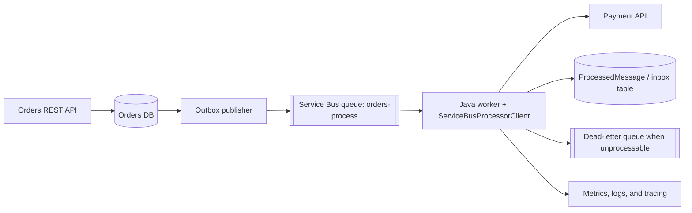
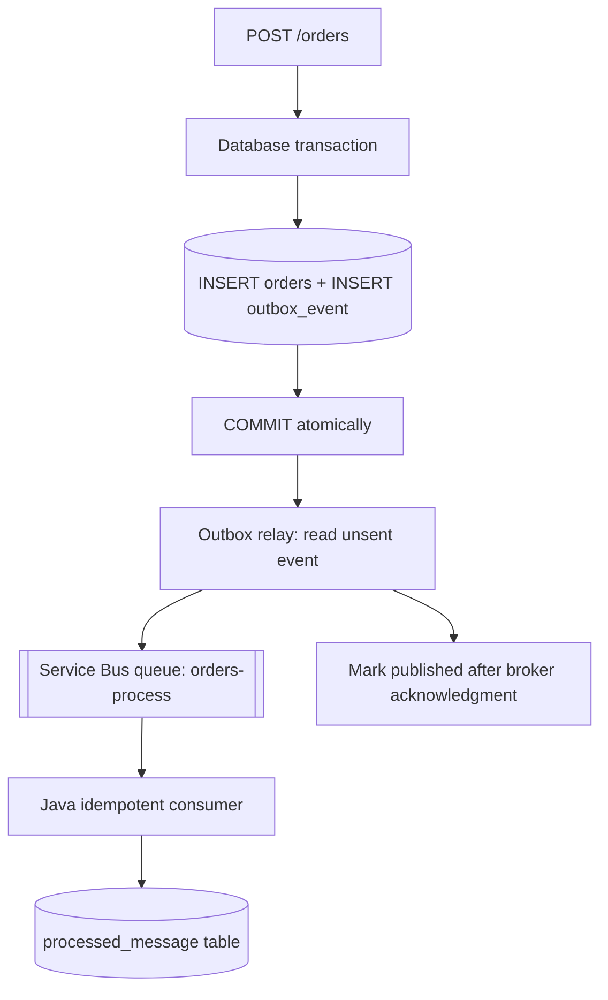

# Designing Java Integrations with the Service Bus SDK

In the **CLOUD_PROVIDERS_AZURE** module, learners explore the Microsoft Azure ecosystem from subscriptions, resource groups, and Microsoft Entra ID to virtual networks, compute services, storage, and data, while learning how to deploy, monitor, secure, and control costs for application architectures on Azure. In the **Queues and Messaging** chapter, this lesson focuses on **designing and implementing Java integrations with the Azure Service Bus SDK**: how to send and receive messages reliably, authenticate without static secrets, handle failing messages, and operate a distributed system.

Consider an ordering system. When an API receives a new order, it needs to save the order to a database, trigger payment processing, and send a confirmation email. If the HTTP request waits for both payment and email, one slow external dependency makes customers wait or receive errors even though the order was already saved. **Azure Service Bus** decouples these steps via messages: the API sends a message to the broker; Java workers receive, process, and settle it per designed mechanics.

However, moving from synchronous HTTP to a message queue **does not automatically produce exactly-once processing**. A worker can finish updating the database yet fail right before settling the message; Service Bus can then redeliver it. The most important part is therefore not calling `sendMessage` and `processMessage`, but **idempotency, settlement, retries, dead-letter queues, schema evolution, ordering, and observability**.

After this lesson, you will be able to:

- Choose between a **queue** and a **topic/subscription** for single-consumer workflows vs. publish/subscribe.
- Distinguish **`ServiceBusSenderClient`**, **`ServiceBusReceiverClient`**, **`ServiceBusProcessorClient`**, and async/session APIs.
- Authenticate Java apps using **Microsoft Entra ID + `DefaultAzureCredential`/managed identities** with least-privilege RBAC.
- Build messages carrying `messageId`, `correlationId`, application properties, and versioned bodies while avoiding embedded secrets.
- Use **PeekLock**, `complete`, `abandon`, `deadLetter`, and `defer` appropriately; understand lock duration and renewal.
- Design bounded retries, **DLQs**, idempotent consumers, and **transactional outboxes** for distributed failure handling.
- Understand session ordering, duplicate detection, TTL, scheduled messages, and transaction caveats.
- Build resilient Java workers and monitor queue depth, processing latency, errors, and cost.

## 1. What Problems Does Azure Service Bus Solve?

**Azure Service Bus** is a managed message broker on Azure supporting **queues** and **topics/subscriptions**. It fits systems needing durable message storage and coordination between independent components—especially when senders and receivers operate at different speeds or availability levels.

```text
Client
  |
  | POST /orders
  v
Orders API (Java)
  |
  | 1. Save order to database
  | 2. Publish message "OrderCreated"
  v
Azure Service Bus: queue orders-process
  |
  | Broker retains message until received/settled/expired per config
  v
Orders Worker (Java)
  |
  +--> Payment service
  +--> Update order state
  +--> Complete message
```

In practice, writing the DB and sending a message are **not atomic** if performed as two separate operations. Later sections cover the transactional outbox pattern to avoid losing events when either step fails.

### 1.1. Key Benefits

- **Decoupling:** APIs and workers do not have to be online simultaneously for requests to be accepted.
- **Buffering:** the broker absorbs traffic spikes when consumers run slower than producers.
- **Conditional retries:** unsettled messages can be redelivered per receive mode and broker policies.
- **Fan-out:** topics distribute a single event to multiple subscriptions with independent filters.
- **Per-group ordering:** sessions serialize processing for messages sharing a `SessionId`.
- **Operational visibility:** queue depth, dead-lettered messages, incoming/outgoing requests, and metrics help track backlogs.

Boundaries: Service Bus is **not** a business database, object store, search engine, or infinite stream analytics platform. Messages should be processed and drained from queues/subscriptions; long-lived records or large payloads belong in appropriate databases or Blob Storage, with messages holding only references and metadata.

### 1.2. Compared with Direct HTTP and Other Services

| Option | Best Fit | Key Caveats |
|---|---|---|
| **Direct HTTP / gRPC** | Request-response needing immediate answers | Couples availability to downstream services; timeouts cascade |
| **Azure Service Bus queue** | Asynchronous tasks needing broker management | Must design retries, at-least-once, settlement, and DLQs |
| **Azure Service Bus topic/subscriptions** | One event for multiple independent processing groups | Must manage subscription filters, backlogs, and permissions |
| **Azure Storage Queue** | Simple queues matching Storage Queue APIs/limits | Differs from Service Bus in sessions, broker features, and APIs |
| **Azure Event Grid** | Event routing and source/destination integration in an event-driven model | Does not replace queue workflows needing session/transaction semantics |
| **Azure Event Hubs** | High-throughput streaming ingestion with consumer groups | Partition/offset log model differs from Service Bus queue settlement |

Never assume Service Bus is always better than every alternative. Choose based on delivery semantics, fan-out, throughput, latency, message size, retention, cost, and operational capacity.

## 2. Service Bus Resource Architecture

A **Service Bus namespace** is the container boundary for queues, topics, and subscriptions. Its endpoint typically looks like:

```text
sb-orders-dev.servicebus.windows.net
```

Example:

```text
Azure Service Bus namespace: sb-orders-dev
|
+-- Queue: orders-process
|
+-- Queue: notification-jobs
|
+-- Topic: orders-events
     |
     +-- Subscription: billing
     |     +-- Filter: events relevant to billing
     |
     +-- Subscription: analytics
     |
     +-- Subscription: notifications
```

### 2.1. Queue: Competing to Process One Workload

In a queue, multiple workers compete to receive messages; while one worker holds a PeekLock on a message, other workers do not concurrently receive that same message. Yet the message **can still be redelivered** if the receiver abandons, fails to complete, or crashes. Thus queues provide **competing consumers**, not application-level exactly-once guarantees.

For `orders-process`, five replicas of the same worker can process separate orders in parallel. If business logic requires updates for **one** order to run sequentially, evaluate sessions rather than assuming normal queue order holds under scaling.

### 2.2. Topic/Subscription: One Event, Multiple Recipients

When `OrderCreated` must be handled independently by **billing**, **analytics**, and **notifications**, publish one message to topic `orders-events`. Service Bus places a delivery copy into **each subscription** matching configured filters/rules; one subscription never "steals" messages from another.

```text
Orders API
   |
   | Publish OrderCreated
   v
Topic orders-events
   |
   +--> Subscription billing       --> Billing Worker
   +--> Subscription analytics     --> Analytics Worker
   +--> Subscription notifications --> Email Worker
```

Note: **A topic subscription is neither a Kubernetes subscription nor an Azure subscription.** It is a message broker entity. Failures in one subscription grow that subscription's backlog/DLQ without blocking other subscriptions.

### 2.3. Queue or Topic?

| Requirement | Queue | Topic / Subscription |
|---|---|---|
| Single job type processed by one worker pool | Usually ideal | Possible, yet needlessly complex without fan-out |
| One event sent to multiple independent consumer groups | Does not fan out natively | Ideal |
| Future consumers must receive future events | Create/adjust send routing | Add a new subscription and rules |
| Filter by event type | Producer or consumer routes manually | Subscription rules/filters where supported |
| Independent backlog per consumer group | Requires multiple queues and fan-out logic | Each subscription holds its own backlog |
| Cost and operations | Fewer entities for simple workflows | Adds subscription, filter, metrics, and DLQ management |

**Decision example:** `orders-process` is a queue for a single order-processing workflow; `orders-events` is a topic when multiple services subscribe to `OrderCreated`, `OrderPaid`, or `OrderCancelled`.

## 3. Delivery Concepts to Master Before Writing Java

### 3.1. At-Least-Once and Duplicate Delivery

Under **PeekLock**, Service Bus delivers a message with a **lock token** for a configured duration. The receiver processes it and settles it. If the receiver dies before calling `complete`, the lock expires and the message is redelivered.

```text
Queue holds message #42
     |
     v
Worker A receives (PeekLock) ----> updates database successfully
     |
     X  Network drops before complete
     |
     v
Lock expires; message #42 redelivered to Worker B
     |
     v
Worker B must recognize work is already done and skip duplicate side effects
```

Therefore **consumers must be idempotent** or enforce uniqueness at the target store. Broker **duplicate detection** mitigates duplicate sends at ingest, not consumer redeliveries.

### 3.2. PeekLock vs. ReceiveAndDelete

| Receive Mode | How It Works | When to Use |
|---|---|---|
| **PEEK_LOCK** | Message is temporarily locked; receiver calls `complete`/`abandon`/`deadLetter`/`defer` | Recommended default for reliable business processing |
| **RECEIVE_AND_DELETE** | Broker deletes message upon delivery without settlement | Only when losing messages on worker crashes is acceptable |

**Never use `RECEIVE_AND_DELETE` for payments or critical workflows** just to save a few lines of code. If the process crashes after receiving and before processing, the message is permanently gone.

### 3.3. Settlement: Handling Outcomes

| Action | Meaning | When to Apply |
|---|---|---|
| `complete` | Confirms processing succeeded; broker removes message | **After** business outcomes commit or idempotency confirms prior completion |
| `abandon` | Releases lock so message can be received again per broker rules | Transient errors needing retry |
| `deadLetter` | Moves message to the Dead-Letter Queue (DLQ) | Corrupt payloads, unsupported schemas, or unretryable errors |
| `defer` | Postpones processing via deferred-retrieval mechanics | When holding a message aside to fetch later **by sequence number** |

**`defer` is not "schedule retry in 5 minutes."** Deferred messages must be fetched explicitly by **sequence number**; they do not reappear in normal receives on a timer like scheduled messages. For delayed retries, schedule a new message or build an explicit retry mechanism.

### 3.4. Lock Duration, Renewal, and Delivery Count

Locks last for a bounded duration. If processing outlasts the lock, settlement fails with lock-loss errors and the message may redeliver. Processor clients support **automatic lock renewal** up to a configured limit; still, avoid multi-hour callbacks without checkpointing and idempotency.

**Delivery count** increments on redeliveries per broker mechanics. Once it exceeds the entity's `MaxDeliveryCount`, Service Bus can automatically move the message to the DLQ (per actual broker semantics). Never treat delivery count as a business sequence number; it strictly counts deliveries.

### 3.5. TTL and Scheduled Enqueue Time

- **Time to Live (TTL):** bounds how long a message remains valid per entity and message config; expired messages are discarded or dead-lettered depending on dead-letter-on-expiration settings.
- **Scheduled enqueue:** schedules when a message becomes available in the future; it does not delay an actively running handler.
- **Duplicate detection window:** when enabled on an entity, duplicate `MessageId` sends within the window are dropped per feature rules.

Capabilities, message size limits, lock durations, sessions, duplicate detection, and transactions **depend on SKU/tier and entity settings**. Never hardcode assumptions that Basic, Standard, and Premium share identical features.

## 4. Designing the Message Contract Before Writing Clients

Every message should represent a **clear business event or command** with a schema and version—never an untyped string that breaks as the system evolves.

Example `OrderCreated` message:

```json
{
  "schemaVersion": 1,
  "eventId": "evt-1042-20261120",
  "eventType": "OrderCreated",
  "occurredAtUtc": "2026-11-20T10:15:00Z",
  "orderId": "ORD-1042",
  "customerRef": "cust-72",
  "totalAmount": 125000,
  "currency": "VND"
}
```

This is an illustrative payload, not real customer data. Production messages must govern PII and sensitive monetary/identity fields. When full records aren't required, send **IDs and essential attributes** and let authorized workers look up details.

### 4.1. Properties of `ServiceBusMessage`

| Property | Example | Usage |
|---|---|---|
| `messageId` | `evt-1042-20261120` | Identifies message; supports duplicate detection/idempotency |
| `correlationId` | `trace-3f5b...` | Correlates one request across multiple services |
| `subject` | `OrderCreated` | Classifies events where supported by SDK/broker |
| `contentType` | `application/json` | Describes body format |
| `applicationProperties` | `eventType=OrderCreated`, `schemaVersion=1` | Metadata for filtering/routing; never store secrets here |
| `sessionId` | `ORD-1042` | Groups messages needing session order when sessions are enabled |
| `scheduledEnqueueTime` | Future timestamp | Controlled future scheduling |
| Body | Event JSON / bytes | Data parsed and validated by consumers |

**Never treat `messageId` as a universally immutable business key if producers regenerate it on retries.** Producers must generate deterministic IDs per policy; minting a new ID on retry defeats `messageId`-based duplicate detection.

### 4.2. Envelopes, Schema Evolution, and Compatibility

A maintainable schema includes:

1. **Message kind:** event or command, with unambiguous semantics.
2. **Schema version:** e.g., version 1, 2.
3. **Event/command ID:** supports idempotency and auditing.
4. **UTC timestamp:** when the business event occurred, separate from broker enqueue time if needed.
5. **Business key:** `orderId` or target object identifier.
6. **Correlation/trace ID:** enables cross-service tracing.
7. **Minimal payload:** avoids unnecessarily copying sensitive data.

When adding optional fields, older consumers should tolerate unknown fields if allowed by contract. When changing semantics or dropping required fields, deploy versioned consumers/producers or new topics/subscriptions. **Never reuse one event name with two different business meanings** just to avoid adding schemas.

### 4.3. Message Size and the Claim-Check Pattern

Message and batch size caps vary by Service Bus tier, protocol, and features. For PDFs, images, large reports, or payloads exceeding limits, store them in **Azure Blob Storage** and send a message containing references and metadata:

```json
{
  "eventId": "evt-file-783",
  "eventType": "DocumentReady",
  "blobContainer": "documents",
  "blobName": "orders/ORD-1042/report.pdf",
  "checksumSha256": "example-checksum",
  "schemaVersion": 1
}
```

Workers use **managed identity + Azure RBAC** to read blobs. Never embed storage account keys or long-lived SAS URLs inside messages; brokers store messages under separate retention policies and messages can sit in retries or DLQs longer than expected.

## 5. Recommended Java Architecture

An operationally clean architecture for Java apps:



The DB → outbox publisher flow is the **transactional outbox** pattern detailed later. The arrow to DLQ represents a settlement/error outcome, not the worker manually publishing to a separate custom queue.

### 5.1. Separation of Responsibilities

| Component | Responsibilities | Avoid Doing |
|---|---|---|
| **REST API** | Validate input, commit business/outbox transaction, return proper status | Waiting on all downstream jobs inside the HTTP request |
| **Publisher** | Poll outbox, serialize schema, send to Service Bus, mark sent | Embedding secrets or tokens in messages |
| **Service Bus** | Persist, dispatch, lock, settle, and DLQ per configuration | Relying on broker to replace DB idempotency |
| **Java consumer** | Deserialize, validate, run idempotent business logic, settle | Completing before durable business commit |
| **Operational tooling** | Monitor queue depth, errors, DLQ, latency, quotas, and cost | Blindly auto-replaying all DLQ messages without triage |

### 5.2. Choosing Synchronous vs. Asynchronous SDK APIs

The modern Java SDK provides both **blocking/synchronous** and **asynchronous/reactive** APIs:

- **`ServiceBusSenderClient`:** synchronous sends; straightforward in standard services.
- **`ServiceBusSenderAsyncClient`:** non-blocking sends; fits Project Reactor pipelines when the app is already reactive.
- **`ServiceBusReceiverClient`:** imperative receive/browse/settle control loops.
- **`ServiceBusReceiverAsyncClient`:** reactive receive processing with SDK-supported backpressure.
- **`ServiceBusProcessorClient`:** callback-driven message receiver managing connections, concurrency, and auto-lock renewal; great for continuous workers.
- **Session receiver/processor:** for session-enabled queues/subscriptions needing sequential per-session processing.

**Never pick async solely because it sounds "faster."** If handlers call blocking JDBC or HTTP clients, manage thread pools and concurrency appropriately; reactive APIs do not magically turn blocking I/O non-blocking. For most workers, `ServiceBusProcessorClient` with controlled concurrency is a clean starting point.

## 6. Secure Authentication: Microsoft Entra ID and Azure RBAC

Azure Service Bus supports **Microsoft Entra ID** authentication for supported data-plane operations. For Java workloads on Azure, prefer **managed identities** with `DefaultAzureCredential` or explicit SDK credentials rather than placing Shared Access Signature (SAS) connection strings in source code.

### 6.1. Producers and Consumers Need Different Roles

| Identity | Azure RBAC Role | Purpose |
|---|---|---|
| `mi-orders-api-prod` | `Azure Service Bus Data Sender` | Send to `orders-process` |
| `mi-orders-worker-prod` | `Azure Service Bus Data Receiver` | Receive and settle messages from `orders-process` |
| `mi-orders-operations` | Scoped admin/reader roles only as needed | Manage entities and inspect settings |

Distinguish these data-plane roles from Azure Resource Manager's `Owner`, `Contributor`, or `Reader`:

- **`Azure Service Bus Data Sender`:** sends messages to entities in scope.
- **`Azure Service Bus Data Receiver`:** receives/settles messages from entities in scope.
- **`Azure Service Bus Data Owner`:** broad data-plane rights; avoid granting to send-only or receive-only runtimes.

Roles can be assigned at namespace or entity scope where supported. Prefer the **narrowest scope** when a producer targets one queue; avoid granting namespace-wide rights unnecessarily. Creating role assignments also requires separate RBAC management permissions.

### 6.2. Managed Identities, Service Principals, and Key-Based Auth

On **App Service, Azure Container Apps, VMs, or AKS Workload Identity** where supported, Java apps obtain Entra tokens via the Azure Identity SDK. Local development can use Azure CLI login or IDE credentials, while production should use approved workload identities.

Service Bus also supports **Shared Access Signatures (SAS)** via entity/namespace authorization rules. Key-bearing connection strings are **sensitive secrets**. For legacy systems not yet migrated:

- Never commit connection strings to Git or bake them into Docker images.
- Store them in a tightly scoped secret vault with a rotation schedule.
- Separate `Send`, `Listen`, and `Manage` SAS policies; never give regular apps `RootManageSharedAccessKey`.
- Consider disabling local/SAS auth once your tier and all integrations support Entra ID after a full dependency audit.

**A Service Bus SAS token is not a Blob Storage SAS URL.** Never pass a Blob SAS URL into `ServiceBusClientBuilder` expecting authentication to work.

### 6.3. Namespace Format in the Java SDK

With Microsoft Entra credentials, pass the **fully qualified namespace**, such as:

```text
sb-orders-dev.servicebus.windows.net
```

This is **not** a connection string like `Endpoint=sb://...;SharedAccessKeyName=...;SharedAccessKey=...`. The SDK pairs the FQDN with your Entra credential to open an AMQP connection.

## 7. Infrastructure Hands-On: Creating Namespace and Queue with Azure CLI

Illustrative commands use **Bash / Azure Cloud Shell** in an approved dev environment. You need permissions to create Service Bus resources and role assignments. **Standard** is a paid tier—clean up resources afterward.

Prerequisites:

1. Active Azure subscription and Azure CLI supporting `servicebus` commands.
2. Dev resource group in a region supporting Service Bus.
3. Permissions to create namespaces/queues, read resource IDs, assign Azure RBAC, and sufficient quota.
4. Producer and consumer principals / managed identities ready for role assignment.
5. Network reachability from the Java runtime to the Service Bus endpoint.

### 7.1. Set Variables and Verify Context

```bash
az login
az account show --output table
az account set --subscription "<subscription-id>"

RG="rg-orders-messaging-dev"
LOCATION="southeastasia"
SB_NAMESPACE="sb-orders-dev-unique"
QUEUE="orders-process"
TOPIC="orders-events"
```

Replace `sb-orders-dev-unique` with a valid, globally unique namespace name following Service Bus rules. Never reuse sample names in production or put sensitive information in resource names.

### 7.2. Create Namespace and Queue

```bash
az group create \
  --name "$RG" \
  --location "$LOCATION"

az servicebus namespace create \
  --resource-group "$RG" \
  --name "$SB_NAMESPACE" \
  --location "$LOCATION" \
  --sku Standard

az servicebus queue create \
  --resource-group "$RG" \
  --namespace-name "$SB_NAMESPACE" \
  --name "$QUEUE" \
  --max-delivery-count 5
```

This queue allows up to 5 deliveries before the broker moves messages to the DLQ per `max-delivery-count`. `5` is a lab-friendly example, **not** an ideal universal setting. Lock duration, TTL, duplicate detection, sessions, partitioning, and other flags must be tailored per workload—and several must be set **at entity creation time** because they cannot be toggled later once data exists.

### 7.3. Verify Configuration

```bash
az servicebus namespace show \
  --resource-group "$RG" \
  --name "$SB_NAMESPACE" \
  --query "{name:name,location:location,sku:sku.name,id:id}" \
  --output json

az servicebus queue show \
  --resource-group "$RG" \
  --namespace-name "$SB_NAMESPACE" \
  --name "$QUEUE" \
  --query "{name:name,lockDuration:lockDuration,maxDeliveryCount:maxDeliveryCount,requiresSession:requiresSession,requiresDuplicateDetection:requiresDuplicateDetection}" \
  --output json
```

If `requiresSession=true` is enabled on the queue, standard non-session receivers below will not work—you need a **session receiver/processor**. Never mask entity configuration errors by blindly rewriting message handlers.

### 7.4. Assign Sender/Receiver Permissions by Principal

Assume two **user-assigned managed identities** already exist. Fetch their **real Principal/Object IDs** and assign roles:

```bash
SB_ID=$(az servicebus namespace show \
  --resource-group "$RG" \
  --name "$SB_NAMESPACE" \
  --query id --output tsv)

# Both values must be actual Principal/Object IDs, not Client IDs.
PRODUCER_PRINCIPAL_ID="<producer-principal-object-id>"
CONSUMER_PRINCIPAL_ID="<consumer-principal-object-id>"

az role assignment create \
  --assignee-object-id "$PRODUCER_PRINCIPAL_ID" \
  --assignee-principal-type ServicePrincipal \
  --role "Azure Service Bus Data Sender" \
  --scope "$SB_ID"

az role assignment create \
  --assignee-object-id "$CONSUMER_PRINCIPAL_ID" \
  --assignee-principal-type ServicePrincipal \
  --role "Azure Service Bus Data Receiver" \
  --scope "$SB_ID"
```

**Namespace scope** keeps this lab concise. In production, evaluate **queue/topic/subscription scope** per Service Bus and RBAC support to narrow each identity's reach. Never pass a `clientId` into `--assignee-object-id`; always pass the **object/principal ID**.

Inspect role assignments:

```bash
az role assignment list \
  --scope "$SB_ID" \
  --include-inherited \
  --output table
```

New role assignments take time for **RBAC propagation**. If a producer succeeds with `az login` yet fails sending with `Unauthorized`, check principal, scope, data-plane role, and networking—never grant subscription-wide `Owner` to debug.

### 7.5. Skip Topics If the Lab Only Needs a Queue

To explore fan-out, you can create a topic in dev:

```bash
az servicebus topic create \
  --resource-group "$RG" \
  --namespace-name "$SB_NAMESPACE" \
  --name "$TOPIC"

az servicebus topic subscription create \
  --resource-group "$RG" \
  --namespace-name "$SB_NAMESPACE" \
  --topic-name "$TOPIC" \
  --name billing

az servicebus topic subscription create \
  --resource-group "$RG" \
  --namespace-name "$SB_NAMESPACE" \
  --topic-name "$TOPIC" \
  --name notifications
```

This creates subscriptions with Service Bus's **default rule/filter**. When each consumer must receive only specific events, create explicit rules and filters and test both positive and negative routing rather than relying on subscription names.

## 8. Preparing Maven and Java Configuration

Core libraries:

- **`com.azure:azure-messaging-servicebus`:** senders, receivers, processors, and message models.
- **`com.azure:azure-identity`:** Entra credentials such as `DefaultAzureCredential` and `ManagedIdentityCredential`.

Use **stable SDK versions approved by your organization**, or manage versions via the Azure SDK BOM. Sample `pom.xml`:

```xml
<dependencies>
  <dependency>
    <groupId>com.azure</groupId>
    <artifactId>azure-messaging-servicebus</artifactId>
    <version>REPLACE_WITH_APPROVED_SERVICEBUS_VERSION</version>
  </dependency>
  <dependency>
    <groupId>com.azure</groupId>
    <artifactId>azure-identity</artifactId>
    <version>REPLACE_WITH_APPROVED_IDENTITY_VERSION</version>
  </dependency>
</dependencies>
```

`REPLACE_WITH_...` strings are **placeholders** that must be replaced with valid Maven versions before building. Never guess future versions or mix incompatible versions. When using the Azure SDK BOM, manage versions via `dependencyManagement` aligned with a tested BOM release.

### 8.1. Configuring via Environment Variables

```text
SERVICE_BUS_FQDN=sb-orders-dev-unique.servicebus.windows.net
SERVICE_BUS_QUEUE=orders-process
SERVICE_BUS_CLIENT_ID=<client-id-of-managed-identity-if-needed>
```

`SERVICE_BUS_FQDN` is the namespace hostname without `sb://`. `SERVICE_BUS_CLIENT_ID` is only needed when selecting a specific **user-assigned managed identity**. If the runtime holds a single system-assigned identity, `DefaultAzureCredential` resolves it automatically per SDK chain; if multiple identities exist, configure explicitly to prevent picking the wrong identity.

### 8.2. DefaultAzureCredential Locally and in Production

`DefaultAzureCredentialBuilder` walks the Azure Identity SDK credential chain (environment, workload identity, managed identity, developer tools, etc., per version and config):

- **Local:** can use your `az login` user; that principal must hold the needed data-plane role.
- **Azure VM / App Service / Container Apps:** uses the assigned managed identity.
- **AKS:** with Workload Identity, requires ServiceAccount/federated credential and webhook env/token file supported by the Java SDK.
- **Strict production auth:** consider explicit `ManagedIdentityCredential` or `WorkloadIdentityCredential` where appropriate to prevent unexpected fallbacks.

Never stash a secret connection string in environment variables as a "fallback" when managed identity breaks; that hides RBAC misconfigurations and increases credential exposure.

## 9. Writing a Java Producer to Send Messages to a Queue

The following uses **Java 17+** with the modern Azure SDK. It assumes dependency versions are filled in, the namespace/queue exist, and your identity holds **Azure Service Bus Data Sender**.

### 9.1. Synchronous Sender with Microsoft Entra ID

```java
import com.azure.identity.DefaultAzureCredentialBuilder;
import com.azure.messaging.servicebus.ServiceBusClientBuilder;
import com.azure.messaging.servicebus.ServiceBusMessage;
import com.azure.messaging.servicebus.ServiceBusSenderClient;

import java.time.Instant;
import java.util.UUID;

public final class OrderEventPublisher {

    public static void main(String[] args) {
        String namespace = requiredEnv("SERVICE_BUS_FQDN");
        String queueName = requiredEnv("SERVICE_BUS_QUEUE");

        try (ServiceBusSenderClient sender = new ServiceBusClientBuilder()
                .credential(
                        namespace,
                        new DefaultAzureCredentialBuilder().build())
                .sender()
                .queueName(queueName)
                .buildClient()) {

            String orderId = "ORD-1042";
            String eventId = "evt-" + UUID.randomUUID();

            // Illustrative data only; never embed secrets.
            String payload = """
                    {
                      "schemaVersion": 1,
                      "eventType": "OrderCreated",
                      "orderId": "ORD-1042"
                    }
                    """;

            ServiceBusMessage message = new ServiceBusMessage(payload);
            message.setMessageId(eventId);
            message.setCorrelationId("trace-" + UUID.randomUUID());
            message.setContentType("application/json");
            message.setSubject("OrderCreated");
            message.getApplicationProperties().put("schemaVersion", 1);
            message.getApplicationProperties().put("source", "orders-api");

            sender.sendMessage(message);

            System.out.println("Message accepted: id=" + eventId
                    + ", sentAt=" + Instant.now());
        }
    }

    private static String requiredEnv(String name) {
        String value = System.getenv(name);
        if (value == null || value.isBlank()) {
            throw new IllegalStateException("Missing env: " + name);
        }
        return value;
    }
}
```

In this single-run demo, `eventId` is randomized. In systems with **publish retries** or a transactional outbox, keep the ID stable for **the same logical event** across send attempts—such as storing it in the outbox before publishing; minting a new ID per retry defeats broker duplicate detection.

### 9.2. Why `sendMessage` Succeeding Does Not Mean "Order Paid"

When `sendMessage` returns normally, the producer only knows the SDK/broker accepted the send per protocol at that moment. It **does not prove** workers received it, captured payment, or updated a database. Therefore:

- Returning HTTP `202 Accepted` fits asynchronous processing once the API persists a durable request/outbox record.
- Maintain explicit order states such as `PENDING`, `PROCESSING`, `PAID`, `FAILED` in a clear state model.
- Let clients poll status via an endpoint or webhook instead of assuming send success equals business completion.
- Avoid "fire-and-forget" without tracking send failures, retries, and ambiguous states.

### 9.3. Timeouts or Send Errors Create Ambiguous State

A network error at the producer can happen **after the broker ingested the message yet before the producer received the response**. Retrying with a new `messageId` easily creates duplicates.

Strategy:

1. Persist a consistent **event ID** in data/outbox records.
2. Retry transient errors per SDK policy and application limits.
3. When duplicate detection is enabled on the entity, ensure identical logical events reuse the exact same message ID.
4. Keep consumers idempotent anyway, since redeliveries happen for reasons beyond duplicate publishing.
5. Monitor and alert on outbox rows stuck unpublished.

### 9.4. Batching Multiple Messages

When sending multiple messages, use **`ServiceBusMessageBatch`** to stay under size caps:

```java
import com.azure.messaging.servicebus.ServiceBusMessage;
import com.azure.messaging.servicebus.ServiceBusMessageBatch;
import com.azure.messaging.servicebus.ServiceBusSenderClient;

// sender was already built with ServiceBusClientBuilder as shown earlier.
ServiceBusMessageBatch batch = sender.createMessageBatch();

for (String eventJson : eventJsonList) {
    ServiceBusMessage msg = new ServiceBusMessage(eventJson);
    // Assign each event's stable message ID in production code.
    if (!batch.tryAddMessage(msg)) {
        sender.sendMessages(batch);
        batch = sender.createMessageBatch();
        if (!batch.tryAddMessage(msg)) {
            throw new IllegalArgumentException(
                    "One event is too large for an empty batch");
        }
    }
}

if (batch.getCount() > 0) {
    sender.sendMessages(batch);
}
```

This is an **illustrative snippet inside a method holding `sender` and `eventJsonList`**, not a standalone Java class. `tryAddMessage` prevents exceeding batch caps; still design idempotency and failure handling when a batch send times out. In production, avoid buffering millions of events in RAM—stream and chunk appropriately.

## 10. Writing a Java Consumer with `ServiceBusProcessorClient`

**`ServiceBusProcessorClient`** fits long-running workers receiving messages via callbacks. It manages connections and receive loops per configuration, invoking message and error callbacks. Use **PeekLock** so `complete` only runs after business state is durably persisted.

### 10.1. Consumer with Manual Settlement

```java
import com.azure.identity.DefaultAzureCredentialBuilder;
import com.azure.messaging.servicebus.ServiceBusClientBuilder;
import com.azure.messaging.servicebus.ServiceBusProcessorClient;
import com.azure.messaging.servicebus.ServiceBusReceivedMessage;
import com.azure.messaging.servicebus.ServiceBusReceivedMessageContext;

import java.time.Duration;
import java.util.concurrent.CountDownLatch;

public final class OrdersWorker {

    public static void main(String[] args) throws InterruptedException {
        String namespace = requiredEnv("SERVICE_BUS_FQDN");
        String queue = requiredEnv("SERVICE_BUS_QUEUE");

        ServiceBusProcessorClient processor = new ServiceBusClientBuilder()
                .credential(
                        namespace,
                        new DefaultAzureCredentialBuilder().build())
                .processor()
                .queueName(queue)
                .disableAutoComplete()
                .maxConcurrentCalls(4)
                .maxAutoLockRenewDuration(Duration.ofMinutes(5))
                .processMessage(OrdersWorker::handleMessage)
                .processError(error -> {
                    System.err.println("Processor error: "
                            + error.getException().getClass().getSimpleName()
                            + "; source=" + error.getErrorSource());
                })
                .buildProcessorClient();

        Runtime.getRuntime().addShutdownHook(new Thread(processor::close));
        processor.start();
        System.out.println("Worker started.");

        // Demo service: keep the process alive.
        // Real apps manage lifecycle via runtime or Spring Boot.
        new CountDownLatch(1).await();
    }

    private static void handleMessage(ServiceBusReceivedMessageContext context) {
        ServiceBusReceivedMessage message = context.getMessage();
        String eventId = message.getMessageId();

        try {
            String json = message.getBody().toString();
            processBusinessEvent(eventId, json);
            // Complete ONLY AFTER durable commit or idempotent verification.
            context.complete();
            System.out.println("Completed messageId=" + eventId);
        } catch (IllegalArgumentException invalidPayload) {
            // Permanent schema error: avoid endlessly retrying corrupt payloads.
            System.err.println("Invalid messageId=" + eventId);
            context.deadLetter();
        } catch (Exception transientOrUnknown) {
            System.err.println("Abandoning id=" + eventId
                    + ", type=" + transientOrUnknown.getClass().getSimpleName());
            context.abandon();
        }
    }

    private static void processBusinessEvent(String eventId, String json) {
        // Illustrative placeholder: replace with schema validation, inbox,
        // and business transaction before production use.
        if (json.isBlank() || eventId == null) {
            throw new IllegalArgumentException("Missing message data");
        }
    }

    private static String requiredEnv(String key) {
        String value = System.getenv(key);
        if (value == null || value.isBlank()) {
            throw new IllegalStateException("Missing env: " + key);
        }
        return value;
    }
}
```

**This sample illustrates the API and settlement flow, not a production consumer:** `processBusinessEvent` only validates basic inputs and performs no DB writes or idempotency checks. Never run this demo against real payments.

Key points:

- `disableAutoComplete()` makes callbacks explicitly own settlement so messages aren't accidentally completed while work fails.
- `maxConcurrentCalls(4)` bounds simultaneous callbacks, without guaranteeing downstream DBs/APIs handle that load.
- `maxAutoLockRenewDuration` auto-renews locks up to a cap, yet cannot hold locks across disconnects or unbounded runs.
- `processError` catches processor/connection-level faults; classify business errors directly inside the message handler.
- Shutdown hooks close the processor cleanly on normal JVM exits; on Kubernetes, align with `SIGTERM`, termination grace periods, readiness probes, and in-flight work.

### 10.2. Do Not Always `abandon` Every Error

| Error | Nature | Handling |
|---|---|---|
| Unsupported schema version | Permanent | Dead-letter with standardized reason per policy |
| Missing required field | Permanent | Dead-letter or data-repair workflow |
| Downstream HTTP 503 | Transient | Bounded backoff retry; consider delayed retry |
| Database timeout | Possibly transient; ambiguous outcome | Check idempotency/transaction before retrying |
| Inbox unique key shows already processed | Duplicate delivery | `complete` once committed outcome is confirmed |
| Lock lost | Settlement failed; message may redeliver | Log and let next delivery process idempotently |
| Service Bus authorization error | Identity/RBAC fault | Alert and fix RBAC; never retry forever |
| Worker killed mid-flight | Callback never settled | Lock expires; message redelivers |

For transient errors, calling `abandon` immediately can trigger rapid redelivery and a **retry storm**. During downstream outages, use delayed retries, circuit breakers, reduced concurrency, and monitoring instead of tight retry loops.

### 10.3. Lock Renewal Does Not Prevent Duplicate Side Effects

1. Worker completes payment and commits results.
2. Connectivity to Service Bus drops before `complete`.
3. Lock expires; message redelivers.
4. The next worker must detect the transaction already completed.

Thus, **idempotency is a business-layer responsibility**, not solved merely by cranking up lock duration or auto-renewal.

## 11. Imperative Receiving with `ServiceBusReceiverClient`

When polling or driving a custom receive loop, use **`ServiceBusReceiverClient`**. Example:

```java
import com.azure.identity.DefaultAzureCredentialBuilder;
import com.azure.messaging.servicebus.ServiceBusClientBuilder;
import com.azure.messaging.servicebus.ServiceBusReceivedMessage;
import com.azure.messaging.servicebus.ServiceBusReceiverClient;
import com.azure.messaging.servicebus.models.ServiceBusReceiveMode;

import java.time.Duration;

public final class PollOrders {
    public static void main(String[] args) {
        String namespace = System.getenv("SERVICE_BUS_FQDN");
        String queue = System.getenv("SERVICE_BUS_QUEUE");

        try (ServiceBusReceiverClient receiver =
                new ServiceBusClientBuilder()
                        .credential(
                                namespace,
                                new DefaultAzureCredentialBuilder().build())
                        .receiver()
                        .queueName(queue)
                        .receiveMode(ServiceBusReceiveMode.PEEK_LOCK)
                        .buildClient()) {

            for (ServiceBusReceivedMessage message :
                    receiver.receiveMessages(5, Duration.ofSeconds(20))) {
                try {
                    // Production: parse/validate, idempotent DB commit, tracing.
                    System.out.println("Received id=" + message.getMessageId());
                    receiver.complete(message);
                } catch (Exception ex) {
                    receiver.abandon(message);
                }
            }
        }
    }
}
```

**Warning:** this example calls `complete` after **only printing the message ID** to show the API. In real code, execute business logic and verify DB commit/idempotency before `complete`. `complete` and `abandon` can also fail if the lock expired; never swallow settlement exceptions assuming the message vanished.

If `ServiceBusReceiverClient` and `ServiceBusProcessorClient` listen on the same queue, they **compete** for messages rather than each getting copies. When multiple consumer groups need the same event, use a **topic with multiple subscriptions** or explicitly send to separate queues.

## 12. Idempotent Consumers: Foundation of Reliable Processing

**Idempotency** ensures processing the same request repeatedly causes no unwanted duplicate business effects. In message-driven integrations, keep an **inbox / processed-message table** in the consumer's database:

```sql
CREATE TABLE processed_message (
    consumer_name VARCHAR(100) NOT NULL,
    event_id VARCHAR(120) NOT NULL,
    processed_at_utc TIMESTAMP NOT NULL,
    PRIMARY KEY (consumer_name, event_id)
);
```

This is conceptual SQL; timestamp types, transaction isolation, and schemas vary by database engine. The composite `(consumer_name, event_id)` key lets two distinct consumers process the same event without blocking each other.

### 12.1. Transaction + Settlement Algorithm

```text
Receive message with PeekLock
      |
      v
Parse and validate schema
      |
      v
BEGIN database transaction
      |
      +-- INSERT processed_message(consumerName, eventId)
      |        |
      |        +-- Key conflict -> confirm already processed, COMMIT/no-op
      |        |
      |        +-- New key -> update business DB, COMMIT
      |
      v
After COMMIT succeeds -> complete Service Bus message
      |
      +-- Complete fails -> may redeliver,
                          inbox blocks duplicate side effects
```

**Mandatory invariant:** inserting the processed marker and updating business tables must sit in the **same transaction** when sharing a database. Inserting and committing the inbox row before business work finishes causes retries to wrongly skip unfinished work.

### 12.2. Java Pseudocode

```java
public void handleOrderCreated(OrderCreatedEvent event) {
    database.inTransaction(tx -> {
        boolean inserted = tx.tryInsertProcessedMessage(
                "orders-worker", event.eventId());
        if (!inserted) {
            return; // already processed this event
        }
        tx.updateOrderState(event.orderId(), "PROCESSING");
        tx.appendAuditRecord(event.eventId(), event.orderId());
    });
    // Transaction committed: call context.complete() at Service Bus layer.
}
```

This is **pseudocode**, not a concrete JDBC/JPA API. Real implementations must roll back both inbox and business changes on error, handle unique-key races cleanly, and avoid partial commits.

### 12.3. External Service Calls Are Not Atomic with the Database

Suppose a worker successfully charges a payment provider and crashes before updating the DB, causing message redelivery. A database transaction cannot roll back an accepted external charge. Use a **stable idempotency key** per payment request, query transaction status with the provider, or run reconciliation/compensating sagas.

Never generate a fresh payment idempotency key per retry or delivery. One **logical payment** must keep one key across resends, restarts, and redeliveries.

## 13. Transactional Outbox: Preventing Lost Events Between DB and Broker

Suppose Orders API runs:

```text
1. INSERT order into database
2. COMMIT database transaction
3. Service Bus send OrderCreated
```

Crashing **between step 2 and step 3** leaves an order with no worker event. Sending before DB commit risks workers acting on an order that never committed.

A **transactional outbox** commits **business data and the outbox event in the same DB transaction**, while a separate publisher polls the outbox and sends to Service Bus.



### 13.1. Outbox Schema

```sql
CREATE TABLE outbox_event (
    event_id VARCHAR(120) PRIMARY KEY,
    event_type VARCHAR(100) NOT NULL,
    schema_version INTEGER NOT NULL,
    payload_json TEXT NOT NULL,
    created_at_utc TIMESTAMP NOT NULL,
    published_at_utc TIMESTAMP NULL
);
```

Business transaction:

```text
BEGIN TRANSACTION
  INSERT INTO orders (...);
  INSERT INTO outbox_event(event_id, event_type, schema_version, ...)
    VALUES('evt-1042-20261120', 'OrderCreated', 1, ...);
COMMIT
```

Relay:

1. Poll outbox rows where `published_at_utc` is null, using claims/leases/locks if multiple replicas run.
2. Send messages with **`messageId = event_id`** and schema-valid payloads.
3. Await broker send acknowledgment.
4. Set `published_at_utc` and track pending row counts and age.
5. On timeout/crash, retry **with the exact same event ID**—never mint a new logical event.

An outbox can resend if a crash occurs after broker send and before marking published. **That is not a flaw in the pattern**: idempotent consumers and duplicate detection absorb it. Outboxes ensure committed events are never dropped—they **do not turn DB + Service Bus into one distributed exactly-once transaction**.

### 13.2. When Multiple Publishers Poll the Same Outbox

Workers may concurrently pick up the same unpublished row. Use row locks, claim columns, leases, or DB locking to minimize duplicate sends and contention. Even with locking, keep stable `eventId`s and idempotency because a worker can die after sending and before committing the published flag.

Manage retention/archival for published rows and index unpublished rows. Never delete old unpublished events just because they waited too long; alert on outbox lag and fix the root cause.

## 14. Retries, Backoff, DLQs, and Poison Messages

Never retry every failure infinitely. A malformed payload fails on every delivery; a downstream outage causes thousands of messages to loop nonstop.

### 14.1. Classify Before Settling

```text
Receive message
      |
      v
Validate schema / event type / business key
      |
      +-- Permanent error -> deadLetter + reason
      |
      v
Check inbox / idempotency
      |
      +-- Already processed -> complete
      |
      v
Execute business logic
      |
      +-- Commit succeeded -> complete
      |
      +-- Transient error -> bounded backoff retry
      |
      +-- Budget exhausted / needs intervention -> DLQ / incident
```

### 14.2. Exponential Backoff and Jitter

For HTTP 503s or network timeouts, widen delays between attempts and add jitter so workers do not stampede at once. Retries can live at multiple layers:

- **Azure SDK retry policy** for transient AMQP/network calls where supported.
- **Application-level retries** around payments, databases, or backend HTTP calls.
- **Message-level delayed retries** via scheduled messages or retry queues when multi-minute waits are needed.

**Avoid multiplying nested retries blindly:** 4 SDK retries × 5 HTTP retries × 10 broker deliveries generates far more downstream calls than expected.

`abandon` makes a message eligible for redelivery per broker mechanics without enforcing a multi-minute exponential wait. When you need a **5-minute retry delay**, design explicit delayed retries—never abuse `defer` as a "5-minute sleep," since deferred messages require sequence-number retrieval.

### 14.3. What Is a Dead-Letter Queue?

Every queue/subscription includes a **dead-letter subqueue**. Messages reach the DLQ when:

- Consumers explicitly call `deadLetter` on unprocessable payloads/schemas.
- Delivery count exceeds `MaxDeliveryCount`.
- Other configured broker conditions trigger, such as TTL expiration with dead-letter-on-expiration enabled.

DLQs **never fix or replay themselves**. Operations teams must:

1. Alert when `DeadletteredMessages` rises or breaches thresholds/SLOs.
2. Categorize root causes from sanitized metadata and logs.
3. Fix code, dependency, or payload bugs via change workflows.
4. Replay **under strict control** after fixing root causes, preserving trace IDs.
5. Verify consumer idempotency before replaying large volumes.

**Never set up a 1-minute cron job blindly pushing all DLQ messages back to the main queue.** That creates infinite poison-message loops and hides root causes.

### 14.4. Reading a DLQ with the Java SDK

A receiver can target **`SubQueue.DEAD_LETTER_QUEUE`** on any queue or topic subscription:

```java
import com.azure.identity.DefaultAzureCredentialBuilder;
import com.azure.messaging.servicebus.ServiceBusClientBuilder;
import com.azure.messaging.servicebus.ServiceBusReceivedMessage;
import com.azure.messaging.servicebus.ServiceBusReceiverClient;
import com.azure.messaging.servicebus.models.SubQueue;

import java.time.Duration;

String namespace = System.getenv("SERVICE_BUS_FQDN");
String queue = System.getenv("SERVICE_BUS_QUEUE");

try (ServiceBusReceiverClient dlq = new ServiceBusClientBuilder()
        .credential(namespace, new DefaultAzureCredentialBuilder().build())
        .receiver()
        .queueName(queue)
        .subQueue(SubQueue.DEAD_LETTER_QUEUE)
        .buildClient()) {
    for (ServiceBusReceivedMessage message :
            dlq.receiveMessages(5, Duration.ofSeconds(10))) {
        System.out.println("DLQ id=" + message.getMessageId());
        // Log metadata only for investigation; never print sensitive payloads.
        // Do not replay or complete without following the DLQ runbook.
    }
}
```

This is an **illustrative snippet inside a Java method**, not a standalone class. Reading the DLQ in PeekLock does not fix or delete messages; unsettled locks expire per broker rules. Production DLQ tools need authentication, audit logs, least-privilege RBAC, and review/replay workflows.

### 14.5. How to Choose `MaxDeliveryCount`

If handlers call flaky dependencies, setting max delivery too low pushes recoverable messages into the DLQ prematurely. Setting it too high keeps poison messages churning and polluting queues.

Base your choice on:

- Likelihood of transient vs. permanent errors.
- Typical downstream recovery times and delayed-retry options.
- Processing SLAs and acceptable backlog sizes.
- Message volume, processing duration, and cost.
- DLQ runbook maturity and on-call readiness.

Broker delivery caps never replace **explicit error classification** inside your Java handler.

## 15. Sessions: Ordered Processing by Business Key

Service Bus supports **sessions** on compatible entities. Producers set `SessionId`; messages in a session are dispatched to a session receiver for sequential processing under a valid session lock.

Example of one order moving through three events:

```text
SessionId = ORD-1042

OrderCreated -> PaymentAuthorized -> OrderCompleted
```

Independent orders process in parallel, while messages sharing one `SessionId` run sequentially inside a properly configured session processor.

### 15.1. Sender with `SessionId`

```java
ServiceBusMessage created = new ServiceBusMessage(orderCreatedJson);
created.setMessageId("evt-order-1042-created");
created.setSessionId("ORD-1042");
created.setContentType("application/json");
sender.sendMessage(created);
```

This **illustrative snippet** assumes `sender` and `orderCreatedJson` exist. The target entity must be **created with sessions enabled** per Service Bus rules. Simply setting `SessionId` on a message will not convert a non-session queue.

### 15.2. Session Processor and Ordering

For session-enabled queues/subscriptions, Java apps use **session receiver/processor** APIs (such as `sessionProcessor()` or session receiver builders). Configure **maximum concurrent sessions** and per-session concurrency carefully.

Ordering holds primarily **within a single session** when both producer and consumer are designed properly—never assume global ordering across the namespace. Even with sessions, spawning async background tasks and calling `complete` early can still execute side effects out of order.

### 15.3. Choose `SessionId` Deliberately

| Choice | Pros | Cons |
|---|---|---|
| `SessionId = orderId` | Per-order ordering | Must manage millions of orders and session lifecycles |
| `SessionId = customerId` | Orders all events per customer | Large customers become hotspots, reducing parallelism |
| One global `SessionId` for the whole system | Easy-to-describe global order | Severe bottleneck; serializes entire workload |
| No sessions | Simpler throughput and fan-out | No broker-enforced business-key ordering |

**Send order** must also be preserved at the producer, especially when multiple producer instances or outbox relays run. Sessions cannot repair events already sent out of order before reaching the broker.

### 15.4. Session State Is Not a Long-Term Database

Service Bus supports lightweight **session state** in certain models. Never use it as the system of record replacing your business database for orders. When used, bound state size, clean it up on workflow completion, and respect service limits.

## 16. Duplicate Detection, Scheduling, Transactions, and TTL

### 16.1. Duplicate Detection

When **duplicate detection** is enabled with a configured history window, the broker detects repeated sends with the same `MessageId` and drops duplicates per feature rules. This helps when producers are unsure whether the broker received a send.

Example:

```text
Attempt 1: MessageId = evt-1042-A   -> broker receives successfully
ACK lost
Attempt 2: MessageId = evt-1042-A   -> caught as duplicate within window
```

However, if retries use `evt-1042-B` or arrive past the window, detection misses them. Broker ingest dedup also never stops **redeliveries when consumers fail to complete**. Consumer inboxes/idempotency remain mandatory.

### 16.2. Scheduled Messages

The SDK lets you schedule a message for future availability, e.g.:

```java
import java.time.OffsetDateTime;
import java.time.ZoneOffset;

ServiceBusMessage retry = new ServiceBusMessage(retryJson);
retry.setMessageId(stableRetryAttemptId);
sender.scheduleMessage(
        retry,
        OffsetDateTime.now(ZoneOffset.UTC).plusMinutes(5));
```

This **illustrative snippet inside a method** assumes `sender`, `retryJson`, and `stableRetryAttemptId`. Watch interactions between **duplicate detection**, scheduled messages, and message IDs per broker rules: when scheduling a *new retry attempt* after a prior one processed, distinguish **logical event ID** from **transport message ID** (e.g., via `attemptNumber`) so duplicate detection doesn't silently drop valid retries.

When building delayed retries, define clearly when the original message completes, when the scheduled copy is acknowledged, and how crashes between those steps recover without losing work. Without an atomic transaction, rely on durable retry state and idempotency.

### 16.3. Deferred Messages Are Not Scheduled Messages

Deferred messages stay parked until a receiver explicitly fetches them by saved **sequence number**. Deferring without persisting the sequence number makes messages nearly impossible to find via normal receives. Use deferral only with explicit sequence-number management—never as a lazy retry delay.

### 16.4. Service Bus Transactions Differ from Database Transactions

Azure Service Bus supports transactions across **certain broker operations** under supporting SKUs and settings. This helps coordinate broker transfers and settlements, yet **never merges SQL + Service Bus into one cross-service distributed transaction**.

Use an outbox to ensure DB commits reliably produce events. Use an inbox/idempotency so consumers survive crashes between DB commits and `complete`. Never let the SDK word "transaction" mislead stakeholders into expecting **end-to-end exactly-once**.

### 16.5. TTL, Locks, Backlogs, and Retention

Your design should answer:

- How long is a message valid? An email job may lose relevance after a few days.
- When TTL expires, does the broker delete or dead-letter per config?
- Does `LockDuration` match normal processing durations?
- How deep can backlogs grow during a consumer outage?
- Who triages the DLQ before business data goes stale?
- Do messages with sensitive data face compliance/retention rules?

Never "fix" backlogs by setting infinite TTLs without addressing capacity, consumer counts, and slow workflows.

## 17. Concurrency, Backpressure, and Scaling Java Workers

When a queue hits 100,000 messages, the knee-jerk reaction is cranking up `maxConcurrentCalls` and replica counts. Yet if every message hits a database with a 20-connection pool, excess concurrency saturates the backend instead.

### 17.1. Three Limits to Balance

| Limit | Example | Impact When Misconfigured |
|---|---|---|
| **Processor concurrency** | 4 concurrent callbacks / replica | Too low builds backlogs; too high causes memory/connection pressure |
| **Worker replica count** | 6 pods in AKS | Too many pods saturate DB/Service Bus quotas or fuel retry storms |
| **Downstream capacity** | Payment API 50 requests/s | Adding consumers achieves nothing while downstream stays capped |

Max concurrency **roughly** equals replicas × concurrency-per-replica in simple setups, while real throughput depends on prefetch, session partitioning, CPU, handler latency, retries, locks, and quotas.

### 17.2. Prefetch

The Service Bus SDK supports **prefetch count** on compatible receivers/processors. Prefetch cuts round-trip latency for small fast messages, yet buffers messages in client memory:

- High prefetch + slow handlers cause locks to expire before processing even begins.
- Large messages + prefetch bloat memory footprint.
- Across competing workers, high prefetch on one worker skews load distribution.
- Tune from measured throughput, latency, and lock-renewal telemetry—never pick huge values just to feel "fast."

A proper load test tracks **messages processed/s, p95 latency, lock-lost errors, queue depth, and memory** after changing prefetch or concurrency.

### 17.3. Backpressure and Circuit Breakers

If the Payment API returns 503s:

1. Throttle worker downstream call rates or trip a timed circuit breaker.
2. Apply jittered backoff retries while ensuring failing messages are never wrongly completed.
3. Monitor backlog, DLQ counts, and message age.
4. Scale compute only after confirming workers—not downstream—are the bottleneck.
5. During prolonged outages, surface SLA warnings and consider pausing intake/producers per runbook.

Never autoscale infinitely on queue depth alone: queues deepen when **downstream stalls**, and adding consumers only pours fuel on the fire.

### 17.4. Autoscaling Workers

On **AKS**, teams can use KEDA autoscaling on Service Bus queue length when properly configured. On **Azure Container Apps**, native Service Bus scale rules apply. Remember that authentication for the **scaler** and authentication for the **Java worker** are two separate paths to verify—especially with managed identities / Workload Identity.

Example:

```text
Queue active messages climb
        |
        v
Scaler reads queue depth via authorized identity
        |
        v
Scale out worker replicas within min/max bounds
        |
        v
Each worker uses Entra identity to receive/settle
```

Never grant a scaler `Data Owner` or namespace `Manage` when read-only runtime metrics suffice per supported auth mode. Test identity bindings, token acquisition, RBAC, networking, and scale-down grace periods.

## 18. Networking, DNS, and AMQP Transport

The Java Service Bus SDK normally sends messages using **AMQP over TLS**. Typically AMQP TLS uses **TCP 5671**, with **AMQP over WebSockets over TLS on TCP 443** available when enterprise networks block direct AMQP ports.

### 18.1. What to Check?

- Does DNS resolve `<namespace>.servicebus.windows.net`?
- Do VMs, AKS nodes, or App Service have outbound routes to the Service Bus endpoint?
- Do NSGs, Azure Firewalls, proxies, or network policies block TCP 5671 or WebSockets 443?
- When using firewalls or Private Endpoints (on supporting SKUs), are Private DNS and routes accurate?
- Can the app reach Microsoft Entra ID token endpoints to acquire OAuth tokens?
- With Private Endpoints, does the app resolve the hostname to the expected private IP?

**Having `Azure Service Bus Data Sender`/`Receiver` RBAC does not create network connectivity.** Conversely, opening TCP 5671 does not let unauthenticated or unauthorized clients send messages.

### 18.2. AMQP over WebSockets

In the Azure Java SDK, configure transport type per API when **AMQP WebSockets** is required. Conceptual example:

```java
// Illustrates compatible SDK/transport enum usage.
new ServiceBusClientBuilder()
    .credential(namespace, credential)
    .transportType(
        com.azure.core.amqp.AmqpTransportType.AMQP_WEB_SOCKETS);
```

This is a **builder configuration fragment**, not a complete producer. Behind corporate proxies, configure proxy settings per SDK docs and test live. WebSockets on 443 clears outbound port restrictions, yet never bypasses Service Bus firewalls, Private Endpoints, or RBAC.

### 18.3. Network Isolation and Security

A production topology often looks like:

```text
AKS / App Service / Container Apps
     |
     | VNet integration / node egress
     v
VNet + DNS + NSG/Firewall
     |
     v
Service Bus namespace endpoint (private/public per design)
     |
     v
Azure Service Bus queue/topic
```

Never disable public network access before proving every producer and consumer has a working private path. On live systems, inventory CI jobs, workers, runbooks, DLQ tools, and cross-region links before tightening network rules.

## 19. Observability and Alerting for Message-Driven Systems

To operate reliably, observe **the broker** and **producers/consumers** together. Growing queue depth alone does not tell you whether the fault lies in senders, receivers, schemas, downstream sinks, or scaling.

### 19.1. Metrics to Track

| Group | Metrics / Signals | Operational Question |
|---|---|---|
| **Backlog** | Active messages, scheduled messages, dead-lettered messages | How much work sits waiting in queues? |
| **Throughput** | Incoming/Outgoing messages, send/receive operations | Are traffic spikes or drops occurring? |
| **Reliability** | Throttled requests, server/user errors, exceptions/lock lost | Are broker or clients hitting errors/limits? |
| **Latency** | Message age, time-to-process, end-to-end event latency | How long are orders waiting? |
| **Producer** | Outbox unsent count, oldest outbox age, send failures | Is the API committing events it cannot publish? |
| **Consumer** | Processing success/fail, retries, duplicate skips, handler duration | Are workers succeeding fast enough? |
| **Dependency** | DB pools, Payment API p95 latency, 429/503s | Is the bottleneck downstream? |

Exact Azure Monitor metric names and dimensions vary by SKU, API, and version. Check live metric lists on your namespace/entity rather than assuming every counter exists on every tier.

### 19.2. A Minimal Dashboard

A dashboard for `orders-process` might display:

```text
ActiveMessages              1,250
DeadletteredMessages           12
IncomingMessages/min         400
Completed business events/min 380
Oldest unprocessed age      6m 20s
Processing latency p95      1.8s
Worker replicas               4
```

Numbers are illustrative. **Oldest age** and **business completion rate** often come from application telemetry/outboxes rather than built-in broker metrics. Never label custom app metrics as "Azure built-in metrics."

### 19.3. Logging and Distributed Tracing

Producers and consumers should log enough context to trace without leaking payloads:

```json
{
  "timestamp": "2026-11-20T10:15:01Z",
  "level": "INFO",
  "service": "orders-worker",
  "eventId": "evt-1042-20261120",
  "messageId": "evt-1042-20261120",
  "correlationId": "trace-3f5b",
  "status": "COMPLETED",
  "processingDurationMs": 1820
}
```

Mock log entry. Never log `SharedAccessKey`, Entra access tokens, credit card fields, or PII payloads. With OpenTelemetry / Application Insights, instrument producer/consumer spans and propagate trace context per SDK support; a plain `correlationId` does not automatically stitch full distributed traces.

### 19.4. Runbook-Backed Alerts

Suggestions:

- **DLQ > 0 or sudden spike:** alert and triage errors; never auto-replay.
- **Oldest message age > SLA:** inspect consumer throughput and downstream health.
- **Outbox unsent age rising:** inspect producers, senders, RBAC, and networking.
- **Zero completed messages during business hours with backlog > 0:** inspect worker health.
- **High lock-lost / retry rates:** inspect handler duration, prefetch, lock renewal, and dependency latency.
- **Service Bus server errors / throttling:** check quotas, networking, and SKU sizing.

Alerts require **scope, thresholds, evaluation windows, action groups, owners, and runbooks**. A large persistent DLQ should not page engineers thousands of identical duplicate alerts.

## 20. Message Security, IAM, and Secret Management

### 20.1. Least Privilege

Recommended policy:

| Workload | What to Grant | What NOT to Grant |
|---|---|---|
| Orders API | `Data Sender` on target queues/topics | `Data Owner`, `Manage` keys |
| Orders worker | `Data Receiver` on target queues/subscriptions | `Data Sender` unless it legitimately publishes |
| Outbox relay | `Sender` on target entity | Namespace-wide `Owner` |
| DLQ operator | Minimal rights for audited DLQ workflows | Unneeded send/receive across every entity |
| Security / monitoring | Read access to metrics, logs, and audits | Rights to edit messages or grant roles unnecessarily |

**Azure control-plane and data-plane roles are distinct layers.** Never assume resource-group `Contributor` grants broker message rights like `Azure Service Bus Data Receiver`.

### 20.2. Never Put Secrets Inside Messages

Messages can be:

- Stored in the broker until settled or TTL expires.
- Redelivered multiple times.
- Moved to DLQs awaiting operator review.
- Read by any principal holding data-plane receiver roles.
- Exported to logs/traces if code logs unredacted bodies.

Never put database passwords, access tokens, SAS keys, or unnecessary sensitive data into message bodies or `applicationProperties`. If protected data must flow, evaluate **application-layer encryption**, strict RBAC, retention, and key management per compliance rules.

### 20.3. Rotation and Revocation

If SAS authorization policies are still in use:

1. Inventory all clients and `Send`/`Listen`/`Manage` scopes.
2. Rotate using primary/secondary keys across active clients.
3. Update secrets and roll out with canary/rollback guards.
4. Revoke the old key once zero clients depend on it.

With managed identities / Entra ID:

- Revoke role assignments or identities when no longer needed.
- Remember issued access tokens remain valid until expiry; never promise instant termination of every existing session.
- Monitor IAM role changes, identity edits, SAS policies, and firewall changes in Azure Activity Log.

### 20.4. Message Schemas and Data Access Boundaries

`OrderCreated` may fan out to multiple subscriptions. If analytics should not see customer details, never stuff sensitive fields into the shared message hoping consumers ignore them. Minimize payloads, use tokenization/authorized lookups where needed, or separate event types/topics by data classification.

## 21. Cost and Choosing a Service Bus Tier

Azure Service Bus tiers differ in features, quotas, throughput, and billing. This lesson uses **Standard** for illustration—evaluate thoroughly before production:

| Tier | Reference Purpose | Notes |
|---|---|---|
| **Basic** | Simple queues when basic limits/features suffice | Do not assume topics, sessions, or transactions work like higher tiers |
| **Standard** | Enterprise messaging with rich broker features | Shared infrastructure/capacity per tier model; subject to quotas/throttling |
| **Premium** | Workloads needing dedicated isolation/capacity, performance/networking, and advanced features | Budget Messaging Units and baseline platform costs |

No single price applies across every region or tenant. Use the **Azure Pricing Calculator** and current pricing tables. Cost drivers include:

- Operations/messages per tier billing model.
- Namespace/entity counts, tier/capacity choices, and uptime.
- Throughput, network egress, Private Endpoints, Firewalls, and NAT if used.
- Azure Monitor / Log Analytics ingestion and retention.
- Producer/worker compute, databases, Blob Storage, and auxiliary services.
- Retries, DLQ replays, fan-out copies, and scaled concurrency.

Publishing one event to a topic with three subscriptions multiplies deliveries, operations, and downstream processing relative to one queue. Never treat fan-out as free just because the producer sent once.

### 21.1. Hidden Costs of Failing Retries

One poison message redelivered 100 times triggers:

- Extra send/receive/settlement billable operations.
- Wasted worker CPU and RAM.
- Extra backend HTTP calls, log volume, and alerts.
- Occupied concurrency slots slowing down healthy messages.

Real cost optimization comes from **early schema validation**, bounded retries, idempotency, and DLQ workflows—not blindly downgrading tiers.

### 21.2. Lab Resource Hygiene

After finishing labs, inventory queues, topics, subscriptions, namespaces, RBAC assignments, identities, and running workers. If a resource group is **strictly lab-only** with zero shared resources, propose deletion with approval:

```bash
# ILLUSTRATIVE ONLY: this deletes every resource in the resource group.
# az group delete --name "$RG"
```

Never delete production namespaces or tweak TTL/max delivery as shortcuts. Deleting a queue wipes active messages, DLQs, and breaks dependent producers/consumers.

## 22. Layered Troubleshooting

When a Java worker reports missing messages or `ServiceBusException`, investigate **in order**. Never change IAM, networking, and max delivery simultaneously, or you will not know which change fixed or hid the root cause.

### 22.1. Symptom Matrix

| Symptom | Possible Cause | What to Check |
|---|---|---|
| Cannot connect to namespace | DNS, firewall, TCP 5671/443, Private Endpoint, proxy | DNS, routes, and AMQP transport from the Java runtime |
| `Unauthorized` or `403` | Wrong managed identity, missing Data Sender/Receiver, or wrong scope | Principal ID, role assignments, namespace/entity |
| Works locally, fails in production | Local `az login` user has rights; prod identity differs | Effective credential chain and prod RBAC |
| Send succeeds, consumer sees nothing | Wrong queue/topic, subscription filter, expired TTL, sessions | Resource names, rules, message counts, consumer config |
| Worker receives yet never completes | Handler errors, settlement exceptions, lost locks | Processor logs, delivery counts, lock renewal |
| Message processed twice | Crash between DB commit and `complete`, or publish retry | Inbox idempotency, stable `MessageId`, outbox |
| Message keeps returning | Immediate `abandon`, downstream 503, or expired lock | Retry policy, handler duration, `MaxDeliveryCount` |
| Mass messages flood DLQ | Poison payloads, schema drift, exceeded delivery count | DLQ reasons, schema versions, rollout timeline |
| `MessageLockLost` | Slow processing, network drops, missed renewals | `LockDuration`, auto-renew, connection health |
| `SessionCannotBeLocked` or zero receives | Entity requires sessions while receiver is non-session, or session locked | `RequiresSession` and session receiver/processor |
| `MessageSizeExceeded` | Payload/batch exceeds entity/tier limits | Batch `tryAddMessage`, payload size, claim-check |
| SDK throttled | Exhausted quotas/throughput or excess concurrency | Azure Monitor metrics, exceptions, tier |
| Payment finished yet message remains in queue | `complete` failed or lock expired | DB/idempotency, settlement logs, redelivery |
| Topic received, one subscription empty | Different filter/rule or misconfigured subscription | Subscription rules, event type/property values |

Error codes and messages vary across SDK versions, tiers, and protocols. Log **`ServiceBusFailureReason`** (when supported) alongside operation name, entity, and UTC timestamp rather than string-matching messages alone.

### 22.2. Verifying Identity and Scope

1. Identify the runtime environment: App Service, Azure Container Apps, VM, AKS, or local.
2. Confirm which **managed identity / Workload Identity** Java picks up; never assume `DefaultAzureCredential` selects identical principals across environments.
3. Read the real Object/Principal ID.
4. Check `Data Sender` / `Data Receiver` Azure RBAC scopes, including inherited roles.
5. Allow propagation time after IAM changes and refresh clients/tokens cleanly.
6. Confirm exact namespace and queue/topic/subscription names.

```bash
az servicebus namespace show \
  --resource-group "$RG" \
  --name "$SB_NAMESPACE" \
  --output table

az role assignment list \
  --scope "$SB_ID" \
  --include-inherited \
  --output table
```

These commands inspect **control-plane metadata and role assignments**. They do not prove runtime code uses the right principal or reaches the data plane—verify in runtime logs and test send/receive.

### 22.3. Checking Networking and Endpoints

If failures happen prior to authentication:

- Confirm Java targets `<namespace>.servicebus.windows.net` in the right subscription.
- Test DNS resolution from the actual pod/VM, not just a developer laptop.
- If egress blocks TCP 5671, evaluate AMQP WebSockets over 443 per SDK/architecture.
- With Private Endpoints, verify Private DNS, private IP routes, and firewall rules.
- Verify reachability to Microsoft Entra ID token endpoints; reaching Service Bus without reaching token endpoints still fails auth.

Never open firewalls to the entire Internet in production to debug an unverified "connection timeout."

### 22.4. Distinguishing Empty Queues from Blocked Receivers

`ActiveMessages = 0` can mean producers haven't sent, workers finished, or messages were dead-lettered/expired/scheduled. Conversely, active messages sitting unconsumed can mean:

- Receiver targets the wrong entity name or lacks Listen/`Data Receiver`.
- Queue requires sessions while a non-session receiver is attached.
- Network or AMQP handshake errors.
- Worker hasn't started or is crash-looping.
- Messages are locked by other workers or deferred.

Inspect **active, scheduled, dead-lettered, and transfer counts** in Service Bus/portal metadata alongside consumer logs.

### 22.5. Safely Inspecting DLQs

Never dump full DLQ payloads into public logs or download them onto personal laptops to debug. Protect business data with RBAC, controlled storage, redaction, and retention limits.

In DLQ operator workflows, capture:

```text
messageId
correlationId
eventType / schemaVersion
entity (queue or topic/subscription)
dead-letter reason
delivery count
first failure / last retry UTC
owner + remediation ticket
```

On replay, record source, timestamp, handling code version, idempotency status, and message count. If minting a fresh transport message ID, preserve links to the original logical event ID for auditability.

## 23. Layered Java Integration Testing

Passing one happy-path message test is nowhere near production-ready. Include **positive tests**, **negative tests**, fault injection, and safe replay verification.

### 23.1. Unit Tests Without Azure

Decouple business logic from the Service Bus SDK using interfaces:

```java
public interface OrderEventHandler {
    void handle(OrderCreatedEvent event);
}

public interface ProcessedMessageStore {
    boolean alreadyProcessed(String consumerName, String eventId);
    // Real implementation must enforce safe transactions / unique constraints.
}
```

Unit tests should verify:

- Valid JSON deserializes and passes schema validation.
- Unsupported schema versions classify as permanent failures.
- Re-running the same event ID produces zero duplicate side effects.
- Transient business exceptions are not treated as completed.
- Unrecognized event types are never silently completed.

Never mock `ServiceBusClientBuilder` and claim **IAM, locks, and networking** are tested: unit tests only validate Java business logic.

### 23.2. Integration Tests on an Isolated Namespace

In an authorized test Azure environment, provision dedicated queues/topics and verify:

| Scenario | Test Condition | Expected Result |
|---|---|---|
| Normal send/receive | Schema v1 message | Worker commits and completes |
| Redelivery | Kill worker after DB commit, before `complete` | Inbox blocks duplicate side effects |
| Downstream timeout | Simulated Payment 503 | Bounded retries, zero retry storm |
| Bad payload | Missing `orderId` | Dead-lettered with standardized reason |
| Duplicate publish | Resend same logical event | Processed business-wise only once |
| RBAC deny | Receiver-only identity tries sending | Send rejected |
| Valid role, blocked network | Block egress to namespace | Connection fails; no permission bypass |
| Sessions | Events sharing `SessionId` | Consumer processes in session order |
| Schema evolution | Producer v2, consumer v1 | Follows compatibility or clear DLQ policy |
| DLQ replay | Fix bug then replay controlled batch | Zero lost audits and zero duplicate effects |

### 23.3. Chaos and Failure Testing

A high-value test:

1. Send `OrderCreated` with a stable event ID.
2. Worker commits to the DB.
3. Sever Service Bus connectivity **before settlement** or kill the test worker.
4. Wait for lock expiration so the message redelivers.
5. Confirm the processed-message table catches the duplicate.
6. Confirm order/payment state mutated **once** per logical event.
7. Confirm logs capture message ID, correlation ID, and settlement errors without leaking secrets.

This provides far stronger evidence than checking that `sendMessage` returned without throwing.

### 23.4. Load and Threshold Testing

Ramp producer rates while measuring:

- Queue age/depth and drain velocity once producers pause.
- Consumer throughput and p50/p95/p99 latency.
- CPU, RAM, DB connection pools, and HTTP/backend saturation.
- Lock-lost errors, throttling, retries, and dead-letters.
- Impact of tuning `maxConcurrentCalls`, prefetch, and replicas.
- Estimated cost per thousand/million logical events processed.

Never choose the highest raw-throughput configuration if it blows tail-latency or DLQ SLOs. Aim for **stable, recoverable throughput**.

## 24. Integrating with Spring Boot and Application Lifecycles

In enterprise Java services, separate concerns cleanly:

```text
OrdersController
   |
OrdersApplicationService
   |
OrdersRepository + OutboxRepository (same DB transaction)
   |
OutboxRelay -> ServiceBusSenderClient

OrdersConsumerApplication
   |
ServiceBusProcessorClient
   |
OrderEventDeserializer -> OrderEventHandler -> Database + downstream
```

Teams often use **Spring Boot** for dependency injection and bean lifecycle management. Keep Service Bus client plumbing out of HTTP controllers:

- Reuse **`Sender`** beans cleanly—never instantiate one per HTTP request.
- Start **`Processor`** beans once the app is ready and close them in shutdown hooks / `@PreDestroy`.
- Keep **message handlers** stateless and independently unit-testable.
- Manage **DB transactions** in service/repository layers—never confuse them with broker `complete`.
- Bound **threading and concurrency** to node/container limits.
- Expose **health endpoints** reflecting worker readiness and dependencies without falsely reporting `READY` if consumers are wedged past SLO limits.

### 24.1. Graceful Shutdown on AKS / Container Apps

During scale-in or rolling deploys, processes receive `SIGTERM` with a finite termination grace period:

1. Stop accepting new work per processor/runtime capabilities.
2. Let in-flight callbacks finish within bounds.
3. Commit DB work and `complete` eligible messages.
4. For unfinished messages, never complete prematurely—let locks expire/retry on healthy replicas.
5. Close clients/AMQP connections and flush metrics.

If a callback takes 10 minutes while the termination grace period is 30 seconds, design **checkpointing/task splitting** or idempotency to survive interruption—never expect Kubernetes to wait indefinitely.

### 24.2. Health Probes vs. Broker Outages

Do not fail liveness probes on brief Service Bus network blips: Kubernetes will crash-loop every worker, amplifying contention and retries. Split probes by purpose:

- **Liveness:** JVM/process is alive and not deadlocked.
- **Readiness:** able to accept or process workload per deployment policy.
- **Metrics/alerts:** broker outages or outbox backlogs trigger ops alerts without blindly restarting the fleet.

Design a clear distinction between transient disconnects (recoverable) and permanent misconfigurations (requiring intervention).

## 25. Architectural Case Studies

### Scenario A: Order Created Without Emitting Event

Orders API saves an order, then hits a network error sending `OrderCreated`. The API already returned success to the customer.

**Tasks:**

1. Explain the consistency gap between the database and Service Bus.
2. Propose a transaction persisting order + outbox.
3. Describe relay retries with a stable event ID.
4. Design an alert for oldest outbox age.
5. Prove consumers handle duplicates without double-charging.

**Solution:** commit order and outbox in the same transaction; relay publishes and marks sent, retrying with the exact `eventId` on ambiguous ACKs. Consumers enforce inbox tables and payment idempotency keys. Monitor unsent outbox age—never delete rows just to shrink backlogs.

### Scenario B: Duplicate Processing After Worker Crash

A worker receives `OrderCreated`, captures payment with the payment provider, and crashes before `complete`. After lock expiry, Service Bus redelivers.

**Tasks:** outline checking the inbox, payment provider transaction ID / idempotency key, DB update, `complete`, and audit. Explain why raising lock duration alone is insufficient.

**Solution:** a stable payment request ID and provider idempotency (where supported) prevent double-charging; consumers only call `complete` after durably persisting state and recording the processed marker in the same DB transaction where applicable.

### Scenario C: One Event, Three Consumer Groups

`OrderPaid` must trigger:

- Billing to record an invoice.
- Notifications to send an email.
- Analytics to update dashboards.

**Tasks:** queue or topic? Design subscriptions, filtering, and backlogs; analyze what happens when the email worker suffers an outage while billing must keep running.

**Solution:** topic `orders-events` with independent subscriptions. Each consumer group owns an isolated backlog and DLQ; an email outage never blocks billing. Each consumer maintains its own inbox/idempotency and `Data Receiver` role.

### Scenario D: DLQ Spikes After a Rollout

After upgrading consumers to schema v2, queue `orders-process` dead-letters thousands of messages with logs reporting missing required fields.

**Tasks:**

1. Check whether v1 messages remain in the queue.
2. Decide between rolling back consumers or adding backward compatibility.
3. Classify and inspect DLQ payloads without exposing sensitive data.
4. Design small-batch replays with metrics and abort triggers.
5. Revisit schema contract tests between producers and consumers.

**Solution:** avoid abrupt breaking changes to required fields; support v1/v2 during transitions or version event types/endpoints. Replay only after fixing root cause, with audit trails and idempotent consumers.

### Scenario E: Scaling Workers Crashes Downstream

Queue jumps from 0 to 100,000 messages. KEDA scales workers from 2 to 40; Payment API returns surging 429/503 errors.

**Tasks:** design max replicas/concurrency, circuit breakers, jittered backoff, monitoring, and downstream rate caps. Explain why scaling Service Bus or AKS compute alone fails.

**Solution:** determine sustainable payment provider throughput, cap concurrent requests, enforce controlled retries, watch backlog age, and scale holistically. When an external API is the bottleneck, adding workers only worsens the retry storm.

## 26. Self-Check Questions

**1. How does a queue differ from a topic?** A queue suits work queues with competing consumers; a topic fans out events to independent subscriptions via rules/filters.

**2. Why shouldn't you call `complete` before committing to the database?** Crashing after `complete` and before commit deletes the message without recording business work.

**3. Does PeekLock guarantee exactly-once processing?** No. Locks can expire and messages redeliver; idempotency is required.

**4. How do `Data Sender` and `Data Receiver` differ?** Sender pushes messages, Receiver pulls/settles; avoid granting `Owner` unless needed.

**5. Will `DefaultAzureCredential` in production always pick the same principal as on a developer laptop?** No. It depends on the credential chain and environment; verify the effective runtime identity.

**6. What problem does an outbox solve?** Prevents losing events when a business DB commit succeeds yet sending to Service Bus fails.

**7. Does an outbox eliminate all duplicates?** No. Relays can resend on crashes; pair with stable event IDs and consumer idempotency.

**8. Is `defer` equivalent to "retry after 5 minutes"?** No. Deferred messages must be fetched explicitly by sequence number.

**9. When should you use sessions?** When strict ordering per business key (such as `orderId`) is required.

**10. Does broker duplicate detection replace an inbox table?** No. Broker dedup has limited windows/scopes and does not prevent redeliveries.

**11. Why does a DLQ require a runbook?** A DLQ holds failed messages without auto-fixing or safely replaying them; you need classification, audits, and controlled recovery.

**12. If `sendMessage` succeeds, can the order be considered `PAID`?** No. Broker ingestion does not prove consumers completed business workflows.

**13. When is claim-check needed?** When large bodies or binary artifacts belong in Blob Storage, leaving only references and metadata in the message.

**14. Why can raising `maxConcurrentCalls` sometimes reduce throughput?** Downstream DBs/APIs, CPU/memory, or quotas can saturate and thrash.

**15. What consequences can `MessageLockLost` trigger?** `complete` fails and the message redelivers; business logic must handle duplicate deliveries safely.

## 27. Production Readiness Checklist

- [ ] Determined whether the use case requires a queue or topic/subscription with fan-out/routing.
- [ ] Selected appropriate tier/SKU, namespace, region, and message/throughput limits.
- [ ] Producers and consumers use Entra ID / managed identities wherever possible, avoiding static keys.
- [ ] Assigned `Data Sender` / `Data Receiver` to exact principals at narrowest scopes.
- [ ] Verified DNS, AMQP TLS 5671 or WebSockets 443, firewalls/Private Endpoints, and Entra token access.
- [ ] Messages include `schemaVersion`, `eventId`/`messageId`, `correlationId`, business keys, and UTC timestamps.
- [ ] Message bodies exclude secrets; claim-check handles large or sensitive payloads when needed.
- [ ] Producers keep stable event IDs across retries and use transactional outboxes for reliable DB publishing.
- [ ] Consumers run PeekLock and call `complete` **after** durable commit, never earlier.
- [ ] Implemented inbox/idempotency and payment/external API idempotency keys where needed.
- [ ] Classified transient vs. permanent errors with bounded retries, jittered backoff, lock renewal, and `MaxDeliveryCount`.
- [ ] Set up DLQ monitoring, investigation/replay runbooks, and DLQ data protection.
- [ ] Evaluated sessions/ordering and duplicate detection per requirements and tier support.
- [ ] Java clients are reused, closed cleanly on lifecycle exit, and bounded on concurrency/prefetch.
- [ ] Workers support graceful shutdown, health probes, and backpressure/scaling limits.
- [ ] Configured metrics for backlog, message age, processing latency, outbox lag, retries, and errors.
- [ ] Linked logs/traces via `correlationId` without leaking access tokens or unnecessary PII.
- [ ] Tested post-commit crash redelivery, downstream timeouts, DLQs, RBAC/network denials, and schema migrations.
- [ ] Budgeted Service Bus tier/operations, compute, networking, logging, and retry costs.
- [ ] Queue/topic configs, RBAC, networking, and workloads managed via IaC and peer review where feasible.

## Conclusion

The **Azure Service Bus SDK for Java** connects application components over **queues** or **topics/subscriptions** with managed messaging APIs. Clients such as **`ServiceBusSenderClient`**, **`ServiceBusReceiverClient`**, and **`ServiceBusProcessorClient`** combined with **Microsoft Entra ID + Azure RBAC** let teams build decoupled producers and consumers without embedding static access keys in source code.

Yet resilient design goes far beyond `sendMessage` and `processMessage`: it demands **PeekLock with post-commit settlement, idempotent consumers, transactional outboxes, bounded retries, DLQs, schema versioning, session ordering where needed, backlog observability, and secret hygiene**. Handling crashes, timeouts, redeliveries, and scale-out properly is what makes Java systems on Azure consistent, recoverable, and ready for real-world growth.
