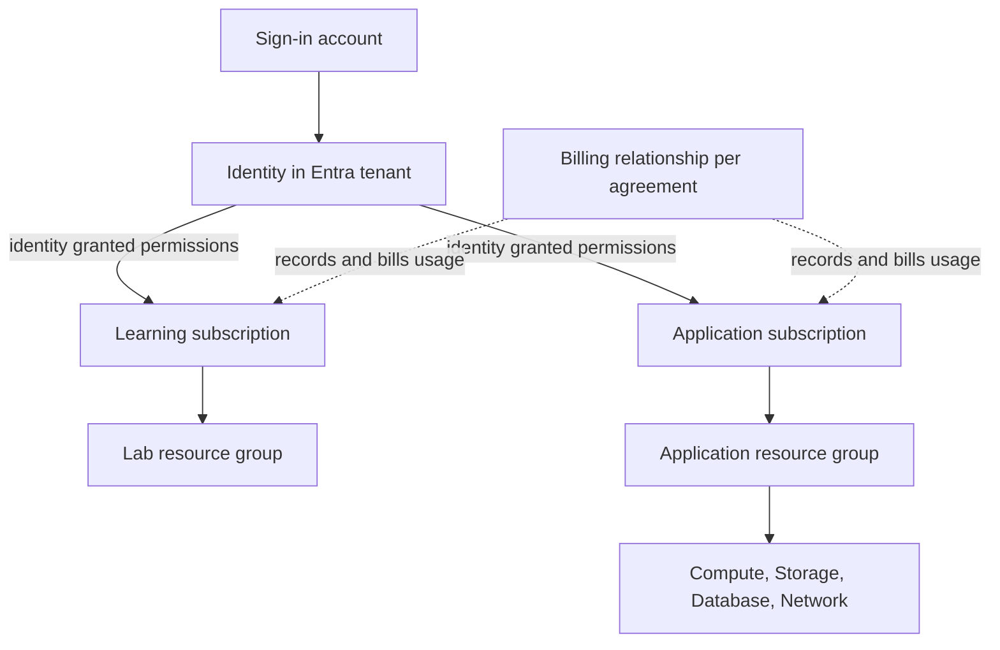

# Creating an Account and Choosing an Azure Subscription Type

## 1. Objectives of Account Preparation

Before creating virtual networks, virtual machines, App Services, storage accounts, or databases on Azure, learners need to determine three things: which identity to sign in with, which subscription to use, and who is responsible for billing. A resource created successfully in the wrong subscription can still cause billing confusion, incorrect governance scope, or handover difficulties later.

This lesson belongs to the **Accounts and Tools** chapter in the Microsoft Azure ecosystem. The goal is to prepare an environment that can be used for lessons on deploying, monitoring, and securing applications while controlling costs from the very beginning.

After this lesson, you should be able to:

- Distinguish between a sign-in account, a Microsoft Entra tenant, an Azure subscription, and a billing account.
- Choose an Azure program or purchasing option suited for learning, development/testing, or running production applications.
- Complete the sign-up process or request access to an organization's environment.
- Verify the correct tenant, subscription, status, and permissions before deploying.
- Distinguish between promotional credits, free usage limits, spending limits, and budgets.

Promotional terms, supported services, and verification requirements are subject to change. Official links are placed directly in the relevant sections so learners can check current conditions before confirming sign-up or upgrading.

## 2. Four Easily Confused Concepts

### 2.1. Sign-in account: who are you?

A sign-in account provides the identity used to access the Azure Portal and management tools. Two common cases are:

- **Personal Microsoft account:** an identity managed by an individual, commonly used for self-study and personal service sign-ups.
- **Work or school account:** an organizational identity managed within that organization's Microsoft Entra system.

The same email address string can appear in different sign-in contexts. When the system prompts you to choose between a personal account and a work/school account, select the exact type used to receive permissions or register.

A successful sign-in only proves that the system recognizes you. It does not prove that you have an active subscription, permission to create resources, or permission to view invoices.

### 2.2. Microsoft Entra tenant: where are identities organized?

A **Tenant** is an instance of an organization's Microsoft Entra ID directory, containing objects such as users, groups, and application identities. A tenant has a **Tenant ID** for identification.

A subscription trusts one tenant at a time; one tenant can be associated with multiple subscriptions. This trust relationship determines the identity directory used for granting access to resources. A subscription's billing relationship is a separate dimension, tied to the service purchasing agreement. [Microsoft Learn: relationship between billing and tenant](https://learn.microsoft.com/en-us/azure/cost-management-billing/understand/understand-billing-tenant-relationship).

Learners can be invited into a school or company tenant without becoming the payer. Therefore, do not infer that being present in a tenant means owning that tenant's subscriptions.

### 2.3. Azure subscription: where are resources managed and costs recorded?

An **Azure subscription** is the scope for deploying and managing Azure resources, applying appropriate governance mechanisms, and aggregating usage for billing. Each subscription has a **Subscription ID**.

The display name helps humans recognize it, for example `sub-azure-learning` or `sub-orders-dev`. The ID helps tools accurately identify the object; two subscriptions can have very similar names, so you should not rely solely on the name.

A subscription usually contains multiple resource groups, each containing related resources. Resources are deployed according to the region options of each service; a subscription should not be understood as a single server or a single deployment region.

A subscription is an important governance scope, but it does not automatically complete network design, access permissions, or data protection. Those decisions still need to be configured for the application architecture.

### 2.4. Billing account and purchasing agreement: who pays, and under what terms?

A billing account represents the billing relationship with Microsoft or the corresponding commercial structure. Depending on the agreement type, there may also be billing profiles, invoice sections, or other management levels. Not all Azure accounts share the same billing hierarchy or invoicing method. [Microsoft Learn: types of billing accounts](https://learn.microsoft.com/en-us/azure/cost-management-billing/manage/view-all-accounts).

Resource management permissions and billing management permissions need to be checked separately. For example, a developer may be assigned to deploy into a resource group without having permission to change the enterprise's payment method.

| Concept | Question it helps answer | Example identifier or object |
| --- | --- | --- |
| Sign-in account | Who is accessing? | Personal user or organizational user |
| Entra tenant | Which directory do identities and groups reside in? | Tenant ID |
| Subscription | Which Azure scope do resources belong to? | Subscription ID |
| Resource group | Which resources are managed together? | `rg-orders-dev` |
| Billing account and billing structure | Under which relationship are costs billed? | Purchasing agreement and corresponding invoice scopes |



The diagram is an illustrative example of an organization. It should not be taken as a rule that every subscription in the same tenant must share a single billing account.

## 3. Properly Understanding the Phrase "Subscription Type"

In casual conversation, users often refer to Free Account, Pay-As-You-Go, Students, Enterprise Agreement, and CSP as "subscription types." These names actually belong to different conceptual layers:

| Choice layer | Example | What needs to be evaluated |
| --- | --- | --- |
| Program or sign-up offer | Azure free account, Azure for Students, Visual Studio benefits | Eligibility, credit, duration, and usage scope |
| Usage-based pricing model | Pay-as-you-go | Which usage incurs charges and who pays |
| Purchasing relationship or channel | MCA, EA, purchased through CSP | Contract, invoicing, management permissions, and support |
| Offers for development environments | Eligible Dev/Test | Who is allowed to use it and which workloads are permitted |
| Configuration of each resource | SKU, tier, VM size | Capacity, features, and unit price of the resource |

MCA stands for **Microsoft Customer Agreement**; EA stands for **Enterprise Agreement**; CSP stands for **Cloud Solution Provider**, a partner purchasing channel. Knowing that a subscription uses consumption-based pricing is not enough to determine its entire contractual structure. [Microsoft Learn: billing account types](https://learn.microsoft.com/en-us/azure/cost-management-billing/manage/view-all-accounts).

Changing technical support plans, choosing a larger VM, or purchasing a cost-saving option does not create a new sign-in account type. When choosing a subscription, commercial questions must be separated from resource configuration questions.

## 4. Common Options When Getting Started

### 4.1. Azure free account: exploring within promotional limits

The Azure free account is aimed at eligible new customers who want to try Azure. The overview page currently describes an initial 200 USD credit usable for 30 days, along with conditional free usage amounts. To continue after the time limit or when the credit runs out, users must actively switch to pay-as-you-go pricing. [Microsoft Azure: Free Account and Pay-As-You-Go](https://azure.microsoft.com/en-us/free/).

An important distinction is between trial credit and each service's free tier limits. Running out of credit does not mean all services become free; a configuration outside the promotional scope still needs to be evaluated before continuing use.

The sign-up process includes identity verification and a suitable payment method. The terms state that the credit does not apply to all products, such as certain separately purchased services or Marketplace products. You should not rely on the credit amount to conclude that every choice in the Portal is covered by the promotion. [Azure free account terms](https://azure.microsoft.com/en-us/pricing/offers/ms-azr-0044p/).

This is a suitable option for trying out a planned sequence of lessons, provided the learner knows when their offer ends and manages resources after each lesson.

### 4.2. Azure for Students: check student eligibility first

Azure for Students is a program for students who meet Microsoft's criteria and complete academic verification. The program page currently describes 100 USD of credit usable for 12 months, with no credit card required, along with renewal eligibility based on student status. Having a school email address alone is not enough to assume registration will definitely be accepted. [Microsoft Azure: Azure for Students](https://azure.microsoft.com/en-us/free/students/).

Learners need to check the specific program they are choosing, because Azure for Students and similarly named programs do not necessarily provide the same benefits. When working on a project, compare the services and configurations required by the assignment against the actual capabilities of the provisioned subscription.

### 4.3. Pay-as-you-go: pay for what you use, requires ongoing management

Pay-as-you-go is a way of using Azure where costs are incurred based on provisioned resources and applicable consumption. It is suitable when you need to continue learning or running workloads beyond the trial scope, after identifying the payer and budget. [Microsoft Azure: account options](https://azure.microsoft.com/en-us/free/).

"Pay-as-you-go" should not be understood as only being charged when someone opens the application. A provisioned resource can continue incurring charges even when there are no requests. Storage, networking, backups, or logs may be billed separately depending on the service.

A subscription on pay-as-you-go pricing does not have a trial-credit-style spending limit that can be set to an arbitrary dollar amount. Budgets must be used in their proper role for tracking and alerting. [Microsoft Learn: Azure spending limit](https://learn.microsoft.com/en-us/azure/cost-management-billing/manage/spending-limit).

### 4.4. Azure benefits included with a Visual Studio subscription

Some Visual Studio subscriptions include monthly Azure credit benefits. The credit amount and conditions depend on the owned plan; this benefit is intended for personal development and testing under applicable terms. Installing Visual Studio or using Visual Studio Code should not be equated with having Azure credit benefits. [Microsoft Azure: credits for Visual Studio subscribers](https://azure.microsoft.com/en-us/pricing/member-offers/credit-for-visual-studio-subscribers/).

If you have already been granted an eligible benefit by your organization, check it before creating a separate paid subscription. For production workloads, use an option that permits production instead of defaulting to dev/test credits.

### 4.5. Dev/Test for eligible development teams

Azure Dev/Test programs provide pricing for development and testing when eligibility requirements are met, including Visual Studio subscription requirements in applicable cases. This is an offer for non-production workloads; it is not a general free mode for all resources. [Microsoft Azure: Azure Dev/Test pricing](https://azure.microsoft.com/en-us/pricing/offers/dev-test/).

The team needs to identify who participates in the environment, the intended usage, and who approves licensing eligibility. A subscription serving real customers should not be treated as a test environment simply because the project is in an early stage.

### 4.6. Organizational subscriptions: MCA, EA, or partner-purchased

If a company or school already has an Azure environment, the first step is usually to request scoped permissions or request subscription creation through internal processes. Organizations can purchase directly under an MCA, use an EA, or purchase services through a CSP partner; invoice management and support contacts depend on the purchasing relationship. [Microsoft Learn: billing offers and Entra tenant](https://learn.microsoft.com/en-us/azure/cloud-adoption-framework/ready/landing-zone/design-area/azure-billing-microsoft-entra-tenant).

Learners do not need to act as the payer if the organization has already provided an environment. Internal points of contact should confirm which subscription is for learning, which resources are permitted to be created, and the cleanup procedure after labs.

## 5. Choosing an Option Based on Practical Needs

### 5.1. Decision guide table

| Need | Option to check first | Deciding conditions |
| --- | --- | --- |
| Student wanting to learn and build projects | Azure for Students | Meets verification criteria and needed services can be deployed |
| Individual newly trying Azure short-term | Azure free account | Meets new customer criteria and understands offer duration |
| Individual needing continued use after trial | Pay-as-you-go | Has a payer, expected spend level, and cost-check schedule |
| Already has eligible Visual Studio benefit | Azure credit in that benefit | Properly activated and used under dev/test terms |
| Development team in an enterprise | Organizational subscription or eligible Dev/Test | Has approval, permission scope, and shared usage rules |
| Application serving real customers | Organization-managed production subscription | Purchasing form permits the use case and has operations ownership |

This table is a decision-making guide for the lesson. The final choice depends on registration eligibility, required services, and organizational policy; an option with higher credit is not necessarily more suitable.

### 5.2. Five questions before confirming

1. **Who owns the environment?** Whether individual, school, or company, there must be a clear owner.
2. **Who pays?** The person signing in may differ from the payer.
3. **How long will the environment exist?** A single lab session differs from an API that needs to run continuously for months.
4. **What services does the lesson need?** You need to check available services, regions, quotas, and configurations in the specific subscription.
5. **How will it be handled when finished?** Who exports data, deletes resources, and checks remaining costs?

For example, a student building a Java API using Storage can check Students benefits first. If a mandatory service for the project is unavailable, review the requirements or request an appropriate environment from the school; do not upgrade solely because of an error message without identifying the root cause.

For employees developing company applications, prioritizing a company-approved environment keeps resources tied to the organization's governance and handover processes. Using a personal account with a personal card easily separates billing responsibility from the application owner.

## 6. Preparing Before Registration

### 6.1. Preparing identity and verification information

Before starting the registration process, prepare:

- The identity you plan to use long-term for this environment.
- Access to the email and verification method required by the process.
- Accurate personal or organizational information matching the form.
- An accepted payment method if required by the program.
- Proof of academic status or organizational entitlement if registering under the corresponding program.

Specific requirements depend on the program and country or region. Free Account terms describe requirements for phone, account, and eligible card, and there may be a temporary verification hold. Learners need to read the actual form rather than assuming all programs require or waive card verification. [Free Account sign-up terms](https://azure.microsoft.com/en-us/pricing/offers/ms-azr-0044p/).

The country or region in the billing profile does not dictate the region of all resources. Use actual billing information; application deployment regions will be chosen based on service availability and system requirements.

### 6.2. Preparing permissions when using an organizational account

Ask your internal admin contact about the tenant to use, the subscription designated for labs, the scope where resource creation is allowed, and the billing contact. Creating additional subscriptions under an organization's agreement requires permissions at the corresponding billing scope; having permissions inside a resource group is not enough to create a new subscription yourself. [Microsoft Learn: create a subscription under MCA](https://learn.microsoft.com/en-us/azure/cost-management-billing/manage/create-subscription).

If you have already been assigned a lab resource group, you may not need to create a new subscription. What remains is signing in with the right identity and verifying permissions in the assigned environment.

### 6.3. Protecting administrative identity from the start

Set up strong authentication appropriate for your account and organizational policy, complete multi-factor authentication requirements when prompted, and prepare account recovery methods. Do not share a single administrative account across the entire team instead of granting permissions to individual members.

In a team environment, granting permissions by role helps trace who created, modified, or deleted resources. Someone who only needs to practice in a single resource group does not automatically need subscription-wide administrative permissions.

## 7. Process for Creating an Account or Receiving an Environment

### Step 1: Open the right official program page

For individuals, go to the [Azure account options](https://azure.microsoft.com/en-us/free/) page or [Azure for Students](https://azure.microsoft.com/en-us/free/students/) depending on the chosen option. For Visual Studio benefits, use the benefit activation flow of the specific Visual Studio subscription provided.

If the organization already has Azure, follow the link and process provided by the organization. Do not register a new personal billing relationship just to resolve not seeing the company subscription yet.

### Step 2: Sign in and confirm the right identity

Verify the account being used before continuing. If your browser is signed into multiple identities, pay attention to choosing personal or work/school account at the redirect step.

The account name displayed in the Portal, the currently selected tenant, and the visible subscription are three pieces of information to cross-check separately. Looking only at the profile picture or email address is not enough.

### Step 3: Complete program information and verification

Fill in the form details, complete the required verification, and read the payment terms section. For student programs, complete the academic verification step; for programs requiring a card, check acceptance conditions in your region.

If the process fails to verify, use the program's official guidance or support channel. Do not alter identity information, country, or create multiple registrations to bypass eligibility requirements.

### Step 4: Review your selection before accepting

Confirm the program being registered, the party responsible for payment, credits or time limits if any, and behavior when the offer ends. Pay special attention to the fact that switching to paid pricing can change how the subscription continues using services.

The goal of this step is to ensure the form you accept matches the decision made in the selection section, rather than rushing through the form just to enter the Portal.

### Step 5: Enter the Azure Portal and inspect the subscription

Open the [Azure Portal](https://portal.azure.com/), search for **Subscriptions**, select the subscription you plan to use, and view the overview page. UI label names or locations may change; search by subscription management functionality.

Record the Subscription ID, Tenant ID, display name, active status, and program or billing information visible to your permissions. For users invited into an organizational environment, also check the directory and subscription filters if the list does not show the assigned environment yet.

### Step 6: Confirm permissions and governance contacts

Open **Access control (IAM)** at the appropriate scope to check permissions or ask an administrator to confirm. Compare permissions against the tasks needed, such as reading resources, creating resources in a resource group, or managing permissions for others.

Completing sign-up is not a reason to immediately create large resources. Only move on to deployment lessons once you know the scope, payer, and how costs are tracked.

## 8. Checking Permissions and Context Before Deploying

### 8.1. Being able to sign in does not mean having sufficient permissions

Azure RBAC manages permissions for Azure resources, whereas Microsoft Entra roles manage objects and functions within the directory. Therefore, tenant administration and subscription administration are distinct scopes to differentiate. [Microsoft Learn: Azure roles and Microsoft Entra roles](https://learn.microsoft.com/en-us/azure/role-based-access-control/rbac-and-directory-admin-roles).

Three common Azure roles help illustrate permission levels:

| Role | Capabilities at the assigned scope |
| --- | --- |
| Reader | View resources; insufficient to create or modify resources |
| Contributor | Manage resources; cannot assign Azure RBAC roles through this role alone |
| Owner | Manage resources and has permission to assign Azure RBAC roles |

These are general descriptions of the roles and do not replace checking effective permissions and applicable constraints. Permissions also depend on the assigned scope, inherited permissions, and organizational policies. [Microsoft Learn: basic Azure roles](https://learn.microsoft.com/en-us/azure/role-based-access-control/rbac-and-directory-admin-roles).

In a group study environment, one person may only get Contributor on `rg-azure-learning`, while an administrator retains subscription-level permissions. There is no need to make every member an Owner just to deploy a lab exercise.

### 8.2. Checking via Portal or Azure CLI

The Portal is sufficient for initial verification. If you have installed and signed into Azure CLI, you can use the following commands to view and select a subscription. This is an example for learners; these are not resource creation steps.

```bash
az account list --output table

az account set --subscription "<SUBSCRIPTION_ID>"

az account show \
  --query "{subscription:name,subscriptionId:id,tenantId:tenantId,state:state}" \
  --output json
```

Replace `<SUBSCRIPTION_ID>` with the actual ID; do not keep the angle brackets. The `\` line continuation in the example is for Bash; the last command can be written on a single line in other shells.

`az account list` lists the subscriptions visible to the current account; `az account set` sets the default subscription in the CLI context without moving resources to another subscription; `az account show` displays details of the currently selected subscription. [Azure CLI documentation: az account](https://learn.microsoft.com/en-us/cli/azure/account).

Illustrative output example:

```json
{
  "subscription": "sub-azure-learning",
  "subscriptionId": "11111111-1111-1111-1111-111111111111",
  "tenantId": "22222222-2222-2222-2222-222222222222",
  "state": "Enabled"
}
```

The IDs above are dummy data. When starting a working session, match the actual IDs against the assigned environment. The Portal and CLI may have different subscriptions selected, so verify in the exact tool you will use for deployment.

### 8.3. Distinguishing permissions, quotas, and service availability

Having permission to create a VM does not guarantee you can always create every VM size in every region. A deployment request can also be limited by quota, subscription terms, policies, or service availability.

A quota is a capacity or resource count limit, such as vCPUs in a region; it is not a maximum spending cap. Some quotas can be requested to increase under eligible conditions, while some limits cannot be changed. Free trials have restrictions on quota increases. [Microsoft Learn: Azure limits and quotas](https://learn.microsoft.com/en-us/azure/azure-resource-manager/management/azure-subscription-service-limits).

When encountering an error, read the error code and message first: missing permissions require fixing permissions; policy violations require working with an administrator; insufficient quota requires checking the right quota type and region; an inactive subscription requires checking status or billing. Upgrading the subscription is not the default fix for every error.

## 9. Setting Up Cost Management from the Very First Session

### 9.1. Credits, free usage, spending limits, and budgets

| Concept | Meaning | Common misconception |
| --- | --- | --- |
| Credit | Promotional allowance used under specific terms and time limits | Not unrestricted money for every product |
| Free usage allowance | A usage tier or configuration within a specific program | Not unlimited free usage for the entire service |
| Spending limit | A limiting mechanism tied to certain credit-based subscriptions | Not an arbitrary cap button for all subscriptions |
| Budget | A budget threshold used to track and trigger alerts | Does not automatically stop all resources when reached |
| Quota | Resource or capacity limit by service scope | Does not replace cost management |

A spending limit can be enabled for eligible credit programs; its protection scope and exceptions should be read according to the program. Setting a 10 USD budget does not mean Azure automatically applies a 10 USD spending limit. [Microsoft Learn: spending limit](https://learn.microsoft.com/en-us/azure/cost-management-billing/manage/spending-limit).

### 9.2. Creating a budget and understanding how alerts work

In the Portal, find Cost Management at a scope you are permitted to manage, select Budgets, set the tracking period, amount, and alert recipients. As an illustrative example, a learner chooses a monthly budget equivalent to 10 USD with thresholds at 50%, 80%, and 100%; the actual amount must match the billing scope's currency and your own budget.

Budgets use cost data to evaluate thresholds, not as an instant usage kill switch. Data and alerts have latency; if automated action is required, a separate mechanism must be designed and tested. [Microsoft Learn: create and manage budgets](https://learn.microsoft.com/en-us/azure/cost-management-billing/costs/tutorial-acm-create-budgets).

For new subscriptions, Cost Management features may not be ready immediately. When unable to create a budget yet, check permissions, account type, and activation time according to official guidance; do not assume that seeing no cost report means no charges exist. [Microsoft Learn: Budgets prerequisites](https://learn.microsoft.com/en-us/azure/cost-management-billing/costs/tutorial-acm-create-budgets).

### 9.3. Estimating all accompanying components of an application

A small Java API may include App Service, a database, Storage, networking, and logs. Before deploying, build an estimate table for all components instead of only looking at the price of where the Java code runs.

| Component | Questions to estimate usage |
| --- | --- |
| Compute | Provisioned continuously or consumption-based? How many hours or instances will run? |
| Database | Which tier, how much storage, what operating mode, and how are backups handled? |
| Storage | What are the capacity, operation count, and storage options? |
| Network | Are there data transfers, IPs, or separately billed networking components? |
| Monitoring | How much log data is collected and how long is it retained? |

Use the [Azure Pricing Calculator](https://azure.microsoft.com/en-us/pricing/calculator/) to build an estimate for the planned configuration. Estimates are for planning; actual usage and applicable pricing terms determine incurred costs.

After each study session, review created resources and delete lab components that do not need to be kept. For VMs, shutting down inside the OS and deallocating have different operational meanings; accompanying components like disks still need to be reviewed separately. For other services, check the status and billing model of that specific service.

Grouping a lesson's resources into a dedicated resource group makes inventory and cleanup much easier. Before deleting, check whether the group contains shared resources or data that must be preserved; after cleanup, verify the result and check cost reports once data is updated.

## 10. Common Issues When Starting Out

| Symptom | What to check | Initial troubleshooting step |
| --- | --- | --- |
| Can sign into Portal but see no subscription | Identity, directory, filters, and granted permissions | Switch to the right context, verify invitations, or ask an administrator |
| Can see subscription but cannot create resources | Status, effective permissions, policy, quota, and service errors | Read the specific error message before requesting more permissions or changing config |
| Cannot view invoices | Billing scope and permissions | Contact the billing point person; do not infer invoice access from resource permissions |
| Offer not accepted | Customer eligibility, program, region, and verification | Check official terms and support |
| Subscription disabled or unable to continue deploying | Exhausted credit, expiration, billing issue, or management state | Identify the cause in the Portal and follow program instructions |
| Do not see costs immediately after creating resources | Data latency and report filters | Check again at the right scope after data updates |
| CLI deploys to a different environment than Portal | Current subscription in each tool | Verify the Subscription ID before taking action |

**Illustrative scenario:** Lan is invited by her company into a tenant and signs into the Portal successfully, but the Subscriptions page is empty. Lan should not immediately create a Free Account with her personal card. She checks that she selected the right work account, right directory, and filters; then asks the administrator to verify permissions on the assigned subscription or resource group.

If the goal is solely to practice inside the company environment, the issue to resolve is access permissions and context. Creating another personal billing relationship will not make the company subscription appear.

**Another scenario:** Nam uses a trial subscription and cannot create a VM with the configuration shown in a guide. Nam reads the error to distinguish insufficient quota from an unavailable configuration. Nam reviews the lesson's needs, tries a supported option if appropriate, or requests a licensed environment. Switching to paid pricing should only happen after understanding the impact and who pays.

Do not let unique data or a critical service depend on a promotion that is about to expire. If continued use is needed, plan a valid transition before the end date; if finishing practice, export data to keep and clean up resources as planned.

## 11. Lab Exercise and Self-Check Questions

### 11.1. Lab exercise: preparing an environment without deploying an application yet

Perform this in the Portal with your own account or an assigned organizational environment:

1. Choose a use case: personal self-study, student, or company environment.
2. Record the reason for choosing the program or purchasing option, the payer, and the expected usage duration.
3. Register under eligible conditions or obtain permissions from an administrator.
4. Open Subscriptions and confirm the exact Subscription ID, Tenant ID, and status.
5. Check your permissions at the practice scope.
6. Identify where to view costs, credits, and benefit end date if applicable.
7. Set up a budget if supported and permitted; confirm alert recipients.
8. Create a cleanup plan for your first deployment lesson.

The lab is complete when you know for sure which environment will be used, who bears the cost, and what permissions you have. There is no need to create a VM, database, or Storage just to prove the account is ready.

Self-record template, do not enter passwords, verification codes, or card details:

```text
Purpose: learning to deploy a Java API
Usage form: chosen program or organizational environment
Owner and billing contact: ...
Sign-in identity and directory to use: ...
Subscription ID and Tenant ID: verified
Subscription status: ...
Permitted practice scope: ...
Credits or time limits to track: ...
Expected budget and alert recipients: ...
Data export and resource cleanup plan: ...
```

### 11.2. Self-check questions

**Question 1: Does having a Microsoft account mean you already have an active Azure subscription?**

No. Sign-in identity, subscription relationship, and access permissions are separate details that must be checked independently.

**Question 2: Do two subscriptions with the same tenant necessarily have the same payer?**

Do not assume so. Identity relationships and billing relationships are two different dimensions; you must inspect the actual commercial structure and management permissions.

**Question 3: Does a 10 USD budget guarantee the bill will not exceed 10 USD?**

No. A budget is for tracking and alerting; you must manage resources, account for data latency, and design separate actions if automated responses are required.

**Question 4: If you encounter an error creating a VM, should you switch to paid pricing immediately?**

Read the error first. Permissions, policy, quota, subscription status, and resource availability are different causes with different fixes.

**Question 5: Does being a Contributor on a resource group automatically grant invoice management and permission assignment for everyone?**

No. Roles have specific scopes and capabilities; billing permissions and role assignment permissions must be reviewed separately.

**Question 6: Does changing the current subscription via the CLI move resources to that subscription?**

No. It changes the CLI's selection context. Moving resources or changing a subscription's relationships are different administrative operations that must be evaluated separately.

## 12. Key Takeaways

Preparing Azure starts with identifying the right identity, tenant, subscription, and billing relationship. For beginners, the right choice must be based on eligibility, required practice services, usage duration, and who bears the cost.

Once you have an environment, verify status, permissions, quotas, and the Subscription ID before deploying. Distinguish credits from free allowances, spending limits from budgets, and also track billable components accompanying the application. These steps lay the foundation for learning networking, compute, storage, and data on Azure within a clearly governable and handover-ready scope.
