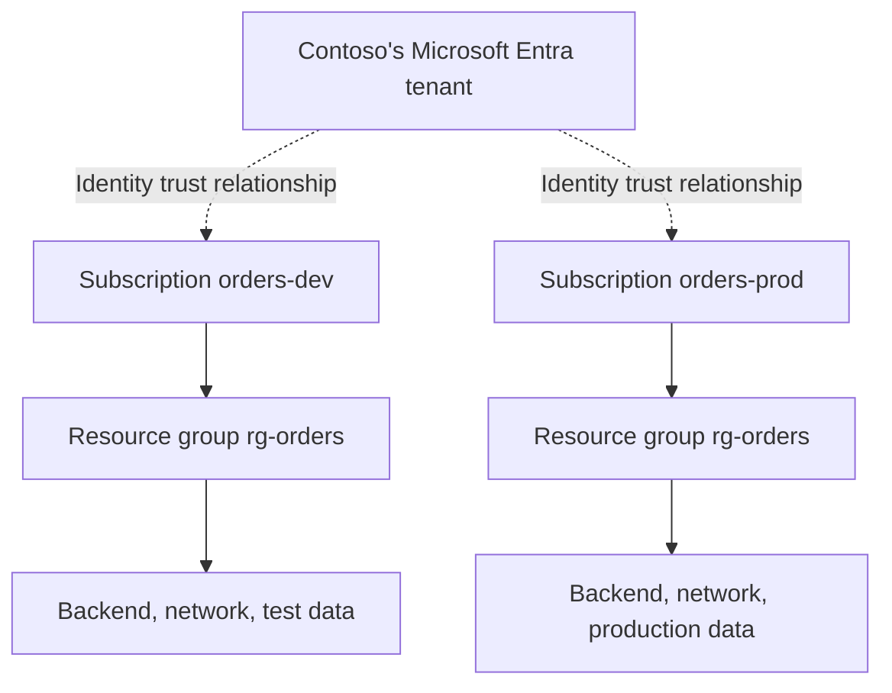

# Selecting a Tenant, Subscription, and Working Context

## Objectives and Background

In the **Accounts and Tools** chapter of the **CLOUD_PROVIDERS_AZURE** module, selecting the right context is the step that connects your sign-in account to the Azure resources you intend to work on. A single account may see multiple organizations and multiple subscriptions. Signing in successfully only confirms part of the picture; you still need to know which environment your tools are targeting.

This lesson explains how to identify the tenant, subscription, and resource scope in the Azure Portal, Azure CLI, and Azure PowerShell. The examples tie into an application with virtual networking, a backend, storage, data, and monitoring, so context selection directly supports deployment planning and cost control.

All GUIDs, subscription names, accounts, and resource groups in this lesson are **illustrative values**. When practicing yourself, replace them with details from your assigned environment. The inspection snippets only read Azure metadata or switch the tool's sign-in session/context; this lesson does not require creating or deleting resources.

## 1. What Does a Working Context Include?

You can use the following model to describe the target of an operation:

```text
Context to verify
  = cloud environment
  + executing identity
  + tenant
  + subscription
  + resource scope
```

This is a practical mental model for thinking about operations, not the name of a single Azure API object.

| Component | Question to answer | Illustrative example |
| --- | --- | --- |
| Cloud environment | Which Azure endpoint cloud is being used? | AzureCloud |
| Identity | Which user or workload is making the request? | developer@contoso.example |
| Tenant | Which directory provides the identity context for this target? | Contoso organization's tenant |
| Subscription | Which management scope do the resources belong to? | orders-dev |
| Resource scope | Which specific group or resource is being operated on? | rg-orders-dev |

**Region/location** is a deployment parameter that must be checked separately. Selecting the right subscription does not confirm resources will be placed in the right region.

You should also note the tool and session being used. Verification results in the Portal do not replace checking the `az` command or `Az` cmdlet you are about to run.

## 2. How Are Tenants and Subscriptions Related?

A **Microsoft Entra tenant**, also called a directory in many interfaces, holds an organization's identity context. An **Azure subscription** is the scope for managing resources and associated Azure permissions.

A subscription trusts one Microsoft Entra tenant at a time; a tenant can be trusted by multiple subscriptions. Microsoft Entra roles and Azure roles are two systems that must be distinguished. See [how Azure subscriptions are associated with a Microsoft Entra tenant](https://learn.microsoft.com/en-us/entra/fundamentals/how-subscriptions-associated-directory).

Diagram illustrating an organization using two subscriptions:



The two groups with the same name `rg-orders` in the diagram belong to different subscriptions. When working, a group name must be paired with its subscription or full resource ID.

### 2.1. A sign-in account is not a tenant

An email address identifies an account during interaction, but it is not enough to infer the target tenant. For example, an engineer at an implementation firm might use the same account to support multiple customers.

In a multi-tenant collaboration model, the **home tenant** contains the user in their origin organization; the **resource tenant** is the tenant containing the shared resources. Both concepts are explained in [multi-tenant user management terminology](https://learn.microsoft.com/en-us/entra/architecture/multi-tenant-user-management-introduction).

In customer support scenarios, obtain the target tenant ID from the customer's environment record. Do not use the home tenant just because that is where the account normally signs in.

### 2.2. Selecting a tenant does not mean having permissions

Azure RBAC grants permissions using a triad: **security principal, role definition, and scope**. Switching to an appropriate context does not automatically create a role assignment. See [Azure RBAC overview](https://learn.microsoft.com/en-us/azure/role-based-access-control/overview).

Therefore, separate three outcomes:

- Able to sign in: the authentication step succeeded with the method being used.
- Able to select subscription: the tool resolved an available subscription scope.
- Able to execute operation: the identity also meets the permissions and conditions of the specific operation.

For example, being able to read metadata of a resource group does not prove you are permitted to change the configuration of a backend inside that group.

## 3. Targeting by ID and Environment Profile

Names like "Development", "Production", or "Azure subscription 1" are convenient for humans to read, but they can be identical or renamed. In scripts and deployment configs, use verified GUIDs.

An illustrative environment profile:

| Field | Development | Production |
| --- | --- | --- |
| Cloud | AzureCloud | AzureCloud |
| Tenant ID | 11111111-1111-4111-8111-111111111111 | 11111111-1111-4111-8111-111111111111 |
| Subscription name | orders-dev | orders-prod |
| Subscription ID | 22222222-2222-4222-8222-222222222222 | 33333333-3333-4333-8333-333333333333 |
| Resource group | rg-orders | rg-orders |
| Illustrative task | Testing application configuration | Operating live system |

In this example, the tenant is the same while the subscriptions differ. If a script only compares the tenant ID, it can still mistakenly target production.

A workflow should obtain the tenant ID, subscription ID, and resource scope from the request or an agreed-upon environment configuration. When these values are unclear, pause before making any modifications and confirm with the environment owner.

## 4. Identifying Context in Azure Portal

### 4.1. Selecting a directory

In the Portal, open **Settings** and look for **Directories + subscriptions**. Check **Current directory**; use **All Directories** and **Switch** to pick the directory you need to work in. The Portal also offers a startup directory setting, either a specific directory or your most recently accessed directory.

These options are described in the [Azure Portal preferences guide](https://learn.microsoft.com/en-us/azure/azure-portal/set-preferences). Item names and locations may vary depending on UI version or language.

When entering a customer environment, match the displayed directory against the tenant ID in the request instead of relying solely on a logo or organization name.

### 4.2. Understanding subscription filters

The Portal has default filters and subscription list filters. A subscription may not appear because a filter is excluding it from view. The subscription list is also tied to the currently signed-in directory. See [how to filter and view subscriptions](https://learn.microsoft.com/en-us/azure/cost-management-billing/manage/filter-view-subscriptions).

Therefore, "not seeing the subscription" is not enough to conclude the subscription was deleted or that the account definitely lacks permissions.

An appropriate diagnostic sequence:

1. Check the currently signed-in account.
2. Check the current directory and tenant ID.
3. Check subscription filters.
4. Open the expected subscription and verify the subscription ID.
5. Open the target resource group or resource and check its scope.

### 4.3. Checking the target directly on the resource

Before changing a backend's configuration, view the subscription and resource group details on that backend's page. If creating a resource, double-check the subscription, resource group, and region fields on the form.

Filters narrow what is displayed on screen. They are not an authorization mechanism replacing Azure RBAC and do not replace verifying the target of an operation.

## 5. Selecting Tenant and Subscription with Azure CLI

The `az` command examples below use syntax entered in **PowerShell**. The learner's machine needs Azure CLI installed and a suitable sign-in method.

### 5.1. Checking the cloud environment

```powershell
az cloud show --query name --output tsv
```

Example output for the Azure public cloud:

```text
AzureCloud
```

Azure CLI supports different cloud environments with different endpoints. You can inspect them with `az cloud list` and `az cloud show`. If your work belongs to another cloud, select the right cloud first, then authenticate and check the corresponding subscriptions. See [manage Azure clouds with CLI](https://learn.microsoft.com/en-us/cli/azure/manage-clouds-azure-cli).

This lesson uses `AzureCloud`. Do not switch clouds just because a subscription list appears incomplete; first verify the assigned environment.

### 5.2. Signing into the target tenant

```powershell
$tenantId = '11111111-1111-4111-8111-111111111111'

az login --tenant $tenantId
```

Complete the interactive authentication step, including MFA or sign-in conditions required by your organization. After signing in, a tenant/subscription selector prompt may appear depending on the CLI version and environment.

In some environments, to sign into a specific tenant you may need to turn off the subscription selector first:

```powershell
az config set core.login_experience_v2=off
az login --tenant $tenantId
```

This is a workaround branch when needed for tool behavior, not a mandatory step for every sign-in. You can re-enable the selector with `az config set core.login_experience_v2=on`. See [sign in interactively with Azure CLI](https://learn.microsoft.com/en-us/cli/azure/authenticate-azure-cli-interactively).

### 5.3. Listing and selecting a subscription

```powershell
az account list --query "[].{name:name,id:id,tenantId:tenantId,state:state,isDefault:isDefault}" --output table

$subscriptionId = '22222222-2222-4222-8222-222222222222'
az account set --subscription $subscriptionId
```

`az account list` helps cross-check the subscriptions known to the CLI session. `az account set` sets the active subscription; the command accepts a name or ID. In the example, an ID is used to avoid picking between identical names. See [manage Azure subscriptions with CLI](https://learn.microsoft.com/en-us/cli/azure/manage-azure-subscriptions-azure-cli).

If the assigned ID cannot be found, do not proceed to subsequent operations. Recheck the account, tenant, and access permissions first.

### 5.4. Reading back the current context

```powershell
az account show --query "{name:name,id:id,tenantId:tenantId,state:state,account:user.name,accountType:user.type}" --output json
```

Illustrative output:

```json
{
  "name": "orders-dev",
  "id": "22222222-2222-4222-8222-222222222222",
  "tenantId": "11111111-1111-4111-8111-111111111111",
  "state": "Enabled",
  "account": "developer@contoso.example",
  "accountType": "user"
}
```

Verify at least the tenant ID and subscription ID against the environment profile. The `account` field helps identify whether the session uses a user or a workload identity; how the account is represented depends on the authentication method.

`az account show` is a context-reading command. It is not a comprehensive check of all permissions held by that identity.

### 5.5. Passing the subscription to critical commands

To read a resource group with an explicit target:

```powershell
az group show --name rg-orders --subscription $subscriptionId --query "{id:id,name:name,location:location}" --output json
```

The `--subscription` parameter selects the subscription for commands that support it, reducing reliance on defaults. See [Azure CLI global parameters](https://learn.microsoft.com/en-us/cli/azure/azure-cli-global-parameters).

Passing a subscription does not grant extra permissions and does not fix a session signed into the wrong cloud. For resources referenced by a full resource ID, check that ID as well; do not assume every target parameter is automatically overridden by the default subscription.

## 6. Context in Azure PowerShell

Azure PowerShell uses cmdlets such as `Connect-AzAccount`, `Get-AzContext`, and `Set-AzContext`. This is a different toolset from running the `az` executable inside a PowerShell window.

### 6.1. Connecting to a specific tenant and subscription

```powershell
$tenantId = '11111111-1111-4111-8111-111111111111'
$subscriptionId = '22222222-2222-4222-8222-222222222222'

Connect-AzAccount -Environment AzureCloud -Tenant $tenantId -Subscription $subscriptionId -Scope Process -ErrorAction Stop
```

`Connect-AzAccount` supports specifying the environment, tenant, subscription, and the scope of the context change. Refer to [Connect-AzAccount](https://learn.microsoft.com/en-us/powershell/module/az.accounts/connect-azaccount).

This example uses user sign-in. `-Scope Process` restricts the new context from this connection to the current process; it does not clear previously saved sign-in credentials.

### 6.2. Selecting and reading back the context

```powershell
$context = Set-AzContext -Tenant $tenantId -Subscription $subscriptionId -Scope Process -ErrorAction Stop

Get-AzContext | Format-List Account, Tenant, Subscription, Environment
```

`Set-AzContext` sets the tenant, subscription, and environment information for cmdlets in the session. See [Set-AzContext](https://learn.microsoft.com/en-us/powershell/module/az.accounts/set-azcontext).

You can inspect IDs via properties of the context object:

```powershell
if ($context.Tenant.Id -ne $tenantId) {
    throw 'Tenant in context does not match target.'
}

if ($context.Subscription.Id -ne $subscriptionId) {
    throw 'Subscription in context does not match target.'
}

if ($context.Environment.Name -ne 'AzureCloud') {
    throw 'Cloud environment does not match target.'
}
```

Checking by ID avoids relying on context names or display names.

### 6.3. Passing context to resource-reading cmdlets

```powershell
Get-AzResourceGroup -Name rg-orders -DefaultProfile $context -ErrorAction Stop |
    Select-Object ResourceGroupName, ResourceId, Location
```

This cmdlet's `-DefaultProfile` receives the account, tenant, and subscription details used for the connection. See [Get-AzResourceGroup](https://learn.microsoft.com/en-us/powershell/module/az.resources/get-azresourcegroup).

When writing functions that accept a context, pass that object consistently to cmdlets that support it. For cmdlets that do not support the same parameter, check their target selection mechanism in their own documentation.

## 7. Using Resource IDs to Confirm the Final Scope

An Azure Resource Manager resource ID can contain the subscription, resource group, resource provider, resource type, and resource name. Illustrative example:

```text
/subscriptions/22222222-2222-4222-8222-222222222222/resourceGroups/rg-orders/providers/Microsoft.Web/sites/orders-api-dev
```

Scope and resource ID structure are described in the [Azure RBAC scope overview](https://learn.microsoft.com/en-us/azure/role-based-access-control/scope-overview).

When verifying the target of a command, read the ID by segments:

| Segment | Illustrative value | What to verify |
| --- | --- | --- |
| subscriptions | 22222222-2222-4222-8222-222222222222 | Matches development environment |
| resourceGroups | rg-orders | Matches assigned group |
| provider/type | Microsoft.Web/sites | Matches resource type |
| resource name | orders-api-dev | Matches backend to inspect |

A resource ID does not contain the tenant ID as a similar path segment. Therefore, checking the ID string does not replace verifying the tenant in the identity context.

In practice, do not look only at a `-dev` suffix. An easy-to-read name can still be misapplied; the ID lets you cross-check directly against the requested scope.

## 8. Pre-Operation Verification Pattern Using the CLI

The PowerShell snippet below illustrates a **read-only** verification step. It requires a CLI session that has already signed in and selected a context beforehand, and then compares the current target against expected values.

This snippet does not sign in automatically, change subscriptions, or modify resources. The halt-on-mismatch logic is placed right before the point where an actual workflow would continue.

```powershell
$ErrorActionPreference = 'Stop'

$expectedCloud = 'AzureCloud'
$expectedTenantId = '11111111-1111-4111-8111-111111111111'
$expectedSubscriptionId = '22222222-2222-4222-8222-222222222222'
$resourceGroupName = 'rg-orders'

function Invoke-AzureCliJson {
    param(
        [Parameter(Mandatory)]
        [string[]] $CliArguments
    )

    $output = & az @CliArguments
    $exitCode = $LASTEXITCODE

    if ($exitCode -ne 0) {
        throw "Azure CLI failed with exit code $exitCode."
    }

    $jsonText = $output -join [Environment]::NewLine
    if ([string]::IsNullOrWhiteSpace($jsonText)) {
        throw 'Azure CLI did not return JSON.'
    }

    return ($jsonText | ConvertFrom-Json -ErrorAction Stop)
}

$cloud = Invoke-AzureCliJson -CliArguments @(
    'cloud', 'show', '--output', 'json'
)

if ($cloud.name -ne $expectedCloud) {
    throw 'Cloud environment does not match target.'
}

$account = Invoke-AzureCliJson -CliArguments @(
    'account', 'show', '--output', 'json'
)

if ($account.tenantId -ne $expectedTenantId) {
    throw 'Tenant ID does not match target.'
}

if ($account.id -ne $expectedSubscriptionId) {
    throw 'Subscription ID does not match target.'
}

if ($account.state -ne 'Enabled') {
    throw 'Subscription is not in Enabled state.'
}

$resourceGroup = Invoke-AzureCliJson -CliArguments @(
    'group', 'show',
    '--name', $resourceGroupName,
    '--subscription', $expectedSubscriptionId,
    '--output', 'json'
)

$expectedResourceGroupId =
    "/subscriptions/$expectedSubscriptionId/resourceGroups/$resourceGroupName"

if ($resourceGroup.id -ne $expectedResourceGroupId) {
    throw 'Resource group ID does not match target.'
}

[pscustomobject]@{
    Cloud = $cloud.name
    Account = $account.user.name
    AccountType = $account.user.type
    TenantId = $account.tenantId
    SubscriptionId = $account.id
    ResourceGroupId = $resourceGroup.id
    ContextCheck = 'PASS'
}
```

`az group show` reads resource group details; its syntax is in the [az group reference](https://learn.microsoft.com/en-us/cli/azure/group#az-group-show).

There are three design points in this example:

1. Check the exit code immediately after each `az` command. A failed CLI command must not be treated as a passing context check.
2. Compare tenant, subscription, and cloud before reading the target group.
3. Pass the subscription ID explicitly to the group-reading command, then verify the returned resource group ID.

`ContextCheck = 'PASS'` only means the conditions in the script passed at the time of verification. It does not confirm that the identity is a workflow-approved user or workload, does not check all write permissions, and does not verify an appropriate region.

In real workflows, identity verification policies matching the authentication method in use should be added. Do not use a displayed email as the sole proof of a service principal or managed identity.

If multiple processes share the same CLI configuration, the default context can change between steps. Therefore, subsequent operations must still carry an explicit target and run in a consistently managed configuration environment.

## 9. Where Are Defaults Stored and What Do They Mean?

### 9.1. Azure CLI and default configuration

Azure CLI can store default configurations for resource group and location. The configuration directory is determined via `AZURE_CONFIG_DIR`; on Windows, the default is `%USERPROFILE%\.azure`. Command-line parameters can be used to state targets explicitly rather than relying on default configurations. See [Azure CLI configuration](https://learn.microsoft.com/en-us/cli/azure/azure-cli-configuration).

This leads to two practical habits:

- When taking over an existing terminal, read back the context before using it.
- When handling multiple environments in parallel, use isolated configs or processes per team workflow, and pass targets explicitly.

If using a dedicated `AZURE_CONFIG_DIR`, set it consistently before signing in and before every command in the workflow. Separating config directories does not create an Azure permission boundary; it helps manage tool state.

### 9.2. Azure PowerShell has context persistence

Azure PowerShell can persist contexts across sessions. `-Scope Process` and `Disable-AzContextAutosave -Scope Process` help control saving new contexts in the current process. Disabling autosave does not remove previously saved tokens or contexts. See [Azure contexts and sign-in credentials](https://learn.microsoft.com/en-us/powershell/azure/context-persistence).

Do not assume that "closing the window" means all sign-in traces were cleared. When you need to sign out or clear context, use the tool's functions for the intended scope.

### 9.3. Checking the tool actually running the request

A single PowerShell window can run both `az account show` and `Get-AzContext`. These two commands inspect two different toolsets. In the Portal, Cloud Shell, or an IDE terminal, run the check corresponding to the tool about to execute the request.

| Tool you are about to use | Check directly |
| --- | --- |
| Azure Portal | Directory, subscription, and resources in the UI |
| Azure CLI commands | `az cloud show` and `az account show` |
| Azure PowerShell cmdlets | `Get-AzContext` and the context passed into cmdlets |
| Pipeline | Job identity along with tenant/subscription from job config |

Do not use a "correct" check in one row to infer that the remaining rows are also correct.

## 10. Correct Context and Data Permissions Are Checked Separately

Azure distinguishes the **control plane**, used to manage resources, from the **data plane**, used to access or consume a service's data. Endpoints and permission enforcement can differ. See [Azure control plane and data plane](https://learn.microsoft.com/en-us/azure/azure-resource-manager/management/control-plane-and-data-plane).

For example, someone who can read storage account metadata in the right subscription still needs to satisfy data access requirements to read blobs. Reselecting the subscription will not fix a data permission error on its own.

During diagnosis, explicitly note which type of request is failing:

| Illustrative request | Target details to verify |
| --- | --- |
| Reading backend metadata | Subscription, resource ID, management identity |
| Changing application configuration | The above details plus permission to perform the change |
| Reading stored data | Data endpoint, authentication method, permission scope |
| Sending logs or querying monitoring | Target resource, sender/reader identity, and related permissions |

This distinction prevents changing tenants or broadening management roles when the root cause lies in a specific service's endpoint or data permissions.

## 11. Automation Requires Explicit Identity and Target

Interactive scripts and automated pipelines have different sign-in needs. Azure CLI supports user identities as well as workload methods such as service principals and managed identities. Microsoft recommends using an appropriate workload identity for automation rather than relying on user password sign-in. See [Azure CLI authentication methods](https://learn.microsoft.com/en-us/cli/azure/authenticate-azure-cli).

A deployment job should be provided with clear target values:

```text
Cloud environment:
Tenant ID:
Subscription ID:
Allowed workload identity:
Deployment scope:
Application environment:
```

After the job's authentication step, read back the tenant/subscription and compare against the expected configuration. Never let a pipeline inherit a default subscription from a person's manual sign-in state on the runner machine.

Example of separation of responsibilities:

- Environment configuration states whether the deployment targets development or production.
- Authentication mechanism identifies which workload is executing the deployment.
- Role assignments specify what the workload can do and at which scope.
- Context verification compares the actual target against the job's requirements.

Tenant IDs and subscription IDs are identifiers, not passwords. Even so, when logging, output only the details needed for traceability per organizational policy; never log access tokens, refresh tokens, or credential contents.

## 12. Diagnosing When a Subscription Is Missing or Unusable

To avoid making changes in the wrong place, investigate in order from context to permissions and then to the service operation.

| Symptom | Hypothesis to check | Appropriate investigation step |
| --- | --- | --- |
| Portal does not show subscription | Wrong directory or filter | Check current directory, tenant ID, and subscription filters |
| CLI cannot find ID | Wrong account, tenant, or stale session list | Read `az account list`; verify account and sign in again if needed |
| CLI shows a different subscription than expected | Default was not reselected | Select by ID then read `az account show` |
| Portal is right but command hits wrong target | Checked in a different tool | Read the context of CLI or Az PowerShell itself |
| Can read resource but cannot modify | Action permissions insufficient or blocked by condition | Verify identity, action, and scope of the request |
| Metadata reads succeed but data is denied | Wrong endpoint or data-plane permissions | Check the data service's access method |
| Message states subscription is disabled | Unusable subscription state | Inspect state and coordinate with subscription management owner |
| Operation uses right ID but wrong cloud | Wrong endpoint or cloud context | Compare assigned cloud with `az cloud show` |

### When the CLI subscription list is not yet updated

If permissions were just granted and the CLI does not see the subscription yet, you may need to re-authenticate to refresh the list. After making sure you will not disrupt ongoing work using that session, you can use:

```powershell
az logout
az login --tenant $tenantId
az account list --output table
```

Azure CLI also has `az account clear` to clear the subscription cache; after this command, you must sign in again before continuing. Do not run cache-clearing commands as the opening step for every error. Cache refresh behavior and limits are described in the [CLI subscription management troubleshooting guide](https://learn.microsoft.com/en-us/cli/azure/manage-azure-subscriptions-azure-cli#troubleshooting).

If signing in again still does not show the right ID, verify permissions in the target tenant and subscription. Do not try unfamiliar subscriptions one by one just to find one where commands succeed.

### When performing directory-only tasks

Some Microsoft Entra tasks do not require managing resources inside an Azure subscription. Azure CLI provides the `az login --allow-no-subscriptions` option for suitable cases. That option does not create a subscription and does not grant resource management permissions. See [az login reference](https://learn.microsoft.com/en-us/cli/azure/reference-index#az-login).

Therefore, a sign-in session for directory tasks should not be assumed ready for deploying backends or databases.

## 13. Distinguishing Context Switching from Moving Resources

`az account set` and `Set-AzContext` change the target used by the tool. They do not move resources, do not change where existing resources incur charges, and do not transfer a subscription to another tenant.

Example:

```text
Before:
  CLI currently selects orders-prod
  Production backend still belongs to orders-prod

Action:
  Select orders-dev in CLI

After:
  CLI currently selects orders-dev
  Production backend still belongs to orders-prod
```

If the requirement is to move a subscription to another directory, that is a separate administrative operation with its own impacts on identity permissions. Follow the process for transferring directories, described in [associating a subscription with a tenant](https://learn.microsoft.com/en-us/entra/fundamentals/how-subscriptions-associated-directory).

Do not treat context switching as a way to "switch environments" for existing resources.

## 14. A Repeatable Workflow

Suppose the requirement is to read the development backend configuration in resource group `rg-orders`:

1. Obtain the cloud, tenant ID, subscription ID, and resource ID from the development profile.
2. Sign in with the exact assigned identity.
3. Select the tenant/subscription in the tool you will use.
4. Read back the context and compare against the profile.
5. Read the resource group or backend using an explicit target.
6. Compare the returned resource ID against the requested target.
7. Proceed with the assigned task using the same explicit targeting mechanism.
8. Record necessary audit details and end the session per team procedure.

In this example, if step 4 shows the production subscription, the flow must stop right there even if the account has sufficient permissions to operate. The reason is that the target does not match the request.

A concise operation log can use this template:

```text
Task:
Tool and session:
Cloud:
Executing identity:
Tenant ID:
Subscription ID:
Resource group / Resource ID:
Verification timestamp:
Context read-back result:
```

When working with Azure, identify simultaneously **who is operating, which tenant provides the context, which subscription holds the target, and which resource ID will receive the request**. This information lays the foundation for deploying, monitoring, and operating applications in the exact assigned environment.
