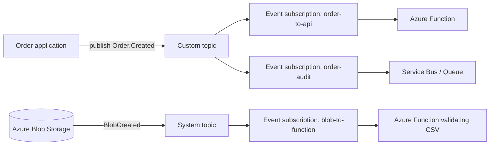
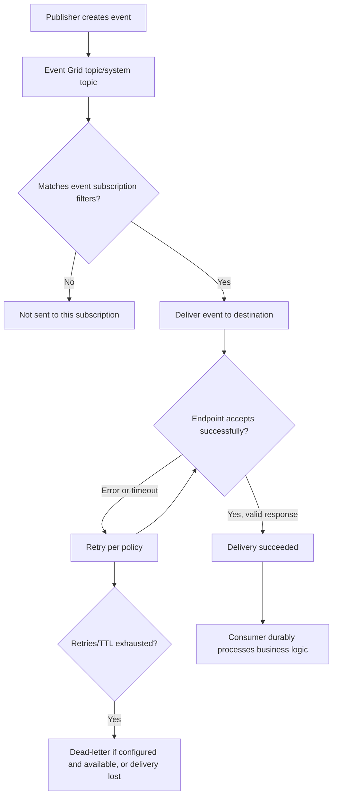
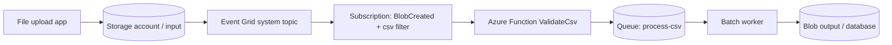
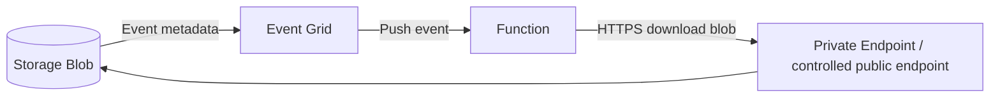
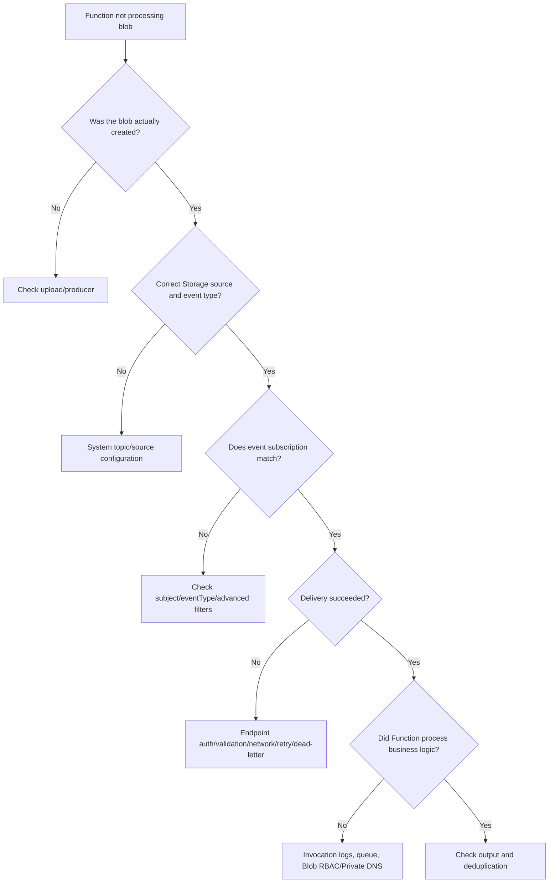
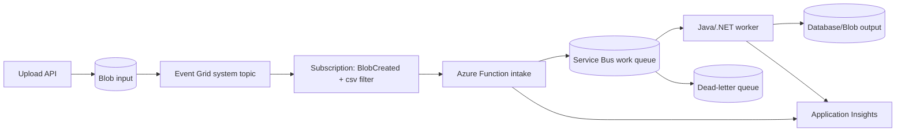

# Event Grid Topic, System Topic, and Subscription

In an *event-driven architecture*, a system emits a notification stating **“an event has occurred”** instead of directly calling every service that needs to know about it. For example, after a customer uploads a CSV file to Azure Blob Storage, the system can trigger an Azure Function to validate the data, send a signal to a processing queue, or update a search index without the upload application calling all those components itself.

**Azure Event Grid** is a managed event routing service on Azure. The three core concepts of this lesson are:

- **Event Grid topic:** the event publishing endpoint. With a *custom topic*, your application actively publishes events according to the configured schema.
- **System topic:** a resource representing the event source emitted by **an Azure service**, such as blob creation events from a Storage Account. Applications do not use a system topic as an arbitrary custom-event publishing endpoint.
- **Event subscription:** a rule connecting **a source topic** to **a receiving endpoint** (*event handler/destination*), optionally with filters, retries, dead-lettering, and delivery settings.

This lesson belongs to the **Events and Streaming Data** chapter of the Microsoft Azure module, service code **CLOUD_PROVIDERS_AZURE**. It connects concepts across subscriptions, resource groups, Microsoft Entra ID, VNet, Azure Functions, Blob Storage, security, monitoring, and cost control. The content focuses on the common **Event Grid Basic / push delivery** flow; capabilities such as **Event Grid namespaces / Standard, MQTT, or pull delivery** use a different resource model and should be evaluated separately during implementation.

> The CLI commands and payloads below are examples for an authorized lab environment, not executed operations. Command names, parameters, and features may vary by Azure CLI version, Azure Event Grid version, and region; verify in your target environment before applying to production.

## Learning Objectives

After this lesson, you will be able to:

1. Explain the difference between **events**, **job messages**, and **event streaming**.
2. Distinguish **custom topics**, **system topics**, and **event subscriptions** in Azure Event Grid.
3. Read **Event Grid event schema** and **CloudEvents v1.0** payloads, identifying ID, type, subject, time, and data.
4. Create a custom topic, publish a sample event, and register a receiving endpoint via Azure Portal/Azure CLI.
5. Create a subscription for an Azure Storage BlobCreated source and understand how system topics can be created or reused by Azure workflows.
6. Design appropriate filters by **event type**, **subject prefix/suffix**, and **advanced filters**.
7. Understand webhook ownership verification (*endpoint validation*) and event delivery mechanisms.
8. Handle **at-least-once delivery**, duplicate events, retries, TTL, dead-lettering, and idempotency.
9. Choose Azure Functions, WebHook, Storage Queue, Service Bus, or Event Hubs as a destination.
10. Secure publishers, subscribers, credentials, networking, and event payloads.
11. Observe publish/match/delivery/error metrics and build a troubleshooting runbook.
12. Design a reliable, cost-monitored event-driven file processing pipeline.

## 1. How Do Events Differ from API Calls and Job Messages?

An **event** describes a change or something that has already happened: `Order.Created`, `Microsoft.Storage.BlobCreated`, `User.Registered`. Events typically carry a small amount of metadata so receivers can decide whether to act.

A **command / job message** requests an action: “Process file X,” “Calculate invoice Y.” It is usually sent via a queue with processing/acknowledgment mechanics, retry management, and guarantees that work is not lost before a worker finishes.

**Event streaming** stores a continuous sequence of events so multiple consumers can read by partition/offset, such as Azure Event Hubs. Event Grid focuses on **routing/distribution** of discrete events rather than replacing a long-term streaming log broker.

| Model | Example | Key considerations |
|---|---|---|
| Direct HTTP call | Upload API calls Thumbnail API | Tight synchronous coupling, timeouts, and availability dependency |
| Event Grid notification | BlobCreated sent to two subscribers | Fan-out, filters, at-least-once delivery, and fast endpoint handling |
| Service Bus work queue | Worker picks up “ProcessBlob” message | Lock/settlement, DLQ, retries, and job coordination |
| Event Hubs stream | Millions of telemetry records | Partitions, consumer groups, offsets, and retention |
| Event Grid + queue | Event Grid puts BlobCreated into a queue; worker processes | Decouples emission rate from processing, prevents overload |

Never put a file of several hundred MB inside an Event Grid payload. Send **an identifier or reference to the data**, then let the worker read it via the Storage SDK with appropriate permissions.

## 2. Topic, System Topic, and Event Subscription: One Sentence Each

**A topic is where events are published. A system topic is an Azure event source represented as an Event Grid resource. An event subscription defines who receives which events and how they are delivered.**



One source can have **multiple event subscriptions**. Each subscription has its own filters and destination. When a topic receives an event, Event Grid evaluates the subscriptions on that source and forwards matching events to each destination.

### Do not confuse three types of “subscription”

| Name | Meaning |
|---|---|
| **Azure subscription** | Billing/governance boundary for Azure resources, with an ID, Azure RBAC, and quotas |
| **Event Grid event subscription** | Resource/rule routing events from a topic/source to a destination |
| **Service Bus topic subscription** | Message subscription queue on a Service Bus topic, with its own message retention/settlement |

They are not interchangeable. An Event Grid subscription can route events into a **Service Bus queue/topic**, but it does not become a Service Bus subscription.

## 3. Custom Topic: The Application as Publisher

A **custom topic** is created when events originate from **your application or a self-managed system** rather than directly from a built-in Azure publisher.

For example, after recording a successful transaction, a Java application emits:

```text
Order.Created
subject: /orders/ORD-1001
data: orderId, tenantId (non-sensitive), eventVersion
```

Different consumers can subscribe independently:

- Billing Service needs to initiate an invoice.
- Analytics Service needs to update metrics.
- Notification Service needs to send an email.
- Audit Service needs to record a business audit trail.

The publisher does not need to know the addresses of all four systems. It only needs **permission to publish to the custom topic** and adherence to the event schema contract.

### When is a custom topic appropriate?

- You control the event-emitting application.
- You want fan-out to multiple independent consumers.
- You do not want to couple publisher lifecycle to downstream HTTP endpoints.
- You want type/subject filtering and managed delivery behavior.
- You accept the **at-least-once** model and design idempotent consumers.

### When is it not appropriate?

- You need to execute a command with a synchronous response within seconds: HTTP/API may fit better.
- You need transactional/message queues with locks, sessions, or workflow dead-lettering: consider Service Bus.
- You need to store high-volume event sequences with offsets/replay: Event Hubs may fit better.
- You need to query business state: Event Grid does not replace a database or search index.

## 4. System Topic: An Azure Service as Publisher

A **system topic** represents an event source produced by an Azure service. A prominent example is an **Azure Storage account** emitting event types such as:

- `Microsoft.Storage.BlobCreated`
- `Microsoft.Storage.BlobDeleted`

Depending on the service, account kind, and features, other event types exist; always verify the exact list of event types supported by the source.

### Differences from a custom topic

| Characteristic | Custom topic | System topic |
|---|---|---|
| Who emits events? | Your application or controlled publisher | Corresponding Azure resource/service |
| Who defines event types? | You and your application contract | Published by the Azure service |
| Can you publish arbitrary events via HTTP? | Yes, with valid permissions and schema | Not used as a custom publisher endpoint |
| What is the source? | Event Grid custom topic resource | Azure resource and provider `topicType` |
| Has event subscriptions? | Yes | Yes |
| Filters and destinations | Yes | Yes |
| Lifecycle | Follows the topic resource | Follows the source and event subscriptions; may be auto-managed on subscription creation |

For example, a user uploads `input/orders-2026-11-20.csv` to Blob Storage. A Storage event is sent to Event Grid, which routes it through an event subscription to an Azure Function.

### How is a system topic created?

Some Azure Portal/CLI workflows allow creating an **explicit system topic**. In many workflows, when subscribing to events directly on an Azure resource (for example from the **Events** blade of a Storage Account), Azure automatically creates or reuses the appropriate system topic.

Therefore, when investigating an existing system, inspect **the Storage account source, the system topic, and the event subscriptions**. Do not create a second system topic simply because events do not appear in Log Analytics yet; the cause may be a filter, endpoint, or subscription state.

## 5. What Does an Event Subscription Actually Contain?

An **event subscription** attached to a topic/source typically includes:

- **Name** and resource scope.
- **Source**: custom topic or system topic/Azure resource.
- **Event types** to receive.
- **Subject filtering**: subject prefix/suffix.
- **Advanced filters**: additional conditions over supported fields.
- **Destination/endpoint**: where Event Grid delivers events.
- **Event delivery schema**: payload format sent to the handler if schema selection is supported.
- **Retry policy**: attempt count / time limits as supported by the service.
- **Dead-letter destination**: location storing undeliverable events, when configured.
- **Identity/authentication**: mechanism Event Grid uses to deliver to the destination.
- **Delivery settings**: batching or other options depending on destination and features.

**An event subscription does not create the consumer application.** Event Grid only handles filtering and delivery as configured; the handler must exist, authenticate properly, and process the payload.

### Example

```text
Source: Azure Storage account storderdemo
Event type: Microsoft.Storage.BlobCreated
Subject begins with: /blobServices/default/containers/input/
Subject ends with: .csv
Destination: Azure Function ValidateCsv
```

Only CSV files under the `input` container fall within the expected filter scope. PNG files in the same account will not be sent to this handler if the filter is configured correctly.

## 6. Data Flow from Publish to Successful Processing



This diagram illustrates the conceptual flow, not every Event Grid retry status code branch. Distinguish:

1. **Publisher sent the event to the topic**.
2. **Event matched a subscription**.
3. **Event Grid delivered successfully to the endpoint**.
4. **Consumer completed business processing**.

Step 3 **does not guarantee step 4** if the endpoint returns HTTP 2xx before work is durably recorded. A reliable design can place the event onto a queue for asynchronous worker processing.

## 7. Event Grid Schema: Core Fields

The classic Event Grid schema typically has these fields:

```json
[
  {
    "id": "evt-order-1001",
    "eventType": "Order.Created",
    "subject": "/orders/ORD-1001",
    "eventTime": "2026-11-20T08:15:00Z",
    "dataVersion": "1.0",
    "data": {
      "orderId": "ORD-1001",
      "reportBlob": "reports/ORD-1001.json"
    }
  }
]
```

### Field meanings

| Field | Purpose |
|---|---|
| `id` | Identifier of an event; useful for deduplication |
| `eventType` | Type of what happened: `Order.Created` |
| `subject` | Categorization of the event subject, e.g., logical path by order |
| `eventTime` | Timestamp when the event occurred, typically UTC ISO 8601 |
| `dataVersion` | Contract version of the `data` payload |
| `data` | Business metadata needed for consumers to act |
| `topic` | Topic/source resource per schema when delivered; population may be managed by Event Grid |
| `metadataVersion` | Schema metadata provided by the platform in delivered payloads as applicable |

For custom topic publishers, the JSON block above illustrates the essential fields commonly used. **Do not populate or depend on `topic`/`metadataVersion` manually if the service manages them**; verify publish requirements and delivery payloads for the chosen schema.

### Designing a good event contract

- `id` is sufficiently stable/unique for consumer deduplication.
- `eventType` has clear meaning and a versioning strategy.
- `subject` follows a consistent structure for filtering.
- `data` is small, avoiding secrets, tokens, or unnecessary personal data.
- Events only announce **that a change happened**, while full state lives in a designated database/Storage.
- Document clearly whether consumers use event time or processing time; the two can diverge significantly.

## 8. CloudEvents v1.0 and Schema Boundaries

**CloudEvents** is a standardized event schema/metadata specification. A CloudEvents event can look like:

```json
{
  "specversion": "1.0",
  "id": "evt-order-1001",
  "source": "/shop/orders",
  "type": "com.example.order.created",
  "subject": "ORD-1001",
  "time": "2026-11-20T08:15:00Z",
  "datacontenttype": "application/json",
  "data": {
    "orderId": "ORD-1001"
  }
}
```

| Event Grid Schema | CloudEvents |
|---|---|
| `eventType` | `type` |
| `eventTime` | `time` |
| `topic` or resource source | `source` |
| `dataVersion` | Versioning typically defined by app in `type`/`data` or extension attributes |
| `data` | `data` |

**Never assume a payload contains both `eventType` and `type` simultaneously.** The topic's input schema and the subscription's delivery schema must be compatible with both producer and consumer.

When using **CloudEvents to a webhook**, endpoint verification works differently from the Event Grid schema. Use a handler/SDK that implements the proper CloudEvents handshake instead of blindly copying classic `SubscriptionValidationEvent` code.

### When to choose CloudEvents?

- Multiple non-Azure systems need to exchange events using a common standard.
- You want a contract portable across multiple event brokers and clouds.
- Consumers already have libraries for handling CloudEvents.

Regardless of the schema chosen, Event Grid does not turn an event into a **transaction** or an always-consistent data snapshot.

## 9. Creating a Custom Topic with Azure CLI

Examples use Bash in Azure Cloud Shell. Resource creation commands may incur charges; execute only in an authorized resource group and region.

### Step 1: confirm the subscription

```bash
az account show --output table
az account set --subscription "<SUBSCRIPTION_ID>"

RG="rg-eventgrid-lab"
LOCATION="southeastasia"
TOPIC="eg-orders-lab"

az group create \
  --name "$RG" \
  --location "$LOCATION"
```

### Step 2: create the topic

```bash
az eventgrid topic create \
  --name "$TOPIC" \
  --resource-group "$RG" \
  --location "$LOCATION"
```

Conditions such as provider registration, SKU/region, and namespace/quota must be checked in the target subscription.

### Step 3: inspect endpoint and resource ID

```bash
TOPIC_ID=$(az eventgrid topic show \
  --name "$TOPIC" \
  --resource-group "$RG" \
  --query id --output tsv)

TOPIC_ENDPOINT=$(az eventgrid topic show \
  --name "$TOPIC" \
  --resource-group "$RG" \
  --query endpoint --output tsv)

az eventgrid topic show \
  --name "$TOPIC" \
  --resource-group "$RG" \
  --query "{name:name,id:id,endpoint:endpoint,provisioningState:provisioningState}" \
  --output json
```

The endpoint alone is not enough to publish: the publisher also needs **the authentication mechanism and permissions supported by the topic**. The endpoint URL is not a secret, but accompanying keys/tokens must be protected.

### Is the topic name a DNS name?

The Azure Event Grid topic name contributes to the endpoint, but you should not guess and concatenate the endpoint string from the name. Always retrieve `endpoint` directly from the resource to avoid wrong hosts and routing errors.

## 10. Publishing a Sample Event to a Custom Topic

### Step 1: create event.json in a lab environment

Content following the Event Grid event schema:

```json
[
  {
    "id": "evt-order-1001",
    "subject": "/orders/ORD-1001",
    "eventType": "Order.Created",
    "eventTime": "2026-11-20T08:15:00Z",
    "dataVersion": "1.0",
    "data": {
      "orderId": "ORD-1001",
      "source": "lab"
    }
  }
]
```

This is an **event notification**, not a direct “process order” command sent to a worker. `eventTime` is an example timestamp and need not match the publish request time for schema illustration; in a real application, set the exact time the event occurred.

### Step 2: authenticate to publish

Custom topics support suitable authentication mechanisms such as **access keys/SAS** or **Microsoft Entra ID with a data sender role**, depending on configuration/features used. For a simple lab using an access key, **never copy keys into documentation or publicly saved command lines**.

The Bash example below prompts for the key in an interactive terminal:

```bash
# Type the key in an interactive terminal; do not commit to Git.
read -r -s -p "Event Grid topic key: " TOPIC_KEY
echo

curl --fail-with-body -sS \
  -X POST "$TOPIC_ENDPOINT" \
  -H "Content-Type: application/json" \
  -H "aeg-sas-key: $TOPIC_KEY" \
  --data-binary @event.json

unset TOPIC_KEY
```

`curl --fail-with-body` requires a recent version of curl; on older environments, use `curl -i` and inspect the HTTP status separately. **Do not run `curl` without verifying that the endpoint and key variables point to the right lab topic**. A successful publish means Event Grid **accepted the event**; it does not prove a subscriber exists, a filter matched, or business processing succeeded.

### Production should not rely on manual keys

Where SDK/API and topic configuration support it, prefer **Microsoft Entra ID with managed identity / service principal** and least-privilege publish permissions instead of sharing access keys broadly. Azure RBAC resource management and data-plane publishing may use different roles; verify the exact scope/role for your topic model.

If access keys are still required, store them in Key Vault or an approved secret store with a rotation process.

## 11. Creating an Event Subscription for a Custom Topic

An event subscription needs a real destination. For a **Webhook**, the endpoint must be an HTTPS service able to receive requests and complete **subscription validation** before events can be delivered.

### Creating in the Portal

1. Open the Event Grid custom topic `eg-orders-lab`.
2. Select **Event Subscriptions → + Event Subscription**.
3. Name it something like `orders-to-webhook`.
4. Select the event types to receive, e.g., `Order.Created` if listed or per custom type configuration.
5. Choose **Endpoint Type = Web Hook**, and enter the HTTPS URL of an approved receiver service.
6. Configure **subject begins with** = `/orders/`.
7. Configure retries, dead-lettering, and delivery authentication if needed.
8. Create and verify validation/registration status.

### Illustrative CLI

```bash
WEBHOOK_URL="https://<VERIFIED_HTTPS_HOST>/webhooks/eventgrid"

az eventgrid event-subscription create \
  --name orders-to-webhook \
  --source-resource-id "$TOPIC_ID" \
  --endpoint-type webhook \
  --endpoint "$WEBHOOK_URL" \
  --included-event-types Order.Created \
  --subject-begins-with "/orders/"
```

Before running, the endpoint must exist and support the validation flow. When using an **Azure Function with an Event Grid trigger**, a safer way to create the subscription is usually choosing **Endpoint Type = Azure Function** in the Portal so the platform uses the proper trigger endpoint and credentials; **do not paste an arbitrary Function webhook URL** without verifying the extension and auth setup.

### Why can a topic still accept publishes with no subscribers?

Publishers and subscribers are decoupled. Event Grid can validly accept an event even when **no active event subscription** matches it. That is why you must inspect **publish metrics**, **matched events**, **delivery metrics**, and handler outcomes together.

## 12. How Does Webhook Endpoint Validation Work?

Event Grid needs to verify you control the endpoint before delivering events to a webhook. With the **Event Grid Schema**, Event Grid can send an event of type:

```text
Microsoft.EventGrid.SubscriptionValidationEvent
```

Illustrative payload:

```json
[
  {
    "id": "validation-event-1",
    "eventType": "Microsoft.EventGrid.SubscriptionValidationEvent",
    "subject": "",
    "eventTime": "2026-11-20T08:16:00Z",
    "dataVersion": "1",
    "data": {
      "validationCode": "sample-code",
      "validationUrl": "https://<VALIDATION_URL>"
    }
  }
]
```

The webhook endpoint receives the validation event and can return an appropriate JSON response:

```json
{
  "validationResponse": "sample-code"
}
```

**The value must match the actual `data.validationCode`**, not the sample string. Some workflows support manual validation via the URL with its own expiration window.

### Common validation failures

- URL does not use HTTPS or has an invalid TLS certificate.
- Endpoint returns 401/403 because auth/allowlist is not configured to accept validation.
- Endpoint returns 404 due to a wrong route.
- Endpoint only handles `Order.Created` and ignores validation events.
- Handler returns 200 without a valid `validationResponse` when validation requires it.
- Endpoint times out or redirects to a login page.
- Using CloudEvents while implementing the Event Grid Schema handshake.

**Validation only proves endpoint ownership; it does not replace authentication/authorization for individual event deliveries.** Production requires proper authentication and event-origin verification.

## 13. System Topic from Azure Blob Storage

Suppose an organization has a Storage account and an `input` container. Whenever a new blob is created as emitted by Storage, Event Grid can deliver `Microsoft.Storage.BlobCreated` to subscribers.

### Architecture



This is a conceptual diagram. Azure Storage stores the **actual file**, Event Grid only sends **event metadata**, the Function validates and converts it into a **work message**, and a batch worker processes it later. This avoids keeping a webhook waiting on a long data transformation.

### Creating from the Portal

1. Open the **Storage account** in the right subscription/resource group.
2. Select **Events** or the Event Grid experience provided in the Portal.
3. Click **+ Event Subscription**.
4. Select event type `Microsoft.Storage.BlobCreated`.
5. Set filters by container/path and file extension.
6. Select an Azure Function or another supported destination endpoint.
7. Configure delivery, retries, and dead-lettering as needed.
8. Create and verify the associated system topic and event subscription resource.

When creating a subscription on an Azure resource, Azure can manage creating/reusing the **system topic**. Do not assume you must manually create both a system topic and a separate subscription; avoid duplicate subscriptions that trigger double file processing.

### Creating a system topic explicitly via CLI

For an existing Storage account, first retrieve its resource ID:

```bash
STORAGE_ID=$(az storage account show \
  --resource-group "<STORAGE_RESOURCE_GROUP>" \
  --name "<STORAGE_ACCOUNT_NAME>" \
  --query id --output tsv)

STORAGE_LOCATION=$(az storage account show \
  --resource-group "<STORAGE_RESOURCE_GROUP>" \
  --name "<STORAGE_ACCOUNT_NAME>" \
  --query location --output tsv)

az eventgrid system-topic create \
  --resource-group "$RG" \
  --name "eg-storage-events-lab" \
  --location "$STORAGE_LOCATION" \
  --topic-type "Microsoft.Storage.StorageAccounts" \
  --source "$STORAGE_ID"
```

This example uses the common Storage account source type. For other sources, `topic-type` and region requirements may differ. Before creating, verify the source supports Event Grid and whether a matching system topic already exists.

### Creating a subscription from the source resource

A common deployment pattern references the **source resource ID** when creating an event subscription:

```bash
az eventgrid event-subscription create \
  --name blob-created-to-webhook \
  --source-resource-id "$STORAGE_ID" \
  --endpoint-type webhook \
  --endpoint "https://<VERIFIED_HTTPS_HOST>/webhooks/blob" \
  --included-event-types Microsoft.Storage.BlobCreated \
  --subject-begins-with "/blobServices/default/containers/input/" \
  --subject-ends-with ".csv"
```

This command illustrates **one way to subscribe** to a Storage source; do not create multiple subscriptions pointing to the same endpoint simultaneously unless duplicate processing is intentional. Depending on CLI version and how system topics are managed, there may be a dedicated `az eventgrid system-topic event-subscription ...` command group; check `--help` in your target environment.

## 14. Understanding Subject and Filtering by Container/Extension

A BlobCreated payload typically has a subject like:

```text
/blobServices/default/containers/input/blobs/orders/2026-11-20.csv
```

When configured with:

```text
subject begins with: /blobServices/default/containers/input/
subject ends with: .csv
event type: Microsoft.Storage.BlobCreated
```

the subscription only matches events satisfying **all relevant conditions** according to how the filters are configured.

### Common pitfalls

| Goal | Right direction | Common mistake |
|---|---|---|
| Only files in `input` container | Prefix includes exact container path | Using `/input/` prefix which does not match actual subject |
| Only CSV files | `subjectEndsWith=.csv` | Some producers generate paths without matching extension |
| Only blob creation events | Included event type `Microsoft.Storage.BlobCreated` | Subscribing to all types and mistakenly processing deletes |
| Only logical `orders/` folder | Prefix includes `.../blobs/orders/` | Thinking folders are separate resources in a flat namespace |
| Case-insensitive matching | Check case-matching option | Assuming Event Grid is always case-insensitive |

**Subject is event metadata**, not necessarily the full Blob URL. With Storage, file paths may be encoded or sources may have schema variations. Before finalizing production filters, capture **one real event payload** in staging to confirm exact subject and data fields.

### Advanced filters

Event Grid can support additional matching operators on event fields and `data`, depending on schema/features, such as:

- String begins with / ends with.
- String contains / equals / not equals.
- Numeric greater/less or range per supported filter operators.
- Boolean equals.
- Certain array-related matching where supported.

Do not treat an advanced filter as an arbitrary SQL query over file contents. To inspect CSV rows and decide based on internal columns, the consumer must still access Blob Storage and parse the data.

## 15. Choosing a Destination: Azure Function, Webhook, or Queue?

| Destination | When appropriate | Conditions and risks |
|---|---|---|
| **Azure Function Event Grid trigger** | Short event processing, tight Azure Functions integration | Auth/extension, runtime, and execution duration |
| **HTTPS Webhook** | Any HTTP application with an event receiver endpoint | Endpoint validation, HTTPS/auth, and fast response |
| **Azure Storage Queue** | Turning events into jobs for another worker | RBAC/destination auth, message schema, poison/retries |
| **Azure Service Bus** | Workflows needing a message broker, DLQ, settlement, and load leveling | Queue/topic permissions, TTL, locks, and idempotency |
| **Azure Event Hubs** | Forwarding events into streaming/analytics pipelines | Partitions, consumer groups, throughput, and checkpoints |
| **Logic Apps** | Integration/automation workflows with connectors | Action costs, flow management, and auth |

Choose based on business needs:

- Handler only needs to log briefly and return immediately: Azure Function Event Grid trigger may suffice.
- Handler needs 15 minutes to process a file: **Event Grid → Queue → worker** reduces webhook timeout risk.
- Multiple independent consumers care about the same event: create **multiple subscriptions** with separate filters.
- Need to retain events for offset-based consumer replay: evaluate Event Hubs instead of treating an Event Grid topic as a long-term stream.

### Event Grid is not an application scheduler

Event Grid decides when to **deliver notifications**; running long jobs, managing checkpoints, transactions, and business retries are the responsibility of the consumer or an orchestration/messaging system such as Service Bus or Durable Functions.

## 16. Java Azure Function Receiving an Event Grid Event

Example using Java Azure Functions with an **Event Grid trigger**. This Function only reads event metadata and writes minimal logs; real CSV processing must extend this into an idempotent job rather than stopping at logging.

```java
package vn.example.events;

import com.microsoft.azure.functions.ExecutionContext;
import com.microsoft.azure.functions.annotation.EventGridTrigger;
import com.microsoft.azure.functions.annotation.FunctionName;

public class BlobEventHandler {

    @FunctionName("OnBlobCreated")
    public void onEvent(
            @EventGridTrigger(name = "event")
            String event,
            final ExecutionContext context) {

        // Lab: do not print the full payload because event.data may
        // contain URLs, filenames, or sensitive metadata.
        context.getLogger().info(
            "event=eventgrid_received"
            + " invocationId=" + context.getInvocationId()
            + " payloadLength="
            + (event == null ? 0 : event.length())
        );

        // Production:
        // 1. Parse JSON according to the chosen schema.
        // 2. Verify eventType/type, subject, and input metadata.
        // 3. Use event ID + source as the dedup key.
        // 4. Write the work item to a durable queue/database.
        // 5. Return success only after job intake has committed.
    }
}
```

Notes:

- Requires a **compatible** Java Azure Functions project, dependencies, Event Grid extension bundle/extension, and runtime. This is a sample class snippet, not a complete standalone buildable project.
- If the subscription is created from the Azure Portal with **Endpoint Type = Azure Function**, the platform and Event Grid extension handle trigger/validation mechanisms per supported configuration.
- Never log raw JSON containing personal data.
- A Function invocation can succeed even when **no business output was produced**, so you must persist the work item and verify downstream outcomes.
- When parsing Event Grid Schema, look for `eventType`; with CloudEvents Schema, look for `type`. Never assume a single parser works identically across all delivery schemas.

### Handlers must be fast and idempotent

If file processing can take a long time, the handler should:

1. Parse, validate the schema, and extract the event ID.
2. Check deduplication policy in a durable store or use an idempotent sink.
3. Enqueue a processing command with a unique key.
4. Return success only after enqueueing is confirmed by the system.
5. Have the worker perform the real work with retries and checkpointing.

**Be careful with deduplicating before enqueueing:** if you mark an event “processed” and the process crashes before enqueueing, the job can be lost. Use a transaction/outbox pattern, or explicit `Received/Enqueued/Completed` states with reconciliation.

## 17. Webhook Validation Is Not Delivery Security

For self-hosted webhooks, validation proves you control a URL, but it does not verify that every incoming HTTP request originates from a trusted source.

### Protection layers

- **HTTPS/TLS** with valid certificates.
- Webhook authentication/authorization using Event Grid supported mechanisms, such as **Microsoft Entra authentication** when supported by destination and features.
- Grant permissions only to approved sender identities/scopes.
- Validate event schema/type/source, size, format, and ID.
- Manage ingress/network restrictions compatible with how Event Grid delivers push requests.
- Never expose function keys or secrets in URLs or logs.
- Enforce resource/timeout limits and never let arbitrary requests run internal commands.

### Do not block Event Grid unintentionally

A webhook that only accepts requests from a private VNet or always redirects to a login page may fail to receive push deliveries under the chosen architecture. For private networking requirements, evaluate **integrated destinations, supported service endpoint/network models, or an intermediate queue** rather than assuming Event Grid can reach any private IP.

Security must satisfy two conditions simultaneously: **proper authorization** and **valid network path**. Opening a public endpoint to all sources for a quick test and forgetting to lock it down is a production risk.

## 18. At-Least-Once Delivery and Event Ordering

Event Grid is designed for **at-least-once** delivery within retry/TTL and service conditions: once an event is accepted for delivery, consumers **may receive the same event multiple times**. Event Grid **does not guarantee event ordering** in all scenarios.

### Duplicate example

```text
T0: Storage emits BlobCreated id=evt-1001
T1: Event Grid invokes Function
T2: Function writes output successfully
T3: HTTP response/ack is lost or treated as a timeout
T4: Event Grid retries sending evt-1001
T5: Function risks writing output a second time
```

The fix is not “disable retries,” but designing an **idempotent consumer**.

### Deduplication keys

A common key combines:

```text
source/resource + eventId
```

For business events that may have multiple versions or operations, you may need:

```text
eventType + source + eventId
```

The actual key must follow the publisher's ID convention and uniqueness scope. If a bug causes a publisher to emit two distinct events with the same ID, consumer deduplication will drop an event.

### Idempotent outputs

- Insert database records with a **unique constraint** on event ID or business operation ID.
- Use conditional create / ETag on Blob Storage to avoid overwriting or duplicating files.
- Use clear processing state transitions with transaction/outbox patterns.
- For payments, use an **idempotency key** verified by the gateway/transaction store.
- For emails, persist send state and handle races; never treat calling an email API once as a guarantee of single delivery.

**Do not assume at-least-once means an event is guaranteed to reach its destination forever.** When TTL/retries expire, an endpoint stays broken for too long, or dead-lettering is misconfigured, delivery attempts may stop.

## 19. Retry, TTL, Batching, and Handler Responses

Event Grid can retry failed deliveries according to its **retry policy** and destination type. Settings to review:

- **Maximum delivery attempts**.
- **Event time-to-live (TTL)** or delivery expiration window.
- Service-specific handling of error status codes and timeouts.
- **Batching** where supported to bundle multiple events in one delivery.
- **Dead-lettering** when delivery fails.

Never hardcode fixed attempt counts or backoff intervals across all topics/plans: inspect the configured values and limits shown in the portal/API for your environment.

### What responses are safe?

For an event-receiving webhook:

- Return **HTTP 2xx** only after the payload is validated and **the work to preserve has been durably stored** or processing has actually finished.
- If the backend temporarily fails to persist the work item, return an appropriate error so the delivery policy can handle it.
- Never hold a single webhook request open for tens of minutes to run a large batch.
- Control timeouts and concurrency to prevent retry storms when downstream degrades.
- Distinguish retryable errors from permanent errors; specific HTTP status codes can trigger different behaviors depending on the Event Grid destination.

### Batching

If batching is enabled and the endpoint receives an **array of multiple events**, your code cannot parse only one event and ignore the rest. Returning a single 2xx for the entire batch may tell Event Grid the whole delivery succeeded. Therefore, define batch handling rules, how failed individual events are quarantined, and ensure accepted events are persisted.

## 20. Dead-Letter Destination: Do Not Let Failed Events Disappear

If Event Grid cannot deliver an event under its policy, you can configure **dead-lettering** to an Azure Storage Blob container (as supported by the service/endpoint). The goal is to preserve metadata/payloads for investigation and reprocessing.

### Why is dead-lettering needed?

- Webhook returns 503 for hours.
- Receiver was deleted or its URL changed.
- Network path or delivery permissions broke.
- Events consistently fail consumer validation.
- Event retries exhausted the policy or exceeded TTL.

### Configuration checks

1. Authorized destination Storage account/container.
2. Identity and **write permissions to the dead-letter location** matching the configured mechanism.
3. Storage firewall/network rules allow dead-letter writes per supported architecture.
4. Retention, encryption, monitoring, and who is permitted to read failed event data.
5. Alerts on dead-lettered events and a re-drive runbook.
6. Storage costs and lifecycle cleanup.

**Do not confuse Event Grid dead-letter blobs with a Service Bus dead-letter queue or Storage Queue poison queue**; they have different formats and reprocessing procedures.

### Reprocessing after an incident

- Triage the root cause before re-driving.
- Verify payload and event schema of the dead-lettered file.
- Use an approved re-drive publisher/process; never push directly to a production handler using a leaked script key.
- Preserve event ID/correlation and respect idempotency.
- Track reprocessing status so the same event is not injected into the pipeline multiple times.
- Verify the final business output.

Having no dead-letter configuration or having a broken dead-letter Storage location means **you cannot assume a copy of the event remains after TTL expires**.

## 21. Authentication, Authorization, and Secrets

Permissions for **publishers**, **topic administrators**, and **destinations** are three separate scopes to review.

| Logical role | Permission needs |
|---|---|
| Application publisher | Publish events to the specific custom topic |
| Topic administrator | Create/configure topics and event subscriptions |
| Event subscription creator | Subscribe to event sources and destinations, holding proper permissions on both sides |
| Event Grid delivery identity | Deliver events to destinations via supported mechanisms |
| Receiver Azure Function/worker | Write output data, read Blobs, or call downstream services |
| Security/auditor | Read metrics, configuration, and logs within required scope |

### Managing custom topic keys

- Never commit access keys or SAS tokens to Git.
- Never place keys directly in URLs, tickets, or CI logs.
- Store secrets in Key Vault or an approved secret manager.
- Rotate keys with a zero-downtime plan for publishers.
- Where supported, prefer managed identity and Microsoft Entra authorization with least-privilege data sender roles.

### Azure RBAC differs from data permissions

An account with permission to view an Event Grid resource in the Portal does not necessarily have permission to **publish** or change destinations. Similarly, an Azure Function receiving events does not automatically have permission to read input Blobs; it needs **Storage Blob Data Reader** or an appropriate data role plus a valid network path.

### Protecting payloads and telemetry

Events may be stored in retry queues, history, diagnostics, or dead-letter blobs depending on service settings. Never place **client secrets, access tokens, connection strings, card details, or health data** inside event `data`.

## 22. Event Grid with Azure Storage, Private Endpoint, and DNS

In a file-processing architecture, there are at least two distinct network paths:

1. **Event Grid delivering events to the handler**.
2. **Handler/worker reading Blob Storage or writing outputs**.

Even when event delivery succeeds, an Azure Function can still encounter Storage 403 or timeouts when downloading the file. Causes can be RBAC, Storage firewall, VNet Integration, Private Endpoint, DNS, or NSG/UDR.

### Separating the paths



### Questions to verify

- Does the Function have a **managed identity** and the right data-plane role to read Blobs?
- Does the Storage account disable public network access?
- Does the Function hosting plan support VNet Integration as designed?
- Is the Private DNS zone `privatelink.blob.core.windows.net` properly linked/forwarded from the Function?
- Do routes/NSGs/firewalls allow outbound HTTPS to the Blob endpoint?
- Is there confusion between the **Event Grid webhook endpoint** and the **Azure Storage private endpoint**?

Never use a **Storage account key** as a blanket workaround for firewall errors; valid credentials cannot bypass network restrictions.

## 23. Monitoring and Correlation: Publish Differs from Delivery

Event Grid must be monitored across multiple layers.

| Signal | Operational question |
|---|---|
| **Publish attempts/success/failure** | Can the publisher send events to the topic? |
| **Matched/unmatched events** | Do subscription filters match the expected events? |
| **Delivery succeeded/failed** | Is the destination responding properly? |
| **Delivery attempts/retries** | Is the endpoint timing out, returning 5xx, or failing authentication? |
| **Dead-lettered events** | How many undeliverable events require investigation? |
| **Receiver invocation failure** | Is the handler failing in code or on dependencies? |
| **Queue backlog/age** | Are workers keeping up with the event rate? |
| **Business completion** | Was the final file/report produced accurately? |

Metric names, dimensions, and access methods depend on the Event Grid resource, Azure Monitor API, and current version. **Do not guess CLI metric names**; inspect metric definitions from the target resource.

### Viewing Metrics in the Portal

1. Open the source Event Grid topic/system topic/subscription.
2. Select **Metrics** or Azure Monitor metrics.
3. Choose a UTC time window covering your test events.
4. Inspect publish, matched, delivery, failure, or dead-letter metrics as supported.
5. If metrics have dimensions by event subscription, filter to the specific subscriber.
6. Cross-check with Application Insights / Function invocation logs.

### Read-only Azure CLI

```bash
az monitor metrics list-definitions \
  --resource "$TOPIC_ID" \
  --output table
```

Then query actual metrics using names from that output rather than guessing. System topics / source resources have a different scope from custom topics, so pass the exact resource ID.

### Correlation ID

A useful log entry includes:

```text
eventgridEventId=evt-order-1001
eventType=Order.Created
subject=/orders/ORD-1001
receiverInvocationId=inv-42
processingJobId=job-91
result=Enqueued
```

To trace an event, follow the sequence:

**publisher event ID → matching subscription → delivery attempt → receiver invocation → queued job → business output**.

## 24. Diagnostic Settings, Application Insights, and History Retention

Azure Monitor metrics show volume and error rates, while logs and traces provide details once an appropriate pipeline is enabled.

### Diagnostic settings

You can route diagnostic logs of an Event Grid resource to a supported destination such as a **Log Analytics workspace, Storage account, or Event Hubs**, depending on features, categories, and resource type.

Delivery/publish failure logs can provide details on event subscription, timestamp, endpoint, and outcome. However, **do not assume every log category exists for every topic/region**. Check the category list shown in the Portal before writing queries.

### App Insights on the receiver

If the destination is an Azure Function, **Application Insights** can provide:

- Function invocation counts and exceptions.
- Request/trigger telemetry per runtime.
- Outbound Blob/SQL/HTTP dependency durations where instrumentation is supported.
- Trace/correlation IDs and Java/.NET/Node logs.

Do not confuse **Event Grid delivery success** with **Function business success**. If Event Grid delivered successfully to the Functions endpoint but the Function failed business logic afterward, consumer-side retry/queue/telemetry mechanisms are needed.

### Illustrative KQL in receiver workspace

If workspace-based Application Insights has the `AppTraces` table:

```kusto
AppTraces
| where TimeGenerated > ago(1h)
| where Message contains "eventgrid_received"
| project TimeGenerated, Message, OperationId, AppRoleName
| order by TimeGenerated desc
```

If exceptions occur:

```kusto
AppExceptions
| where TimeGenerated > ago(1h)
| summarize Errors = count() by Type
| top 20 by Errors desc
```

Table and column names depend on the telemetry pipeline; classic Application Insights may use `traces` and `exceptions` with different column names. If a query returns empty, verify connection strings, sampling, time range, and schema before concluding events were not sent.

## 25. Diagnostic Flowchart: “BlobCreated Never Reaches Function”



### Detailed Runbook

1. **Data source:** verify blob existence, creation timestamp, container, path, account, and region.
2. **System topic:** verify the topic/source resource is correct and active.
3. **Event subscription:** inspect `BlobCreated` event type, subject begins/ends, and advanced filters.
4. **Validation:** if using a Webhook, did endpoint validation succeed?
5. **Delivery:** inspect Metrics/diagnostic logs on the source/subscription; are there HTTP errors, timeouts, or dead-lettered events?
6. **Function runtime:** check function indexing, Event Grid trigger extension, identity, auth, and Application Insights.
7. **Dependencies:** if the Function ran but failed to download the blob, inspect RBAC, Storage firewall, and DNS.
8. **Business output:** verify final file/record and idempotency; do not stop at a `received` log.
9. **Retries:** check for duplicate events or parallel retries during recovery.
10. **Remediation:** fix the failing layer, perform controlled replay/re-drive, and write an RCA.

Never resolve incidents by opening a Storage account to the Internet, disabling Function auth, sharing topic keys, or deleting a system topic before finding the root cause.

## 26. Common Issues

| Symptom | Likely cause | How to verify |
|---|---|---|
| Publisher receives 401/403 on publish | Wrong topic key/token/RBAC | Verify endpoint, publisher credential, role/scope |
| Publish returns 400 Bad Request | Invalid event schema, missing field, or malformed payload | Validate JSON/schema/size |
| Publish succeeds but subscriber receives nothing | No matching event subscription, endpoint failing | Matched events, filters, delivery metrics |
| Webhook subscription stays inactive | Validation handshake failed | HTTPS, certificate, 2xx, validationResponse |
| Custom event fails filter | Wrong event type or subject prefix/suffix/case | Compare actual payload against filter |
| System topic emits no events | Azure source did not emit corresponding event or wrong resource subscribed | Storage operations, supported event types |
| Duplicate deliveries | At-least-once delivery, response timeout, or retries | Event ID, delivery attempts, dedup store |
| Events arrive out of order | No ordering guarantee | Sequence/version, business logic |
| Webhook repeatedly returns 503 | Receiver overloaded, code bug, or slow downstream | Handler logs, latency, queue, autoscale |
| Events land in dead-letter | TTL/attempts exhausted or undeliverable | Destination settings, dead-letter blobs, alerts |
| Dead-letter shows no data | Not enabled or dead-letter endpoint/permission broken | Config and identity/storage logs |
| Function receives event but cannot read Blob | Missing data-plane RBAC, firewall, or wrong DNS | App Insights, VNet/Private Endpoint |
| Azure Function shows no trigger | Incompatible extension/binding/deployment | Function list, startup logs, endpoint type |
| Event handler returns 200 but job is lost | Acked before persisting/queueing | Outbox/transactions and output checks |
| Multiple replicas write duplicate reports | Non-idempotent consumer | Unique key / conditional write |
| Rising costs | High publish/delivery volume, retries, Log Analytics, storage | Cost Management and metrics |

### Layered Troubleshooting Approach

Do not just ask “Is Event Grid working?” Ask in order:

**Did the source emit the event? → Did the topic accept the event? → Did the subscription match? → Did delivery reach the endpoint? → Did the consumer persist the job? → Did business work finish?**

Each step has its own verification method and owner.

## 27. Production Design: Event-Driven CSV Processing

### Problem Statement

An application lets customers upload order files. A single CSV file can be several GB and take minutes to process; requirements include zero data loss, zero duplicate processing, and alerting on failures.

### Proposed Architecture



### Layer Responsibilities

| Layer | Responsibility | What to observe |
|---|---|---|
| Upload API | Upload file and confirm upload completion | Blob path/version, upload status |
| Storage | Store file durably | Blob existence, version/ETag |
| System topic | Receive events from Storage service | Matched/published events |
| Event subscription | Filter and deliver BlobCreated | Delivery/retries/dead-letter |
| Intake Function | Validate metadata, deduplicate, and enqueue | Invocation ID, event ID, queue send result |
| Work queue | Hold messages until workers process them | Queue depth, age, DLQ |
| Worker | Stream CSV, validate, transform, write output | Checkpoint, records, errors, duration |
| Output store | Persist reports durably | Unique business key, checksum/manifest |

### Avoiding processing incomplete files

Do not assume every upload system emits an event after a large file completes in the exact same pattern. Explicitly design:

- How uploads commit a blob or publish a `ready` marker file.
- Using Blob version/ETag as the exact input reference.
- Using a manifest file for multi-file batches if needed.
- Enqueueing only after input readiness conditions are verified.
- Verifying version/ETag remains unchanged when the worker reads, if consistency is required.

### End-of-pipeline idempotency

For example, use a business key:

```text
storageAccount + container + blobName + blobVersionId
```

When Blob Storage events include version/ETag, deduplication design must match the fields actually present in the event and system contract. If a new version is uploaded to the same blob path, it must not be treated as a duplicate of the old version.

### Why not process CSV directly inside the webhook?

A multi-GB file can cause the HTTP handler to time out, retries cause duplicate processing, and scaling becomes unpredictable. When the handler only receives the event and enqueues it, long-running work shifts to workers with proper checkpointing, visibility, and locking.

## 28. Cost, Limits, and Operational Responsibility

Azure Event Grid incurs charges based on resource/tier type, number of operations/events/deliveries, or applicable features, with unit prices varying by region and time. Related costs typically include:

- Custom/system topics and publish/delivery operations per the active pricing model.
- Event subscriptions/filters and event transmission operations.
- Retries/failed deliveries or other billable components per pricing schedule.
- Azure Functions executions and hosting plan.
- Storage Queue / Service Bus / Event Hubs if used as destinations.
- Blob Storage input/output and dead-letter retention.
- Log Analytics ingestion/retention, Application Insights, and alerts.
- Networking such as Private Endpoint, Firewall, NAT, or data transfer where applicable.

### Reducing cost without sacrificing safety

1. Filter events early by event type/subject to cut unnecessary consumer traffic.
2. Pass IDs/references instead of large payloads.
3. Never leave endpoints perpetually returning 503, causing endless retry attempts and log floods.
4. Limit concurrency/rate and use queues to absorb bursts.
5. Set retention and dead-letter lifecycles according to audit requirements.
6. Use metrics/alerts to catch volume and failure anomalies.
7. Apply `owner`, `environment`, `service`, and `costCenter` tags where policy supports them.
8. Clean up unused subscriptions and obsolete destinations through change management.
9. Check official pricing documentation at deployment time; do not rely on static figures in study materials.

### Technical limits

- Event payloads have size limits per service/tier.
- Event delivery has attempt/TTL limits.
- Each topic/subscription has quotas and filter/endpoint constraints.
- HTTPS webhooks must satisfy validation and authentication.
- Azure Resource Manager/RBAC, Storage firewalls, and region availability may constrain design.
- In multi-subscriber architectures, each consumer has different SLAs and throughput capacities.

Never conclude an event subscription has “unlimited throughput” merely because it is a managed service.

## 29. Hands-On Synthesis: Two Types of Event Sources

This lab is split into two independent parts to clearly contrast custom topics and system topics. You may complete just one part if your lab subscription limits resource creation.

### Part A — Custom topic publishing `Order.Created`

**Step 1:** select your lab subscription/resource group and create custom topic `eg-orders-lab` per section 9.

**Step 2:** prepare an authorized HTTPS receiver supporting Event Grid Schema subscription validation. If using an Azure Functions Event Grid trigger, select the integrated endpoint from the Azure Portal.

**Step 3:** create event subscription `orders-to-webhook` with `--subject-begins-with "/orders/"`.

**Step 4:** create `event.json` per section 10 and publish via curl using a safely entered lab key, or use an SDK publisher with managed identity.

**Step 5:** verify in Event Grid metrics:

- Did the publish request succeed?
- Did the event match the subscription?
- Did delivery to the endpoint succeed?
- Did the receiver log/commit handling of the event?

**Step 6:** test an event with `subject=/customers/CUST-1001` while the subscription only accepts `/orders/`. Expect the publisher to succeed in publishing, while the event **does not match** the orders subscription.

### Part B — System topic receiving BlobCreated

**Step 1:** prepare a Storage account / `input` container and an Azure Function Event Grid trigger or validated HTTPS receiver.

**Step 2:** from Storage account → Events, create a subscription for `Microsoft.Storage.BlobCreated`.

**Step 3:** set the container prefix filter and `.csv` suffix filter.

**Step 4:** upload two lab files:

```text
input/orders-001.csv
input/photo-001.png
```

**Step 5:** verify the CSV event is matched/delivered, while the PNG does not reach the CSV subscription when filters are set properly.

**Step 6:** in the Function, inspect event metadata and idempotency handling. Do not upload real files containing personal data into the lab.

**Step 7:** simulate a controlled endpoint failure in staging (e.g., temporarily stopping the receiver) to observe delivery failures/retries per policy. Never intentionally disrupt production or delete a Function receiving live events.

**Step 8:** configure dead-lettering if needed and verify backend Storage permissions. Do not assume events appear in dead-letter immediately; timing depends on retries and TTL.

### Expected Evidence

| Check | Expected outcome |
|---|---|
| Custom topic exists | Has endpoint/topic ID and provisioned state |
| Sample event publish | Event Grid accepts valid payload |
| Subscription validation | Endpoint is confirmed and ready to receive events |
| Subject filter | `/orders/` matches, `/customers/` does not match |
| Storage BlobCreated | Event emitted from Azure Storage source |
| Suffix filter | CSV matches, PNG does not match if actual subject fits |
| Receiver | Event ID/correlation ID present and data ingested accurately |
| Retry/dedup | No duplicate business output when event is redelivered |
| Metrics | Publish/match/delivery metrics visible on configured source |
| Lab cleanup | No shared-environment resources or files deleted |

### Safe cleanup

Verify which event subscriptions, topics, Functions, Storage accounts, queues, and dead-letter resources belong **exclusively to the lab** before deleting. Never delete a source system topic serving other subscriptions. If deleting a lab resource group, confirm it holds no resources used by other teams.

## 30. Production Deployment Checklist

- [ ] Selected Event Grid appropriately instead of confusing it with Service Bus or Event Hubs.
- [ ] Identified custom topic vs. Azure system topic source, schema, and ownership.
- [ ] Defined an event contract with ID, type, subject, time, version, and small data payload.
- [ ] Excluded credentials, PII, and large raw files from event payloads.
- [ ] Configured Event subscription with correct source, event types, and subject filters.
- [ ] Tested case sensitivity and advanced filters against real payloads.
- [ ] Completed endpoint validation for the active schema and destination.
- [ ] Secured HTTPS webhooks with authentication, authorization, and safe logging.
- [ ] Configured publishers with least-privilege managed identity/RBAC or key rotation.
- [ ] Granted delivery identity access to the destination per supported mechanism.
- [ ] Handler returns success only after durably persisting work.
- [ ] Implemented consumer idempotency, retry budget, and duplicate/out-of-order handling.
- [ ] Configured retry/TTL per SLA and dead-lettering where needed.
- [ ] Verified dead-letter Storage permissions, firewall, retention, alerts, and re-drive runbook.
- [ ] Designed Event Grid → Queue/Service Bus for long-running jobs.
- [ ] Implemented verification of input Blob version/ETag and ready state.
- [ ] Tested Blob/network/Private Endpoint/DNS connectivity directly from the consumer.
- [ ] Enabled publish/matched/delivery/error metrics and correlated logs/traces.
- [ ] Configured alerts for delivery failures, dead-letters, backlogs, and missing outputs.
- [ ] Planned schema changes and subscription updates/deletions to prevent duplicate processing.
- [ ] Sized quotas, scale, payload limits, and Azure Functions/Storage/log costs.
- [ ] Tested endpoint outages, retries, re-drive, duplicates, and recovery drills.
- [ ] Documented lab resource cleanup and protection of shared resources.

## 31. Self-Check Questions

1. How do a topic, system topic, and event subscription differ?
2. Why is an **Azure subscription** not an **Event Grid event subscription**?
3. When should you create a custom topic instead of subscribing to events from a Storage account?
4. Is a system topic an endpoint where applications publish their own `Order.Created` events?
5. Can a single topic have multiple subscriptions with different destinations and filters?
6. How do Event Grid's responsibilities differ from Service Bus and Event Hubs?
7. What do the fields `id`, `eventType`, `subject`, `eventTime`, and `data` represent?
8. Which field names differ between Event Grid Schema and CloudEvents?
9. Why does a publisher receiving an HTTP success response not prove the consumer succeeded?
10. Does event subscription validation replace webhook authentication?
11. If a webhook returns 200 before writing to the queue, how can work be lost?
12. Why can events be delivered multiple times or arrive out of order?
13. When should an idempotency key be based on event ID vs. business ID?
14. When BlobCreated fails to match a `.csv` suffix filter, what should you inspect in the actual subject?
15. Can advanced filters replace parsing CSV content inside a Blob?
16. Why can an Azure Function receiving an Event Grid event still hit Storage 403?
17. How does Event Grid dead-lettering differ from a Service Bus DLQ?
18. During an extended endpoint outage, how do retry and TTL settings affect data?
19. Why should you not delete a system topic while investigating an incident?
20. Which metrics help distinguish publish failures from delivery failures?
21. For large files, why is Event Grid → Queue → worker better than processing directly in a webhook?
22. If two BlobCreated events share the same blob path but have different versions, should you deduplicate strictly by blob path?
23. When changing a publisher's schema, what must be prepared for older consumers?
24. What costs outside Event Grid arise in an event-driven pipeline?

## Conclusion

A **Custom Event Grid topic** lets applications actively publish events; a **system topic** represents events emitted by an Azure resource; an **event subscription** determines **which events are delivered to which destinations** using filters and delivery settings. Together, these three components decouple publishers from consumers, enable fan-out, and scale event-driven architectures on Azure.

Reliable Event Grid design goes beyond creating a topic and watching a webhook receive JSON. It requires **consistent schemas, endpoint validation, least-privilege permissions, retry/TTL policies, dead-lettering, idempotent consumers, correlation, observability, and business output verification**. For long-running tasks or large payloads, combining Event Grid with Azure Functions, Service Bus/Queues, and Blob Storage keeps the system responsive, secure, and cost-controlled in production.
