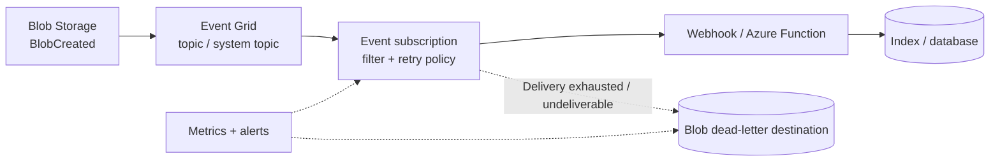
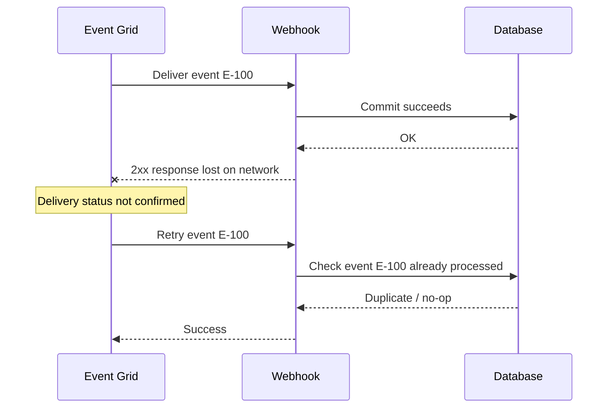
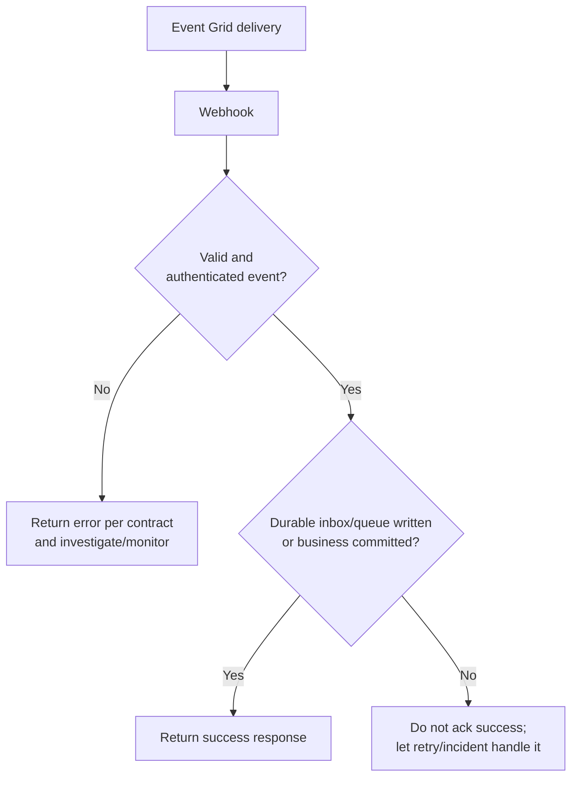
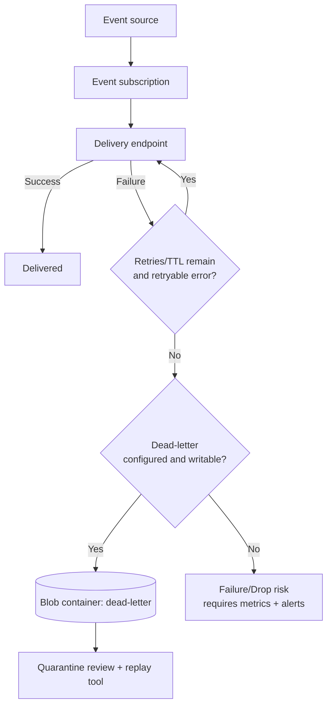
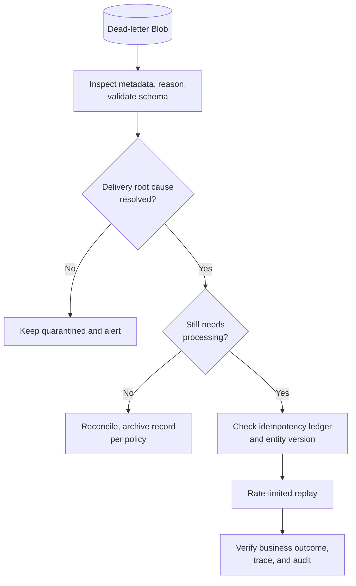
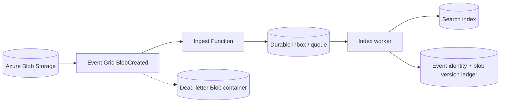

# Delivery Retry, Dead-Letter, and Event Deduplication

An enterprise stores invoices in **Azure Blob Storage** and uses **Azure Event Grid** to emit events that trigger an indexing service. During peak hours, the event receiver fails with HTTP 503 for several minutes. When the system recovers, some events are redelivered; some events that had already been processed successfully—whose acknowledgment response was lost—are also delivered again. If the application creates a new invoice record on **every** receipt, data gets duplicated. If the application simply ignores all errors, some documents never get indexed.

Solving this properly requires **three coordinated mechanisms**:

1. **Delivery retry:** the delivery service retries sending when a delivery attempt fails.
2. **Dead-letter:** isolating events that cannot be delivered after configured limits for investigation and recovery.
3. **Deduplication/idempotency:** receiving the same event multiple times does not trigger unintended duplicate business effects.

This lesson belongs to the **Events and Streaming Data** chapter of the **CLOUD_PROVIDERS_AZURE** module, following the Microsoft Azure learning path from subscriptions, resource groups, and Microsoft Entra ID through networking, compute, storage, data, deployment, monitoring, security, and cost control. The focus is on **Azure Event Grid with the push delivery model of event subscriptions**, while clearly distinguishing this behavior from **Service Bus** and **Event Hubs** so retry, dead-letter, and checkpointing mechanisms are not misapplied.

After this lesson, you will be able to:

- Explain why Event Grid can deliver events **at least once** and **without global ordering guarantees**.
- Classify webhook/Function delivery errors to choose appropriate responses and retry strategies.
- Understand the interaction between **maximum delivery attempts**, **event TTL**, and service backoff.
- Design a **dead-letter destination** using Blob Storage, access permissions, monitoring, and a replay workflow.
- Derive event identity from **Event Grid schema** or **CloudEvents 1.0** to prevent duplicate processing.
- Implement an **atomic inbox + business transaction** or durable handoff before acknowledging event delivery.
- Inspect delivery failures, dead-letter metrics, poison events, identity/network setup, and costs.

## 1. Event Source, Event Subscription, and Event Handler

In the Event Grid push model, there are three main roles (plus the downstream sink):

| Component | Role | Example |
|---|---|---|
| **Event source** | Emits events when state changes | Blob Storage emits `Microsoft.Storage.BlobCreated` |
| **Event Grid topic/system topic** | Ingests, filters, and routes events per configuration | System topic attached to a storage account |
| **Event subscription** | Specifies filters, destination, retry policy, and dead-letter policy | Subscription routing BlobCreated events to a Function |
| **Event handler/destination** | Receives events and runs processing logic | Azure Function, webhook, Service Bus, or supported endpoint |
| **Business sink** | Stores final results with duplicate protection | Azure SQL, Cosmos DB, Azure AI Search, Blob |



**Important condition:** the diagram above applies to **Event Grid Basic push delivery / event subscriptions** that support redelivery and dead-lettering. **Event Grid namespaces** can use other models such as **pull delivery, push delivery, or MQTT** depending on feature/tier; acknowledgment protocols, locks, retries, and retention across models are not identical by default. During design, always identify the **exact Event Grid resource type and delivery model** being used.

### 1.1. Distinguishing delivery and processing

- **Delivery succeeded:** Event Grid received a success response from the destination under the delivery contract.
- **Processing succeeded:** the application completed business processing and durably persisted the result.

These two conditions do not always happen together. If a webhook returns HTTP 200 as soon as it puts an event into an **in-memory queue**, and the process then crashes, Event Grid considers delivery successful while the event can be lost before business processing occurs. Conversely, if the database commit succeeds but the HTTP response is lost, Event Grid may redeliver the same event.

**Principle:** acknowledge success only after the event has been **safely processed or handed off to durable storage/queue** that the organization accepts as completing the webhook's responsibility.

## 2. Event Delivery Contract: At-Least-Once, Duplicates, and Out-of-Order

Event Grid push delivery can deliver an event **more than once**. A consumer should never assume each Event Grid event ID appears only once in its system.

Two fundamental cases:



**At-least-once** does not guarantee that every event is **certain** to be delivered forever until a consumer processes it. Push delivery is bounded by attempts, TTL, destination reachability, and dead-letter policies. If limits expire or the destination stays down too long, delivery stops.

### 2.1. No ordering guarantee

Suppose a file is created and then deleted:

```text
Source timestamps:
  10:00:00  BlobCreated  file-A
  10:00:02  BlobDeleted  file-A

Actual consumer arrival times:
  10:00:03  BlobDeleted  file-A
  10:00:06  BlobCreated  file-A  (due to delayed retry)
```

If the consumer blindly records “file-A exists” upon seeing `BlobCreated`, it ends up with the wrong final state even though both events were received. **Deduplication does not solve out-of-order delivery**; you also need entity version/actual state checks or business-supported ordering comparisons.

### 2.2. A comparison of guarantees

| Capability | Event Grid push | Service Bus | Event Hubs |
|---|---|---|---|
| Receiving messages/events | Pushes events to handler | Consumer receives from queue/subscription | Consumer reads stream by partition |
| Duplicate delivery/processing | Possible; requires idempotency | Possible redelivery; requires idempotency | Possible replay after checkpoint/crash |
| Ordering | Do not assume order preservation | Can use sessions where supported | Ordered within **each partition**, no global hub order |
| Error handling | Delivery retry, max attempts, TTL | Lock, abandon, delivery count, settlement | Consumer retry, offset/checkpoint |
| Dead-letter | Blob destination when supported/configured on subscription | Built-in DLQ per queue/subscription | No per-event DLQ like Service Bus; self-quarantine |
| Replay | From dead-letter or separate event store | Re-drive messages from DLQ per runbook | Re-read within retention / external archive |

**Do not conflate the three services** simply because all three support event-driven architectures. This lesson focuses on retries and dead-lettering **at the Event Grid event subscription layer**.

## 3. Under What Conditions Does Delivery Retry Trigger?

For push destinations, Event Grid sends an event and evaluates the **delivery result**. When the endpoint does not respond according to the success contract and the error qualifies for retry, the service can retry on a **backoff schedule**.

Possible causes include:

- The webhook or Function returns a server error such as HTTP 5xx.
- The endpoint does not respond before the service's timeout limit.
- Transient TLS, DNS, or network errors occur.
- The destination is throttled, out of capacity, or unavailable.
- Certain failure responses have specific retry behaviors based on endpoint type and Event Grid policy.

**Note:** do not claim that **every** non-2xx HTTP status is retried. Event Grid may treat certain client errors as non-retryable and **stop retrying**, depending on destination type and the active delivery contract. For 400/401/403/413 errors, verify actual endpoint behavior and documentation; never rely on returning 400 to ask Event Grid to retry.

### 3.1. Response codes and how to interpret them at the webhook

| Observed outcome | Common meaning | Design guidance |
|---|---|---|
| Success response per delivery contract | Event Grid treats the event as received | Respond only after processing or durable handoff |
| HTTP 5xx | Handler application or dependency failure | Investigate dependencies; allow bounded retries if appropriate |
| Timeout / connection reset | Unknown whether handler committed | Retries may occur; consumer must be idempotent |
| HTTP 429 or throttling | Destination overloaded | Shed load, scale, or buffer into durable queue; check actual retry behavior |
| HTTP 400 | Invalid payload/contract or validation error | Fix schema/handler; some errors may not retry |
| HTTP 401/403 | Invalid auth/authorization or blocked endpoint | Check identity, tokens, firewall; do not assume self-recovery |
| HTTP 413 | Event/batch exceeds endpoint limit | Adjust ingestion design; retrying same payload usually will not help |

### 3.2. Handlers should not return 200 and forget the event

A webhook may return `202 Accepted` once it has written the event to **Azure Service Bus** or a durable inbox database. However, merely queuing the event onto an in-process background task and returning 2xx is insufficient for zero-data-loss workloads.



If downstream experiences a temporary outage, writing the event into a durable queue before responding to Event Grid reduces webhook pressure and decouples business processing duration from event delivery timeouts.

## 4. Retry Policy: Max Delivery Attempts and Event TTL

An **Event Grid event subscription** in supported models can configure a **retry policy** consisting of:

- **Maximum delivery attempts:** cap on the number of delivery tries the service may make.
- **Event time-to-live (TTL):** window during which the event remains eligible for delivery attempts from the time Event Grid accepted it, per service semantics.

These two limits combine on a **whichever expires first** basis: an event is not retried indefinitely just because time remains, nor is it guaranteed to use every attempt if its TTL expires first. Responses classified as non-retryable can also end delivery early.

### 4.1. Example policy design

```text
Event subscription: blob-indexing-prod
Delivery mode:      Event Grid Basic push
Destination:        Azure Function or HTTPS webhook
Max attempts:       12  (illustrative value; verify supported limits)
Event TTL:          360 minutes (e.g. 6 hours; verify validity)
Dead-letter:        Azure Blob Storage container eventgrid-deadletter
```

These are not Azure defaults. For production, verify **supported limits and valid values at deployment time** for the specific event subscription, endpoint, and tier. Do not blindly apply a 6-hour TTL to every workload: a “price just changed” event may quickly become stale, whereas an “invoice needs indexing” event may require durable retention for delayed processing.

### 4.2. Backoff is not a fixed application clock

Event Grid schedules retries according to service policy. Do not design assuming events will be redelivered **every 30 seconds on the dot** or at strictly predictable intervals. Prepare for:

- An event being retried while a previous delivery already caused side effects.
- Multiple events retrying together after an endpoint recovers, creating a burst.
- Retries terminating before max attempts due to TTL or error type.
- Events moving to dead-letter under qualifying conditions, or failing to dead-letter if the destination is broken.

### 4.3. Dead-letter is not an infinite backup

When dead-lettering is configured, undeliverable events **can** be written to quarantine storage when service conditions allow. However, if the Blob container is wrong, permissions are missing, a storage firewall blocks writes, or the dead-letter destination itself is unavailable, events cannot be assumed safely preserved.

**Production policy:** set separate alerts for **delivery failures** and **dead-letter failures**, rather than watching webhook 5xx alone.

## 5. Dead-Letter Destination on Azure Blob Storage

In Event Grid models supporting dead-lettering, the destination is typically a **container in Azure Blob Storage**. Event Grid writes events that could not be delivered under policy so operations teams can investigate or replay them.



This diagram is a logical model. Dead-letter timing and behavior for non-retryable responses can vary by endpoint type and feature; measure with real tests and metrics.

### 5.1. Prerequisites to verify

1. The Storage account/container has the right subscription/resource ID, exists ahead of time, and is protected from accidental deletion during incidents.
2. The event subscription has a platform-accepted **dead-letter destination** configured.
3. **Access mode:** the account or identity Event Grid uses has **blob write** permission at the right scope via a supported mechanism (e.g., Storage Blob Data Contributor on the corresponding identity when using managed identity).
4. **Network:** firewalls, Private Endpoints, trusted services, or Storage network rules do not inadvertently block dead-letter writes. **A Private Endpoint for a consumer does not automatically grant Event Grid permission to write blobs.**
5. Lifecycle retention and blob deletion policies cover investigation, evidence retention, and compliance needs.
6. Clear ownership exists for monitoring the container, triaging failures, recovering, and performing controlled deletion.

Whether Event Grid supports **managed identity** for destination/dead-letter delivery and how roles are assigned depends on event subscription type and identity delivery mode; avoid assigning roles to the wrong Function identity or Storage identity.

### 5.2. Dead-letter differs from Service Bus DLQ

| Criterion | Event Grid dead-letter Blob | Service Bus DLQ |
|---|---|---|
| Stored data | Blob containing undeliverable event info | Message in the dead-letter subqueue of a queue/subscription |
| How to read | Storage Blob API/SDK/Portal | Service Bus Receiver targeting the dead-letter subqueue |
| How to replay | Tool/pipeline built by operations | Tool receiving and re-sending messages per entity/contract |
| Auto-processed after dead-letter | Not by default | Not by default |
| Security permissions | Azure Storage data-plane and networking | Service Bus data-plane and networking |
| Retention/deletion | Blob lifecycle/retention/immutability per config | Per Service Bus DLQ semantics and governance |

A **dead-letter blob** cannot be consumed like a Service Bus message just by swapping a connection string. Define its schema and replay pipeline explicitly.

### 5.3. Dead-letter contains data requiring protection

Events may contain internal data paths, customer IDs, order IDs, security metadata, or references to sensitive documents. Therefore:

- Never enable public anonymous read access on the container.
- Enforce least-privilege RBAC: system writes, incident responders read with approval, replay pipeline has scoped permissions.
- Define retention and deletion policies; do not keep sensitive data indefinitely.
- Enforce encryption, auditing, access tracking, and compliance checks.
- Never paste raw payloads into chat/tickets without redaction.

## 6. Conceptual Event Subscription Configuration

Example policy snippet in ARM/REST for an **Event Grid Basic event subscription**:

```json
{
  "properties": {
    "retryPolicy": {
      "maxDeliveryAttempts": 12,
      "eventTimeToLiveInMinutes": 360
    },
    "deadLetterDestination": {
      "endpointType": "StorageBlob",
      "properties": {
        "resourceId": "<STORAGE_ACCOUNT_RESOURCE_ID>",
        "blobContainerName": "eventgrid-deadletter"
      }
    }
  }
}
```

**This is an illustrative property snippet, not a complete ARM template or REST request.** You still need API version, source resource, destination endpoint, filters, scope, identity, and required properties per event subscription type. When using managed identity, a different **delivery/dead-letter with resource identity** structure may be required; do not copy this snippet assuming the Storage account automatically allows writes.

### 6.1. Configuration rollout plan

1. Identify the **event source** and **Event Grid topic/system topic type**.
2. Identify the target endpoint (Azure Function, webhook, Service Bus, Event Hubs, or supported service).
3. Verify **filters** so unnecessary events are not sent.
4. Set **TTL/attempts** according to business SLA and tolerable endpoint outage duration.
5. Create the dead-letter Blob container, grant permissions, and configure networking.
6. Deploy the event subscription via Portal, ARM/Bicep, Terraform, or syntax-verified CLI.
7. Send a test event and confirm successful delivery.
8. Simulate endpoint failure and verify retries, dead-lettering, and telemetry.

**Do not use dead-lettering as a substitute for handling business errors after a handler has already returned 2xx.** Once Event Grid receives a successful ACK, any internal processing failure must be recovered from your own **durable queue/inbox and runbook**.

## 7. Webhook Authentication and Subscription Validation

For a **self-managed webhook**, Event Grid must verify the endpoint before delivering events using a validation flow matching the **event schema** and **endpoint type**. For example:

- With **Event Grid event schema**, there is a **SubscriptionValidationEvent** flow: the webhook must handle the validation code per the service contract.
- With **CloudEvents**, validation/handshake may use a different mechanism per CloudEvents HTTP webhook binding (e.g., HTTP OPTIONS challenge), depending on endpoint and integration.
- With **Azure Functions Event Grid trigger**, the runtime/extension may handle parts of validation, so avoid re-implementing a handshake already managed by the platform.

**Do not treat completing validation as authenticating all subsequent requests.** Webhooks still need TLS, access controls, origin/identity verification, and anti-spoofing protections supported by Event Grid.

### 7.1. Responding from a webhook is a business decision

A production webhook should:

1. Validate content type, event schema, required fields, and size.
2. Enforce proper authentication/authorization; never trust any JSON containing `eventType` as coming from Event Grid.
3. Identify duplicate events using stable identity.
4. **Commit data or durable inbox/queue before returning success**.
5. Keep database/queue timeouts shorter than the webhook's timeout budget.
6. Avoid holding requests open for minutes to run long business workflows.

```text
POST /events
  -> auth / schema validation
  -> insert into durable inbox (unique event key)
  -> return success for new event or already-processed duplicate
  -> background worker executes downstream per its own policy
```

If writing to the inbox fails due to a database outage, the webhook **must not return a success ACK** hoping the event survives in RAM.

## 8. Deduplicating from Event Identity

Events include fields that identify **one logical notification**. However, you must understand the difference between **event identity** and **business operation identity**.

### 8.1. Event Grid event schema

Event Grid schema example:

```json
{
  "id": "a19f0e8b-9012-47ef-a326-43ff4fa11111",
  "eventType": "Contoso.Orders.InvoiceRequested",
  "subject": "/orders/order-42",
  "eventTime": "2026-11-20T03:00:00Z",
  "dataVersion": "1.0",
  "topic": "/subscriptions/<SUB_ID>/resourceGroups/rg-events/providers/Microsoft.EventGrid/topics/orders",
  "data": {
    "orderId": "order-42",
    "commandId": "issue-invoice-order-42-v1"
  }
}
```

In this example:

- `id` identifies the event instance created by the producer; **it stays the same when Event Grid retries the same event**.
- `topic` describes the publish source in Event Grid schema.
- `subject` typically represents the business resource/entity and should not be treated as a unique event ID.
- `data.commandId` is a **business idempotency key** that stays constant even if the same request is republished as **two separate events**.

**Two duplicate scenarios:**

1. **Delivery duplicate:** the exact same `event.id` is redelivered due to retries.
2. **Business duplicate:** the producer emits two events with different `event.id` values that both request invoicing `order-42`.

To strictly prevent duplicate effects, you may need **both event-level deduplication and business-level idempotency**.

### 8.2. CloudEvents 1.0

CloudEvents example:

```json
{
  "specversion": "1.0",
  "id": "evt-order-42-v1",
  "source": "/services/orders",
  "type": "com.contoso.orders.invoice.requested",
  "subject": "order-42",
  "time": "2026-11-20T03:00:00Z",
  "datacontenttype": "application/json",
  "data": {
    "orderId": "order-42",
    "commandId": "issue-invoice-order-42-v1"
  }
}
```

In CloudEvents, the **`source` + `id` pair** forms the standard event identity key. If multiple producers independently use `id="1"`, comparing `id` alone causes **false duplicates**.

### 8.3. Deduplication Key Selection Table

| Goal | Recommended key | Risks to watch |
|---|---|---|
| Event Grid schema delivery dedup | `consumerId + topic/source + event.id` | Different sources could collide on ID |
| CloudEvents delivery dedup | `consumerId + source + id` | Do not omit source |
| Business command idempotency | `orderId + action` or `commandId` per contract | Republished events may carry new event IDs |
| Snapshot/aggregation update | `entityId + version/ETag/sequence` | Out-of-order requires version comparison |
| Payment/external side effect | Stable idempotency key supported by target API | Irreversible side effects if key changes |

Never use `eventTime` or consumer arrival time as a unique key; valid distinct events can share identical or near-identical timestamps.

## 9. Inbox Pattern and Idempotent Transactions

A common solution is an **inbox table** recording events accepted/processed by the consumer. Its primary benefit is turning “has this been processed?” into an **atomic** datastore operation.

### 9.1. Mistake: separate SELECT then INSERT

```text
Worker A: SELECT ... WHERE eventId=E1 -> none
Worker B: SELECT ... WHERE eventId=E1 -> none
Worker A: INSERT invoice
Worker B: INSERT invoice
=> two invoices if there is no unique constraint / transaction
```

**SELECT followed by INSERT** without proper locking or transactions introduces a race condition. Use unique constraints / conditional writes and transaction commit control so two workers cannot both apply the side effect.

### 9.2. Atomic processing pseudocode

```python
def handle_invoice_event(event, database):
    identity = event["data"]["commandId"]  # stable business key
    order_id = event["data"]["orderId"]

    with database.transaction() as tx:
        # try_claim_unique must use a UNIQUE constraint or
        # atomic conditional insert inside the same transaction.
        claimed = tx.try_claim_unique(
            consumer="invoice-worker",
            key=identity,
        )
        if not claimed:
            return "duplicate-no-op"

        # Business write must be in the SAME transaction as the inbox marker.
        tx.create_invoice_if_absent(order_id=order_id)
        # Commits on successful transaction exit.

    return "committed"
```

This is **pseudocode using an application-provided database adapter**, not a built-in Python library or Azure SDK. In production, `try_claim_unique` can rely on unique indexes, transactional inserts, or conditional write APIs. Under concurrent workers, one transaction may hit a duplicate-key conflict; handle that conflict as a **safe no-op** after confirming the existing record represents the same request.

### 9.3. What must share the same transaction?

If the inbox records “processed” and the process crashes **before** writing the invoice, retries will see a duplicate and skip it, causing **lost business effects**.

If the invoice is written and the process crashes **before** marking the inbox, retries may create a second invoice.

Where the database supports it, place **the inbox marker and business write in the same transaction**. If side effects live outside the transaction (calling payments, sending emails, calling partner APIs), use **outbox, downstream idempotency keys, or sagas/reconciliation** instead of claiming a single transaction spans all external systems.

### 9.4. Inbox TTL

If processed markers are purged after 1 hour while Event Grid retries or replays a day later, duplicates can trigger side effects again. Choose inbox retention based on:

- Active delivery/retry window.
- Dead-letter retention and manual replay window.
- How long source systems might republish events.
- Compliance and sensitive data rules.

For critical financial commands, **business uniqueness** (such as one invoice per order/action) usually needs to outlive pure transport event deduplication windows.

## 10. Azure Functions Event Grid Trigger: Intake Pattern

If the destination is an **Azure Function**, use the Event Grid trigger matching your runtime and programming model. Example using **Python v2 programming model**:

```python
import logging
import azure.functions as func

app = func.FunctionApp()


@app.event_grid_trigger(arg_name="event")
def on_blob_event(event: func.EventGridEvent):
    event_id = event.id
    event_type = event.event_type
    subject = event.subject
    data = event.get_json()

    logging.info(
        "Event Grid received: id=%s type=%s subject=%s",
        event_id, event_type, subject
    )

    # PRODUCTION TODO:
    # 1. Validate event type, source, schema and business rules.
    # 2. Persist an inbox record or business result atomically.
    # 3. Handle duplicate event IDs without repeating side effects.
    # 4. Raise on transient failure; do not pretend a log is a commit.
    # 5. Use durable handoff if downstream processing is long-running.
```

The snippet above only demonstrates extracting event metadata; **it does not yet perform idempotent persistence**. Never deploy to production returning success simply because `logging.info` ran without error. The Event Grid extension / Functions runtime has specific validation and delivery response mechanics; verify extension version and how failures propagate so Event Grid retries properly.

### 10.1. Function invocation retry differs from Event Grid delivery retry

Do not blindly apply retry guidance for **Timer/Queue/Event Hubs triggers** to an Event Grid trigger. With Event Grid push, the **Event Grid** service orchestrates delivery to the endpoint; if the application needs long business retries after receiving an event, hand off to **Service Bus / Durable Functions / durable queue** and manage retries independently.

A Function taking 20 minutes per event risks delivery deadlines or plan timeouts. A safer pattern:

```text
Event Grid -> small ingest Function
                 -> write to Service Bus / durable inbox
                 -> return success
Service Bus -> worker Function -> business DB -> complete/DLQ
```

In this design, Event Grid handles **ingest delivery retries**, while Service Bus handles **business retries**. Never conflate the two, and never have the queue consumer call back into Event Grid as an ACK operation.

## 11. Webhook Handler: Validation, Acknowledgment, and Security

When building a custom HTTP endpoint instead of using an Event Grid trigger, separate **subscription validation** from **business event delivery**.

### 11.1. Example pseudo-flow for a webhook

```text
1. Receive HTTP request from Event Grid
2. Authenticate origin/identity per supported integration
3. If validation handshake:
      return validation response matching schema/endpoint type
4. If business event:
      validate schema/event type/source
      write to durable inbox or queue with unique event key
      if duplicate already committed, return success
      if durable write succeeded, return success
      if durable sink unavailable, return appropriate failure
5. Background worker executes side effects idempotently
```

Event Grid schema can deliver **an array of events** in one HTTP payload depending on delivery settings; CloudEvents has its own batching/formatting per mode. If a batch contains two events and the consumer persists only one before returning success for the entire request, the second event can be lost. Design **all-or-nothing batch acknowledgment or per-item durable inbox with idempotent retries**.

### 11.2. Request authentication goes beyond hostname checks

- Enforce **HTTPS/TLS** with valid endpoint certificates.
- Apply **Microsoft Entra authentication / managed identity delivery** or Event Grid-supported destination protection where applicable.
- Configure network/access restrictions supported by the endpoint; never trust a request merely because it contains an `eventType` field.
- Keep headers, tokens, and secrets out of logs and administrative output.
- Plan secret rotation and re-test webhook validation after domain changes.

**Origin authentication** and **idempotency** are separate concerns. A fully authentic request from Event Grid can still carry a redelivered event.

## 12. Out-of-Order Events, Event Versions, and Preventing Stale Overwrites

Event ID deduplication only filters **the exact same event**. Across two distinct events for the same entity, the consumer must protect ordering.

Example `OrderStatusChanged`:

```json
{
  "id": "evt-status-42-v3",
  "source": "/orders",
  "type": "contoso.order.status-changed",
  "specversion": "1.0",
  "time": "2026-11-20T03:05:00Z",
  "data": {
    "orderId": "order-42",
    "version": 3,
    "status": "Shipped"
  }
}
```

The consumer should perform conditional updates:

```text
Current DB version = 4
Incoming event version = 3
=> Do not overwrite version 4 state with version 3.

Current DB version = 2
Incoming event version = 3
=> Update only if business/sequence conditions are valid.
```

**Do not treat `eventTime` as an absolute order:** clocks across systems can skew, and retries shift arrival times. Use source-guaranteed versions, ETags, or sequences—or re-query current state if the event acts strictly as a change notification.

### 12.1. BlobCreated / BlobDeleted

A `BlobCreated` event can be redelivered **after** the blob was deleted or overwritten. Workers must not rely solely on stale event payloads to assume the blob still exists. You can:

- Check Blob ETag/version ID where provided by event/architecture.
- Use conditional requests so updates apply only if the version still matches.
- Read **current object state** and distinguish a valid 404 from a transient error.
- Never treat an old replayed record as a command to recreate intentionally deleted resources.

### 12.2. When is serialization needed?

If business logic demands strict per-`orderId` ordering, consider:

- A Service Bus queue/session keyed by business entity after Event Grid ingest.
- Optimistic concurrency / row versions in the database.
- Partitioned work queues by aggregate key with bounded parallelism.
- State machines that accept late events based on version checks.

Never assume Event Grid guarantees delivery ordering and skip these protections.

## 13. Dead-Letter Replay: Do Not Unconditionally “Resend Everything”

Once events land in dead-letter Blobs, recovery is **its own operational workflow**. Answer these questions first:

1. Has the root cause been fixed (endpoint outage, IAM, firewall, schema)?
2. Did the consumer already process the event before the ACK was lost?
3. Does the event still have business value, or is it obsolete?
4. Must entity/version order be preserved during replay?
5. Can metadata/correlation IDs be extracted for reconciliation?
6. Should replay target the **original endpoint, an intermediate queue, or a dedicated recovery processor**?

### 13.1. Safe replay workflow



**Replay must preserve event identity or business command ID** per policy. Minting a brand-new event ID on every replay when consumers only deduplicate by event ID can trigger duplicate side effects despite an inbox.

### 13.2. Three replay strategies

| Strategy | Pros | Risks |
|---|---|---|
| Re-publish to a supported Event Grid topic | Reuses existing routing/filters | May require new envelope; identity/cost semantics change |
| Enqueue into a recovery Service Bus queue | Dedicated DLQ, concurrency, and backpressure controls | Extra path needing access control and payload mapping |
| Run a replay worker calling business handler directly | Fine-grained per-event control for small volumes | Easy to bypass auth/dedup logic unless sharing core handler |

**Never delete dead-letter Blobs immediately upon starting replay.** Archive or delete only after verifying business outcomes and capturing an audit trail explaining which events succeeded, were skipped, or failed.

### 13.3. Throttling during replay

If 100,000 events piled up during an outage, blasting them all at once can trigger a secondary outage. Replay workers should enforce:

- Bounded concurrency and token buckets.
- Prioritization by business criticality/age rather than timestamp alone.
- Backoff with jitter when downstream throttles.
- Retry/timeout caps and quarantine for permanently failing events.
- Metrics for replay attempts, committed, duplicate, skipped, and failed.

## 14. Handling a “Poison” Event That Breaks Every Delivery

An event with an invalid schema or unsupported data can cause handlers to fail every time. This is a **poison event**.

With Event Grid:

- If errors are retried, delivery burns through attempts/TTL and lands in dead-letter when configured/supported.
- If the error is treated as **non-retryable**, delivery may terminate early; verify behavior and dead-letter interaction.
- If the handler **swallows the error and returns success**, Event Grid has no reason to retry; data is silently lost unless persisted durably.

A strategy for handling bad payloads without data loss:

1. Validate schema and version.
2. If unprocessable, write the event + reason + identity to a **durable quarantine store**.
3. Return success only after the quarantine write commits, if that matches your intake contract.
4. Alert the schema-owning team and initiate a fix/replay workflow.

**Application quarantine** differs from **Event Grid dead-lettering**. Event Grid only knows endpoint delivery status, not whether payload semantics satisfy business rules.

## 15. Monitoring: Look Beyond Failed Deliveries

Monitor four groups:

| Layer | Signals/metrics | Question to answer |
|---|---|---|
| Event Grid subscription | Delivery succeeded/failed, attempts, dropped/undelivered, dead-lettered per available metrics | Are events reaching the destination? |
| Dead-letter Storage | New blobs, write errors, oldest blob age, size | Are failed events piling up unnoticed? |
| Ingest webhook/Function | 2xx, 4xx, 5xx, timeouts, p95/p99 latency, durable commit failures | Can the destination actually accept traffic? |
| Business worker | Duplicate counts, inbox commits, processing failures, replay backlog, business completion SLO | Did events produce the right outcome? |

**Exact metric names** depend on Event Grid resource type, endpoint, Azure Monitor dimensions, and active features; not every label in the table is a verbatim Azure Monitor metric name.

### 15.1. End-to-end correlation

Use structured logs and tracing:

```json
{
  "subscription": "blob-indexing-prod",
  "source": "/storage/files",
  "eventId": "a19f0e8b-9012-47ef-a326-43ff4fa11111",
  "businessKey": "document-42",
  "eventType": "Microsoft.Storage.BlobCreated",
  "outcome": "duplicate-no-op",
  "durableAccepted": true,
  "processedAtUtc": "2026-11-20T03:15:00Z"
}
```

For CloudEvents, log `source + id`. Include trace ID, version, and attempt/replay origin where collectible. **Never log tokens, private keys, PII payloads, or full URLs containing credentials**.

### 15.2. Reference production alerts

- Delivery failure rate exceeds baseline and persists past SLO thresholds.
- Event Grid event TTL nearing expiration while the endpoint remains unavailable.
- Dead-letter blob count rises or unprocessed blobs exceed age limits.
- Dead-letter destination write errors or Storage auth/network failures.
- Ingest ACKs succeed while business completion rate drops (internal queue stalled).
- Unusual spike in duplicate rate after deploy, cutover, or replay.
- Business results stop updating despite the source emitting events.

Do not alert blindly on raw duplicate counts: small duplicate rates can be normal under at-least-once delivery; measure **duplicate side effects** (which should be zero for sensitive operations).

## 16. IAM, Private Endpoints, and Network Connectivity

### 16.1. Three distinct connectivity paths

1. **Source → Event Grid:** permission to emit/receive event sources.
2. **Event Grid → destination:** webhook/Function/Event Hubs/Service Bus supporting appropriate network paths and authentication.
3. **Event Grid → dead-letter Storage:** separate permission to write Blobs and separate network policy.

Additionally:

4. **Business worker → Azure SQL/Blob/Key Vault:** worker's own identity and data-plane permissions.

Never grant every identity `Contributor` across the resource group and consider architecture complete. **Azure RBAC control plane** does not equate to the data-plane permissions needed to write Blobs or call Service Bus.

### 16.2. Private endpoints and network boundaries

- Event Grid is a managed service; **do not** assume it can reach arbitrary private IPs in a VNet merely because a consumer Function has VNet integration.
- When webhooks only accept private-network traffic, evaluate **private delivery models / managed identity / intermediate brokers** supported by that Event Grid resource type.
- When using Service Bus / Event Hubs as an intermediate destination, verify identity, tier, Private Link, and connectivity on each segment.
- When dead-letter Storage is locked down by a firewall or private endpoint, verify Event Grid's write path and supported trusted services/exceptions; never assume “Private Endpoint Approved” alone covers it.

**Network reachability, authentication, and authorization are three independent layers.** HTTP 403 may be missing permissions; timeouts may be DNS/routing; never fix a network error by granting cluster-admin or Storage Owner.

### 16.3. Operational permissions

| Group | Appropriate permissions |
|---|---|
| Event subscription managers | Azure RBAC on Event Grid source/subscription at required scope |
| Event Grid identity writing dead-letter | Azure Storage data-plane write on target container/account per supported mechanism |
| Incident responders reading dead-letter | Storage Blob Data Reader at appropriate scope |
| Replay worker | Read quarantine + send to approved destination |
| Business Function | Least-privilege access to database/Storage/Service Bus |
| Monitoring | Read metrics/logs without necessarily reading full event payloads |

Strictly restrict **who can modify endpoints**: changing a destination to an attacker-controlled endpoint leaks event data.

## 17. Azure CLI: Inspecting Event Subscriptions and Dead-Letter

The examples below are **read-only**. They do not create subscriptions or delete Blobs. Resource and identity names are placeholders; Azure CLI may require specific extensions/versions depending on resource type.

### 17.1. Confirm scope and subscription

```bash
az account show \
  --query "{subscription:name,subscriptionId:id,tenantId:tenantId}" \
  -o json

# Replace with the exact Resource ID of the Event Grid event source:
SOURCE_ID="<EVENT_SOURCE_AZURE_RESOURCE_ID>"

az eventgrid event-subscription list \
  --source-resource-id "$SOURCE_ID" \
  -o table
```

### 17.2. View event subscription details

```bash
EVENT_SUB="blob-indexing-prod"

az eventgrid event-subscription show \
  --source-resource-id "$SOURCE_ID" \
  --name "$EVENT_SUB" \
  --query "{name:name,provisioningState:provisioningState,destination:destination,retryPolicy:retryPolicy,deadLetterDestination:deadLetterDestination,filter:filter}" \
  -o json
```

Field names and syntax depend on Azure CLI/extension/API versions; if a field appears blank, inspect the full JSON output before assuming it is unconfigured. **Never paste delivery destination secrets or credentials into tickets or chat** if the response contains sensitive data.

### 17.3. List dead-letter blobs

```bash
DL_RG="rg-events-prod"
DL_STORAGE="steventdeadletterprod"
DL_CONTAINER="eventgrid-deadletter"

az storage blob list \
  --account-name "$DL_STORAGE" \
  --container-name "$DL_CONTAINER" \
  --auth-mode login \
  --query "[].{name:name,lastModified:properties.lastModified,size:properties.contentLength}" \
  -o table
```

The executing account needs Azure Storage data-plane permissions; resource group reader permissions do not grant Blob read access. **Do not download and distribute dead-letter payloads** without authorization and redaction of sensitive data.

### 17.4. Verify identity write permissions

```bash
STORAGE_ID=$(az storage account show \
  --resource-group "$DL_RG" \
  --name "$DL_STORAGE" \
  --query id -o tsv)

az role assignment list \
  --scope "$STORAGE_ID" \
  --include-inherited \
  -o table
```

This is a broad check of **role assignments on the storage account and parent scopes**; it may not list assignments scoped strictly to a lower-level container. Identify the exact principal/identity Event Grid uses for dead-lettering, and verify inherited roles, network rules, and actual write failures.

## 18. Controlled Setup of Retry and Dead-Letter

In the Azure Portal or an approved IaC pipeline:

1. Open the event subscription under the target Event Grid source/topic.
2. Confirm the destination passed validation and authorization.
3. Set **delivery attempts and event TTL** aligned with RTO/SLO.
4. Select the **dead-letter Blob container** and grant proper permissions.
5. Configure Storage network policies and verify Event Grid can write.
6. Send a test event with a clear ID.
7. Temporarily simulate endpoint failure **in staging**, wait for the policy to act, and inspect metrics and dead-letter blobs.
8. Restore the endpoint and test **idempotent replay** from dead-letter.
9. Record change metadata, owner, alert channels, and rollback plan.

**Never intentionally induce failures in production** by turning off a Function or returning 503 for live events without formal approval. That can cause backlogs or permanent event loss past TTL.

### 18.1. Mandatory test cases

| Test | How to simulate | Expected outcome |
|---|---|---|
| Delivery success | Valid event, healthy endpoint | Event durably accepted, business state accurate |
| Transient failure | Staging endpoint returns temporary 5xx | Bounded retries, no duplicate side effects |
| Ambiguous ACK | Commit succeeds but response is dropped | Retry treated as duplicate/no-op |
| Permanent failure | Invalid schema/identity/endpoint | Classified properly, audited and quarantined per policy |
| Dead-letter | Endpoint fails longer than staging policy | Event written to Blob if policy and permissions work |
| Dead-letter failure | Revoke write permission in test environment | Metrics/alerts report quarantine failure |
| Out-of-order | Send version 3 after version 4 | Version 3 does not overwrite newer state |
| Replay | Read dead-letter and resend under control | No duplicate effects; results reconciled |
| Scale-out | Multiple Functions run concurrently | Unique constraints prevent race conditions |

## 19. Case Study A: BlobCreated → Document Indexing

**Requirement:** each document must be indexed once per **content version**, yet storage may emit multiple events, webhooks can be retried, and files may be overwritten before consumers read them.

### 19.1. Design



**Detailed flow:**

1. The `BlobCreated` event carries event ID, blob subject, and reference metadata.
2. Ingest identifies the event, authenticates origin, writes to a durable inbox, and returns success.
3. The worker checks the blob **version/ETag** or current state per contract.
4. If the event is a duplicate, record metric `duplicate-no-op` only.
5. If the blob was deleted or the version is no longer the target to index, treat it as stale per policy.
6. When indexing a newer version, the worker runs a conditional/version-keyed upsert so stale content never overwrites a newer index entry.
7. On transient dependency errors, the worker retries independently; on permanent failure, it quarantines and raises an incident.

### 19.2. Test conditions

- Replay the same event three times → only one index entry for that version.
- `BlobDeleted` arrives before an older `BlobCreated` → index is not resurrected erroneously.
- Search service fails for 10 minutes → inbox grows without losing events at ingest.
- Old events in dead-letter → post-recovery replay still respects version ordering.

## 20. Case Study B: Event Grid Webhook Triggering Invoice Issuance

**Requirement:** never issue two invoices for the same order even if Event Grid redelivers or the producer republishes with a new event ID.

**Flawed design:**

```text
POST /events -> parse orderId -> INSERT Invoice -> return 200

Flaw: if the first delivery INSERTs but the response is lost,
Event Grid retries and the handler INSERTs a second invoice.
```

**Better design:**

1. Define a stable `commandId` at the producer, e.g., `IssueInvoice:order-42`.
2. Write **inbox + invoice in the same transaction** backed by unique constraints.
3. If the same event ID arrives again, return success/no-op after confirming the prior outcome.
4. If a new event ID carries the same command ID, still no-op on the business key.
5. When calling an external accounting API, pass a stable idempotency key or use outbox plus reconciliation.
6. Keep ledger records for post-retry/replay reconciliation.

**Key takeaway:** event ID deduplication solves **transport duplicates**; unique business commands solve **business duplicates**.

## 21. Case Study C: Dead-Letter Failing to Write Due to Storage Firewall

**Scenario:** a production webhook fails continuously. The event subscription has a dead-letter Blob configured, yet after TTL expires no Blobs appear. Operations assumes “no Blobs means no events failed.”

**Possible causes:**

- Event Grid identity lacks Storage Blob data-plane write permissions.
- The container was renamed/deleted or the resource ID is wrong.
- Storage firewall / private networking blocks the active write path.
- The event subscription/destination type does not support dead-lettering as configured.
- Delivery/undelivered metrics were not inspected, or policy limits had not yet triggered.

**Investigation workflow:**

1. Check Event Grid delivery/undelivered/dead-letter failure metrics by resource type.
2. Inspect retry policy, event TTL, and when events were emitted.
3. Verify the storage resource/container exists and inspect access restrictions.
4. Identify the **actual identity** used for dead-letter writes and check RBAC at the exact scope.
5. Inspect Activity Logs and storage diagnostics as permissions and data allow.
6. Fix permissions/networking and validate with a new test event in staging; **never claim historical events are guaranteed recoverable** without a source backup.
7. If the event source has original logs/records or an outbox, reconcile and perform controlled replay.

**Lesson:** dead-lettering is a dependency that must be tested, monitored, and owned; it is not automatic insurance guaranteeing zero event loss.

## 22. Cost and Capacity Planning

Associated costs may include:

- Event Grid operations/deliveries per active tier and billing model.
- Azure Functions or webhook compute, request execution, and logging.
- Blob Storage for dead-lettering, transactions, retention, and reads.
- Service Bus / Storage Queue when using durable handoff.
- Database inbox tables, unique indexes, backups, and event retention.
- Azure Monitor / Log Analytics and network/egress transfer.

### 22.1. Estimating outage backlog

Suppose a system emits **300 events/second**, the handler is down for **10 minutes**, and every event matches the subscription filter:

```text
300 events/sec × 60 sec/min × 10 min = 180,000 events
```

This is the **incoming event volume during the outage**; do not assume all 180,000 events stay alive in the retry queue or all reach dead-letter—actual retention depends on TTL, attempts, error type, filters, service throughput, and policy. Once the endpoint recovers, retries can create a **burst** exceeding the business sink's capacity.

At 2 KB per event on average, raw payload volume is roughly **360 MB** before overhead, metadata, and replication. Never treat back-of-the-envelope math as an Azure bill; evaluate actual billing meters and payload sizes in your environment.

### 22.2. Choosing where long-running business logic executes

Never force an Event Grid webhook to wait on a 2-minute AI indexing job before returning HTTP 2xx. A better pattern:

```text
Event Grid -> lightweight ingest Function -> Service Bus queue
                                                  |
                                                  v
                                    Workers with autoscale, retry, DLQ
                                                  |
                                                  v
                                           Durable business result
```

This adds queue cost and operational components, but decouples Event Grid delivery timeouts from business processing duration and lets you throttle consumer concurrency.

## 23. Delivery and Dead-Letter Incident Runbook

### Phase A — Scope the incident

1. Identify the event source, event subscription, destination, schema, region, and emission time.
2. Check delivery metrics, endpoint 4xx/5xx/timeouts, Azure Activity Log, and recent config changes.
3. Determine whether events are retrying, dead-lettered, dropped, or ACKed while downstream processing failed.
4. Check network/DNS/TLS/identity and durable inbox latency.
5. Record event IDs and correlation IDs without exposing sensitive data.

### Phase B — Stop further data loss

1. If endpoint failure is transient, restore the Function/webhook and downstream dependencies; avoid compounding outages with untested deployments.
2. If an outbox/source event log exists, ensure source records are durably retained for reconciliation.
3. If dead-lettering is broken, prioritize restoring Storage access while checking whether error codes are non-retryable.
4. Never blindly crank up TTL/attempts while an endpoint returns permanent errors; this raises cost and delays root-cause work.
5. If downstream is congested, rely on durable queues and bounded concurrency; never return 200 for data held only in RAM.

### Phase C — Recover cleanly

1. Confirm the webhook/Function ACKs only after durable commit.
2. Test with a single synthetic event carrying a distinct ID and verify end-to-end outcome.
3. Inspect dead-letter blobs, classify root causes, and check business versions.
4. Run rate-limited, idempotent replay with full auditing.
5. Verify business outcomes, absence of duplicate side effects, and absence of stale overwrites.
6. Document the RCA and update policies, alerts, and retention rules.

## 24. Design Mistakes to Avoid

| Symptom | Root mistake | Fix |
|---|---|---|
| Invoices/indexes created twice | Believed in exactly-once delivery | Event key + business idempotency |
| Returned 200 then lost events | Buffered events only in RAM | Durable inbox/queue before ACK |
| Events lost despite retry config | TTL/attempts exhausted or non-retryable error | Understand policy, monitor undelivered/dropped |
| Dead-letter Blob empty during outage | Wrong Storage RBAC/network or unsupported mode | Test dead-letter destination explicitly |
| Replay creates duplicate effects | Minted new IDs without checking business keys | Stable keys, inbox, and ledger |
| Record state reverts to older state | Out-of-order event delivery | Entity version / ETag / optimistic concurrency |
| Handler endlessly retries bad JSON | Poison event lacks quarantine | Validation + durable quarantine |
| Webhook cannot create subscription | Validation handshake unhandled | Implement schema-specific validation |
| Webhook publicly exposed | No origin auth/authorization | TLS, Entra auth, or supported protections |
| Only tracking delivery success | Internal worker fails post-ACK | Business completion metrics |
| Replay crashes database | Unthrottled replay flood | Bounded concurrency / token bucket |
| IAM looks right but endpoint unreachable | Wrong Private DNS / firewall / route | Separate network from authorization |
| Ingest works yet storage fills up | Missing retention/lifecycle/capacity alerts | Monitor inbox/dead-letter growth and cost |

## 25. Production Deployment Checklist

- [ ] Distinguished Event Grid Basic push from Event Grid namespaces pull/MQTT or other mechanisms.
- [ ] Identified event source, schema (Event Grid / CloudEvents), destination, and filters.
- [ ] Designed for at-least-once, duplicate, and out-of-order deliveries.
- [ ] Webhook/Function properly handles subscription validation and authentication.
- [ ] Delivery success is returned only after durable acceptance or safe business commit.
- [ ] Retry policy has appropriate max attempts/TTL and non-retryable error behaviors are understood.
- [ ] Dead-letter Blob container exists with correct identity write permissions and compatible networking.
- [ ] Alerts configured for delivery failures, dropped/undelivered events, and dead-letter failures.
- [ ] Defined event identity (`topic/source + id`) and business idempotency keys.
- [ ] Inbox uses atomic unique constraints / conditional writes so side effects never duplicate.
- [ ] Version/sequence checks or live state reads prevent out-of-order overwrites.
- [ ] Quarantine is distinct from dead-lettering, with runbooks for both.
- [ ] Replay preserves identity, is rate-limited, and includes reconciliation.
- [ ] Least-privilege role assignments; secrets and payloads protected.
- [ ] Metrics track completed business processing, not just Event Grid ACKs.
- [ ] Tested post-commit timeouts, parallel duplicates, stale events, poison payloads, and dead-letter Storage outages.
- [ ] Retention, cost budgets, and operational ownership approved.

## 26. Self-Check Questions

1. Why can Event Grid redeliver an event even after a webhook committed to the database?
2. Does Event Grid push guarantee events are processed exactly once? Distinguish delivery from business effect.
3. How do maximum delivery attempts and event TTL interact?
4. Why can't you assume every HTTP 4xx status will be retried by Event Grid?
5. When does an event land in a dead-letter Blob? Does dead-lettering prevent data loss if Storage permissions block writes?
6. How does an Event Grid dead-letter Blob differ from a Service Bus DLQ?
7. Why is checking `event.id` alone insufficient when a producer republishes the same business command with a new event ID?
8. In CloudEvents, which pair of fields defines event identity?
9. Why is `SELECT if processed` followed by `INSERT` without a unique constraint unsafe under scale-out?
10. If an inbox record succeeds before the business write and the business write fails, what risk does the system face?
11. An older `BlobCreated` event arrives after a newer `BlobDeleted`. What mechanism does the consumer need beyond deduplication?
12. Why is returning HTTP 200 after placing an event into an in-memory queue unsafe?
13. An Event Grid-triggered Function needs 30 minutes to process. What benefits does an ingest + Service Bus architecture provide?
14. If dead-letter blobs stop appearing or failures spike after a firewall change, in what order should you investigate?
15. In the 300 events/sec case study, how many source events occur during 10 minutes of downtime? Are all of them guaranteed to land in dead-letter?
16. Propose three metrics proving **business processing** succeeded rather than only Event Grid delivery.

## Conclusion

Reliable event-driven design treats **delivery retry, dead-lettering, and deduplication** as **three complementary layers**, not three names for the same feature. Event Grid can redeliver events when delivery is unconfirmed, yet retries are bounded by **attempts, TTL, and error types**; dead-letter Blobs only help when write config, permissions, and networking work; and consumers must still guard business effects using **event identity, business idempotency keys, unique constraints, atomic inboxes, and version checks**. For long workflows, hand off durably to a queue/worker, decoupling delivery retries from business retries. Finally, maintain metrics, access controls, replay runbooks, and real failure drills so your Azure system neither drops events, duplicates side effects, nor corrupts state under traffic spikes or endpoint outages.
