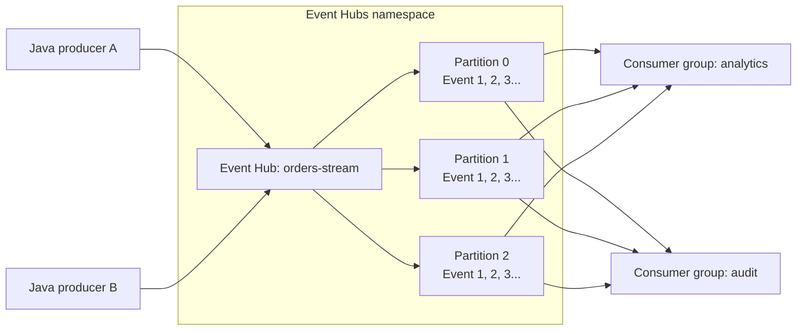
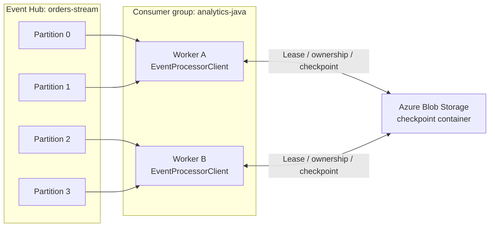
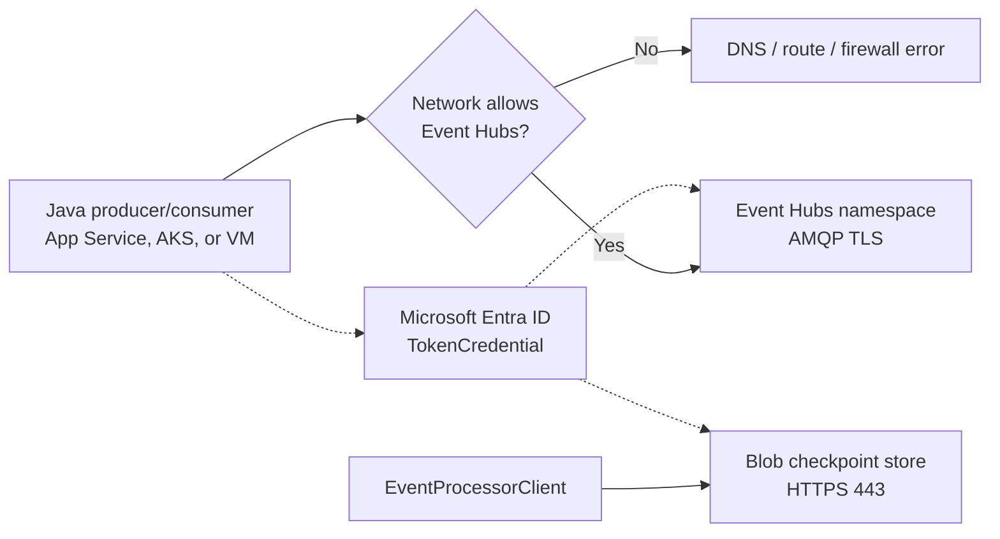
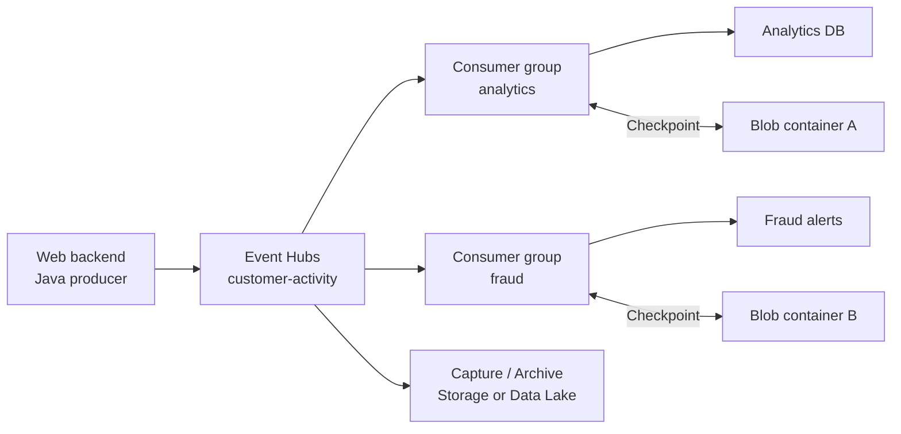

# Developing Java Producers and Consumers for Event Hubs

Suppose an e-commerce platform receives hundreds of thousands of events per minute: users view products, add to cart, place orders, and apps emit telemetry. Multiple systems need to read the same events: one computes real-time metrics, one feeds an analytics pipeline, and one runs anomaly detection. If every producer sent directly to every consumer, connection counts and cross-service coupling would explode.

**Azure Event Hubs** is a large-scale **event streaming** ingestion and distribution service. Producers send events into Event Hub **partitions**; consumers read independently by **consumer group** and log position. For Java, the Azure SDK provides `EventHubProducerClient`, `EventHubConsumerClient`, and `EventProcessorClient` to publish events, read partitions, and process streams across multiple checkpointed instances.

In the **CLOUD_PROVIDERS_AZURE** module, you explore Microsoft Azure from subscriptions, resource groups, and Microsoft Entra ID through networking, compute, storage, data, monitoring, security, and application deployment cost. This lesson belongs to the **Events and Streaming Data** chapter, focusing on **developing Java producers and consumers for Event Hubs** using modern SDKs, Microsoft Entra ID authentication, partition control, checkpointing, error handling, and production operations.

## 1. Learning Objectives

After this lesson, you will be able to:

- Distinguish **Event Hubs namespace**, **event hub**, **partition**, **consumer group**, **offset**, and **sequence number**.
- Describe the producer → partition → consumer flow and how Event Hubs differs from Service Bus.
- Set up a Java application with `azure-messaging-eventhubs`, `azure-identity`, and a checkpoint store when needed.
- Use `EventHubProducerClient` to send event batches within size limits.
- Use **partition keys** when preserving event order per business entity.
- Read events with `EventHubConsumerClient` to inspect or test a partition.
- Use `EventProcessorClient` paired with Azure Blob Storage to balance partitions across processes and persist checkpoints.
- Apply **managed identity / Microsoft Entra ID + Azure RBAC**, avoiding embedded connection strings in source code.
- Handle retries, duplicate events, schema versioning, throughput, and connectivity failures in production.

## 2. When to Use Azure Event Hubs?

Event Hubs suits **append-only** data emitted continuously where multiple consumer groups need independent or replayable reads within a retention window:

| Data source | Illustrative events | Consumer |
|---|---|---|
| Web/mobile apps | `page_view`, `checkout_started` | Real-time dashboards |
| IoT / devices | Temperature, machine status, valid location | Anomaly detection |
| Backend services | Audit events, order status | Behavioral analytics, data warehouse |
| Operational systems | Telemetry, logs, event metrics | Streaming ETL |
| CDC / integration | Data change events from controlled sources | Index/aggregation update pipelines |

### How does Event Hubs differ from Azure Service Bus?

| Criterion | Azure Event Hubs | Azure Service Bus |
|---|---|---|
| Core model | Partitioned event stream, time-retained log | Queue/topic with message processing and settlement |
| Consumer | Reads by partition/offset in a consumer group | Receives, completes/abandons/dead-letters messages |
| Retention after read | Events **are not deleted just for being read** | Messages are typically completed and removed from queue |
| Multiple independent pipelines | Consumer groups track separate progress | Topic/subscription or separate fan-out topologies |
| Ordering | Defined within **a single partition** | Depends on entity/feature and sessions |
| Typical use cases | Telemetry, clickstream, streaming analytics | Commands, workflows, business tasks needing settlement |

If the primary need is a worker receiving a command and calling **complete message** or dedicated dead-letter handling, consider Service Bus. If multiple applications need to consume **a replayable event stream**, Event Hubs is usually the better fit.

## 3. Event Hubs Architecture: Namespace, Hub, and Partition

A **namespace** provides the management boundary, endpoint identity, tier, throughput capacity, and security/networking controls. One namespace can hold multiple **event hubs**; each event hub contains a set of **partitions**.



A **partition** is an independent ordered log. Events are appended with metadata such as partition ID, offset, sequence number, and enqueued timestamp. Order is preserved **within the same partition**, with no single global order across all partitions.

### Offset and sequence number

- **Sequence number:** incrementing number reflecting the order events were stored in a partition; never use as a global cross-partition ID.
- **Offset:** position of an event within a partition's log, used for consuming/resuming; representation depends on API/SDK.
- **Enqueued time:** timestamp when the service accepted the event; not necessarily when the event actually occurred in the emitting app.
- **Retention:** duration events remain readable per configuration and tier capabilities; independent of whether consumers have read them.

Re-reading from an older offset works only if the event is still within retention. If a consumer stops too long, old checkpoints can point to purged data; define gap-recovery rules using another durable store if the business requires it.

### Consumer group

A **consumer group** is an independent view over the same Event Hub. For example, group `analytics-java` reads to compute reports, while group `fraud-detector` reads to detect anomalies. Both groups maintain separate positions/checkpoints and never “steal” events from each other.

Within a single consumer group, `EventProcessorClient` processes share partition ownership to scale horizontally. Never share the same consumer group and checkpoint store across two pipelines with different goals if you want **each to read every event**.

## 4. Producer, Consumer, and Event Processor Differences

| SDK component | Role | When to use |
|---|---|---|
| `EventHubProducerClient` | Sends events/batches to an Event Hub | Synchronous event publishing apps |
| `EventHubProducerAsyncClient` | Sends asynchronously (Reactor) | Reactive apps or pipelines needing backpressure |
| `EventHubConsumerClient` | Reads a partition from a chosen position | Diagnostic tools, test apps, manual partition readers |
| `EventHubConsumerAsyncClient` | Reads partitions via async API | Reactive integration, explicit subscription control |
| `EventProcessorClient` | Processes multiple partitions, balances ownership, checkpoints | Production consumers running multiple replicas |
| `BlobCheckpointStore` | Persists ownership/checkpoints in Azure Blob Storage | Coordinating multiple `EventProcessorClient` instances |

**Event Hubs has no `complete(message)` consumer call like Service Bus.** Instead, consumers track read progress via position/checkpoints, and events remain until retention expires. After a crash, events may be reprocessed from the prior checkpoint.

## 5. Preparing Azure and the Java Project

Examples use illustrative names (replace with real existing resources):

| Resource | Example name | Purpose |
|---|---|---|
| Resource group | `rg-stream-lab` | Resource management |
| Event Hubs namespace | `evh-orders-lab` | Event Hubs endpoint |
| Event Hub | `orders-stream` | Event ingestion log |
| Consumer group | `analytics-java` | Dedicated consumption pipeline |
| Storage account | `ststreamlab01` | Checkpoint storage |
| Blob container | `eh-checkpoints` | Stores ownership/checkpoints |
| Producer identity | `mi-event-producer` | Sends events |
| Consumer identity | `mi-event-consumer` | Reads events, writes checkpoints |

### 5.1. Prerequisites

- Java **17 or a compatible LTS release** for your SDK and build tool (Maven/Gradle).
- Organization-approved dependency versions, or the **Azure SDK BOM** to manage compatibility:
  - `com.azure:azure-messaging-eventhubs`;
  - `com.azure:azure-identity`;
  - `com.azure:azure-messaging-eventhubs-checkpointstore-blob` (only when using the event processor);
  - `com.azure:azure-storage-blob` for the checkpoint container.
- Event Hub and consumer group already exist; the app has network connectivity to both the namespace and Storage.
- Producer principal holds **Azure Event Hubs Data Sender**, consumer holds **Azure Event Hubs Data Receiver**, and processor holds appropriate Blob permissions.

**Never hardcode an arbitrary Maven version** from an old example if your pipeline uses a managed BOM. Verify compatibility, API changes, and security updates before building. The Java snippets below illustrate synchronous SDK v5 and may need import/version adjustments for your dependencies.

### 5.2. Secret-free environment configuration

On a developer machine, use `az login` with a role-assigned account so `DefaultAzureCredential` can acquire tokens. On Azure, use **managed identity** or AKS Workload Identity.

Example configuration variables:

```text
EVENTHUB_NAMESPACE=evh-orders-lab.servicebus.windows.net
EVENTHUB_NAME=orders-stream
EVENTHUB_CONSUMER_GROUP=analytics-java
CHECKPOINT_STORAGE_ACCOUNT=ststreamlab01
CHECKPOINT_CONTAINER=eh-checkpoints
```

Variables holding **resource names** are not secrets. Avoid putting connection strings or Shared Access Keys in source code or committing `.env` files containing credentials. For user-assigned managed identity, configure `AZURE_CLIENT_ID` / credential options per SDK guidelines to select the intended identity.

## 6. Inspecting Event Hubs and Consumer Groups with Azure CLI

The commands below are **read-only** (except the optional consumer group creation step). Select the right subscription to avoid touching unintended resources:

```bash
az login
az account set --subscription "<subscription-id>"

RG="rg-stream-lab"
NS="evh-orders-lab"
HUB="orders-stream"

az eventhubs namespace show \
  --resource-group "$RG" \
  --name "$NS" \
  --query "{name:name,location:location,sku:sku.name}" \
  --output json

az eventhubs eventhub show \
  --resource-group "$RG" \
  --namespace-name "$NS" \
  --name "$HUB" \
  --query "{name:name,partitions:partitionCount,retention:messageRetentionInDays}" \
  --output json

az eventhubs eventhub consumer-group list \
  --resource-group "$RG" \
  --namespace-name "$NS" \
  --eventhub-name "$HUB" \
  --output table
```

If you need a dedicated lab group and hold management permissions:

```bash
az eventhubs eventhub consumer-group create \
  --resource-group "rg-stream-lab" \
  --namespace-name "evh-orders-lab" \
  --eventhub-name "orders-stream" \
  --name "analytics-java"
```

`create` modifies resources; if the consumer group already exists, verify and reuse it instead of recreating. Consumer group limits and retention/partition parameters depend on tier; an existing Event Hub does not guarantee your app has data-plane roles or sufficient throughput capacity.

## 7. Java Producer: Safely Sending an Event Batch

A producer creates `EventData` from payloads and uses `EventHubProducerClient` to send to the Event Hub. Batching reduces network round trips, though **request size limits** and max event bytes depend on SDK and tier. Never try to cram unbounded events into a single batch.

### 7.1. Complete Java example

The program below:

1. Reads namespace and event hub name from environment variables.
2. Initializes the client with `DefaultAzureCredential`.
3. Creates a batch with `createBatch()`.
4. Attempts to add 6 events sequentially; when the batch fills, **sends the current batch and creates a new one**.
5. If **a single event is too large**, throws an informative error instead of silently dropping data.

```java
import com.azure.identity.DefaultAzureCredentialBuilder;
import com.azure.messaging.eventhubs.EventHubClientBuilder;
import com.azure.messaging.eventhubs.EventHubProducerClient;
import com.azure.messaging.eventhubs.models.EventDataBatch;
import com.azure.messaging.eventhubs.EventData;

import java.time.Instant;
import java.util.UUID;

public final class EventHubBatchProducer {
    private static String requiredEnv(String key) {
        String value = System.getenv(key);
        if (value == null || value.isBlank()) {
            throw new IllegalArgumentException("Missing environment variable: " + key);
        }
        return value;
    }

    public static void main(String[] args) {
        String namespace = requiredEnv("EVENTHUB_NAMESPACE");
        String eventHubName = requiredEnv("EVENTHUB_NAME");

        try (EventHubProducerClient producer = new EventHubClientBuilder()
                .fullyQualifiedNamespace(namespace)
                .eventHubName(eventHubName)
                .credential(new DefaultAzureCredentialBuilder().build())
                .buildProducerClient()) {

            EventDataBatch batch = producer.createBatch();
            for (int i = 1; i <= 6; i++) {
                String eventId = UUID.randomUUID().toString();
                String json = String.format(
                        "{\"eventId\":\"%s\",\"type\":\"page_view\","
                                + "\"page\":%d,\"occurredAt\":\"%s\"}",
                        eventId, i, Instant.now());

                EventData event = new EventData(json);
                event.getProperties().put("schemaVersion", 1);

                if (!batch.tryAdd(event)) {
                    if (batch.getCount() == 0) {
                        throw new IllegalArgumentException(
                                "One event exceeds the allowed batch size");
                    }

                    producer.send(batch);
                    batch = producer.createBatch();

                    if (!batch.tryAdd(event)) {
                        throw new IllegalArgumentException(
                                "One event exceeds the allowed batch size");
                    }
                }
            }

            if (batch.getCount() > 0) {
                producer.send(batch);
            }
            System.out.println("All test events submitted to Event Hubs");
        }
    }
}
```

**Key API explanation:**

- `EventHubClientBuilder` constructs the client from the namespace hostname and event hub name.
- `DefaultAzureCredentialBuilder` acquires tokens from authorized credential sources without SAS connection strings.
- `EventData` holds the body and application properties; avoid sending sensitive data without explicit need and protection.
- `EventDataBatch.tryAdd(event)` returns `false` when the event does not fit the batch limit; it **does not auto-send the batch**.
- `producer.send(batch)` sends the batch; the SDK retries select transient errors per configuration, but **does not guarantee exactly-once** if the response is lost after server acceptance.
- `try-with-resources` closes the client at program exit. In long-lived producers, **reuse a single client** rather than opening and closing per event.

This is a test Java snippet sending 6 events. Real systems need explicit schemas, stable event IDs, source timestamps, and data protection policies. Never log sensitive event payloads verbatim.

### 7.2. Why not send one event at a time?

Sending one network request per event adds CPU, round-trip, and network overhead. Batching improves throughput when events are small and continuous. However, oversized batches increase latency and retry cost on request failure; benchmark against your payload sizes, emission rate, and latency budget.

**Never assume a batch provides a cross-system business transaction.** If a producer writes to a database and then sends a batch, a failure in between creates inconsistency. For critical business events, consider a **transactional outbox** or durable event-publishing pipeline.

## 8. Partition Keys and Ordering Rules

When no partition is specified, producers distribute events across partitions via SDK/service mechanics. This aids load balancing, yet gives no guarantee that events for the same order land in the same partition.

### Using a partition key

For instance, to send all events for a given `orderId` with the same partition key:

```java
import com.azure.messaging.eventhubs.EventData;
import com.azure.messaging.eventhubs.EventHubProducerClient;
import com.azure.messaging.eventhubs.models.CreateBatchOptions;
import com.azure.messaging.eventhubs.models.EventDataBatch;

// producer initialized and authenticated as in the previous section.
CreateBatchOptions options = new CreateBatchOptions()
        .setPartitionKey("order-1001");

EventDataBatch batch = producer.createBatch(options);
if (!batch.tryAdd(new EventData(
        "{\"orderId\":\"order-1001\",\"status\":\"created\"}"))) {
    throw new IllegalArgumentException("Event is too large");
}
producer.send(batch);
```

This is a **code snippet placed inside a scope where `producer` exists**, not a standalone Java class. The SDK uses the partition key to route events sharing that key to the same partition under the active configuration. Where ordering has business meaning, you must also ensure:

- The producer emits events for the same key **in the desired order**; concurrent sends across threads/processes can alter arrival order versus business order.
- Consumers process sequentially or coordinate by partition/key where required.
- When partition count or partitioning topology changes, never assume key → partition mappings stay identical forever.
- Overly “hot” partition keys (all events sharing one key) create a **hot partition** and cap throughput.

**A partition key is not an event primary key.** Multiple events for one `orderId` have distinct `eventId`s; consumers use `eventId` to detect duplicates and `orderId` to group by entity.

### Specifying a partition ID directly?

The SDK also offers direct partition-ID options in appropriate APIs, yet business producers should generally use **partition keys** for affinity instead of hardcoding partition `0` or `1`. Hardcoding partitions skews load and couples application code to infrastructure topology.

## 9. Java Consumer: Reading Events from a Partition

`EventHubConsumerClient` is useful for learning partition-level read APIs and inspecting events in a lab. You need **partition ID**, **consumer group**, and **starting position**. Consumers do not delete events after reading, and there is no Service Bus-style `complete()`.

### 9.1. Synchronous Java consumer

```java
import com.azure.identity.DefaultAzureCredentialBuilder;
import com.azure.messaging.eventhubs.EventHubClientBuilder;
import com.azure.messaging.eventhubs.EventHubConsumerClient;
import com.azure.messaging.eventhubs.models.EventPosition;
import com.azure.messaging.eventhubs.models.PartitionEvent;

import java.time.Duration;

public final class ReadOnePartition {
    private static String requiredEnv(String key) {
        String value = System.getenv(key);
        if (value == null || value.isBlank()) {
            throw new IllegalArgumentException("Missing environment variable: " + key);
        }
        return value;
    }

    public static void main(String[] args) {
        String namespace = requiredEnv("EVENTHUB_NAMESPACE");
        String eventHubName = requiredEnv("EVENTHUB_NAME");
        String group = requiredEnv("EVENTHUB_CONSUMER_GROUP");

        try (EventHubConsumerClient consumer = new EventHubClientBuilder()
                .fullyQualifiedNamespace(namespace)
                .eventHubName(eventHubName)
                .consumerGroup(group)
                .credential(new DefaultAzureCredentialBuilder().build())
                .buildConsumerClient()) {

            String[] partitions = consumer.getPartitionIds().stream()
                    .toArray(String[]::new);
            if (partitions.length == 0) {
                throw new IllegalStateException("Event Hub has no partitions");
            }

            String partitionId = partitions[0];
            System.out.println("Reading partition: " + partitionId);

            // Read at most 20 events from the start of this partition's retention.
            Iterable<PartitionEvent> events = consumer.receiveFromPartition(
                    partitionId,
                    20,
                    EventPosition.earliest(),
                    Duration.ofSeconds(20));

            for (PartitionEvent partitionEvent : events) {
                System.out.println(
                        "partition=" + partitionEvent.getPartitionContext().getPartitionId()
                        + ", sequence=" + partitionEvent.getData().getSequenceNumber()
                        + ", body=" + partitionEvent.getData().getBodyAsString());
            }
        }
    }
}
```

**About this example:**

- `getPartitionIds()` retrieves partition IDs. The program reads only **the first partition** for illustration, **not the whole Event Hub**.
- `EventPosition.earliest()` starts at the oldest event **still within retention** on that partition.
- `receiveFromPartition(..., 20, ..., Duration.ofSeconds(20))` requests up to 20 events and waits per API semantics. If no events exist, it may print nothing and exit cleanly.
- Each `PartitionEvent` provides the body and metadata/partition context.
- This consumer API **does not persist long-term checkpoints** for your application.

Printing the body aids observation **in a lab only**; never log raw payloads in production if they contain personal or sensitive data. For real JSON payloads, parse, validate against schema, and handle malformed data.

### 9.2. Where to start reading?

In the Java SDK, `EventPosition` factory methods select starting positions:

| Option | Meaning | When to use |
|---|---|---|
| `EventPosition.earliest()` | Start at oldest retained data | Backfills or replay tests |
| `EventPosition.latest()` | Read from tail of stream per API semantics | Consumers caring only about new data |
| By offset | Read near a specific offset | Recovery or investigation at a known position |
| By sequence number | Read by per-partition sequence | Controlled debugging/replay |
| By enqueued time | Start near an enqueue timestamp | Time-bounded replay |

For offsets/sequences, verify **inclusive vs. exclusive** API parameters. **Never use an offset from partition A to track progress on partition B.**

### 9.3. Why not run a manual consumer on 20 pods?

If 20 processes run `ReadOnePartition` targeting the first partition, they all read **the exact same duplicate data** rather than splitting work. Multi-instance production consumers require **partition ownership and checkpointing**, such as `EventProcessorClient` with a Blob checkpoint store.

## 10. EventProcessorClient: Production Consumer with Checkpointing

`EventProcessorClient` processes data across multiple partitions with a callback model and multi-instance coordination. When multiple consumer processes run in the same consumer group pointing to **the same checkpoint store**, they share ownership state to distribute partitions.

### 10.1. What do checkpoints solve?

A checkpoint records the last successfully processed position for **each partition**, allowing consumers to resume from a safe spot after restarts or when partition ownership moves to another process.



In this 4-partition / 2-worker diagram, each worker handles 2 partitions once balanced. This is an **illustrative distribution**; actual partition counts and load balancing are coordinated by the SDK. Having 4 workers does not guarantee every worker holds exactly one partition at every instant due to rebalancing, reconnects, and failures.

### 10.2. Preparing the Blob container

An Azure Blob Storage checkpoint store requires an **existing storage account and container**. Pick a dedicated container per pipeline or scope appropriately, avoiding accidental checkpoint sharing across unrelated apps.

Example creating a lab container via Azure CLI using Entra ID (write operation):

```bash
az storage container create \
  --account-name "ststreamlab01" \
  --name "eh-checkpoints" \
  --auth-mode login
```

The executing principal needs suitable data permissions on the Storage account/container. The consumer runtime needs **Storage Blob Data Contributor** on `eh-checkpoints` (or valid scope) to read, write, and renew ownership/checkpoint blobs.

**Never use a checkpoint container to store business event archives.** A Blob checkpoint store holds **progress and ownership metadata**, not a full copy of the event stream or a substitute for Event Hubs Capture / Data Lake.

### 10.3. Complete Java EventProcessorClient

The example below uses:

- `DefaultAzureCredential` to acquire tokens for **both Event Hubs and Blob**.
- Dedicated consumer group `analytics-java`.
- `BlobCheckpointStore` backed by `BlobContainerAsyncClient`.
- A `processEvent` callback that processes the message and calls `updateCheckpoint()` **only after** processing succeeds.

```java
import com.azure.core.credential.TokenCredential;
import com.azure.identity.DefaultAzureCredentialBuilder;
import com.azure.messaging.eventhubs.EventProcessorClient;
import com.azure.messaging.eventhubs.EventProcessorClientBuilder;
import com.azure.messaging.eventhubs.checkpointstore.blob.BlobCheckpointStore;
import com.azure.storage.blob.BlobContainerAsyncClient;
import com.azure.storage.blob.BlobContainerClientBuilder;

public final class CheckpointedEventProcessor {
    private static String requiredEnv(String key) {
        String value = System.getenv(key);
        if (value == null || value.isBlank()) {
            throw new IllegalArgumentException("Missing environment variable: " + key);
        }
        return value;
    }

    public static void main(String[] args) throws InterruptedException {
        String namespace = requiredEnv("EVENTHUB_NAMESPACE");
        String eventHubName = requiredEnv("EVENTHUB_NAME");
        String consumerGroup = requiredEnv("EVENTHUB_CONSUMER_GROUP");
        String storageAccount = requiredEnv("CHECKPOINT_STORAGE_ACCOUNT");
        String storageContainer = requiredEnv("CHECKPOINT_CONTAINER");

        TokenCredential credential =
                new DefaultAzureCredentialBuilder().build();

        BlobContainerAsyncClient blobContainer =
                new BlobContainerClientBuilder()
                        .endpoint("https://" + storageAccount + ".blob.core.windows.net")
                        .containerName(storageContainer)
                        .credential(credential)
                        .buildAsyncClient();

        EventProcessorClient processor = new EventProcessorClientBuilder()
                .fullyQualifiedNamespace(namespace)
                .eventHubName(eventHubName)
                .consumerGroup(consumerGroup)
                .credential(credential)
                .checkpointStore(new BlobCheckpointStore(blobContainer))
                .processEvent(context -> {
                    String partitionId =
                            context.getPartitionContext().getPartitionId();
                    String eventId = context.getEventData().getMessageId();
                    String body = context.getEventData().getBodyAsString();

                    // LAB: simulates processing only. Production: validate schema,
                    // enforce idempotency, and write durable output before checkpointing.
                    System.out.printf("partition=%s eventId=%s bytes=%d%n",
                            partitionId, eventId, body.length());

                    // Checkpoint every event to show progress easily in the lab.
                    // Production: pick checkpoint cadence based on volume/SLO.
                    context.updateCheckpoint();
                })
                .processError(context -> {
                    System.err.println("Event Processor error: "
                            + context.getThrowable().getMessage());
                })
                .buildEventProcessorClient();

        processor.start();
        try {
            Thread.sleep(60_000); // Lab: let processor receive events for ~1 minute.
        } finally {
            processor.stop();
        }
    }
}
```

**Conditions for running this code:** the Blob container exists and is reachable; the principal holds **Event Hubs Data Receiver** on the Event Hub and **Storage Blob Data Contributor** on the checkpoint container; namespace, group, and endpoints match; and network paths allow reaching both Event Hubs and Blob Storage.

The code above **does not persist business outputs**; it only marks where processing goes. Never carry `updateCheckpoint()` right after a log line into production and treat that as completed business processing. Commit durable business results first, then checkpoint.

### 10.4. Why is checkpointing every event not always optimal?

Checkpointing hits the storage backend, incurring **I/O, latency, and transaction cost**. At millions of events, checkpointing every event is expensive and degrades throughput.

Production apps usually configure a **count-based or time-based checkpoint policy**, ensuring checkpoints advance monotonically along each partition **only after preceding events are safely processed**.

| Strategy | Benefit | Risk / trade-off |
|---|---|---|
| Checkpoint per event | Minimal reprocessing after restart | High Blob writes, cost/latency |
| Every 100–1,000 events | Cuts Storage transactions | Crash may reprocess more events |
| Every few seconds | Fits steady streams | Irregular batches require per-partition progress tracking |
| After committing a business batch | Aligns cleanly with output persistence | Requires careful ordering and failure boundary control |

These thresholds are design examples, **not mandatory Event Hubs settings**. Benchmark, verify retry/idempotency behavior, and never checkpoint past unfinished events.

## 11. Multiple Consumer Instances, Ownership, and Rebalancing

Suppose an Event Hub has **4 partitions**. One `EventProcessorClient` reads all 4; when 3 more processor instances start in the same consumer group sharing the same Blob checkpoint store, the SDK distributes partitions via load balancing.

### Scaling to multiple replicas

- When processor instances are **fewer than** partitions, one instance owns multiple partitions.
- When processor instances **equal** partitions, steady-state balancing converges near one partition per instance.
- When processor instances **exceed** partitions, excess instances hold zero partitions; adding replicas stops raising throughput.
- When an instance dies or replicas scale in/out, **ownership transfers**; uncheckpointed events may be re-read.

Thus, **partition count sets a practical ceiling on partition-level parallelism per consumer group**. Processing multiple events concurrently *within a single partition* can boost app throughput, but complicates ordering and checkpoint tracking.

### Checkpoint containers must be scoped properly

Within one logical consumer application:

1. Share **the same Event Hubs namespace, event hub, and consumer group**.
2. Share the same checkpoint store read/written by all instances.
3. Run compatible processing logic/versions across instances with authorized identities.

Across two independent pipelines, use **different consumer groups**. If both an audit pipeline and an analytics pipeline need every event, never let them “share” one group, or they will split partitions instead of each reading the full stream.

### Process lifecycle and shutdown notes

When deploying on Azure Container Apps, AKS, or VM Scale Sets, implement **graceful shutdown**: stop accepting new work, finish in-flight events, update checkpoints safely, and release resources. Never assume SIGTERM lets processes run forever; after the grace period, containers get killed, and resuming from the last checkpoint is expected behavior.

## 12. Event ID, Duplicate Delivery, and Idempotent Consumers

**Event Hubs retains events by retention window, not per-subscriber completion state.** When a processor crashes after writing to a database but before checkpointing, events are redelivered.

### Example event with stable identity

```json
{
  "eventId": "evt-2026-000123",
  "eventType": "OrderPlaced",
  "schemaVersion": 1,
  "occurredAt": "2026-11-20T10:15:00Z",
  "orderId": "ORD-1001",
  "amount": 250000
}
```

Distinguish between:

- Business **`eventId`** created by the producer to identify an event across all retries.
- **`partitionId + sequenceNumber`**, identifying a record's slot in one specific Event Hub; this does not replace `eventId` if a producer can emit the same business event twice.
- **`MessageId`**, which can be set on an event/AMQP message via API, though you should not assume the SDK auto-generates an `eventId` aligned with your business deduplication rules.

### Idempotent consumer

A common approach:

```text
Upon receiving event E:
    1. Validate schema, event ID, and required fields.
    2. Check processed_events table for E.eventId.
    3. Inside a transaction:
         - Apply business change (if not yet applied).
         - Record processed_events[E.eventId].
    4. Commit transaction.
    5. Only after commit succeeds, checkpoint the partition.
```

A non-atomic two-step **check-then-write** still suffers race conditions if two instances process the same event concurrently. Enforce unique constraints or backend conditional writes/transactions. For side effects outside the database—such as emails, payments, or external API calls—use an outbox and target-service idempotency keys.

### Schema evolution

JSON payloads should be schema-versioned. If a producer adds a new field, older consumers should safely ignore unknown fields when the contract allows. If changing a field type or removing a required field, use backward-compatible transitions, staged rollouts, or versioned event types.

Never emit ad-hoc payloads leaving consumers to guess conventions. Document data types, UTC timezone rules, currency units, event IDs, sources, and privacy rules in the event contract.

## 13. Granting Azure Event Hubs and Blob Permissions to Java Clients

With **Microsoft Entra ID**, Service Bus and Event Hubs expose **dedicated Azure RBAC data roles**. To send/receive in Event Hubs, use:

| Principal | Task | Recommended data role |
|---|---|---|
| Java producer | Send events only | **Azure Event Hubs Data Sender** |
| Java consumer | Read events only | **Azure Event Hubs Data Receiver** |
| Data-plane tooling needing broader access | Operate on data within approved scope | **Azure Event Hubs Data Owner** only when genuinely needed |
| EventProcessorClient checkpoint identity | Read/write Blob ownership and checkpoints | **Storage Blob Data Contributor** on the checkpoint container |
| Pipeline provisioning namespaces/hubs | Manage Azure resources | Appropriate Azure RBAC management-plane role |

**Azure RBAC Reader/Contributor on a resource group is not equivalent** to Event Hubs read/write permissions via Entra tokens. Check each role's `DataActions` and avoid granting subscription-wide Owner to runtime apps.

### 13.1. Keep scopes as narrow as possible

Role assignments can be scoped to a namespace or an individual event hub as supported by Azure RBAC. For an `orders-stream` producer, prefer granting Data Sender on that specific Event Hub rather than the entire namespace if it only publishes to one stream. Apply the same principle for Data Receiver. If one pipeline legitimately reads many Event Hubs, consider namespace scope per organizational policy.

**A consumer group is a read-coordination boundary**, not an Azure RBAC security control. Granting Data Receiver on a namespace/hub does not restrict a client from reading a different consumer group; to strictly isolate pipelines, separate Event Hubs/namespaces or enforce appropriate access boundaries.

### 13.2. Azure CLI role assignments

The commands below **modify permissions** and require role-assignment privileges (such as Role Based Access Control Administrator or Owner) at the target scope. Run only in an authorized lab.

```bash
az login
az account set --subscription "<subscription-id>"

# Retrieve the ID of the target Event Hub.
EVENTHUB_ID=$(az eventhubs eventhub show \
  --resource-group "rg-stream-lab" \
  --namespace-name "evh-orders-lab" \
  --name "orders-stream" \
  --query id --output tsv)

# Existing Principal IDs for producer and consumer.
PRODUCER_PRINCIPAL_ID="<producer-principal-object-id>"
CONSUMER_PRINCIPAL_ID="<consumer-principal-object-id>"

az role assignment create \
  --assignee-object-id "$PRODUCER_PRINCIPAL_ID" \
  --assignee-principal-type ServicePrincipal \
  --role "Azure Event Hubs Data Sender" \
  --scope "$EVENTHUB_ID"

az role assignment create \
  --assignee-object-id "$CONSUMER_PRINCIPAL_ID" \
  --assignee-principal-type ServicePrincipal \
  --role "Azure Event Hubs Data Receiver" \
  --scope "$EVENTHUB_ID"
```

If the principal is a **system-assigned managed identity**, read `principalId` from the Azure resource hosting the app; if **user-assigned**, read the managed identity's `principalId`; for AKS Workload Identity, identify the identity bound to the Kubernetes ServiceAccount and federated credential.

For checkpointing to a Blob container:

```bash
STORAGE_ID=$(az storage account show \
  --resource-group "rg-storage-lab" \
  --name "ststreamlab01" \
  --query id --output tsv)

CONTAINER_SCOPE="$STORAGE_ID/blobServices/default/containers/eh-checkpoints"

az role assignment create \
  --assignee-object-id "$CONSUMER_PRINCIPAL_ID" \
  --assignee-principal-type ServicePrincipal \
  --role "Storage Blob Data Contributor" \
  --scope "$CONTAINER_SCOPE"

# Verify effective/inherited permissions at target scope.
az role assignment list \
  --scope "$EVENTHUB_ID" \
  --include-inherited \
  --output table
```

New role assignments take time to propagate. If you hit `Unauthorized` immediately afterward, verify principal ID, scope, token caches, and network connectivity before broadening permissions.

### 13.3. Why separate producer and consumer identities?

If both producer and consumer share one managed identity allowed to send and receive across every hub, a vulnerability in the producer exposes read access the producer never needed. Separating principals per workload:

- Shrinks blast radius if a container or credential is compromised.
- Clarifies RBAC auditing by business role.
- Lets you revoke a producer without disrupting consumers.
- Avoids granting Storage Blob Data Contributor to a producer that only emits events.

## 14. Private Networking, TLS, and Event Hubs Endpoints

Event Hubs SDK endpoints typically follow:

```text
<namespace>.servicebus.windows.net
```

When a namespace uses a firewall or **Azure Private Link**, apps need valid network routes, DNS resolution, and permissions. Private endpoint support and network restrictions depend on tier, region, and service settings; verify before designing.

### Java application connectivity flow



Distinguish **the path to Event Hubs**, **the path to the checkpoint Blob**, and **the path to acquire Microsoft Entra tokens**. A worker can read events fine yet fail checkpointing if the Blob account blocked public access and the worker lacks a route to Blob's private endpoint.

### AMQP over TLS and WebSockets

| Connection | Common port | Notes |
|---|---|---|
| **AMQP over TLS** | **TCP 5671** | Default commonly used by the Java Event Hubs SDK |
| **AMQP over WebSockets** | **TCP 443** | Fits networks allowing only outbound HTTPS/WebSockets |
| **Azure Blob checkpoint store** | **HTTPS TCP 443** | Separate connection to the Storage account |
| **Microsoft Entra token endpoint** | **HTTPS TCP 443** | Token acquisition per identity flow |

To use WebSockets where supported by SDK and proxies:

```java
import com.azure.core.amqp.AmqpTransportType;
import com.azure.messaging.eventhubs.EventHubClientBuilder;

// Configuration snippet inside client initialization code.
EventHubClientBuilder builder = new EventHubClientBuilder()
        .fullyQualifiedNamespace("evh-orders-lab.servicebus.windows.net")
        .transportType(AmqpTransportType.AMQP_WEB_SOCKETS);
// Add .eventHubName(...), .credential(...) and build client as shown earlier.
```

Never disable TLS certificate validation or hardcode IP addresses to bypass DNS errors. WebSockets on port 443 **cannot fix** a principal missing Data Receiver or lacking Blob checkpoint permissions.

### Private Endpoint and DNS

With Azure Private Link, private endpoints are attached at the namespace level per tier capabilities. **The Private DNS zone is typically `privatelink.servicebus.windows.net`**; clients keep using the standard hostname `evh-orders-lab.servicebus.windows.net`, while private DNS resolves it to the private endpoint IP.

Test from the exact container or VM running the application:

```bash
nslookup evh-orders-lab.servicebus.windows.net

# When netcat is available, test the AMQP port.
nc -vz evh-orders-lab.servicebus.windows.net 5671

# Check checkpoint Blob DNS when using a private endpoint.
nslookup ststreamlab01.blob.core.windows.net
```

A passing TCP check **does not prove** OAuth authorization is valid or the event hub exists. Conversely, if DNS resolves a private IP yet connections fail, check VNet integration, peering, routes, NSGs, private endpoint approval, and outbound firewalls.

### Public network access and local authentication

**Network access** and **authentication** are two separate policies:

- Disabling public network access requires valid private connectivity for all clients.
- Disabling local/SAS authentication (where supported) requires migrating all clients to Entra tokens first.
- Turning off one policy does not substitute for the other.

When migrating production from public/SAS to private/Entra, roll out in stages: **migrate identity → verify private networking → switch public access → disable SAS**. Never flip everything at once without a rollback plan.

## 15. Producer Reliability Guarantees

### Send success, timeouts, and duplicate send risk

Suppose a producer sends a batch, the server persists it, and the response drops. The client sees a timeout and retries. Resending the same payload can append **two records** in Event Hubs for one business event.

Therefore:

- Generate a **stable event ID** before sending and reuse it across retries of the same event.
- Never mint a new event ID for each retry of the same business event.
- Define which retries are safe; handle `ServerBusy`/throttling, timeouts, and resets with **bounded exponential backoff and jitter**.
- Bound in-memory queues/buffers in the producer so RAM does not overflow if Event Hubs temporarily stalls.
- Track counts of events **requested to send**, successful batches, exceptions, and upstream-blocked events.
- For critical data, use a **transactional outbox** or durable buffer to prevent losing events if the producer crashes.

**SDK retries do not guarantee exactly-once business processing**. Any idempotent publishing features (if offered by a specific tier/API/SDK) must be verified separately; consumers must still deduplicate.

### Using batches wisely

| Adjustment | Potential benefit | Risk |
|---|---|---|
| Pack many small events into a batch | Cuts per-request overhead | Adds wait time for trailing events |
| Increase producer threads | Raises throughput for CPU-bound sources | Hot partitions, memory and network pressure |
| Choose balanced partition key | Preserves per-entity order in one partition | Skewed keys create hot partitions |
| Retry on throttling | Recovers from transient limits | Retry storms without backoff |
| Add durable buffer | Prevents loss across process restarts | Adds cost and complexity |

If a single event cannot fit in an empty batch, **shrink the payload or offload large data to Blob** and send a Blob reference/metadata. Never split a large object across multiple events expecting consumers to reassemble it unless you design ordering, checksums, and timeouts explicitly.

## 16. Consumer Reliability Guarantees

### Replay and retention

Event Processor persists checkpoints per partition. On restart, it resumes based on checkpoint and SDK policy. If a checkpoint falls behind retention, purged data can no longer be replayed from Event Hubs.

Monitor **consumer lag** against:

- Per-partition ingress rate vs. actual processing rate.
- Maximum consumer downtime tolerance.
- Configured Event Hub retention.
- Recovery behavior when a checkpoint becomes invalid.

If the business requires months of history, use **Event Hubs Capture**, Storage/Data Lake, or a dedicated durable pipeline; never treat short Event Hubs retention as permanent storage.

### Handling data errors

Inside the callback:

1. Parse payload against schema and validate required fields.
2. Distinguish transient database/network failures from invalid data.
3. For transient errors, retry within limits; never checkpoint if output failed.
4. For permanently invalid events, write to a dedicated **application-level quarantine / dead-letter store** (such as Blob or an error queue) with event ID and reason, then checkpoint per policy.
5. Maintain a replay runbook after fixing the consumer to avoid duplicating already-processed events.

Event Hubs **does not offer per-event `abandon`/`deadLetter`** like a Service Bus queue. To keep one bad event from blocking an entire partition, the app must explicitly persist/isolate it before advancing the checkpoint.

### Never checkpoint too early

Dangerous sequence:

```text
Read event --> checkpoint --> write database
                               |
                               +-- database fails -> lost replay from checkpoint
```

Safer sequence:

```text
Read event --> validate --> durable database write
                                    |
                                    v
                            checkpoint partition
```

Even when checkpointing after commit, a crash between the two steps still causes **duplicate processing**; idempotency and post-commit checkpointing complement each other and neither replaces the other.

## 17. Throughput, Partition Count, and Scaling Limits

Event Hubs capacity depends on **tier/capacity**, partition count, event size, producer count, consumer groups, and Java app efficiency. Adding Java workers cannot scale Event Hub throughput infinitely.

### 17.1. Rough throughput math

Suppose a producer sends **8,000 events/second** averaging **1 KiB** each (excluding protocol overhead):

\[
\text{Ingress payload} \approx 8000 \times 1\,\text{KiB/s}
\approx 7.8\,\text{MiB/s}
\]

This is only **payload throughput**. Billable capacity and service limits also include overhead, event size, partitioning, tier capacity, and Azure quotas.

If one Java consumer sustains **600 events/second**, handling 8,000 events/second needs at least:

\[
\left\lceil\frac{8000}{600}\right\rceil = 14
\]

ideal consumer workers, *assuming* sufficient partition parallelism, network/backend capacity, and one partition per worker. If the hub only has 4 partitions and you run one EventProcessorClient per consumer group, spinning up 14 processes will not put all 14 onto partitions. You must instead raise **per-partition/per-processor** throughput, adjust partitioning within tier limits, or redesign the stream.

### 17.2. Event Hubs tiers and capacity

Event Hubs offers different tiers—such as Standard, Premium, and Dedicated—with scaling units like **throughput units** or **processing units** depending on tier. Never infer events/second from partition count alone, and never apply Standard limits to Premium.

| Component | Can be bottlenecked by | Symptom |
|---|---|---|
| Namespace capacity | Quotas / throughput units / processing units | Throttling, send latency |
| Partition count | Partition parallelism, tier, and config limits | Fewer processor instances assigned partitions |
| Java producer | CPU, memory, batch size, network, retries | Buffer growth, slow sends |
| Java consumer | JSON parsing, DB I/O, GC, checkpoint writes | Consumer lag climbs |
| Blob checkpoint store | Storage throughput, transaction latency, firewall/RBAC | Ownership/checkpoint errors |
| Backend | Database transactions, API rate limits | Consumer reads cleanly yet processes slowly |

### 17.3. Partition keys and load skew

If 90% of events share partition key `tenant-main`, one partition takes almost all traffic, creating a **hot partition**. Adding consumer groups or replicas rarely fixes this. Consider:

- Choosing a better-distributed key (e.g., `deviceId` or `orderId` instead of a constant).
- Accepting single-entity throughput limits when ordering is strict, or designing controlled subkeys.
- Never changing partition keys arbitrarily if consumers rely on per-order/per-device ordering.
- Evaluating impact before changing partition counts per tier and API constraints.

### 17.4. Sync or async SDK?

**Synchronous clients** are readable and fit lessons, CLI tools, and moderate-concurrency producers/consumers. For high throughput, evaluate **async clients** with Reactor:

- Use non-blocking I/O and proper backpressure.
- Reuse clients and bound concurrent requests.
- Cap buffers so RAM cannot grow unbounded.
- Measure CPU, GC, thread pools, connection counts, and p95 send latency.

**Async does not raise throughput automatically** if the bottleneck sits in Event Hubs capacity or the consumer's database. Load-test with representative data.

## 18. Observing Producers, Consumers, and Event Hubs

**Azure Monitor** provides metrics and diagnostic logs for Event Hubs per tier and configuration. Java apps should add SDK- and business-level telemetry to measure end-to-end lag and reliability.

| Component | Suggested signals | Meaning |
|---|---|---|
| Producer | Events/s, bytes/s, send latency, batch size, retry/failure count | Is publishing keeping pace? |
| Event Hubs namespace | Incoming/outgoing messages/bytes, throttled requests, server errors | Is capacity saturated? |
| Consumer | Events processed/s, processing duration, error count | True processing capacity |
| Checkpoint | Time since last checkpoint, checkpoint write failures | Replay exposure on restart |
| Partition | Consumer lag by offset/sequence or time, hot partitions | Is load balanced? |
| Blob storage | Request latency, 4xx/5xx, transactions | Is the checkpoint store healthy? |
| Business | Duplicate event IDs, valid events processed, quarantined events | Business correctness |

### Azure CLI: inspect supported metrics

```bash
EH_NAMESPACE_ID=$(az eventhubs namespace show \
  --resource-group "rg-stream-lab" \
  --name "evh-orders-lab" \
  --query id --output tsv)

az monitor metrics list-definitions \
  --resource "$EH_NAMESPACE_ID" \
  --output table
```

This command only **lists metric names** on the resource. To view historical series, use the Azure portal or `az monitor metrics list` with the exact metric name and time range. Never assume a specific metric is emitted on every tier.

### Correlation ID and privacy

Events should carry tracing metadata such as `eventId`, `source`, `eventType`, `schemaVersion`, and `occurredAt`. With OpenTelemetry / Application Insights, link producer → Event Hubs → consumer spans using SDK- and app-supported correlation/tracing conventions.

Never log bearer tokens, connection strings, credentials, or raw payloads containing PII. For troubleshooting, log event ID, partition ID, sequence number, timestamp, and error code under proper log retention and access controls.

### KEDA and consumer autoscaling

When running consumers on AKS / Container Apps, consider scaling on **Event Hubs lag** via a supported scaler. However:

- Lag-based scaling requires **reliable consumer groups and checkpoints/positions**.
- Scaling replicas past partition count does not increase partition concurrency.
- On scale-in, checkpointing and idempotency must survive ownership handoffs.
- HPA/KEDA adding Pods cannot schedule them if AKS lacks nodes; pair with node autoscaling.

Separate **consumer application scaling** from **Event Hubs namespace capacity**, as the two limits scale via different mechanisms and speeds.

## 19. Common Errors and Diagnostic Methods

| Symptom | Possible causes | How to verify / fix |
|---|---|---|
| Producer returns 401 | Invalid token, wrong tenant, credential acquisition failed | Check `DefaultAzureCredential`, managed identity, tenant/SDK logs |
| Producer returns unauthorized/permission error | Principal lacks **Azure Event Hubs Data Sender** | Check role, scope, propagation |
| Consumer receives no events | Wrong hub, group, partition, or start position | Inspect config; test `EventPosition.earliest()` in lab |
| Consumer has Receiver role yet fails checkpointing | Missing **Storage Blob Data Contributor** | Check checkpoint Blob container, role, and network |
| Two pipelines “split” events instead of reading all | Sharing one consumer group and dividing partitions | Create separate consumer groups per pipeline |
| Producer succeeds yet analytics sees low counts | Partition lag, parse errors, insufficient consumer throughput | Metrics, processor logs, checkpoints, partition skew |
| Consumer processes duplicates after restart | Prior checkpoint was not updated | Idempotency, checkpoint policy, transaction boundaries |
| `tryAdd(event)` returns `false` on an empty batch | Event too large | Shrink payload or store in Blob and send reference |
| EventProcessor fails to assign partitions | Blob checkpoint ownership unreachable or wrong group/store | Checkpoint container, role, SDK errors, config |
| Client connection times out | DNS, private endpoint, firewall, ports 5671/443, proxy | Test DNS → TCP/TLS → token → role |
| Works locally yet fails on Azure | Developer identity differs from managed identity or private network | Verify runtime principal and private networking |
| Producer throttled / server busy | Insufficient capacity, hot partition, sending too fast | Measure capacity, backoff, batching, key distribution |
| Checkpoint falls behind retention | Consumer stopped too long or backlog exceeded retention | Assess event loss, restore from historical archive, tune retention |
| High consumer CPU/RAM despite healthy hub | JSON parsing, allocations, GC, missing concurrency bounds | Profile Java, batch strategy, heap/off-heap |
| Upgraded code fails to parse events | Breaking schema change | Versioned schemas, compatibility tests, lab replay |

### Rapid investigation order

1. **Confirm exact resources:** namespace, event hub name, tier, consumer group, partition count.
2. **Check network path:** DNS, TCP 5671 or WebSockets 443, Private Link, and firewalls.
3. **Check identity:** Azure credential chain, principal, Data Sender/Receiver roles, propagation.
4. **Confirm events entered the hub:** incoming metrics, producer send status, partition distribution.
5. **Check consumer offset/position:** right group, right checkpoint, data still within retention.
6. **Check checkpoint Blob:** role, container name, networking, write errors.
7. **Check business logic:** JSON schema, database, retries, eventId, idempotency, and throughput.

**Never resolve incidents by granting subscription-wide Owner, opening public firewalls, or deleting production checkpoints.** Deleting checkpoints forces massive replays or data skips depending on start position, requiring a controlled runbook.

## 20. Real-World Scenario: Real-Time Clickstream Analytics

An e-commerce platform emits `product_viewed`, `add_to_cart`, and `order_placed` events. Three applications consume independently:

- **Analytics worker:** counts product views per minute.
- **Fraud worker:** detects anomalous behavior.
- **Archive pipeline:** archives events to Data Lake for multi-month analysis.

### Architecture



### Step-by-step implementation

1. **Design event schema:** `eventId`, `eventType`, `customerId` (when legally justified), `productId`, and UTC timestamp; exclude sensitive payment details unless strictly needed.
2. **Choose partition key:** e.g., `customerId` if per-session ordering is needed and customer traffic is fairly even; measure skew/hot keys.
3. **Java producer:** reuse `EventHubProducerClient`, batch within limits, retry with backoff, and record send outcomes.
4. **Consumer groups:** separate `analytics-java` and `fraud-java` with isolated checkpoint stores; independent archival per service/tier capability.
5. **Java consumers:** use `EventProcessorClient`, validate schemas, and persist outputs durably before checkpointing.
6. **Permissions:** producer gets Data Sender; each consumer gets Data Receiver; Blob checkpoint permissions scoped to each group's container.
7. **Networking:** if namespace/Storage use private endpoints, ensure DNS and outbound routes from workloads.
8. **Restart testing:** intentionally kill one consumer instance after committing output but before checkpointing to verify idempotency prevents duplicates.
9. **Performance metrics:** incoming/outgoing events, lag, batch send latency, checkpoint writes, storage/database throughput.
10. **Operational reporting:** track events lost to retention, incompatible schemas, consumer backlog, and total cost.

### Testing 3 failure cases

| Test | Expected behavior |
|---|---|
| Stop analytics worker for 5 minutes then restart | Consumer resumes from checkpoint within retention, reprocesses safely without duplicating business state |
| Producer emits duplicate eventId | Downstream detects duplicate and avoids creating two orders/billing entries |
| Blob checkpoint temporarily unreachable | Processor reports error, app alerts; never writes fake checkpoints and recovers via retries |

For streaming analytics, measure **time from event enqueue to visible result**, not only raw events/second. A system can process high volume yet lag hours behind if consumer backlog grows steadily.

## 21. Hands-On Exercises and Self-Check Questions

### Exercise A. Producer batching

You have 10,000 JSON events, ~1 KiB each. Why shouldn't you create one batch, call `tryAdd` 10,000 times, and ignore the return value?

**Hint:** batches have size limits. When `tryAdd` returns false, send the current batch, create a new batch, and try adding the event again; if it returns false on an empty batch, the single event is too large.

### Exercise B. Consumer groups

Two Java applications both need to read **all** events in `orders-stream`. Should they share one consumer group or use two different consumer groups?

**Hint:** two different consumer groups for independent progress and processing. Within one group, processor instances split partition ownership among themselves.

### Exercise C. Event ordering

A producer emits `OrderCreated`, `OrderPaid`, and `OrderShipped` for the same `orderId`. What lets consumers process them in order within Event Hubs?

**Hint:** use `orderId` as the partition key, send sequentially from the producer when needed, and preserve per-partition order in the consumer; there is no total ordering across partitions.

### Exercise D. Checkpoints after crash

A consumer writes event E to the database successfully and crashes before checkpointing. On restart, E is re-read. What prevents writing data twice?

**Hint:** business `eventId`, unique constraints / idempotent transactions, and checkpointing only after durable output succeeds.

### Exercise E. Distinguishing permissions

A Java consumer holds **Azure Event Hubs Data Receiver**, yet the Blob checkpoint store returns 403 on writes. Which role do you check?

**Hint:** **Storage Blob Data Contributor** on the checkpoint container, runtime principal, Storage network/firewall/DNS, and propagation.

### Exercise F. End-to-end lab

Practice only on an authorized subscription and resources:

1. Provision or verify Event Hub `orders-stream`, consumer group `analytics-java`, and checkpoint container `eh-checkpoints`.
2. Assign Data Sender/Receiver and Blob Data Contributor at minimal scopes.
3. Put namespace/hub/group/storage names in environment variables, keeping secrets out of code.
4. Run the Java producer, verify batch sends succeed, and confirm incoming metrics rise.
5. Use a Java consumer to read one partition with `EventPosition.earliest()` and inspect event metadata.
6. Run `EventProcessorClient`, verify checkpoints are written, and test stopping and restarting the process.
7. Run two processor instances sharing the same group/store, observe ownership distribution, and stop one instance.
8. Record events processed, duplicate counts, lag, and checkpoint frequency; tune as needed.
9. Clean up **only the lab resources you created**; never delete shared consumer groups, checkpoint containers, or namespaces.

## 22. Production Readiness Checklist for Java Producers/Consumers

### Event stream design

- [ ] Selected Event Hubs over Service Bus based on streaming/replay needs.
- [ ] Aligned on event schema, eventId, schemaVersion, occurredAt, and privacy rules.
- [ ] Benchmarked partition count, partition keys, and load distribution.
- [ ] Separated consumer groups per independent reading pipeline.
- [ ] Retention covers maximum consumer downtime; archival configured for long-term history.

### Java producer

- [ ] Supported Azure SDK/BOM and Java runtime versions.
- [ ] Clients reused rather than creating a new connection per event.
- [ ] Batches check `tryAdd`, handle oversized events, and apply backpressure.
- [ ] Bounded retries with backoff; stable eventId across retries.
- [ ] Evaluated outbox / durable buffering if business events cannot be lost.
- [ ] Metrics and alerts for send latency, retry counts, throughput, and throttling.

### Java consumer

- [ ] Production processor uses proper partition ownership and checkpoint store.
- [ ] Checkpoints always happen **after** business persistence succeeds.
- [ ] Idempotency, unique keys/transactions, and duplicate handling implemented.
- [ ] Quarantine strategy exists for schema-invalid events; never stuck forever.
- [ ] Shutdowns, restarts, and rebalances never drop business data.
- [ ] Benchmarked consumer instance count against partition count and backend throughput.

### Security, networking, and operations

- [ ] Producer Data Sender, consumer Data Receiver, and checkpoint Storage Blob Data Contributor scoped precisely.
- [ ] Managed identity / Workload Identity preferred; zero committed SAS connection strings or keys.
- [ ] Network paths open to Event Hubs, Blob checkpoints, and Entra token endpoints.
- [ ] TLS/AMQP ports, private DNS, Private Link/firewalls tested from actual workloads.
- [ ] Azure Monitor metrics/logs, lag tracking, app-level dead-lettering, and alerts configured.
- [ ] Estimated tier/capacity, retention, Storage checkpoint transactions, logs, and network costs.
- [ ] Runbooks exist for replay, broken checkpoints, and controlled recovery access.

## Conclusion

Developing **Java producers and consumers for Azure Event Hubs** rests on three principles: **producers send by batch and partition**, **consumers read by partition and consumer group**, and **checkpoints track read progress without substituting for business correctness**. `EventHubProducerClient` sends events efficiently, `EventHubConsumerClient` helps inspect reads by position, and `EventProcessorClient` paired with `BlobCheckpointStore` powers multi-instance production consumers. Combined with **Microsoft Entra ID + Azure RBAC**, schema versioning, idempotency, private networking protections, and throughput/lag observability, Java streaming systems can scale and recover from failures while keeping data consistent, secure, and cost-controlled.
