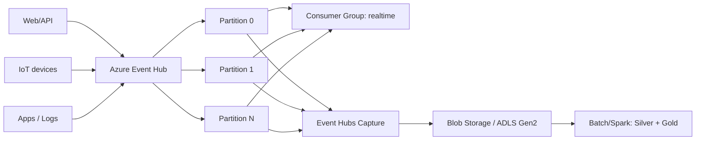
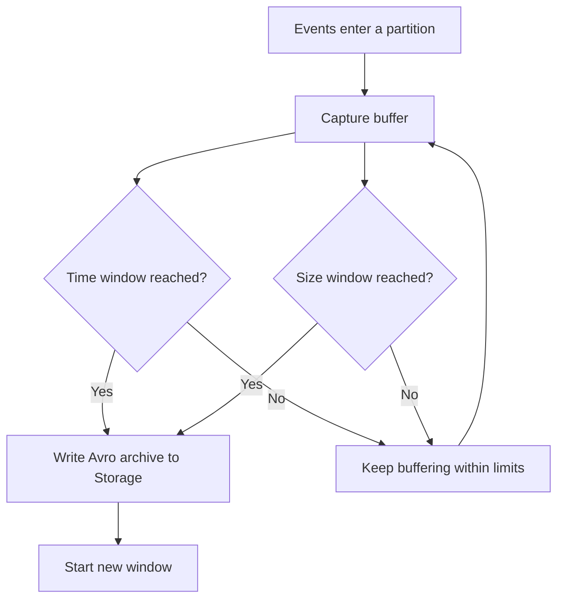
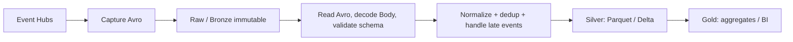
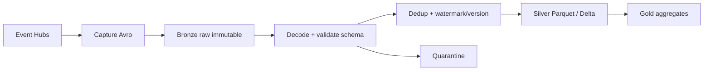

# Event Hubs Capture and Data Stream Archival

A system generating millions of events from web applications, transactions, IoT devices, or business logs needs two distinct capabilities: **near-real-time processing** to react fast, and **long-term raw data archival** for analytics, auditing, or pipeline reprocessing. **Azure Event Hubs** provides the streaming ingestion point with **partitions**, while **Event Hubs Capture** automatically writes events passing through an Event Hub into **Azure Blob Storage** or **Azure Data Lake Storage Gen2 (ADLS Gen2)** without maintaining a dedicated consumer just to save raw records.

For example, a retail application pushes `OrderCreated` and `PaymentConfirmed` events into an Event Hub. One consumer group powers a near-real-time dashboard, while Capture lands data into the `raw/bronze` zone of a data lake. The data team can read these files the next day to build summary tables, audit figures, or recover analytics after a consumer failure. However, Capture **does not turn Event Hubs into a database or an exactly-once transaction system**, does not automatically convert business data into Parquet/Delta for every requirement, and does not replace data quality controls.

This lesson belongs to the **Events and Streaming Data** chapter in the `CLOUD_PROVIDERS_AZURE` module. It connects subscriptions, resource groups, Microsoft Entra ID, private networking, Azure Storage, monitoring, and cost management to deploy an event ingestion, storage, and analytics architecture on Microsoft Azure.

## Learning Objectives

After this lesson, you will be able to:

1. Explain **Event Hub, partition, producer, consumer group, retention, and Capture** within one architecture.
2. Distinguish **live data retained in Event Hubs** from **long-term archives in Blob Storage / ADLS Gen2**.
3. Understand **Capture time and size windows**, `skip empty archives`, and small-file count implications.
4. Explain archive folder structure, **Apache Avro** format, metadata, `Body`, and offset/sequence numbers.
5. Choose storage targets, partition layouts, retention, and steps from **raw/bronze → silver → gold**.
6. Configure Capture via Azure Portal or illustrative templates/IaC and verify generated files.
7. Design storage access permissions, managed identities, RBAC, firewalls / Private Endpoints, and encryption.
8. Monitor Capture, reconcile data, troubleshoot errors, and plan cost and capacity.

## 1. Event Hubs in a Streaming Architecture

**Azure Event Hubs** is a high-throughput event stream ingestion service. Producers send events to an **Event Hub** inside a namespace; data is written into one of several **partitions**. Consumers connect via **consumer groups**, read events by offset/sequence number, save checkpoints, and resume from processed positions.



This diagram illustrates logical flows—it does not mean Capture is a custom consumer process you write or that every partition passes through the same consumer group. Capture is a **built-in feature of the Event Hubs service**, writing archives automatically per configuration; application consumers continue reading from their own consumer groups.

### 1.1. Namespace, Event Hub, and partition

| Concept | Role | Operational note |
|---|---|---|
| **Event Hubs namespace** | Management, network, security, and capacity boundary for Event Hubs | Choose appropriate region, tier, capacity, and permissions |
| **Event Hub** | Named event stream composed of multiple partitions | One namespace can hold multiple Event Hubs within tier limits |
| **Partition** | Relatively ordered log within a single partition | No global ordering guaranteed across all partitions |
| **Partition key** | Used by producers to route related events sharing a key | Skew toward one partition can create a hotspot |
| **Offset / sequence number** | Position of an event within a partition | Used to track progress and replay within that partition |
| **Consumer group** | Independent read view for a consumer application | Consumer groups do not delete events from the Event Hub after reading |
| **Retention** | Duration events remain readable inside Event Hubs | Not a long-term storage policy replacing a storage archive |

When an order's `Created → Paid → Shipped` events need relative ordering, the producer can use `orderId` consistently as the partition key. However, if all messages use `partitionKey="all-events"`, load piles onto a single partition, creating a hotspot that throttles real throughput even when other partitions have spare capacity.

### 1.2. Event Hubs retention is not a long-term archive

Event Hubs keeps events within its **retention window** per tier/config so consumers can read and replay during that period. Once retention expires, events are no longer in the log to re-read, even if a consumer has not finished processing them. Whether a consumer succeeded **does not automatically delete** events from the log.

**Capture** writes archives to Storage with an **independent lifecycle**. Files landed in Blob / ADLS Gen2 can be kept for months or years under lifecycle rules, or deleted earlier per policy, regardless of Event Hubs retention. Never confuse **message retention** with **storage lifecycle**.

### 1.3. Capture vs. a custom Storage-writing consumer

| Aspect | Event Hubs Capture | Custom Storage-writing consumer |
|---|---|---|
| Mechanism | Built-in Event Hubs feature | Code / stream processor deployed by your team |
| Primary goal | Write Event Hub streams directly into raw archives | Custom formatting, filtering, transforms, business logic |
| Worker operations | No separate read/write app to run just for raw archival | Must manage scaling, checkpoints, retries, deployments |
| Format | Typically **Avro** containing envelope and event body | Can output JSON/Parquet/Delta per pipeline needs |
| Write timing | By capture time/size window, not immediate event-by-event | Can tune latency and flushes programmatically |
| Quality responsibility | Saves raw events only; does not validate business schemas | Can validate, enrich, and deduplicate in code |

Capture is ideal for **archiving raw streams for downstream processing**, not when each event must immediately call an API, filter by complex rules, or commit normalized database transactions. For those workloads, use Azure Functions, Stream Analytics, Apache Spark, Event Hubs consumers, or another streaming processor.

## 2. Capture Operates by Partition and Write Windows

When Capture is enabled on a supported Event Hub, the service batches events into **archive files** and writes them to a Storage container. Typical settings include:

- **Destination:** Storage account, blob container, and archive naming structure; Blob Storage or ADLS Gen2 depending on setup.
- **Time window:** duration to buffer data before flushing.
- **Size window:** byte size threshold for buffering data.
- **Encoding/format:** archive format supported by the feature, typically **Avro**.
- **Skip empty archives:** whether to write an empty archive when a window receives zero events.

### 2.1. Time and size thresholds

A Capture file is typically flushed when **either threshold is reached first**: time or size. For example, configured at **5 minutes** or **100 MiB**:

- A partition with sparse traffic flushes a small file after the configured time interval containing whatever events arrived.
- A high-traffic partition may hit the size threshold **before 5 minutes**, producing multiple files within the same time window.
- Different partitions can produce different file counts and flush at different times.



In typical Event Hubs Capture configurations, time windows can range from **1–15 minutes** and size windows from **10–500 MB**; exact values and limits depend on API, tier, and feature availability at deployment time. Always check accepted values in the Azure Portal/API for your target namespace rather than assuming all tiers match.

**Do not treat the time window as a millisecond-accurate SLA for file arrival.** Internal service latency, throughput, Storage/network conditions, and backend health can introduce delay. When building downstream SLAs, measure actual **archive arrival lag** rather than reading the 5-minute setting literally.

### 2.2. Threshold selection examples

| Workload | Initial time window | Initial size window | Why testing is needed |
|---|---|---|---|
| Continuous IoT telemetry | 5 minutes | 100 MB | Balances file count against data freshness |
| Low-traffic clickstream | 10–15 minutes | Moderate threshold | Avoids excessive tiny files |
| High-traffic system logs | 1–5 minutes | Throughput-matched threshold | Files may hit size cap early; check cost and latency |
| Data needed in dashboard immediately | Do not rely solely on Capture | Not applicable as primary path | Needs a real-time consumer / stream processor |

Values in this table are **starting points for testing**, not optimal recommendations for every volume or a service SLA.

### 2.3. Skip empty archives

When a partition receives **no data during a window**, the service can emit an **empty archive** unless configured to skip. With `skipEmptyArchives` supported and enabled, the service skips creating empty files for quiet windows.

This affects completeness checks:

- **No file** in a window can mean **zero events** when skip-empty is enabled.
- Yet it can also mean **Capture failed to write** due to Storage permissions, quotas, config, or backend outages.
- An empty file is **not** proof that upstream systems checked all data sources successfully.

Therefore, monitoring must correlate **actual ingress event counts, Capture health, and created file counts**, rather than asserting “every partition must produce one file every 5 minutes.”

### 2.4. Files are created per partition

Capture organizes archives by **partition**. It does not merge all partitions into a single file sorted by event time. When reading back, downstream pipelines must handle files across partitions, offsets/sequences, and timestamps appropriately. An event in partition 0 with `EnqueuedTimeUtc=10:00:01` and an event in partition 1 with `10:00:00` have no guaranteed global processing order when residing in separate files.

## 3. Storage Targets: Azure Blob Storage and ADLS Gen2

Both **Azure Blob Storage** and **ADLS Gen2** build on Azure Storage, though data management and access patterns differ.

| Criterion | Blob Storage | ADLS Gen2 (hierarchical namespace) |
|---|---|---|
| Model | Objects/blobs with containers and prefixes | Data lake with true hierarchical directories on HNS-enabled Storage Account |
| Best suited for | Raw archives, backups, object workloads, simple batch jobs | Lakehouse, Spark/analytics, directory governance, ACLs, downstream pipelines |
| How Capture writes | Writes objects into blob container | Writes to HNS-enabled storage container/filesystem per feature config |
| Authorization | Azure Storage data-plane RBAC, scoped SAS policies, network rules | Data-plane RBAC plus POSIX-like ACLs where needed per operation/model |
| Downstream analytics | Readable/convertible to many formats | Native fit for data lake / Spark / analytics engines |

**ADLS Gen2 is not a second Event Hubs retention tier**: it is durable storage governed by your storage lifecycle and permissions. When picking a Storage account, verify Capture support for the target **account kind, namespace, region, tier, and networking**.

### 3.1. Separate raw capture from processed data

A typical data lake layout has zones:

```text
storage-account/
  raw-events/                 # Capture writes Avro files, preferably immutable
    <namespace>/<event-hub>/<partition>/<time-path>/...
  silver-events/              # Parsed, normalized, deduplicated
    event_type=OrderPaid/...
  gold-analytics/             # Datasets serving reporting and BI
    report_date=2026-11-20/...
```

Capture only needs **write access to the raw landing area**. Transform jobs need read access on raw and write access on silver/gold. Analysts should generally read only curated zones, not raw data by default if it contains PII. Separate storage accounts, containers, or folders along organizational access boundaries.

### 3.2. Blob versioning, immutability, and lifecycle

Captured data may serve as audit evidence or a replay source. Consider:

- **Lifecycle management:** transition infrequently accessed objects to cooler tiers or purge per approved retention.
- **Versioning / soft delete:** helps recover from accidental edits or deletions; does not replace backup/DR in all models.
- **Immutability / legal hold:** apply per compliance requirements and storage account/container capabilities.
- **Tags/metadata and catalog:** record source, timestamp, schema version, and owner for lineage.
- **Encryption and network restrictions:** protect sensitive data at rest and in transit.

Never set a 7-day deletion policy on the raw zone simply because Event Hubs retention is 7 days. The two policies serve different purposes and must reflect actual retention requirements.

## 4. Organizing Archives: Filenames, Folders, and Timestamps

Event Hubs Capture uses an archive naming template with supported **placeholders**, for example:

```text
{Namespace}/{EventHub}/{PartitionId}/{Year}/{Month}/{Day}/{Hour}/{Minute}/{Second}
```

Suppose namespace `evh-commerce`, Event Hub `order-events`, partition `2`, and an archive created at the corresponding UTC timestamp:

```text
raw-events/
  evh-commerce/
    order-events/
      2/
        2026/
          11/
            20/
              02/
                15/
                  00.avro
```

This is an **illustrative naming structure**, not a claim that every deployment produces the exact filename `00.avro`. Actual names depend on `archiveNameFormat`, capture time, partition, and service rules. Inspect real generated paths after enabling Capture. By default, the key benefit is having **namespace, event hub, partition, and capture time** in the path for easy prefix-based discovery.

### 4.1. Is the timestamp in the path the event time?

**Not necessarily.** Year/Month/Day/Hour components in the archive path reflect **when Capture wrote the archive** per the naming pattern—not the business timestamp inside the payload or each event's `EnqueuedTimeUtc`.

There are at least three distinct timestamps:

1. **Event time:** when the business event or sensor reading occurred; typically inside `Body`, set by the producer.
2. **Enqueue time:** when Event Hubs accepted the event, typically recorded in `EnqueuedTimeUtc` metadata.
3. **Capture/file time:** when the archive was flushed per window, used for storage organization and freshness tracking.

For example, an IoT device goes offline at 09:00 and uploads backlogged readings at 11:00: `eventTime=09:00`, `enqueuedTime≈11:00`, and the Capture file carries a timestamp shortly after 11:00. Data pipelines must define which timestamp governs daily reports and late-arriving data.

### 4.2. Folder partitioning for analytics

Capture's layout makes inventory by Event Hub and partition easy, though it is rarely optimal as-is for analytics engines. In the silver layer, design partitions such as `event_date=YYYY-MM-DD`, `tenant_id`, or `event_type` based on volume and query patterns. Avoid partitioning into a folder per `userId` if high cardinality creates millions of tiny files.

In particular, **never infer cross-partition transaction order by sorting archive filenames**. To order events per aggregate, use business sequences/versions and consistent partition keys from producers.

## 5. Data Format: Avro and the Event Hubs Envelope

**Apache Avro** is a schema-aware, block-oriented binary format suited for batch event archival. Event Hubs Capture traditionally writes **Avro archives** placing Event Hubs metadata fields alongside `Body`. These are **not** JSON Lines files you can open in a text editor and read line by line.

Each archive contains multiple event records with fields similar to:

| Field | Meaning |
|---|---|
| `Body` | Payload bytes sent by producer; may be UTF-8 JSON, Protobuf, application Avro, or other bytes |
| `SequenceNumber` | Sequence position of the event within a partition |
| `Offset` | Offset of the event within the partition |
| `EnqueuedTimeUtc` | Timestamp when the broker accepted the event into the Event Hub |
| `SystemProperties` | Service-level system metadata on the event |
| `Properties` | Application properties set by the producer |

**Exact field names and types depend on the service's Capture schema** and reader version; inspect the schema embedded in an actual Avro file before casting fields. `Body` is **bytes**, so `orderId` does not automatically appear as a top-level column in the Avro file. To query `orderId`, downstream pipelines must decode `Body` using the application schema.

### 5.1. Two schema layers

```text
Avro archive (Capture envelope):
  SequenceNumber
  Offset
  EnqueuedTimeUtc
  Properties
  SystemProperties
  Body [bytes]
      |
      +--> Application JSON:
             eventId
             eventType
             eventTime
             tenantId
             orderId
             schemaVersion
```

**Schema evolution** spans two layers: the envelope schema used by Capture and the application schema inside `Body`. If the app upgrades from `schemaVersion=1` to 2, Capture still simply stores bytes; batch readers must know how to decode both versions.

### 5.2. Why not assume Capture outputs Parquet/Delta directly?

Parquet and Delta Lake are optimized for analytics/lakehouses; Avro archives excel at sequential event capture. Pipelines commonly follow:



Never claim **Event Hubs Capture always outputs Delta tables or automatically deduplicates event payloads**. Even where extra encoding options exist on specific tiers/versions, always verify real configuration and reader contracts. Architectures needing Delta must define an explicit **conversion/ingestion step** into Delta tables with clear schema and partition strategies.

### 5.3. Designing payloads for archival and replay

An illustrative JSON event:

```json
{
  "eventId": "evt-order-1057",
  "eventType": "OrderPaid",
  "schemaVersion": 1,
  "tenantId": "tenant-A",
  "orderId": "ORD-1057",
  "eventTime": "2026-11-20T02:14:31Z",
  "amountVnd": 350000
}
```

Include a **stable event ID**, schema version/registry reference if needed, business timestamp, and correlation ID. Never send access tokens, credentials, payment card data, or unnecessary PII into a stream archived long-term. Capture replicates sensitive data into a new storage account; review access controls and retention **before enabling it**.

## 6. Prerequisites Before Enabling Event Hubs Capture

A valid Capture configuration must be right on all three fronts: **source Event Hub**, **destination Storage**, and **permissions/network path**. Before using Azure Portal or IaC, complete this checklist:

| Group | What to verify | Why it matters |
|---|---|---|
| **Subscription / resource group** | Namespace, Event Hub, and Storage belong to the approved environment | Prevents writing production data into lab storage or wrong subscriptions |
| **Event Hubs tier** | Tier/region supports Capture and its limits | Not all tiers support all options |
| **Partitions and throughput** | Partition count, ingress rate, partition key distribution, and quotas | Skewed partitions create hotspots |
| **Destination account** | Storage account supports Blob/ADLS Gen2, container/filesystem already exists | Wrong account type or missing container blocks Capture writes |
| **Identity and permissions** | Identity used by Capture has data-plane blob write permission | Management-plane RBAC `Reader` cannot write blobs |
| **Networking** | Firewall / private networking and supported service-to-service path | Valid RBAC can still be blocked by Storage firewalls |
| **Format and path** | Encoding, `archiveNameFormat`, time/size windows, skip-empty | Controls file count and read/partition layout |
| **Security / retention** | PII, encryption, lifecycle, reader permissions | Capture creates another long-lived data copy |
| **Monitoring** | Metrics/logs/alerts on ingestion, Capture failures, file arrival lag | Catches missing archives before events age out of retention |

### 6.1. Capture must be enabled before the data window you want archived

Capture is not an “export entire historical Event Hub” button. It **archives events as they flow through the Event Hub while enabled**. If Capture starts at 12:00, yesterday's events are not backfilled automatically.

If you need earlier events that **remain within the retention window**, run a **separate consumer** reading from the target offset/time to archive them via a custom pipeline. If events already aged out of retention with no backup, enabling Capture cannot recover them.

### 6.2. Choose region and storage locality

Place Storage in a region aligned with Event Hubs, data residency rules, and supported destination capabilities. This minimizes latency, data-transfer fees, and network complexity. If cross-region copies are required, design Storage-layer replication or pipeline DR explicitly; never assume Capture replicates archives across regions automatically.

### 6.3. Use a dedicated raw container

Example:

```text
Storage account: ststreamrawprod
Container:       eventhub-capture
Prefix:          {Namespace}/{EventHub}/{PartitionId}/{Year}/{Month}/{Day}/{Hour}/{Minute}/{Second}
```

Separate where Capture writes from where ETL writes outputs so raw files are never overwritten or deleted prematurely. Before changing retention or permissions on the raw container, review every workload reading from it.

## 7. Securing Capture with Microsoft Entra ID and Managed Identity

Capture needs an **authentication and authorization mechanism** to write to Storage as supported by your config and tier. Modern architectures can use the **Event Hubs namespace managed identity** where supported, paired with **Azure Storage data-plane RBAC**, reducing reliance on shared keys or long-lived SAS tokens.

### 7.1. Three identities not to confuse

| Identity | Action | Corresponding permission |
|---|---|---|
| **Producer application** | Sends events to Event Hub | Event Hubs Data Sender or equivalent |
| **Event Hubs Capture identity** | Writes archives to Storage | Blob create/write permissions, typically `Storage Blob Data Contributor` |
| **Downstream ETL/analytics** | Reads raw Avro, writes silver/gold | `Storage Blob Data Reader` on raw, separate write permissions on outputs |

A producer holding Event Hubs Data Sender **does not gain Storage write access**. Capture holding Blob Data Contributor **does not grant downstream pipelines database access**.

### 7.2. System-assigned vs. user-assigned identity

A **system-assigned identity** shares the resource's lifecycle; deleting/recreating the resource changes its principal and requires reapplying role assignments. A **user-assigned identity** is a standalone resource suited when stable identities must survive infrastructure rebuilds. For Capture, verify **which identity types are actually supported by your namespace and destination** before choosing.

Logical workflow:

1. Enable/attach a managed identity on the **Event Hubs namespace** where supported.
2. Retrieve the **principal/object ID** of the identity Capture actually uses.
3. Grant blob write permissions on the target storage account/container at minimal scope.
4. Select that identity mechanism in the Capture destination via Portal/API.
5. Verify role assignment and network path, then test Capture with sample events.
6. Monitor errors and allow Azure RBAC propagation time before concluding config is broken.

**Do not confuse** client ID, principal ID, and ARM resource ID. Role assignments typically target the principal ID, whereas resource ID identifies the Azure resource.

### 7.3. Write permissions and read permissions are separate

Capture needs permission to **write raw archives**, not subscription-wide admin roles. Transform jobs can receive read access to raw; BI users should query quality-checked, PII-scrubbed silver/gold layers. On HNS-enabled Storage, also understand directory-scoped POSIX ACLs for specific operations rather than relying solely on role names.

Never grant `Owner` on the resource group to fix a 403 when Capture writes to Storage. Diagnose whether the cause is wrong principal, missing data-plane role, missing container, storage firewall, or unsupported destination configuration.

### 7.4. Storage firewalls and Private Endpoints

Even with the right role, the Capture backend needs an **allowed service-to-service path**. On Storage accounts restricting public access, architecture may require **trusted Microsoft services bypass** with the right identity, or another officially supported network pattern.

**Do not assume** a Private Endpoint used by producers to reach Event Hubs automatically routes Capture backend traffic through Storage's Private Endpoint. Those are **two different network flows**. Under strict security baselines, confirm supported data paths and network exceptions before enabling Capture.

### 7.5. Encryption and sensitive data

Azure Storage provides encryption at rest, TLS in transit, and key policies per environment. If using customer-managed keys, manage Key Vault, key availability, and rotation. Capture does not strip sensitive data from `Body`: raw archives contain whatever producers sent. Avoid writing SAS URLs, connection strings, access tokens, or raw PII payloads into logs and support tickets.

## 8. Azure Portal Hands-On: Configuring Capture

Assume **Event Hubs namespace, Event Hub, Storage account, and target container/filesystem already exist**. Operations may incur charges and create data copies; run only in an approved environment. UI labels vary slightly over time and by tier.

### Step 1. Confirm the source

In the Azure Portal, open the target namespace and Event Hub; verify **subscription/resource group**, region, tier, partition count, retention, ingress capacity, and the **Capture** blade. Never enable Capture on a production Event Hub without confirming the stream's Data Owner and approved Storage destination.

### Step 2. Prepare the destination

Select the Storage account and create `eventhub-capture` or a dedicated lab container. Check Blob / ADLS Gen2 support, firewall/networking, managed identity/RBAC, ACLs if using hierarchical namespace, and retention policy.

### Step 3. Enable Capture

In the Event Hub, open Capture settings and configure supported options:

- **Destination:** prepared storage account and container/filesystem.
- **Time window:** e.g., 300 seconds (5 minutes).
- **Size window:** e.g., 100 MB in the unit accepted by Portal/API.
- **Encoding:** Avro for the standard case.
- **Archive naming format:** namespace/hub/partition/time placeholders.
- **Skip empty archives:** enable to avoid empty files on quiet streams.
- **Identity/authentication:** prefer managed identity and RBAC where supported by feature, tier, and destination.

Save the config and read it back. If the Portal rejects a setting, check **current limits** rather than blindly opening firewalls or over-granting roles.

### Step 4. Send test events

Using an authorized producer targeting that Event Hub, emit events **containing no real sensitive data**, with explicit `eventId` and `schemaVersion`. Wait long enough for the capture window and backend flush delay; do not conclude Capture is broken after a few seconds.

### Step 5. Verify Storage and contents

In Azure Storage Explorer / Storage Browser, inspect the container/prefix for new Avro files, sizes, modification timestamps, and partition paths. Open at least one file with an Avro-capable reader, decode `Body`, and verify sample event IDs. **Seeing one file does not prove every event was captured completely.**

### Step 6. Save operational evidence

```text
Event Hub: order-events
Partitions: 4
Capture time window: 5 minutes
Destination: ststreamrawprod/eventhub-capture
First archive observed at: <UTC timestamp from environment>
Test eventId found in Avro: <id from test message>
Measured archive lag: <observed interval>
Capture failures: <observed metric/log state>
```

This is a **verification log template**, not live lab output. Operations teams must fill in real observed values.

## 9. Illustrative Bicep Creating a New Event Hub with Capture

IaC lets teams review window settings, destinations, and naming formats in pull requests. The example below references an **existing namespace**, creates a **new Event Hub**, and points to a pre-created Storage container. It is **not a safe patch to apply over a production Event Hub**, because it could alter `partitionCount`, `retention`, or `captureDescription` on the target resource.

```bicep
@description('Existing Event Hubs namespace in the resource group')
param namespaceName string

@description('New Event Hub for the lab environment')
param eventHubName string = 'telemetry-archive-lab'

@description('ARM resource ID of the Storage Account')
param storageAccountResourceId string

@description('Existing writable container')
param captureContainer string = 'eventhub-capture'

resource ns 'Microsoft.EventHub/namespaces@2022-10-01-preview' existing = {
  name: namespaceName
}

resource hub 'Microsoft.EventHub/namespaces/eventhubs@2022-10-01-preview' = {
  parent: ns
  name: eventHubName
  properties: {
    partitionCount: 4
    messageRetentionInDays: 1
    captureDescription: {
      enabled: true
      encoding: 'Avro'
      intervalInSeconds: 300
      sizeLimitInBytes: 104857600
      skipEmptyArchives: true
      destination: {
        name: 'EventHubArchive.AzureBlockBlob'
        properties: {
          storageAccountResourceId: storageAccountResourceId
          blobContainer: captureContainer
          archiveNameFormat: '{Namespace}/{EventHub}/{PartitionId}/{Year}/{Month}/{Day}/{Hour}/{Minute}/{Second}'
        }
      }
    }
  }
}
```

This template uses an **illustrative** API version; verify current Bicep/ARM schemas, tier, and region in your environment before deploying. `sizeLimitInBytes=104857600` equals 100 MiB. `EventHubArchive.AzureBlockBlob` is the destination type supported for blob archival; ADLS Gen2 builds on blob/HNS storage, though you must verify current identity and config fields. The template **does not create the container, grant RBAC, enable identities, or open network paths**: design and govern those separately under least privilege.

### 9.1. Why not copy Bicep and deploy immediately?

Several prerequisites cannot be inferred from the template: quotas/tiers, Storage account Destination support, Storage firewalls, identity permissions, compliance rules, capture windows, and ingress rates. A Bicep deployment returning `Succeeded` only proves the resource config was accepted—**it does not prove events are landing in Blob Storage**.

## 10. Azure CLI: Inspecting Configuration and Captured Data

The commands below **only read metadata or download a test file** from existing resources. They do not enable Capture, create infrastructure, or send events. Run in Bash / Cloud Shell once properly authorized.

### 10.1. Inspect the Event Hub

```bash
az login
az account set --subscription "<subscription-id>"

RG="rg-streaming-lab"
NS="evh-streaming-lab"
HUB="order-events"

az eventhubs namespace show \
  --resource-group "$RG" \
  --name "$NS" \
  --query "{name:name,sku:sku.name,identity:identity}" -o json

az eventhubs eventhub show \
  --resource-group "$RG" \
  --namespace-name "$NS" \
  --name "$HUB" \
  --query "{name:name,partitions:partitionCount,capture:captureDescription}" -o json
```

In the output, verify `captureDescription.enabled`, `intervalInSeconds`, `sizeLimitInBytes`, `encoding`, `skipEmptyArchives`, and `destination` per current CLI/API schema. **An existing Event Hub does not prove Capture is enabled.**

### 10.2. List archive files

```bash
STORAGE="ststreamrawlab"
CONTAINER="eventhub-capture"
PREFIX="$NS/$HUB/"

az storage blob list \
  --account-name "$STORAGE" \
  --container-name "$CONTAINER" \
  --auth-mode login \
  --prefix "$PREFIX" \
  --query "[].{name:name,size:properties.contentLength}" \
  --output table
```

`--auth-mode login` uses the CLI operator's identity, **not** the Capture identity's write permission. The caller needs Blob read permissions and network reachability. If the list is empty, check container, prefix, and time window before assuming failure.

### 10.3. Download one archive for inspection

```bash
BLOB_NAME="<exact-blob-path-from-list>"

az storage blob download \
  --account-name "$STORAGE" \
  --container-name "$CONTAINER" \
  --name "$BLOB_NAME" \
  --file "./sample-capture.avro" \
  --auth-mode login
```

This is a **lab sample command for learners**; never download raw production archives containing PII onto unmanaged laptops. One Avro file existing does not prove all events were captured cleanly; cross-check ingress, partitions/offsets, and Capture errors.

## 11. Java Producer: Sending Sample Events to Verify Capture

A producer needs `com.azure:azure-messaging-eventhubs` and `com.azure:azure-identity`. This Java example uses `DefaultAzureCredential` (with **Azure Event Hubs Data Sender**) to send a synthetic JSON event to a Capture-enabled Event Hub:

```java
import com.azure.identity.DefaultAzureCredentialBuilder;
import com.azure.messaging.eventhubs.EventData;
import com.azure.messaging.eventhubs.EventDataBatch;
import com.azure.messaging.eventhubs.EventHubClientBuilder;
import com.azure.messaging.eventhubs.EventHubProducerClient;
import java.nio.charset.StandardCharsets;
import java.util.UUID;

public final class CaptureSample {
    public static void main(String[] args) {
        String namespace = "<namespace>.servicebus.windows.net";
        String hub = "order-events";

        try (EventHubProducerClient producer =
                new EventHubClientBuilder()
                    .credential(namespace, hub,
                        new DefaultAzureCredentialBuilder().build())
                    .buildProducerClient()) {

            String eventId = "capture-lab-" + UUID.randomUUID();
            String body =
                "{\"eventId\":\"" + eventId + "\","
              + "\"eventType\":\"DemoOrder\","
              + "\"schemaVersion\":1}";

            EventData event = new EventData(
                body.getBytes(StandardCharsets.UTF_8));
            event.getProperties().put("source", "capture-demo");

            EventDataBatch batch = producer.createBatch();
            if (!batch.tryAdd(event)) {
                throw new IllegalStateException("Sample event too large");
            }
            producer.send(batch);
            System.out.println("Sent sample eventId=" + eventId);
        }
    }
}
```

**Send success does not mean an Avro file appears instantly**: Capture waits on time/size windows and backend flushing. Record the `eventId`, wait past the window, and locate it inside a real archive. One event appears in only one partition, not all partitions. In real batch producers, `tryAdd` returns false when a batch fills—flush and create a new batch accordingly.

## 12. Reading Avro and Decoding the Body

Apache Avro files in Capture contain the Event Hubs envelope. `Body` is typically a **bytes payload**, not pre-split JSON columns. The illustrative snippet below uses `fastavro` to read a downloaded lab file (**do not run Python inside the authoring worker process**):

```python
import json
from pathlib import Path
from fastavro import reader

with Path("sample-capture.avro").open("rb") as stream:
    for index, record in enumerate(reader(stream)):
        if index >= 10:
            break

        summary = {
            "sequence": record.get("SequenceNumber"),
            "offset": record.get("Offset"),
            "enqueuedAt": record.get("EnqueuedTimeUtc"),
        }
        raw = record.get("Body")

        if isinstance(raw, (bytes, bytearray, memoryview)):
            try:
                payload = json.loads(bytes(raw).decode("utf-8"))
                summary["eventId"] = payload.get("eventId")
                summary["schemaVersion"] = payload.get("schemaVersion")
            except (UnicodeDecodeError, json.JSONDecodeError):
                summary["eventId"] = "<non-JSON body>"

        print(summary)
```

This example applies only when `Body` contains UTF-8 JSON per your application schema; Protobuf, application Avro, or compressed payloads require corresponding decoders. Verify exact envelope field names/schemas against an actual Avro file. Never print full payloads if they contain personal data or secrets.

### 12.1. Pipeline file processing

A production pipeline typically:

1. Lists new raw files by prefix and checkpoint.
2. Reads Avro in streaming/batched mode, avoiding loading huge datasets into RAM.
3. Extracts partition ID, offset/sequence, `EnqueuedTimeUtc`, and source file path.
4. Parses `Body` according to `eventType` / `schemaVersion`.
5. Validates records and routes malformed records to quarantine.
6. Deduplicates by event/business version if required by the silver model.
7. Writes Parquet/Delta outputs and updates checkpoints **after output commits**.

If ETL crashes **after writing silver yet before checkpointing**, the same file will be re-read. Downstream pipelines therefore need **merge/upsert or idempotent batch processing**; Capture does not manage side effects for archive-reading jobs.

## 13. Auditing: Offsets, Sequence Numbers, and Replay

To trace where every event was stored and processed, correlate each record by:

- Event Hubs namespace and Event Hub.
- Partition ID, sequence number, and offset.
- `EnqueuedTimeUtc` and event time inside `Body`.
- Business event ID, aggregate version, and schema version.
- Capture file path, pipeline run ID, and target output table.

| Key | Purpose | Do not confuse with |
|---|---|---|
| `(EventHub, PartitionId, SequenceNumber)` | Identifies an event written into a partition log | One payment ID can span multiple physical events |
| `(EventHub, PartitionId, Offset)` | Checks source position and replay range | Global ordering across all partitions |
| Application `eventId` | Deduplicates logical events across retries | File path or Function invocation ID |
| `(tenantId, orderId, version)` | Validates aggregate state updates | Event Hubs offset |
| `captureFilePath + rowIndex` | Traces an Avro record inside one file | Unique business transaction key |

### 13.1. Cross-partition order and late events

Sequence numbers within one partition reflect broker order, yet **there is no total ordering across partitions**. Producer-supplied event time can diverge noticeably from `EnqueuedTimeUtc`. To construct final state accurately, use **business versions / ETags / state machines** and late-arrival rules instead of merely sorting Avro filenames.

### 13.2. Detecting data gaps

An audit check can summarize sequence ranges per partition, record counts per Avro file, ingestion timestamps, and Capture error metrics. When a gap appears, distinguish among:

- A Capture window still open or file arriving slightly late.
- ETL scanning the wrong prefix or missing files.
- Capture outage, Storage permission loss, or unavailable destination.
- Capture was enabled after those events had already been ingested.
- Producer attempted to send events that Event Hubs **rejected** due to throttling/validation, so they never received a sequence number.

Never conclude “events were lost” just because a file hasn't appeared after a few seconds. Gather evidence across **source, Capture, and destination**.

### 13.3. Backfill

If ETL fails after reading Avro while writing Silver tables, re-read the **raw archive** and upsert using event identity. If Capture was disabled or failed to write during a window, filling the gap depends on whether events still sit in **Event Hubs retention**—which may require a consumer backfill. Capture cannot magically restore unarchived gaps once retention expires.

## 14. Bronze, Silver, and Gold Architecture



**Bronze** keeps raw Avro records, source metadata, and suitable retention. **Silver** decodes `Body`, normalizes timestamps, deduplicates, handles late data, and writes analytical formats. **Gold** builds revenue tables, conversion rates, or IoT KPIs for end users.

Never edit raw archives to “remove duplicates” if they serve as an audit trail; create clean deduplicated datasets in Silver instead. For real-time needs, run a **live consumer** alongside Capture: the consumer powers near-real-time dashboards while Capture supplies raw history for backfills and analytics.

## 15. Capture Windows, Throughput, and Small Files

Capture writes archives per partition and per time/size threshold. **Short** windows surface raw files sooner at the cost of many small files. **Long** windows suit batch processing better while increasing data visibility latency.

### 15.1. Estimating file counts over time

Suppose an Event Hub has **4 partitions**, all receiving steady traffic; Capture uses a **5-minute** window, and no partition hits the size cap before the time window:

```text
Per partition: 60 / 5 = 12 windows/hour
All partitions: 4 × 12 × 24 = 1,152 files/day
30 days: roughly 34,560 files
```

This is only an **estimate**, not a file count guaranteed by Event Hubs. Busy partitions hitting size caps early produce extra files; quiet partitions with `skipEmptyArchives` enabled produce fewer; backend flushes can shift slightly. With **8 partitions** under the same assumptions, the baseline rises to **2,304 files/day**.

### 15.2. Time window vs. size window trade-offs

| Choice | Benefit | Risk |
|---|---|---|
| Short time window | Raw archives arrive sooner per design | Many small files, higher list/read/ETL overhead |
| Long time window | More records packed per file | Staler freshness, delayed failure detection |
| Low size threshold | Busy partitions flush early | Proliferation of small objects |
| High size threshold | Larger files on high-volume streams | Low-traffic streams still wait on time window |
| Skip empty archives | Cuts empty objects | Missing files can be normal; monitoring must check ingress |

No single window suits every system. Measure **p95 archive arrival lag**, file sizes, daily blob counts, and downstream job duration and cost.

### 15.3. Small-file compaction belongs downstream of Capture

To keep Spark/SQL from opening tens of thousands of tiny Avro files, an ingestion job can read batches of archives, validate, and write **fewer, larger Parquet/Delta files**, followed by engine-appropriate compaction. Never mutate raw archives if used for auditing; run compaction on Silver/Gold.

### 15.4. Partition key skew and throughput

If most events share one partition key, traffic concentrates on a single partition. Capture writes heavily on that partition while others stay nearly empty. Monitor per-partition ingress, producer key distribution, and namespace capacity. **Increasing `partitionCount` will not fix skew** if producers still target one key. Furthermore, changing partitioning can alter per-aggregate event order and requires migration planning.

## 16. Long-Term Storage and Cost

Capture avoids operating an archival-only consumer, yet still incurs costs across **Event Hubs tier/capacity, SKU-based Capture fees, Azure Storage, transactions, data transfer, ETL, and monitoring**. Check current pricing for your subscription, region, and tier; no universal fixed rate exists.

### 16.1. Capacity forecasting

Suppose raw events average **20 GiB/day**, excluding Avro metadata and encoding differences:

```text
30 days × 20 GiB = roughly 600 GiB raw per month
90 days × 20 GiB = roughly 1,800 GiB raw
```

This is a **rough linear model**, not a bill forecast: account for envelope overhead, traffic growth, redundancy (LRS/ZRS/GRS), cross-region transfers, retention, and object counts. Raw archives are not automatically compressed or indexed optimally for every query engine.

### 16.2. Cost drivers to track

| Component | Cost driver | Controlled optimization |
|---|---|---|
| Event Hubs | Ingress/capacity per tier and billing rules | Partition/capacity planning, monitor throttling and peaks |
| Capture | Feature/SKU pricing where applicable | Enable only where raw archival is genuinely needed |
| Blob / ADLS | Capacity, redundancy, transactions, access tiers | Lifecycle, retention, file sizing, data lineage |
| ETL / Spark | Compute, scanning, and transformations | Batched ingestion/compaction, checkpoints, incremental reads |
| Networking | Egress/cross-region, Private Endpoints, related services | Region locality, avoid cross-region hops |
| Monitoring | Metrics / Log Analytics, log storage / alerts | Appropriate sampling/retention; avoid logging sensitive payloads |

### 16.3. Access tiers and lifecycle

For raw data scanned heavily by ETL for 30 days and kept afterward only for rare audits, lifecycle tiering helps. However, cool/archive storage tiers carry **retrieval fees, early-deletion penalties, and rehydration delays**. If your SLO demands backfills within minutes, moving raw archives into the Archive tier too soon can break RTO.

Define explicitly:
- **Retention:** how long raw data must stay per compliance/business needs.
- **RPO:** acceptable data loss window if Capture or destination fails.
- **RTO:** how fast recovery/replay must complete.
- **Data residency:** which Azure regions are permitted to store data.
- **Budget:** monthly storage growth and transaction volume.

### 16.4. Raw and silver costs differ

Raw Avro enables replay, while Silver/Gold layers create **additional copies of data**. Never budget only for one Event Hub or one container; account for **all retained copies**, transformations, indexes/checkpoints, logs, and replication. Use the Azure Pricing Calculator for estimates and Azure Cost Management grouped by tags/resource groups to track actual spend.

## 17. Monitoring Capture and Data Freshness

`enabled=true` only confirms Capture config was saved, not that every event is being archived. Effective monitoring answers three questions:

1. **Ingress:** are producers successfully sending events into Event Hubs?
2. **Capture:** are ingested events landing in Storage archives on time?
3. **Processing:** is ETL reading raw files, decoding them, and updating Silver/Gold on schedule?

### 17.1. Signals to monitor

| Signal | Observation source | Action on anomaly |
|---|---|---|
| Incoming messages/bytes | Event Hubs metrics | Check producers, quotas, throttling |
| Capture outcomes/errors | Event Hubs supported metrics / diagnostic logs | Check destination auth, Storage, networking |
| Blob creation / freshness | Storage inventory / listing / logs | Check prefix, window, skip-empty |
| Partition / file counts | Capture and ETL metadata | Detect key skew or small-file explosions |
| Avro decode / schema failures | Pipeline validation / quarantine | Inspect schema versions and payload encoding |
| Gap / duplicate event counts | Sequence/offset and business event ID reconciliation | Classify capture gaps vs. ETL replays |
| Silver/Gold lag | ETL checkpoints and analytics telemetry | Tune compute, batching, or downstream errors |
| Storage / capture cost | Azure Cost Management | Adjust retention, lifecycle, and workloads |

Metric names vary by tier, API, and Azure Monitor resource. **Never invent metric names**; inspect Metrics / Diagnostic Settings directly on your resource over the relevant time window.

### 17.2. Distinguish capture latency from analytics latency

An **illustrative** timeline:

```text
10:00  Event Hubs accepts event
10:05  Capture window closes
10:06  Avro archive appears in Storage
10:08  ETL commits event to Silver
10:10  Gold report refreshes

Capture lag: ~6 minutes
End-to-end analytics lag: ~10 minutes
```

These numbers are not Azure SLAs. When reports run late, pinpoint whether delay happened **at Capture or in ETL** before tweaking windows or capacity. Raw files may arrive on schedule while Silver stalls on an unsupported schema.

### 17.3. When is “no file” valid?

With `skipEmptyArchives=true`, idle partitions produce no files. An alert firing on “no new file after 10 minutes” is only trustworthy when correlated with **active ingress** or expected traffic schedules. Combine ingress metrics, capture health, time window, and an operational buffer to avoid false alarms.

### 17.4. Capture gaps and retention

If Capture stays broken longer than Event Hubs retention, unarchived events expire from Event Hubs before backfill can happen. Thus, **alerting well before retention expires** matters far more than counting files at month-end. Backup sources such as producer outboxes, historical databases, or contractually replayable upstream systems may be required.

## 18. Troubleshooting: When Archives Fail to Appear or Cannot Be Read

| Symptom | Causes to check | Resolution |
|---|---|---|
| **No Capture option in Portal** | Tier, subscription/region, feature availability, admin role | Check tier/API and permissions on the Event Hub |
| **Capture enabled yet no Avro files** | Window still open, zero ingress, skip-empty, wrong prefix, backend error | Check ingress and capture status; inspect exact container |
| **Capture returns 403 writing Storage** | Wrong managed identity, missing data-plane RBAC/ACL, firewall | Compare principal ID/role scope and Storage network logs |
| **Destination not found** | Container/filesystem renamed/deleted or wrong resource ID | Verify target; update via reviewed change |
| **Too many tiny files** | Short window, many partitions, low traffic | Tune window and compact in Silver |
| **JSON parser fails to read files** | Files are binary Avro with `Body` bytes | Use an Avro reader and decode `Body` per schema |
| **Test `eventId` missing** | Event in another partition/file, window open, wrong hub | Search by partition/offset and producer telemetry |
| **Path timestamp differs from Vietnam local time** | UTC capture time differs from local event time | Normalize timezones and use the intended timestamp |
| **One partition has far more files** | Partition key skew / hotspot | Inspect producer key distribution |
| **Silver has duplicate rows** | Replayed raw file or duplicate business events | Merge/upsert by event ID / version |
| **Silver misses events present in raw** | ETL scanning wrong prefix, parser bug, bad checkpoint | Reconcile raw event IDs against ingestion manifest |
| **Storage RBAC right yet timeouts occur** | Invalid firewall / trusted-services / network path | Verify supported service-to-service connectivity |
| **Sudden cost spike** | Rising traffic, storage, small files, replication, or ETL scans | Break down bill by service and volume |

### 18.1. Ordered diagnostic flow

```text
Data missing in Silver/Gold
  |
  +-- Did producers deliver to Event Hubs?
  |     +-- No: check auth, ingress quotas, SDK/network
  |
  +-- Did Event Hubs ingest events?
  |     +-- Yes: verify Capture enabled + time/size windows
  |
  +-- Did raw Avro appear in expected container/prefix?
  |     +-- No: check Storage RBAC, firewall, skip-empty, backend errors
  |
  +-- Does Avro contain expected event ID?
  |     +-- No: check other partitions/files, Body encoding, open window
  |
  +-- Did ETL parse and commit properly?
        +-- No: check schemas, checkpoints, sink quotas, data quality
```

Never fix a Capture 403 by making Storage public or assigning subscription Owner; likewise, never scale Event Hubs capacity if the bug is in ETL parsing. Identify the **failing layer** before changing systems.

## 19. Design Scenario: Archiving IoT Telemetry for Long-Term Analytics

A system ingests temperature and status readings from tens of thousands of devices. Requirements:

- Near-real-time alerting dashboard.
- Retain raw events for 18 months for device investigations and algorithm changes.
- Ability to re-run pipelines when KPI formulas update.
- Only authorized groups may view raw data; BI consumes curated datasets.
- Control storage growth, small files, and cost.

### 19.1. Proposed solution

1. **Producers:** emit events with `deviceId`, `eventId`, `schemaVersion`, `eventTime`; choose partition keys balancing ordering and throughput.
2. **Real-time:** dedicated consumer group reads from Event Hubs, checkpoints, and fires alerts within its own SLO.
3. **Capture:** enabled on Event Hub writing Avro to a raw Blob/ADLS Gen2 container; tune time/size windows against measured latency and file sizes.
4. **Security:** Capture identity holds scoped Storage Blob Data Contributor; ETL holds Data Reader on raw and write access on Silver; BI reads Gold only.
5. **Silver:** decode `Body`, standardize units/timestamps, handle late events, deduplicate, and write Parquet/Delta.
6. **Gold:** per-device/day/hour aggregates, tracking algorithm version and reconciliation.
7. **Monitoring:** ingress, Capture errors, file freshness, ETL lag, gaps, schema failures, and budget.
8. **Retention:** 18-month raw compliance retention; never conflate with Event Hubs retention.

### 19.2. Late events and timestamps

A sensor records an event at **08:00 UTC**, goes offline until **10:00 UTC**, and then uploads; Event Hubs enqueues it at 10:00 and Capture writes the file afterward. Event-time reports place the record in the 08:00 bucket; arrival-time dashboards show it later—publish explicit watermark policies. Never use Avro archive path timestamps as the business timestamp for all events.

### 19.3. Self-check questions

1. Why can't Capture replace a real-time consumer for alerting dashboards?
2. Why isn't a 4-partition Event Hub with a 5-minute window guaranteed to produce exactly 1,152 files/day?
3. Why can archive path time differ from an IoT device's `eventTime`?
4. A managed identity holds Storage Blob Data Contributor yet still fails to write files—what might be missing?
5. Why isn't `temperature` immediately exposed as a top-level column in the Avro file instead of inside `Body`?
6. When Event Hubs retention expires while raw Avro remains, where can you replay from?
7. When Silver re-reads the same file twice, how do you prevent duplicates?
8. If partition 0 gets 90% of events, does merely raising partition count guarantee fixing the skew?

**Hints:** Capture archives in windows; real-time needs a consumer. File counts depend on size caps, traffic, and skip-empty. Three timestamps carry different meanings. Networking/firewalls/ACLs must align. `Body` bytes require schema decoding. Raw Avro supports post-retention reprocessing. Silver uses dedup/upsert. Producer partition key distribution drives skew.

## 20. Production Checklist

- [ ] Defined archive retention, real-time SLOs, and analytics freshness independently.
- [ ] Confirmed subscription, resource group, namespace, Event Hub, and Capture-capable tier.
- [ ] Benchmarked ingress, partition key distribution, throughput, and quotas.
- [ ] Verified destination Storage / ADLS Gen2, container/filesystem, HNS, and region.
- [ ] Granted Capture identity least-privilege Storage data-plane permissions and supported network path.
- [ ] Tested Avro encoding, archive naming, time/size windows, and skip-empty behavior.
- [ ] Confirmed test `eventId` appears in an archive and decodes cleanly from `Body`.
- [ ] Configured metrics/alerts for ingress, Capture failures, archive freshness, and ETL lag.
- [ ] Designed offset/sequence/event-ID inventory and reconciliation.
- [ ] Built schema evolution, quarantine, and late-event handling in ETL.
- [ ] Silver/Gold layers use checkpoints/upserts/dedup for safe replays.
- [ ] Raw archives are never edited directly by ETL; lineage and PII controls enforced.
- [ ] Budgeted storage growth, file counts, small-file compaction, redundancy, and ETL compute.
- [ ] Lifecycle, access tiers, and retention meet compliance and backfill RTOs.
- [ ] Runbooks exist for Capture errors, Storage 403s, missing files, skew, and gaps.
- [ ] Assigned owners, budget alerts, rollback plans, and change-review workflows.

## Conclusion

**Azure Event Hubs Capture** automatically archives streaming events into **Azure Blob Storage or ADLS Gen2** per partition and **time/size windows**, typically as **Avro archives** containing metadata alongside payloads. It excels at building a **raw/bronze** zone for auditing, historical analytics, and replay without operating a dedicated archival consumer. However, Capture **does not validate business schemas, deduplicate data, output Delta tables automatically, or replace real-time consumers**. Reliable production operation pairs it with **managed identity/RBAC, network security, clean archive structure, capture lag and gap monitoring, idempotent downstream pipelines, lifecycle rules, and cost controls**. Separating Event Hubs ingestion, Capture archival, and analytics processing gives Azure systems resilient recovery and trustworthy data for business decisions.
