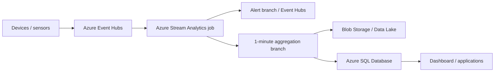
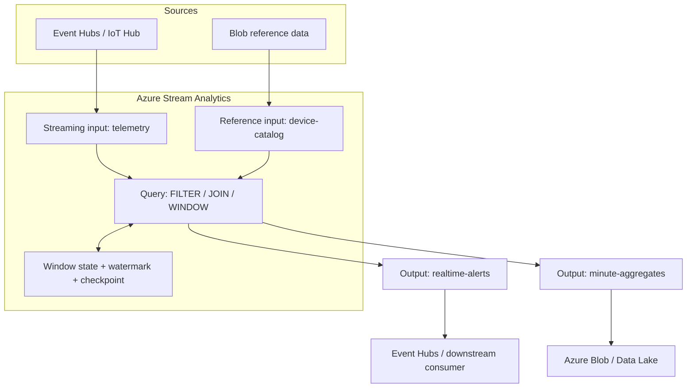
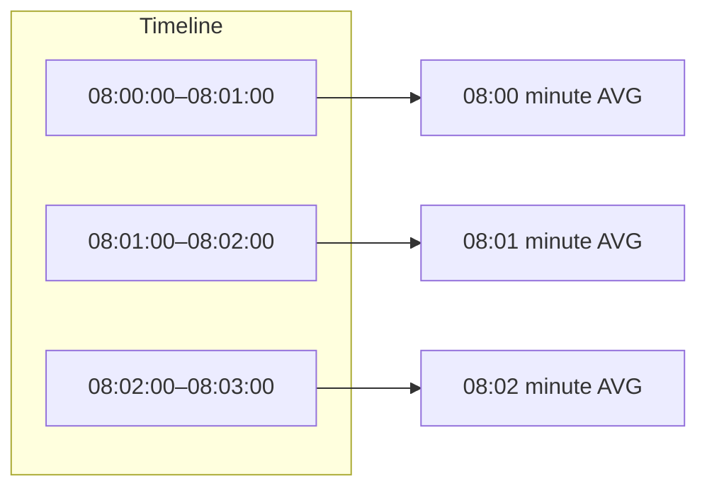
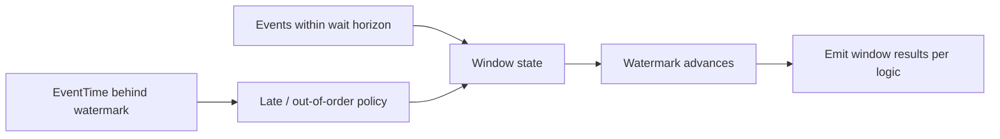
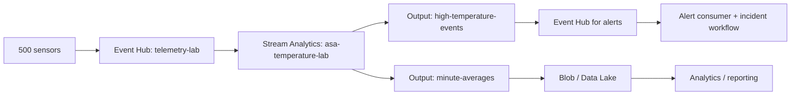
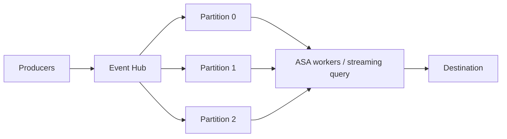
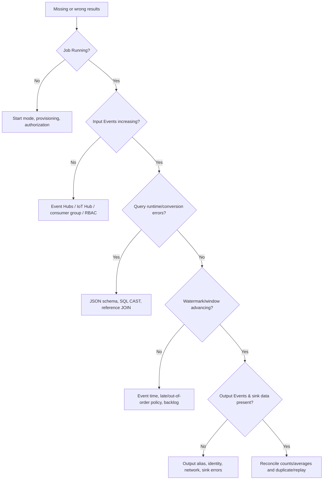
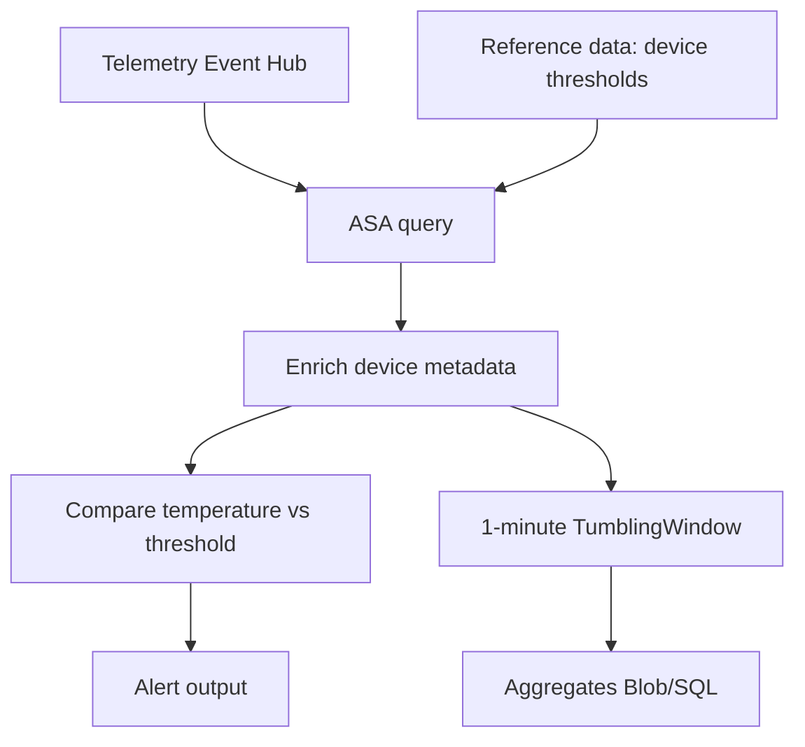

# Stream Processing with Azure Stream Analytics

Suppose a factory has thousands of temperature sensors. Each sensor emits an event every few seconds; operations wants **alerts when temperature crosses a threshold**, **per-minute average temperatures**, and long-term storage of aggregates for analytics. Loading all data first and running an hourly batch job detects incidents too slowly. Conversely, building a custom service to ingest, maintain state, compute time windows, handle late events, and ensure fault tolerance forces the engineering team to operate complex infrastructure.

**Azure Stream Analytics (ASA)** is a managed stream processing service on Microsoft Azure. A **Stream Analytics job** reads events from inputs such as **Azure Event Hubs** or **Azure IoT Hub**, runs SQL-like queries to filter, transform, join, and aggregate over time windows, and writes results to supported outputs such as **Azure Blob Storage / Data Lake**, **Azure SQL Database**, **Event Hubs**, or analytics/visualization targets.

This lesson belongs to the **Events and Streaming Data** chapter of the `CLOUD_PROVIDERS_AZURE` module. Along the path exploring Microsoft Azure from subscriptions, resource groups, and Microsoft Entra ID through virtual networks, compute, storage, and data, this content teaches how to **design, deploy, monitor, secure, and control the cost of a near-real-time stream processing pipeline on Azure**.

> **Scope:** commands, resource names, JSON records, and queries below are for learning. Availability of input/output connectors, managed identity, private networking, Streaming Units, and Portal UI varies by region, SKU, and service version. Provision billable resources only in an authorized sandbox subscription; running a live job is not required to grasp all concepts.

## Learning Objectives

After this lesson, you will be able to:

1. Distinguish stream processing from batch processing and determine when to use Stream Analytics.
2. Explain the three components of an ASA job—**input → query → output**—and distinguish **streaming inputs** from **reference data inputs**.
3. Write Stream Analytics Query Language statements to filter events, compute metrics, group by device, and emit outputs.
4. Distinguish **event time**, **arrival/enqueued time**, and **processing time**, and use `TIMESTAMP BY` when processing by business time.
5. Understand and choose among **Tumbling, Hopping, Sliding, and Session windows**.
6. Design **late arrival / out-of-order** policies, watermarks, bad-data handling, and understand their impact on outputs.
7. Build a pipeline from Event Hubs to Blob/SQL and test queries with sample datasets in the Portal.
8. Identify duplicates, replays, and checkpoints, and distinguish **at-least-once** outputs from end-to-end exactly-once guarantees.
9. Evaluate consumer groups, partitioning, Streaming Units (SUs), scaling, security, and private networking.
10. Monitor input/output events, watermark delay, backlog, runtime errors, and costs to run stably.

## 1. How Does Stream Processing Differ from Batch Processing?

| Criterion | Batch processing | Stream processing |
|---|---|---|
| Input data | An accumulated bounded dataset | Continuous or near-continuous event sequence |
| Processing time | Scheduled or manually triggered | As events arrive, per processing policy |
| Output | Emitted once per dataset run | Continuous outputs, per event or per window |
| State | Typically aggregates over a closed dataset | Maintains state across multiple events/windows |
| Latency | Minutes, hours, or days depending on architecture | Usually targeted lower, though not guaranteed instantaneous |
| Complexity | Data storage and batch scheduling | Event time, late events, watermarks, state, delivery semantics |
| Example | End-of-day revenue rollup | Per-minute over-temperature detection |

A streaming pipeline does not mean **every event is always processed instantaneously**. Latency depends on source rate, event timestamps, watermark settings, job health, load, window size, and output sink throughput.

### Factory example



**Event Hubs is the ingestion/buffer layer**, ASA is the compute layer, and SQL/Blob is the result storage layer. Each component has its own role; never treat ASA as a replacement for the event source or a long-term data warehouse.

## 2. Architecture of an Azure Stream Analytics Job

A job consists of three core parts:

- **Input:** defines the data source, connection, format, and read configuration.
- **Query:** streaming SQL statements transforming and routing data.
- **Output:** target sink for results, including schema mapping, permissions, and write options.



### An input is a configuration, not a permanent SQL table

In queries, `[telemetry]` looks like a table name, yet it actually references an **event stream source**. ASA reads records and processes them over time; the job does not store a permanent copy of all historical events for arbitrary ad-hoc querying.

### A query is a continuous flow, not a one-off script

The job runs continuously. The query declares rules applied as data flows through:

```sql
SELECT
    deviceId,
    temperature,
    eventTime
INTO
    [raw-events-output]
FROM
    [telemetry]
```

While the job runs, every valid event flows through the query and writes to the output per connector semantics. There is no traditional `INSERT INTO` syntax here: ASA uses `SELECT ... INTO [output-alias] FROM [input-alias]` to wire the query to a declared output.

### One job can write to multiple outputs

Example feeding one input into two query branches:

```sql
SELECT deviceId, temperature, eventTime
INTO [raw-events-output]
FROM [telemetry];

SELECT
    deviceId,
    COUNT(*) AS sampleCount,
    AVG(CAST(temperature AS float)) AS averageTemperature
INTO [minute-averages]
FROM [telemetry] TIMESTAMP BY eventTime
GROUP BY deviceId, TumblingWindow(minute, 1);
```

Output aliases must exist and be configured properly in the job. Two outputs can differ in format, throughput, latency, and write failures. A query running cleanly **does not automatically prove** data committed durably to every sink.

## 3. Choosing Streaming Inputs and Reference Inputs

### Streaming inputs

**Azure Event Hubs** fits telemetry, logs, and high-volume event streams. Producers send messages to an Event Hub; ASA reads via its configured consumer group.

**Azure IoT Hub** handles device connectivity, device authentication, and IoT telemetry. ASA can consume its supported compatible event endpoint as an input.

Other sources can pass through a preprocessing step into Event Hubs or use a supported ASA connector. Never assume any arbitrary Kafka or HTTP endpoint can be picked directly as an ASA input.

### Reference inputs

Reference data is a relatively static lookup dataset, for example:

```json
[
  {
    "deviceId": "sensor-01",
    "site": "Factory-A",
    "maxSafeTemperature": 75.0
  },
  {
    "deviceId": "sensor-02",
    "site": "Factory-B",
    "maxSafeTemperature": 80.0
  }
]
```

ASA supports **reference data inputs** from supported sources such as Blob Storage or Azure SQL to enrich streaming events. Reference data uses its own snapshot/refresh cadence; **never assume editing a row in Blob immediately updates every partition instantaneously**.

### Choosing the right input type

| Problem | Data type | ASA role |
|---|---|---|
| Per-second temperature readings | Streaming | Read and aggregate over windows |
| Mapping `deviceId` → factory | Reference | Enrich via JOIN |
| Orders in Event Hubs | Streaming | Compute orders/minute |
| Safety thresholds per device | Reference | Filter threshold breaches |
| Year-end report scanning full history | Batch / lake analytics | ASA is not the sole or default choice |

## 4. Designing Event Data: Event Time and Entity Keys

Sample IoT record:

```json
{
  "eventId": "evt-10001",
  "deviceId": "sensor-01",
  "eventTime": "2026-11-20T08:00:10Z",
  "temperature": 72.4,
  "humidity": 55.0,
  "unit": "C"
}
```

Each field serves a purpose:

| Field | Role | Notes |
|---|---|---|
| `eventId` | Identifies event for downstream tracing/deduplication | Keep identical across retries of the same event |
| `deviceId` | Device grouping key | Design cardinality and partitioning sensibly |
| `eventTime` | Timestamp when the event actually occurred | Prefer UTC ISO 8601 and validate at source |
| `temperature` | Metric to compute | Ensure numeric type and consistent units |
| `humidity` | Supplemental metric | May be missing or null |
| `unit` | Measurement unit | Never `AVG` temperatures of mixed units |

### Events pass through multiple time layers

An event may follow this timeline:

```text
08:00:10Z   Device measures reading (event time)
08:00:12Z   Event Hubs receives event (enqueued/arrival time)
08:00:15Z   ASA reads and processes (processing time)
08:00:21Z   Output becomes visible in sink
```

These timestamps **are not identical**. A disconnected device may transmit a 08:00 reading to Event Hubs at 08:12. Aggregating by arrival time places it in the 08:12 window instead of 08:00. When reporting by measurement time, use **event-time processing**.

### Standardize schemas at the producer

Recommendations:

1. Send `eventTime` in UTC with an explicit timezone indicator.
2. Keep field names and casing consistent with queries.
3. Send numeric values as JSON numbers rather than mixing `"72.4"` strings and `72.4` numbers.
4. Include a stable `eventId` for tracing and duplicate mitigation.
5. Exclude passwords, SAS keys, tokens, or unnecessary PII from telemetry.
6. Publish schema versions when formats evolve over time.
7. For multi-device streams, pick appropriate partition keys without assuming partition keys alone guarantee end-to-end business order.

## 5. Selecting Event Time with `TIMESTAMP BY`

In ASA Query Language, you can specify the event timestamp field explicitly:

```sql
SELECT
    deviceId,
    temperature,
    eventTime
INTO [raw-events-output]
FROM [telemetry] TIMESTAMP BY eventTime
```

`TIMESTAMP BY eventTime` instructs ASA to use the **logical event timestamp** rather than relying solely on message arrival time for time-based operations. `eventTime` must hold a valid timestamp format accepted by the schema parser / ASA SQL. If producers send malformed strings or omit timezones, handle casting/validation or error routing before aggregating.

Never view `TIMESTAMP BY` as a command that fixes skewed clocks or repairs invalid timestamps. It strictly tells the query which timestamp field drives time semantics.

### What if `TIMESTAMP BY` is omitted?

The job uses an arrival-related timestamp per the supported runtime/source behavior. That works well when you genuinely want **messages ingested into Event Hubs per minute**, rather than when devices took measurements.

| Business question | Timestamp to consider |
|---|---|
| How hot was a sensor at actual 08:00? | Sensor **event time** if trustworthy |
| How many messages did ingestion receive at 08:00? | Enqueued / arrival time |
| Why is the dashboard updating slowly? | Processing/output time, watermark, backlog |
| Need to audit sources with clock drift? | Compare event time against arrival time |

### Field names are part of the data contract

`TIMESTAMP BY eventTime` will not behave as expected if the source emits `event_time` or `EventTimestamp` and the query misses it. Before starting a job, test sample data matching your exact serializer, format, encoding, and casing.

## 6. Windowing: Grouping Events into Time Intervals

Streams have no “end of table” signaling when to finalize an `AVG` or `COUNT`. **Windows** bound aggregation intervals over time.

### Four core window types

| Window | How data is grouped | When to use |
|---|---|---|
| **Tumbling** | Contiguous, non-overlapping intervals | Per-minute or hourly reporting |
| **Hopping** | Fixed-size intervals advancing by a smaller hop, overlapping | 5-minute moving average updated every minute |
| **Sliding** | Slides continuously with events, emitting when output changes per operator semantics | Alerts over the most recent rolling span |
| **Session** | Groups nearby events, splitting on inactivity gaps | Grouping user sessions or device activity bursts |

### Tumbling window: every event belongs to one window



Query:

```sql
SELECT
    deviceId,
    COUNT(*) AS sampleCount,
    AVG(CAST(temperature AS float)) AS avgTemperature,
    MIN(CAST(temperature AS float)) AS minTemperature,
    MAX(CAST(temperature AS float)) AS maxTemperature,
    System.Timestamp() AS windowEndUtc
INTO [minute-averages]
FROM [telemetry] TIMESTAMP BY eventTime
GROUP BY
    deviceId,
    TumblingWindow(minute, 1)
```

Meaning:

- `TumblingWindow(minute, 1)` creates non-overlapping 1-minute windows.
- `GROUP BY deviceId` emits one row per device for each window containing data.
- `COUNT(*)` counts valid records entering the group (not necessarily true device sample count if messages were dropped or duplicated).
- `System.Timestamp()` in window aggregations typically yields the **logical window end timestamp** of the result, not the time a user views the dashboard.

Even a single record for `sensor-01` in a window emits an output once the watermark passes. If zero events arrive for a `deviceId` in a window, ASA does not emit a `sampleCount=0` row by default; “zero-filled windows” require dedicated design.

### Hopping window: overlapping windows

Example 5-minute aggregation updated every minute:

```sql
SELECT
    deviceId,
    COUNT(*) AS sampleCount,
    AVG(CAST(temperature AS float)) AS movingAverage,
    System.Timestamp() AS windowEndUtc
INTO [rolling-averages]
FROM [telemetry] TIMESTAMP BY eventTime
GROUP BY
    deviceId,
    HoppingWindow(minute, 5, 1)
```

`HoppingWindow(minute, 5, 1)` has a **5-minute window size** and **1-minute hop size**. One event contributes to multiple overlapping windows, so summing `sampleCount` across hopping windows exceeds raw event counts.

### Sliding window: reactive to change

```sql
SELECT
    deviceId,
    COUNT(*) AS eventsInWindow,
    System.Timestamp() AS windowTimestamp
INTO [sliding-activity]
FROM [telemetry] TIMESTAMP BY eventTime
GROUP BY
    deviceId,
    SlidingWindow(minute, 5)
```

A sliding window tracks events across a rolling 5-minute span per ASA semantics. It is **not equivalent** to emitting once per fixed minute like a HoppingWindow. When you want fixed-cadence outputs, HoppingWindow or TumblingWindow is easier to control.

### Session window: grouping by inactivity gaps

Example grouping events from one device into a session while consecutive events stay within a timeout gap:

```sql
SELECT
    deviceId,
    COUNT(*) AS eventCount,
    MIN(CAST(temperature AS float)) AS minTemperature,
    MAX(CAST(temperature AS float)) AS maxTemperature,
    System.Timestamp() AS sessionEnd
INTO [device-sessions]
FROM [telemetry] TIMESTAMP BY eventTime
GROUP BY
    deviceId,
    SessionWindow(minute, 5, 30)
```

In this syntax, the inactivity timeout is **5 minutes** and the maximum session duration is **30 minutes** per supported SessionWindow parameters. Verify exact syntax, modes, and session closure behavior in your service version before production use.

### Choosing a window from business questions

| Requirement | Starting choice |
|---|---|
| Per-minute revenue | 1-minute Tumbling |
| 5-minute average refreshed every minute | 5-min / 1-min Hopping |
| Anomaly check over last 30 seconds | Sliding or Hopping depending on output cadence |
| Device usage session split after 5 minutes idle | Session |
| End-of-day totals | Calendar/timezone-aware Tumbling or batch, per requirement |

**No single window fits every workload.** Dense hopping multiplies outputs and compute load; Session windows retain per-key state across long sessions; Tumbling introduces natural latency until the watermark closes the window.

## 7. Sample Dataset to Verify Calculations

Suppose ASA receives these events for sensors:

| Event ID | Event time (UTC) | Device | Temperature |
|---|---|---|---:|
| E1 | 08:00:10 | sensor-01 | 70 |
| E2 | 08:00:25 | sensor-01 | 74 |
| E3 | 08:00:55 | sensor-01 | 76 |
| E4 | 08:01:05 | sensor-01 | 80 |
| E5 | 08:01:50 | sensor-01 | 82 |
| E6 | 08:00:30 | sensor-02 | 65 |

Assuming all events are accepted at their event times without late/out-of-order drops or adjustments, **TumblingWindow(minute, 1)** produces:

| Window UTC | Device | Count | Average |
|---|---|---:|---:|
| [08:00, 08:01) | sensor-01 | 3 | 73.33 |
| [08:00, 08:01) | sensor-02 | 1 | 65.00 |
| [08:01, 08:02) | sensor-01 | 2 | 81.00 |

Calculation for `sensor-01` in the 08:00 minute:

\[
\frac{70+74+76}{3}=73.33.
\]

**Do not lump E4 into the 08:00 minute** merely because it arrived in the same send batch: window assignment here follows `eventTime`.

### Mixed-unit hazard

If E3 sends `168.8 F` instead of `76 C`, averaging raw values produces garbage. Convert everything to a canonical unit before windowing, or filter/flag invalid records. Aggregation queries cannot infer physical units automatically.

## 8. Stream Analytics SQL: Filtering, Transforming, and Routing

ASA SQL resembles T-SQL in many expressions, yet **it is not full SQL Server**. Queries use temporal operators and stream-specific functions; you cannot paste stored procedures, SQL Server index hints, or SQL transaction scripts into ASA.

### A. Filtering over-threshold temperatures

```sql
SELECT
    deviceId,
    eventTime,
    temperature,
    eventId
INTO [high-temperature-events]
FROM [telemetry] TIMESTAMP BY eventTime
WHERE CAST(temperature AS float) >= 80
```

This statement performs no window aggregation; matching events pass straight to the output. If noisy alerts must be throttled, add suppression/windowing/state downstream rather than assuming a filter deduplicates.

### B. Normalizing and tagging severity

```sql
SELECT
    eventId,
    deviceId,
    eventTime,
    CAST(temperature AS float) AS temperatureC,
    CASE
        WHEN CAST(temperature AS float) >= 90 THEN 'critical'
        WHEN CAST(temperature AS float) >= 80 THEN 'warning'
        ELSE 'normal'
    END AS severity
INTO [classified-events]
FROM [telemetry] TIMESTAMP BY eventTime
```

If `temperature` cannot parse as a float, `CAST` can raise a **conversion error**. In production, use validation / `TRY_CAST` (where supported by your ASA SQL compatibility level) or validate schemas upstream before Event Hubs. Adding `CASE` only classifies records that **already parsed cleanly**.

### C. Multiple outputs from one query job

```sql
SELECT
    deviceId,
    eventTime,
    temperature
INTO [raw-events-output]
FROM [telemetry];

SELECT
    deviceId,
    COUNT(*) AS readingCount,
    AVG(CAST(temperature AS float)) AS averageTemperature,
    System.Timestamp() AS windowEndUtc
INTO [minute-averages]
FROM [telemetry] TIMESTAMP BY eventTime
GROUP BY deviceId, TumblingWindow(minute, 1);
```

When writing multiple outputs from the same event stream, remember **a failure on one output can impact job state/health**; never assume two branches commit atomically together. If exact consistency across sinks is required, write canonical results to one replayable/idempotent sink or use application coordination.

### D. Common Table Expressions (CTEs)

CTEs avoid duplicating transformation logic inside a query:

```sql
WITH CleanTelemetry AS
(
    SELECT
        deviceId,
        CAST(temperature AS float) AS temperatureC,
        eventTime
    FROM [telemetry] TIMESTAMP BY eventTime
    WHERE unit = 'C'
)
SELECT
    deviceId,
    AVG(temperatureC) AS avgTemp,
    System.Timestamp() AS windowEndUtc
INTO [minute-averages]
FROM CleanTelemetry
GROUP BY deviceId, TumblingWindow(minute, 1);
```

This keeps multi-step queries maintainable. A CTE is **not a persisted table**; stateful operators still depend on job time, windows, and checkpoints.

## 9. Enrichment: Joining Streaming Inputs with Reference Data

80°C may be normal for one machine and dangerous for another. Use reference data:

```json
{
  "deviceId": "sensor-01",
  "site": "Factory-A",
  "maxSafeTemperature": 75.0
}
```

Given streaming input `[telemetry]` and reference input `[device-catalog]`, an illustrative query:

```sql
SELECT
    t.deviceId AS deviceId,
    r.site AS site,
    t.eventTime AS eventTime,
    t.temperature AS temperature,
    r.maxSafeTemperature AS threshold
INTO [enriched-events]
FROM [telemetry] t TIMESTAMP BY t.eventTime
JOIN [device-catalog] r
    ON t.deviceId = r.deviceId
```

Edge cases to handle:

- Device missing from reference data: an **inner JOIN** drops events for that device. Use an OUTER JOIN or dedicated branch if supported and you need to catch unregistered devices.
- Duplicate rows for the same `deviceId` in reference data: multiplies matches and inflates counts.
- Stale reference snapshot: outputs temporarily evaluate against older thresholds.
- Wrong `maxSafeTemperature` data type: normalize types before comparing.

### JOIN is not a per-event remote API call

ASA manages reference inputs via snapshots/refreshes, not by firing an HTTP database query on every sensor event. When thresholds change rapidly, evaluate refresh cadence consistency or model threshold updates as a versioned control-event stream.

### Joining two streaming inputs

ASA supports stream-to-stream JOINs using explicit **time bounds** (`DATEDIFF`) to avoid unbounded state. For instance, matching a `payment` event with an `order` event occurring nearby requires a correlation key and a time window; never write an unbounded SQL JOIN on `orderId` expecting the engine to keep history forever.

When business logic demands transactions, strict ordering, and exactly-once order state mutations, Azure Service Bus Sessions, stateful application workers, or transactional stores may fit better than ASA aggregations. Every service has its own responsibility boundary.

## 10. Late Arrival, Out-of-Order, and Watermarks

Real-world streams rarely arrive in perfect timestamp order. Two main deviations occur:

1. **Late arrival:** an event's `eventTime` is significantly older than when it reaches the source/ASA.
2. **Out-of-order arrival:** an event's timestamp is earlier than events already seen in the stream/partition.

Example:

| Arrival order | Event time | Meaning |
|---|---|---|
| 1 | 10:00:10 | Normal |
| 2 | 10:00:40 | Normal |
| 3 | 10:00:25 | Out of order |
| 4 | 09:52:00 | Very late |

ASA needs to know **how long to wait for late data** before finalizing window outputs. A job cannot wait forever for one disconnected sensor.

### What is a watermark?

A **watermark** is a logical timestamp tracking how far the stream processor has progressed in event time and which windows are eligible to emit results per policy. Watermarks reflect delay/late-arrival policies and stream progression—they do not always equal the latest event timestamp seen.



### Job ordering policy settings

In the Azure Portal, **Event ordering** or equivalent job configuration typically exposes:

- **Out-of-order tolerance:** time window allowing out-of-order timestamps to be reordered.
- **Out-of-order action:** **Adjust** or **Drop**, per service/configuration.
- **Late arrival tolerance:** threshold for events arriving far behind wall-clock arrival time; adjusting or dropping follows supported service policy.

Do not treat both tolerances as one setting. They measure different kinds of time skew. **Never set huge tolerances** just to “never drop data”: windows stay open longer, raising latency, memory pressure, and cost.

### Adjust vs. Drop trade-offs

| Policy | Meaning | Risk |
|---|---|---|
| **Drop** events outside tolerance | Discards violating events per policy | Reports lose data unless raw events are archived elsewhere |
| **Adjust** timestamps per supported policy | Rewrites timestamp to continue processing | Records land in a different window than original `eventTime` |

If audit reports require preserving **original `eventTime`**, archive raw events separately via Event Hubs Capture / Blob / Data Lake or an ingestion pipeline, and log adjustment metadata for traceability. **Never use adjusted aggregate outputs as the sole legal system of record.**

### Watermark delay is not the only latency indicator

Late outputs can stem from:

- Slow input sources or consumer group checkpoint delays.
- Large clock skew in `eventTime`.
- Overly wide tolerances or quiet partitions stalling watermark progression.
- Complex queries/windows short on SUs.
- Throttled or unavailable output sinks.

To diagnose, compare **Input Events, Backlogged Input Events, Watermark Delay, Output Events, and runtime/output errors** on the same timeline rather than checking only downstream app CPU/HTTP logs.

## 11. Data Quality: Duplicate and Missing Events

A producer may retry when uncertain whether Event Hubs accepted a message, duplicating the event. ASA's `COUNT(*)` counts **received records**; it does not automatically treat two messages sharing an `eventId` as one business event.

### Example of skewed aggregation

```json
{"eventId":"evt-77","deviceId":"sensor-01","eventTime":"2026-11-20T08:00:10Z","temperature":70}
{"eventId":"evt-77","deviceId":"sensor-01","eventTime":"2026-11-20T08:00:10Z","temperature":70}
```

If both enter the window without deduplication, `COUNT(*)` increments to 2 even though the device emitted one logical reading.

### Mitigation strategies

- Producers assign a **stable `eventId`**, never minting new IDs on retries of the same event.
- Retain raw streams long enough for audit/replay and duplicate detection.
- Apply window/query deduplication where retention, keys, and semantics fit; never assume a naive `DISTINCT` or `GROUP BY` catches duplicates across arbitrary replays.
- For database sinks, enforce **idempotent upserts / unique constraints** keyed by `deviceId + windowEnd + metricVersion` instead of blind inserts.
- Distinguish duplicate input events from duplicate outputs caused by post-crash replays.

### Missing events

If a sensor disconnects for 10 minutes, zero events does not mean temperature was 0°C. **“Missing” and “zero” are different.** Monitoring should trigger a “device silent” alert using last-seen timestamps and expected heartbeats; never inject zeros into `AVG` and distort averages.

## 12. ASA Outputs: Choose by How Results Are Consumed

Outputs answer two questions: **who consumes the result** and **must the result state be persisted durably**?

| Output category | Example targets | Fits | Operational notes |
|---|---|---|---|
| **Object storage** | Azure Blob Storage, Azure Data Lake Storage Gen2 per supported connector | Archiving aggregates, history, data lakes | Format, partition paths, file size, output latency |
| **Relational data** | Azure SQL Database | Dashboards, windowed operational reporting | Schema, throughput, unique keys, upsert/idempotency |
| **Event distribution** | Azure Event Hubs | Forwarding filtered events to downstream consumers | Retention, consumer groups, downstream retries |
| **Analytical stores** | Azure Data Explorer or supported analytics sinks | Time-series analytics, search, dashboards | Connector, ingestion latency, ingestion mappings |
| **Visualization connectors** | Supported reporting integrations | Near-real-time dashboards | API quotas, schema, identity, service limits |

Not every output type or auth mode exists in every region or hosting tier; verify compatibility under **Outputs** in your job before locking the architecture.

### Blob output is not row-by-row database writes

When ASA writes to Blob / Data Lake, outputs may be **buffered/batched into files** per format and config. A processed event does not necessarily appear instantaneously as an individual blob. Check output latency, file naming, and partition paths before relying on Blob output for instant alerting.

### SQL output does not auto-upsert by business key safely

If per-window results write to SQL:

```text
deviceId    windowEndUtc          avgTemperature
sensor-01   2026-11-20T08:01Z     73.33
sensor-01   2026-11-20T08:02Z     81.00
```

To maintain strictly one row per `deviceId + windowEndUtc + queryVersion`, design **unique keys, column mappings, idempotent writes/upserts, or staging + merge** per connector capabilities and data model. Never assume ASA's write to one sink forms a distributed transaction with another sink.

### When to use Event Hubs output?

When ASA detects threshold breaches, it can forward events to an **Event Hubs output** so a downstream worker/service triggers alerts with its own retries, throttling, and permissions. Event Hubs suits **telemetry streams**, lacking Azure Service Bus message sessions and settlement.

**Never treat an Event Hubs output as proof an operator read the alert.** If acknowledgment, audit trails, and escalation are required, pair it with a stateful notification/incident system.

## 13. Reference Pipeline: Event Hubs → ASA → Blob + Dashboard

### Architecture requirements

A system monitoring 500 sensors:

- Each sensor sends JSON telemetry to Event Hubs.
- Some events may arrive late or out of order.
- Detect temperature events over 80°C to raise alerts.
- Compute **average, min, max, and sample count per device/minute**.
- Store aggregates in Storage for analytics.
- Monitor backlog, window latency, errors, and cost.



### Illustrative resource design

| Resource | Sample name | Role |
|---|---|---|
| Resource group | `rg-stream-lab` | Cost/tag boundary and cleanup |
| Event Hubs namespace | `ehns-stream-lab-<unique>` | Ingestion namespace |
| Event Hub | `telemetry-lab` | Ingests JSON telemetry |
| Consumer group | `cg-asa-temperature` | Dedicated read group for ASA job |
| Stream Analytics job | `asa-temperature-lab` | Continuous query |
| Streaming input alias | `telemetry` | Input from Event Hubs |
| Raw output alias | `raw-events-output` | Optional raw pass-through |
| Window output alias | `minute-averages` | Blob / SQL |
| Alert output alias | `high-temperature-events` | Event Hubs or alert sink |
| Storage account/container | `ststreamlab<unique>` / `aggregates` | Stores results |

**An ASA job can read the same Event Hub alongside other consumers**, provided it uses a **dedicated consumer group** for independent checkpointing and no read contention. Event Hub throughput, retention, partitions, and namespace tier must be sized independently of the ASA job.

## 14. Creating a Stream Analytics Job via Azure Portal

The steps below describe the procedural flow. Exact menu labels may vary by Portal version, region, and features.

### Step 1 — Confirm subscription and budget

1. Select an authorized sandbox subscription.
2. Create or select a dedicated lab resource group.
3. Confirm Event Hubs, Stream Analytics, and Storage regions satisfy latency, cost, and data residency rules.
4. Ensure your account holds Azure RBAC to create/manage resources and assign data-plane roles.
5. Note projected costs while the job is **Running**; stopping a job does not delete supporting resources.

### Step 2 — Create the Event Hubs input

In the Azure Portal:

1. Create or select an Event Hubs namespace.
2. Create Event Hub `telemetry-lab` with partition count and retention suited for testing.
3. Create consumer group `cg-asa-temperature` dedicated to ASA.
4. Configure an authorized sender identity or policy.
5. Check ingestion metrics after sending test events; producer send success does not mean ASA has read them.

**Partition count and consumer group must be chosen intentionally.** If the input has 8 partitions, the query and outputs need compatible parallelization; increasing partitions does not automatically preserve accuracy across arbitrary JOINs or windows.

### Step 3 — Create the ASA job

1. Navigate to **Stream Analytics jobs → Create**.
2. Choose subscription/resource group, name `asa-temperature-lab`, and region.
3. Select hosting/cloud configuration and **Streaming Units (SUs)** or supported capacity tier.
4. Configure identity and networking per policy.
5. Review tags, budget, and summary, then create the job.

After creation, the job starts in **Created/Stopped** state. **Creating the job does not start reading Event Hubs.**

### Step 4 — Define the streaming input

In the job → **Inputs → Add stream input → Event Hub**:

- Input alias: `telemetry`.
- Select namespace `ehns-stream-lab-...`.
- Select Event Hub `telemetry-lab`.
- Select consumer group `cg-asa-temperature`.
- Choose a connector-supported authentication mode, preferring managed identity where fully supported.
- Serialization: **JSON**, UTF-8 encoding matching the producer.
- Configure event compression/format if required by the source.

Save and run **Test connection** if supported in the Portal. A passing connection test still requires testing live reads, since consumer groups, permissions, and message schemas can fail at runtime.

### Step 5 — Create outputs

Example first lab output:

- Output alias: `minute-averages`.
- Destination: supported Blob Storage or Data Lake.
- Storage account/container: `ststreamlab...` / `aggregates`.
- Serialization: JSON or a connector-supported format suited to downstream readers.
- Path/file pattern and output partitioning: configure sensibly to avoid excessive tiny files.
- Authentication: key or managed identity per feature support and policy.

When adding `high-temperature-events` to Event Hubs, point to a separate target Event Hub or downstream processing stream. Never route alerts back into ASA's own input Event Hub without safeguards preventing a **feedback loop**.

### Step 6 — Write the query

To test **one output first** and reduce misconfiguration surface, start with the aggregation query:

```sql
SELECT
    deviceId,
    COUNT(*) AS sampleCount,
    AVG(CAST(temperature AS float)) AS averageTemperature,
    MAX(CAST(temperature AS float)) AS maximumTemperature,
    System.Timestamp() AS windowEndUtc
INTO [minute-averages]
FROM [telemetry] TIMESTAMP BY eventTime
WHERE unit = 'C'
GROUP BY
    deviceId,
    TumblingWindow(minute, 1)
```

Verify this query before adding the alert output/branch.

### Step 7 — Configure event ordering

Decide carefully:

- Do you trust device `eventTime` clocks?
- What are normal and worst-case network delays?
- Does the business prefer faster partial outputs or more complete delayed outputs?
- For events arriving too late, should the job **drop** or **adjust** per policy?
- Are raw events archived separately for replay and reconciliation?

Document tolerances and actions in a runbook; sample figures **do not replace** real measurements.

### Step 8 — Test query before starting

In the Portal, use **Test query** with sanitized sample inputs or uploaded test files. Inspect sample outputs and check for:

- JSON serialization mismatches.
- Missing `eventTime` or `deviceId` fields.
- Non-numeric `temperature` conversion errors.
- Undefined output aliases.
- Bad reference input paths or formats.
- Window outputs diverging from expectations due to timestamps and watermarks.

**Testing a query on a sample file is not the same as a Running job**: it does not verify consumer groups, live input lag, or output sink connectivity. Always run an end-to-end test too.

### Step 9 — Start the job under control

In job **Overview → Start** (or equivalent), choose the stream starting position supported by the Portal:

- Start from now (`Now` / job start time).
- Start from a custom timestamp within source retention.
- Resume from checkpoint / last output state per job support.

**Start position has major impact:** starting from “Now” skips messages sent while the job was stopped; starting from an older timestamp can re-read events and duplicate outputs. Record the start mode and replay policy before starting.

### Step 10 — Verify end-to-end

1. Send telemetry with valid timestamps to Event Hubs.
2. Watch **Input Events** rise.
3. Monitor **Output Events**, **Watermark Delay**, **Backlogged Input Events**, and errors.
4. Inspect actual Blob / SQL / Event Hubs output.
5. Reconcile counts and averages against input records for a test window.
6. Stop the job after finishing the lab to stop compute charges, and clean up temporary resources.

## 15. Testing Queries with Sample Event JSON

### Three-device dataset

Prepare sample events (each line is an independent JSON record; when testing in the Portal, use the sample import format accepted by the tool):

```json
{"eventId":"t-01","deviceId":"sensor-01","eventTime":"2026-11-20T08:00:10Z","temperature":70,"unit":"C"}
{"eventId":"t-02","deviceId":"sensor-01","eventTime":"2026-11-20T08:00:20Z","temperature":74,"unit":"C"}
{"eventId":"t-03","deviceId":"sensor-01","eventTime":"2026-11-20T08:00:55Z","temperature":76,"unit":"C"}
{"eventId":"t-04","deviceId":"sensor-01","eventTime":"2026-11-20T08:01:10Z","temperature":80,"unit":"C"}
{"eventId":"t-05","deviceId":"sensor-02","eventTime":"2026-11-20T08:00:30Z","temperature":65,"unit":"C"}
```

**Important:** the block above uses **JSON Lines** for readability rather than one single JSON document. When using **Upload sample data** or specific SDKs, format it as required by the tool. Never paste 5 separate lines into an API expecting one JSON array/object.

Test query:

```sql
SELECT
    deviceId,
    COUNT(*) AS sampleCount,
    AVG(CAST(temperature AS float)) AS averageTemperature,
    System.Timestamp() AS windowEndUtc
INTO [minute-averages]
FROM [telemetry] TIMESTAMP BY eventTime
GROUP BY deviceId, TumblingWindow(minute, 1)
```

Assuming all events arrive and pass event-time policy, expected outputs are:

| Device | Window end (UTC) | Count | Average |
|---|---|---:|---:|
| sensor-01 | 08:01:00 | 3 | 73.33 |
| sensor-01 | 08:02:00 | 1 | 80.00 |
| sensor-02 | 08:01:00 | 1 | 65.00 |

In live runs, **watermarks and window closure** may require sending an event with a slightly later timestamp or waiting briefly before outputs appear. Sending hardcoded **past `eventTime` values** to a **job running on a later day** may trigger late-arrival drop/adjust rules so outputs diverge from the table above. For live tests, generate timestamps near **current UTC** while keeping relative spacing intact.

### Test record to log

```text
Job: asa-temperature-lab
Input alias: telemetry
Input format: JSON / UTF-8
Output alias: minute-averages
Query version: 1
Event time field: eventTime
Watermark/out-of-order setting: <configured>
Sample events input: <count>
Expected windows: <list>
Actual windows: <list>
Input Events: <metric over time>
Output Events: <metric over time>
Watermark Delay: <metric>
Backlogged Input Events: <metric>
Exceptions / Conversion Errors: <count>
Comparison result: PASS / needs investigation
```

## 16. Sending Live Data to Event Hubs with Python

Learners can use the Python SDK in an **isolated sandbox environment** to emit events near current time. This code does not run inside the ASA job; ASA reads from Event Hubs and evaluates the query.

### Preparation

Assumptions:

- Event Hubs namespace FQDN `<namespace>.servicebus.windows.net`.
- Event Hub `telemetry-lab` exists.
- Running identity holds **Azure Event Hubs Data Sender** at appropriate scope.
- Host running the script has DNS/routing to the Event Hubs namespace.

Install packages:

```bash
python -m pip install azure-eventhub azure-identity
```

### Sample producer

```python
import datetime
import json
import os
import uuid

from azure.eventhub import EventData, EventHubProducerClient
from azure.identity import DefaultAzureCredential


namespace = os.environ["EVENTHUB_FQDN"]
eventhub_name = os.environ["EVENTHUB_NAME"]

with DefaultAzureCredential() as credential:
    with EventHubProducerClient(
        fully_qualified_namespace=namespace,
        eventhub_name=eventhub_name,
        credential=credential
    ) as producer:
        batch = producer.create_batch()
        now = datetime.datetime.now(datetime.timezone.utc)

        samples = [
            ("sensor-01", 70.0, 0),
            ("sensor-01", 74.0, 10),
            ("sensor-02", 65.0, 20),
            ("sensor-01", 81.0, 35),
        ]

        for device_id, temperature, offset_seconds in samples:
            timestamp = now + datetime.timedelta(
                seconds=offset_seconds
            )
            payload = {
                "eventId": str(uuid.uuid4()),
                "deviceId": device_id,
                "eventTime": timestamp.isoformat().replace(
                    "+00:00", "Z"
                ),
                "temperature": temperature,
                "unit": "C"
            }
            batch.add(EventData(json.dumps(payload)))

        producer.send_batch(batch)
        print("Sent", len(samples), "lab events")
```

### Two fixes when adapting for a live lab

1. **Future timestamps:** adding `+35 seconds` from script start produces timestamps ahead of broker arrival time, which can trigger unexpected event-ordering behavior. For cleaner event-time testing, anchor in the recent past—such as `now - 60 seconds` plus offsets `0, 10, 20, 35`.
2. **Batch sizing:** the demo sends a tiny batch. Real apps must handle `tryAdd` returning false on full batches, split across multiple batches, retry with backoff, and keep `eventId` constant across retries.

The snippet uses `uuid.uuid4()` for **brand-new test events**. When simulating retries of **the same business event**, preserve the original `eventId` instead of generating a fresh UUID.

**Never point this script at a production endpoint** or run an infinite loop just to watch autoscaling. Both Event Hubs and ASA incur load- and resource-based costs.

## 17. Partitioning: Scaling Out Without Corrupting Results

Event Hubs splits streams into **partitions** for parallel reads/writes. ASA can exploit parallel processing across input partitions, query structure, and output partitioning where supported.



### Three limits not to confuse

1. **Event Hub partition count:** bounds parallel reads and partition-level stream sharding.
2. **Streaming Units / ASA capacity:** CPU, memory, processing throughput, and state management capacity.
3. **Output capacity:** how fast Blob / SQL / Event Hubs sinks accept and persist data.

If the input has **only one partition**, adding many SUs may fail to unlock parallelism. If the SQL output hits write throughput limits, adding SUs will not speed up the sink.

### Partition key and aggregation key

If producers route the same `deviceId` to the same partition, that can aid per-device processing and tracing. However, when a query groups by `deviceId` and window:

- Ensure the query structure supports parallelization per service semantics.
- Never assume a device's events can never switch partitions if publishers change.
- Understand state redistribution/recovery when scaling or editing a job.
- Cross-partition JOINs may require shuffling data across nodes, reducing parallelism.

To optimize high-volume workloads, start from the **actual data path** (partition count, keys, query operators, sink throughput), then measure gains at each SU increment.

### Reference data can become a bottleneck

An oversized or constantly reloaded reference dataset impacts memory and refresh latency. Never dump full device history into reference data when only current metadata is needed. Measure memory usage and JOIN latency, and define refresh cadences and connector limits.

## 18. Streaming Units (SUs), Scaling, and Backpressure

**Streaming Units** measure processing capacity and billing for ASA jobs in supported pricing models. One SU represents a logical bundle of compute/memory resources; **do not equate 1 SU = 1 fixed vCPU** across every job.

### When should you increase SUs?

Consider scaling capacity when you observe together:

- Steadily rising **Backlogged Input Events**.
- Rising **Watermark Delay** and output latency.
- High **SU / CPU / memory utilization** in available metrics.
- More complex stateful queries, windows, or JOINs.
- Higher input rates while sinks are not yet throttled.

Adding SUs **will not fix** broken schemas, missing Storage permissions, bad timestamps, producer throttling on Event Hubs, or downstream SQL locks.

### Throughput reasoning example

Suppose input load is:

```text
Devices:            2,000
Frequency:          1 event / 5 seconds / device
Input rate:         ~400 events/second
Window:             1-minute Tumbling / deviceId
Active groups:      ~2,000 devices
```

Theoretical events entering the job per minute:

\[
400 \times 60 = 24\,000\ \text{events/min}.
\]

If every device reports during the minute and the query outputs **one row per device per window**, output volume is roughly **2,000 rows/minute**—much lower than input rate. This is a **baseline estimate excluding late events, offline devices, duplicates, and window semantics**.

You cannot derive exact SU requirements from `400 events/s` alone without knowing payload size, field count, query complexity, partitions, window state, reference JOINs, output connectors, and latency SLAs. Run **realistic load tests in a sandbox**.

### Backpressure

When ASA falls behind input rates, Event Hubs buffers events up to its retention window and consumer offsets; backlog climbs. That buffer **is not infinite**: if lag exceeds retention, unarchived events expire from the source before the job reads them.

Design practices:

1. Monitor input backlog and watermark lag.
2. Size Event Hubs retention for expected outage windows and replays.
3. Partition and scale ASA and sinks properly.
4. Set alerts well before lag approaches retention.
5. Keep raw capture or backup archives if complete history is required.

## 19. Start, Stop, Checkpoints, and Replay

### Start mode is a data decision

When starting a job, the starting position determines **which events get processed**. UI/API choices depend on input type and service version, yet always boil down to:

- Start from **now** and intentionally skip prior backlog?
- Re-read from a **custom timestamp within input retention**?
- Resume from **checkpoint / last output state** as supported by the job?

Never select “from now” on a critical pipeline without checking backlog and business impact.

### Checkpointing does not guarantee every downstream side effect is exactly-once

ASA manages internal state and checkpoints for fault tolerance per service capabilities. Still, a failure sequence can occur:

```text
ASA finishes window aggregation
→ writes output to a sink
→ network error / job restarts before completion state is persisted
→ same event range is reprocessed
→ output may be written again depending on sink/connector semantics
```

Therefore:

- Check **exact delivery semantics for each output connector**.
- Build **idempotency** at result consumers.
- Key aggregates with `jobVersion + deviceId + windowEndUtc`.
- Retain raw event sources or Capture archives for rebuilds.
- Never claim writes across multiple sinks commit in one cross-service transaction.

### When modifying a query

Changing `TumblingWindow(minute,1)` to `HoppingWindow(minute,5,1)` alters **output schema semantics and row counts**. You should:

1. Version the query and target a new output or follow a migration plan.
2. Test the query with a standardized sample dataset.
3. Evaluate whether window/checkpoint state resets or changes.
4. Define start and replay policies.
5. Compare old vs. new outputs during validation.
6. Cut consumers over to the new output only after verification.

**Never edit a production query mid-shift assuming closed windows or historical outputs will magically recompute cleanly.**

## 20. Azure CLI and Resource Manager for Config Inspection

Azure Stream Analytics is managed as an **Azure Resource Manager resource**. The commands below are primarily **read-only**, suited for pre- and post-deployment checks.

```bash
az login --tenant "<tenant-id>"
az account set --subscription "<subscription-id>"
az account show \
  --query "{name:name,id:id,tenantId:tenantId}" \
  --output json

az resource show \
  --resource-group "rg-stream-lab" \
  --resource-type "Microsoft.StreamAnalytics/streamingjobs" \
  --name "asa-temperature-lab" \
  --query "{id:id,name:name,location:location,properties:properties}" \
  --output json
```

Depending on your Azure CLI setup, `az stream-analytics` commands or ARM/REST APIs can manage jobs, inputs, outputs, functions, and start/stop actions. Before automating, run `az stream-analytics -h` and check extension/API versions and identity permissions rather than assuming every command exists everywhere.

### Why use IaC?

In enterprise environments, manage under version control:

- Job identity, region, tags, capacity, and input/output schemas.
- Consumer groups, private connectivity, and access roles.
- Versioned, peer-reviewed query source code.
- Event ordering policies and start/stop procedures.
- Monitoring/alerts and budgets.

Bicep, ARM, Terraform, or approved IaC tools make configurations reproducible. **Never put Event Hubs SAS keys, Storage account keys, or SQL passwords in repositories**; use secret references or managed identities where supported.

## 21. Security and Access Control

### Distinguish control plane from data plane

| Permission layer | Purpose | Example |
|---|---|---|
| **ARM control plane** | Create/edit jobs, inputs, outputs, SUs, and settings | Azure RBAC at resource group / job |
| **Event Hubs data plane** | Read/send events | `Azure Event Hubs Data Receiver` / `Data Sender` |
| **Blob Storage data plane** | Read/write Blobs | `Storage Blob Data Contributor` or least privilege |
| **SQL data access** | Write results into schemas/tables | Appropriate database principals/roles |
| **Telemetry read access** | View logs and metrics | Assigned monitoring / Log Analytics permissions |

Holding `Reader` on an Event Hubs namespace does not let you read events from an Event Hub. ASA inputs require connector-supported identity/SAS credentials and scoped data-plane roles.

### Managed identity

Where supported by ASA connectors, **managed identities** let jobs connect to Event Hubs, Storage, or supported sinks without embedding long-lived keys in config.

Workflow:

1. Enable system-assigned or user-assigned managed identity as supported by the job.
2. Assign least-privilege roles on the **exact inputs and sinks**.
3. Configure connectors for identity mode and verify runtime uses it.
4. Check RBAC propagation delay, tenant alignment, and firewall/network rules.
5. Revoke old SAS secrets **after** verifying migration success.

Never assume managed identity carries identical support across **every output connector**. Where a connector needs another credential type, manage secrets via enterprise secret stores and rotation policies.

### Private networking

ASA is a managed service, not a VM with a NIC you attach to any subnet. **Managed private endpoints** and private connectivity have specific prerequisites, typically tied to **Stream Analytics cluster / dedicated environment** capabilities. Never apply App Service VNet Integration assumptions mechanically to every ASA job.

When Event Hubs or Storage allows private access only:

- Verify whether your current ASA hosting model **supports private connectivity to that specific source/sink**.
- Create and approve managed private endpoints where required.
- Verify Private DNS resolution and firewall rules per the supported model.
- Verify live traffic from the running job, not from a VPN-connected laptop.
- Keep Azure RBAC data-plane permissions enforced even over private links.
- If requirements exceed your hosting plan, consider another streaming engine with suitable network ownership.

**Never open public access or hand out overly broad `RootManageSharedAccessKey` policies** just to clear connectivity errors. Separate auth, private DNS, networking, connector, and quota issues.

### Data classification

When telemetry includes device locations, customer IDs, or sensitive operational metrics:

- Project only needed fields in outputs; avoid `SELECT *` in production.
- Enforce data-plane permissions, encryption, and retention on Storage/SQL.
- Use storage regions compliant with data residency rules.
- Never dump raw sensitive payloads into logs or public dashboards.
- Define retention and deletion policies for raw and aggregated datasets.
- Protect producer and automation credentials.

## 22. Azure Monitor, Diagnostics, and Alerts

### Baseline dashboard

| Group | Signals to check | What it reveals |
|---|---|---|
| **Input** | Input Events, Input Deserialization Errors | Whether data arrives and parses cleanly |
| **Delay** | Watermark Delay | Logical event-time lag |
| **Backlog** | Backlogged Input Events | Whether the job keeps pace with input |
| **Output** | Output Events, output write failures | Whether results reach sinks |
| **Runtime** | Runtime Errors, conversion errors | Query, connector, or serializer errors |
| **Capacity** | SU utilization / memory/CPU per supported metrics | Whether to scale SUs or optimize queries |
| **Source** | Event Hubs incoming messages/bytes, throttled requests | Whether producers deliver cleanly into source |
| **Sink** | Blob operations or SQL ingestion/errors | Whether sinks accept outputs cleanly |
| **Cost** | SU running hours, Event Hubs, Blob, logs | Whether spend tracks within budget |

Exact metric names and availability vary by job tier, Portal, and time; never assume a job is error-free just because **one** chart shows nothing.

### High Watermark Delay: diagnostic flow

1. Are **Input Events** arriving during the same period?
2. Is Event Hubs receiving events steadily, or did devices disconnect?
3. Does `eventTime` have clock skew, wrong timezones, or stale timestamps?
4. Are late/out-of-order tolerances set too wide?
5. Does the query run heavy stateful JOINs or windows?
6. Are SU utilization and input backlog climbing?
7. Is the output sink throttling or missing permissions/network access?
8. Is a low-traffic partition stalling watermark advancement?

**Only raise SUs after proving capacity is the bottleneck.** Shrinking tolerances too aggressively drops late events and skews results; making them too wide delays dashboards.

### Recommended alerts

- Job leaves Running state during active hours.
- Input Events drop abruptly to 0 on a continuous source.
- Backlogged Input Events climb steadily.
- Watermark Delay breaches SLO for a sustained interval.
- Output Events stay at 0 despite steady input and elapsed windows.
- Rising Runtime, Deserialization, or Conversion Errors.
- Event Hubs retention nears exhaustion relative to backlog.
- SQL/Blob outputs repeatedly throttle or fail.
- SU, Storage, or Log Analytics costs exceed forecast.

Choose evaluation windows thoughtfully; **never treat a single empty TumblingWindow check as an outage** if the window hasn't closed yet.

## 23. Error Scenarios and Layered Remediation

| Symptom | Possible causes | Next checks |
|---|---|---|
| Job created yet produces no output | Job not started, no input, or window still open | Job status, Input Events, watermark |
| Input Events stay at 0 | Wrong Event Hub, consumer group, permissions, silent producer | Event Hubs incoming metrics, ASA input connection |
| Input arrives yet test query returns empty | Wrong field names/schema or unmatched filter | Sample JSON, query aliases, WHERE clause |
| Only some events disappear | Late/out-of-order Drop policy or serialization error | Ordering policy, error metrics, timestamps |
| `AVG` yields nonsensical numbers | Mixed C/F units, strings, duplicates, malformed input | Data validation, sample events |
| Slow output to Blob | Window open, watermark delay, buffering, sink latency | Watermark, output diagnostics, path |
| Output `EventTime` shifted by hours | UTC vs. local timezone mismatch in producer | Inspect ISO 8601 and `TIMESTAMP BY` |
| No `COUNT=0` windows emitted | Zero events in that group/window | Custom heartbeat / zero-fill logic |
| Reference JOIN drops events | Inner join miss or stale reference snapshot | Reference schema, key uniqueness/refresh |
| Backlogged Input Events climbing | Too few SUs, heavy query, slow sink | SU metrics, partitions, sink throttling |
| Raising SUs does not speed up job | Single partition / hot key or sink bottleneck | Input partitioning, query plan, sink throughput |
| Job restart creates duplicate output | Replay / start mode / connector semantics | Window keys, idempotent sink upserts |
| ASA reports `AccessDenied` | Missing data-plane RBAC or expired secret | Identity, roles, tokens, SAS rotation |
| Private connection timeouts to Event Hubs/Blob | Misconfigured networking / managed private endpoint / DNS | Private connectivity support and approvals |
| JSON parse / conversion errors | Producer sends wrong type or format | Raw messages, parser/encoding, CAST |
| Job runs yet costs spike | SUs running 24/7, heavy outputs/logs/Storage transactions | Cost Management, start/stop, workload |
| Output branch A succeeds, branch B fails | Wrong connector B settings, permissions, schema, sink limits | Inspect output B and runtime logs |
| Device goes silent without dashboard alert | Query aggregates only present events, no watchdog | Last-seen logic and missing-data alerts |

### Troubleshooting flowchart



## 24. Cost: Account for Source, Processing, and Sink

Billable components include:

| Component | Cost drivers |
|---|---|
| **Stream Analytics** | Processing capacity / SUs, Running hours, or selected billing model |
| **Event Hubs / IoT Hub** | Namespace/SKU, throughput/capacity, operations, retention, Capture |
| **Storage / Data Lake** | Capacity, transactions, access tiers, lifecycle, replication |
| **Azure SQL / analytical output** | Compute/database capacity, storage, I/O, ingestion |
| **Networking** | Egress, Private Link, cross-region transfer, network services |
| **Monitoring** | Log Analytics ingestion/retention, alerts, dashboards |
| **Downstream compute** | Consumers reading results and running alert workflows |

### Cost optimization practices

1. **Never leave lab jobs running indefinitely** when idle; stop jobs and confirm status.
2. Pick sensible window cadences: 5-minute Hopping every 5 seconds emits vastly more rows than every minute.
3. Project only needed fields and filter malformed data early.
4. Use clean partitioning instead of throwing unlimited SUs at a bottleneck.
5. Tune output file sizes and lifecycle rather than creating a tiny blob per event.
6. Benchmark SQL/Blob sink throughput before buying extra processing capacity.
7. Align Event Hubs/Storage retention with replay needs and compliance rules.
8. Configure Azure Cost Management budgets/alerts rather than watching `job.status` alone.

**Stopping an ASA job does not stop billing on other resources.** Event Hubs namespaces, Storage, SQL, and monitoring carry their own lifecycles and charges.

## 25. Hands-On Lab: Per-Minute Temperature Aggregation

### Prerequisites

- Azure sandbox subscription with permission to create/read Event Hubs, Stream Analytics, and Blob.
- Suitable region and granted quotas/capacity.
- No real customer or production device data.
- Organizational permission to use the Portal and emit test events.
- Verified how to create and clean up managed identities / data-plane roles if using identity auth.
- Plan to stop the job and delete temporary resources afterward.

### Step 1 — Design the input

Choose names:

```text
Resource group: rg-stream-lab
Event Hubs namespace: ehns-stream-lab-<unique>
Event Hub: telemetry-lab
Consumer group: cg-asa-temperature
JSON encoding: UTF-8
Input alias: telemetry
Device field: deviceId
Time field: eventTime (UTC ISO 8601)
Numeric field: temperature (C)
```

Reason for a dedicated consumer group: isolates ASA read progress/checkpoints from other tools without contention.

### Step 2 — Create a durable output

Select Blob Storage container `aggregates`. Create output alias `minute-averages`. For non-sensitive test data, use JSON or a supported format easy to inspect in Storage Explorer.

### Step 3 — Enter the query

```sql
SELECT
    deviceId,
    COUNT(*) AS sampleCount,
    AVG(CAST(temperature AS float)) AS avgTempC,
    MIN(CAST(temperature AS float)) AS minTempC,
    MAX(CAST(temperature AS float)) AS maxTempC,
    System.Timestamp() AS windowEndUtc
INTO [minute-averages]
FROM [telemetry] TIMESTAMP BY eventTime
WHERE unit = 'C'
GROUP BY
    deviceId,
    TumblingWindow(minute, 1)
```

Explain why plain `GROUP BY deviceId` will not work: on an unbounded stream, a **window** is required to bound aggregation and determine when results emit.

### Step 4 — Offline test with sample data

Using the dataset from section 15, verify `sensor-01` for minute 08:00 outputs `sampleCount=3` and `avgTempC≈73.33`. Analyze what happens if the timestamp field fails to parse or gets dropped/adjusted by ordering policy.

### Step 5 — Live test

1. Start the job with your documented start mode.
2. Send telemetry with timestamps near current UTC via an authorized SDK/test producer.
3. Monitor input events and input errors.
4. Wait for the window to close and inspect watermark delay.
5. Read Blob output and compare `deviceId`, `sampleCount`, `avgTempC`, and `windowEndUtc`.
6. Measure elapsed time from event enqueue to visible output.

### Step 6 — Test late-arriving data

In the sandbox, emit an event whose `eventTime` is a few minutes behind send time. Observe:

- Whether the event is dropped or its timestamp adjusted per policy.
- Which window receives the event.
- How counts/averages shift.
- Whether out-of-order/late-event warnings or metrics appear.

Never run this by setting huge tolerances in production, which drags down job watermarks and delays normal results.

### Step 7 — Test duplicates and replay

Send the same `eventId` twice to observe `COUNT(*)`, then discuss where idempotency belongs. When preserving a single aggregate per window, key the sink/transform by `deviceId+windowEndUtc+queryVersion`.

### Step 8 — Stop and clean up

1. Stop the job and confirm it is no longer Running.
2. Inventory Storage outputs and any test messages remaining in Event Hubs retention.
3. Inventory all resources created in `rg-stream-lab`.
4. Delete the resource group **only if it is truly your isolated sandbox containing no shared resources**.
5. Revoke temporary test credentials and role assignments per procedure.
6. Check Cost Management/metrics afterward; Event Hubs and Storage may still accrue charges.

### Acceptance Form

```text
Job / Region: <...>
Input alias & resource: <...>
Consumer group: <...>
Event-time field: <...>
Late-arrival tolerance / action: <...>
Out-of-order tolerance / action: <...>
Window type & duration: <...>
Query source version: <...>
Output alias & resource: <...>
Expected sample windows: <...>
Actual sample windows: <...>
Watermark delay observed: <...>
Input backlog observed: <...>
Duplicate test result: <...>
Late event test result: <...>
Security/RBAC/network validation: <...>
SU allocation / hourly-cost estimate: <...>
Cleanup/owner: <...>
```

## 26. Extension Problem: Per-Factory Threshold Alerting

### Requirement

Each factory has a different safe temperature limit. `sensor-01` in Factory-A has a 75°C threshold; `sensor-02` in Factory-B has an 80°C threshold. Emit alerts only when a device exceeds its own limit while continuing to store 1-minute averages.

### Design



Illustrative alert query:

```sql
WITH Enriched AS
(
    SELECT
        t.deviceId AS deviceId,
        t.eventId AS eventId,
        t.eventTime AS eventTime,
        CAST(t.temperature AS float) AS temperatureC,
        CAST(r.maxSafeTemperature AS float) AS limitC,
        r.site AS site
    FROM [telemetry] t TIMESTAMP BY t.eventTime
    JOIN [device-catalog] r
        ON t.deviceId = r.deviceId
)
SELECT
    eventId,
    deviceId,
    site,
    eventTime,
    temperatureC,
    limitC
INTO [high-temperature-events]
FROM Enriched
WHERE temperatureC > limitC;
```

**This is a per-event alert rule**—it does not suppress repeated alerts, orchestrate escalations, or catch devices missing from metadata. To avoid alert storms, add windowing/rate limiting and state in the alerting layer.

### Tricky edge cases

- `deviceId` missing from reference data: add an audit/quality branch rather than silently ignoring unregistered sensors.
- Threshold updated mid-minute: define whether thresholds apply by event time or snapshot refresh time.
- Hot event retried: downstream must deduplicate by `eventId`.
- Late-arriving event: real-time alerts arrive late; distinguish measurement time from detection time in incidents.
- Source already uses IoT Hub: evaluate direct reads, permissions, and throughput before adding an extra Event Hubs hop.

## 27. When to Use Stream Analytics vs. Another Tool?

| Need | Does ASA fit? | Alternatives to consider |
|---|---|---|
| Telemetry filtering and windowed AVG/COUNT | **Strong fit** | Other stream engines if deep low-level control is needed |
| Joining telemetry with small/medium reference data | **Fits when connectors/queries meet needs** | Enrichment API or stateful worker for complex joins |
| Near-real-time dashboards | **Fits**, via sinks/integrations | Data Explorer, Fabric, or target dashboard stacks |
| Order workflows needing sequential mutations/transactions | **Not the default choice** | Service Bus Sessions, Functions, stateful workers + DB |
| Complex per-event ML inference / custom code | Limited to supported UDFs/extensions | Azure Functions, AKS, Spark/Flink, or specialized services |
| Historical petabyte batch processing | Not optimal as sole engine | Data Lake + batch Spark / SQL analytics |
| Simple event alerts without custom workflows | Can use queries/filters | Event Grid / IoT rules / Monitor depending on source and SLO |
| Multi-step orchestration and long-running tasks | Not primary purpose | Durable Functions, Logic Apps, workflow engines |

ASA shines when you want managed **SQL-like stream transformations**. When you need huge arbitrary state, deep custom libraries, or bespoke network/partitioning control, compare against alternative streaming platforms on operational cost and team skills.

## 28. Common Misconceptions

**“Sending to Event Hubs makes ASA run automatically.”** False. You must create the job, wire inputs/queries/outputs, and **Start** it from an explicit position.

**“ASA stores full historical data like a database.”** Not by default. It processes streams and holds needed window/join state; use Event Hubs retention, Capture, Blob, or Data Lake for raw history.

**“TIMESTAMP BY always uses the ASA host clock.”** False. It selects an event-time field from the payload; validate timestamp quality.

**“A one-minute window always outputs at the exact first second of the next minute.”** Not guaranteed. Watermarks, late data, and job state govern when results emit.

**“Tumbling and Hopping produce the same output row counts.”** False. Overlapping hopping windows emit more frequently and count events across multiple windows.

**“SlidingWindow is just HoppingWindow with a 1-second hop.”** Not quite; sliding windows' event-driven emission behavior has distinct semantics.

**“`COUNT(*)` tells how many unique business events occurred.”** False if duplicates exist; implement `eventId` and idempotency strategies.

**“No event arriving means the sensor value is zero.”** False. Missing data is not zero.

**“Raising SUs always reduces latency.”** False if the bottleneck lies in Event Hub partitions, event timestamps, output sinks, or conversion errors.

**“Sharing one consumer group for ASA and everything else is most convenient.”** Bad practice. Dedicated consumer groups isolate progress and avoid contention.

**“Passing Test query in the Portal means production-ready.”** False. Offline tests do not prove auth, networking, live throughput, or output connectors.

**“Replay always reproduces one exact output with zero duplicates.”** Never assume so. Checkpoints, start modes, and sink semantics vary; enforce idempotency.

**“Managed identity automatically makes Event Hubs private endpoints reachable.”** False. Identity handles permissions; private networking requires supported hosting, routes, and DNS.

**“If AccessDenied occurs, turning on full public network access is the fix.”** False. Separate identity, RBAC, connectors, and private endpoints before relaxing security posture.

**“Stopping the ASA job stops billing across the whole pipeline.”** False. Event Hubs, Storage, SQL, Private Link, and monitoring bill independently.

## 29. Self-Check Questions

**Question 1.** What are the three basic components of an ASA job?

**Answer:** Input, query, and output; the job reads events, executes streaming queries, and writes results to configured sinks.

**Question 2.** Why is Event Hubs placed in front of ASA in many telemetry systems?

**Answer:** Event Hubs ingests/buffers streams and supports partition/consumer-group reads; ASA processes streams from that source.

**Question 3.** How do event time, enqueued time, and processing time differ?

**Answer:** Event time is when the event occurred, enqueued time is when the broker received it, and processing time is when the processor evaluated it; network delays or backlogs separate them.

**Question 4.** What role does `TIMESTAMP BY eventTime` play?

**Answer:** It drives temporal processing by a valid `eventTime` field in the message, essential for windowing and late-event handling.

**Question 5.** How do TumblingWindow and HoppingWindow differ?

**Answer:** Tumbling windows do not overlap; Hopping windows specify both window size and hop size, overlapping so one event contributes to multiple windows.

**Question 6.** To get a 5-minute average updated every minute, which window should you use?

**Answer:** `HoppingWindow(minute, 5, 1)` per supported ASA syntax.

**Question 7.** Why do window aggregations need watermarks?

**Answer:** Watermarks track event-time progression to decide when windows are ready to emit despite out-of-order arrivals.

**Question 8.** What can happen when IoT data arrives with `eventTime` 10 minutes behind arrival time?

**Answer:** Events may be dropped, adjusted, or delay outputs depending on late-arrival/out-of-order policies and watermarks; verify configuration.

**Question 9.** If a sensor sends zero events in a minute, does ASA automatically emit `COUNT=0` for that sensor?

**Answer:** Not by default. Windows with no events for a group normally emit no row; build a dedicated missing-data detector.

**Question 10.** If ASA receives two messages sharing the same `eventId`, does `COUNT(*)` automatically count 1?

**Answer:** No. Implement explicit deduplication and idempotency.

**Question 11.** What does `System.Timestamp()` usually represent in window aggregations?

**Answer:** The logical timestamp of the output row—typically window end—not when a dashboard receives the row.

**Question 12.** What are reference data inputs used for?

**Answer:** Enriching streaming events with relatively static lookup data like site or threshold tables via JOINs as supported by connectors.

**Question 13.** Why does a SQL output need a unique key / upsert strategy?

**Answer:** Replays, retries, and recovery paths can write duplicate outputs; protect a single business row per key/window/version.

**Question 14.** Why should ASA have its own consumer group?

**Answer:** To isolate ASA's read progress and coordination from other consumers and avoid offset or resource contention.

**Question 15.** A job shows steady Input Events yet Output Events stay at 0. What should you check?

**Answer:** Query filters/schema, unclosed windows, watermarks, output aliases/sinks, permissions, and runtime errors.

**Question 16.** Can adding Streaming Units fix `eventTime` timezone bugs?

**Answer:** No. That is a schema/producer/event-time bug requiring normalized timestamps or proper time policies.

**Question 17.** Does managed identity replace private DNS / network routing to Blob Storage?

**Answer:** No. Identity solves authentication/authorization, whereas private networking requires valid routes and DNS.

**Question 18.** Why can't you price ASA solely from events/second?

**Answer:** Price and sizing depend on query complexity, window state, payload size, partitions, SUs, Running hours, sources/sinks, logging, and networking.

**Question 19.** What is the risk of starting a job from “Now”?

**Answer:** It skips existing backlog/older events if unintended; document start modes and input retention explicitly.

**Question 20.** What are three key metrics for investigating ASA lag?

**Answer:** **Backlogged Input Events**, **Watermark Delay**, and **Input/Output Events** over time, paired with runtime errors and sink metrics to isolate root cause.

## Summary

**Azure Stream Analytics** lets you build stream processing pipelines using the **input → Stream Analytics SQL query → output** model, well suited for near-real-time filtering, enrichment, and windowed aggregation. When working with telemetry, carefully distinguish **event time, arrival time, and processing time**, and master `TIMESTAMP BY`, **Tumbling/Hopping/Sliding/Session** windows, watermarks, and late/out-of-order policies.

A reliable streaming system takes more than a valid query: it needs **well-formed source schemas, dedicated consumer groups and partitions, idempotency across replays/duplicates, proper permissions and private networking, high-capacity output sinks, lag/error dashboards, and budgets across SUs, Storage, and Event Hubs**. Start with small sample datasets, verify every window, test failure scenarios, and scale only after measuring latency, correctness, security, and pipeline cost.
