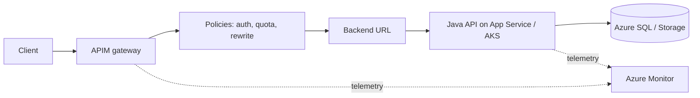
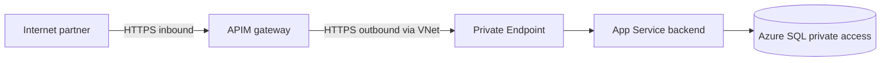
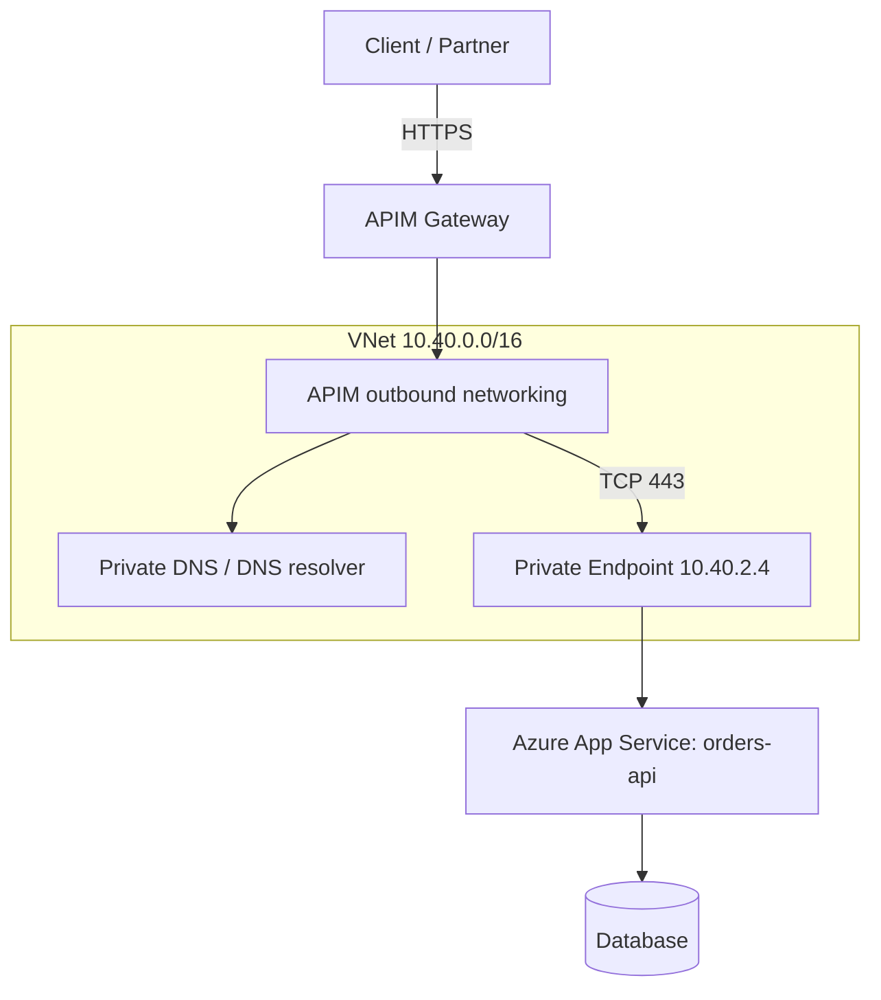
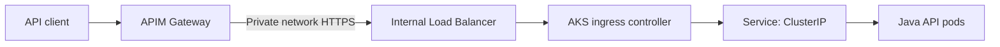
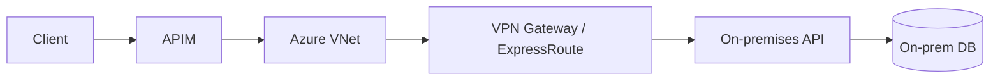
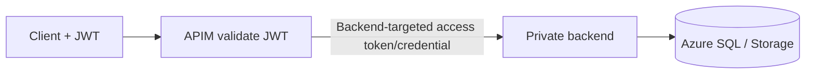
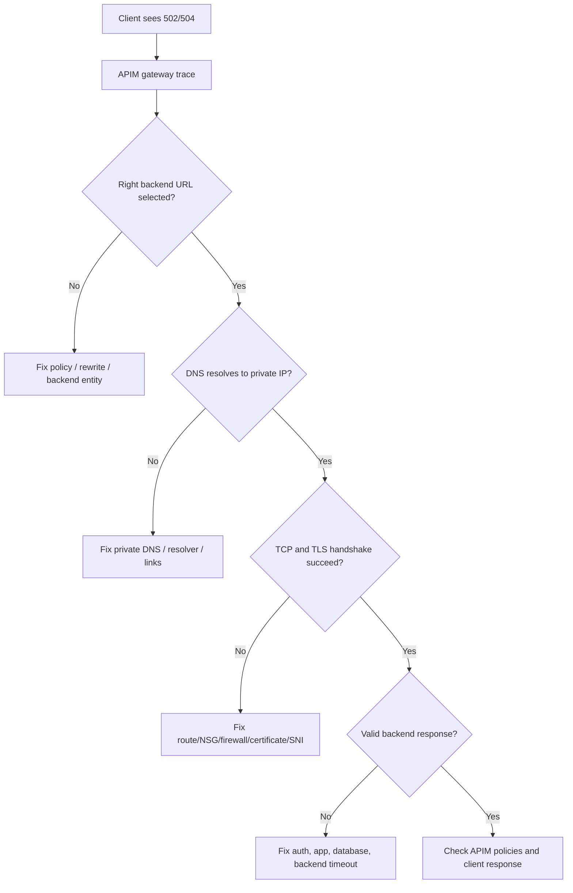

# Connecting API Management to Private Network Backends

An organization exposes an ordering API to partners through **Azure API Management (APIM)**. The API gateway must authenticate callers, enforce rate limits, normalize URLs, emit telemetry, and forward requests to a Java application running on **Azure App Service**, **Azure Kubernetes Service (AKS)**, or virtual machines. However, the backend containing business logic and database connections should not be exposed directly to the public Internet.

The solution is to make **APIM the API control point**, while the **backend is reachable only over a private address or network path**, such as an App Service Private Endpoint, an AKS internal load balancer, or an address inside a VNet. To achieve this, **two separate problems** must be solved:

1. **Outbound network path from APIM to the backend:** the APIM gateway has the routing, DNS, network permissions, and TLS required to call the private endpoint.
2. **Inbound access path from clients to APIM:** determining whether the APIM gateway is public or internal-only, along with authentication policies, firewalls, or private access.

These two problems **do not solve each other automatically**. Placing a Private Endpoint on the backend does not automatically allow APIM to reach the backend; giving APIM a private gateway does not prove the backend is protected.

This lesson belongs to the **API and Workflow Integration** chapter of the **CLOUD_PROVIDERS_AZURE** module. The material connects Azure subscriptions, resource groups, Microsoft Entra ID, VNets, DNS, App Service/AKS, Storage, data, monitoring, security, and cost control for an Azure application architecture.

> **Feature scope:** Classic APIM tiers and v2 tiers differ in networking capabilities. Never copy a VNet configuration from Developer/Premium classic to Standard v2/Premium v2 without checking features, release status, region support, and exact tier limits. This lesson presents principles and verification steps that do not depend on guessing a SKU's capabilities. Illustrative commands are for approved lab environments only.

## Learning objectives

After this lesson, you will be able to:

1. Distinguish **APIM gateway**, backend API, private endpoint, private DNS, VNet Integration, and VNet injection.
2. Explain why an APIM inbound private endpoint **differs** from outbound connectivity from APIM to a backend.
3. Diagram request paths from client through APIM to an App Service Private Endpoint or AKS internal ingress.
4. Select an APIM architecture based on the networking capabilities of your tier.
5. Configure backend entities and the `set-backend-service` policy to route to private hostnames.
6. Design DNS, routing, NSGs, firewalls, TLS certificates, and SNI/Host headers for HTTPS backends.
7. Integrate client authentication with Microsoft Entra ID and APIM-to-backend authentication with managed identity where appropriate.
8. Diagnose 401/403, 404, 500, 502, 503, 504, DNS, and TLS handshake errors.
9. Use Azure Portal/CLI, APIM tracing, Azure Monitor, and Application Insights to find root causes.
10. Build a production runbook and checklist covering availability, security, operations, and cost.

## 1. Role of API Management in the system

**Azure API Management** is an API lifecycle management platform with a **gateway** component processing requests alongside governance capabilities like products, subscriptions, APIs, policies, analytics, and a developer experience.

In a typical request:

1. The client calls the APIM gateway hostname.
2. The gateway identifies the API/operation by URL and method.
3. **Inbound** policies authenticate or evaluate conditions.
4. APIM selects the backend API and forwards the request during the **backend** stage.
5. The backend returns a response, and APIM applies **outbound** policies.
6. The gateway returns the result to the client and emits metrics/logs per configuration.



**APIM is not the Java backend itself** and does not automatically build private network paths to every system merely by declaring a URL in an API definition. Policies decide **where to call**, while VNet/DNS/routes/firewalls decide **whether the call can reach it**.

### How it differs from a standard reverse proxy

| Capability | Role |
|---|---|
| API/operation routing | Keeps the public API stable even when backends change |
| Policy engine | Validate JWT, transform headers, rewrite URLs, rate limit, cache |
| Backend entities | Manage backend addresses, credentials, and routing settings in a clean scope |
| Products/subscriptions | Organize APIs and how consumers register to use them |
| Observability | Metrics, logs/traces, and correlation |
| Versioning/revisions | Manage API contract evolution |
| Developer portal/management | Support publishing and governing APIs |

A backend can be called from APIM over a controlled public endpoint or a private network. This lesson focuses on **private backends**.

## 2. What does a “private network backend” mean?

A private network backend is an API that **does not rely on public Internet inbound access** for gateway traffic. Examples include:

- **Azure App Service with a Private Endpoint** for VNet inbound API traffic.
- **Azure Functions with a Private Endpoint** when supported by the hosting plan/features.
- **AKS** with an ingress/controller behind an **internal Azure Load Balancer (ILB)**, private IP, and private DNS.
- **VMs/VMSS** running a Java API on a private IP, often behind an internal load balancer.
- An API running in an **on-premises network** connected to Azure via VPN/ExpressRoute per approved topology.
- A backend in an **Azure Container Apps internal environment** or another managed service with private ingress.

Example private hostnames:

```text
orders-api.internal.example
orders-api.azurewebsites.net
orders.aks.corp.internal
```

With an App Service Private Endpoint, the **standard hostname** such as `orders-api.azurewebsites.net` can still be used to preserve the Host header, SNI, and certificate validation, while DNS inside the private network resolves it via Private Link. Never default to replacing the backend URL with a raw private IP, as that easily breaks TLS.

### A private backend is not automatically completely secure

If a workload sits on a VNet while still keeping its public endpoint enabled, it may remain reachable from the Internet. Subnet isolation, Private Endpoints, and private DNS are only part of the defense. You also need:

- Disabling/restricting public ingress via mechanisms supported by the backend.
- AuthN/AuthZ at the API/backend layer.
- Network rules restricting traffic to authorized sources.
- Least-privilege identities accessing the data plane.
- Managed TLS and secrets.
- Logging/monitoring and incident response.

## 3. Inbound to APIM vs. outbound from APIM: two independent directions

Consider a client calling APIM to fetch an order:



### Inbound — client to APIM

Questions:

- Does the APIM gateway expose a **public hostname/public IP** or a **private entrypoint**?
- Are Microsoft Entra authentication, JWT validation, APIM subscription keys, policies, and rate limiting in place?
- Is there a WAF/Front Door/Application Gateway or IP allowlist if required by the architecture?
- How must internal clients or external partners connect?

### Outbound — APIM to backend

Questions:

- Can APIM **enter the VNet** or reach the network connected to the backend under its SKU?
- Is there a route to the private IP/endpoint on TCP port 443?
- Does APIM's DNS resolve the backend hostname to the right private destination?
- Does the backend permit connections from APIM's network path?
- Do the backend TLS certificate, SNI, and Host header align?
- Does the backend require a token, client certificate, or dedicated credential?

**Key rule:** an APIM inbound Private Endpoint (where supported by the SKU) lets **clients call the gateway privately**. It **does not automatically grant** APIM outbound access to a private backend. Conversely, APIM with outbound VNet connectivity can still be a **public gateway** if inbound is designed that way.

## 4. APIM networking models by tier family

Private backend connectivity depends on tier, service generation, region, and network mode. Common patterns include:

| Model | Concept | What to verify |
|---|---|---|
| **Classic VNet injection — external mode** | APIM deploys into a VNet; gateway remains publicly reachable per mode/tier while calling private backends via VNet | Available only on supported classic tiers; dedicated subnet, NSG/route/DNS, infrastructure requirements |
| **Classic VNet injection — internal mode** | APIM gateway/endpoints reside inside the VNet in private/internal mode | Private DNS for APIM, access from clients/VPN/ExpressRoute, control plane dependencies |
| **Outbound VNet integration (supported v2 tiers)** | Gateway keeps its inbound mode while routing outbound to backends in the integrated VNet | Tier/region support, integration subnet, routes, limitations |
| **Private endpoint for APIM inbound (supported tiers)** | Clients access the APIM gateway over Private Link | Inbound only; does not replace outbound integration |
| **Self-hosted APIM gateway** | Gateway runs near the backend (e.g., AKS/on-premises) with management connectivity to APIM | Deployment/runtime/management connectivity differs from managed gateways |

Never memorize “**every APIM tier has VNet injection**.” Classic tiers like Developer/Premium use a different injection model than v2 tiers. Specifically, Standard v2 is often considered for certain **outbound VNet integration** needs, while Premium v2 offers advanced networking options per current capabilities. Inbound private endpoints, VNet injection, and network isolation options must be verified for the **exact tier at deployment time**, never assumed solely from the word “Premium.”

### Requirements-driven tier selection process

1. Does the backend live on a **private IP, Private Endpoint, or on-premises network**?
2. Do clients access APIM from the **Internet or only from VNet/on-premises**?
3. Does APIM need **private inbound gateway access**, or only **outbound to a private backend**?
4. What scale/HA/zones/multi-region, SLA, and compliance guarantees are required?
5. Does backend DNS require a custom resolver/forwarder?
6. Are subnet size, network policies, and forced tunneling supported in the intended mode/tier?
7. Which option's cost delta and quotas are acceptable?

If the current tier **does not support outbound private networking**, adding a Private Endpoint to the backend **will not solve it**. You must change tiers, switch gateway topology, or use an Azure-supported pattern.

## 5. Reference architecture 1: APIM → App Service Private Endpoint

A Java Spring Boot API is deployed to App Service with hostname:

```text
orders-api.azurewebsites.net
```

The app has a **Private Endpoint** configured for inbound traffic. APIM uses a network mode providing outbound connectivity to the VNet hosting the Private Endpoint or a connected VNet.



### Minimum prerequisites

- APIM tier/networking mode has an **outbound route** to the VNet/private endpoint.
- Private Endpoint is created for **App Service inbound** with connection state approved.
- DNS along APIM's network path resolves the App Service hostname via **Private Link**.
- Network rules allow HTTPS from APIM to the Private Endpoint.
- App Service ingress/public network access is restricted per the goal of not exposing the backend publicly.
- APIM backend URL uses a **valid HTTPS hostname**, not a raw IP unless Host/SNI/certificates are explicitly handled.
- Backend enforces authentication if arbitrary VNet workloads should not call the API.

### Why keep the `azurewebsites.net` hostname?

App Service TLS certificates and virtual-host routing bind to the hostname. Calling `https://10.40.2.4` directly can cause:

- **Certificate name mismatch**.
- TLS Server Name Indication (SNI) mismatch.
- Incorrect Host header causing 404 or misrouting.
- Inability to verify the intended backend hostname.

Therefore, standard architectures prefer **FQDN + private DNS resolution**, never rewriting the backend URL to an IP just to “dodge DNS.”

## 6. App Service Private Endpoint and accurate DNS

When accessing an App Service Private Endpoint, relevant names typically include:

```text
orders-api.azurewebsites.net
orders-api.privatelink.azurewebsites.net
privatelink.azurewebsites.net
```

In a standard Private Link topology, the App Service public hostname CNAMEs to the `privatelink` name; from a network with properly configured private DNS, queries resolve to the Private Endpoint's **private IP**.

### Do not confuse DNS zones

| Service | Typical Private DNS zone |
|---|---|
| App Service / Azure Functions Private Endpoint | `privatelink.azurewebsites.net` |
| Azure Blob Storage | `privatelink.blob.core.windows.net` |
| Azure Files | `privatelink.file.core.windows.net` |
| Azure SQL Database | `privatelink.database.windows.net` |
| Azure Key Vault | `privatelink.vaultcore.azure.net` |

APIM calling an App Service backend needs to resolve the **App Service hostname**. If the backend in turn calls Blob/SQL via Private Endpoints, the backend needs the DNS zones for **its own dependencies**—having private DNS for APIM does not automatically cover backend dependencies.

### Verifying DNS configuration

1. Private Endpoint targets the right backend resource and subresource.
2. Zone `privatelink.azurewebsites.net` is linked to the **VNet serving APIM DNS queries**, or custom DNS has proper forwarders.
3. The A record for the backend name points to the right private IP.
4. No stale records from staging/other regions cause misresolution.
5. Clients/APIM still use the exact FQDN covered by the certificate.
6. When using custom DNS servers, proper forwarding rules exist for Private Link zones.

**VNet peering does not automatically propagate private DNS zone links across all VNets.** If APIM resides in a different VNet from the backend, configure name resolution from APIM's VNet; routing/peering alone is insufficient.

### DNS caching and backend changes

After changing a Private Endpoint, DNS may remain cached in resolvers or the gateway. Account for TTLs and verify via telemetry that APIM resolves the hostname to the new target; avoid changing multiple DNS/route/policy layers simultaneously.

## 7. Reference architecture 2: APIM → AKS internal ingress

A Java Spring Boot system on AKS typically uses a Kubernetes Service and ingress controller. To keep the API internal:

- Run the ingress controller behind an **internal Azure Load Balancer** (ILB) per configuration.
- Create a private IP and private DNS record for the backend.
- Route APIM outbound networking to the VNet/subnet hosting the ILB.
- Configure the APIM gateway to call the **internal ingress hostname** over HTTPS.



### Deployment prerequisites

- Appropriate ingress controller (NGINX, Application Gateway for Containers, or organization standard) configured as **internal**.
- Internal load balancer frontend IP placed in an appropriate subnet/VNet.
- DNS hostname `orders.aks.corp.internal` pointing to the internal private IP.
- NSG/UDR/firewall rules allowing APIM to reach the ingress listener.
- Ingress TLS certificate contains a SAN matching the hostname APIM calls.
- Kubernetes Service/Endpoints/Pods and readiness probes are healthy.
- No accidental **public ingress/load balancer** created for the same backend.

### APIM does not call ClusterIP directly from a regular VNet

A Kubernetes `ClusterIP` is typically meaningful only inside the cluster's service network, not a target IP that an external managed APIM gateway can call directly. Therefore, use an **internal ingress or internal load balancer** as the VNet entry point, letting ingress route to the `ClusterIP` Service.

### When is an ingress controller not needed?

An internal `Service type=LoadBalancer` can serve a single specific backend. However, when multiple services need hostnames, TLS, and L7 routing, an internal ingress/gateway is usually easier to govern. Weigh cost, quotas, and controller lifecycle.

## 8. Reference architecture 3: APIM → on-premises backend over hybrid network

An enterprise may still run Java APIs in a datacenter. APIM can call on-premises backends over a private connection if its networking mode supports it and routes to on-premises via **VPN Gateway or ExpressRoute**.



Check:

- Non-overlapping IP ranges.
- Bidirectional network reachability across routing/firewalls.
- Peering/UDRs and gateway transit per actual topology.
- DNS conditional forwarding for internal datacenter names.
- Whether APIM trusts the certificate chain/PKI.
- Sufficient latency, MTU, timeout budgets, and bandwidth for the API.
- High availability of VPN/ExpressRoute and the backend.

**VNet peering is not automatically transitive across multiple VNets**; nor do all APIM models support forced tunneling or UDRs identically. Verify the exact route path in your architecture.

## 9. Planning VNets, subnets, and addressing

Example lab topology:

| Component | Illustrative address space | Purpose |
|---|---|---|
| Overall hub/spoke VNet | `10.40.0.0/16` | Azure private network |
| Subnet for supported APIM model | `10.40.1.0/24` | APIM injection/integration per tier |
| Private Endpoints subnet | `10.40.2.0/24` | App Service/Storage/SQL Private Endpoints |
| AKS node subnet | `10.40.3.0/24` | Worker nodes |
| Internal ingress frontend | Private IP in appropriate subnet | Target APIM calls |
| DNS resolver/forwarder | IP in VNet per design | Resolve private hostnames |

This is an **illustrative address plan**, not a claim that an APIM subnet must always be `/24` or can be shared across modes. **Dedicated subnets, delegations, network policies, and minimum subnet sizes** vary by APIM tier and networking feature; verify the support matrix and calculate IP capacity for scale-out/upgrades before provisioning.

### Addressing principles

1. Never overlap CIDRs with on-premises networks or peered VNets.
2. Reserve enough IPs for APIM, Private Endpoints, AKS nodes, and scale/surge capacity.
3. Configure NSGs/firewalls along **actual traffic directions**.
4. Do not block DNS resolvers or required control-plane dependencies.
5. Design route tables per network mode/tier, avoiding forced tunneling that breaks service management.
6. Establish network ownership and change approval.

### Never arbitrarily alter a production APIM subnet

Changing the integration/injection subnet, NSGs, DNS, or UDRs can **take down the gateway**, **break backend connectivity**, or **disrupt management connectivity**. Always verify mandatory tier-specific rules before applying changes.

## 10. Network Security Groups, routes, and firewalls

When APIM calls `https://orders-api.azurewebsites.net` through a Private Endpoint, typical network requirements include:

| Direction | Port / protocol | Requirement |
|---|---|---|
| APIM network → DNS resolver | UDP/TCP 53 or architectural DNS transport | Resolve backend hostname |
| APIM gateway → Private Endpoint | TCP 443 | HTTPS connection to backend |
| APIM gateway → internal AKS ingress | TCP 443 or actual listener port | HTTPS/API traffic |
| APIM → Azure services supporting APIM | Per mode/tier requirements | Control plane, telemetry, Storage/Key Vault if needed |
| Backend → Azure SQL/Storage | Backend dependency ports/protocols | **Backend** path, distinct from APIM → backend |

**Never open the entire VNet inbound or `0.0.0.0/0` just to work around a temporary error.** Network rules must restrict to the exact subnets/sources, destinations, ports, and required flows.

### Do Private Endpoints enforce NSG rules?

Whether **network policies/NSGs/UDRs apply to a Private Endpoint subnet** depends on private endpoint network policy settings and product support. Never assume every NSG rule on a subnet automatically governs Private Endpoints the same way as a VM NIC; verify enabled policies and actual access behavior.

### Routing from APIM

For connectivity to succeed, there must be:

- A route to the private IP/backend from **the APIM gateway's own network context**.
- Proper return routing; no asymmetric routing through an NVA dropping TCP.
- No firewall blocking SNI/hostname or breaking TLS inspection unintentionally.
- DNS resolution yielding an IP reachable under the network mode.

A VM inside the VNet successfully calling the API proves **the VM's network path** works; it **does not prove** the APIM gateway uses the same DNS/route. Use APIM gateway traces/telemetry to confirm end-to-end connectivity.

## 11. Backend FQDN, Host header, SNI, and TLS

This is the most common failure group behind “private backend has an IP, yet APIM still returns 502.”

### Distinguish three related names

- **Backend URL hostname:** name APIM uses to open the HTTPS connection, e.g. `orders-api.azurewebsites.net`.
- **HTTP Host header:** host name the backend/webserver uses for virtual-host routing.
- **TLS SNI / certificate hostname:** server name sent during the TLS handshake and checked against the certificate's SAN/CN.

All three values should normally **align**.

```text
Client -> APIM: https://api.contoso.example/orders/123
APIM -> backend:
    URL:  https://orders-api.azurewebsites.net/api/orders/123
    DNS:  orders-api.azurewebsites.net -> 10.40.2.4
    SNI:  orders-api.azurewebsites.net
    Host: orders-api.azurewebsites.net
    TLS:  Valid certificate for the backend hostname
```

`contoso.example` is only an example. Never forward `Host: api.contoso.example` from the client to an App Service backend unless App Service has that custom domain configured; otherwise routing may fail.

### Why do raw IPs fail?

If the backend is configured as:

```text
https://10.40.2.4/
```

the certificate almost certainly lacks that IP in its SAN, and SNI will be wrong. The proper fix is **fixing DNS or the backend FQDN and certificate**, never disabling TLS validation.

### Self-signed or private CA certificates

Internal backends may use certificates issued by a private CA. APIM must **trust the certificate chain** per supported tier/configuration, and the hostname must match. In production, prefer trusted certificates or properly deployed CA/cert trust; **never disable certificate chain/name validation** to get a production connection working.

## 12. Declaring a backend entity in APIM

Instead of repeating the backend URL across every API/operation, create a **backend entity**:

```text
Backend ID: orders-private-backend
Runtime URL: https://orders-api.azurewebsites.net
Description: Java Orders API via Private Endpoint
```

### Configuration via Azure Portal

1. Select the APIM instance in the right subscription/resource group.
2. Open **Backends** (under APIs or API Management, depending on the Portal).
3. Create a backend with logical ID `orders-private-backend`.
4. Choose **HTTP endpoint** and the full HTTPS **hostname** URL.
5. Configure appropriate authentication; never place secrets in unprotected fields.
6. Configure certificate trust/validation, client certificates, or identity if required by the backend.
7. Save the backend entity.
8. Reference this backend via policy inside an API/operation.

**Creating a backend entity does not provision routing or DNS.** After saving, network connectivity from APIM to the backend is still required.

### Backend URL and path

If the public API is at `/orders` while the backend exposes `/api/v1/orders`, configure a path rewrite or choose the right base URL. A mismatched path typically returns **404**, which can be mistaken for a private networking failure if you look only at the final error.

Do not fix it by randomly swapping hostnames or appending slashes. Map out the public API suffix, operation path, backend base URL, and final rewritten URL.

## 13. The `set-backend-service` policy in APIM

API Management uses **policy XML** to shape requests and responses. The example below routes the orders API to the backend entity:

```xml
<policies>
  <inbound>
    <base />
    <set-backend-service backend-id="orders-private-backend" />
    <set-header name="x-correlation-id" exists-action="override">
      <value>@(context.RequestId.ToString())</value>
    </set-header>
  </inbound>
  <backend>
    <base />
  </backend>
  <outbound>
    <base />
  </outbound>
  <on-error>
    <base />
  </on-error>
</policies>
```

### Explanation

- `<base />` inherits outer-scope policies per the inheritance model.
- `set-backend-service backend-id` selects the defined backend.
- `x-correlation-id` links gateway requests with backend logs.
- The `backend` section normally inherits the existing `forward-request` policy per shared config; never delete `<base />` without understanding policy inheritance.
- `on-error` can add diagnostics or shape error responses, but should not mask the root cause.

### Policies can reside at multiple scopes

Global → product → API → operation (depending on actual scope and policy inheritance) is the standard mental model. An operation with its own `set-backend-service` overrides the API-level backend.

When debugging:

1. Determine the **effective policy** on the called operation.
2. Check for `rewrite-uri`, `set-header`, backend entities, retries, or caching.
3. Confirm the actual hostname APIM forwards to.
4. Separate APIM policy errors from network/backend errors.

**Never use a backend entity merely to hide an unmanaged static IP**; if the IP changes, connectivity breaks. Private FQDNs and proper DNS are much easier to operate.

## 14. Rewriting URLs and headers: 404 even when the network works

Suppose the client calls:

```text
GET https://api.contoso.example/orders/123
```

The backend actually exposes:

```text
GET https://orders-api.azurewebsites.net/api/v1/orders/123
```

If APIM routes or rewrites incorrectly, the backend returns 404 even though DNS, TLS, and networking are healthy.

Example policy adding a rewrite at operation scope with route parameter `id`:

```xml
<policies>
  <inbound>
    <base />
    <set-backend-service backend-id="orders-private-backend" />
    <rewrite-uri template="/api/v1/orders/{id}" />
  </inbound>
  <backend>
    <base />
  </backend>
  <outbound>
    <base />
  </outbound>
  <on-error>
    <base />
  </on-error>
</policies>
```

For `{id}` rewriting to work, the operation template must declare that parameter—e.g., `/orders/{id}` per API design. If the API suffix is already `orders` and the operation path is defined differently, inspect the post-rewrite URL using **gateway trace**.

### Which headers are worth checking?

| Header | Notes |
|---|---|
| `Host` | Must match the backend virtual host; APIM should use the appropriate backend hostname |
| `Authorization` | Client tokens are not necessarily targeted at the backend |
| `x-correlation-id` | Links gateway and backend logs |
| `x-forwarded-for` | Handle trust/proxy chains safely; never blindly trust client-sent values |
| `x-forwarded-proto` | Backend may need to know the client used HTTPS |
| API key / backend-specific headers | Never log/expose secrets; store in protected configs |

A private backend should trust privileged headers only when traffic arrives exclusively through a trusted gateway or carries additional verification.

## 15. Protecting inbound APIs with Microsoft Entra ID

**Client → APIM** and **APIM → backend** are two distinct authentication hops.

For example, a partner sends a Microsoft Entra ID JWT to APIM. An APIM policy can run **`validate-jwt`** before calling the backend.



### Illustrative `validate-jwt` policy

```xml
<policies>
  <inbound>
    <base />
    <validate-jwt header-name="Authorization"
                  failed-validation-httpcode="401"
                  failed-validation-error-message="Unauthorized">
      <openid-config url="https://login.microsoftonline.com/&lt;TENANT_ID&gt;/v2.0/.well-known/openid-configuration" />
      <audiences>
        <audience>api://orders-public-api</audience>
      </audiences>
    </validate-jwt>
    <set-backend-service backend-id="orders-private-backend" />
  </inbound>
  <backend><base /></backend>
  <outbound><base /></outbound>
  <on-error><base /></on-error>
</policies>
```

**`TENANT_ID` and the audience are placeholders.** In a real API, use the exact issuer/JWKS/audience/claims matching your **Entra ID app registration**, tenant, and OAuth flow. Never copy `api://orders-public-api` without registering that resource.

If the backend needs the caller's own token, use a deliberately designed pass-through or OBO architecture. Never assume a client JWT issued for APIM is accepted by the backend: the two components may validate **different audiences**.

### Is a subscription key an auth mechanism?

An APIM subscription key supports product/API usage management and basic access control, **but does not replace** user or system identity authentication—especially for sensitive business operations. Production should consider Entra ID, mTLS, or appropriate authentication mechanisms.

## 16. APIM authenticating to backends with managed identity

APIM can use a **managed identity** to acquire an access token from Microsoft Entra ID when the backend supports matching JWT audience/authorization. This is **backend authentication**, independent of client authentication.

### Typical flow

1. Enable system-assigned or user-assigned managed identity on APIM.
2. Backend has a registered app/identity resource and enforces token validation.
3. Grant APIM's identity permission to call the backend API (app role or corresponding authorization).
4. In APIM policy, request a token for the backend's **exact resource/audience**.
5. Gateway forwards the token to the backend.
6. Backend validates issuer, audience, signature, and roles/claims.

### Illustrative policy

```xml
<policies>
  <inbound>
    <base />
    <set-backend-service backend-id="orders-private-backend" />
    <authentication-managed-identity
        resource="api://orders-private-api"
        output-token-variable-name="backendAccessToken"
        ignore-error="false" />
    <set-header name="Authorization" exists-action="override">
      <value>@("Bearer " + (string)context.Variables["backendAccessToken"])</value>
    </set-header>
  </inbound>
  <backend><base /></backend>
  <outbound><base /></outbound>
  <on-error><base /></on-error>
</policies>
```

**This is an example of policy structure**, not a ready-to-use token. `api://orders-private-api` must be a real resource identifier, and the backend must authorize the APIM identity. In many configurations, `authentication-managed-identity` sets the `Authorization` header automatically without needing a separate `set-header`; if using `output-token-variable-name` as shown, handle token variables carefully. Verify API and policy behavior against your supported APIM version.

### Do not confuse APIM permissions with backend data permissions

- APIM identity calling the Java API: backend checks app role/permission.
- Java backend reading Azure SQL/Blob: **the backend's own identity** needs the corresponding data-plane role/permission.
- Granting APIM `Storage Blob Data Contributor` does not let the Java backend read Blob Storage if Java runs under a different identity.
- A private route does not grant an access token; an access token does not create a private route.

## 17. Backends using API keys, client certificates, or mTLS

Not every backend integrates with Entra ID. Some require:

- **Backend API keys**.
- **HTTP Basic auth** in controlled legacy environments.
- **Client certificates (mTLS)**.
- **OAuth 2.0** with an appropriate flow.
- Identity from an internal gateway or service mesh.

### Secrets management

- Use protected APIM **named values** or **Key Vault references** where supported.
- Never hardcode API keys in public/repo policy XML.
- Enforce rotation, expiry tracking, access logging, and least privilege.
- For client certificates, verify chains, validity, key protection, and upload/rotation mechanics in APIM.
- For mTLS, verify both the **server certificate** and **client certificate**; they authenticate opposite sides.

### Be cautious with TLS bypass options

APIM provides options around backend certificate checks in certain cases. **Never disable server certificate validation** to work around production errors; fixing DNS/FQDN/SAN/chain or CA trust is the proper solution.

## 18. App Service backends and public access control

An App Service with a Private Endpoint **is not automatically private-only** if public ingress remains allowed. A secure design typically includes:

1. Private Endpoint connected to the app's proper subresource.
2. Private DNS resolving to the private IP from APIM's network path.
3. APIM outbound connectivity into that VNet.
4. App Service public network access restricted/disabled per features and requirements.
5. Backend authenticating requests or restricting sources rather than relying solely on the Private Endpoint.
6. Administrative/deployment path via SCM/Kudu if needed by the environment, with corresponding DNS/Private Endpoint when private access is enforced.
7. Checking staging slots: endpoints, hostnames, DNS, and slot settings can differ from production.

### Does disabling public access affect deployments?

Yes. Deployment pipelines need access to the management/SCM endpoint or must use an appropriate deployment mechanism. Disabling public access prematurely without provisioning a private path for build agents/SCM can break deployments even while the API gateway still reaches the app.

**Production cutover:** test the APIM → backend path over the Private Endpoint first, then tighten public ingress during a change window. Never reverse that order and take the backend offline without a rollback plan.

## 19. AKS backends and ingress readiness

In AKS, requests traverse multiple layers:

```text
APIM
  -> internal Load Balancer IP
    -> ingress controller
      -> Kubernetes Service
        -> Spring Boot pod
```

If APIM returns 502/503, distinguish whether:

- APIM failed to resolve the ingress hostname.
- APIM could not connect to the private ILB.
- TLS/SNI to ingress failed.
- The ingress route failed to match `Host` or path.
- The Kubernetes Service had no ready endpoints.
- Pods were `CrashLoopBackOff`/`OOM`/`NotReady`.
- The Spring Boot API hit a database error or timeout.

### Inspecting inside AKS

```bash
kubectl config current-context

kubectl get svc -A -o wide
kubectl get ingress -A

kubectl get pods -A -o wide

kubectl get endpoints -A
```

These commands are read-only; never run `kubectl delete` or restart controllers before identifying which layer failed.

### Health checks

- APIM may offer backend health/circuit-breaker capabilities depending on tier/features/policies; never assume everything is enabled by default.
- Ingress/ILB require proper health probes.
- Spring Boot can expose readiness probes such as `/actuator/health/readiness`.
- Pod readiness must reflect ability to serve requests, not merely that the Java process exists.
- A backend can be `Running` yet unable to serve due to database connection failures; check Application Insights/traces.

## 20. Azure CLI: inspecting APIM and network resources

In Bash/Cloud Shell authorized to view resources:

```bash
az account show --output table
az account set --subscription "<SUBSCRIPTION_ID>"

RG="<APIM_RESOURCE_GROUP>"
APIM="<APIM_INSTANCE_NAME>"

az apim show \
  --resource-group "$RG" \
  --name "$APIM" \
  --query "{id:id,name:name,location:location,sku:sku,virtualNetworkType:virtualNetworkType,gatewayUrl:gatewayUrl}" \
  --output json
```

Returned fields and networking property names depend on the API/schema version. If `virtualNetworkType` is missing or null on a v2 tier, **do not conclude there is no VNet integration**; inspect the resource's networking properties in the Azure Portal or via the appropriate API.

### Inspect the App Service backend

```bash
az webapp show \
  --resource-group "<APP_RESOURCE_GROUP>" \
  --name "<APP_NAME>" \
  --query "{name:name,state:state,defaultHostName:defaultHostName,httpsOnly:httpsOnly,publicNetworkAccess:publicNetworkAccess}" \
  --output json
```

### List Private Endpoints

```bash
az network private-endpoint list \
  --resource-group "<NETWORK_RESOURCE_GROUP>" \
  --output table
```

The network resource group may differ from APIM's or the backend's resource group. Never assume Private Endpoints reside in the same resource group; verify against your organization's resource inventory.

### List Private DNS zones

```bash
az network private-dns zone list \
  --resource-group "<DNS_RESOURCE_GROUP>" \
  --output table

az network private-dns link vnet list \
  --resource-group "<DNS_RESOURCE_GROUP>" \
  --zone-name "privatelink.azurewebsites.net" \
  --output table
```

These commands inspect only **management-plane configuration**. Proving live DNS behavior from APIM requires combining network DNS checks with APIM gateway traces.

## 21. Diagnosing DNS/TCP/TLS from a network-adjacent environment

If your organization has a test VM or container in the **same VNet network path** as APIM, standard network tools can help.

### DNS

```bash
nslookup orders-api.azurewebsites.net
```

Expect the resolver to return the relevant private resolution chain and ultimately the exact private IP. Look beyond the CNAME: inspect the final A record, which resolver answered, and the TTL.

### HTTPS

```bash
curl -v \
  --connect-timeout 10 \
  --max-time 30 \
  https://orders-api.azurewebsites.net/health
```

HTTP 401/403 can prove you reached an endpoint and were **denied authorization**, rather than hitting a TCP error. Still verify headers/body to confirm it is the intended backend and not a stray proxy.

### Inspecting TLS certificate by hostname

```bash
openssl s_client \
  -connect orders-api.azurewebsites.net:443 \
  -servername orders-api.azurewebsites.net
```

Inspect certificate subject/SAN, issuer, chain, and verification errors. Never pass private keys or secrets on the command line.

### Limitations of this test

A test VM may use different DNS/routes than the managed APIM gateway. `nslookup`/`curl` from a VM provide **partial evidence only**. When the VM succeeds but APIM fails, prioritize checking:

- APIM networking mode, subnet/routes/NSG.
- Actual DNS used by APIM.
- Backend entity hostname and TLS validation.
- Effective policy and APIM tracing.

Never declare “the network is completely fine” just because a test from Cloud Shell or a laptop succeeded.

## 22. APIM gateway tracing and Application Insights

For end-to-end request diagnostics, separate:

- **APIM gateway telemetry:** gateway received request, policy execution, backend request/response, forwarding errors.
- **Backend telemetry:** Java API received request, exceptions, dependencies, database.
- **Network/Private Endpoint logs:** connection/DNS/firewall events from supported services.

### Tracing in APIM

API Management supports request tracing/debugging via **currently supported mechanisms**, which may require debug tokens/permissions and appropriate tools. Never assume legacy `Ocp-Apim-Trace: true` works or is allowed in every environment.

Workflow:

1. Identify the exact APIM instance, API, operation, and request ID.
2. Enable/capture short-lived traces using an authorized mechanism.
3. Inspect inbound policies, rewrites, and selected backend URL/entity.
4. Observe the backend stage: DNS/connect/TLS/timeout/status.
5. Correlate with backend App Insights using the correlation ID.
6. Disable detailed trace capture afterward and protect sensitive data.

### Policy correlation

Adding `x-correlation-id` as shown in section 13 helps the backend log the same ID. Trust only gateway-managed headers; if a client already sent `x-correlation-id`, consider overriding it via policy to prevent spoofing or enforce standardization.

### Never log secrets in traces

APIM traces can display policy values, headers, or backend request details depending on features; restrict trace access and mask `Authorization`, API keys, and sensitive data.

## 23. Azure Monitor metrics and diagnostic logs

Azure Monitor can provide metrics on **request volume, response status, gateway latency, and backend duration/capacity** depending on APIM resource/SKU and setup. Verify metric names and dimensions by querying the exact resource's definitions.

### Query metric definitions via CLI

```bash
APIM_ID=$(az apim show \
  --resource-group "$RG" \
  --name "$APIM" \
  --query id --output tsv)

az monitor metrics list-definitions \
  --resource "$APIM_ID" \
  --output table
```

Pick real metric names from the output and compare within the same UTC window. Never assume a 502 is always a TLS error: it can be a timeout, DNS issue, backend connectivity failure, or policy issue.

### Diagnostic settings

APIM gateway logs can stream to a **Log Analytics workspace**, Storage, or Event Hubs depending on categories and service support. When a resource-specific table like `ApiManagementGatewayLogs` exists, minimal KQL query:

```kusto
ApiManagementGatewayLogs
| where TimeGenerated > ago(1h)
| summarize Requests = count() by bin(TimeGenerated, 5m)
| order by TimeGenerated asc
```

To inspect the available schema:

```kusto
ApiManagementGatewayLogs
| getschema
```

Some legacy configurations write to `AzureDiagnostics` with different column names. **Never guess column names like `BackendStatusCode` or `ResponseCode` without checking the schema first**; inspect `getschema` before writing backend error-rate queries.

### Application Insights on the Java backend

If App Service/Spring Boot is instrumented, query requests/exceptions/dependencies against the actual schema, e.g., workspace-based:

```kusto
AppRequests
| where TimeGenerated > ago(1h)
| summarize Requests=count(),
            Failed=countif(Success == false)
  by bin(TimeGenerated, 5m), Name
| order by TimeGenerated asc
```

Not seeing backend requests in App Insights **does not guarantee** APIM never called the backend: instrumentation, sampling, resource links, or pipelines might be misconfigured. However, if APIM traces show DNS/connect failure, the backend truly never got a chance to process the request.

## 24. Difference between APIM errors and backend errors

| Symptom | Common failure source | Check step |
|---|---|---|
| Client receives **401 from APIM** | JWT/subscription key/policy authorization | Inbound policy and APIM logs |
| Client receives **403 from APIM** | Policy/IP restrictions or subscription access | Effective policy, caller identity |
| Client receives **401/403 from backend** | Backend token audience/roles, App Service auth, or firewall | Backend response, APIM auth policy, identity |
| **404** | API suffix/operation path/rewrite, Host header, or backend route | Final URL and Host in APIM trace |
| **500** | Policy exception or Java backend exception | APIM trace + App Insights |
| **502** | Backend connection failure, DNS/TLS/connection reset, or gateway/backend error | DNS, cert, routing, backend status |
| **503** | Backend/ingress unavailable, dependency, or gateway overload | Health, metrics, scaling |
| **504** | Gateway/backend request timeout | Backend latency, network, policy timeouts |
| **TLS handshake error** | Certificate chain, SNI, hostname, CA, or protocol | `openssl` with FQDN, APIM logs |
| **NameResolutionFailure** | Wrong Private DNS link/forwarder/hostname | DNS in APIM's network path |
| **Connection refused/timeout** | NSG/UDR/firewall/ILB listener or offline endpoint | TCP reachability, backend listener |
| **Only one backend fails** | Backend-specific DNS, route, cert, or policy | Compare backend entity/config |

HTTP status codes may originate from **APIM**, the backend, or an edge gateway in front of APIM. Determine **which layer generated the status** from request traces; never equate every 403 with Azure RBAC.

## 25. Runbook: “APIM 502 when calling App Service Private Endpoint”

Suppose `https://api.contoso.example/orders/123` returns 502.

### Step 1: record scope and timestamp

- Subscription/resource group/APIM instance, tier/mode.
- API/operation, client hostname, UTC timestamp.
- Correlation ID and request ID.
- Backend entity ID and hostname.
- Recent deployment/Private Endpoint/DNS/NSG changes.

### Step 2: confirm backend is running

Check App Service Overview, health endpoint, metrics, Log stream/Application Insights. If the app failed to start or the Java backend crashed, fix the backend first.

### Step 3: confirm the Private Endpoint

- Right App Service resource and approved private endpoint connection.
- Right private IP and subnet.
- Backend public network access configured properly.
- If using slots, exact slot hostname/endpoint.

### Step 4: check DNS from APIM's network

- Does `orders-api.azurewebsites.net` resolve to the right private IP?
- Is `privatelink.azurewebsites.net` linked/forwarded properly?
- Does APIM use custom DNS or Azure-provided DNS?
- Remember VNet peering does not automatically transit DNS across networks.

### Step 5: check TCP and routing

- Is APIM outbound networking enabled for the right tier/mode?
- Is there a route to the private IP with TCP 443 allowed?
- Did NSG/UDR/NVA rules change recently?
- Are backend firewalls/access restrictions blocking traffic?

### Step 6: check TLS/Host

- Is the backend URL an HTTPS FQDN rather than a raw IP?
- Do SNI/Host match the certificate and App Service hostname?
- Is there an untrusted CA chain?
- Did APIM accidentally override `Host` with the client's custom domain?

### Step 7: check policies and authorization

- Does `set-backend-service` point to the right backend?
- Did `rewrite-uri` produce a wrong path?
- Does `authentication-managed-identity` target the right audience?
- Is Backend App Service Auth rejecting requests for missing tokens/roles?

### Step 8: recover in a controlled manner

Fix one proven root cause, test via APIM, and observe 2xx/4xx/5xx, latency, and logs. Never disable TLS validation, `publicNetworkAccess`, or access restrictions “just to finish testing” without a change plan.

### Step 9: verify business functionality

Verify a real request reads/writes an order properly in the backend (using authorized test data), rather than stopping at HTTP 200 on a health endpoint.



## 26. Incidents when only one environment works

### Staging works, production fails

Possible differences:

- Production APIM uses a different tier/mode or network integration.
- Production Private Endpoint is not yet approved.
- DNS zone link exists on staging VNet but is missing on production VNet.
- Different backend hostname/certificate.
- Entra audience/client identity authorized only in staging.
- Different NSG/UDR or Azure Firewall rules.
- Different App Service `publicNetworkAccess` or access restrictions.
- Different app settings/Key Vault references.

**Never copy production connection strings/keys into staging** for quick debugging. Document configuration differences and compare via IaC/Portal with proper permissions.

### Works from VM, fails from APIM

This is a classic symptom of **APIM network mode/DNS/route/Host/TLS**. A VM succeeding does not prove the gateway shares the same network context. Inspect APIM traces and actual networking configuration.

### APIM reaches backend, but Internet frontend fails

This is **inbound client → APIM**. Check custom domains, public DNS, WAF/Front Door, gateway certificates, APIM subscription/Entra auth, and client IP rules. Do not alter the backend Private Endpoint when APIM → backend is healthy.

## 27. Zero-trust security posture

A private network does not create identity or authorization on its own. Apply “verify explicitly, least privilege, assume breach.”

### Protection layers

| Layer | Controls |
|---|---|
| **Client → APIM** | TLS, JWT/OAuth, rate limits, product/subscription policies, WAF when needed |
| **APIM resource management** | Azure RBAC, PIM, change auditing, IaC |
| **APIM → backend network** | VNet integration/injection, Private Endpoint/ILB, DNS, routing, firewalls |
| **APIM → backend identity** | Managed identity + OAuth token, mTLS, or managed secrets |
| **Backend authorization** | Validate issuer/audience/roles; never trust network alone |
| **Backend → data** | Workload managed identity, Azure RBAC/data roles, Private Endpoints |
| **Secrets** | Key Vault, certificate rotation, secure named values |
| **Observability** | Sanitized traces, audit logs, alerts, correlation |
| **Resilience** | Health checks, retry budgets, timeouts, circuit breakers per design |

### Prevent bypassing APIM

If the backend leaves an unlocked public endpoint, clients can call the backend directly and **skip APIM policies**. When APIM must be the mandatory entry point:

- Restrict/disable backend public ingress via supported mechanisms.
- Allow the backend to accept only approved network sources.
- Enforce backend authorization (e.g., validating APIM's identity token).
- Never rely on an arbitrary header like `x-from-apim: true` as security proof.

### Protecting sensitive internal APIs

An internal administrative endpoint may require:

- Private inbound APIM gateway or private access via VPN/ExpressRoute.
- Entra ID auth with roles and Conditional Access.
- Network segmentation along trust boundaries.
- PIM/least privilege for policy/backend changes.
- Separate environments/subscriptions where data or privileges demand strong isolation.

## 28. Availability, scale, and resilience of private backends

Even when both APIM and backends are private, applications can still go down due to:

- A failing backend node/instance.
- AKS ingress or App Service issues.
- Unavailable DNS resolvers.
- Private Endpoint/route changes.
- Azure SQL or Storage outages.
- APIM tier capacity limits.
- Expired certificates or failed secret/key rotations.

### Mitigations

1. Multiple backend instances/replicas and health checks.
2. App Service scaling / AKS HPA + cluster autoscaler sized to workload.
3. Gateway/APIM capacity and availability zones per tier/region.
4. Redundant/monitored DNS and networking.
5. Backend timeouts and bounded retries with **idempotency** to prevent retry storms.
6. Circuit breakers/backend pools/failover where supported by tier/APIM features.
7. Clear transaction semantics when clients retry or gateways time out.
8. Availability tests along **client → APIM → private backend**.

### Why must retries be handled carefully?

If a client sends `POST /orders`, APIM times out, and the Java backend already persisted the order, retrying can create a **duplicate order**. Therefore:

- Use per-request/order idempotency keys.
- Return consistent results when the same idempotency key is replayed.
- For long tasks, consider `202 Accepted + queue/Durable Functions`.
- Cap retries and apply exponential backoff.
- Never blindly retry non-idempotent POSTs.

### Health checks at the right layer

- APIM gateway availability does not prove backends are ready.
- Backend `/health/ready` does not prove all business APIs work.
- Ingress health does not prove the database is healthy.
- Synthetic transactions from a realistic client vantage point evaluate end-to-end health.

## 29. Cost and architectural trade-offs

Private APIM can increase costs due to:

- **APIM tier** supporting required networking and capacity.
- APIM units/scaling, availability zones/multi-region if enabled.
- **Private Endpoints** (hourly and data-processing charges).
- VPN Gateway/ExpressRoute, Azure Firewall, NAT Gateway, or network appliances.
- DNS Private Resolver or custom DNS infrastructure if needed.
- Application Gateway/Front Door/WAF when used as an inbound layer.
- Azure Monitor/Application Insights/Log Analytics ingestion and retention.
- App Service/AKS compute, egress/inter-zone traffic, and databases.
- Certificates, Key Vault, incident response, and operations.

### Trade-offs

| Option | Pros | Cost / risk |
|---|---|---|
| Public backend + HTTPS/auth | Simpler networking | Backend retains a public ingress surface |
| Private backend + APIM outbound VNet | Reduces public exposure; gateway controls access | Requires tier/mode support, DNS/routes/PE |
| Private inbound APIM gateway and private backend | Suits internal/hybrid APIs | Client access, DNS, peering/VPN, and cost |
| Public APIM + WAF/Front Door + private backend | Public client experience with private backend | More routing/cert/identity/monitoring layers |
| Self-hosted gateway near backend | Close to workloads/on-premises | Higher lifecycle/operational responsibility |

There is no single “best tier” for every system. Choose based on traffic, compliance, private connectivity needs, SLA, and real budget.

## 30. Capstone lab: APIM → App Service Private Endpoint

**Objective:** verify requests flowing from a client through APIM to a Java App Service backend with a Private Endpoint; when failures occur, isolate whether the cause is DNS/network, TLS, policy, or identity.

### Lab prerequisites

- Authorized Azure subscription and resource groups.
- An APIM instance whose networking mode **is verified to support outbound connectivity to private backends**.
- A lab Java/Spring Boot App Service exposing `/health` and `/api/v1/orders/{id}`.
- App Service Private Endpoint created and approved.
- Private Link DNS configured for App Service per topology.
- Permissions to view APIM/networking, Private DNS, and backend logs.
- A client authorized to call the APIM gateway.

This lab leverages existing resources; **never provision expensive APIM SKUs or alter production network modes** just to practice.

### Step 1: trace the request path

```text
Client
  -> APIM gateway hostname (public/private per design)
  -> APIM outbound network
  -> DNS: orders-api.azurewebsites.net -> private IP
  -> Private Endpoint TCP 443
  -> App Service Java API
  -> Azure SQL/Storage if API has dependencies
```

Record APIM tier, mode, VNet/subnet, private endpoint IP, backend FQDN, DNS zones/links, and TLS certificate source.

### Step 2: inspect APIM and backend

```bash
az apim show \
  --resource-group "<APIM_RESOURCE_GROUP>" \
  --name "<APIM_NAME>" \
  --query "{name:name,sku:sku,gatewayUrl:gatewayUrl}" \
  --output json

az webapp show \
  --resource-group "<APP_RESOURCE_GROUP>" \
  --name "<APP_NAME>" \
  --query "{name:name,state:state,defaultHostName:defaultHostName}" \
  --output json
```

Results confirm names/plans/states; also inspect networking properties for the exact tier.

### Step 3: verify Private Endpoint and DNS

- Confirm Private Endpoint connection is approved.
- Check the `orders-api` record in `privatelink.azurewebsites.net`.
- Check zone links/forwarding serving APIM's VNet.
- Check NSG/UDR/firewall rules for TCP 443.

Do not modify production DNS A records merely to test; consult network administrators when needed.

### Step 4: create the backend entity

In the APIM Portal:

```text
Backend ID: orders-private-backend
URL: https://orders-api.azurewebsites.net
```

Verify TLS/certificate validation and authentication settings. Never configure `http://10.40.2.4` just to bypass an unresolved DNS error.

### Step 5: configure API/operation policy

Apply the `set-backend-service` policy from section 13, adding `rewrite-uri` when the backend path differs from the client path. Never apply global auth-changing policies on production outside change control.

### Step 6: test from APIM

```bash
curl -i \
  -H "Authorization: Bearer <VALID_CLIENT_ACCESS_TOKEN>" \
  -H "x-correlation-id: lab-order-001" \
  "https://<APIM_GATEWAY_HOST>/orders/123"
```

This is an **illustrative** command: the caller must hold a valid token matching the inbound auth policy. Never paste real tokens into shell history or share transcripts containing `Authorization` headers with unauthorized people.

If APIM requires a subscription key, supply it via an organization-approved secure channel; never hardcode keys in lesson files.

### Step 7: inspect traces and metrics

From APIM, check:

- What did inbound policies decide?
- What was the final backend entity/URL?
- Were there any DNS/backend connection errors?
- TLS handshake/certificate status?
- What HTTP status and latency did the backend return?

From App Service, check Java logs, correlation ID, HTTP status, readiness, and database dependencies.

### Step 8: safely simulate failures in staging

In a lab environment with rollback, test **one of these scenarios**:

- Wrong backend path: expect 404 from backend.
- Wrong backend token audience: expect 401/403 after networking succeeds.
- Misconfigured Private DNS link (lab network only): triggers name resolution/connection failure.
- Temporarily stopped backend App Service (lab only): APIM receives timeout/502/503 depending on conditions.

Never intentionally break shared Private DNS/NSGs or disable `publicNetworkAccess` in production.

### Step 9: document results and clean up lab

Report should include:

| Evidence | What to record |
|---|---|
| APIM tier/networking mode | Tier name, actual private outbound/inbound capabilities |
| Backend entity | ID, FQDN, and API path |
| Private Endpoint | Resource, IP, connection state |
| DNS | Hostname, private zone, resolver, resolved IP |
| Network | Port, source/destination, NSG/routes |
| TLS | Certificate hostname/chain/SNI |
| Identity | Client auth and backend auth model |
| Telemetry | APIM request ID/correlation, backend invocation, latency |
| Output | HTTP response and business verification |
| Rollback | Initial configuration, lab changes reverted |

Clean up only lab resources you own; never delete shared APIM instances or Private Endpoints.

## 31. Pre-production deployment checklist

- [ ] Clearly separated **APIM inbound** from **APIM outbound**.
- [ ] APIM tier/region/network mode supports calling private backends as designed.
- [ ] Architecture diagram covers client → APIM → DNS/route → backend → data.
- [ ] Backend does not expose unintended public ingress.
- [ ] App Service Private Endpoint or AKS internal ingress verified on the exact resource.
- [ ] Private Endpoint connection approved; ILB ingress uses private IP only per requirements.
- [ ] Backend FQDN resolves to the right private IP along APIM's DNS path.
- [ ] Private DNS zone links and custom DNS forwarding verified.
- [ ] VNet peering, NSGs, UDRs, firewalls, and return routing verified.
- [ ] Sufficient subnet IPs reserved for scale/upgrades, respecting APIM tier constraints.
- [ ] HTTPS hostname used with valid TLS chain, SAN, and SNI.
- [ ] Certificate validation is not disabled in production.
- [ ] Backend entity, API suffix, `rewrite-uri`, and effective policies verified.
- [ ] Inbound JWT/OAuth/subscription/rate limits align with threat model.
- [ ] Backend authenticates APIM via managed identity/mTLS/appropriate credentials.
- [ ] No hardcoded secrets; named values/Key Vault/rotation managed.
- [ ] Backend identity holds scoped RBAC/data-plane roles to SQL/Storage.
- [ ] Health checks, availability tests, timeout/retry budgets, and idempotency in place.
- [ ] APIM gateway logs, Application Insights backend traces, and correlation IDs active.
- [ ] Alerts configured for unusual 401/403s, 5xxs, DNS/TLS/backend timeouts, and latency.
- [ ] Staging/canary, IaC, change approval, and rollback documented.
- [ ] Layered troubleshooting runbook and owners assigned across network/APIM/backend.
- [ ] APIM tier, Private Endpoint, DNS, firewall, compute, and telemetry costs accounted for.
- [ ] Backend/Private Endpoint/DNS outage scenarios tested within authorized scope.

## 32. Self-check questions

1. What role does the APIM gateway play when the backend is still a Java API?
2. Why doesn't an APIM inbound private endpoint automatically provide outbound access to a private backend?
3. How do VNet injection and outbound VNet integration differ?
4. Why shouldn't you assume every APIM tier supports the same networking features?
5. What goals do an App Service Private Endpoint and an AKS internal load balancer achieve?
6. Why should APIM call App Service by FQDN instead of `https://10.x.x.x`?
7. Which Private DNS zone is typically used for an App Service Private Endpoint?
8. Does VNet peering automatically share Private DNS zone links?
9. Why does `kubectl get pods` showing `Running` not prove the backend is working?
10. How does an APIM backend entity differ in role from the `set-backend-service` policy?
11. When the API public path differs from the backend path, what must be checked?
12. How do the `Host` header, TLS SNI, and certificate SAN relate?
13. Why might a backend reject a client token sent to APIM?
14. What does APIM's managed identity do? Does it automatically grant the backend access to Azure SQL?
15. Why shouldn't an APIM subscription key be treated as a replacement for user authentication?
16. When APIM returns 502 while a VNet VM reaches the backend fine, where might the fault lie?
17. How do 401/403 errors from APIM policies differ from 401/403 errors from the backend?
18. After creating a new Private Endpoint, which DNS/network components must be verified?
19. Why is disabling TLS certificate validation a dangerous workaround?
20. When a backend has a public endpoint, how can clients bypass APIM policies?
21. Before re-enabling public ingress for debugging, what risks must be weighed?
22. How do APIM gateway traces and backend Application Insights complement each other?
23. Why can retrying a `POST` order-creation request cause duplicates?
24. Which cost items must be included in an APIM private backend solution?
25. How do you confirm an API has recovered at the business level, not just returning HTTP 200 on `/health`?

## Conclusion

Connecting **Azure API Management to private network backends** requires coordinating **gateway, networking, DNS, TLS, policies, and identity**, rather than merely entering a backend address. Distinguish **inbound to APIM** from **outbound from APIM to backends**; pick a tier/networking mode with matching capabilities; use **App Service Private Endpoints**, **AKS internal ingress**, or hybrid connections cleanly; and keep FQDN/Host/SNI/certificates aligned so HTTPS works properly.

A reliable production solution must also prevent backend bypass, validate JWTs/managed identities, enforce least privilege, design health/retry/idempotency controls, and observe the full request path. A `502` error does not automatically mean “the Private Endpoint is broken”: step systematically through **API policy → backend URL → DNS → routing/firewall → TLS → auth → backend dependencies**. With clear telemetry, runbooks, and change control, APIM becomes an effective API control plane while keeping internal applications secure and operable on Azure.
