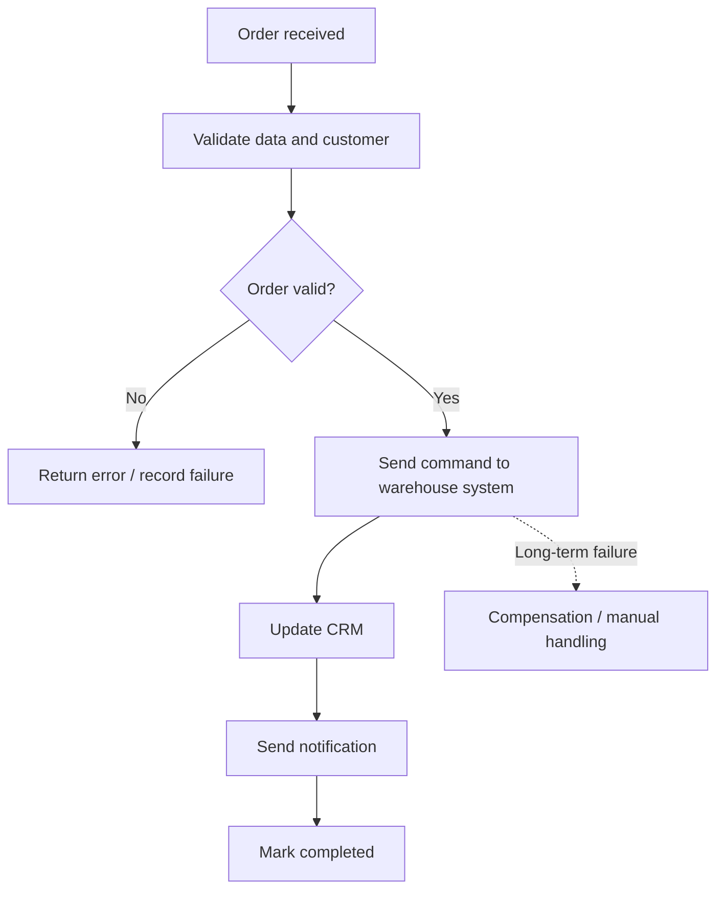
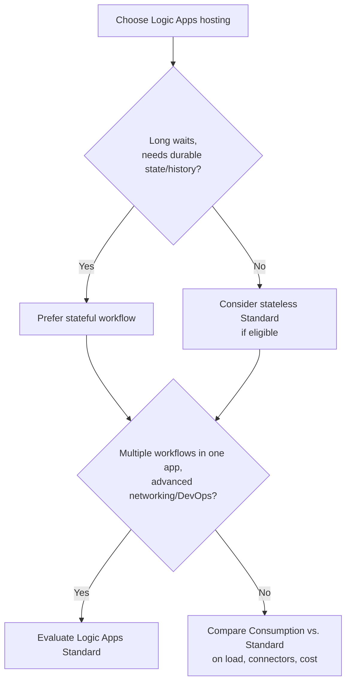
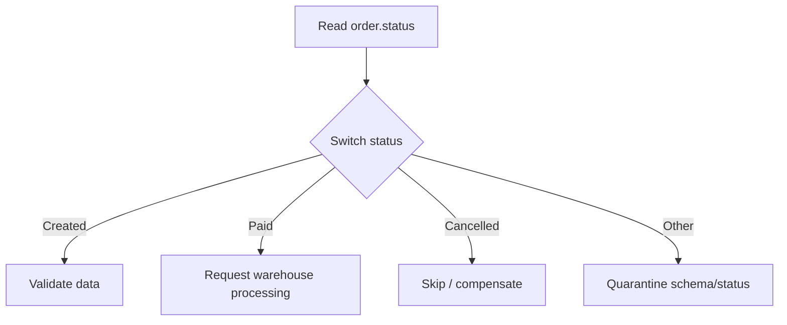
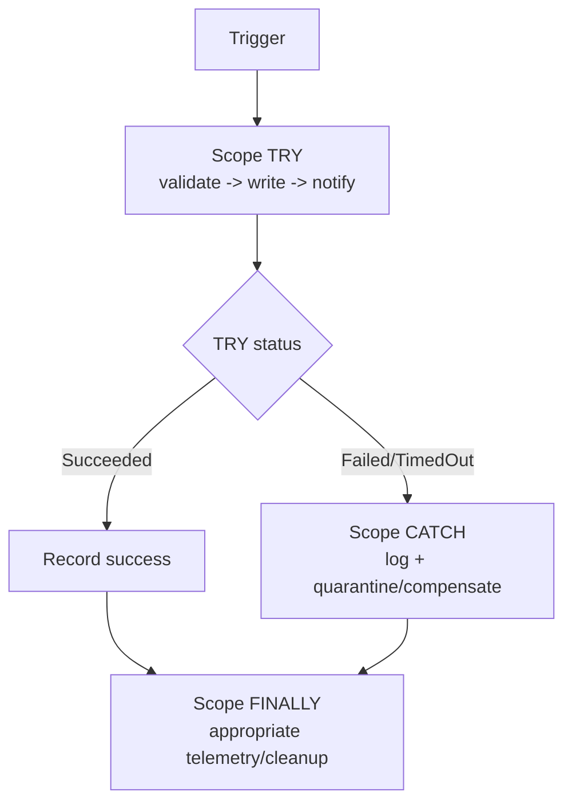
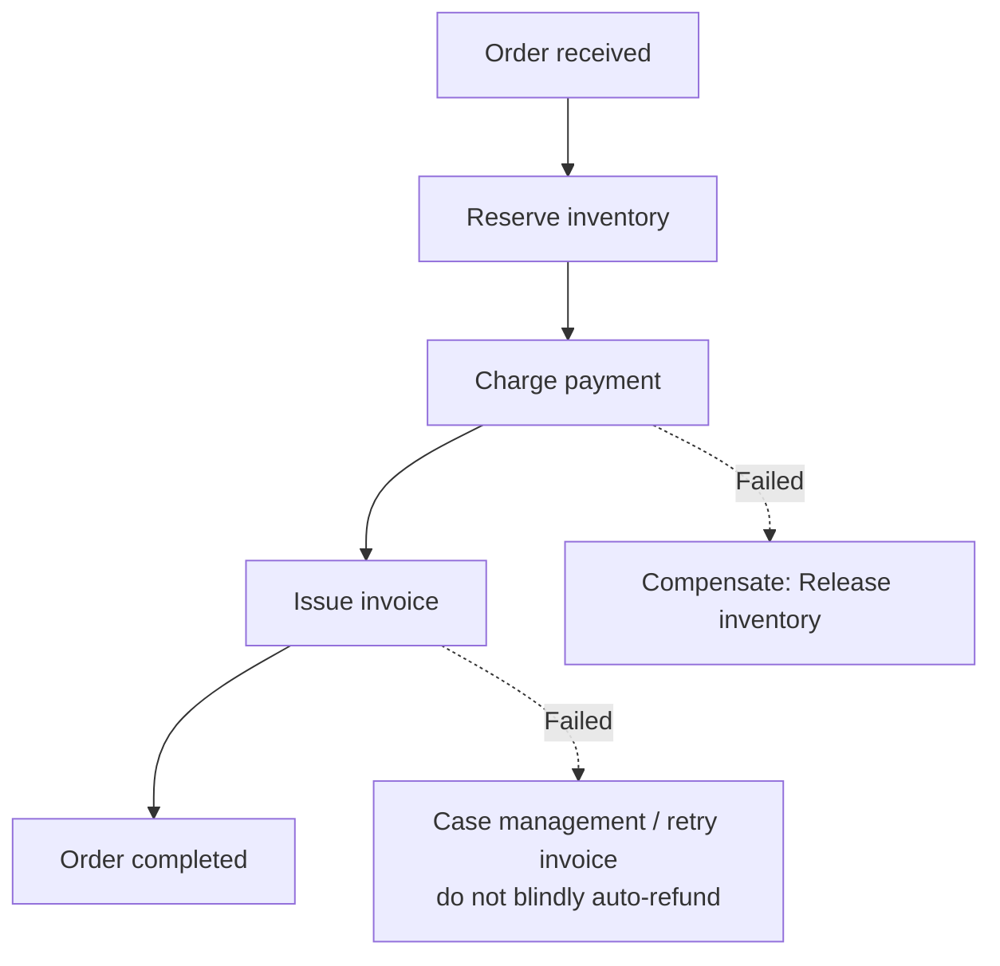
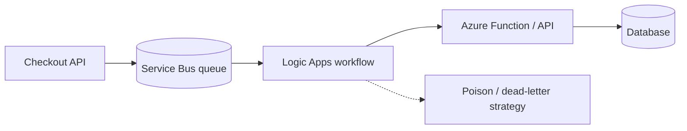
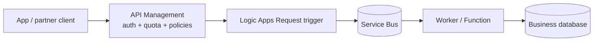
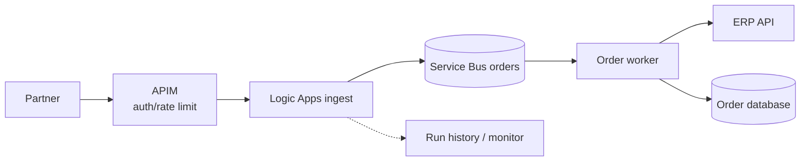
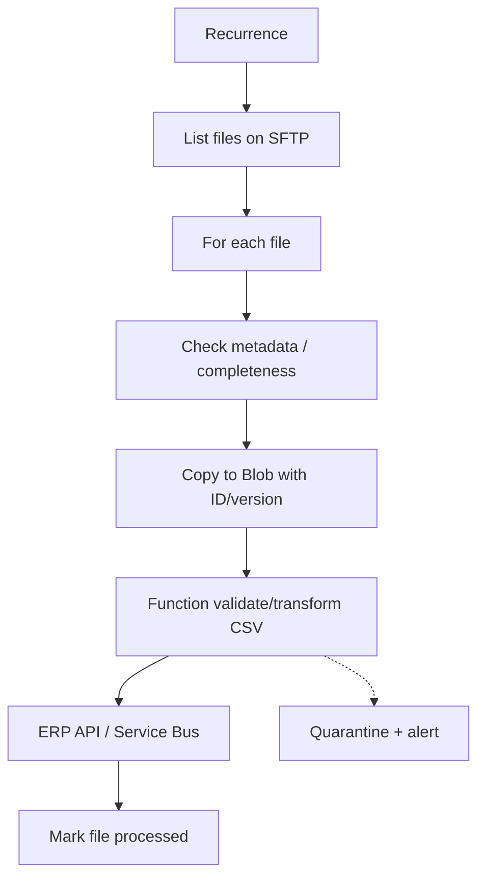

# Logic Apps and Integration Workflow Patterns

An enterprise operates sales, accounting, inventory, email, and CRM systems. After a customer places an order, the system must validate the request, save the order to a database, dispatch an instruction to the warehouse system, notify the customer, and update the CRM. Some steps must run immediately, while others must wait for partner responses; when a later step fails, the organization cannot simply “re-run everything” without risking duplicate invoices or emails.

**Azure Logic Apps** is Microsoft Azure's service for **designing, running, and monitoring integration workflows**, connecting systems via **triggers**, **actions**, and **connectors**. Rather than chaining API calls inside a single web request, you can model each business step, conditional branch, wait state, retry, state management, and error handler as an observable flow.

This lesson belongs to the **API and Workflow Integration** chapter of the **CLOUD_PROVIDERS_AZURE** module. The module explores Azure from subscriptions, resource groups, and Microsoft Entra ID to networking, compute, storage, and data, while teaching how to deploy, monitor, secure, and control application architecture costs on Azure. In that picture, Logic Apps sits at the **orchestration and integration layer**, coordinating API Management, Azure Functions, Service Bus, Event Grid, Storage, SQL, and SaaS/on-premises systems.

**After this lesson, you will be able to:**

- Distinguish **workflow orchestration** from APIs, queues, event routing, and business-logic code.
- Explain **triggers, actions, connectors, control actions, runs, run history**, and Workflow Definition Language.
- Compare **Logic Apps Consumption** and **Logic Apps Standard**, especially **stateful vs. stateless**.
- Design HTTP, scheduled, or event-driven workflows using Condition, Switch, For each, Scope, and `runAfter`.
- Manage **retries, timeouts, idempotency, dead-letter/quarantine, compensation**, and cross-system consistency.
- Connect securely using Microsoft Entra ID, managed identity, API connections, and Private Endpoints/VNet where supported.
- Set up monitoring, alerts, concurrency controls, IaC/CI-CD deployments, and cost optimization.

## 1. When do you need an integration workflow?

A workflow is a sequence of activities with a starting point, branching conditions, state, outcomes, and failure-handling rules.

Example:



Logic Apps fits when the primary value lies in **coordinating systems**, such as:

- Syncing customer data between CRM and ERP.
- Receiving HTTP/webhooks and publishing events to Service Bus.
- Periodically pulling files from SFTP, validating data, and storing in Azure Blob Storage.
- Receiving events from Event Grid and invoking an Azure Function for processing.
- Orchestrating stateful approval processes with wait timeouts.
- Connecting SaaS/on-premises systems via appropriate connectors.

Logic Apps **does not replace all code**. Complex computation, deep data modeling, CPU-heavy processing, or algorithms needing fine-grained automated unit tests generally belong in Azure Functions, APIs, or dedicated apps; Logic Apps calls them and coordinates outcomes.

### 1.1. Orchestration vs. choreography

| Pattern | Coordination style | Pros | Trade-offs |
|---|---|---|---|
| **Orchestration** | One workflow actively invokes/coordinates steps | Clear business flow, easy visibility into order and failures | Orchestrator can become coupled to many systems |
| **Choreography** | Services react autonomously to events without a central coordinator | Lower direct coupling, scales with events | Harder to trace overall progress without correlation |
| **Hybrid** | Event Grid/Service Bus triggers a workflow; workflow calls APIs/Functions and emits further events | Decouples systems while keeping critical processes tracked | Requires governing two retry and tracing models |

Choose orchestration when a process has mandatory steps, branches, and outcomes requiring centralized visibility. Choose choreography when multiple services react independently to an event. Not every microservice interaction needs Logic Apps.

## 2. Core components of Logic Apps

| Component | Definition | Example |
|---|---|---|
| **Logic app resource** | Resource holding a workflow or hosting multiple workflows depending on hosting model | `la-orders-prod` |
| **Workflow** | Process definition and execution state | `ProcessOrder` |
| **Trigger** | Condition/event that starts a workflow run | Request, Recurrence, Service Bus message |
| **Action** | Processing step executed after the trigger fires | HTTP call, SQL insert, Compose, Condition |
| **Connector** | Prebuilt integration with Azure services, SaaS, or external systems | Service Bus, SQL, Outlook, SFTP |
| **Control action** | Conditions, loops, branching, error grouping | Condition, Switch, For each, Until, Scope |
| **Run** | A single workflow execution initiated by a trigger | Run for `order-42` |
| **Run history** | Execution record of statuses, inputs/outputs, and durations depending on workflow type | Shows which action Failed/Skipped |
| **Workflow Definition Language (WDL)** | JSON representation of workflow logic and expressions | `@triggerBody()?['orderId']` |

In the Designer UI, users drag and drop blocks. Under the hood, a workflow is still a **structured definition**; review JSON/IaC for complex changes so logic is never hidden behind the UI.

### 2.1. Triggers vs. actions

A workflow has a starting point defined by its **trigger**, then runs **actions** based on dependencies. Example:

```text
Trigger: When an HTTP request is received
  -> Action: Parse JSON / Validate input
  -> Action: Get customer
  -> Action: Condition
      -> true: Send message to Service Bus
      -> false: Write rejection record
  -> Action: Response
```

A workflow run can contain many actions, executing sequentially or in parallel depending on configuration. **Action Succeeded** means that action completed according to its own contract—**not** that the entire business transaction committed cleanly once.

### 2.2. Runtime and state management

The Logic Apps runtime triggers workflows, executes steps, handles inputs/outputs and errors, and persists state according to the hosting model. For long-running flows, stateful execution persists progress durably; for short flows, stateless execution reduces overhead in supported environments.

Do not assume every workflow shares the same timeout, retention, or history behavior: limits depend on **Consumption vs. Standard, stateful vs. stateless, connectors, and service settings**.

## 3. Consumption vs. Standard: choosing a hosting model

Azure Logic Apps has two major deployment models: **Consumption** and **Standard**.

| Criterion | **Consumption** | **Standard** |
|---|---|---|
| Resource model | Typically one workflow per Logic App Consumption resource | One Logic App Standard resource can host multiple workflows |
| Execution model | Multi-tenant runtime under consumption model | Single-tenant runtime under Standard / Workflow Standard hosting |
| Primary billing | Typically based on trigger/action executions and connector usage per pricing model | Hosting plan capacity/compute plus connector/Storage/network charges per features |
| Workflow state | Workflows run with managed state under Consumption | Supports both **stateful** and **stateless** workflows |
| Network integration | Networking options depend on connectors/service and environment | Offers VNet integration and private networking options per plan/features |
| Deployment | Resource and workflow definition via ARM/IaC | App project with multiple workflows, settings, artifacts, deployment pipeline |
| Target fit | On-demand automation/integration with minimal host management | Multi-workflow apps, runtime/network control, DevOps workflows |

**Standard does not mean running on servers you manage yourself**, and **Consumption does not mean zero fixed or auxiliary costs**: API connections, Storage, networking, and related services can incur separate charges. Check current pricing and limits for your region, SKU, and connectors.

### 3.1. Stateful workflows in Standard

Best suited for:

- Long-running processes waiting on responses or approvals.
- Multi-step flows requiring detailed run history and state tracking.
- Workflows needing runtime checkpoint recovery across host restarts.
- Integrations with non-trivial wait times and multiple dependencies.

State is persisted to support recovery and observability per configuration; this does **not** create an automatic **distributed transaction** across Azure SQL, SAP, and partner APIs.

### 3.2. Stateless workflows in Standard

Best suited for short, latency-sensitive flows with few steps within supported feature and execution-duration limits:

- Simple request/response transformations.
- Input checks followed by calling an internal API.
- Short middleware integration without needing persistent step-by-step run history like stateful workflows.

**Risk:** stateless workflows lack the same checkpoint/history guarantees as stateful ones and carry distinct duration/feature limits. Never pick stateless just to shave latency on a multi-day approval flow or business process that cannot lose state.

### 3.3. Simple decision tree



Final decisions must weigh **regional availability, connector types, actions per run, latency requirements, networking, resilience, and TCO**. Never select a SKU just because a Portal template defaults to it.

## 4. Triggers: where does a workflow start?

Logic Apps supports trigger types tailored to each integration style.

| Trigger type | Characteristics | Use case |
|---|---|---|
| **Request / HTTP** | Workflow invoked via HTTP request when endpoint is configured | API gateway calling a workflow |
| **Recurrence** | Runs on a schedule/interval | Hourly data synchronization |
| **Polling connector trigger** | Periodically checks for new changes/messages | Polling sources without push support |
| **Webhook / push trigger** | Source sends notifications to a callback endpoint | Event-driven integration |
| **Service Bus trigger** | Fires when a message arrives on a queue/subscription per support | Command-processing workflow |
| **Event Grid trigger** | Receives events from Event Grid per connector/features | Workflow reacting to `BlobCreated` |

### 4.1. Polling vs. push

**Polling** can rack up empty check executions, introduce polling-interval latency, and incur execution charges per model. **Push/webhooks** react quickly when supported by the source, but require managing endpoints, authentication, retries, and validation.

Do not assume every connector uses push; a trigger named “When a record is added” may still be implemented via polling. Check the connector reference and throughput/rate limits before deciding.

### 4.2. Recurrence and time zones

Scheduled workflows must specify:

- Frequency and interval (minutes/hours/days/weeks).
- Time zone / UTC offset and daylight saving rules if relevant.
- Behavior when a new scheduled run overlaps an unfinished previous run.
- Concurrency across multiple runs of the same workflow.
- Missed schedules, retries, and controlled catch-up behavior.

For instance, daily order processing at the start of business hours in Vietnam must specify **the business time zone and calendar**, not merely an unverified hardcoded UTC hour.

### 4.3. When a Request trigger generates a callback URL

An HTTP Request trigger can generate a callback URL to invoke the workflow. Depending on the model, the URL may contain a **SAS signature or sensitive access parameters**. Never paste real callback URLs into documentation, public tickets, logs, or source code.

If a workflow is exposed as a public API, consider placing **API Management (APIM)** in front to handle authentication, rate limiting, policies, versioning, and logging. Always verify which authorization modes the hosting model and trigger actually support.

## 5. Actions and connectors: linking systems

Logic Apps provides **built-in actions** and **connectors**.

### 5.1. Built-in actions

These handle orchestration and in-runtime processing, such as:

- **Compose:** construct/transform a value from expressions and inputs.
- **Condition / Switch:** branch based on values.
- **For each / Until:** iterate over collections or repeat until a condition holds.
- **Scope:** group actions for error management and `runAfter`.
- **Terminate:** end a run with a chosen status.
- **Delay / Delay until:** pause execution per supported mechanism.
- **Parse JSON:** parse structured payloads for convenient field access.

These are logical actions; some HTTP, Service Bus, or Storage operations also exist as **built-in connectors** in Standard depending on support. Never assume “built-in” means every action is free or zero-latency.

### 5.2. Managed connectors and API connections

**Managed connectors** integrate with SaaS, enterprise systems, or Azure services and typically use **API connection resources** to hold metadata/authorization per design. Examples:

- Azure SQL, Service Bus, Storage.
- Office 365 Outlook, SharePoint, Teams.
- Salesforce, SFTP, and other systems in the connector catalog.

Each connector has:

1. Specific **operations and trigger types**.
2. Authentication mechanisms (OAuth, managed identity if supported, API keys, etc.).
3. Service/connector limits, throttling, and pagination.
4. Distinct network options, not identical across all connectors.
5. Distinct plan/region availability and pricing.

**Never assume every connector supports managed identity or Private Endpoints.** Verify at the exact operation/connection type level; never assign an identity and assume the connector automatically uses it.

### 5.3. Custom connectors and HTTP actions

When no prebuilt connector fits:

- Use the **HTTP action** with supported authentication to call APIs.
- Front internal APIs with **Azure API Management** and invoke them from the workflow.
- Build a **custom connector** when warranted by publishing/maintenance permissions and supported environments.
- Move complex logic into **Azure Functions** or API services, letting Logic Apps focus on orchestration.

Never put secrets directly into HTTP action URIs/query strings or output logs. Use managed identity, Key Vault, connector settings, and `secure inputs/outputs` where appropriate.

## 6. Workflow Definition Language (WDL) and JSON

A Logic Apps workflow has a **JSON definition** describing triggers, actions, dependencies, parameters, and expressions. Designer provides visual authoring; JSON/code view and IaC enable code review, testing, and version control.

Minimal illustrative example **Request → Compose → Response**:

```json
{
  "$schema": "https://schema.management.azure.com/providers/Microsoft.Logic/schemas/2016-06-01/workflowdefinition.json#",
  "contentVersion": "1.0.0.0",
  "parameters": {},
  "triggers": {
    "When_HTTP_request_received": {
      "type": "Request",
      "kind": "Http",
      "inputs": {
        "schema": {
          "type": "object",
          "properties": {
            "orderId": {
              "type": "string"
            }
          },
          "required": ["orderId"]
        }
      }
    }
  },
  "actions": {
    "Compose_order_id": {
      "type": "Compose",
      "inputs": "@triggerBody()?['orderId']",
      "runAfter": {}
    },
    "Respond_to_caller": {
      "type": "Response",
      "kind": "Http",
      "inputs": {
        "statusCode": 200,
        "body": {
          "status": "validated-example",
          "orderId": "@outputs('Compose_order_id')"
        }
      },
      "runAfter": {
        "Compose_order_id": ["Succeeded"]
      }
    }
  },
  "outputs": {}
}
```

**Meaning:**

- The trigger accepts JSON containing an `orderId` field.
- `Compose_order_id` reads `orderId` from the trigger body.
- `Respond_to_caller` runs only if Compose **Succeeded**.
- The example returns HTTP 200 with status **`validated-example`**; **it has not persisted an order, executed business processing, or performed a durable handoff**.

This is an **illustrative workflow definition**, not a complete ARM/Bicep resource. Deploying to Consumption/Standard requires following the matching resource/project structure, authentication, runtime/plan, and settings. **Never change the example status to “order accepted/processed” without durable persistence.**

### 6.1. Test HTTP request

Using a callback URL **provisioned in an authorized lab environment**:

```bash
curl -X POST "<LOGIC_APP_CALLBACK_URL>" \
  -H "Content-Type: application/json" \
  -d '{"orderId":"order-42"}'
```

Never paste real signature-bearing callback URLs into public examples. If the workflow enforces additional authentication, send tokens/headers per approved policy. The request above **triggers a workflow run** if given a live URL—it is not a read-only command.

## 7. Expressions, dynamic content, and variables

Logic Apps uses **WDL expressions** to read inputs/outputs and transform values.

| Expression | Meaning |
|---|---|
| `@triggerBody()?['orderId']` | Reads `orderId` from trigger body with property-level null safety |
| `@outputs('Compose_order_id')` | Retrieves output of action `Compose_order_id` |
| `@coalesce(triggerBody()?['customerId'], 'unknown')` | Provides a fallback when the first value is null |
| `@concat('orders/', triggerBody()?['orderId'])` | Concatenates strings for a logical key/name |
| `@utcNow()` | Returns the UTC timestamp at expression evaluation time |
| `@variables('attemptCount')` | Reads a declared variable's value |
| `@items('For_each_order')?['id']` | Reads the current item inside loop `For_each_order` |

Expressions have type, escaping, and null-handling quirks. For example, `@coalesce(...)` does not automatically convert an empty string into the fallback in all cases; test real inputs. Dynamic content from a connector is not inherently trusted input: validate schema, length, values, and authorization before calling target systems.

### 7.1. Parse JSON and schema evolution

If an HTTP action returns responses that evolve across versions, a rigid Parse JSON schema can break when a provider adds or drops fields. Best practices:

- Declare required vs. optional fields intentionally.
- Version schemas when payloads are under your organization's control.
- Use controlled fallbacks for optional fields.
- Separate permanently malformed data from transient connector failures.
- Never try to parse an HTML error page as success JSON.

When using **Apply to each**, not every action output is an array. Verify data types before looping to prevent runtime failures.

## 8. Control flow: Condition, Switch, For each, Until

### 8.1. Condition and Switch

**Condition** handles boolean checks, such as requiring approval when an order total exceeds a threshold. **Switch** fits distinct discrete states such as `Created`, `Paid`, and `Cancelled`.



Avoid overlapping conditions where two branches trigger the same side effect. Check for nulls, unknown states, and default cases.

### 8.2. For each and concurrency

`For each` processes collections. Some environments/actions let you raise **concurrency** to run iterations in parallel. That increases throughput at the cost of risks:

- Outputs arrive out of input order.
- Shared variables mutated concurrently cause race conditions.
- Connectors/SaaS APIs hit throttling limits.
- Target APIs may not be safe under concurrent identical calls even if nominally idempotent.

For instance, generating sequential invoice numbers must never rely on `For each` iterations finishing in array order. Push sequencing into a database or a keyed single consumer.

### 8.3. Until and loop limits

`Until` repeats until a condition succeeds or iteration/timeout limits are reached. Useful when polling a partner job status:

```text
POST /export-jobs -> jobId
Until status in [Completed, Failed]:
    GET /export-jobs/{jobId}
    Delay per policy
When Completed: download result
When Failed/timeout: alert and handle
```

Never poll a partner API every 10 ms for 20 minutes if they enforce rate limits. Pick sensible delays, timeouts, and fail-fast conditions; even better, use callbacks/webhooks if the partner supports them.

### 8.4. Parallel branches

After saving an order, sending an email and updating CRM can run in parallel **if both tasks are independent**. If invoice creation depends on payment capture, never parallelize them just to save a couple seconds at the cost of breaking business ordering.

## 9. Run-after and the Try/Catch/Finally pattern

Every action ends in a status such as:

- `Succeeded`: action finished per contract.
- `Failed`: action errored.
- `TimedOut`: action exceeded its timeout condition.
- `Skipped`: action did not run due to dependencies/branching.

**Configure run after** defines which prior action statuses trigger the next action.

### 9.1. Scopes for grouping actions

An operationally clean pattern:



In Designer, put business actions inside `Scope_Try`, then:

1. Configure `Scope_Catch` to run after `Scope_Try` on **Failed** or **TimedOut**.
2. Configure cleanup/telemetry steps after both success and error branches as appropriate.
3. Set the workflow's final status explicitly if failures must surface to callers.
4. Never let Catch accidentally **swallow** errors and report the entire workflow as successful.

### 9.2. `runAfter` snippet

```json
{
  "Scope_Catch": {
    "type": "Scope",
    "actions": {},
    "runAfter": {
      "Scope_Try": [
        "Failed",
        "TimedOut"
      ]
    }
  }
}
```

This is an **action structure snippet** illustrating dependencies, not a complete workflow. When TRY contains multiple branches with mixed outcomes, verify overall scope status propagation against real run history.

### 9.3. Catch is not automatic rollback

Logic Apps **does not automatically undo** an HTTP POST, a committed SQL row, or a sent email when a later step fails. You must define explicit compensation actions and what reversal means in business terms.

Example: inventory was reserved, then payment failed; compensation is **`ReleaseReservation`**, not a generic “undo all SQL writes.”

## 10. Retries, timeouts, and throttling in actions

Connector/HTTP actions can configure retry policies depending on action/runtime type—commonly **fixed, exponential, or none** where supported.

### 10.1. Retrying the right failures

| Error | Should you retry? | Notes |
|---|---|---|
| HTTP 429 or throttling | Usually yes, with backoff and server guidance if supported | Respect rate limits |
| Transient HTTP 502/503/504 | Usually yes | Cap attempt counts and deadlines |
| Network timeout after sending POST | Possible, **but outcome is uncertain** | Requires idempotency key |
| HTTP 400 from bad payload | Usually no | Fix schema/contract |
| HTTP 401/403 from missing permissions | Do not retry indefinitely | Check auth, identity, policy |
| API returns 409 conflict | Depends on semantics | May be already-processed duplicate or real conflict |

**Never treat retries as transaction safety.** If Logic Apps calls an invoicing API, the API commits, and the response times out, retrying creates a second invoice unless the API is idempotent.

### 10.2. Exponential backoff and total deadline

A common delay curve:

\[
d_n = \min(d_{\max}, d_0 \cdot 2^n)
\]

Adding **jitter** keeps multiple workflow runs from retrying in lockstep. In Logic Apps, runtimes and connectors impose their own retry policies and limits: never assume every connector lets you customize all parameters or injects jitter with your exact formula.

Account for:

1. Per-HTTP/connector action timeout.
2. Retry count and wait durations.
3. Overall deadline of the workflow/caller.
4. Whether a connector already retries internally before surfacing failure.
5. Broker/trigger retries if the workflow is message-triggered.

If an HTTP caller waits 5 seconds while a workflow has three actions that each retry for minutes, design an **asynchronous acknowledgement** rather than holding the client connection open.

### 10.3. Retry storms and connector limits

Suppose 500 Logic Apps runs call a SaaS CRM concurrently, and each run retries 5 times when throttled. Total attempts multiply rapidly. Mitigations:

- Cap **trigger concurrency** and loop concurrency.
- Use batching or intermediate queues.
- Rate-limit at APIM/producers as needed.
- Apply exponential retry plus cooldown/circuit-breaking at the application layer where needed.
- Alert on rate limits, raise capacity, or negotiate partner quotas.

Never try to solve 429 errors by spawning more parallel workflows unconditionally.

## 11. Idempotency and preventing duplicate processing

A request, event, or message can arrive multiple times because:

- A trigger/connector retries when a response is lost.
- The upstream source re-emits the same event.
- A user double-clicks a button.
- An operator manually **resubmits** a workflow run.
- One branch fails and an operator re-runs the entire workflow.

**Different workflow run IDs do not mean different business transactions.** You need business-defined idempotency keys.

### 11.1. Business keys

Example:

```json
{
  "schemaVersion": 1,
  "orderId": "order-42",
  "commandId": "issue-invoice-order-42-v1",
  "source": "checkout-api"
}
```

If two runs process the same `commandId`, the invoicing system must execute it only once. Keys can be `commandId` or `orderId + action` per contract.

### 11.2. Inbox pattern

An API or Function called by Logic Apps can implement:

```text
BEGIN DATABASE TRANSACTION
  INSERT Inbox(consumer, commandId)
      with UNIQUE(consumer, commandId)
  IF duplicate:
      RETURN "already_processed"
  ELSE:
      INSERT Invoice(...)
      UPDATE OrderStatus(...)
COMMIT
```

This is pseudocode, **not complete SQL**. Crucially, **the inbox marker and business writes must share the same transaction** (or equivalent conditional writes). Recording “processed” first and failing the business write afterward causes retries to be skipped and business data lost.

### 11.3. Durable handoff before HTTP 202

A Logic Apps workflow receiving HTTP requests can:

1. Validate input data.
2. Write the command to Service Bus or a durable inbox.
3. Receive an ACK confirming durable storage acceptance.
4. Return HTTP `202 Accepted` with a correlation ID.
5. Let a worker run long business steps with dedicated retries/DLQ.

**HTTP 202 means accepted, not completed.** Clients need a status lookup endpoint or callback for final results. If writing to Service Bus fails, never return 202 and ignore the error.

## 12. Sagas and compensation for cross-system transactions

Ordering example:



Each step has **side effects** requiring explicit decisions:

- Is it safe to retry?
- Does the target API support idempotency keys?
- On partial success, what is the compensating action?
- Can compensation itself fail? Who handles the incident?
- Which workflow state represents `PendingManualReview`?

Logic Apps can orchestrate sagas, **but there is no default distributed ACID transaction** spanning warehouse, payment gateway, and CRM. Some actions cannot be cleanly undone (sent emails, settled funds). Compensation is usually an **audited compensating business action**, not erasing history.

## 13. Message-driven workflows with Service Bus

Service Bus decouples producers from processing workflows:



### 13.1. Understand connector mechanics

Depending on the connector/trigger operation, workflows receive messages via **polling**, trigger callbacks, or specific modes. **Complete/abandon/dead-letter** may happen automatically or require explicit actions if supported. Never assume all Service Bus connectors in Consumption and Standard share identical settlement behavior.

When designing:

1. Choose queue vs. topic/subscription.
2. Define timeouts, lock duration, delivery count, and `MaxDeliveryCount`.
3. Ensure message handlers are **idempotent** because redelivery happens.
4. Verify when messages are completed—does completion depend on the whole workflow or an explicit action?
5. Establish DLQ/quarantine and replay procedures.
6. Monitor queue depth, oldest message age, and consumer processing SLOs.

**Pitfall to avoid:** completing a workflow after sending an email but **before** persisting to the database, causing the broker message to be marked complete even though the business step never finished. Align settlement with **durable business outcomes**.

## 14. Event-driven workflows with Event Grid and Event Hubs

### 14.1. Event Grid

Event Grid excels at notifying subscribers when a resource changes (`BlobCreated`, resource events, custom events). Logic Apps can receive events via supported connectors/triggers or endpoints.

With Event Grid push delivery:

- Understand delivery retries, TTL, and potential duplicates.
- Use **event ID/source** and business keys for idempotency.
- Never assume ordered event delivery.
- Configure dead-letter destinations/monitoring if supported by the subscription type.
- For long processing, hand off durably to a queue/worker.

### 14.2. Event Hubs

Event Hubs targets streaming telemetry across partitions/consumer groups, rather than task queues with per-message settlement. Triggering deep orchestration per event requires calculating throughput, batching, checkpoints, and replay. For very high-volume streams, **Azure Functions Event Hubs triggers or stream processors** often fit better than running a Logic Apps workflow per individual event.

### 14.3. Do not spawn millions of workflows for raw telemetry

A 100,000 events/sec telemetry stream should not blindly trigger 100,000 multi-action workflow runs if cost, concurrency, connector quotas, and requirements do not justify it. Often it is better to aggregate/filter with Event Hubs + Functions/Stream Analytics and **invoke Logic Apps only for business events requiring orchestration**.

## 15. API Management and Logic Apps

**Azure API Management (APIM)** can act as the front door for an HTTP workflow:



APIM typically handles:

- Client authentication via OAuth 2.0/JWT or approved mechanisms.
- Rate limits/quotas, header checks, versioning, and transformations where appropriate.
- Hiding backend callback URLs from clients and controlling routing.
- API analytics, correlation, and policies.

Logic Apps handles **workflow orchestration**. Service Bus provides **durable message buffering/decoupling**. Workers/APIs execute **business logic and transactions**. Separating responsibilities avoids stuffing complex logic into APIM policies or building untestable monolithic workflows.

**Note:** placing APIM in front of Logic Apps does not protect the backend if the Logic Apps Request URL can still be called directly. Enforce authentication/authorization and network restrictions on the backend per supported features.

## 16. Secure connections: Microsoft Entra ID and managed identity

### 16.1. Workflow identity

A Logic App can use a **system-assigned** or **user-assigned managed identity** (where supported by hosting model and connector/action) to acquire tokens when accessing Azure resources.

Example workflow reading/writing Blob or sending to Service Bus:

| Activity | Data-plane permission to consider |
|---|---|
| Read Blob | `Storage Blob Data Reader` at the proper scope |
| Write Blob | `Storage Blob Data Contributor` or minimal equivalent role |
| Send Service Bus message | `Azure Service Bus Data Sender` |
| Receive Service Bus message | `Azure Service Bus Data Receiver` |
| Call Entra-protected API | Target API app role/scope or RBAC for that principal |

**Azure `Contributor` on a resource group does not automatically grant data-plane read/write access.** Conversely, holding a data-plane role does not permit modifying the Logic App resource or workflow definition.

### 16.2. API connection authorization

Some managed connectors store connection configuration in API connection resources, which may require:

- OAuth consent from a user or service account.
- App registration or service principal where supported.
- Connection string / API key per connector design.
- Managed identity if supported by that connector operation.

Permissions and tokens can expire, break when an employee leaves, or require refresh. Never bind production connectors to **an individual developer's personal account** without dedicated ownership and rotation/re-authorization runbooks.

### 16.3. Secrets, Key Vault, and logs

For sensitive credentials:

1. Prefer controlled managed identity/OAuth over static secrets when supported.
2. When secrets are required, use **Azure Key Vault**, app settings, or supported connection configs.
3. Enable **secure inputs/outputs** on actions handling sensitive data where supported, understanding how that affects run history debugging.
4. Protect callback URLs, API connection details, deployment pipelines, and diagnostics.
5. Restrict run history access since payloads may contain PII, access tokens, or commercial records.

**Secure inputs/outputs do not sanitize custom logging** if the workflow or downstream services still write tokens elsewhere. Review the entire data path.

## 17. Networking: public/private, VNet, and hybrid

Connection paths may include:

```text
Client/Partner -> APIM -> Logic Apps endpoint
Logic Apps -> Azure SQL Private Endpoint
Logic Apps -> Service Bus / Key Vault / SaaS
Logic Apps -> On-premises API over supported connectivity
```

### 17.1. Outbound and inbound are independent directions

- **Outbound VNet integration** in Logic Apps Standard (per supported config) enables workflows to reach dependencies inside VNets / Private Endpoints.
- **Inbound private access** requires separate design—such as private endpoints, access restrictions, or gateways per hosting model/features.
- **Having VNet integration does not automatically block public Internet access to a Request trigger.**
- Consumption has different networking options and constraints than Standard; never apply a Standard VNet diagram blindly to Consumption.

### 17.2. Private DNS and firewalls

When workflows call Azure SQL, Storage, Key Vault, or Service Bus over Private Link:

1. Verify the exact **Private Endpoint/subresource** on the target service.
2. DNS inside the Logic Apps runtime environment must resolve standard service FQDNs to the right private IPs.
3. Routing, NSGs/firewalls/UDRs must permit outbound flows and return traffic.
4. Managed identities/connectors must hold data-plane permissions.
5. Logic Apps runtime dependencies (Storage, connectors, required platform endpoints) must not be blocked.

**An Approved Private Endpoint does not prove DNS is right.** An HTTP action returning 403 after TCP/TLS succeeds points to auth/policy; timeouts point to networking/DNS—isolate before changing configs.

### 17.3. Connecting on-premises systems

Depending on connectors, environments, and requirements, options include the **on-premises data gateway**, intermediary APIs, VPN/ExpressRoute, Azure Relay, or other supported mechanisms. Never treat the data gateway like a generic VPN tunneling arbitrary protocols; it has specific connector scopes and limits.

For SAP/SQL/SFTP/ERP, clarify:

- Who owns the credentials and read/write permissions?
- Which IPs, ports, and protocols are used?
- How are DNS and certificate validation handled?
- Are there proxy, firewall, or data residency requirements?
- When the gateway or endpoint goes offline, how do workflow retries, delays, and alerts behave?

## 18. Observability, run history, and troubleshooting

### 18.1. Four layers of observation

| Layer | What to track | Question |
|---|---|---|
| Trigger | Trigger fired, skipped, failed, polling delay | Did the workflow start on time? |
| Action | Succeeded/Failed/TimedOut/Skipped, duration, retries | Which step failed? |
| Workflow run | Run status, total duration, concurrency, correlation | Is the process done or still waiting? |
| Business outcome | DB commit, invoice ID, notification delivered, compensation | Is the business state actually correct? |

Logic Apps provides **run history and diagnostic logs** per hosting model. You can integrate **Azure Monitor, Log Analytics, and Application Insights** depending on Logic App type, diagnostic settings, and support.

### 18.2. Correlation IDs and structured logging

Every request/event should carry a durable ID like `commandId`/`correlationId` for tracing:

```json
{
  "workflow": "ProcessOrder",
  "correlationId": "order-42",
  "commandId": "issue-invoice-order-42-v1",
  "action": "Send_to_ServiceBus",
  "outcome": "Succeeded",
  "businessStatus": "Queued",
  "occurredAtUtc": "2026-11-20T03:30:00Z"
}
```

Log only fields needed for investigation. Never log raw authorization headers, callback SAS URLs, connection strings, or full payment details.

### 18.3. Run history is not an immutable business audit ledger

Run history has plan-dependent retention and limits managed by the service. If the business requires multi-year transaction records, store a dedicated **business audit trail** with appropriate retention, immutability, and access controls—never rely solely on run history as a ledger.

### 18.4. Be careful when resubmitting runs

Resubmitting a run can re-execute actions and cause **duplicate side effects**. Before resubmitting:

1. Confirm the event/command ID.
2. Reconcile which steps already completed in target systems.
3. Check the idempotency ledger.
4. Decide between replaying the whole workflow or running a targeted recovery processor.
5. Obtain approval and record an audit trail.

## 19. Deployment, versioning, and environment configuration

Workflows can be updated via the Azure Portal Designer, VS Code/projects, and supported IaC/CI-CD tools. For production:

- Store definitions, connection references, and configs **in version control**.
- Separate **dev, staging, and production** per company policy.
- Use **parameters/app settings** for endpoints, subscriptions, resource IDs, and non-sensitive configs.
- Never embed real credentials in JSON/Bicep/Terraform or pipeline logs.
- Validate API connections and managed identities across environment promotions.
- Version workflow contracts/payloads and linked integrations.
- Deploy with peer review, rollback plans, and post-release verification criteria.

### 19.1. Consumption vs. Standard deployment

In Consumption, workflows are typically `Microsoft.Logic/workflows` resources with definitions and parameters; API connections can be separate resources.

In Standard, workflows live inside an app project deployed as Logic App Standard, typically containing definition and config files for multiple workflows alongside artifacts/connection references per supported model. Never convert a Consumption template to Standard merely by changing a SKU parameter; resource schemas and deployment models differ.

### 19.2. Testing definitions and behavior

Test:

1. **Schema/input:** missing fields, nulls, empty lists, oversized payloads.
2. **Routing:** exact Condition/Switch branches.
3. **Connector failures:** 429, 5xx, 401/403, timeouts, DNS errors.
4. **Duplicate delivery:** identical event/command delivered twice.
5. **Out-of-order:** newer event arrives before older event.
6. **Concurrency:** two runs updating the same business entity simultaneously.
7. **Compensation:** later step fails—does compensating action work cleanly?
8. **Cost/load:** run/action rates and connector rate limits.
9. **Security:** run history hides secrets; endpoints enforce access controls.
10. **Recovery:** resubmits, durable queues, and idempotency yield accurate outcomes.

## 20. Azure CLI: inspecting resources without modifying workflows

The commands below are **read-only**. They inventory resources and diagnostic settings; access depends on Azure RBAC. Because Consumption and Standard use different resource types, identify the type first.

### 20.1. Check subscription and Consumption workflows

```bash
RG="rg-integration-prod"

az account show \
  --query "{subscription:name,id:id,tenantId:tenantId}" \
  -o table

az resource list \
  --resource-group "$RG" \
  --resource-type "Microsoft.Logic/workflows" \
  --query "[].{name:name,location:location,id:id}" \
  -o table
```

### 20.2. Check Logic App Standard resources

```bash
# A Logic App Standard host is a Microsoft.Web/sites resource
# with a workflowapp kind; inspect the actual output.
az resource list \
  --resource-group "$RG" \
  --resource-type "Microsoft.Web/sites" \
  --query "[].{name:name,kind:kind,location:location,id:id}" \
  -o table
```

Not every `Microsoft.Web/sites` resource is a Logic App Standard app. Check `kind`, hosting plan, and Portal before identifying a resource. Listing parent resources also **does not replace** inspecting individual workflows inside Standard.

### 20.3. Inspect resource and diagnostics

```bash
# Replace with the real ID obtained from resource list.
LOGIC_APP_RESOURCE_ID="<LOGIC_APP_RESOURCE_ID>"

az resource show \
  --ids "$LOGIC_APP_RESOURCE_ID" \
  --query "{id:id,name:name,type:type,location:location,kind:kind}" \
  -o json

az monitor diagnostic-settings list \
  --resource "$LOGIC_APP_RESOURCE_ID" \
  -o json
```

**Never dump full resource configs or app settings into public logs** if they contain callback URLs, authorization details, or secret references. These inventory commands do not prove runtime health; inspect workflow run history and monitoring as well.

## 21. Case study A: Ordering via APIM, Logic Apps, and Service Bus

**Requirements:** partners submit orders over an HTTPS API; the system must respond quickly, never lose orders when the ERP fails, and never create duplicate orders on client retries.



**Flow design:**

1. APIM authenticates partners and enforces quotas.
2. Request trigger receives JSON with `orderId` and `requestId`.
3. Logic Apps validates required fields/contract and returns clear errors when invalid.
4. Logic Apps sends a message to Service Bus with a **stable command ID**.
5. Only after broker ACK does the workflow return HTTP `202` with a correlation ID.
6. The worker uses retries/DLQ and idempotent DB updates; final state is durably saved.
7. Clients poll order status via another API or receive a callback, never assuming 202 means completed.

**Failure test:** HTTP response to client times out after Service Bus accepted the message. Client retries with the same `requestId` → system must not create two orders.

## 22. Case study B: Syncing SFTP files to Azure Storage and ERP

**Requirements:** every morning check a partner's SFTP folder, move CSVs to Blob, validate schemas, and update the ERP. Partners occasionally upload two files with the same name or trigger reads before upload finishes.



**Essential rules:**

- Process files only when the partner uses an upload-completion signal (rename/manifest/marker) or approved stability check.
- Deduplication keys should combine partner ID + file ID/version/hash, not filename alone.
- Limit `For each` concurrency to stay within SFTP and ERP quotas.
- Use a transformation Function when CSV mapping is complex.
- Quarantine and alert on invalid data rather than retrying endlessly.
- Govern connector credentials/owners and network/hybrid gateways per service capabilities.

## 23. Case study C: Manual approval with timeouts

**Requirements:** a purchase request above a threshold requires manager approval before dispatching to the ERP; waiting can span several days.

**Design:**

1. A **stateful** workflow receives the request and creates an `approvalId`.
2. Sends notifications via a supported connector.
3. Waits for a response/callback/approval action per the supported pattern.
4. On Approve: verify approver permissions, persist decision, and dispatch to ERP idempotently.
5. On Reject: update status and notify requester.
6. On timeout: transition to `Expired` or `Escalated`—never hang forever.
7. Maintain an audit trail recording who approved, when, what decision, and which policy version.

Never use Stateless Standard for multi-day wait workflows. Never assume an approval action has infinite retention; verify workflow and connector limits alongside timeout transition plans.

## 24. Troubleshooting: layered error isolation

| Symptom | Causes to check | Investigation direction |
|---|---|---|
| Workflow never starts | Trigger disabled, wrong filter, polling interval not elapsed, callback unreachable | Check trigger history/config and source |
| Request trigger returns 401/403 | Authentication/authorization or network policy | Check Entra tokens/SAS/access restrictions |
| HTTP action returns 429 | Connector/SaaS throttling | Reduce concurrency, back off, inspect quotas |
| Action returns 401/403 | Managed identity/API connection lacks permissions, expired consent | Check principal, scopes, tokens, and owner |
| HTTP action times out yet API created record | Uncertain outcome; retry causes duplicate side effect | Idempotency keys and reconciliation |
| Workflow “Succeeded” yet business incomplete | Only queued or Catch swallowed error | Separate business state from success status |
| Logic Apps reads wrong field | Schema changed, null/array, wrong expression | Inspect permitted inputs/outputs, schema version |
| `For each` writes records out of order | Parallel loops + shared variable | Limit concurrency or sequence in DB |
| Workflow runs too long | Polling/Until/Delay, connector retries, slow downstream | Inspect action durations and deadlines |
| Stateless workflow loses state after restart | Wrong model chosen for long-running work | Move to stateful or durable handoff |
| Standard cannot reach private SQL | Wrong VNet, DNS/routing, connector type, or identity | Check outbound VNet integration, private DNS, IAM |
| Run history leaks sensitive data | Secure inputs/outputs/logging not configured | Trim logs, enforce RBAC, protect run details |
| Connector works in dev, fails in prod | Differing API connections/consent/configs | Review connection references and settings |
| Resubmit creates duplicate emails/invoices | Missing business idempotency | Inbox/outbox and API idempotency |
| Costs surge rapidly | Short polling, high action/run counts, retries, connector calls | Trim triggers/actions, batch, compare plans |

### 24.1. Suggested debugging order

1. **Right workflow/region/resource?** Confirm run ID, trigger ID, and timestamp.
2. **Trigger:** did it fire with valid input, or get blocked by filters/concurrency?
3. **Actions:** which step Failed/Skipped/TimedOut? Did `runAfter` handle it right?
4. **Identity:** which connector, principal, and token/scopes?
5. **Network:** DNS, TLS, outbound VNet, Private Endpoints, and firewalls?
6. **Data:** null fields, arrays, schema versions, oversized payloads?
7. **Consistency:** did downstream commit; will retries/resubmits duplicate?
8. **Capacity/cost:** connector quotas, concurrent runs, queue backlogs, SLOs?
9. **Recovery:** fix root cause, replay idempotently, and reconcile results.

## 25. Cost, performance, and limits

### 25.1. Cost components

| Component | What to estimate |
|---|---|
| Logic Apps Consumption | Trigger/action executions and connector usage per pricing model |
| Logic Apps Standard | Hosting plan capacity, storage, and connector/operation charges per model |
| API Management | Tier/capacity and request volume |
| Service Bus / Event Grid / Functions | Message operations, capacity, executions, retries/DLQ |
| Database / Storage | Transactions, retained data, backups |
| Networking | VNet/Private Endpoints, NAT, gateways, or egress if applicable |
| Observability | Log Analytics, Application Insights, retention, and alerts |

A 20-action workflow running 100,000 times/month generates far more executions than a 4-action workflow running the same count; however, **you cannot calculate exact billing simply by multiplying action count by an assumed unit price** because trigger types, connector tiers, hosting models, and retries all affect charges differently.

### 25.2. Performance is more than parallelism

Bottlenecks:

- Partner API capped at 100 requests/second.
- Connector connection limits or quotas.
- Slow SQL transactions.
- Large Service Bus queue backlogs.
- Polling/delay-heavy workflow actions.
- High `For each` concurrency pushing total HTTP calls past limits.

**Increasing concurrency can actually lower throughput** if downstream throttles and every call retries repeatedly. Load-test and measure p95/p99 latency, errors, and cost per workload profile.

### 25.3. Cutting costs while preserving correctness

- Filter events at the source before starting workflow runs.
- Use batching and bulk APIs where business rules allow.
- Offload heavy loops/transformations to Functions/code.
- Cut unnecessary polling; prefer push triggers where suitable.
- Separate long/high-risk workflows from short request-response APIs.
- Cap retries and concurrency; prevent duplicate side effects.
- Strip secrets from logs and tune retention.

## 26. Production deployment runbook

### Pre-deployment

1. Diagram data flow, identifying sources/triggers, actions, and business completion.
2. Choose Consumption/Standard and stateful/stateless based on limits and TCO.
3. Inventory connectors, OAuth/managed identity permissions, and private networking support.
4. Configure retries/timeouts/deadlines, `runAfter`, error scopes, and compensation.
5. Design stable business IDs, downstream idempotency, and durable handoffs.
6. Define input schemas, API versions, contracts, and sensitive data handling.
7. Author IaC, separate environments/parameters, and prepare rollback.
8. Test duplicates, transient failures, invalid payloads, timeouts, and concurrent runs.
9. Prepare dashboards, alerts, runbooks, and on-call owners.

### During deployment

1. Confirm the target Azure subscription/resource group/resource.
2. Deploy workflow definitions and connections through the approved pipeline.
3. Verify principals/roles, secrets, and networking.
4. Run a synthetic request/event with a dedicated test ID.
5. Verify run history **and** actual database/queue/CRM outcomes.
6. Monitor 401/403, 429, 5xx, timeouts, latency, and cost anomalies.

### Post-deployment

1. Reconcile workflow versions, connections, and business IDs.
2. Review Failed/Cancelled/TimedOut/Resubmitted runs.
3. Inspect retry volume, deduplication, and outbox/queue backlogs.
4. Verify security controls, log redaction, and retention.
5. Record the change log, verify release/rollback readiness, and hand over to operations.

## 27. Production checklist

- [ ] Orchestration vs. choreography chosen deliberately instead of overusing Logic Apps.
- [ ] Consumption/Standard and stateful/stateless selected with clear rationale.
- [ ] Triggers, destinations, and connectors verified as supported in target plan/region.
- [ ] Polling intervals/concurrency and push/webhook validation verified.
- [ ] Workflow definitions, parameters, and API connections version-controlled.
- [ ] Input schemas and expressions handle nulls, arrays, and wrong types safely.
- [ ] Condition/Switch/For each/Until include error branches and loop bounds.
- [ ] `runAfter`, Scopes, and Terminate accurately reflect business states.
- [ ] Retry policies target transient errors only, with timeouts/deadlines and finite attempts.
- [ ] Stable idempotency keys and inbox/outbox/durable handoffs implemented where needed.
- [ ] Compensation/reconciliation defined for multi-system transactions.
- [ ] HTTP 202 returned only after durable acceptance, never treated as business completion.
- [ ] Microsoft Entra/managed identities and connector authorizations properly scoped.
- [ ] Callback URLs and secrets protected; `secure inputs/outputs` applied appropriately.
- [ ] VNet, Private DNS, firewalls, and network restrictions verified for inbound and outbound.
- [ ] Run history, diagnostic logs, business KPIs, and alerts have assigned owners.
- [ ] Resubmit/replay reviewed to prevent duplicate side effects.
- [ ] Load testing, cost estimates, quotas, and rollback plans ready.

## 28. Self-check questions

1. How do Logic Apps' responsibilities differ from Azure Functions, API Management, and Service Bus?
2. How do triggers and actions differ? Give an example workflow receiving HTTP and sending to Service Bus.
3. When should you pick orchestration instead of choreography?
4. Compare Consumption and Standard across resource model, hosting, stateful/stateless, and cost.
5. Why should stateless workflows not be chosen for multi-day approval processes?
6. What latency, request-volume, and cost risks do polling triggers carry?
7. Why must a Request trigger's callback URL be protected like a secret in SAS-based setups?
8. How do `@triggerBody()?['orderId']` and `@outputs('Compose_order_id')` differ?
9. What happens if `For each` runs in parallel while logic assumes array ordering?
10. How does `runAfter` with `Failed`/`TimedOut` enable Try/Catch patterns?
11. Why does a succeeding Catch scope not mean committed ERP steps were rolled back?
12. A target API creates an invoice, then the HTTP action times out. Why can a retry create a duplicate invoice?
13. What does HTTP 202 Accepted prove, and what does it not yet prove?
14. How does a business command ID differ from a workflow run ID?
15. Why doesn't the Azure `Contributor` role automatically let a workflow read Blob or Service Bus messages?
16. If a Standard Logic App has VNet integration, is its Request trigger already private? Explain.
17. If Logic Apps ingestion succeeds and the worker fails after ACK, which retry/DLQ system must you inspect?
18. Why shouldn't run history be the sole audit source for an invoice?
19. What must be verified before resubmitting a production run?
20. How can you detect connector/SaaS throttling when raising `For each` concurrency?
21. In an SFTP file-sync scenario, what key prevents processing the same file twice?
22. List metrics that verify a workflow is **business-correct**, not merely showing `Succeeded`.

## Conclusion

**Azure Logic Apps** is an **integration workflow orchestrator**: triggers initiate flows, actions/connectors invoke systems, control actions express branching and loops, and WDL defines logic that can be deployed and reviewed. **Consumption** suits many on-demand automation scenarios, while **Standard** provides a multi-workflow model with stateful/stateless choices and richer hosting/networking controls. Yet a finished workflow run does not automatically guarantee once-only business accuracy: you still need **idempotency, durable handoffs, bounded retries, `runAfter`/catch handling, compensation, and business auditing**. When combined cleanly with **API Management, Service Bus, Azure Functions, Microsoft Entra ID, and Private Link**, enterprises can integrate APIs, SaaS, and internal systems securely, observably, and cost-effectively at scale.
