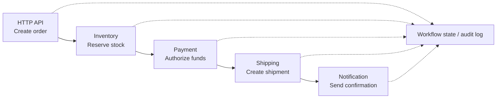
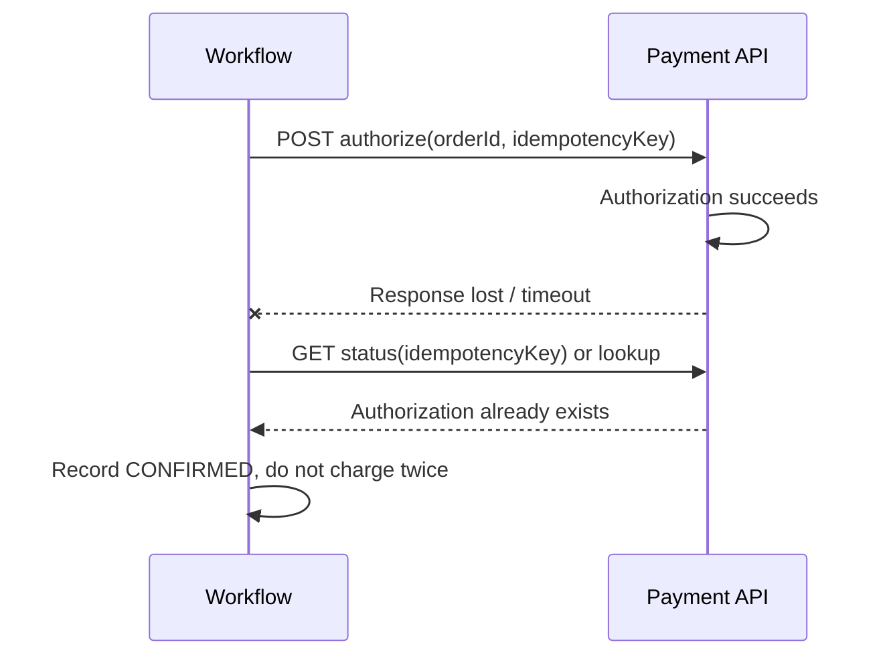
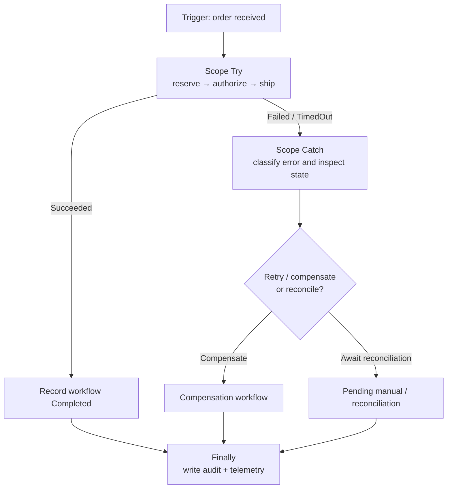
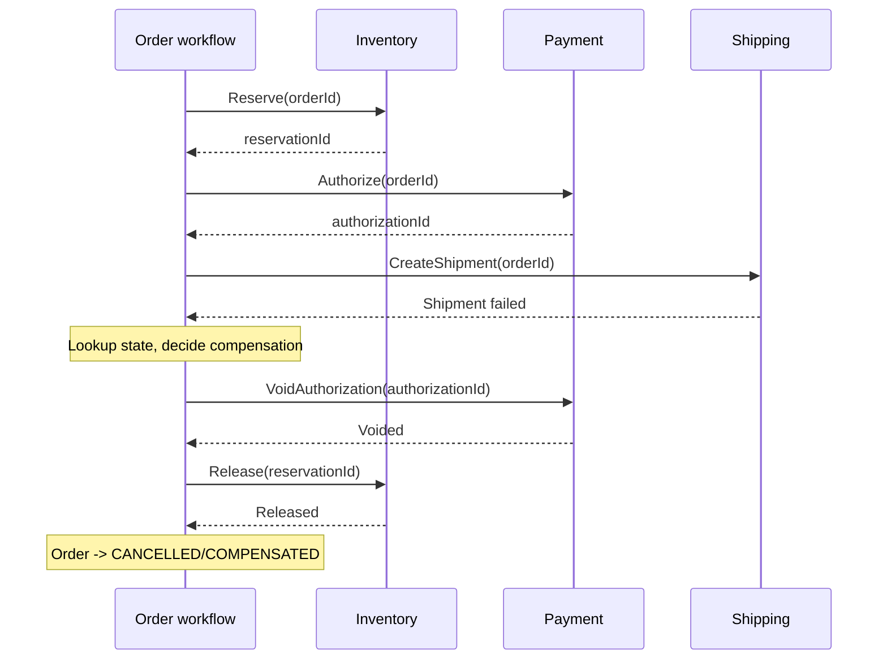
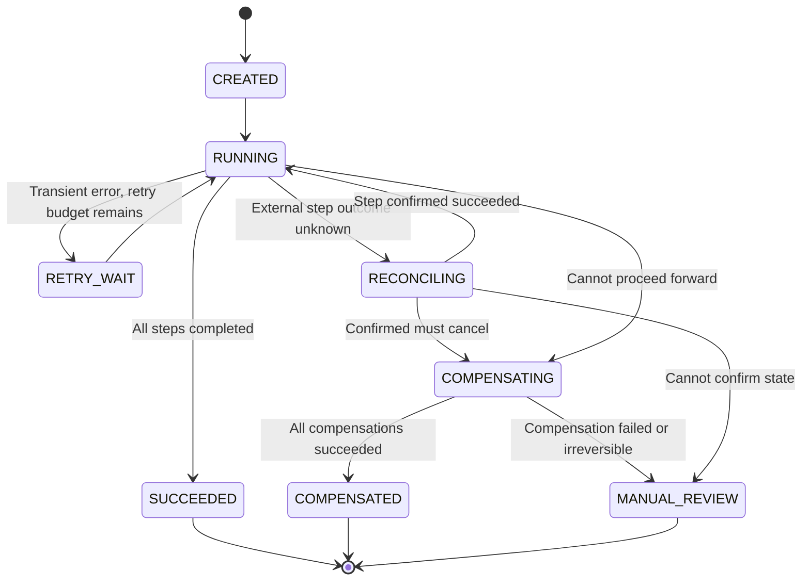
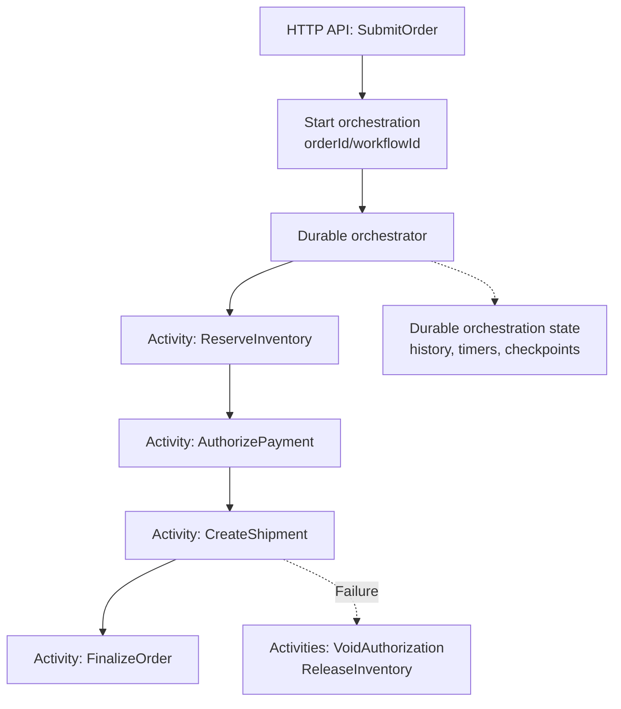
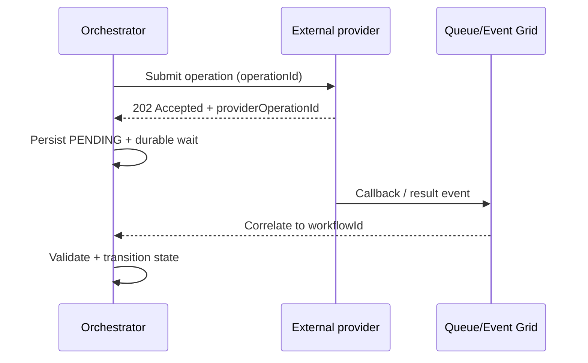
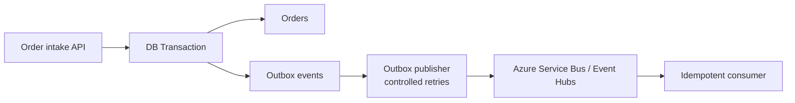
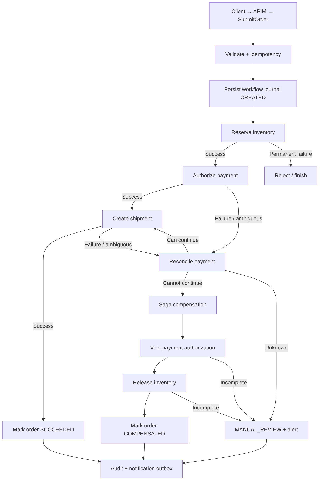

# Error Handling, Retries, and Workflow Compensation

A customer places an order on a website. The system must check inventory, reserve stock, authorize payment, create a shipping request, and send an email. When the shipping service fails to respond after funds have already been authorized and stock has been reserved, the crucial question is not merely **“should we call the API again?”**, but **“what happens to the already-completed steps so the whole system stays consistent?”**.

In integration systems, a workflow spans multiple APIs, queues, databases, and external providers. You cannot treat all of those steps as a single database transaction. Systems must distinguish **transient errors**, **permanent errors**, and **unknown outcomes**, applying **retries, timeouts, idempotency, compensation**, or **manual review** according to risk.

In the **CLOUD_PROVIDERS_AZURE** module, you learn the Azure ecosystem from subscriptions, resource groups, and Microsoft Entra ID to virtual networks, compute, storage, and data, along with deploying, monitoring, securing, and controlling costs of an application. This lesson belongs to the **API and Workflow Integration** chapter, focusing on designing and operating reliable workflows with **Azure Logic Apps**, **Azure Functions / Durable Functions**, APIs, Azure Service Bus, and dependent services.

## 1. Learning objectives

After this lesson, you will be able to:

- Identify **transient**, **permanent**, and **unknown outcome** errors when calling APIs or processing messages.
- Choose **retry policies**, backoff, jitter, timeouts, retry budgets, and overall deadlines.
- Use **Scope**, **Configure run after**, and error branches in Logic Apps; understand `Succeeded`, `Failed`, `TimedOut`, and `Skipped`.
- Explain why retries must be paired with **idempotency keys**, deduplication, and observability.
- Distinguish a single-database **transaction rollback** from a **compensating action** in distributed workflows.
- Design a **Saga** with durable state and compensating steps in a safe order.
- Apply **Durable Functions** for orchestration, retries, and compensation while avoiding side effects in replayed orchestrator code.
- Combine Azure Service Bus retries/dead-lettering, alerts, access controls, and runbooks to handle failing workflows safely.

## 2. What makes up a distributed workflow?

Consider an e-commerce order flow:



Each step may have its own database, transactions, identity, quotas, and timeouts. Even when everything runs on Azure, **there is no default ACID transaction spanning multiple APIs, brokers, and external providers**.

For example: stock reservation committed in Database A, payment was authorized by the PSP, and then the shipping API returns `503`. Rolling back Database A's transaction **does not automatically undo** the PSP authorization. You need an explicit business action—such as **voiding the payment authorization** and **releasing the inventory reservation**.

### Three questions before adding retries

1. **Is the operation safe to call again?** Read-only `GET` differs from `POST /charge`, which moves money.
2. **Did the previous call actually fail?** A timeout can happen after the server committed, with only the response lost.
3. **If the workflow halts permanently, what happens to completed steps?** Resume from a checkpoint, compensate, or escalate to human review?

Retries are only **one mechanism** in reliability engineering; they do not replace state design and business correctness.

## 3. Classify errors before handling them

| Error category | Examples | Initial handling direction |
|---|---|---|
| **Transient** | `429 Too Many Requests`, `503 Service Unavailable`, brief network drop | Bounded retry, backoff/jitter, respect server signals |
| **Prolonged infrastructure / dependency outage** | Broker down, misconfigured DNS or Private Endpoint | Circuit breaker, alert, queue/defer; never retry forever |
| **Permanent business error** | Out of stock, invalid account, incomplete address | Never blindly retry; return error, fix data, or compensate |
| **Permission / configuration error** | `401`, `403`, missing role, or expired credential | Inspect identity, scopes, tokens, network; do not burn retries |
| **Ambiguous / unknown outcome** | Client timeout after sending `POST /authorize-payment` | Look up outcome by idempotency key / operation ID before repeating |
| **Partial success** | Inventory reserved and payment authorized, shipment creation fails | Choose forward recovery or compensation based on recorded state |
| **Poison message** | Unparseable JSON event or schema violation | Quarantine / dead-letter and fix payload; avoid infinite loops |
| **Compensation failure** | Refund API temporarily unavailable | Separate retry, mark pending compensation, alert, manual intervention |

### Common HTTP status codes

| HTTP status | Practical interpretation |
|---|---|
| `200`, `201`, `202`, `204` | Check business semantics; `202` usually means accepted for processing, not that final work succeeded |
| `400`, `422` | Usually invalid/malformed input; fix data, do not retry the same payload |
| `401`, `403` | Authentication or authorization failure; fix the root cause |
| `404` | Resource missing; occasionally eventual consistency lag—verify against API contract |
| `408`, `429` | Retryable if idempotent and within deadline |
| `409` | Conflict; depending on API, could be in-flight request, optimistic lock, or idempotency key collision |
| `500`, `502`, `503`, `504` | Usually retry candidates, though side-effecting calls may have unknown outcomes |

**No HTTP status table applies mechanically to every API.** Each provider's contract dictates which statuses need lookup, which are retryable, and which confirm completion.

## 4. Retrying properly: bounds, backoff, jitter, and deadlines

### Anatomy of a retry policy

A sound retry policy defines:

- **Retry condition:** only errors/codes classified as transient by the API contract.
- **Maximum count:** e.g., up to 3 extra retries after the initial attempt; always clarify “attempts” vs. “retries.”
- **Backoff:** increasing delays between attempts, such as exponential backoff.
- **Jitter:** randomizing wait intervals so many clients do not retry in lockstep.
- **Per-attempt timeout:** no single attempt should block indefinitely.
- **Retry budget / total deadline:** stop when the business time budget expires, even if retries remain.
- **Idempotency:** for side-effecting operations, the server must recognize repeated requests.
- **Telemetry:** log attempt number, failure class, correlation ID, and latency; never log credentials.

Reference formula for **full jitter**:

\[
d_k \sim U\left(0,\,\min(d_{\max}, d_0\cdot 2^{k-1})\right)
\]

Here `d0` is the base delay, `dmax` is the backoff cap, and `k` is the retry attempt number. This is a conceptual formula; **Logic Apps and Azure SDKs implement their own specific algorithms and configuration limits**. Do not assume every connector uses this exact formula.

For instance, 3 retries with backoff caps of 1, 2, and 4 seconds produce **variable** wait times due to jitter. With a 10-second overall deadline, a request that has already spent 8 seconds should not launch another attempt taking tens of seconds.

### Respecting `Retry-After` and throttling

On `429` or `503`, servers may return a `Retry-After` header expressing wait duration in **seconds** or as an **HTTP date**. When supported by clients/connectors, honor that guidance while staying within the overall workflow deadline.

However, `Retry-After` is not permission to retry forever. When a provider is overloaded, retrying at every layer (client → API Management → workflow → SDK) causes **retry amplification**: one user request spawns dozens of backend requests.

**Principle:** designate which layer owns retries, cap total attempts across layers, and use **circuit breakers** to pause traffic when a dependency fails persistently.

### Timeouts and unknown outcomes



If an API lacks both operation-ID lookup and idempotency-key support, **you cannot assume the operation failed simply because the client timed out**. For financial operations, prefer a **`PENDING_RECONCILIATION`** state and a reconciliation process before resending.

## 5. Idempotency as the foundation of reliable workflows

An operation is **idempotent** when repeating it with the same request identifier produces no extra business side effects beyond the defined result. For example, calling “reserve 2 units for order `ORD-1001`” twice must yield **one reservation**, not 4 reserved units.

### Designing idempotency keys

An idempotency key should:

1. Represent **one specific business intent**, e.g., `orderId + operationType + version`.
2. Remain identical across retries of that intent; **never generate a fresh UUID per attempt**.
3. Be persisted by the backend alongside status and outcome under a unique constraint / transaction.
4. Define rules when **the same key arrives with a different payload**: typically return a conflict/validation error rather than silently accepting changes.
5. Have retention longer than the maximum allowed retry/replay window, with a clear cleanup policy.

| Operation | Illustrative idempotency key | Result to persist |
|---|---|---|
| Reserve inventory | `ORD-1001:reserve:1` | Reservation ID, status, quantity |
| Authorize payment | `ORD-1001:authorize:1` | PSP operation ID and status |
| Create shipment | `ORD-1001:shipment:1` | Shipment ID, status |
| Send confirmation email | `ORD-1001:email-confirm:1` | Timestamp, provider message ID |
| Release reservation | `ORD-1001:release:1` | Released status, reason |

In databases, naive **check-then-insert** fails under concurrent workers: both read “not found” and produce duplicate side effects. Use unique constraints, transactional/conditional writes, or API providers with built-in idempotency guarantees.

**Not every API supports an `Idempotency-Key` header.** It is a common convention, so check each contract; for providers without it, build an application-level reconciliation/deduplication layer.

## 6. Azure Logic Apps: action- and scope-level error handling

**Azure Logic Apps** models workflows via triggers and actions. Each action reports an execution status; you can group actions in a **Scope** and use **Configure run after** to branch on success, failure, timeout, or skipped states.

Key statuses:

| Status | Practical meaning |
|---|---|
| `Succeeded` | Action succeeded per connector contract; **does not guarantee all external business effects finished cleanly** |
| `Failed` | Action failed and did not complete per action definition |
| `TimedOut` | No timely response received; external business state **may still have changed** |
| `Skipped` | Action did not run due to conditions or `runAfter` dependencies; not automatically a business failure |

### Try / Catch / Finally pattern



In the Logic Apps designer, you can typically:

1. Place primary actions inside **Scope Try**.
2. Create **Scope Catch** with **Run after** set to `Failed` and `TimedOut` (adding `Skipped` if the workflow needs to interpret skipped paths).
3. Put logging/reconciliation actions inside Catch and set the appropriate business status.
4. Configure a **Finally/Logging** branch to run after the relevant statuses of preceding branches, ensuring all execution paths reach it cleanly.

**Note:** “Catch succeeded” does not turn the business outcome into a success. A technically clean error-handling run may still need to report **`FAILED` / `COMPENSATED` / `MANUAL_REVIEW`** to callers.

## 7. Configuring retries and `runAfter` in Logic Apps

### 7.1. In Azure Portal / Workflow Designer

Assuming an authorized editable Logic App, work in **dev/test**:

1. Open the Logic App and workflow in **Designer**.
2. Add an **HTTP** or connector action to call the inventory service.
3. Open action **Settings** and locate **Retry policy** if supported by the action/connector.
4. Select `None`, `Fixed`, or `Exponential` depending on action type and designer version. Tune count and intervals within supported bounds.
5. Set action timeout settings where supported, aligned with the overall workflow deadline.
6. Wrap primary actions in **Scope Try**; add **Scope Catch** configured via **Configure run after** on `Failed` / `TimedOut`.
7. Inside Catch, inspect error codes and execution statuses, call lookup APIs for business state, and decide between manual retry, compensation, or reconciliation.
8. Add logging and auditing, then test with simulated HTTP `200`, `429`, `503`, `400`, and timeouts.

**Note:** not all connectors/actions expose identical retry settings. Triggers or managed connections may have specific retry/timeout rules; for Managed Connectors, check the connector's exact behavior under your **Consumption** or **Standard** plan.

### 7.2. Workflow definition fragment (illustrative)

The abbreviated snippet below shows the `actions` section of a workflow definition. It is **not a complete Logic App file**: it requires a trigger, real APIs, response handling, authentication, and deployment configuration.

```json
{
  "actions": {
    "Try": {
      "type": "Scope",
      "actions": {
        "Reserve_inventory": {
          "type": "Http",
          "inputs": {
            "method": "POST",
            "uri": "https://inventory.example.invalid/reservations",
            "headers": {
              "Idempotency-Key": "@{triggerBody()?['orderId']}"
            },
            "body": {
              "orderId": "@triggerBody()?['orderId']"
            }
          },
          "retryPolicy": {
            "type": "exponential",
            "count": 3,
            "interval": "PT5S",
            "minimumInterval": "PT5S",
            "maximumInterval": "PT1M"
          },
          "runAfter": {}
        }
      },
      "runAfter": {}
    },
    "Catch": {
      "type": "Scope",
      "actions": {
        "Inspect_try_results": {
          "type": "Compose",
          "inputs": "@result('Try')"
        }
      },
      "runAfter": {
        "Try": ["Failed", "TimedOut"]
      }
    },
    "Finally": {
      "type": "Scope",
      "actions": {
        "Audit": {
          "type": "Compose",
          "inputs": "Record workflow state in a durable store"
        }
      },
      "runAfter": {
        "Catch": ["Succeeded", "Failed", "TimedOut", "Skipped"]
      }
    }
  }
}
```

**Key points to understand:**

- `runAfter` specifies which predecessor statuses allow the next action to run.
- The `result('Try')` expression returns outcomes of actions inside a Scope where supported; filter sensitive error details carefully before logging.
- `PT5S` and `PT1M` are ISO 8601 duration strings.
- `Idempotency-Key` helps only if the inventory API actually **implements** idempotency semantics.
- The `Audit` action above is a dummy `Compose` and **does not persist anything durably**. In production, replace it with Storage/SQL/a monitoring sink and handle audit-write failures.
- In workflows with multiple parallel scopes/branches, verify **paths when Catch is `Skipped`** so the final step is never accidentally bypassed.

### 7.3. Is the default retry policy enough?

Not necessarily. Some HTTP/connector actions retry transient responses automatically, but if the workflow must:

- Query an `operationId` before retrying a side-effecting transaction;
- Wait until business status transitions from `PENDING` to `CONFIRMED`;
- Vary attempt counts by error type or business deadline;
- Combine circuit breaking or dead-lettering to a queue;

then you need **explicit workflow logic** rather than relying solely on built-in connector retries.

### 7.4. `runAfter` does not equal rollback

`Scope Catch` running after `Scope Try` fails only means **the error-handling path started**. Logic Apps does not automatically undo prior HTTP calls. Inside Catch, determine which actions committed, inspect external state, and run safe compensators.

## 8. A Java example: bounded HTTP retry

Not every workflow calls APIs directly from Logic Apps. An Azure Function or Java service often mediates backend calls under a dedicated contract. The Java 17 example below illustrates **bounded retries on `429`/`502`/`503`/`504` and I/O errors** for an endpoint **that already supports idempotency keys**.

```java
import java.io.IOException;
import java.net.URI;
import java.net.http.HttpClient;
import java.net.http.HttpRequest;
import java.net.http.HttpResponse;
import java.time.Duration;
import java.util.concurrent.ThreadLocalRandom;
import java.util.concurrent.TimeUnit;

public final class RetryableWorkflowClient {
    private static final int MAX_ATTEMPTS = 4; // 1 initial attempt + up to 3 retries.
    private final HttpClient client = HttpClient.newBuilder()
            .connectTimeout(Duration.ofSeconds(2))
            .build();

    public String reserve(URI uri, String orderId, String json)
            throws IOException, InterruptedException {
        String idempotencyKey = orderId + ":reserve:v1";
        long deadline = System.nanoTime() + Duration.ofSeconds(20).toNanos();
        IOException lastIOException = null;

        for (int attempt = 1; attempt <= MAX_ATTEMPTS; attempt++) {
            if (System.nanoTime() >= deadline) {
                throw new IOException("Workflow deadline exceeded");
            }

            HttpRequest request = HttpRequest.newBuilder(uri)
                    .timeout(Duration.ofSeconds(4))
                    .header("Content-Type", "application/json")
                    .header("Idempotency-Key", idempotencyKey)
                    .POST(HttpRequest.BodyPublishers.ofString(json))
                    .build();

            try {
                HttpResponse<String> response = client.send(
                        request, HttpResponse.BodyHandlers.ofString());
                int status = response.statusCode();
                if (status >= 200 && status < 300) {
                    return response.body();
                }
                if (!isRetryable(status)) {
                    throw new IllegalStateException("Non-retryable response HTTP " + status);
                }
                lastIOException = new IOException("Retryable HTTP " + status);
            } catch (IOException ex) {
                // Retry only because the endpoint enforces an idempotent contract.
                lastIOException = ex;
            }

            if (attempt == MAX_ATTEMPTS) {
                break;
            }
            long maxBackoffMs = Math.min(4000L, 500L << (attempt - 1));
            long jitterMs = ThreadLocalRandom.current().nextLong(maxBackoffMs + 1);
            long remainingMs = TimeUnit.NANOSECONDS.toMillis(
                    deadline - System.nanoTime());
            if (remainingMs <= 0) {
                break;
            }
            Thread.sleep(Math.min(jitterMs, remainingMs));
        }
        throw new IOException("Reservation not confirmed; reconcile by key",
                lastIOException);
    }

    private static boolean isRetryable(int code) {
        return code == 429 || code == 502 || code == 503 || code == 504;
    }
}
```

This sample enforces **attempt caps, timeouts, and a deadline**, reusing **the same idempotency key**. For production, also add:

- Honoring `Retry-After` when provided and within the remaining deadline.
- Distinguishing transient `IOException`s from configuration/TLS/data errors in the target API.
- When all attempts fail without confirmation, **looking up status** by key rather than assuming the reservation never happened.
- Emitting metrics, trace IDs, and attempt counts without logging PII or secrets.
- Circuit breakers and cross-layer retry budgets (across Logic Apps, SDKs, and API gateways).

**Never use this retry pattern on a charge/transfer endpoint lacking an idempotency contract.** Retrying an HTTP `POST` is safe only when the backend enforces deduplication/transactions or reconciliation is in place.

## 9. How does compensation differ from rollback?

### Rollback inside a single database

If two records update within **the same ACID transaction**, the database can roll back everything before commit. This is an atomic guarantee of a single data management engine.

### Compensating transactions in workflows

Once actions have committed across **multiple independent services**, compensation is **a new forward business operation** intended to undo or mitigate an earlier action:

| Forward action | Compensating action | Limitation |
|---|---|---|
| Reserve stock | Release reservation | Must release only the exact order's reservation |
| Authorize payment | Void uncaptured authorization | Differs from refunding after capture |
| Capture payment | Issue refund per policy and PSP | May not be instant, incur fees, or require approval |
| Create shipping label | Cancel label / pickup request | Cannot cancel once handed over to carrier |
| Create pending record | Mark `CANCELLED` and record reason | Preserve audit trail; never erase history |
| Send email | Send follow-up correction notice | **Cannot reliably “unsend” a delivered email** |

**Compensation is not a mathematically guaranteed inverse.** Some effects **cannot be undone** or can only be offset by issuing a new event. Systems must define acceptable terminal states, reconciliation, and manual ownership.

### Forward recovery or compensation?

After a shipment creation failure, a system might choose:

- **Forward recovery:** keep the stock reservation and payment authorization, retrying shipment creation once the carrier recovers—as long as reservation/auth holds haven't expired.
- **Compensation:** if the deadline expires or shipping is impossible, void payment authorization and release inventory.
- **Manual review:** if payment capture status or physical carrier handoff is uncertain, quarantine the transaction for reconciliation.

Base the decision on **business state, deadlines, and reversibility**, never solely on the last HTTP status code.

## 10. Saga pattern for distributed transactions

A **Saga** coordinates a sequence of local transactions where each committed step may have a matching **compensating action** if the sequence cannot finish.

Two common styles:

- **Orchestration:** a workflow coordinator decides which step to call, inspects outcomes, and triggers compensations. Azure Logic Apps or Durable Functions fit well here.
- **Choreography:** services react to events and emit success/failure/compensation events; Service Bus or Event Grid can support this, though ordering and global observability require extra care.

### Illustrative orchestrated Saga



Compensations usually execute **in reverse order of committed steps** to respect dependencies, though that is not a rigid rule for every domain. When steps run in parallel or share interdependent resources, build a **compensation dependency graph** to determine a safe order.

### Why is a durable state journal necessary?

If an orchestrator crashes right after payment succeeds but before saving `authorizationId`, it will not know which authorization to void. Persist step states and operation IDs durably, paired with idempotency keys for lookup when outcomes are ambiguous.

Minimal workflow journal record:

```json
{
  "workflowId": "wf-ord-1001",
  "orderId": "ORD-1001",
  "state": "COMPENSATING",
  "steps": [
    {
      "name": "reserveInventory",
      "status": "SUCCEEDED",
      "externalOperationId": "res-789"
    },
    {
      "name": "authorizePayment",
      "status": "SUCCEEDED",
      "externalOperationId": "auth-456"
    },
    {
      "name": "createShipment",
      "status": "FAILED",
      "externalOperationId": null
    }
  ],
  "compensations": [
    {"name": "voidAuthorization", "status": "PENDING"},
    {"name": "releaseInventory", "status": "PENDING"}
  ]
}
```

In production, the journal needs concurrency control, state transition history, UTC timestamps, actor/trace IDs, and fencing so two orchestrators never drive the same workflow simultaneously. If a step times out, never blindly mark `FAILED` and trigger compensation against an uncertain external transaction; mark `UNKNOWN` or `RECONCILIATION_REQUIRED` first.

## 11. State machine model for workflows and compensation

Instead of a boolean `success = true/false` flag, define a **state machine** showing clearly what completed and what remains pending.



Business states should have clear operational meaning:

| State | Meaning | Permitted actions |
|---|---|---|
| `CREATED` | Request accepted; forward steps not started yet | Validate, schedule |
| `RUNNING` | One or more forward steps in progress | Proceed per step journal |
| `RETRY_WAIT` | Waiting to retry a transiently failed step | Use durable timer/delay |
| `RECONCILING` | Uncertain whether external side effect committed | Query operation ID; block blind resends |
| `COMPENSATING` | Executing valid compensating steps | Run each compensator with checkpoints |
| `COMPENSATED` | Reversible effects cleanly rolled back | End with cancelled outcome |
| `SUCCEEDED` | All mandatory steps completed | Emit outcome event and audit |
| `MANUAL_REVIEW` | Inconsistent or cannot auto-resolve | Hand off to SRE/finance/operations |

Enforce **valid state transitions**. For example, never let a re-delivered `ShipmentFailed` event push a workflow from `SUCCEEDED` straight into `COMPENSATING` if the parcel was already delivered; handle post-delivery issues through a separate audited business process.

### Compensations also require idempotency

If `voidAuthorization(auth-456)` times out, the PSP may still have voided the hold. Retries must use **the same operation/idempotency key**; before voiding again, query the PSP or call an idempotent endpoint with clear contract semantics. Similarly, repeating `releaseInventory(res-789)` must return “already released” rather than incrementing inventory counts endlessly.

Record `compensationAttemptCount`, `lastError`, `nextRetryAt`, and `externalOperationId` in the journal. When attempts or deadlines run out, transition to `MANUAL_REVIEW` and fire an actionable alert.

## 12. Techniques for handling failed compensations

Many designs cover only the “compensation succeeded” path. In reality, **compensation APIs fail too**—due to payment outages, goods already shipped, or expired tokens.

| Scenario | Recommended handling |
|---|---|
| Compensation API returns `503` | Bounded/durable retry with backoff and deadline |
| Compensation API times out | Look up status by operation ID before repeating |
| PSP returns “already voided” | Treat as complete if operation/correlation and contract match |
| Shipment already picked up by carrier | Switch to return/claim flow; never loop label cancellation |
| Token/role revoked | Alert on permissions/config; do not retry forever or auto-escalate privileges |
| Two compensators depend on each other | Define ordering or graph; checkpoint each step |
| Compensation leaves irreversible state | Write audit, mark conditional terminal state, escalate to human |

### Avoid compensating prematurely

If `createShipment` times out, first ask the carrier:

- Was a shipment ID already created for this `orderId`/idempotency key?
- What status is that shipment in?
- If it exists, can the workflow proceed forward instead of compensating?

Voiding payment while a real shipment was already created risks **shipping unpaid goods**. Distinguishing **confirmed failure** from **unknown outcome** is a prerequisite for compensation.

### Avoid unbounded “compensation of compensation”

Complex Sagas need recovery when compensators fail, without spiraling into an unowned infinite loop of “undoing the undo.” Define:

1. Attempt caps and deadlines per compensator.
2. Explicit step states: `PENDING` → `RUNNING` → `DONE` or `FAILED_RETRYABLE` / `MANUAL_REQUIRED`.
3. Durable retry mechanisms decoupled from open HTTP requests.
4. Authorized alerts and intervention paths.
5. Final reconciliation reports comparing journal state against real targets (PSP, warehouse, carrier).

## 13. Durable Functions: orchestrator, activities, and replay

**Azure Durable Functions** is an option for coordinating long-running workflows, invoking activities, and persisting orchestration state via a configured durable backend. It fits workflows that wait minutes, hours, or days without holding an HTTP connection open.

Typical architecture:



### How does an orchestrator differ from an activity?

- **Orchestrator function:** defines execution order, branching/try-catch, durable timers, external event waits, and compensation. The runtime **replays** the orchestrator from history to restore progress.
- **Activity function:** performs actual I/O—calling PSPs, writing databases, sending messages, calling external APIs.
- **Starter/client:** initiates an orchestration and receives an instance ID for tracking.
- **Durable backend:** persists history/state per provider and app version; requires proper storage, networking, and permissions.

**Critical rule:** never place direct network calls, non-deterministic random numbers, raw system clock reads, or side effects inside orchestrator code that the runtime replays. Perform all I/O inside **activities**, and use runtime-provided deterministic APIs and durable timers.

### Saga pseudocode in Durable Functions

The snippet below is **architectural pseudocode**, not copy-paste Java/JavaScript SDK code. Durable Functions APIs vary by language and programming model.

```text
orchestrate(order):
    reservationId = null
    authorizationId = null
    shipmentId = null

    try:
        reservationId = callActivity("ReserveInventory", order)
        authorizationId = callActivity("AuthorizePayment",
                                       order, reservationId)
        shipmentId = callActivity("CreateShipment",
                                  order, authorizationId)
        callActivity("MarkOrderCompleted",
                     order, reservationId, authorizationId, shipmentId)
        return SUCCEEDED

    catch error:
        # Reconcile all steps with ambiguous outcomes before compensating.
        state = callActivity("ReconcileExternalOperations", order)
        if state.requiresManualReview:
            return MANUAL_REVIEW

        if state.shipmentCanBeCancelled:
            callActivity("CancelShipmentIdempotently", state.shipmentId)
        if state.authorizationCanBeVoided:
            callActivity("VoidAuthorizationIdempotently",
                         state.authorizationId)
        if state.reservationCanBeReleased:
            callActivity("ReleaseReservationIdempotently",
                         state.reservationId)

        callActivity("MarkOrderCompensated", order)
        return COMPENSATED
```

**Warning:** this simplified pseudocode omits individual compensator failure handling, durable progress checkpoints, and rules for irreversible side effects. Real systems need dedicated try/catch around compensations, `PENDING_RECONCILIATION`/`MANUAL_REVIEW` states, and durable retries/timers per activity.

### Durable timers and retries

For transient faults, an orchestrator can wait via a **durable timer** before retrying, or configure activity **retry options** per supported SDK. Unlike `Thread.sleep` inside an HTTP-triggered Function, durable waits let the runtime checkpoint state without pinning an active thread across the entire wait in supported models.

However:

- Activities can still be invoked more than once across crashes/failures; **they must be idempotent**.
- Timing out or cancelling an orchestration **does not automatically undo** a committed PSP operation.
- Never delete execution history or purge instances while reconciliation/compensation obligations remain.
- The durable state backend and its networking/security are critical dependencies—never assume “no database needed.”

## 14. Designing a Logic Apps flow for an order Saga

A practical design can use **Logic Apps** as the orchestrator with HTTP and Service Bus actions:

| Step | Illustrative action | Durable state to record | Failure branch |
|---|---|---|---|
| 1 | Receive `orderId` and payload | `CREATED`, correlation ID | Return `400` on invalid input |
| 2 | Call Inventory Reserve | `reservationId`, `SUCCEEDED` | Retry if transient; reconcile on timeout |
| 3 | Call Payment Authorize | `authorizationId`, `SUCCEEDED` | Idempotent retry / reconcile per PSP |
| 4 | Call Shipping Create | `shipmentId`, `SUCCEEDED` | Retry or compensate per deadline |
| 5 | Update Order completed | `SUCCEEDED` | Forward-recover / alert on DB error |
| 6 | Send notification | Outbox/event status | Retry separately; never void order over transient email error |

A Logic Apps orchestration layout:

```text
Trigger: HTTP / Service Bus
  |
  v
Validate + create workflow journal
  |
  v
Scope Try
  Reserve inventory  --> Store reservation ID
  Authorize payment  --> Store authorization ID
  Create shipment    --> Store shipment ID
  Confirm order
  |
  +-- Succeeded --> Commit final workflow state
  |
  +-- Failed/TimedOut --> Scope Catch
                          Read step journal
                          Reconcile unknown outcomes
                          Choose retry / compensation / manual review
                          Persist final or pending state
  |
  v
Audit + metrics + respond status/operationId
```

### When to use Logic Apps vs. Durable Functions?

| Criterion | Logic Apps | Durable Functions |
|---|---|---|
| Authoring workflows | Visual designer, connectors, action configs | Code in chosen programming model |
| SaaS/enterprise integration | Many managed connectors depending on type/tier | Typically SDK/HTTP code or intermediary services |
| State and retries | Runtime manages run history/retries per features | Orchestration history, durable timers, activity retries |
| Complex code-heavy rules | Can get hard to maintain with excessive branches | Usually cleaner for complex logic and code-level unit tests |
| Compensation | Configure actions/scopes/state | Write idempotent orchestrator/activities |
| Operations | Workflow runs, connector auth, integration accounts if needed | Function host, durable backend, versions, execution history |

**Neither automatically guarantees a correct Saga.** Both supply orchestration infrastructure; business rules, external verification, compensation state, and access controls still require explicit design.

## 15. Azure Service Bus: retries, settlement, and dead-lettering

In asynchronous workflows, **Azure Service Bus** often serves as a durable buffer between stages. For instance, `OrderCreated` enters a queue; an Azure Function or Logic App trigger picks it up, calls the shipping service, saves the outcome, and completes the message.

### Peek-Lock and message redelivery

In **Peek-Lock** mode:

1. The consumer receives the message and holds a **lock** for a bounded duration.
2. The consumer processes it; on success, it calls **complete** (or lets connector/trigger settlement complete per its semantics).
3. If not completed—due to lock expiration or process crash—the message is redelivered.
4. Once delivery attempts exceed the limit or another dead-letter condition triggers, Service Bus moves the message to the **dead-letter subqueue** per policy.

**At-least-once delivery** is the practical baseline for most flows. A consumer receiving the same `MessageId` again must not create extra orders, charges, or invoices.

### `MaxDeliveryCount` and dead-lettering

**`MaxDeliveryCount`** bounds how many times a message can be delivered across abandonment/lock-expiry retries before Service Bus moves it to the dead-letter queue. However, **not all business errors classify themselves accurately**: applications still need to:

- Distinguish transient faults from unprocessable poison messages.
- Record sanitized `DeadLetterReason` and error descriptions when dead-lettering explicitly.
- Maintain dashboards for dead-letter count, oldest message age, and assigned owners.
- Provide **controlled tools to inspect, fix, and replay**, avoiding blasting thousands of bad messages back at once.
- Decide when permanent failures move to **manual review** rather than retrying.

### Trigger retries vs. HTTP action retries

A workflow may stack:

```text
Service Bus trigger
    |
    +-- message redelivered on lock expiry / delivery failure
    |
    v
Logic Apps / Azure Function
    |
    +-- HTTP action retries 3 times
    |
    v
Backend SDK
    |
    +-- retries another 3 times
```

If all three layers retry uncoordinatedly, **one message** can multiply into many backend calls. Document the **end-to-end retry budget**, assign retry ownership cleanly, and ensure backends reuse the same idempotency key.

### Duplicate detection does not replace business idempotency

Service Bus offers **duplicate detection** on supported tiers/entities using `MessageId` within a **detection window**. It is a helpful broker guardrail, but:

- It does not span infinite time.
- It does not stop a producer from sending the same business intent under a different `MessageId`.
- It does not solve crashes occurring after a consumer executes business logic but before completing the message.
- It does not guarantee external side effects executed exactly once.

Therefore, **business-service idempotency** remains mandatory even with broker duplicate detection enabled.

## 16. Long-running workflows and asynchronous events

Not every step finishes inside one HTTP call. A payment gateway may return `202 Accepted` and send a confirmation webhook minutes later. A carrier may publish `ShipmentCreated` or `ShipmentRejected` events onto a topic.

### Request → acknowledgement → callback pattern



**Never record `SUCCEEDED` just because a provider returned `202`.** Wait for the callback or poll status per contract, bounded by an explicit deadline.

### Correlation and callback security

Callbacks must correlate strictly to the target workflow via `workflowId`/`operationId` and be authenticated using a provider-supported mechanism (HMAC signature, OAuth, mTLS, gateway, or security scheme). Never trust `status=SUCCESS` in a payload merely because it names an order ID.

Design for:

- Idempotently ignoring or handling duplicate callbacks.
- Preventing a callback for workflow A from mutating workflow B.
- Handling callbacks arriving **before or after** the orchestration enters its wait state.
- Defining policies for late callbacks arriving after the workflow already entered `COMPENSATED`.
- Providing polling fallbacks within provider rate limits in case callbacks are lost.

In Durable Functions, use **external events** and **durable timers** per your language SDK to await callbacks with timeouts. In Logic Apps, use **webhook actions**, HTTP request-response patterns, or a separate event-receiver workflow updating the state store depending on connector capabilities.

## 17. API Management and gateway-level retries

**Azure API Management (APIM)** sits in front of backend APIs to enforce authentication, rate limits, caching, routing, and—where configured—gateway retry policies. However, **gateway retries cannot tell on their own whether an operation's side effects are safe to repeat**.

### Where should retries live?

| Layer | Appropriate responsibility | Warning |
|---|---|---|
| APIM / gateway | Brief connection failures before backend processing, throttling, simple conditional resilience | Never blindly retry all `POST`s; avoid retry amplification |
| Logic Apps | Action/connector retries per contract, `runAfter`, workflow error branches | Must persist business state and check unknown outcomes |
| Durable Functions | Activity retries, durable timers, orchestration state | Replays and activity retries demand idempotency |
| Backend SDK | Network/timeout/throttling retries per SDK/service policy | Do not stack extra retries past the chain budget |
| Service Bus | Redeliver uncompleted messages, dead-lettering | Does not roll back DB/PSP transactions |

**A clear retry boundary** beats three layers guessing independently. For payment operations, gateways should generally forward idempotency keys and correlation IDs, enforce timeouts, and let the application/workflow own business reconciliation.

### Circuit breakers and bulkheads

- **Circuit breaker:** when a dependency fails repeatedly, pause direct calls to relieve load, probe after a cooldown, and surface degraded status.
- **Bulkhead:** cap concurrent workflows/calls dedicated to one dependency so a failing PSP cannot drag down inventory or frontend APIs.
- **Rate limits and queues:** smooth traffic bursts instead of letting concurrent HTTP requests hammer an overloaded service.

These patterns do not solve transactional correctness alone; combine them with idempotency, Saga state, and business deadlines.

## 18. State store reliability and the transactional outbox

A notorious failure sits **between** writing to a business database and publishing the next event:

```text
1. INSERT order ORD-1001 succeeds
2. Process crashes before publishing OrderCreated
3. Downstream workers never learn the order exists
```

**Transactional outbox** mitigates this by writing both business data and the outbox record inside **the same database transaction**:



After commit, a publisher reads the outbox, emits the event, and marks it published. If the process crashes after the broker accepts the event but before updating the outbox row, the event may be **re-published**; consumers must deduplicate.

### Outbox and compensation

Outboxes help not only for forward events, but also for **compensation commands**:

1. Workflow decides to transition to `COMPENSATING`.
2. Persists state and a `VoidAuthorizationRequested` command in the local transaction.
3. Publisher dispatches the command to a worker authorized to call the PSP.
4. Worker returns the outcome/ack and updates compensation state.
5. On transient errors, the durable command remains available for retries or DLQ handling.

Decoupling avoids keeping an HTTP request open throughout business rollback. Still control **ordering**, duplicate events, and who is authorized to issue compensation commands so cancellations cannot be abused.

## 19. Workflow security, permissions, and sensitive data

In Azure architectures, a Logic App or Durable Function calls multiple services. **A technically succeeding workflow never bypasses authorization in target services.**

### Principle of least privilege

| Component | Required permission | Should not be granted by default |
|---|---|---|
| Logic App / Function calling Inventory API | Create/lookup/release reservations per API contract | Subscription-wide admin roles |
| Payment activity | Narrow permission to authorize/void/refund per workflow | Giving every component direct refund rights |
| Service Bus producer | **`Azure Service Bus Data Sender`** on exact queue/topic | `Data Owner` for every producer |
| Service Bus consumer | **`Azure Service Bus Data Receiver`** to receive/settle | Namespace `Owner` when only receiving |
| State journal / Blob / database | Scoped data read/write roles | Sharing storage account keys across all workflows |
| SRE / manual compensation | Time-bound approved access, audited, strong auth | Untracked static credentials |

Prefer **Managed identity + Microsoft Entra ID** wherever supported by connectors, SDKs, and backends. Between Logic Apps Consumption and Standard, managed identity settings, connections, and per-connector auth differ; verify the exact principal used by each action.

### Networking and secrets

- Use HTTPS/TLS; enable private endpoints / VNet integration where compliance requires, verifying DNS and outbound routes.
- Never pass API keys or PSP credentials in query strings when safer mechanisms exist.
- Store secrets in a proper secret manager with rotation and access control; never commit them into workflow definitions.
- In Logic Apps, enable **Secure Inputs / Secure Outputs** on actions handling tokens, card data, PII, or secrets where supported.
- Restrict who can view **run history**, as trigger/action inputs and outputs can expose sensitive payloads.
- Audit manual interventions without logging plaintext credentials.

### Never let error branches “fail open”

When permission checks fail or fraud services are unreachable, workflows must define explicitly whether to **fail closed**, enter **degraded mode**, or route to **manual review** per business risk. Never treat `403` as a transient error to bypass checks, and never trigger compensation solely off an unauthenticated callback.

## 20. Observability: knowing where it failed, retry counts, and compensation state

Multi-service workflows are hard to debug from a single ingress HTTP `500`. Track **workflow state**, **each step**, **external operation IDs**, and **recovery actions**.

### Fields worth recording

| Field | Meaning | Example |
|---|---|---|
| `workflowId` | Stable identifier for the orchestration instance | `wf-ord-1001` |
| `correlationId` / trace ID | Links logs/traces across services | `trace-abc123` |
| `orderId` / business key | Ties back to business entity | `ORD-1001` |
| `stepName` | Executing step | `AuthorizePayment` |
| `attemptNumber` | Current attempt count | `3` |
| `errorCategory` | Transient, permanent, unknown, authorization... | `UNKNOWN_OUTCOME` |
| `dependencyStatus` | HTTP status / SDK error code if available | `504` |
| `externalOperationId` | ID used for lookup or compensation | `auth-456` |
| `workflowState` | Current Saga state | `COMPENSATING` |
| `nextRetryAt` | Scheduled next retry time | UTC timestamp |
| `compensationState` | Progress of rollback steps | `VOID_PENDING` |

**Never log tokens, connection strings, card numbers, CVVs, or raw sensitive payloads.** Apply appropriate data governance and retention to `orderId` if linked to PII.

### Logic Apps Run history

In the Azure Portal, open Logic App → **Runs history** (section name may vary by Logic App type). During investigation:

1. Locate the workflow run by UTC timestamp or correlation ID.
2. Expand `Scope Try` and find the first `Failed` or `TimedOut` action.
3. Check how many retries occurred and the final error; inspect `outputs` if authorized.
4. Verify whether `Scope Catch` ran and persisted state—not just logged.
5. Reconcile actual state in external services against the journal instead of trusting designer status colors alone.
6. If actions use Secure Inputs/Outputs, follow approved secure access procedures; never disable Secure Inputs just for convenient production debugging.

### Durable Functions history

In Durable Functions, inspect **instance IDs**, runtime status (running/completed/failed per programming model), activity failures, durable timers, and backend health. **Orchestrator replay** can cause naive logs inside the orchestrator to emit repeatedly; use SDK-provided **replay-safe logging** so logs are not mistaken for repeated activity executions.

### Business-aligned metrics and alerts

| Metric / alert | Why it is needed |
|---|---|
| Ratio of `SUCCEEDED` / `COMPENSATED` / `MANUAL_REVIEW` workflows | Measures process health, not just uptime |
| Age of workflows stuck in `RETRY_WAIT`/`RECONCILING` | Catches workflows stalled past deadlines |
| End-to-end duration p95/p99 | Business completion SLO |
| Retries by dependency and status code | Detects throttling and retry storms |
| Queue backlog / oldest message age / DLQ count | Spots accumulating unworked items |
| Failed compensations and resolution time | Highlights unresolved financial/inventory risk |
| Provider API 429/5xx and connection failures | Separates external outages from code bugs |
| Connector/action/compute and logging costs | Tracks budget impact of retries |

Integrate Azure Monitor, Application Insights, Log Analytics, diagnostic settings, broker metrics, and app telemetry per service capabilities. A workflow showing `Succeeded` without recording its business outcome represents an observability gap.

## 21. Fault-injection testing before production

Workflows cannot be validated on happy paths alone. Thorough testing **injects faults at critical points** and checks both journals and external side effects.

### Minimum test matrix

| Scenario | Simulated behavior | Expected outcome |
|---|---|---|
| Inventory returns `429` | Rate limit for 30 seconds | Backoff retry; no duplicate stock reservation |
| Payment returns `400` | Invalid business data | No blind retry; release inventory reservation |
| Payment authorized, client times out | Response dropped | Query operation by idempotency key; never authorize twice |
| Shipping returns transient `503` | 2 errors then recovers | Forward retry succeeds within deadline |
| Shipping rejects permanently | Cannot create shipment | Void payment authorization and release reservation in order |
| Void authorization also times out | PSP voided, response lost | Reconcile; avoid erroneous void/refund |
| Workflow engine restarts mid-flow | Stops after journal write | Resumes at right step without losing state |
| Service Bus redelivers message | Lock timeout / worker crash | No duplicate order or duplicate refund |
| Duplicate callback arrives | Webhook sent twice | Only one valid state transition |
| Callback arrives after `COMPENSATED` | Late event | Never illegally mutates terminal state |
| Secret/role revoked | `401`/`403` | Config alert; does not retry infinitely |
| State journal unavailable | DB/Storage down | Pauses risky mutations; never guesses state |

### Verify across three sources

When a test reports “compensation successful,” verify:

1. **Workflow journal** records `COMPENSATED` and compensating steps `DONE`.
2. **External systems** (PSP, inventory, shipping) genuinely reflect the expected state.
3. **Events/audits/metrics** capture full incident traceability and total duration.

A log entry saying “void requested” does not prove the PSP voided the funds. An HTTP `200` from a mock does not prove production obeys the same semantics.

### Scope boundaries for fault injection

Test only in **lab/staging environments with synthetic data and proper approval**. Never use real card numbers, orders, or customers; never deliberately sever shared Private Endpoints or Service Bus namespaces. Production chaos testing requires approved change plans, live monitoring, and rollback plans.

## 22. Runbook for rescuing a stuck workflow

Suppose a dashboard shows workflow `wf-ord-1001` stuck in `RECONCILING` for over 30 minutes.

### Step 1. Prevent duplicate actions

- Confirm workflow ID, order ID, environment, code version, and correlation ID.
- Mark the workflow as **under investigation** in your operations tracker so multiple responders do not click “Resubmit” simultaneously.
- Use workflow claim/locking mechanisms if supported.
- Pause producers/consumers broadly only with approval; prefer isolating the specific workflow.

### Step 2. Inspect the journal and external systems

| Source | Data to inspect |
|---|---|
| Logic Apps / Durable run history | Action statuses, retries, runtime status, timeouts |
| Workflow journal | Committed steps, unknown outcomes, compensation progress |
| Payment provider | Authorization/capture/refund/void IDs and actual status |
| Inventory | Whether reservation ID is held or released |
| Shipping | Whether shipment ID exists or was handed over |
| Service Bus | Message deliveries, DLQ, lock/replay history |
| Audits/metrics | Who changed permissions, secrets, deployments, dependency errors |

### Step 3. Choose the recovery path

**Do not default to “retry.”** Pick one of:

1. **Resume forward:** if the prior step succeeded and deadline remains.
2. **Reconcile unknown:** query the provider by operation ID before deciding.
3. **Run compensation:** when forward progress is impossible/unwanted and compensators remain valid.
4. **Manual review:** when money, shipments, or irreversible/uncertain states are involved.

### Step 4. Execute controlled actions

Manual compensations require business-authorized operators, documented reasons, exact IDs, approvals, and audit trails. Never run a blanket “refund all failed orders” script based on HTTP status without reconciling first. When replaying Service Bus messages, reuse original idempotency keys and check schema/version compatibility.

### Step 5. Seal final state and learn

- Record `SUCCEEDED`, `COMPENSATED`, or `MANUAL_REVIEW` backed by evidence.
- Reconcile external operation IDs and final outcomes.
- Write a post-incident report: root cause, blast radius, detection/recovery times, and follow-up fixes.
- Tune timeouts, retry budgets, alerts, outboxes, and fault-injection tests as needed.

## 23. Costs, performance, and design priorities

Retries increase **action executions**, run durations, message counts, network calls, and backend spend. A “retry 10 times for extra reliability” rule can slow the entire system and inflate bills.

### Cost components

- **Logic Apps:** action executions, connectors, triggers/runs, and applicable hosting/tier charges.
- **Azure Functions / Durable Functions:** compute, state storage, executions, and provisioned/warm capacity per hosting plan.
- **Azure Service Bus:** tier/capacity, message operations, storage/retention, and diagnostics.
- **Database / Blob state store:** transactions, storage, backups, log/audit retention.
- **Azure Monitor / Application Insights:** telemetry ingestion, retention, and queries.
- **Network / API providers:** Private Link, egress, API quotas, or third-party fees.
- **Compensation:** refund fees, extra PSP calls, manual support time.

A helpful metric:

\[
\text{Cost per valid workflow} =
\frac{\text{Total compute + connectors + broker + storage + network + observability}}
{\text{Count of validly completed workflows}}
\]

For workflows requiring compensation, track costs separately across **`SUCCEEDED`**, **`COMPENSATED`**, and **`MANUAL_REVIEW`** to expose how one flaky dependency drives up processing costs.

### Optimization sequence

1. Eliminate unsafe or futile retries (401/403, validation failures).
2. Set sensible timeouts/deadlines instead of holding HTTP requests open needlessly.
3. Cap concurrency and use queues/bulkheads for quota-bound backends.
4. Cut cross-layer retry amplification across connectors, SDKs, and gateways.
5. Use idempotency/outboxes to avoid duplicate work and data drift.
6. Right-size audit/checkpoint retention per legal and SLO needs rather than storing sensitive payloads indefinitely.
7. Measure end-to-end completion time, not just single-action latency.

**Never optimize by stripping logs until no compensation evidence remains.** One mistaken refund can cost far more than proper telemetry.

## 24. Case study: ordering, payment, and shipping workflow

An e-commerce platform uses **Azure API Management** to protect HTTP APIs, **Logic Apps** to orchestrate workflows, **Azure Functions** for specialized business steps, and **Azure Service Bus** for async messaging. Orders must complete or compensate within a business-acceptable window.

### Business requirements

- One order ID may hold **only one active reservation and one valid authorization**.
- If the carrier fails to create a shipment before the deadline, void the authorization and release inventory where valid.
- When the PSP outcome is unknown, never auto-refund/void or double-charge before reconciling.
- Never lose workflow state when Logic Apps or Function workers restart.
- All money and inventory changes carry audits, correlation IDs, and accountable owners.

### Proposed flow diagram



### Error-driven decision table

| Failure point | What already committed | Recommended handling |
|---|---|---|
| Validation fails | No side effects | Return error; do not retry same payload |
| Out of inventory | No reservation | Finish cleanly; report out of stock |
| Inventory times out | Uncertain whether reserved | Look up by `orderId:reserve:v1` |
| Payment explicitly declined | Inventory reserved | Release inventory; mark `COMPENSATED` |
| Payment times out | Inventory reserved; payment unclear | Reconcile payment; hold in `RECONCILING` |
| Shipping `503` for a few minutes | Inventory + payment confirmed | Retry within deadline; prefer forward recovery |
| Shipping permanently rejected | Inventory + authorization confirmed | Void authorization → release inventory |
| Void succeeds, inventory release fails | Money voided; stock still held | Retry release separately; alert past deadline |
| Confirmation email fails | Order completed | Retry notification via outbox; never cancel order over transient email error |

### Benefits of the design

- Users receive an **operation ID** promptly without hanging minutes on an HTTP request.
- Logic Apps / Durable backends preserve progress and isolate error branches.
- Azure Service Bus buffers tasks so work resumes safely.
- Operations gets visibility into `RECONCILING`, `COMPENSATING`, and `MANUAL_REVIEW`.
- Clear per-service permission and idempotency boundaries limit cascading failures.

### Limitations you must still accept

You cannot promise “every failure auto-compensates within 1 second” when external providers go down. Processes must define **processing deadlines, customer communication policies, accounting reconciliation, and human ownership**. A Saga's final state is a verified business outcome, not the wishful output of an idealized retry loop.

## 25. Exercises and self-check questions

### Exercise A. Choosing which errors to retry

An HTTP action receives in sequence: `400` missing field, `429` with `Retry-After`, `503` from a partner service, and `403` because managed identity lacks permissions. For each case, should you auto-retry?

**Hint:** `400`/`403` require fixing payloads or permissions—never retry blindly; `429` and `503` can retry with backoff/deadlines if the operation is safe or idempotent.

### Exercise B. Timeout after sending payment

A workflow sends `POST /payments/authorize` with `idempotencyKey=ORD-1001:authorize:v1`. The client times out, though the PSP may have authorized funds. What is the best next step?

**Hint:** record `RECONCILING`, query the PSP by key/operation ID, and then decide whether to proceed or compensate—never charge again under a new key.

### Exercise C. Compensating committed steps

A workflow succeeded at `ReserveInventory` and `AuthorizePayment`, then `CreateShipment` failed permanently. List the compensating steps.

**Hint:** confirm no shipment was created; void the uncaptured authorization (or refund per policy), then release the inventory reservation; persist states and run each compensator idempotently.

### Exercise D. Failure during compensation

`VoidAuthorization` returns `503` three times; `ReleaseInventory` has not run yet. Can you mark the workflow `COMPENSATED` right away?

**Hint:** no. The workflow remains `COMPENSATING` or `MANUAL_REVIEW`. Retry/reconcile payment within deadlines and sequence remaining compensations without faking completion.

### Exercise E. Logic Apps `runAfter`

You want `Scope Catch` to run when `Scope Try` is `Failed` or `TimedOut`, while an audit branch still runs when Try succeeds and Catch is `Skipped`. What must you verify?

**Hint:** set Catch's `runAfter` to `Failed`/`TimedOut`; set the audit/finally branch's `runAfter` to accept the corresponding predecessor states, and test every path in run history.

### Exercise F. Service Bus message redelivery

A consumer updates the database successfully but crashes before completing the Service Bus message. The message is redelivered after lock expiry. How do you avoid creating duplicate orders?

**Hint:** use unique/idempotency keys scoped to the business operation inside the DB transaction, completing only after commit; broker duplicate detection alone cannot protect consumer side effects.

### Exercise G. Calculating retry amplification

APIM retries up to 2 **extra** times, a Logic Apps HTTP action retries 3 **extra** times, and the backend SDK retries 2 **extra** times. In the worst case, how many requests can one business request generate against a dependency if nested layers all exhaust attempts?

**Hint:** each layer runs up to 3, 4, and 3 attempts, potentially reaching **3 × 4 × 3 = 36 attempts**. This warns against retry amplification—not that every Azure connector always executes those exact counts.

### Exercise H. Fault-injection lab

On a test workflow with mock data:

1. Build three mock endpoints—`reserve`, `authorize`, `ship`—supporting idempotency keys and status lookup.
2. Build a Logic Apps Scope Try/Catch/Finally or Durable Function orchestration.
3. Add a state journal storing `workflowId`, `stepName`, `externalOperationId`, and `state`.
4. Have `ship` return `503` twice then `200`; verify forward recovery.
5. Have `ship` fail permanently; verify ordered void/release.
6. Simulate payment committing while dropping the response; verify no duplicate authorization.
7. Simulate `void` timing out and workflow restarting; verify reconciliation and no false `COMPENSATED`.
8. Inspect run history, correlation IDs, retry counts, DLQ (if used), and alerts.
9. Clean up **only lab resources you created**, leaving shared workflows/queues untouched.

## 26. Pre-production workflow checklist

### Business design

- [ ] Every forward step defines clear input, output, side-effect, and business deadline contracts.
- [ ] Transient, permanent, and unknown outcomes classified; HTTP status is not the sole truth.
- [ ] Every side-effecting operation is protected by idempotency keys or equivalent deduplication.
- [ ] Workflow state journal is durable, concurrency-safe, and carries audit/correlation IDs.
- [ ] States `SUCCEEDED`, `COMPENSATING`, `COMPENSATED`, `RECONCILING`, and `MANUAL_REVIEW` defined.
- [ ] Every reversible step documents its compensator, limits, ordering, and required external operation ID.
- [ ] Irreversible steps have forward-recovery, reconciliation, or human-review policies.

### Retries and timeouts

- [ ] Retries target eligible faults only, with backoff/jitter, retry budgets, and total deadlines.
- [ ] Strategy honors `Retry-After`/rate limits where supported by backends.
- [ ] No unbounded retry amplification across APIM, Logic Apps, Functions, SDKs, and brokers.
- [ ] Network/action timeouts clearly separated from business deadlines.
- [ ] Timed-out calls with unknown outcomes are **reconciled before compensating or resending**.
- [ ] Circuit breakers and concurrency limits protect critical dependencies.

### Logic Apps / Durable Functions

- [ ] Scope Try/Catch/Finally and `runAfter` tested across `Succeeded`/`Failed`/`TimedOut`/`Skipped`.
- [ ] Per-connector/action retry policies verified for the exact plan and support matrix.
- [ ] Catch handles technical errors without falsely marking business success.
- [ ] In Durable Functions, orchestrators stay deterministic and side effects live in activities.
- [ ] Retries/compensations persist state durably and resume cleanly after restarts.
- [ ] Callbacks/webhooks authenticated, correlated to the right instance, and handle duplicates/late events.

### Messaging, security, and operations

- [ ] Service Bus settlement, `MaxDeliveryCount`, DLQ, and replay runbooks designed.
- [ ] Broker duplicate detection is not treated as a substitute for application idempotency.
- [ ] Managed identities/service principals and RBAC scoped strictly with no excess privileges.
- [ ] Secrets, PII, credentials, and payment data masked in run history/logs.
- [ ] Networking to APIs, Storage, brokers, private endpoints, and identity services verified.
- [ ] Alerts active for stuck workflows, failed compensations, queue backlogs, DLQs, and throttling.
- [ ] Fault injection, restart/replay, ambiguous payment outcomes, and manual compensation tested.
- [ ] Owners, on-call rotation, incident runbooks, budgets, and cost-per-valid-workflow metrics established.

## Conclusion

**Error handling, retries, and workflow compensation** are fundamentally about **business state correctness**, not just HTTP retry counts. Retries help when faults are properly classified, bounded by backoff/deadlines, and paired with idempotency; timeouts must be treated as **unknown outcomes** until proven otherwise. Across multi-service workflows, **Sagas and compensating actions** steer systems back to an acceptable business state when forward progress cannot finish—knowing that compensations themselves can fail or encounter irreversible actions. Azure Logic Apps, Durable Functions, Service Bus, and API Management provide the orchestration tools, while architectures still rely on **durable state journals, reconciliation, auditing, security, monitoring, and human intervention procedures**. That foundation lets Azure workflows recover cleanly, avoid duplicate transactions, and uphold business integrity even when external dependencies fail.
