# Enterprise System and B2B Integration with Logic Apps

A distribution enterprise runs an e-commerce platform, an inventory-managing ERP, accounting software, logistics partners, and hundreds of suppliers. Each partner exchanges data differently: REST APIs returning JSON, SFTP receiving CSVs, major suppliers sending **EDI X12**, an international partner using **EDIFACT** over **AS2**, and an internal ERP reachable only via a private network. Writing a bespoke integration app for every pair of systems quickly collapses into brittle, hard-to-govern point-to-point spaghetti.

**Azure Logic Apps** is Microsoft Azure's service for building integration workflows using **triggers**, **actions**, **connectors**, conditions, loops, and error handling to connect applications, data, and services. Its **Enterprise Integration / B2B** capabilities support exchanging structured documents under standards such as **EDI X12, EDIFACT, and AS2**, depending on hosting model, connector set, and supported artifacts.

This lesson belongs to the **API and Workflow Integration** chapter of the `CLOUD_PROVIDERS_AZURE` module. Across our Azure journey—from subscriptions, resource groups, and Microsoft Entra ID to virtual networks, compute, storage, data, deployment, monitoring, security, and cost control—this lesson focuses on **designing an operable, recoverable, and auditable enterprise and B2B integration solution**.

> **Practice scope:** Partner names, addresses, endpoints, documents, and order IDs in this lesson are fictitious. B2B features, connectors, managed identities, private networking, SLAs, and pricing depend on Logic App type, plan, region, and service version. Use only approved sandboxes; never send live EDI or grant production access without a formal partner agreement.

## Learning objectives

After this lesson, you will be able to:

1. Explain Logic Apps' role in **enterprise application integration (EAI)** and **business-to-business integration (B2B)**.
2. Distinguish Logic Apps **Consumption** and **Standard** across hosting, workflow organization, connectors, networking, and cost.
3. Describe a workflow spanning **trigger → actions → branches → connectors → state/output**, alongside run history, retries, and exception handling.
4. Design **HTTP/API, Service Bus, SAP, SQL, SFTP, and Storage** flows without turning workflows into opaque, unauditable secret chains.
5. Distinguish **EDI X12**, **EDIFACT**, and **AS2**, identifying the roles of interchanges, messages, acknowledgments, and certificates.
6. Understand **trading partners, agreements, schemas, maps, certificates**, and where artifacts live in supported B2B models.
7. Design document transformations **EDI ↔ canonical XML/JSON ↔ ERP**, with validation, routing, idempotency, and correlation.
8. Apply Microsoft Entra ID, managed identity, Key Vault, API Management, private connectivity, and data-protection controls.
9. Build error-handling runbooks: failed runs, retries, dead-lettering, duplicates, reprocessing, ACK/MDN issues, and downstream outages.
10. Plan monitoring, costs, CI/CD, partner change management, and end-to-end testing.

## 1. Why does an enterprise need an integration layer?

Enterprise systems differ in **protocols, data formats, authentication mechanisms, response times, and failure modes**.

| System | Common communication | Integration challenges |
|---|---|---|
| E-commerce website | HTTP/REST + JSON | API timeouts, rate limits, auth, contract versioning |
| ERP such as SAP | Connector/API, RFC/BAPI, OData, or ERP-supported protocols | Internal networking, complex mapping, business transactions |
| CRM | API / SaaS connector | Field mapping, quotas, credential lifecycle |
| Data stores | Azure SQL, Blob, Data Lake | Schemas, batch/stream modes, permissions, retention |
| B2B suppliers | EDI X12/EDIFACT, AS2, SFTP | Agreements, certificates, envelopes, ACKs, reconciliation |
| Legacy systems | File shares, SFTP, internal databases | Firewalls, adapters, legacy formats, lack of idempotency |
| Messaging systems | Service Bus, Event Grid, Event Hubs | Delivery semantics, ordering, retries, DLQs |

An integration layer separates four responsibilities:

- **Connectivity:** connecting to the right sources/targets via managed connectors and identities.
- **Transformation:** translating schemas and data rules across systems.
- **Orchestration:** coordinating step order, conditions, timeouts, retries, and compensation.
- **Operations:** end-to-end observability, partner governance, recovery, and auditing.

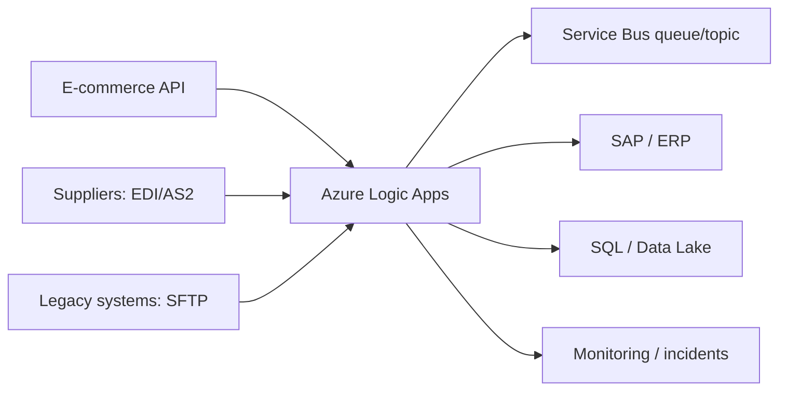

**Logic Apps does not become the business system of record.** The ERP still owns order/inventory state, the payment system still decides payment settlement, and the broker remains responsible for persisting/delivering messages per its guarantees. Workflows form the **orchestration and integration layer**, not a replacement for every business transaction.

## 2. How do EAI, B2B, and API integration differ?

### Enterprise Application Integration (EAI)

EAI focuses on connecting systems **within the same organization** or trust domain—e.g., website → CRM → ERP → warehouse. The enterprise controls schemas and permissions, yet still navigates differing owning teams, lifecycles, and maintenance windows.

### Business-to-Business Integration (B2B)

B2B connects **across organizations**: a manufacturer sends a purchase order to a supplier, the supplier returns an invoice/dispatch advice, and a logistics partner sends shipment updates. Both parties must align on **trading partner IDs, agreements, message formats, transports, certificates, acknowledgments, SLAs, and error-handling procedures**.

### API integration

API integration typically uses HTTP/REST, OAuth, or API keys for synchronous request/response calls. It is a **communication style**, not a replacement for B2B: partners still need data contracts, idempotency, auditing, and acknowledgments over APIs.

| Criterion | EAI | B2B | API |
|---|---|---|---|
| Scope | Internal enterprise | Multiple independent organizations | Service interface |
| Data contract | Canonical JSON/XML, ERP entities | EDI, AS2, XML, CSV, partner-specific APIs | OpenAPI/JSON/XML |
| Identity | Entra ID, managed identity, network policy | Trading partner IDs, certificates, credentials | OAuth2, mTLS, subscription keys |
| Traceability | Cross-system correlation | Interchange/control IDs, business document IDs | Request ID / correlation |
| Outcome | Synchronized internal system state | Document delivery and agreement-compliant ACKs | HTTP result or job ID |
| Pitfall to avoid | Excessive point-to-point links | Lost ACKs, duplicates, schema/version mismatches | Overusing synchronous timeouts |

In practice, one workflow often spans both EAI and B2B: receiving EDI from a partner and updating internal SAP sits right at that intersection.

## 3. Logic Apps Consumption vs. Standard

Azure Logic Apps offers two common hosting models; understand their differences before designing networking, artifacts, deployments, and budgets.

| Attribute | Logic Apps **Consumption** | Logic Apps **Standard** |
|---|---|---|
| Hosting model | Multi-tenant under Consumption workflow resources | Single-tenant runtime hosting one or more workflows per app |
| Organization | Typically one Logic App resource per workflow | One Logic App Standard resource can host multiple workflows |
| Workflow state | Stateful per Consumption hosting mechanics | Supports **stateful** and **stateless** workflows with distinct limits |
| Connectors | Primarily managed connectors and supported built-in triggers/actions | Built-in/in-app connectors plus managed connectors per configuration |
| B2B artifacts | Commonly pairs with an **Integration Account** per supported connectors/plans | Can use **in-app B2B artifacts** in supported Standard models, or appropriate integration setups |
| Networking | Consumption-specific network options/limits | Supports VNet integration and private access per hosting plan |
| Pricing | Based on executions/actions/connectors and related meters | Hosting plan/capacity, managed connector usage, storage/networking/monitoring |
| CI/CD | Workflow JSON / ARM / Bicep plus API connections | Project artifacts, workflows, connections, runtime settings, deployment pipelines |
| Best fit | Simple, event-driven, spiky-traffic workflows | Multi-workflow apps, enterprise integration, tighter networking/runtime control |

**There is no rule that “Standard is always better.”** A small, infrequently run HTTP workflow may suit Consumption well; a B2B solution with many artifacts, private SAP, and multi-step flows often warrants evaluating Standard. Confirm features, limits, and pricing for your **exact region, plan, and connectors** before committing.

### Stateful vs. stateless

**Stateful workflows** persist state and execution history per runtime capabilities, fitting multi-step orchestration, retries, human approvals, and auditable operations. **Stateless workflows** optimize short runs with lower overhead where supported, at the cost of stricter duration limits, limited history, and narrower action support.

For **EDI purchase order flows requiring ACKs, replay, and auditing**, evaluate stateful workflows, history retention, and durable business audit stores. Never expect stateless workflows to retain full documents and trails over long periods.

### Standard has two connector families

- **Built-in / in-app connectors:** run closely with the workflow runtime, with connector-specific deployment, networking, authentication, and throughput characteristics.
- **Managed connectors:** Azure-managed shared connector service configured via API connections and corresponding authorizations.

A connector existing in both families **does not mean triggers/actions, auth modes, private networking, and billing are identical**. Pick the exact connector that supports your target protocol or ERP.

## 4. Anatomy of a Logic App workflow

A workflow begins with a **trigger** and executes one or more **actions**.

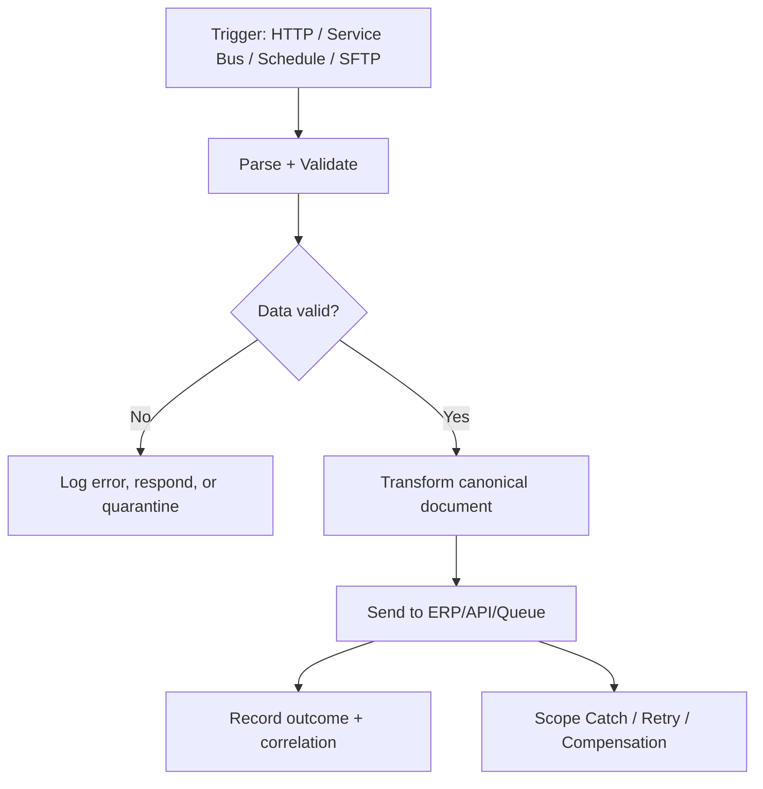

| Concept | How to understand it | Example |
|---|---|---|
| **Trigger** | Starts a workflow run | HTTP request, recurrence, new Service Bus message |
| **Action** | A processing step inside the workflow | HTTP call, Compose, Parse JSON, SQL insert |
| **Connector** | Bridge to a target system, format, or protocol | SAP, SFTP, Service Bus, SQL |
| **Connection** | Endpoint and authentication configuration | Managed identity, OAuth, service principal |
| **Scope** | Groups actions to structure error flows | `Try`, `Catch`, `Finally` |
| **Condition/Switch** | Branches based on data | Document type = `850` / `810` |
| **For each** | Loops over an array of items | Order line items |
| **Until** | Loops until a condition holds or limits hit | Poll job status |
| **Run after** | Specifies which prior statuses trigger the next step | `Succeeded`, `Failed`, `TimedOut`, `Skipped` |
| **Expression** | Extracts/transforms runtime data inside actions | `triggerBody()?['orderId']` |
| **Run history** | Execution trace per runtime/config | Inputs/outputs, timings, errors |

### Synchronous vs. asynchronous

**Synchronous**:

```text
Client POST /orders
→ Request trigger
→ Validate payload
→ Call ERP
→ Response 200/4xx/5xx
```

Drawback: if the ERP responds slowly, clients or gateways time out, and client retries risk creating duplicate orders.

**Asynchronous**:

```text
Client POST /orders
→ Validate request
→ Write message to Service Bus or durable work store
→ Response 202 + correlationId

Worker workflow:
Service Bus trigger
→ Transform/validate
→ Call ERP
→ Persist business status
→ Complete message
```

Async decouples **API response latency** from ERP processing time, while requiring **job status endpoints, idempotency, and retry/poison handling**. Never return `202 Accepted` before confirming the message was durably written to the queue per connector semantics and business policy.

## 5. Orchestrating stateful workflows and failure handling

A long-running workflow may:

1. Receive a document.
2. Validate envelope/schema.
3. Call the ERP system.
4. Wait on a credit check.
5. Send an acknowledgment to the partner.
6. Write audit logs and finish.

These steps are not a single database transaction. If the ERP commits successfully and then sending the ACK fails, the workflow **cannot simply roll back the whole ERP and pretend the partner never sent the document**.

### Scope Try/Catch/Finally

An orchestration pattern:

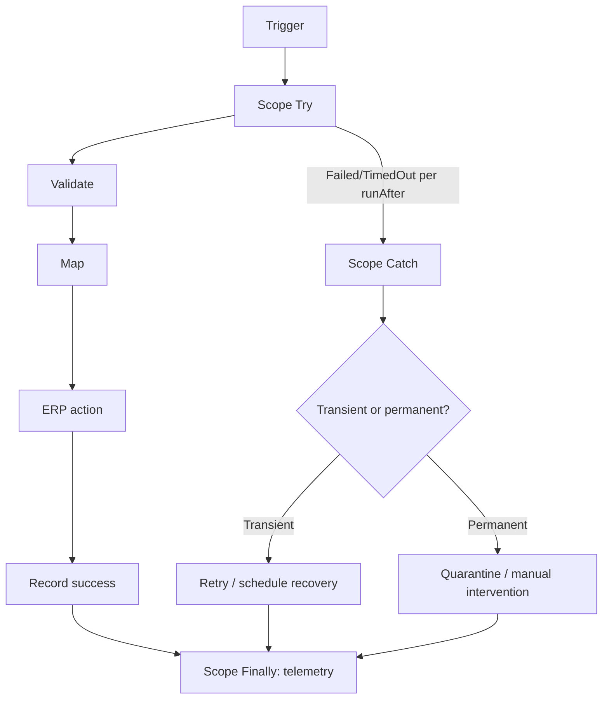

**Important:** `runAfter` governs action sequencing **inside the workflow**; it is not automatic exception rollback for external side effects. Design each branch explicitly for `Succeeded`/`Failed`/`Skipped`/`TimedOut` and test all paths.

### Retry policies

Many connectors/actions support retry policies—typically fixed, exponential, or none depending on the action. **Never retry indefinitely** when the ERP returns a schema error or a partner sends a malformed document. Separate three error types:

- **Transient:** 429, 503, brief timeouts; retry with bounds/backoff.
- **Permanent:** missing required fields, malformed EDI envelope, agreement mismatch; quarantine or reject per contract.
- **Ambiguous:** external API times out after the ERP may have committed; look up by idempotency/business key before retrying creation.

### Compensation instead of distributed rollback

If a workflow created an ERP order and then fails to reserve shipping, run a **compensating action** such as releasing stock or placing the order on hold—do not attempt an ACID transaction spanning SaaS, APIs, and EDI. This is **Saga/process orchestration** thinking for multi-system processes.

## 6. Common enterprise connectors

| Connector / integration path | Data | Notes |
|---|---|---|
| **HTTP/HTTPS** | REST/JSON/XML, webhooks | OAuth/mTLS, timeouts, API Management, rate limits |
| **SAP** | BAPI/RFC/IDoc or connector-supported ops | SAP connector version, SAP components/gateway/networking, licensing |
| **Azure SQL / SQL Server** | Relational data | DB auth, networking, transactional semantics |
| **SFTP / SSH** | EDI/CSV/XML files | SSH host key verification, credentials, file size, polling |
| **Azure Service Bus** | Commands/events | Delivery guarantees, sessions, TTL/DLQ, idempotency |
| **Event Grid** | Resource change events | Delivery retries, event filtering, event IDs |
| **Azure Blob Storage** | Raw/processed documents | Identity/RBAC, versioning, lifecycle |
| **Dynamics 365 / Dataverse** | CRM/ERP entities | OAuth, API limits, field mapping |
| **Office 365 / Teams** | Approvals/notifications | User consent, delegated permissions, message privacy |
| **Key Vault** | Secret/certificate references | Managed identity, RBAC, rotation |
| **Custom connector** | Internal or partner APIs lacking prebuilt connectors | OpenAPI definition, auth, gateway, throttling |

A connector is a **technical bridge**, not a guarantee that every target service API supports every operation you want. For example, SAP exposes IDoc, BAPI, and OData interfaces; pick the exact contract adapter rather than writing “SAP connector” and assuming every ERP action works automatically.

### Connecting on-premises ERPs / SAP

An ERP in a datacenter may sit behind firewalls with no public endpoint. Evaluate options:

- **On-premises data gateway** for connectors/hosting models that support it.
- **VNet/private connectivity** over VPN/ExpressRoute with DNS/network rules in supported models.
- **Appropriate SAP connector/adapter** with required runtime dependencies.
- **Enterprise-owned API proxy** (e.g. via API Management or a secured reverse proxy) to standardize protocols.
- An intermediate queue if the ERP experiences maintenance windows or intake limits.

**Never expose ERP/SAP ports directly to the public Internet just so the Logic Apps designer can test connectivity.** Managed connectors may traverse different network paths than Logic Apps Standard built-in connectors; verify network paths **from where the connector actually executes**, not from a developer laptop on VPN.

## 7. B2B exchange: a document crosses multiple layers

B2B document exchange typically spans four layers:

1. **Business document:** purchase order, invoice, dispatch advice.
2. **Syntax/format:** X12, EDIFACT, XML, CSV, or custom schemas.
3. **Transport/security:** AS2 over HTTP(S), SFTP, APIs, messaging.
4. **Agreement/acknowledgment:** partner identities, qualifiers, control numbers, document validation, and delivery receipts.

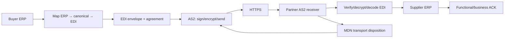

**AS2 MDN, EDI functional acknowledgments, and business acceptance are three distinct confirmation levels.** A successful MDN does not prove the ERP accepted the order's prices, inventory, or payment terms.

## 8. EDI X12: anatomy of an interchange

**ANSI ASC X12** is a widely used EDI standard family in North America. Example transaction sets:

| X12 code | Common document |
|---|---|
| **850** | Purchase Order |
| **855** | Purchase Order Acknowledgment |
| **856** | Advance Ship Notice |
| **810** | Invoice |
| **997/999** | Functional / implementation acknowledgment per standard and version |

An X12 interchange has nested envelopes:

```text
ISA ...                  # Interchange header
  GS ...                 # Functional group header
    ST*850 ...           # Transaction set start
      BEG ...            # Purchase order content
      PO1 ...            # Order line
    SE ...               # Transaction set trailer
  GE ...                 # Functional group trailer
IEA ...                  # Interchange trailer
```

The diagram **illustrates structure only**. It is not a valid production EDI document: X12 enforces strict delimiters, element positions, control numbers, segment counts, versions, and partner agreements.

### Why envelopes matter

- `ISA/IEA` carries interchange metadata, sender/receiver IDs, and version-specific control numbers.
- `GS/GE` wraps a functional group.
- `ST/SE` wraps a transaction set with its transaction control number and segment count.
- Agreements and schemas dictate which segments/elements are mandatory and which values are valid.

For instance, if `SE` reports the wrong segment count, the document can be rejected **even when all business order lines are present**. Always distinguish **syntax validation** from **business validation**.

## 9. UN/EDIFACT: same goal, different syntax

**UN/EDIFACT** is a common EDI standard in international commerce. Common message types:

| EDIFACT code | Common meaning |
|---|---|
| **ORDERS** | Purchase order |
| **ORDRSP** | Order response |
| **DESADV** | Despatch advice |
| **INVOIC** | Invoice |
| **CONTRL** | Syntax / service acknowledgment |

Envelope layout:

```text
UNA ...                # Optional: service string advice
UNB ...                # Interchange header
  UNH ...              # Message header
    BGM ...            # Business message beginning
    ...                # Business segments
  UNT ...              # Message trailer
UNZ ...                # Interchange trailer
```

X12 and EDIFACT **differ in far more than field names**. Versions/releases, segment structures, qualifiers, composite data elements, and envelope rules all differ. Never swap `ST` for `UNH` and call it “converted to EDIFACT”; use proper schemas, maps, and agreement-aligned validation.

### Control numbers and versions

Each partner may specify:

- Specific X12 version/release (e.g. `004010` or `005010` per agreement).
- Specific EDIFACT directory/release.
- Specific delimiters and character sets/encodings.
- Agreed sender/receiver IDs and qualifiers.
- Non-repeating control numbers within a window/partner per rules.
- Mandatory ACK SLAs.

**Never generate stateless random control numbers** when a partner expects sequential increments or duplicate checks. Configure the B2B runtime and agreement properly for generation, validation, and duplicate detection.

## 10. AS2: securing and transporting EDI over HTTP(S)

**Applicability Statement 2 (AS2)** transports B2B messages over HTTP(S), supporting digital signatures, encryption, and **Message Disposition Notifications (MDNs)** per configuration.

### Four distinct elements

| Element | Role |
|---|---|
| **AS2 From / To** | Partner identities in the AS2 message |
| **Signing certificate / private key** | Signs the message so the receiver verifies origin and integrity |
| **Encryption certificate / public key** | Encrypts for the receiver; they decrypt with their matching private key |
| **MDN** | Transport-layer AS2 processing receipt, optionally signed |

The protocol supports **synchronous** or **asynchronous** MDNs per agreement. Senders must correlate message IDs, dispositions, and signature verification; with async MDNs, the initial HTTP response is not the final MDN.

### Three confirmations that must never be conflated

| Confirmation level | Question answered | Does NOT prove |
|---|---|---|
| **HTTP / AS2 MDN** | How did the receiver/gateway process the AS2 message? | That the ERP created a valid order |
| **EDI functional ACK** (`997`/`999`/`CONTRL`) | Was the transaction syntax/implementation accepted? | That price, stock, or credit was approved |
| **Business response** (`X12 855` / `EDIFACT ORDRSP`) | Does the partner accept the order's commercial terms? | That all line items have shipped or been paid |

**Never mark a business order as “Accepted” merely because the MDN succeeded.** Track distinct statuses such as `TransportDelivered`, `SyntaxAccepted`, `BusinessAcknowledged`, and `Fulfilled`.

### B2B certificates

A single partner may use **different certificates for different purposes**: signing, encryption, MDN verification, and endpoint TLS. Never confuse:

- **TLS certificate:** secures the HTTPS transport connection.
- **AS2 signing certificate:** authenticates the AS2 message signature.
- **AS2 encryption certificate:** encrypts the AS2 payload.

Rotation schedules, validity windows, trust chains, private-key ownership, and storage locations must be agreed upon by both sides. An expired certificate breaks partner exchanges even while APIs and Logic Apps stay `Running`.

## 11. Trading partners, agreements, schemas, maps, and certificates

Enterprise Integration / B2B artifacts form the backbone of the pipeline.

| Artifact | Function | Example |
|---|---|---|
| **Trading partner** | Profile of a B2B organization with identifiers/qualifiers | `Buyer-A`, `Supplier-B` |
| **Agreement** | Technical contract between host partner and guest partner | X12 850 + 997, AS2 signed/encrypted |
| **Schema** | EDI/XML structure definition for validate/decode/encode | Supported X12 850 version |
| **Map** | Structural data transformation | PurchaseOrder EDI XML → ERP canonical XML |
| **Certificate** | Keys/certificates for signing, decryption, verification | AS2 encryption/signing |
| **Integration Account** | Resource storing/coordinating B2B artifacts for supported hosting | Artifacts used in Consumption workflows |
| **In-app artifacts** | B2B artifacts managed inside supported Logic Apps Standard models | Runtime schemas/maps/agreements |

### Choosing where artifacts live

In **Consumption**, Enterprise Integration connectors typically link to an **Integration Account**. In **Standard**, B2B operations and artifact management often support **in-app** storage, though certain designs or connectors still integrate with an Integration Account differently. Verify exact requirements for your **chosen hosting model, connector, and operations**.

**Never create an Integration Account simply because you have a Logic App**: it is needed only when B2B features/architecture require it and carries separate costs and limits. Conversely, never delete an Integration Account still serving other workflows while migrating one workflow to Standard.

### Partner IDs and agreement resolution

An incoming document may carry:

```text
AS2-From: SUPPLIER-B
AS2-To: BUYER-A
X12 ISA sender/receiver identifiers: values from agreement
Transaction type: 850
Version: per partner contract
```

Platform teams must ensure **transport and envelope identities** resolve cleanly to the right trading partner so Partner A's document is never processed under Partner B's agreement. With multiple agreements/versions, route by partner ID, message type, and version—never merely by a filename like `order.edi`.

### Data mapping

Schemas define permitted structures; **maps** convert data from source to target formats. Build clean pipelines:

```text
Partner X12 850
→ Decode to canonical XML/schema
→ Validate semantic fields
→ Map to canonical PurchaseOrder
→ Map to SAP/ERP request
```

Maps must never hardcode partner secrets, environment endpoints, or assume partner names never change. Parameterize per environment wherever possible.

## 12. Design a canonical data model before writing dozens of maps

With 8 partners and 3 internal ERPs/apps, building pairwise maps yields:

\[
8\times3=24\ \text{point-to-point mappings}.
\]

A **canonical model** decouples partners from internal ERPs:

```text
X12 850 ─┐
EDIFACT ─┼─> Canonical PurchaseOrder ─┬─> SAP
REST JSON ┘                           ├─> Microsoft Dynamics
                                      └─> Warehouse API
```

This reduces overall mapping sprawl across an organization, **though it is not a rigid mathematical minimum**: partner-specific extensions, validations, or schema variants may still be needed.

### Sample canonical Purchase Order

```json
{
  "schemaVersion": "1.0",
  "documentType": "PurchaseOrder",
  "documentId": "PO-2026-00127",
  "buyerId": "BUYER-A",
  "supplierId": "SUPPLIER-B",
  "currency": "USD",
  "orderDate": "2026-11-20",
  "lines": [
    {
      "lineNumber": 1,
      "sku": "SKU-1001",
      "quantity": 25,
      "unit": "EA",
      "unitPrice": 12.5
    },
    {
      "lineNumber": 2,
      "sku": "SKU-2002",
      "quantity": 10,
      "unit": "EA",
      "unitPrice": 45.0
    }
  ],
  "source": {
    "partner": "SUPPLIER-B",
    "format": "X12",
    "transactionType": "850",
    "interchangeControlNumber": "000000127",
    "eventId": "lab-event-127"
  }
}
```

This is an **illustrative internal JSON contract**, not a complete X12 segment mapping. It also omits taxes, discounts, totals, shipping addresses, time zones, and rounding rules—include those in production canonical schemas as required.

### Concrete mapping table

| Canonical field | Possible X12 850 source | Possible EDIFACT ORDERS source | ERP target |
|---|---|---|---|
| `documentId` | Purchase order number in `BEG` | Order reference in `BGM` | External document/reference ID |
| `orderDate` | Version-specific date element `BEG`/`DTM` | Date/time in `DTM` | Order date |
| `buyerId` | Trading partner IDs in `N1`/envelope | Party in `NAD` | Buyer / business partner |
| `lines[].sku` | Product IDs in `PO1` | Item identification in `LIN` | Material / product code |
| `lines[].quantity` | Quantity in `PO1` | Quantity in `QTY` | Ordered quantity |
| `currency` | Currency segment/qualifier per implementation | Currency info in `CUX` | Currency code |

Segment/field names in this table are **mapping guidance only**. X12 and EDIFACT rely on qualifiers, versions, and varied structures; confirm exact segment locations against **each partner's implementation guide** and signed-off schemas.

### Three-layer validation

1. **Transport/envelope:** valid sender/receiver, signatures/certificates, interchange metadata, control numbers?
2. **Syntax/schema:** matching document version, segment structure, data element types, mandatory fields?
3. **Business semantics:** active buyer/supplier contract, valid SKUs, valid currency, positive quantities, agreed delivery dates?

**Never lump all failures into one generic “Invalid EDI” error.** Partners need to know which layer rejected the document to fix the issue, while operations must know whether to retry or request a corrected transmission.

## 13. Inbound B2B architecture: from AS2/X12 to ERP

Scenario: Supplier-B sends an X12 850 purchase order over AS2. The workflow must verify transport, decode EDI, validate payloads, dispatch to the ERP, and emit a separate business acknowledgment.

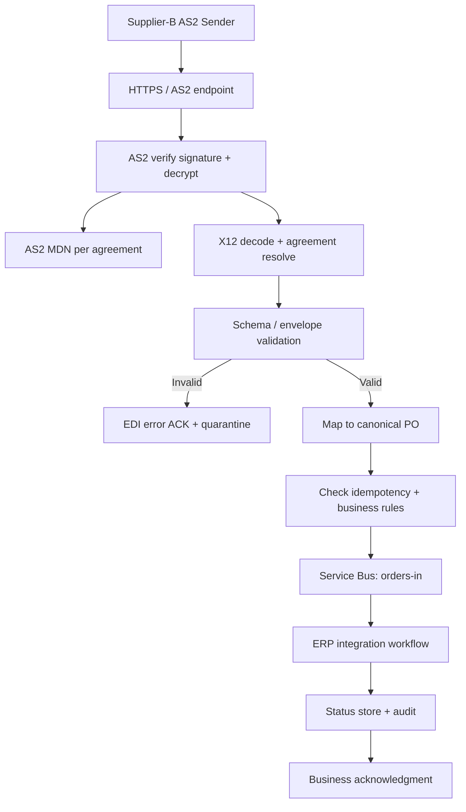

### Why split into two workflows?

A practical separation:

**Workflow A — B2B Gateway**

- Receives the AS2 message.
- Verifies signature / decrypts and resolves the partner agreement.
- Sends the MDN per protocol and SLA window.
- Decodes/validates EDI and archives the raw payload in an encrypted/secured store per policy.
- Persists a durable work item into Service Bus / DB.
- Records correlation across AS2 `Message-ID`, EDI control numbers, and work item ID.

**Workflow B — ERP Processor**

- Picks up the work item.
- Checks business idempotency.
- Maps the canonical document to an ERP request.
- Calls SAP/ERP with realistic timeouts, retries, and transaction boundaries.
- Saves business status after commit.
- Emits a functional/business ACK or response per agreement.

**Benefit:** AS2 transport never blocks waiting on an ERP that may take minutes. During ERP downtime, the queue preserves work items for controlled reprocessing.

### Ordering ACKs and processing

Partners often require synchronous MDNs within seconds. Waiting for ERP completion before returning the MDN risks timeouts, partner resends, and duplicates. An MDN belongs strictly to **transport/disposition** per the AS2 agreement; **business acceptance** is a separate flow.

**Never send a positive MDN** if AS2 verification failed on an invalid signature or decryption error. Likewise, **never use a 997/999 functional ACK** to pretend the ERP approved credit—those acknowledgments mean entirely different things.

### Archiving original documents

Storing raw documents in a secured Blob/Data Lake archive supports:

- Investigating schema/version issues;
- Auditing signatures and envelopes;
- Replaying after fixing mapping bugs;
- Providing compliance audit trails;
- Checking duplicate control numbers.

Raw EDI can contain PII, pricing, and addresses; enforce **encryption, private access, retention policies, read-access auditing, and scheduled deletion**. Never dump raw documents indefinitely into workflow run history or unrestricted logs.

## 14. Outbound B2B architecture: ERP invoice to partner

An invoiced order must generate an X12 810 and send it to Supplier-B over AS2.

```mermaid
flowchart LR
    ERP["ERP invoice committed"] --> OUTBOX["Outbox / Service Bus"]
    OUTBOX --> WF["Logic App outbound"]
    WF --> CANON["Map ERP → canonical Invoice"]
    CANON --> EDI["Encode X12 810 / validate"]
    EDI --> AS2["Sign + encrypt via agreement"]
    AS2 --> SEND["HTTPS send partner"]
    SEND --> MDN["Receive / correlate MDN"]
    MDN --> TRACK["Update transmission state"]
    TRACK --> BIZ["Wait for 997/999 / business response"]
```

### States to keep separate

```text
InvoiceCreatedInERP
→ QueuedForB2B
→ EncodedValidated
→ Sent
→ TransportAcknowledged (MDN)
→ SyntaxAcknowledged (EDI ACK)
→ BusinessAccepted / BusinessRejected
```

Never jump straight from `Sent → BusinessAccepted` merely because HTTP returned `200`. With asynchronous MDNs, the initial HTTP response only confirms transport receipt; correlate the arriving MDN separately and handle timeouts explicitly.

### What if sending succeeded, yet the workflow timed out?

Example:

1. The AS2 receiver accepted and processed the message.
2. The network dropped before the sender received the MDN.
3. The Logic App recorded a timeout.
4. Retrying without idempotency would transmit the same invoice twice.

Design safeguards:

- Reuse **stable `documentId`, interchange control numbers, and AS2 `Message-ID`** per agreement rather than generating brand-new IDs if the partner expects duplicate recognition.
- Correlate sends, MDNs, and functional ACKs.
- Align resend and duplicate-handling policies with the partner.
- When status is uncertain, query transmission state before resending.
- Distinguish **transport uncertain** errors from **document rejected** errors.

## 15. Integration Accounts and B2B artifacts: governance workflow

A B2B solution is more than workflow JSON; it manages contractual artifacts between the enterprise and partners.

### A partner's artifact set

```text
Trading Partner: BUYER-A
Trading Partner: SUPPLIER-B
Agreement: BUYER-A <-> SUPPLIER-B
  ├── Transport: AS2 IDs, endpoint, signed/encrypted, MDN behavior
  ├── Message format: X12 850 inbound / 810 outbound
  ├── Syntax: version, delimiters, qualifiers, control numbers
  ├── Certificates: signing, encrypting, verification, expiry
  ├── Schemas: 850 / 810 versions
  └── Maps: EDI ↔ canonical ↔ ERP
```

Note: how an agreement appears in the Portal/Integration Account UI may differ from this tree; treat this as a **checklist of configuration groups you must govern**.

### Promoting artifacts to production

1. **Obtain the trading partner implementation guide** and official AS2 profile.
2. Finalize sender/receiver identifiers and qualifiers.
3. Confirm certificate owners, public/private key exchange, expirations, trust chains, and rotation plans.
4. Acquire exact schema versions and supported extensions/transformers.
5. Author maps + validations with tests covering optional and mandatory segments.
6. Configure agreements along with duplicate/control-number checks where supported.
7. Run partner interoperability tests: signed/encrypted AS2, MDNs, 997/999 or CONTRL, and business ACKs.
8. Document endpoints, IP/network requirements, SLAs, contacts, and escalation paths.
9. Promote via CI/CD with approval—never make unrecorded manual production edits.
10. Monitor errors and ACK latency post go-live.

### Never manage certificates as “email attachments”

Partners exchange **public certificates** over agreed channels, while **private keys** must stay protected in Key Vault or an approved key/certificate store per connector and hosting capabilities. Never share private keys, PFX files, or passwords in chat or tickets.

During rotation, plan an overlap transition:

- Agree on effective timestamps and new certificates;
- Verify whether workflows/connectors support dual-certificate configuration during cutover;
- Test inbound and outbound MDN/signature/decryption;
- Keep rollback ready if the partner has not switched yet;
- Revoke/remove old keys once cutover is confirmed safe.

Never auto-rotate a B2B certificate silently without coordinating with the partner, because both endpoints must agree on the active public/private pair.

## 16. JSON/XML mapping: transforming and canonicalizing data

In Logic Apps, you can combine:

- **Parse JSON** with schemas to access properties after receiving API payloads.
- **Compose** and expressions for simple transformations.
- **Data Operations** such as Select, Filter array, and Join where appropriate.
- **XML Transform/Map** via supported B2B artifacts/connectors for structural mappings.
- **Azure Functions** or dedicated services for complex transformation logic.

### Example incoming order JSON

```json
{
  "partnerId": "SUPPLIER-B",
  "poNumber": "PO-127",
  "orderDate": "2026-11-20",
  "items": [
    {"code": "SKU-1001", "qty": 25},
    {"code": "SKU-2002", "qty": 10}
  ]
}
```

### Canonical output after mapping

```json
{
  "documentType": "PurchaseOrder",
  "documentId": "PO-127",
  "supplierId": "SUPPLIER-B",
  "orderDate": "2026-11-20",
  "lines": [
    {"lineNumber": 1, "sku": "SKU-1001", "quantity": 25},
    {"lineNumber": 2, "sku": "SKU-2002", "quantity": 10}
  ]
}
```

In the designer, extract a property with an expression:

```text
triggerBody()?['poNumber']
```

Or read an action's output by action name:

```text
outputs('Parse_Order')?['body']?['poNumber']
```

`Parse_Order` is an action name **chosen by the designer author**, not a fixed built-in action in every workflow. Expressions do not validate full JSON schemas on their own: explicitly handle missing/null properties, wrong data types, and invalid values.

### Business rules to check after mapping

- `documentId` is non-empty and scoped to the right partner.
- `orderDate` is a valid date with clear timezone/format.
- `quantity` is positive with agreed decimal/unit rules.
- SKUs map cleanly to version-accurate ERP material codes.
- No duplicate `lineNumber` entries exist.
- Currency and totals align with contract rules.
- Tenants/partners cannot access another partner's data.

If an error is **schema-level**, return a reject / functional acknowledgment per contract; if **business-level**, return a business rejection status or request a corrected document through the agreed channel.

## 17. Service Bus as the buffer between B2B and ERP

Internal ERPs undergo maintenance windows and rate limits. Buffering validated documents in **Azure Service Bus** provides:

- Decoupling inbound AS2/HTTP response times from ERP processing duration.
- Durable work-item storage with messaging guarantees.
- Independent consumer scaling matching queue backlogs and ERP quotas.
- Built-in retries, DLQ, TTL, and duplicate detection per entity/SDK config.
- Correlation and per-`PurchaseOrderId` ordering via sessions when needed.

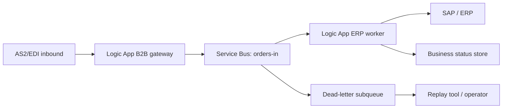

### Queue delivery is not exactly-once

Messages can be redelivered due to lock expiry, retries, or host crashes. Maintain both:

```text
Business key:
partnerId + documentType + documentId + revision

Technical correlation:
AS2 Message-ID + EDI interchange/group/transaction control numbers
  + Service Bus MessageId + Logic App runId
```

The business key prevents creating duplicate orders; technical correlation drives end-to-end tracing. Never collapse both into one key while ignoring order revision updates.

### Idempotency in the ERP

When receiving a purchase order:

1. Check the business key in **`ProcessedDocuments`** or ERP status.
2. If that exact revision already committed, do not create a new order.
3. Otherwise, set state to `Processing` using an atomic/conditional write.
4. Invoke the ERP and store the external ERP order ID.
5. Commit `Completed` status; then settle the broker message.
6. If a connector times out after potential commit, query the ERP by external reference before retrying.

A **`Compose`** step setting `status="Completed"` inside the workflow does not prove the ERP committed. Require a valid business/transaction ID back from the ERP.

### Sessions for order-modification ordering

When a partner sends `CreatePO`, `ChangePO`, and `CancelPO`, Service Bus `SessionId=documentId` reduces the risk of processing a change before creation. However, **broker-arrival session ordering does not fix** a producer sending revision 3 ahead of revision 2. Keep a business revision guard or outbox at the source.

## 18. API Management protecting Logic Apps HTTP endpoints

Logic Apps can expose an **HTTP Request trigger**. When serving partners or internal callers as an API, add a governance layer:

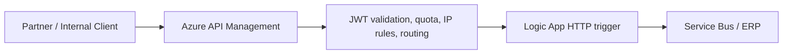

API Management can:

- Validate JWT/OAuth tokens or other approved schemes.
- Enforce rate limits, quotas, and request/response policies.
- Provide versioned gateway URLs and developer onboarding.
- Inject correlation headers and govern client API contracts.
- Reject payloads violating policy schema/size limits.

**APIM does not automatically enforce business authorization.** Even with a valid token issued to Partner-A, the workflow must still ensure Partner-A operates only on its own documents.

### A Logic Apps Request URL is not a shareable password

A Request trigger URL may embed a **signed query token / SAS** depending on configuration. Treat it as a sensitive credential:

- Never commit the full URL to Git.
- Never paste signed URLs into run logs or public documentation.
- Never use that SAS token as a substitute for user-level authentication.
- Rotate/revoke per supported procedures.
- When using APIM/private networking, verify actual access paths and auth checks at every layer.

If a B2B endpoint requires mTLS, signed webhooks, or payload signature validation, enforce it per agreement—never assume HTTPS alone proves partner identity.

## 19. Workflow Definition Language (WDL) example

Logic Apps workflows are defined using **Workflow Definition Language**, typically JSON containing `triggers` and `actions`.

Minimal example of an HTTP workflow that only validates JSON structure and returns a receipt—**without writing to a queue**:

```json
{
  "$schema": "https://schema.management.azure.com/providers/Microsoft.Logic/schemas/2016-06-01/workflowdefinition.json#",
  "contentVersion": "1.0.0.0",
  "parameters": {},
  "triggers": {
    "Receive_Order": {
      "type": "Request",
      "kind": "Http",
      "inputs": {
        "schema": {
          "type": "object",
          "properties": {
            "orderId": {"type": "string"},
            "partnerId": {"type": "string"}
          },
          "required": ["orderId", "partnerId"]
        }
      }
    }
  },
  "actions": {
    "Compose_Receipt": {
      "type": "Compose",
      "inputs": {
        "orderId": "@triggerBody()?['orderId']",
        "partnerId": "@triggerBody()?['partnerId']",
        "receiptStatus": "received"
      },
      "runAfter": {}
    },
    "Return_Receipt": {
      "type": "Response",
      "inputs": {
        "statusCode": 200,
        "body": "@outputs('Compose_Receipt')"
      },
      "runAfter": {
        "Compose_Receipt": ["Succeeded"]
      }
    }
  },
  "outputs": {}
}
```

This illustrates general workflow structure. In Consumption vs. Standard deployments, resource packaging, app settings/connections, and connector schemas differ; let the **Logic Apps designer** generate and validate workflow files rather than pasting raw JSON across deployment models as a complete app.

### Lessons from the JSON

- `Receive_Order` is the trigger, starting the workflow via HTTP Request.
- `Compose_Receipt` reads values from `triggerBody()`.
- `Return_Receipt` runs only when `Compose_Receipt` succeeds.
- `Response` returns HTTP 200 with the composed body.

**HTTP 200 above confirms only that the workflow received and parsed the payload**, not that the ERP processed it. To guarantee durable queuing, add the Service Bus Send action **before** Response, handle send failures, and return `202` only after confirming the send succeeded.

### Useful expressions

| Illustrative expression | Meaning |
|---|---|
| `triggerBody()?['orderId']` | Read a property from the trigger body |
| `outputs('Compose_Receipt')` | Retrieve an action's outputs by name |
| `body('Parse_Order')?['lines']` | Extract the `lines` array from `Parse_Order` |
| `coalesce(triggerBody()?['currency'], 'USD')` | Supply a default when null |
| `empty(triggerBody()?['orderId'])` | Check emptiness per expression semantics |
| `workflow()?['run']?['name']` | Run name for correlation within WDL context |
| `utcNow()` | Current UTC timestamp; not the business event timestamp |

Never blindly substitute `utcNow()` for a document issuance timestamp in EDI: during retries hours later, the business date must not shift if the partner requires the original issuance date.

## 20. Concurrency, sequential processing, and ordering

A workflow receives two events for the same order:

```text
Message A: Create PurchaseOrder 127
Message B: Cancel PurchaseOrder 127
```

If each message starts a parallel workflow run, the Cancel request can hit the ERP before Create. **Logic Apps connectors and workflow engines do not automatically enforce business ordering by document ID.**

### Approaches

| Mechanism | When to use | Limitation |
|---|---|---|
| Trigger concurrency limit | Cap concurrent workflow runs | Throttles entire workflow; no dynamic per-order lock |
| Sequential `For each` | Lines must update in strict order | Applies only within one run/array |
| Service Bus Sessions | Ordering needed per `documentId` | Receiver/session semantics, locks, version guards |
| Optimistic concurrency in ERP/DB | Guard state against concurrent writers | Must handle version conflicts |
| Outbox/inbox | Zero lost events; survive retry duplicates | Requires state store and reconciliation |
| Durable workflow / state machine | Multi-step, long-running processes | More states and failure modes to govern |

### `For each` loops

In Designer, `For each` executes iterations in parallel depending on concurrency settings. When line-item order genuinely matters, set **sequential** mode where supported. However, many ERPs prefer receiving **an entire order with all lines** in one transaction; sending line-by-line can leave partial, inconsistent orders.

**Never force sequential execution across all orders just because a few document IDs require ordering**: it starves throughput unnecessarily. Partition by aggregate key where appropriate.

## 21. Authentication and security: who can access which data?

### Microsoft Entra ID and managed identity

A Logic App can use **managed identity** to access Azure resources through supported connectors—such as Blob Storage, Service Bus, or Key Vault.

Steps:

1. Enable system-assigned or user-assigned identity per hosting/connector support.
2. Verify the exact principal and tenant.
3. Grant **data-plane** Azure RBAC at the narrowest scope.
4. Configure connectors to use managed identity instead of copying account keys.
5. Test access from the actual workflow runtime environment.
6. Document rotation/change-management policies.

| Resource | Role to consider per action |
|---|---|
| Service Bus sending messages | `Azure Service Bus Data Sender` |
| Service Bus receiving/settling | `Azure Service Bus Data Receiver` |
| Blob reading documents | `Storage Blob Data Reader` |
| Blob writing documents | `Storage Blob Data Contributor` |
| Key Vault accessing secrets | Role/permission scoped to read specific secrets |
| SQL | Matching database principal/permissions—never inferred from Azure `Reader` |

**Azure `Contributor` on a resource group does not automatically grant data-plane access across connectors.** Many Azure services separate control-plane RBAC from data-plane RBAC.

### Isolating partners and environments

Designing for 20 trading partners:

- Partner A must never read Partner B's documents.
- Production and sandbox maintain distinct credentials, certificates, and agreements.
- Trading partner IDs follow strict naming and auditing conventions.
- Operators should not hold default rights to export private keys.
- Partner-specific secrets need isolated scopes and rotation schedules.
- Any reprocessing affecting production ERP requires auditing and proper approval.

### Secure inputs/outputs

Logic Apps run history can display action payloads, headers, and outputs. For sensitive data, use **Secure Inputs / Secure Outputs** where supported by the designer/actions to hide them in diagnostics. Still remember:

- Secure data settings have specific scopes and behaviors; check propagation to downstream actions.
- Securing run history **does not scrub data from downstream services**, APIs, or application logs.
- Never log connection strings, tokens, raw EDI payloads, or certificate passwords.
- Store separate non-sensitive **audit metadata** so transactions remain traceable even when payloads are masked.

## 22. Networking: private ERP, SFTP, APIs, and B2B endpoints

An integration workflow may need both **outbound** reachability to an internal ERP and **inbound** intake from Internet partners.

### Outbound to internal networks

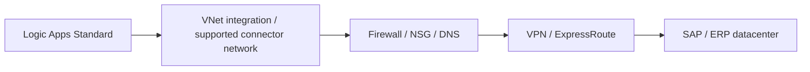

Verify every hop:

1. Which workflow runtime or connector initiates the connection?
2. Does that hosting plan support VNet integration or a data gateway?
3. Does DNS resolve the ERP hostname to the right private IP?
4. Do NSGs, routes, and firewalls permit the exact ports?
5. Does the connector support the required SAP/Entra/Windows auth?
6. Does the ERP enforce allowlists, mTLS, or client-identity policies?
7. When calls fail, is a timeout caused by routing, or is 401/403 caused by auth?

### Inbound for B2B partners

Where do partners send AS2/HTTP or SFTP?

- **AS2/HTTPS:** needs a secured endpoint plus an agreement defining AS2 identities, certificates, and MDNs.
- **SFTP:** may be hosted by a managed SFTP service or another server/connector. Polling SFTP from Logic Apps does not turn Logic Apps into an SFTP server.
- **APIs:** typically fronted by API Management, WAF/reverse proxies, and Entra/OAuth/mTLS.

**Never expose ERP/SQL directly to the Internet to receive B2B files.** Partners talk to the gateway/B2B intake tier; workflows cross into internal networks via approved connectors.

### Private endpoints do not solve everything automatically

Logic Apps Standard and related services support private endpoints/VNets per plan. However, a **managed connector** may execute inside shared connector infrastructure and require a gateway or specific network path rather than automatically riding the workflow runtime's VNet routes. Verify **each connector's exact execution model** before claiming “private end-to-end.”

## 23. Error management: look beyond green/red workflow badges

When a B2B gateway run reports `Succeeded`, at least four realities are possible:

1. The workflow received and archived EDI, while the ERP hasn't processed it yet.
2. The workflow enqueued a message onto Service Bus for later processing.
3. The workflow completed some business actions while the partner ACK is still pending.
4. The workflow cleanly executed a controlled rejection path, ending in a **technical success**.

Therefore, maintain a **business status store** independent of run history.

### Suggested state machine

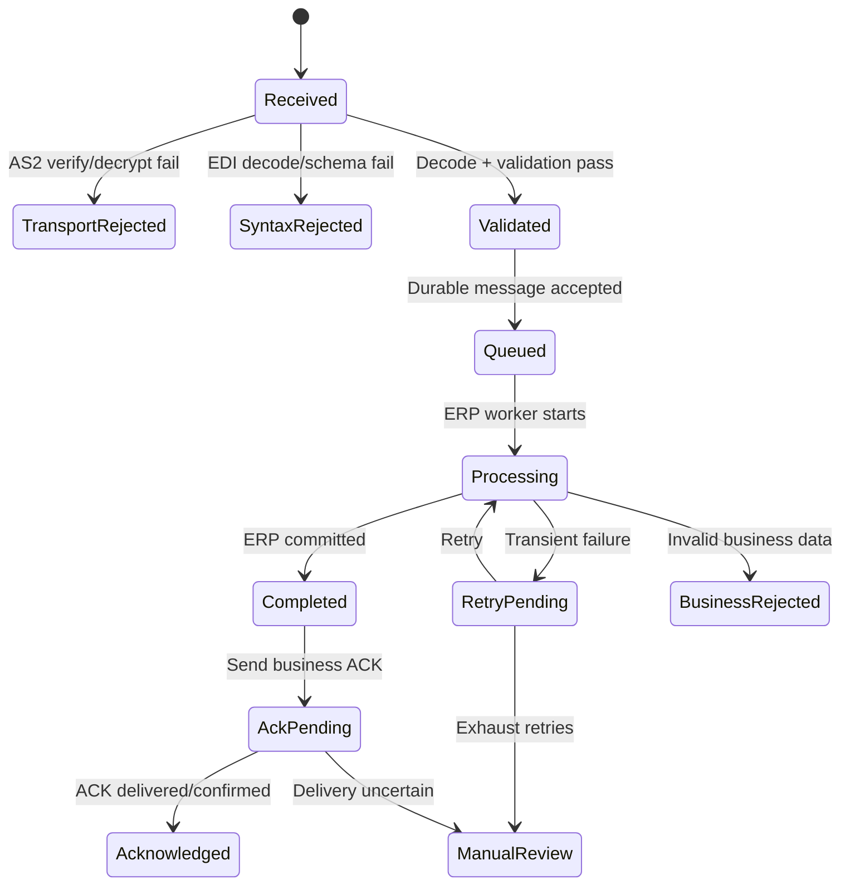

This state machine illustrates a single flow; **not all stages are strictly sequential across every agreement**. Transport MDNs can be sent before ERP processing, and syntax ACKs may carry separate SLAs/triggers.

### Minimum fields to persist

| Status field | Why it is needed |
|---|---|
| `businessDocumentId` | Identifies the business document |
| `partnerId` | Isolates partner scope |
| `documentType/version` | Pins schema contract |
| `interchangeControlNumber` | Correlates EDI envelopes |
| `as2MessageId` | Correlates AS2/MDN exchanges |
| `workflowRunId` | Technical debugging |
| `messageId/correlationId` | Traces across queues/APIs |
| `currentStatus` | Surfaces business progress |
| `erpReference` | Proves object creation in ERP |
| `retryCount/lastErrorCategory` | Operations and alerting |
| `receivedAt/processedAt/ackAt` | Measures end-to-end SLA |
| `payloadArchiveReference` | Retrieves raw document under access control |

**Never use `runId` alone as an idempotency key:** the same document can spawn multiple runs on retries or partner resends.

## 24. Retries, DLQ, replay, and manual intervention

### When the ERP returns 503

Likely a transient fault. Logic Apps or the Service Bus worker should:

1. Cap retries with backoff.
2. Honor server-side rate limits / `Retry-After` where supported.
3. Never recreate orders if the prior request might have committed.
4. Route the work item to a retry queue/delay or let broker redelivery handle it.
5. Alert when retry counts or queue age exceed SLA.

### When EDI fails schema validation

Do not retry the exact same malformed payload 100 times. Follow a clean flow:

- Record `SyntaxRejected`.
- Archive the original securely for analysis.
- Send an EDI functional acknowledgment/rejection per agreement where required.
- Open a partner ticket with error codes and segment/element positions (sanitized of sensitive data).
- Wait for a corrected transmission or an idempotent resubmit.

### When the partner never sends an MDN

Do not guess “not received” or “received” without proof. Use **`TransportUnknown`/`MDNTimeout`** and:

- Correlate the sent `Message-ID`;
- Check async MDN callback routing and certificates;
- Inspect gateway response logs;
- Contact the partner if uncertain;
- Resend in a controlled way preserving business identity and duplicate policies.

### Dead-letter queue (DLQ)

Service Bus's DLQ holds messages that failed processing per policy/`MaxDeliveryCount`. **It does not fix errors automatically.** A safe replay runbook requires:

```text
1. Look up documentId + partnerId + eventId.
2. Read DeadLetterReason and secret-scrubbed exception.
3. Inspect current ERP/business status.
4. Confirm the underlying root cause is fixed.
5. Verify whether the original attempt already produced side effects.
6. Approve replay targeting the exact revision and destination.
7. Re-inject the message into a controlled processing path.
8. Audit: who replayed, when, why, and outcome.
```

**Never provide a blind “replay all” button for 10,000 invoices.** It can send duplicate invoices, invert amendment order, or crush ERP capacity.

## 25. Monitoring and distributed tracing for Logic Apps B2B

### Technical telemetry

In Azure Portal and Azure Monitor, per Logic App type capabilities:

- **Runs/Triggers:** run counts, successes, failures, skipped, throttled.
- **Action duration:** ERP connector, AS2/EDI decode, mapping, Service Bus send.
- **Run history/diagnostics:** protected inputs/outputs, errors, retries, correlation.
- **API connections:** connection auth failures, expired credentials, gateway health.
- **Managed identity/RBAC:** data-plane authorization failures.
- **Compute/hosting:** Standard capacity, memory, scaling, runtime errors.

### Business telemetry

| Metric | Meaning |
|---|---|
| Received documents/minute | Inbound rate by partner and document type |
| Syntax reject rate | Share of EDI failing schema/envelope checks |
| AS2 MDN latency | Transport acknowledgment latency |
| Functional ACK pending | Documents awaiting syntax ACK against SLA |
| Business acceptance latency | Time from receipt to ERP commit/acceptance |
| Duplicates detected | Duplicate documents caught by business/control keys |
| Queue oldest message age | How far behind ERP processing lags |
| DLQ depth/age | Documents requiring intervention |
| Mapping errors by version | Partner/schema release regressions |
| Certificate expiration days | Risk of B2B exchange interruption |
| Partner-specific SLA compliance | Adherence to agreement deadlines |

A `Succeeded` workflow can still produce a **valid business rejection**. Dashboards must separate **technical failure rates** from **business outcome rates** to avoid misleading metrics.

### Cross-system correlation

```text
Partner          AS2 Message-ID: as2-msg-127
EDI envelope     ISA control number: 000000127
Business         PO number: PO-2026-00127
Logic App        Run ID: run-abc123
Service Bus      MessageId: partnerB-PO-127-v1
ERP              SalesOrderId: ERP-73511
ACK              Functional ACK reference: ack-127
```

Store a **trace/correlation record** linking all identifiers. Never rely on IDs “looking similar” when source systems generate independent control numbers.

### Security logging and auditing

In production:

- Log only required metadata.
- Use `secure inputs/outputs` on actions carrying sensitive payloads where supported.
- Store raw EDI in an encrypted document archive with explicit retention policies.
- Maintain dedicated audit logs for replays, agreement edits, and certificate rotations.
- Never turn on full-payload debug logging while processing financial orders.

## 26. Cost: evaluate the entire integration chain, not just Logic Apps

| Component | Cost driver |
|---|---|
| Logic Apps Consumption | Triggers/actions/connectors per pricing model |
| Logic Apps Standard | Hosting plan/capacity, managed connector calls, related resources |
| Integration Account | Tier/pricing per features and artifact attachments |
| Service Bus | Namespace tier, operations, capacity/retention, DLQ |
| Storage | Raw archive, Blob transactions, replication, backups, lifecycle |
| Key Vault | Secret/certificate operations and service configuration |
| API Management | Gateway tier/capacity/policies/networking |
| Gateway/VNet/Private Link | Network infrastructure, egress, private endpoints |
| SAP/ERP/database | API licenses, compute, gateways, connections, DB throughput |
| Azure Monitor/Log Analytics | Ingestion, retention, queries/alerts |

### Per-transaction estimation

A single document might traverse:

```text
1 inbound trigger
4 validation/transformation actions
2 B2B decode/map actions
1 Blob archive
1 Service Bus send
1 ERP worker trigger
5 ERP/status actions
2 acknowledgment actions
N retry attempts on failures
```

**You cannot price a system simply from “100,000 documents/month”** without knowing Standard vs. Consumption, connector action counts, runtimes, payload sizes, retry rates, Integration Account SKU, and storage/logging. A schema mismatch triggering mass retries can spike both bills and backlogs.

### Cost control measures

1. Pick hosting aligned with load profile and networking.
2. Avoid polling SFTP/APIs every few seconds without an SLA requirement.
3. Bound retries to prevent endless loops/quarantine churn.
4. Standardize mappings with canonical documents to cut maintenance.
5. Keep raw archives out of expensive log-ingestion pipelines.
6. Set run history/log retention to match audit requirements and budgets.
7. Set dedicated budgets/alerts for integration workloads.
8. Measure throughput and connector API quotas before raising concurrency.

### Throughput and “hot partners”

One partner sending 50,000 orders in an hour can overwhelm SAP API quotas. Cranking up Logic Apps concurrency won't help if the ERP accepts only 100 transactions/minute. Instead:

- Buffer with Service Bus;
- Cap concurrent ERP calls;
- Use partner priority lanes when SLAs require;
- Track oldest message age and backlogs;
- Coordinate capacity ahead of promotional campaigns;
- Isolate partners so one noisy partner cannot starve others.

## 27. CI/CD, IaC, and B2B change management

One mapping bug can corrupt **tens of thousands of documents**. Workflow releases need the same rigor as core business application releases.

### What goes into version control?

```text
integration-solution/
  workflows/
    inbound-orders/
    outbound-invoices/
    erp-processor/
  schemas/
    x12-850-version-A/
    x12-810-version-A/
  maps/
    x12-850-to-canonical/
    canonical-to-erp/
  infrastructure/
    logic-app/
    service-bus/
    storage/
    monitoring/
  tests/
    golden-documents/
    invalid-documents/
  documentation/
    partner-agreements/
    runbooks/
```

This layout is a **source-code organization sample**, not a mandatory Logic Apps Standard project structure. Package B2B artifacts and workflows according to your supported deployment model.

### Separate code from secrets

**In Git:** licensed/authorized schemas, maps, queries/workflow definitions, anonymized test payloads, IaC templates, alerts, runbooks.

**Never in Git:** signing private keys/PFX files, AS2 passwords, ERP credentials, connection strings, SAS URLs, real customer documents, raw EDI containing sensitive data.

### Recommended deployment pipeline

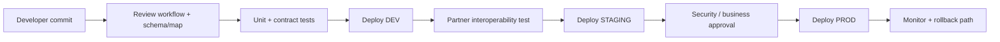

### Contract testing

For every partner/document type/version:

- A **golden valid EDI** matching the contract.
- Sample missing a mandatory field/segment.
- Sample with wrong qualifier, control number, or version.
- Duplicate interchange/message sample.
- Invalid certificate/signature or broken MDN behavior.
- ERP validation rejection sample.
- Post-ERP-commit timeout sample.
- Order change/cancel arriving before Create.

**Never test only the happy path.** In EDI/B2B, partner format deviations are a leading cause of production incidents.

### Backward compatibility and migration

When a partner upgrades X12 versions:

1. Add and test the new schema.
2. Continue accepting the old version during an agreed overlap window.
3. Route to maps dynamically by actual partner/version.
4. Migrate endpoints/certificates with advance notice.
5. Track document share moving to the new version.
6. Retire the old version only after partner confirmation and backlog drainage.

Never overwrite a single schema “in place” while in-flight or replayable documents still rely on the old version.

## 28. Onboarding a new trading partner

Standardize an onboarding intake checklist so no transport or agreement detail gets missed.

| Information group | Questions / items to verify |
|---|---|
| Legal/Business | Entity, owner, support contacts, trading relationship |
| Document types | 850/810/855, ORDERS/INVOIC, XML/CSV/API, versions |
| Partner identifiers | AS2-From/To, ISA/GS sender/receiver, UNB IDs |
| Transport | AS2 HTTPS endpoint, sync/async MDN, SFTP/API |
| Certificates | Signing/encryption/public keys, thumbprints, expiries, rotation windows |
| Message envelope | Control numbers, delimiters, duplicate rules, compression |
| Validation | Mandatory segments, qualifiers, business rules |
| Acknowledgments | MDN, 997/999, CONTRL, order responses, deadlines |
| Security | TLS/mTLS, OAuth, IP restrictions, PII classification, retention |
| Reliability | Retry policy, outages, SLA, escalation path, replay agreements |
| Testing | Valid/invalid/duplicate samples, negative tests, go-live criteria |
| Operations | Dashboards, contacts, certificate calendar, audit requirements |

### Onboarding is NOT finished at “Test connection PASS”

A passing AS2 connectivity test does not prove the partner accepts your EDI schema. Go-live requires:

- Real acknowledgments verified by the partner.
- Inbound/outbound document pairs reconciled in ERP.
- Idempotency and duplicate detection tested.
- Retry/MDN timeout procedures agreed upon by both sides.
- Production certificates imported and secured.
- Support hotlines/escalations and maintenance calendars shared.

## 29. Lab: Order API → Logic Apps → Service Bus → Mock ERP

### Purpose

This initial lab **sends no real EDI**. It proves orchestration, validation, durable queuing, and tracing; afterward, it can expand to B2B decoders/maps using valid test documents. This avoids crafting fake “EDI-looking” strings that could confuse a real partner endpoint.

### Hypothetical resources

```text
Subscription: Authorized Azure sandbox
Resource group: rg-logic-b2b-lab
Logic App: la-orders-lab
Hosting: Standard or Consumption per lab requirement
Service Bus namespace: sb-logic-b2b-lab-<unique>
Queue: incoming-purchase-orders
Storage account: stlogicb2blab<unique>
Input sample: Mock JSON purchase order
Output: Service Bus work item
ERP target: Mock HTTP endpoint or test system
Partner: SUPPLIER-B (fictitious)
```

Provisioned Azure resources can incur charges. Never reuse resource groups holding shared workloads; check budgets, tags, and ownership before creating resources.

### Step 1 — Prepare Service Bus

Create the namespace and queue in your sandbox via Azure Portal or approved IaC. Confirm:

- The queue actually exists.
- Logic App's identity has `Azure Service Bus Data Sender`.
- If a consumer workflow reads the queue, its identity has `Azure Service Bus Data Receiver`.
- TTL, `MaxDeliveryCount`, DLQ, and duplicate detection set per lab goals.
- Queue depth / oldest message age monitoring enabled.

**Never share `RootManageSharedAccessKey` across every workflow.** Whenever connectors support managed identity, use least-privilege data-plane RBAC.

### Step 2 — Create the Logic App

In the Portal:

1. Select your subscription and `rg-logic-b2b-lab`.
2. Create a Logic App (Consumption or Standard) per section 3 criteria.
3. Choose a stateful workflow for clear run history and retries.
4. Add a **Request trigger** with a JSON schema.
5. Add **Parse JSON** and basic business validation.
6. Add **Service Bus — Send message** (matching the hosting connector).
7. Return HTTP `202 Accepted` only after the send succeeds.
8. Add error branches returning appropriate statuses (`400`/`503`) on validation or send failure.
9. Enable managed identity and assign scoped roles.
10. Enable monitoring/correlation and Secure Inputs/Outputs if payloads require it.

### Step 3 — JSON schema for the Request trigger

```json
{
  "type": "object",
  "properties": {
    "partnerId": {"type": "string"},
    "poNumber": {"type": "string"},
    "orderDate": {"type": "string"},
    "items": {
      "type": "array",
      "items": {
        "type": "object",
        "properties": {
          "code": {"type": "string"},
          "qty": {"type": "number"}
        },
        "required": ["code", "qty"]
      }
    }
  },
  "required": ["partnerId", "poNumber", "items"]
}
```

**This schema checks basic structure only.** It does not block negative quantities, unauthorized partner names, duplicate SKUs, oversized payloads, or malformed `orderDate` values; enforce business contract validations on top.

### Step 4 — Message sent to the queue

Build a work item carrying metadata without duplicating secrets:

```json
{
  "eventType": "PurchaseOrderReceived",
  "schemaVersion": "1.0",
  "partnerId": "SUPPLIER-B",
  "documentId": "PO-127",
  "correlationId": "trace-lab-127",
  "payload": {
    "orderDate": "2026-11-20",
    "lines": [
      {"sku": "SKU-1001", "quantity": 25}
    ]
  }
}
```

If raw documents are huge or sensitive, store them in access-controlled Blob Storage with retention and pass only a **document reference** plus metadata over Service Bus. Never pass indefinite SAS URLs inside queue messages.

### Step 5 — Test via HTTP

If the workflow exposes a secured test HTTP endpoint, use Postman or `curl` with externally managed URLs/credentials:

```bash
# Replace with an authorized lab endpoint.
# Never paste signed URLs with SAS/query secrets into logs or source code.
curl -X POST "$LOGIC_APP_TEST_URL" \
  -H "Content-Type: application/json" \
  -d '{
        "partnerId": "SUPPLIER-B",
        "poNumber": "PO-127",
        "orderDate": "2026-11-20",
        "items": [{"code": "SKU-1001", "qty": 25}]
      }'
```

**Note:** `LOGIC_APP_TEST_URL` must be set securely on the client, as it may carry sensitive credentials. This command illustrates the call flow; if the endpoint requires Entra/OAuth/mTLS, include the required authentication mechanism per policy.

### Step 6 — Inspect the queue

Verify:

1. Workflow run shows Succeeded after the Send action.
2. Queue holds the new work item (or a concurrent consumer already picked it up).
3. `partnerId`, `documentId`, `correlationId`, and payload match.
4. Resending the same document triggers duplicate detection under business idempotency.
5. When Service Bus is unreachable, the workflow takes the error branch instead of falsely returning `202`.

### Step 7 — Mock ERP worker

Create a separate workflow triggered by the Service Bus queue:

```text
Service Bus trigger
→ Parse work item
→ Check IdempotencyStore(partnerId+documentId+revision)
→ Call mock ERP API
→ Save ERP reference/status
→ Complete message per connector/runtime semantics
```

For thorough learning, simulate:

- ERP returns `201 Created`.
- ERP returns `400 BusinessValidationError`.
- ERP returns `503 ServiceUnavailable`.
- ERP times out **after potentially creating the order**.

That final case distinguishes **safe retries** from **duplicate order creation under uncertain outcomes**.

### Step 8 — Cleanup

When finished:

- Stop/deactivate lab workflows per hosting model so triggers stop polling.
- Inventory queue and DLQ messages; archive any needed test notes.
- Confirm whether the resource group belongs strictly to the lab.
- Delete only lab-owned resources; never delete shared Service Bus, Key Vault, APIM, or Integration Accounts.
- Check Cost Management and confirm temporary secrets/roles were revoked.

## 30. Advanced B2B lab: receiving test EDI per agreement

### Prerequisites

This lab **uses only sample documents generated from verified schemas/implementation guides**. Never hand-craft fake X12/EDIFACT strings and send them to a real partner endpoint. Required:

- B2B runtime/connector supporting X12 or EDIFACT.
- Appropriate artifact store / integration account.
- Test trading partners and agreement.
- Approved test schemas and maps for the test version.
- Test certificates and AS2 endpoints if testing transport.
- Mock queue/ERP and business status store.

### Lab sequence

1. Create trading partners `BUYER-A` and `SUPPLIER-B` with test identifiers.
2. Create a test agreement with version-accurate fields and ACK settings.
3. Upload test EDI schemas and maps from EDI-decoded XML to the canonical model.
4. Configure a trigger receiving files/messages over your lab transport (test SFTP/Blob/AS2).
5. Run decode + validate, recording metadata and correlation.
6. Map to the canonical order and compare against expected JSON.
7. Enqueue the work item and verify the mock ERP receives it accurately.
8. Verify test ACKs without confusing MDNs with functional/business ACKs.
9. Test two failure cases: syntax-invalid document and syntax-valid document with a non-existent SKU.
10. Measure errors, durations, statuses, and cost.

### Expected output

| Case | Expected outcome |
|---|---|
| Valid X12/EDIFACT purchase order | Decode/schema PASS; canonical map accurate |
| Wrong control numbers / trailer counts | Syntax reject with clear diagnostics |
| Valid schema, non-existent SKU | Dedicated business rejection |
| Duplicate document | No duplicate ERP order created |
| Invalid AS2 signature | Transport verification fails; never enters ERP |
| Temporary ERP outage | Work item stays in retry/backlog state |
| Retry after ERP commit | Already-committed detected; no second order created |
| Delayed ACK/MDN | Accurate correlation and SLA alert |

## 31. Diagnostic scenarios

| Symptom | Possible cause | Check direction |
|---|---|---|
| HTTP trigger 401/403 | Auth gateway, Entra, SAS/signature, APIM policy | Request metadata, identity, endpoint, scope |
| Logic Apps run Succeeded yet ERP has no order | Workflow only enqueued or returned transport ACK | Business status store, queue, ERP references |
| Connector fails to reach SAP | Gateway/VNet/DNS/firewall, SAP components, or credentials | Network path from connector, logs, auth |
| AS2 signature verification failed | Wrong/expired certificate, signer ID, altered content | Trust chain, cert thumbprint, partner agreement |
| AS2 decryption failed | Wrong private key / cipher settings | Certificate purpose and key version |
| Missing MDN | Async callback failure, timeout, AS2 agreement mismatch | `Message-ID`, endpoint, callback logs |
| MDN succeeds yet EDI rejects | Transport succeeded; schema/control numbers failed | B2B decode and EDI ACK |
| X12 850 fails to map | Version, qualifiers, schema mismatch | Implementation guide, segment-level errors |
| EDIFACT ORDERS invalid | Directory/version or service string/segments wrong | `UNB`/`UNH`/`UNT`/`UNZ`, schema |
| Mapping returns null fields | Source path differs by version or optional fields | Sample payload, map I/O, schema |
| EDI processed twice | Resends/timeouts/retries; missing idempotency | Control numbers, `documentId`, status store |
| Service Bus DLQ growing | Persistent ERP errors, bad schema, queue auth | `DeadLetterReason`, delivery count, workers |
| Workflow runs slowly | ERP throttling, retry loops, wait actions | Action durations, `retryCount`, downstream SLA |
| Expired secret | Missed OAuth/certificate/SAS rotation | Expiry alerts, identity settings, Key Vault |
| Logic Apps Standard outbound timeout | VNet/NSG/routing/DNS or managed connector path | Connector-specific networking, diagnostics |
| Only Partner A fails | Agreement/map/certificate/ID differs from Partner B | Partner-specific metadata and logs |
| Rising costs | Tight polling, retries, Standard plan, verbose logging | Cost Management and execution metrics |
| Functional ACK sent, partner claims missing | Transport ACK failure / correlation mismatch | ACK message ID, partner endpoint, resend policy |
| Reprocessing breaks ordering | Replaying old revision after newer revision | Business version guard, operator approval |

### Runbook flowchart

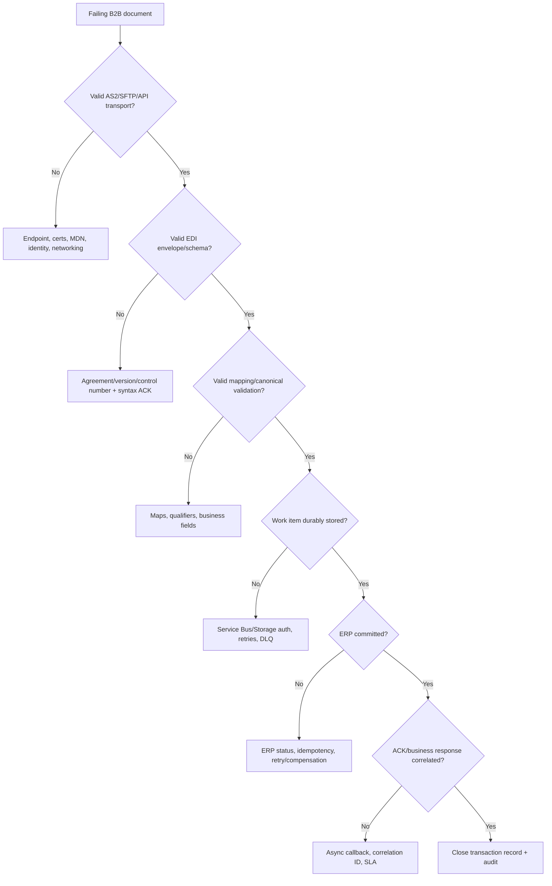

## 32. Reference architecture: multi-partner supply chain

A manufacturing enterprise has:

- 30 suppliers sending X12 850 or EDIFACT ORDERS.
- 5 logistics partners receiving advance ship notices and returning statuses.
- SAP ERP in an on-premises datacenter, reachable only via private networking.
- 7-year document retention policy per company rules (an **internal example only**, not a legal mandate claim).
- SLA: 95% of valid orders created in ERP within 10 minutes.
- AS2 partner agreements with rotating certificate expirations.

### Proposed components

| Layer | Service / mechanism | Responsibility |
|---|---|---|
| Entry/transport | AS2 gateway, SFTP ingress, API Management | Endpoint protection and data intake |
| B2B syntax | Logic Apps B2B connectors/artifacts | Decode/encode, agreements, validation, ACKs |
| Canonical | Maps + JSON/XML schemas | Business normalization |
| Buffer | Azure Service Bus | Durable work items, retries, DLQ, sessions if needed |
| ERP integration | Logic Apps Standard + SAP connector/private path | Create/update ERP orders |
| Archive | Encrypted Blob/Data Lake + policy | Raw/processed documents, audits |
| Status | SQL/Cosmos DB/ERP status | Business process source of truth |
| Secrets | Key Vault / managed identity | Credentials and certificates per support |
| Observability | Azure Monitor / Log Analytics + business dashboard | Latency, errors, SLA, cert expirations |
| Governance | IaC/CI/CD + runbooks | Releases, partner onboarding, rollbacks |

### Architecture review sequence

1. Identify the **business source of truth** (ERP vs. integration status DB).
2. Define what “Accepted” means: MDN, functional ACK, or ERP response.
3. Choose Standard vs. Consumption by networking, connectors, volume, and operations.
4. Establish partner boundaries, agreements, and certificate lifecycles.
5. Design canonical models, mapping versioning, and idempotency.
6. Balance API, Service Bus, and ERP throughput—not just workflow capacity.
7. Design DLQ/replay/compensation and data protection.
8. Estimate costs across hosting, connectors, integration accounts, networking, and storage/logs.
9. Pilot end to end with at least one partner before scaling to all partners.

### Failure scenarios to rehearse

**Partner sends duplicate document:** caught via business document key and envelope/control IDs; zero duplicate ERP orders.

**SAP goes down for 30 minutes:** queue holds work items, retries back off, SLA and oldest-message alerts fire; on recovery, workers drain without exceeding quotas.

**AS2 certificate expires:** pre-expiry alerts trigger coordinated partner rotation; unauthenticated messages are never admitted.

**Mapping version bug:** halt rollout, preserve raw messages to replay with fixed map version; never silently alter committed ERP records without business sign-off.

**Async MDN lost:** hold transmission in `Unknown`, reconcile with partner and resend policy; never silently assume failure or success.

**Workflow rollback:** ensure older schema/agreement versions can still drain queued backlogs without breaking in-flight items.

## 33. Pre-production architecture checklist

### Partner contracts

- [ ] Trading partner identifiers/qualifiers agreed and verified.
- [ ] Approved list of document types (X12/EDIFACT/API) and **versions**.
- [ ] AS2/SFTP/API transport and signing/encryption/mTLS rules finalized.
- [ ] Public certificates, thumbprints, expirations, and rotation owners tracked.
- [ ] Sync/async AS2 MDNs, functional ACKs, business ACKs, and SLAs separated.
- [ ] Duplicate control number / message ID policies defined.
- [ ] Support contacts, hours, escalation paths, and replay agreements documented.

### Workflow and data design

- [ ] Standard vs. Consumption chosen by **connectors/networking/cost**, not habit.
- [ ] Single trigger, actions, and `runAfter`/scopes define clear error paths.
- [ ] Raw EDI, canonical models, and ERP requests versioned with schemas.
- [ ] Mappings accurately handle qualifiers, units of measure, currency, decimals, time zones.
- [ ] Business idempotency keys and source-of-truth states persisted.
- [ ] Outbox/inbox/replay procedures ready for multi-system workflows.
- [ ] HTTP/API workflows never hold connections open during slow ERP work.
- [ ] Service Bus capacity, retries, DLQ, and sessions configured per needs.
- [ ] Create/Change/Cancel ordering preserved per aggregate.

### Security and operations

- [ ] Least-privilege managed identity/RBAC or approved secret stores configured.
- [ ] SAP/SQL/SFTP/AS2 connectivity verified **from the connector runtime**.
- [ ] Sensitive B2B payloads hidden from run history/logs per policy.
- [ ] Certificates/credentials have expiry alerts and rotation drills.
- [ ] Both technical runs and **business document states** monitored.
- [ ] DLQ owners and replay runbooks enforce approvals and auditing.
- [ ] Document retention, archiving, and deletion policies active.
- [ ] Budgets and alerts track Logic Apps, connectors, Service Bus, and Storage.
- [ ] CI/CD runs positive/negative contract tests and supports rollback.

## 34. Common misconceptions

**“Logic Apps is just an automated email sender.”** False. Properly configured, it orchestrates APIs, ERPs, messaging, data transformations, and B2B.

**“Standard and Consumption differ only in price.”** False. Hosting, lifecycles, stateful/stateless, connectors, deployments, networking, and B2B artifact models all differ.

**“Every connector uses managed identity and VNets identically.”** False. Support varies by connector, trigger/action, hosting, runtime, and network topology.

**“A `Succeeded` Logic App run means the order is accepted.”** False. It may have only ingested/validated/enqueued while ERP or business ACKs are still pending.

**“X12 and EDIFACT are just two names for the same file.”** False. They have distinct envelopes, segments, qualifiers, versions, and rules.

**“AS2 is an EDI file format.”** False. AS2 is a message transport and security protocol; payloads can be EDI or other formats per agreement.

**“A successful MDN means the ERP created the order.”** False. MDN is an AS2 transport disposition, not a business acknowledgment.

**“A 997/999 functional acknowledgment means the invoice was paid.”** False. It reflects syntax/implementation acknowledgment per standard and agreement.

**“One HTTPS TLS certificate covers all AS2 needs.”** False. Signing, encryption, and MDN certificates serve distinct purposes and lifecycles.

**“Schema validation guarantees prices and inventory are right.”** False. Business rules must be validated by the ERP/business validation layer.

**“Mapping X12 850 to JSON is just renaming `BEG` to `orderId`.”** False. It requires qualifiers, loops, versions, mandatory elements, and business normalization.

**“API Management automatically stops Partner-A from reading Partner-B's data.”** Not completely. Gateways enforce auth and policies, while applications must enforce resource-level authorization.

**“Service Bus delivers once, so idempotency isn't needed.”** False. Redeliveries, retries, and lock expirations happen; business state must tolerate duplicates.

**“Run history doubles as a raw EDI backup.”** False. Run history has retention and secure-input limits and never replaces durable document archives.

**“Adding infinite retries reduces failed documents.”** False. It causes duplicates, drives up bills, and hammers the ERP on permanent errors.

**“If SAP connects from my laptop, Logic Apps can connect too.”** False. Connector runtimes and gateways have different network paths, DNS, and identities.

**“Share one agreement across all partners to simplify config.”** Wrong whenever IDs, message types, certificates, ACKs, or validation rules differ.

**“Purging the DLQ to zero errors fixes the problem.”** False. It drops unprocessed documents, breaks audits, and corrupts business state.

**“Cranking up concurrency always makes SAP process orders faster.”** False when SAP has narrow connection/quota caps or requires business ordering.

**“When changing production schemas, delete the old version immediately.”** False. In-flight or replayable documents may still rely on the old version.

## 35. Self-check questions

**Question 1.** What role does Logic Apps play among e-commerce, ERP, and B2B suppliers?

**Answer:** It serves as the workflow integration layer: ingesting events/documents, connecting systems, validating, transforming, routing, retrying, and tracking progress—without replacing the ERP as the business system of record.

**Question 2.** What are the two common Logic Apps hosting models, and what differences matter?

**Answer:** Consumption and Standard; evaluate hosting, workflows/resources, stateful/stateless, connectors, networking, B2B artifacts, deployment, and cost.

**Question 3.** How do triggers and actions differ inside a workflow?

**Answer:** Triggers initiate runs; actions execute steps afterward such as Parse JSON, Compose, calling an ERP, or sending to Service Bus.

**Question 4.** What is the difference between EAI and B2B?

**Answer:** EAI integrates applications typically within one organization; B2B exchanges documents across organizations with explicit partner identities, agreements, transports, and ACKs.

**Question 5.** Is AS2 a document syntax standard equivalent to X12/EDIFACT?

**Answer:** No. AS2 is a transport protocol over HTTP(S) providing signing, encryption, and MDNs; X12 and EDIFACT are EDI document syntax standards.

**Question 6.** What are the main envelopes in X12?

**Answer:** `ISA/IEA` for the interchange, `GS/GE` for the functional group, and `ST/SE` for the transaction set per version and agreement.

**Question 7.** Which envelope segments does EDIFACT use?

**Answer:** `UNB/UNZ` for the interchange, `UNH/UNT` for the message, and optional `UNA` for service string advice, with business segments inside.

**Question 8.** How do MDN, 997/999 or CONTRL, and a business response differ?

**Answer:** MDN reports AS2 transport disposition; EDI acknowledgments report syntax/implementation conformance; business responses convey commercial acceptance/rejection per contract.

**Question 9.** What is a Partner Agreement used for?

**Answer:** Defining exchange rules with a partner: IDs, message types/versions, envelopes, transport, signing/encryption, ACKs, and validation checks where supported.

**Question 10.** Why use a canonical data model?

**Answer:** To cut point-to-point connections and mappings, decouple partner schemas from ERP internals, and maintain a versionable internal contract.

**Question 11.** A document has valid EDI syntax, yet the ERP rejects a non-existent SKU. Which error category is this?

**Answer:** Business validation error—not transport or EDI syntax. Report business rejection per agreement rather than misreporting a syntax ACK failure.

**Question 12.** Why place Service Bus between AS2 inbound and SAP?

**Answer:** To decouple transport/ACK deadlines from ERP processing duration, persist work items durably, leverage retries/DLQ, and regulate throughput.

**Question 13.** An ERP request timed out but may have committed. Is it safe to retry creating the order immediately?

**Answer:** No. Check business keys/external references and the idempotency store to see if the side effect already occurred.

**Question 14.** Should you use `runId` or `documentId` as the business idempotency key?

**Answer:** Use a business-scoped key like `partnerId+documentType+documentId+revision`; `runId` identifies only a single technical execution.

**Question 15.** When should you use Logic Apps Standard and evaluate private networking?

**Answer:** When connector needs, multi-workflow packaging, runtime control, and internal system connectivity require Standard hosting/networking features; always verify exact connector support.

**Question 16.** Does managed identity automatically give access to a private-endpoint SAP or Blob resource?

**Answer:** No. Identity handles authentication/authorization, while private reachability requires DNS, routes, firewalls, gateways, or VNets per hosting/connector.

**Question 17.** How should B2B agreements and certificates be managed outside Git?

**Answer:** Manage configurations via IaC where allowed, keep private keys/passwords in Key Vault/secret stores, and maintain expiry alerts, owners, and partner-coordinated rotations.

**Question 18.** Why isn't run history sufficient as a document audit archive?

**Answer:** Retention limits, secure input/output masking, and log permissions restrict it; use an encrypted archive and business status store with controlled correlation.

**Question 19.** Before replaying a DLQ message, what two checks come first?

**Answer:** Confirm the root cause is fixed and inspect ERP/business status to prevent duplicate side effects; then replay with approval and auditing.

**Question 20.** What are the end-to-end verification layers for a B2B order?

**Answer:** Transport/AS2 → EDI envelope/schema → canonical/business validation → durable queue → ERP commit → acknowledgments → business status/audit.

**Question 21.** A partner sends 100,000 invoices at peak. Is maxing out Logic Apps concurrency the right fix?

**Answer:** No. Use Service Bus buffering, respect ERP capacity/quotas, partition cleanly, apply retries/backpressure, monitor lag, and consider partner SLA tiers.

**Question 22.** Why keep old schema/map versions when rolling out a new version?

**Answer:** In-flight or replayable documents may still arrive under the older agreement; removing old version support breaks processing and recovery.

## Summary

**Azure Logic Apps** builds integration workflows out of **triggers, actions, connectors, expressions, scopes, and workflow state**, connecting HTTP/APIs, SAP/ERP, SQL, SFTP, Service Bus, and Storage. Scaling into **B2B** adds **X12, EDIFACT, AS2, trading partners, agreements, schemas, maps, certificates, and acknowledgments**. Picking the right Consumption/Standard hosting model and B2B artifact store lays the foundation for reliable operations.

A dependable enterprise pipeline separates **transport delivery**, **syntax validity**, and **business acceptance**; uses a **canonical data model**, secured document archives, **idempotency/queues/retries/DLQs**, business status stores, and correlation IDs to survive partner or ERP outages safely. Combined with **managed identities, connector-aware private networking, certificate lifecycles, CI/CD, monitoring, SLAs, and budgets**, Logic Apps becomes an auditable, resilient, and scalable integration layer instead of a fragile web of point-to-point links.
