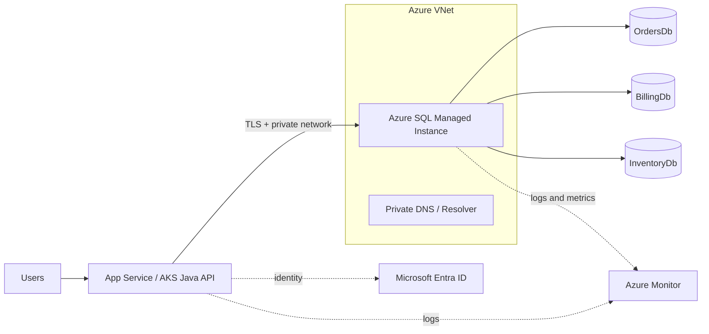
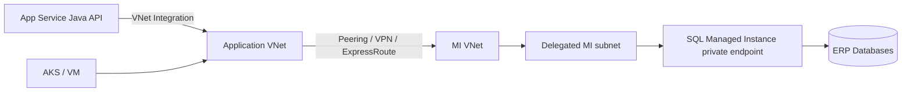
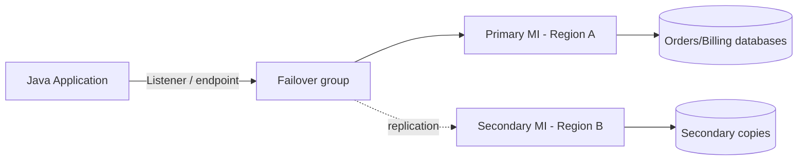
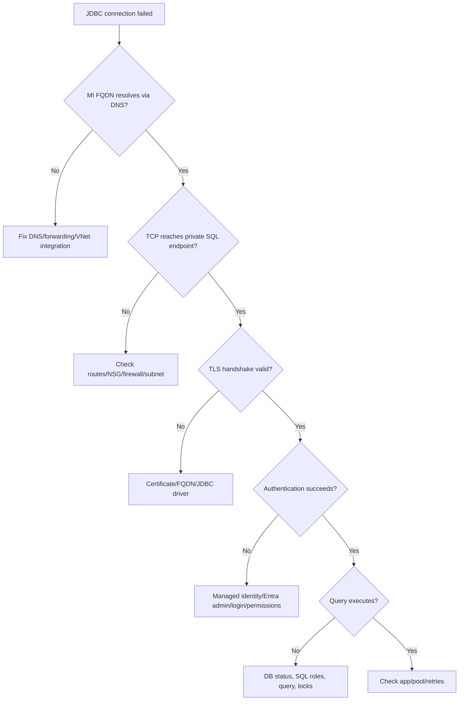
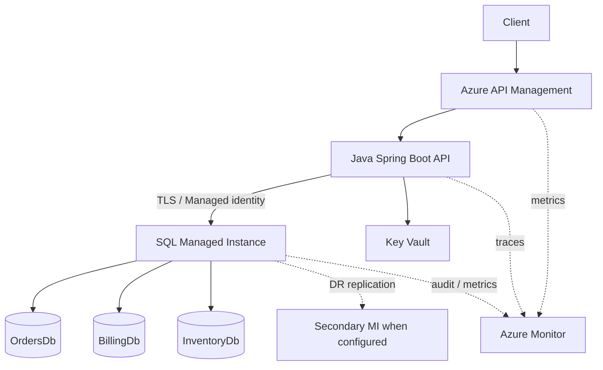

# Azure SQL Managed Instance for SQL Server Compatibility

An enterprise operates an ERP system on **Microsoft SQL Server** in its own datacenter. Java applications connect via JDBC, multiple databases exchange data through three-part queries (`Database.Schema.Table`), operations uses **SQL Server Agent** to run overnight jobs, and the DBA team manages backups, permissions, indexes, and performance. When moving to Azure, the enterprise wants to reduce OS and SQL Server engine administration without rewriting the entire application.

**Azure SQL Managed Instance (SQL MI)** is a Platform as a Service (PaaS) option aiming for **high instance-level compatibility with SQL Server**, while Azure manages provisioning, patching, automated backups, and high availability mechanisms. It sits between **Azure SQL Database** (a database-first model with fewer instance-level dependencies) and **SQL Server on Azure Virtual Machines** (full OS/instance flexibility, but more self-management).

However, **high compatibility does not mean 100% identical to self-managed SQL Server**. Certain server-level features, linked servers, Windows authentication, file system access, SQL Agent jobs, replication, extensions, SSIS/SSRS integrations, engine versions, or network connectivity have specific constraints. The right architecture must be selected after **inventory, assessment, and real workload testing**.

This lesson belongs to the **Relational Databases** chapter of the **CLOUD_PROVIDERS_AZURE** module. The content connects to subscriptions, resource groups, Microsoft Entra ID, VNet/subnets, compute, storage, databases, monitoring, security, cost control, and Java application deployment workflows on Microsoft Azure.

> **Scope:** Examples use common capabilities of Azure SQL Managed Instance. Limits on SKUs, vCores, memory, storage, regions, zones, public/private endpoints, backup policies, migration, and Microsoft Entra authentication may change over time/by tier. Verify supported documentation and actual subscription configuration before deploying. Commands below are for authorized labs only; this lesson does not perform Azure provisioning.

## Learning Objectives

After this lesson, you will be able to:

1. Distinguish SQL Server on VM, Azure SQL Database, and Azure SQL Managed Instance.
2. Explain T-SQL compatibility, SQL Server Agent, cross-database queries, and gaps requiring assessment.
3. Choose the **General Purpose** or **Business Critical** service tier based on workload, performance, RTO, and cost.
4. Understand that SQL MI deploys into a *delegated subnet* and requires DNS, NSG, routes, and peering/VPN/ExpressRoute.
5. Distinguish SQL Managed Instance's **private VNet endpoint**, **Private Endpoint/Private Link**, and **public endpoint**.
6. Connect from Java/Spring Boot applications via JDBC with TLS and Microsoft Entra managed identity where supported.
7. Plan SQL Server migrations with assessments, Azure Database Migration Service, native backup/restore, or suitable replication options.
8. Define strategies for backups/point-in-time restore, availability, disaster recovery, and failover groups.
9. Manage permissions via SQL logins/Microsoft Entra ID, TDE, auditing, Defender for SQL, and network controls.
10. Monitor workloads, tune queries, govern costs, and troubleshoot common connectivity/migration issues.

## 1. Where Does SQL Managed Instance Fit in the Azure SQL Ecosystem?

Azure offers multiple ways to run the SQL Server engine or compatible SQL services. Choosing the wrong model can force excessive application rewrites or raise operational costs beyond what is needed.

| Criterion | Azure SQL Database | Azure SQL Managed Instance | SQL Server on Azure VM |
|---|---|---|---|
| Primary management unit | Database or elastic pool | Managed SQL instance hosting multiple databases | Self-managed VM and SQL Server instance |
| OS access | No | No | Yes, per VM/OS permissions |
| SQL Server instance feature support | Database-scoped, limited | **Higher instance-level compatibility** | Close to self-managed SQL Server on VM |
| SQL Server Agent | Not in the traditional Agent model | **Yes**, subject to service constraints | Yes |
| Cross-database queries | Limited with specific patterns | Well-supported for many same-instance scenarios | Yes |
| SQL engine/OS patching | Managed by Azure | Managed by Azure | Customer initiates/coordinates |
| Automated backups | Provided by Azure | Provided by Azure | Customer designs and manages per chosen service |
| Network connectivity | Public/private endpoints per config | **VNet-native**, private connectivity centered | Customer-designed private IP, VNet, and firewall |
| Server/OS customization | Low | Medium, with instance-level constraints | High |
| Best-fit scenario | Cloud-native database, minimal server-level dependencies | **Lift-and-modernize SQL Server** needing high compatibility | Requiring OS/engine control or PaaS-unsupported features |

### Selection Guidelines

- **Azure SQL Database:** new apps needing only one database, easily decoupled logic, and no special SQL Agent/cross-database dependencies.
- **SQL MI:** existing apps needing familiar SQL Server features where the business wants Azure to handle patching, backups, and availability without requiring OS access.
- **SQL Server on Azure VM:** apps needing Windows/Linux OS software/agents, file system/hardware access, or instance features unsupported by SQL MI.

**Do not pick Managed Instance solely because the name contains SQL Server.** If an app is already cloud-native and does not need instance compatibility, Azure SQL Database can be simpler and more economical. If SSRS must run on the same host OS, SQL MI does not replace a server running SSRS.

## 2. Real-World Scenario: Migrating an ERP from SQL Server to Azure

An ERP system includes:

- `OrdersDb`: orders, transactions, shipping info.
- `BillingDb`: invoices and payments.
- `InventoryDb`: stock levels.
- A Java Spring Boot app connecting via JDBC.
- A nightly SQL Server Agent job aggregating revenue.
- Stored procedures, views, triggers, and some cross-database queries.
- Internal apps accessing SQL Server over VPN.
- Data protection, recovery, and cost control requirements.

### Target Architecture



Applications use the **Managed Instance FQDN**, not a guessed IP address. Networking is designed upfront: App Service uses VNet Integration, AKS/VMs reside in a connected VNet or connect over VPN/ExpressRoute, and DNS and routing must reach the private endpoint.

The goal is to **preserve most existing T-SQL logic**, while proactively assessing SQL Agent, linked servers, authentication, SQL Server version, and operational steps that cannot be copied verbatim from the legacy server.

## 3. What Managed Instance Manages vs. What Customers Still Manage

**Shared responsibility** model:

| Azure Manages Much Of | App/DBA Team Still Manages |
|---|---|
| Managed SQL engine platform and hosting infrastructure | Database schema, indexes, stored procedures, transaction logic |
| OS/engine patching per service | Query tuning, performance, and resource control |
| Automated backups and platform HA | RPO/RTO, restore drills, and DR strategy |
| Infrastructure provisioning/replacement per service tier | Selecting vCores/storage/tier, quotas, and budgets |
| Many monitoring and maintenance tasks | Alerts, incident response, audit reviews |
| Service-level encryption features | Data access rights, credentials, private networking, compliance |
| Maintaining service availability per SLA | Designing retries/idempotency for failovers/connection resets |

**PaaS does not eliminate DBA responsibilities.** Long-running transactions, missing indexes, full-table scan queries, or oversized connection pools can still slow down SQL MI. Azure automated backups do not protect against wrong retention settings, overly broad permissions, or untested restores.

## 4. What Does High SQL Server Compatibility Mean?

SQL MI uses the SQL Server database engine as a managed service, supporting most of the familiar T-SQL feature set and SQL Server programming model, making it particularly suited for workloads relying on **multiple databases on the same instance**.

### Commonly Important Capabilities

- **T-SQL:** stored procedures, functions, triggers, views, transactions, indexes, and query optimizer.
- **SQL Server Agent:** supports scheduled jobs per Managed Instance capabilities, with limits depending on job subsystem and external dependencies.
- **Cross-database queries:** referencing objects via three-part names in the same instance, e.g., `BillingDb.dbo.Invoices`.
- **Backup/restore:** automated backups and ability to back up/restore SQL Server databases along supported migration paths.
- **Instance-level logins:** appropriate SQL/Entra authentication and permissions, with differences from VMs.
- **Service Broker**, linked servers, and other SQL Server features per the **support matrix**; do not assume every self-managed server scenario is guaranteed.
- **SQL Server drivers:** Java apps can use Microsoft JDBC Driver for SQL Server over TDS/TLS.

### Compatibility Does Not Cover Everything

- No **RDP/SSH** access to the SQL MI host to install services or run OS scripts.
- Cannot install **SQL Server Reporting Services (SSRS)** or any Windows service "inside" Managed Instance as on a VM.
- **SSIS** packages may require Azure Data Factory/Azure-SSIS Integration Runtime or a separate execution model.
- SQL Agent jobs using `CmdExec`, PowerShell, file shares, proxies, or OS-installed programs must be evaluated/redesigned.
- Linked servers only support specific data sources/providers and auth mechanisms; do not assume every OLE DB provider works.
- Features tied to registry, file system, OS, certain server-level options, distributed transactions, or replication may have restrictions.
- SQL authentication/Windows domain/Entra integration mechanisms are not 1-to-1 identical across every version.
- SQL MI is not a server where you freeze an engine version indefinitely: Azure updates engines/maintenance per service policy.

**Migration rule:** audit every **technical and operational dependency**, rather than running one sample SELECT query and concluding 100% compatibility.

## 5. Cross-Database Queries: A Common Reason to Choose MI

Suppose a stored procedure in `OrdersDb` needs to query invoices in `BillingDb`:

```sql
USE OrdersDb;
GO

SELECT o.OrderId, o.CreatedAt, i.TotalAmount
FROM dbo.Orders AS o
JOIN BillingDb.dbo.Invoices AS i
  ON i.OrderId = o.OrderId
WHERE o.CreatedAt >= DATEADD(day, -7, SYSUTCDATETIME());
```

This is a **T-SQL logic example**: the tables must actually exist and object permissions for the executing principal must be valid.

SQL MI can provide cross-database query/transaction support close to SQL Server when **databases reside on the same instance**, though you still must:

1. Verify actual schema and database names.
2. Check collation of each database, especially when joining on string columns.
3. Confirm authentication, ownership chaining, and proper cross-database permissions.
4. Check transaction isolation, locking, and throughput.
5. Never assume cross-database queries work automatically between **two separate Managed Instances** using three-part syntax as within one instance.

### Why Can SQL Database Be More Complex?

Azure SQL Database is database-scoped; cross-query scenarios have separate mechanisms/limits. For an ERP with many stored procedures referencing other databases, SQL MI can reduce rewrites. However, if the system can separate service boundaries and communicate via APIs/events, moving to SQL Database remains worth evaluating.

## 6. SQL Server Agent on Managed Instance

SQL Server Agent is familiar to DBAs for:

- Running scheduled stored procedures.
- Updating summary tables and running data checks.
- Performing permitted housekeeping tasks.
- Executing multi-step scheduled jobs with status tracking per supported subsystems.

Example query listing jobs if the account holds permission:

```sql
USE msdb;
GO

SELECT TOP (20)
    name,
    enabled,
    date_created
FROM dbo.sysjobs
ORDER BY date_created DESC;
```

### What to Check When Migrating Jobs

| Job Type | Issues to Review |
|---|---|
| T-SQL step | Procedures, database context, security, and performance |
| Legacy backup scripts | May need replacement with MI automated backups/retention |
| PowerShell/CmdExec | Do not assume they run on MI's host OS |
| Jobs reading Windows file shares | Lack identical OS/file share access as legacy servers |
| Jobs sending email | Database Mail/mail relay path and corresponding policy |
| Jobs calling linked servers | Provider/auth/endpoint support |
| Jobs updating large datasets | Resource contention, maintenance windows, and log growth |
| Jobs running on local time | Timezone/UTC, DST, and business schedules |

**Not every SQL Agent job that imports cleanly works properly.** Test in staging, verify job step outputs, agent permissions, execution timing, and side effects.

If a job primarily performs data movement or multi-system orchestration, consider moving it to **Azure Data Factory, Logic Apps, Azure Functions, or Azure Batch** instead of forcing all jobs into SQL MI.

## 7. Choosing a Service Tier: General Purpose vs. Business Critical

SQL MI offers service tiers tailored to different workload profiles. Two primary groups are **General Purpose (GP)** and **Business Critical (BC)**.

| Aspect | General Purpose | Business Critical |
|---|---|---|
| Goal | Common enterprise workloads, reasonable cost | Workloads with higher I/O/latency requirements |
| Storage engine | Compute and storage separated per tier model | Storage/replica architecture optimized for latency and HA per tier |
| Relative price | Generally lower for comparable configs | Generally higher |
| Performance | Fits typical transactional workloads | Valuable when latency/IOPS/throughput are decisive |
| Readable replicas | Not enabled with the same read-scale mechanism as BC by default | Can provide secondary read capability per feature/conditions |
| HA | Service-managed HA | Tier-architected HA with replicas |
| Choice | ERP/reporting/APIs with suitable SLOs | Latency-sensitive or high-throughput OLTP |

Some **next-generation General Purpose** variants or newer scaling options may be available depending on region, subscription, and timing. Do not compare using a static throughput chart; measure latency, CPU, I/O, tempdb, and cost on the actual configuration.

### Choose by Metrics, Not Guesswork

If a Java application observes high p95 latency, first ask:

- Does the query plan have large scans or missing indexes?
- What is sustained CPU/vCore utilization?
- What are data I/O latency, throughput, and log write latency?
- Are there transactions/locks or deadlocks?
- Is the connection pool exhausted?
- Is the backend causing a retry storm?
- Have statistics or parameter sensitivity changed?

**Upgrading from GP to BC will not fix a SQL statement missing a WHERE clause or a logic deadlock.**

## 8. vCores, RAM, Storage, and Capacity Sizing

SQL MI compute and storage resources are configured by tier, hardware generation/family, and regional limits. Consider:

- **vCores:** SQL query processing capacity, concurrency, and compute billing level.
- **Memory:** tied to compute tier; affects buffer pool, sorts, hashes, and execution plans.
- **Data storage:** allocated/capped space for databases, tempdb/logs per tier architecture.
- **IOPS/throughput/latency:** influenced by service tier and storage configuration.
- **Max databases:** instance-level limit per configuration.
- **Network throughput:** impacts chatty applications or batch data loads.
- **Resource governance:** prevents reporting workloads from starving OLTP capacity.

### Preliminary Sizing Example

An ERP has 600 GiB of data, growing 20 GiB/month, 400 logical app connections, peaking at 1,500 transactions/second. You cannot pick a tier from **database size** or **connection count** alone.

Proper process:

1. Measure CPU, memory, disk latency, log throughput, and query runtimes on the current SQL Server.
2. Separate real peaks from averages.
3. Measure data growth, transaction logs, tempdb, index maintenance, and backup windows.
4. Check database count and cross-database interactions.
5. Choose a baseline vCore/storage allocation with headroom for failover/maintenance.
6. Benchmark critical workloads in staging.
7. Review costs in the target region/tier, then right-size.

**Do not use "1 on-premises CPU = 1 MI vCore" as an exact rule.** Hardware, architecture, storage, and workloads change.

## 9. How Is SQL MI Deployed Into the Network?

Azure SQL Managed Instance is built with **VNet-native networking**. The instance receives a private endpoint within the customer's Azure network topology, differing from a default public-endpoint-only model.



This is a conceptual diagram. An MI has a **VNet-local endpoint** inside a delegated subnet; depending on architecture and features, a separate Private Endpoint may simplify access from other networks. Do not equate MI's native internal endpoint with a standalone Azure Private Endpoint resource you create manually.

### Key Definitions

- **VNet:** private Azure network address space.
- **Subnet:** IP range within a VNet dedicated to resources or features.
- **Delegated subnet:** a subnet delegated to `Microsoft.Sql/managedInstances` per service requirements, reserved exclusively for MI under applicable rules.
- **NSG:** network security rules applied to subnets/NICs per platform capabilities.
- **UDR/route table:** traffic routing that may traverse firewalls/NVAs/VPNs.
- **Private DNS:** resolves FQDN to the proper address from the client network.
- **Peering/VPN/ExpressRoute:** establishes connectivity from apps in other networks to MI.

**Never deploy VMs or unsupported resources inside the delegated subnet just because free IPs exist.** The MI subnet must meet strict service-specific requirements.

## 10. Designing the Delegated Subnet for Managed Instance

SQL MI requires a subnet meeting requirements for:

- Proper **delegation** to `Microsoft.Sql/managedInstances`.
- Enough IPs for MI, maintenance, upgrades, and scaling, not just the endpoint IP.
- NSGs/route tables compliant with **service-aided subnet configuration** and mandatory service management rules.
- Non-overlapping network address space relative to app VNets/on-premises.
- Limits on DNS, endpoint policies, peering, and instance count per service version guidance.
- Subnet dedicated strictly as required by Azure SQL MI.

### Illustrative Address Planning Example

| Component | Example Address Range |
|---|---|
| Application VNet | `10.20.0.0/16` |
| App Service VNet integration subnet | `10.20.1.0/24` |
| AKS worker subnet | `10.20.2.0/24` |
| SQL MI VNet | `10.30.0.0/16` |
| SQL MI delegated subnet | `10.30.1.0/26` |
| DNS resolver/private endpoints for supporting systems | Separate subnets per design |

**Here `/26` is a sizing example, not a universal mandatory minimum for every MI.** Required IPs depend on instance count, vCores, maintenance, service tier, and current limits. Before provisioning, consult Azure's capacity/subnet sizing guidance.

### Do Not Arbitrarily Lock Down NSGs/UDRs

SQL MI requires platform connections for management, backups, availability, and monitoring. Overly aggressive NSG/UDR changes can cause **MI provisioning, scaling, or operations to fail**, even if TCP 1433 from the app still works. Review mandatory service-aided configurations/rules and security policies before any network change.

## 11. VNet-Local Endpoint, Private Endpoint, and Public Endpoint

Three easily confused access paths:

| Endpoint Type | Purpose | Key Takeaway |
|---|---|---|
| **VNet-local endpoint** | Default private path for clients reaching MI across routable VNet topologies | Use the **actual MI FQDN**, DNS, and private network routing |
| **Private Endpoint/Private Link** (per MI capabilities) | Adds a private IP/private access path from consuming networks | Has its own DNS and networking requirements/constraints; does not replace the delegated subnet |
| **Public endpoint** | Allows client connections over a public data endpoint when enabled and permitted by policy | Expands attack surface; requires strict NSG/authorization/firewall/network controls |

For many architectures, **VNet peering or VPN/ExpressRoute + VNet-local endpoint** suffices for apps calling MI. Private Endpoint is not mandatory in every SQL MI deployment; it is an option based on network model, product capabilities, and access requirements.

### Ports and DNS

- SQL MI private connectivity commonly uses **TCP 1433** to the MI FQDN within permitted networks.
- SQL MI's **public data endpoint**, if enabled, typically uses **TCP 3342** per product mechanics and should remain disabled if unnecessary.
- Certain client/connection policies or network features require extra ports/rules. Check your exact mode/tier and never assert 1433 is the only port SQL MI ever needs.

**Do not guess the FQDN solely from the instance name.** The actual DNS zone is embedded in the Azure-provided fully qualified domain name, generically shaped like `<mi-name>.<dns-zone>.database.windows.net`. Retrieve the exact FQDN from the Azure Portal/CLI or service-provided connection string.

### Does a Public Endpoint Destroy Security?

Enabling the public endpoint does not automatically expose the database to everyone, as authentication and network rules still apply. However, it **increases attack surface and access-control burden**. For purely Azure-hosted apps, prefer private connectivity and keep the public data endpoint disabled when unneeded.

## 12. DNS: Common Failure Point When Connecting from App Service/AKS

Java apps connect to MI by **FQDN**, and DNS must return an endpoint with a valid route.

Suppose:

```text
MI_FQDN = sql-erp.<AZURE_ASSIGNED_DNS_ZONE>.database.windows.net
```

App Service VNet Integration needs a DNS resolver capable of resolving that MI name; AKS/VMs in another VNet need proper DNS and peering/hybrid routing. If using custom DNS/forwarding, configure resolvers per MI guidance.

### Checks to Perform

1. FQDN was retrieved from the MI resource, not typed from memory.
2. Which DNS resolver is the **application runtime** using?
3. Does the FQDN resolve to the IP and CNAME expected for the active endpoint?
4. Does the client network have a route to that IP via VNet peering/VPN/ExpressRoute?
5. Do NSGs/Firewalls allow SQL TCP and return traffic?
6. Does DNS forwarding handle Azure/MI DNS zones in a supported way?
7. If using a separate Private Endpoint, is the private DNS configuration linked to the right network?
8. Are stale manual records or split-horizon DNS misrouting queries?

### VM Connects, App Service Does Not

This alone is insufficient to blame MI. VMs and App Service can use **different DNS, routes, and network integration**. App Service requires outbound VNet Integration configured properly; creating a private endpoint for **App Service inbound** does not let App Service reach SQL MI outbound.

Similarly, failing to reach MI from Cloud Shell does not prove MI is down: Cloud Shell may not sit on an authorized private network path.

## 13. Network Security Groups, Routes, and Hybrid Connectivity

### Minimal Connectivity Matrix

| Source | Destination | Purpose |
|---|---|---|
| App Service integrated subnet | MI private FQDN/IP | JDBC TDS/TLS per supported port/mode |
| AKS worker/egress network | MI private FQDN/IP | Java API/workers accessing SQL |
| Admin jumpbox VM | MI private endpoint | DBAs running SSMS/SQL tools over permitted network |
| On-premises datacenter | MI via VPN/ExpressRoute | Legacy apps, tools/ETL when routing permits |
| MI subnet ↔ Azure platform services | Per Managed Instance requirements | Provisioning, HA, backups, and service management |

### Common Design Mistakes

- Overlapping VNet CIDRs between Azure and on-premises.
- Forgetting to configure peering or peering route settings.
- Asymmetric routing through a firewall/NVA breaking TCP handshakes.
- NSGs blocking outbound/inbound SQL or platform-required traffic.
- Custom DNS failing to resolve the MI FQDN.
- Wrong FQDN or using the public port against a private endpoint.
- Assuming opening port 1433 from an Internet laptop suffices to reach a private MI.
- Placing non-MI resources in the SQL MI delegated subnet, violating service rules.

**Never disable all NSG rules, firewalls, or open `0.0.0.0/0` to "debug quickly."** Inspect the actual path, endpoint, and port, then make the smallest approved rule change.

## 14. Security: SQL Logins and Microsoft Entra ID

Azure SQL Managed Instance supports SQL Server-compatible authentication methods alongside **Microsoft Entra ID** integration per supported models/features.

### SQL Authentication

Legacy apps may use username/password SQL logins. When used:

- Store secrets in Key Vault/secret manager.
- Never hard-code into source code, Docker images, or committed connection strings.
- Enforce TLS encryption and certificate validation.
- Restrict SQL roles/permissions to the target database.
- Enforce rotation and auditing policies.

### Microsoft Entra Authentication

When apps run on Azure App Service, Azure Functions, AKS, or VMs with managed identities, consider authenticating to SQL MI using **Microsoft Entra tokens**, reducing SQL password storage.

Requirements:

1. Configure a suitable **Microsoft Entra administrator** for SQL MI.
2. Create SQL logins/users or database principals from Entra per MI permissions and setup.
3. Grant least-privilege permissions/roles in the database.
4. Enable managed identity on the workload and ensure network reachability to SQL MI.
5. Use a JDBC/driver with an authentication mode supported by that driver version.
6. Verify token audience, tenant, principal mapping, and retries when tokens/connections expire.

### Distinct Layers

| Layer | Controls |
|---|---|
| Azure control plane | Azure RBAC to create/modify MI, networking, backup settings |
| SQL data plane | SQL logins, Entra principals, database roles, GRANT/DENY |
| Network | VNet, DNS, NSG, private endpoint, public endpoint policy |
| Encryption | TDE at rest, TLS in transit, keys if CMK is required |
| Audit | SQL auditing, Azure Monitor, Defender for SQL |
| Workload | Managed identity, Key Vault, secret rotation |

**Azure RBAC Contributor on a resource group does not automatically allow SELECT on SQL tables.** The Azure control plane and SQL data plane maintain separate permission models.

## 15. SQL Permissions, Roles, and Least Privilege

An app reading/writing orders does not need `sysadmin` or `db_owner`. Create an appropriate principal and grant access only to needed schemas/procedures.

Illustrative **T-SQL example** assuming user `orders_app` already exists in the database:

```sql
USE OrdersDb;
GO

GRANT SELECT, INSERT, UPDATE
ON SCHEMA::sales
TO [orders_app];

GRANT EXECUTE
ON SCHEMA::api
TO [orders_app];
```

This is a permissions snippet, not a full identity provisioning script. Schemas `sales`, `api`, and user `orders_app` must already exist.

### Why Can Schema-Wide Grants Be Too Broad?

GRANT on an entire schema applies to many current and future objects; use it only if the application genuinely requires access to all of them. When less is needed, grant on individual stored procedures or tables.

### Restricting Access to Sensitive Data

- Separate principals for applications, analysts, and DBAs.
- Never share one SQL login across all microservices.
- Evaluate Row-Level Security, Dynamic Data Masking, or Always Encrypted when requirements and support fit.
- Use SQL auditing and Defender for SQL per policy.
- Govern break-glass accounts and log privileged access.
- Avoid writing PII/passwords into query logs or Application Insights telemetry.

## 16. Encryption at Rest, in Transit, and Keys

**Transparent Data Encryption (TDE)** provides encryption at rest per Azure SQL mechanisms. SQL MI offers key management options such as service-managed keys or customer-managed keys depending on product/configuration.

### TLS on Connections

Java applications should configure:

```text
encrypt=true
trustServerCertificate=false
```

This requires the JDBC driver to use TLS and validate the certificate chain and hostname properly. Never set `trustServerCertificate=true` in production merely because an FQDN or CA chain is misconfigured.

### Key Management

- If using customer-managed keys, plan Key Vault/Managed HSM per supported features.
- Grant key access permissions to the required identity.
- Design rotation, expiration tracking, monitoring, availability, and recovery.
- Misconfigured Key Vault network restrictions or MI identity can break database accessibility.
- Test backup restores and DR with key access requirements.

**Encryption does not replace authorization:** an encrypted database can still leak data if an application principal holds overly broad `SELECT` rights.

## 17. Secure Java JDBC Connectivity to SQL Managed Instance

Microsoft JDBC Driver for SQL Server connects to SQL MI using **TDS over TLS**. Basic URL:

```text
jdbc:sqlserver://<MI_FQDN>:1433;
    databaseName=OrdersDb;
    encrypt=true;
    trustServerCertificate=false;
    loginTimeout=15;
```

Line breaks are for readability only. In actual application properties/JDBC URLs, use **a single line** with the MI FQDN; private endpoints/modes may require different endpoints/ports per product configuration.

### Maven JDBC Dependency (Illustrative)

```xml
<dependency>
    <groupId>com.microsoft.sqlserver</groupId>
    <artifactId>mssql-jdbc</artifactId>
    <version><!-- Pin a stable version compatible with JDK/runtime --></version>
</dependency>
```

Do not copy placeholders as a ready-to-run `pom.xml`; choose a driver version compatible with your JDK, Azure Identity, and Microsoft Entra auth mode.

### Connecting Using System-Assigned Managed Identity

When the app runs in an Azure environment with a **system-assigned managed identity**, drivers/versions supporting `ActiveDirectoryManagedIdentity` can use:

```java
package vn.example.azure.sql;

import java.sql.Connection;
import java.sql.DriverManager;
import java.sql.PreparedStatement;
import java.sql.ResultSet;
import java.sql.SQLException;

public final class ManagedInstanceDemo {

    private ManagedInstanceDemo() {
    }

    public static void main(String[] args) throws SQLException {
        String host = System.getenv("SQL_MI_FQDN");
        if (host == null || host.isBlank()) {
            throw new IllegalStateException(
                "Missing SQL_MI_FQDN environment variable");
        }

        String url = "jdbc:sqlserver://" + host + ":1433;"
                + "databaseName=OrdersDb;"
                + "encrypt=true;"
                + "trustServerCertificate=false;"
                + "loginTimeout=15;"
                + "authentication=ActiveDirectoryManagedIdentity;";

        String sql = "SELECT TOP (10) OrderId, CreatedAt "
                   + "FROM sales.Orders ORDER BY CreatedAt DESC";

        try (Connection conn = DriverManager.getConnection(url);
             PreparedStatement statement = conn.prepareStatement(sql);
             ResultSet rows = statement.executeQuery()) {

            while (rows.next()) {
                System.out.println(
                    "OrderId=" + rows.getString("OrderId"));
            }
        }
    }
}
```

**Prerequisites for this example to run:**

- The Azure workload has an actual, configured managed identity.
- SQL MI is configured with a Microsoft Entra administrator, principal mapping, and appropriate read permissions.
- The selected JDBC driver supports `ActiveDirectoryManagedIdentity` in the runtime/JDK.
- For a **user-assigned managed identity**, pass the client ID as supported by the JDBC driver version; do not reuse the system-assigned example verbatim.
- The application network can resolve/reach the MI private FQDN.
- Table `OrdersDb.sales.Orders` exists and the identity has `SELECT`.

When running locally on a laptop, there is no Azure managed identity endpoint. Use `ActiveDirectoryDefault`/interactive auth supported by your driver and development identity, or a securely stored lab secret; never embed SQL passwords in code.

### Never Open a New Connection Per Production Request

Spring Boot applications should use **connection pooling** (such as HikariCP) and configure max pool size, connection lifetime, and timeouts for the workload. An oversized pool can overload MI and trigger connection storms during failover.

## 18. JDBC with Spring Boot and Connection Pooling

Application configs should externalize secrets, FQDNs, and pool settings. Conceptual `application.yml` example:

```yaml
spring:
  datasource:
    url: "jdbc:sqlserver://<MI_FQDN>:1433;databaseName=OrdersDb;encrypt=true;trustServerCertificate=false;authentication=ActiveDirectoryManagedIdentity;"
    driver-class-name: com.microsoft.sqlserver.jdbc.SQLServerDriver
    hikari:
      maximum-pool-size: 10
      minimum-idle: 2
      connection-timeout: 30000
      max-lifetime: 1500000
```

Values **10, 2, 30000, 1500000** are illustrative lab baselines only, not universal recommendations for every SQL MI. With 20 replicas × 10 connections, **200 total connections** create very different load than a single pod. Calculate total pool size across all replicas, other apps, and database workload.

### Common Symptoms

- **Connection acquisition timeout:** pool exhausted or slow backend.
- **Login failed:** invalid identity/permissions/audience.
- **Socket timeout:** networking/DNS, long-running query, or failover.
- **TLS handshake failure:** certificate/FQDN/driver/trust misconfiguration.
- **Transient SQL error:** maintenance/failover/throttling requiring proper retries.
- **Deadlock:** transaction concurrency issue, not necessarily lack of vCores.

### Retry Responsibly

For transient errors, clients can apply bounded retries/backoff on **idempotent business units**. Never retry an invoice-creation transaction blindly without knowing whether the prior attempt committed. Use idempotency keys or durable transaction states.

## 19. Testing Connectivity from Within the Private Network

To distinguish networking issues from SQL authentication failures, use an **authorized** admin VM or test environment inside the proper VNet/peered network.

### Check DNS Resolution

```bash
nslookup "<MI_FQDN>"
```

### Check TCP to the Private Endpoint

On Linux with supported netcat:

```bash
nc -vz "<MI_FQDN>" 1433
```

On Windows PowerShell:

```powershell
Test-NetConnection -ComputerName "<MI_FQDN>" -Port 1433
```

These commands only verify **DNS and transport reachability**; they do not prove SQL logins have permissions or the database is healthy. If the VM succeeds while App Service/AKS fails, inspect the **real app's** network context, routes, DNS, and identity.

### Check SQL Using sqlcmd

An admin environment with `sqlcmd` and suitable Microsoft Entra auth can run:

```bash
sqlcmd \
  -S "tcp:<MI_FQDN>,1433" \
  -d master \
  -G \
  -Q "SELECT @@SERVERNAME AS server_name, DB_NAME() AS database_name;"
```

`-G` and TLS/auth options vary between **ODBC sqlcmd** and **go-sqlcmd** versions; verify your installed client version, identity type, and supported auth flags. Never pass `-P <password>` containing secrets on a logged or shell-history-saved command line.

## 20. Inspecting SQL MI with Azure CLI (Read-Only)

First verify the target subscription and resource group:

```bash
az account show --output table

az account set --subscription "<SUBSCRIPTION_ID>"

RG="<MI_RESOURCE_GROUP>"
MI="<MI_NAME>"

az sql mi show \
  --resource-group "$RG" \
  --name "$MI" \
  --query "{name:name,location:location,sku:sku,subnetId:subnetId,fqdn:fullyQualifiedDomainName,publicDataEndpointEnabled:publicDataEndpointEnabled,provisioningState:provisioningState}" \
  --output json
```

**Some properties may be null or formatted differently by API/CLI version.** Inspect real environment output/schema; do not assume a resource is broken just because a field is absent.

### List Managed Databases

```bash
az sql midb list \
  --resource-group "$RG" \
  --managed-instance "$MI" \
  --output table
```

Check current syntax with `az sql midb list --help` if your CLI version differs; no need to run builds/scripts outside lesson scope.

### Inspect the Delegated Subnet

```bash
az network vnet subnet show \
  --resource-group "<NETWORK_RESOURCE_GROUP>" \
  --vnet-name "<MI_VNET_NAME>" \
  --name "<MI_SUBNET_NAME>" \
  --query "{id:id,addressPrefix:addressPrefix,delegations:delegations,networkSecurityGroup:networkSecurityGroup,routeTable:routeTable}" \
  --output json
```

Check subnet delegation, NSG/route references, and address prefixes; modify only with a change plan after checking service-aided network requirements.

## 21. Native Backup/Restore and Database Migration

One method for migrating from SQL Server to SQL MI is **native backup/restore** via Azure Blob Storage under supported features/conditions.

### Conceptual Workflow

1. Back up the source SQL Server database in a compatible mode.
2. Upload backup files to Azure Blob Storage over a secure path.
3. Ensure Managed Instance has storage access and appropriate credentials.
4. Execute restore onto SQL MI per supported syntax/support matrix.
5. Verify schemas, users, jobs, data, integrity, and performance.
6. Synchronize post-backup changes if minimizing downtime, or schedule a maintenance window.
7. Point the application to the MI FQDN and validate business outcomes.
8. Keep a rollback ready if acceptance criteria fail.

### Conditions to Evaluate

- SQL Server version/backup format supported by SQL MI.
- Database compatibility level, collation, SQL logins, and users.
- Backup types, encryption/keys, and Blob authentication method.
- Database size, network throughput, and copy/restore duration.
- Filegroups, unsupported features, and restore constraints.
- Ability to keep the legacy system online during migration.
- Backup chain, final log backup, or continuous sync when a short downtime is needed.

**Do not assume you can restore a database back from SQL MI to any older SQL Server version.** Design the data rollback path beforehand, possibly keeping the source running in parallel or using dedicated data export/sync.

### Illustrative T-SQL Syntax Example

```sql
-- Conceptual skeleton only. Prepare credentials,
-- real URL, and required permissions before executing.
RESTORE DATABASE [OrdersDb]
FROM URL = 'https://<STORAGE_ACCOUNT>.blob.core.windows.net/<CONTAINER>/<BACKUP_FILE>.bak';
```

Never run against production databases without backups/rollback, and never commit SAS tokens directly inside SQL scripts in a repository. Choose a credential mechanism supported by SQL MI per organizational policy.

## 22. Azure Database Migration Service and Low-Downtime Options

**Azure Database Migration Service (Azure DMS)** and supported **Azure SQL migration** experiences assist with assessment and data migration from SQL Server to SQL MI using offline/online methods depending on source, features, and current conditions.

| Option | Strengths | Trade-Offs |
|---|---|---|
| **Offline backup/restore** | Familiar to DBAs, simpler when downtime is acceptable | Depends on copy/restore duration and write freeze |
| **Azure DMS offline** | Guided/integrated migration workflow | Requires source/target connectivity, permissions, and downtime |
| **Azure DMS online** (when supported) | Reduces downtime via change synchronization | More complex; must verify prerequisites, latency, and cutover |
| **Log Replay Service** (when supported) | Continuously applies backups/logs to shrink cutover window | Requires backup chain, storage, and specific constraints |
| **Managed Instance link** (when supported) | Near real-time replication/migration scenarios | Depends on SQL Server version/edition, features, and ops constraints |

Never promise **zero downtime**. Even with online approaches, you need a cutover point to switch connections, pause/coordinate writes, complete final sync, and verify state.

### Do Not Skip Assessment

Before picking a tool, run Azure-supported assessments/compatibility checks covering:

- SQL Server version/edition and database features.
- Stored procedures, CLR, linked servers, SQL Agent jobs.
- Logins, server roles, credentials, endpoints.
- Cross-database queries and collations.
- Encryption/backup/replication prerequisites.
- Latency to source and destination.
- Blockers that cannot be remediated automatically.

A migration tool copying data successfully **does not confirm application compatibility** or performance.

## 23. Phased Migration Checklist

### Phase 1 — Discovery

- Inventory all SQL instances, databases, sizes, and growth.
- Collect SQL Agent jobs, linked servers, logins, SSIS/SSRS/ETL.
- List applications/client versions, JDBC/ODBC, connection strings.
- Measure peak CPU, RAM, I/O, query durations, deadlocks, and backup windows.
- Define business SLA, RPO, RTO, and allowable downtime.

### Phase 2 — Assessment

- Check blockers, unsupported features, and collations.
- Classify items to keep as-is, reconfigure, or refactor.
- Identify security principals, Entra ID/SQL logins, and networking.
- Select service tier, vCores, storage, region, and baseline budget.
- Choose offline or online migration accordingly.

### Phase 3 — Foundation

- Design Azure subscriptions/resource groups and tags.
- Prepare MI delegated subnet, NSG/UDR, and DNS.
- Establish VPN/ExpressRoute/peering or Private Endpoint if appropriate.
- Provision MI via approved IaC/governance workflows.
- Enable identity, auditing, monitoring, and Defender for SQL as required.

### Phase 4 — Migration Rehearsal

- Run test data transfer, restore, and validate.
- Create SQL logins/Entra principals and map users.
- Migrate evaluated SQL Agent jobs/linked servers.
- Run staging Java app and workload benchmarks.
- Test rollback, RPO/RTO, and data discrepancies.

### Phase 5 — Cutover

- Define freeze window and final data cutoff.
- Complete final sync/restore.
- Update connection strings/FQDN or config references.
- Run smoke tests, compare row counts/checksums/transactions.
- Shift traffic via canary plan if architecture allows.
- Monitor performance, exceptions, locks, and business metrics.

### Phase 6 — Stabilization

- Perform business reconciliation.
- Run full workload tests and daily jobs.
- Record actual costs and tune indexes/queries.
- Decommission legacy source only after sign-off, backups/retention, and rollback policy window pass.

## 24. Automated Backups, PITR, and Long-Term Retention

SQL MI provides **automated backups** and service-managed recovery capabilities. Understand:

- **Point-in-time restore (PITR):** restores a database to a supported timestamp within the retention window.
- **Backup retention:** number of days backups are retained for recovery, with defaults/limits varying by service and config.
- **Long-term retention (LTR):** ability to retain backups long-term when supported by SKU/service and configured accordingly.
- **Geo-restore/geo-redundant backups:** depends on configured backup storage redundancy, region, and capabilities.
- **Database restore target:** may create a new database or follow supported API restore flows; do not treat restore as an instant in-place "undo" on production.

### Why Do Automated Backups Still Require Testing?

An organization needs 15-minute RPO and 1-hour RTO. Having automated backups **does not prove** you can restore a 1 TiB database and switch app connections within 1 hour. Measure:

- Recovery time at real database sizes.
- Time to restore logins/permissions/jobs/dependencies.
- Data loss exposure per failure type.
- Time to cut over DNS/connection strings.
- Data reconciliation and approval workflow.

### Backup Consistency and Business Continuity

PITR protects against certain logic errors/accidental deletions within retention, yet if multiple databases must **recover consistently to a shared transaction boundary**, understand recovery capabilities and application design. Never restore `OrdersDb` to 09:00 and `BillingDb` to 10:00 and assume the ERP remains consistent.

## 25. High Availability and Planned Failover

SQL MI features a managed availability architecture. Across service tiers, Azure manages much of the compute/storage protection and failover orchestration.

### What Happens During Failover

- Existing TCP/TDS connections may be **closed/reset**.
- In-flight transactions may roll back, or the client may be unsure whether commit succeeded.
- JDBC connection pools must re-establish connections once the instance is ready.
- DNS/endpoint behavior and downtime depend on service tier and maintenance/failover type.
- Clients/workers should use an **appropriate retry policy**, retrying only idempotent transaction logic.

### What Java Applications Must Prepare

1. Bounded connection acquisition timeouts.
2. Never reuse stale JDBC connections after network/failover errors.
3. Categorized retries for transient connection/statement errors.
4. Idempotency keys for operations with side effects.
5. Sensible health checks to avoid restarting all replicas simultaneously during DB failover.
6. Alerts when connections, errors, and p95 latency spike.
7. Controlled failover testing in staging when permitted.

SQL MI having managed HA does not automatically give the application end-to-end high availability. App Service/AKS, networking, Key Vault, and other APIs remain dependencies.

## 26. Disaster Recovery and Failover Groups

**Disaster Recovery (DR)** addresses regional outages or prolonged incidents where single-region HA is insufficient. Azure SQL MI offers **failover groups** or supported geo-replication/failover features to maintain an instance/replica in another region.



### Questions to Decide

- Is the secondary region permitted to store data under compliance?
- How must service tier/compute/storage match or remain compatible?
- Do RPO/RTO meet business targets?
- Is there a **failover group listener endpoint** and how do clients connect when the primary switches?
- Must SQL logins, jobs, linked servers, and server-level objects be synced separately?
- Are Region B networking/NSG/DNS/VNets prepared?
- Can apps/APIs fail over to Region B, or do they still depend on Region A?
- Under what conditions and policies is failover automatic vs. manual?
- What are costs for secondary MI, storage, monitoring, and data transfer?

**Never assume asynchronous replication cannot lose data.** During forced failover, data loss within the solution's RPO can occur. Test DR with representative load and synthetic data.

### Testing DR

A controlled drill should record start time, listener/endpoint redirection, reset connection counts, API recovery time, data consistency, job statuses, secrets/identities in Region B, and failback steps.

## 27. Monitoring Workloads with Azure Monitor

Azure SQL MI provides service-aligned metrics and diagnostic capabilities. Key signals:

- CPU utilization, memory-related pressure if metrics are available.
- Data I/O and log I/O utilization/latency per telemetry source.
- Storage usage, growth, and free space.
- Active connections/sessions, login failures.
- Query duration, request throughput, deadlocks, waits.
- Failed operations, failover/maintenance events.
- Backup/restore and DR health.
- vCore, storage, secondary, and log ingestion costs.

### Check Metric Definitions Instead of Guessing Names

```bash
MI_ID=$(az sql mi show \
  --resource-group "$RG" \
  --name "$MI" \
  --query id --output tsv)

az monitor metrics list-definitions \
  --resource "$MI_ID" \
  --output table
```

Look up the instance's actual metric names, aggregations, and dimensions. Never guess metric names when building production alerts.

### Diagnostic Settings

Depending on capabilities, send audit/resource logs to **Log Analytics, Storage, or Event Hubs**. KQL tables/schemas depend on category and destination. Verify real tables using the **Log Analytics schema explorer** before relying on fixed queries.

For example, if the workspace has `AzureDiagnostics` with SQL MI logs, an initial exploration query is:

```kusto
AzureDiagnostics
| where TimeGenerated > ago(1h)
| summarize Records = count() by ResourceProvider
| order by Records desc
```

This query only shows which log sources are present; **it does not prove all SQL MI audit actions are enabled**. With resource-specific tables, table/column names differ.

## 28. Query Store and Post-Migration Performance Tuning

A system running smoothly on on-premises SQL Server can still run slowly on SQL MI due to different hardware, memory, database compatibility levels, cardinality estimators, indexes, concurrency, or network latency.

### Query Store

**Query Store** retains query plan history and runtime statistics per database when enabled/configured. Use it to:

- Identify queries with high total CPU/duration.
- Detect regressions after migration or upgrades.
- Compare old and new plans.
- Evaluate forcing plans under DBA-approved procedures.
- Spot queries driving I/O/log pressure.

### Illustrative DMVs

```sql
SELECT TOP (20)
    r.session_id,
    r.status,
    r.command,
    r.cpu_time,
    r.total_elapsed_time,
    r.wait_type,
    r.blocking_session_id
FROM sys.dm_exec_requests AS r
WHERE r.session_id <> @@SPID
ORDER BY r.total_elapsed_time DESC;
```

Results reflect currently executing requests only, not full query history. Appropriate database/server permissions are needed; across SQL engine versions, DMV permissions or views may differ.

### Common Causes of Slowness

| Symptom | Potential Cause |
|---|---|
| High CPU | Table scans, missing indexes, parameter sensitivity |
| High I/O latency | Service tier/IOPS limits or suboptimal query plans |
| Log write bottleneck | Oversized transactions, bulk updates, heavy sequential writes |
| Blocking/deadlocks | Long transactions, isolation levels, lock ordering |
| Connection timeouts | Oversized pool, DNS/network/failover, overloaded instance |
| Tempdb pressure | Sorts/hashes, spills, query plans |
| Slow ETL jobs | Source network, batch size, parallelism, linked servers |
| App latency rises while MI CPU is low | Excessive round trips, DNS, TLS, network, or backend retries |

**Right-size based on real queries.** Do not raise vCores when the actual bottleneck is blocking or making dozens of DB calls per HTTP request.

## 29. Operational Differences Between SQL MI and Self-Managed Servers

DBAs accustomed to on-premises SQL Server must adapt several workflows:

- No permission to install Windows updates, swap physical disks, or edit the OS registry.
- Automated backup scheduling differs from SQL Server VM backup scripts.
- SQL Agent is supported, but job subsystems/external commands need review.
- Maintenance windows/engine updates are Azure-managed per service selection.
- Instance/storage scaling are control-plane operations that take time and can trigger brief disruptions/failovers; plan change windows.
- Certain server-level settings/features are not customizable like on a VM.
- Auditing, Defender for Cloud/SQL, and Azure Monitor replace or augment traditional monitoring.
- Networking and delegated subnets become central to the DBA runbook.
- Costs reflect provisioned resources and enabled features, not just SQL Server licenses.

### Should SQL Agent Still Run Backups?

Do not blindly copy old database-backup SQL Agent jobs into SQL MI. The service already provides automated backups and policy-driven retention; SQL Agent backup jobs can conflict with operational design or invoke unsupported commands. Review each job's real purpose: recovery, data export, auditing, or feeding external files.

## 30. Network Security and Blocking Direct Internet DB Access

Production measures worth enforcing:

1. Default to **private connectivity** for SQL MI.
2. Keep the public data endpoint disabled unless the application genuinely requires it.
3. Protect the delegated subnet and forbid unrelated resources inside it.
4. Separate application, management, and database network planes by trust level.
5. Apply NSGs/UDRs/firewalls matching MI network requirements.
6. Use private DNS and valid routing from App Service/AKS/on-premises.
7. Restrict management access; never expose a public jumpbox just to run SSMS.
8. Enforce TLS in JDBC; never trust unverified certificates.
9. Prefer Microsoft Entra managed identities for workloads when supported.
10. Apply least-privilege SQL roles and separate accounts.
11. Enable auditing/threat detection per policy and review logs.
12. Manage secrets, rotation, keys, and backup/restore permissions.
13. Shield production data from staging apps and test accounts.
14. Ensure logs never capture connection strings, passwords, or tokens.

**A private IP does not mean only authorized apps can read the database.** If another VM on the same VNet has a route, it can still attempt connections; the database must always enforce independent authN/authZ.

## 31. Cost Management for Managed Instance

SQL MI costs typically depend on:

- **Service tier** (General Purpose/Business Critical and available variants).
- **vCore compute** and hardware family.
- **Allocated/configured storage** and backup storage usage per policy.
- Licensing such as **Azure Hybrid Benefit** if eligible, or license-included pricing.
- **Reserved capacity** or supported commitment/pricing options.
- Secondary instances/DR/failover groups in another region.
- Network VPN/ExpressRoute, Private Endpoint if used, firewalls, resolvers.
- Monitoring: Log Analytics ingestion/retention, Defender for SQL, alerts.
- Supporting services: App Service/AKS, Storage/Key Vault, data migration.
- Data transfer/inter-region egress per specific pricing rates.

### Decision Illustration

Suppose an ERP peaks for only 8 hours/day, yet must stay online overnight for nightly reports. SQL MI still requires continuous provisioned capacity; do not assume a scale-to-zero serverless model like some Azure SQL Database offerings.

### Optimization Workflow

1. Measure actual CPU, I/O, memory pressure, query costs, and capacity peaks.
2. Size tier/vCores/storage to the performance SLO.
3. Remove unsupported jobs and offload work that does not belong on MI.
4. Tune indexes/query plans/connection pooling before adding compute.
5. Consolidate/split databases based on isolation and business ownership.
6. Apply Savings/Hybrid Benefit if eligible and approved.
7. Monitor backup/storage growth and audit retention.
8. Configure Azure Cost Management budgets/alerts by resource group/tags.
9. Re-evaluate periodically post-migration and as load grows.

**A budget alert does not automatically stop spending.** Never stop or delete a production MI for exceeding budget without assessing data retention/availability and obtaining business approval.

## 32. JDBC Connection Troubleshooting Runbook

A Java app on App Service cannot connect to SQL MI.



### Step 1: Record Scope

- MI name, resource ID, FQDN, region/tier.
- Java app host/slot/namespace and managed identity.
- UTC timestamp, exception class, SQLState/error code.
- Recent deployments, config, or network changes.
- Database name and driver version.

### Step 2: DNS

Check FQDN resolution from the **actual application network environment**. If a VM in one VNet connects while App Service does not, never conclude the network is healthy system-wide.

### Step 3: Transport

Verify TCP to the proper private port, routes/NSGs/firewalls, peering, gateways/VPNs, and return paths.

### Step 4: TLS

If reporting `certificate path building failed`, `hostname mismatch`, or SSL handshake errors, inspect the trust store, DNS hostname, certificate chain, and JDBC driver. **Never set `trustServerCertificate=true` in production** to bypass errors.

### Step 5: Authentication

If reporting login failed:

- Is managed identity enabled on the workload?
- Is the JDBC authentication mode compatible with the driver?
- Has SQL MI configured Entra admin/principals and grants?
- For user-assigned identity, is the right client ID passed?
- Do token audience and tenant match?
- For SQL logins, are credentials or key rotation misconfigured?

### Step 6: Query/Database

If connection succeeds but queries fail:

- Does the database exist and is it Online?
- Does the user have SELECT/EXECUTE on the target objects?
- Default schema/database, collation, and query syntax?
- Blocking, deadlocks, or resource limits?

### Step 7: Verify Recovery

Run a read-only query and a rollbackable lab transaction; verify p95 latency, error rate, and business output rather than just testing TCP ports.

## 33. Runbook for Post-Migration Performance Degradation

Suppose a checkout transaction took 200 ms before migration and now takes 1.5 s.

### Cause Classification

| Category | Questions |
|---|---|
| Network | Are app and MI in the same region or on a low-latency link? Are there excessive round trips? |
| Query plan | Did statistics, compatibility level, cardinality estimator, or indexes change? |
| Compute | Are CPU/vCore or concurrency hitting limits? |
| Storage | Data/log I/O latency and throughput bottlenecks? |
| Transactions | Long locks, deadlocks, isolation mismatches? |
| Java | Connection pool, GC, thread starvation, ORM N+1 queries? |
| External jobs | Are SQL Agent/ETL jobs running concurrently and competing for resources? |
| Failover/maintenance | Recent node switch or connection resets? |

### Methodology

1. Capture the same transaction, inputs, time window, and representative volume.
2. Separate **APM time** (Java) from **query execution time** (SQL).
3. Use Query Store to compare plans/runtime stats if enabled.
4. Inspect query waits, locks, I/O, and CPU.
5. Count JDBC round trips; eliminate N+1 queries.
6. Test index/query tuning in a staging deployment.
7. Benchmark before/after and record evidence.
8. Upgrade service tier/vCores only after proving capacity is needed.

**Never remediate by disabling auditing, weakening TLS, or granting a SQL login `sysadmin`.** Those actions do not solve the root cause and introduce security risks.

## 34. Hands-On Exercise: Inventory, Connect, and Query a Lab MI

This exercise prioritizes **read-only Azure CLI** and creates data only with authorization on a **lab database**. SQL Managed Instance can incur significant costs and takes time to provision; never spin up a new instance with hard-coded passwords just for an exercise.

### Lab Prerequisites

- An MI pre-provisioned per organizational IaC/policy in an authorized resource group.
- A VM/App Service/AKS client with routing and DNS to the MI private FQDN.
- A SQL principal (Entra or SQL login) with appropriate permissions; avoid unnecessary `sysadmin`.
- Query tooling such as SSMS/Azure Data Studio/sqlcmd or Microsoft JDBC Driver.
- Azure Monitor/Activity Log access to inspect metrics and logs.
- Approval to create/delete a test database if running DDL.

### Step 1: Collect MI Metadata

```bash
az account show --output table

az sql mi show \
  --resource-group "<MI_RESOURCE_GROUP>" \
  --name "<MI_NAME>" \
  --query "{name:name,location:location,sku:sku,subnetId:subnetId,fullyQualifiedDomainName:fullyQualifiedDomainName}" \
  --output json
```

Record the real FQDN, tier, subnet, and region. Never guess DNS suffixes or hostnames.

### Step 2: Verify Networking

From a machine inside the permitted network:

```bash
nslookup "<MI_FQDN>"
nc -vz "<MI_FQDN>" 1433
```

If `nc` is unavailable, use another TCP test for your OS. If using a different public/private endpoint mode, confirm the exact port from MI config before testing.

### Step 3: Connect and Read Metadata

In an authenticated SQL client:

```sql
SELECT
    @@SERVERNAME AS server_name,
    DB_NAME() AS current_database,
    SERVERPROPERTY('EngineEdition') AS engine_edition,
    SERVERPROPERTY('ProductVersion') AS engine_version;

SELECT name, compatibility_level, state_desc
FROM sys.databases
ORDER BY name;
```

Output verifies connection to the SQL engine and lists databases/compatibility levels within permitted scope.

### Step 4: Create Lab Data When Permitted

Only when a DBA approves creating test databases/tables:

```sql
IF DB_ID(N'OrdersLab') IS NULL
    CREATE DATABASE OrdersLab;
GO

USE OrdersLab;
GO

IF OBJECT_ID(N'dbo.OrderEvents', N'U') IS NULL
BEGIN
    CREATE TABLE dbo.OrderEvents
    (
        EventId nvarchar(80) NOT NULL PRIMARY KEY,
        OrderId nvarchar(40) NOT NULL,
        CreatedAt datetime2(3) NOT NULL
            CONSTRAINT DF_OrderEvents_CreatedAt
            DEFAULT SYSUTCDATETIME()
    );
END;
GO

INSERT INTO dbo.OrderEvents (EventId, OrderId)
VALUES (N'evt-lab-001', N'ORD-1001');
GO

SELECT EventId, OrderId, CreatedAt
FROM dbo.OrderEvents
ORDER BY CreatedAt DESC;
```

On re-execution, `INSERT` with the same `EventId` violates the PRIMARY KEY. This illustrates **idempotency**: in production, duplicate event handling must rely on unique constraints/transactions, never dropping keys to let duplicate inserts pass.

### Step 5: Test the Java Application

Use a Java project configured with the Microsoft JDBC Driver for SQL Server dependency, set `SQL_MI_FQDN`, enable managed identity (when running on Azure), and grant necessary SQL permissions.

Expected results:

- Accurate DNS resolution.
- Valid TCP/TLS handshake.
- Successful authentication.
- Read-only query succeeds.
- No tokens/passwords in logs.
- Correlation/latency metrics captured if instrumented.

### Step 6: Measure Performance

Record query duration, CPU/data I/O/log I/O from available metrics. Test with lab data without driving concurrency high enough to affect shared production MIs.

### Step 7: Test Failure Scenarios in Staging

Safe test cases:

- Deliberately pass a non-existent database name to recognize database-context errors.
- Use a principal lacking `SELECT` (lab only) to observe SQL permission errors.
- Pass an invalid/non-existent test hostname to distinguish DNS failures.
- Verify retry policies when a query returns a non-transient error.

**Never alter production delegated subnet NSGs/routes to induce failures.** Never manually fail over a production instance outside an approved change window.

### Step 8: Document Report and Clean Up

Include in the report:

| Item | Evidence |
|---|---|
| Resource | MI name, resource ID, region, tier |
| Network | VNet/subnet, FQDN, DNS results, and routes |
| Authentication | Entra managed identity/SQL login model, least privilege |
| Compatibility | T-SQL/Agent/cross-DB dependencies, assessment blockers |
| JDBC | Driver/JDK version, TLS, connection latency |
| Data | Metadata queries, test rows, idempotency behavior |
| Performance | CPU/I/O/latency and key waits |
| Backup/DR | Policies, restore drill, and failover plan |
| Cost | Compute/storage/licensing/monitoring baseline |
| Status | Verified items, unverified items, and blockers |

Delete `OrdersLab` only when confirmed to be a **lab-created** test database and approved by the DBA. Never delete a shared Managed Instance or resource group.

## 35. Production Architecture for ERP and Spring Boot

A production architecture may combine:

- **API Management** at the edge to validate client JWTs and enforce rate limits.
- **App Service/AKS Java backend** with managed identity and VNet connectivity.
- **Azure SQL Managed Instance** hosting multiple ERP databases needing compatibility.
- **Private networking**, DNS, and NSGs/UDRs per policy.
- **Azure Key Vault** for secrets/keys and lifecycle management.
- **Azure Monitor/Application Insights** for request traces, dependency latency, and SQL metrics.
- **Automated backups**, restore drills, and failover groups if RPO/RTO require them.
- **Cost Management** tracking compute, storage, and secondaries.



### Why Is This Not Pure "Lift and Shift"?

Even while keeping substantial T-SQL, key boundaries shift:

- Connectivity moves to private VNet topology.
- Application identity transitions from passwords/Windows Integrated Auth to Entra/managed identity where applicable.
- Backups/HA become Azure-managed PaaS responsibilities.
- SQL Agent jobs may need adjustments.
- Query performance may differ, requiring measurement and tuning.
- Monitoring moves to Azure-native telemetry.
- Costs shift to provisioned cloud resources and SLA/DR choices.

## 36. Production Deployment Checklist

- [ ] Compared SQL Database, SQL MI, and SQL Server on Azure VM against real requirements.
- [ ] Inventoried databases, SQL Server versions, sizes, growth, and dependencies.
- [ ] Assessed SQL Agent, cross-database queries, linked servers, CLR, SSIS/SSRS, logins, and unsupported features.
- [ ] Tested real Java/T-SQL workloads on a staging MI, not just `SELECT 1`.
- [ ] Selected GP/BC, vCores, storage, region, and availability appropriately.
- [ ] SQL MI delegated subnet has sufficient IPs and meets service requirements.
- [ ] NSGs/UDRs/DNS/peering/VPN/ExpressRoute designed to support both SQL traffic and MI management.
- [ ] Distinguished VNet-local endpoint, Private Endpoint, and public endpoint.
- [ ] Public data endpoint disabled/restricted when unneeded.
- [ ] App Service/AKS/VM clients have DNS and routing to the exact FQDN/port.
- [ ] JDBC enforces TLS, certificate validation, and an appropriate driver version.
- [ ] Managed identity/Entra principals/SQL roles enforce least privilege with no hard-coded secrets.
- [ ] Database auditing/Defender for SQL/TDE/Key Vault comply with policy.
- [ ] Migration strategy, rehearsal, data validation, cutover, and rollback established.
- [ ] Plan in place for SQL Agent job migration or replacement with Azure integration services.
- [ ] PITR/restore rehearsed and RPO/RTO verified.
- [ ] DR/failover group plan created if required by business SLA.
- [ ] Java connection pools, retries/backoff/idempotency tested against failovers.
- [ ] SQL metrics, Query Store (when appropriate), alerts, and runbooks enabled.
- [ ] Evaluated vCore/storage/licensing/secondary/network/log costs.
- [ ] Change approvals established for scaling, DNS, subnet NSGs/routes, and key rotation.
- [ ] DBA, app, network, and security owners assigned with incident response workflows.

## 37. Self-Check Questions

1. How does SQL MI differ primarily from Azure SQL Database and SQL Server on Azure VM?
2. Why might an ERP with many cross-database stored procedures suit SQL MI?
3. Does high SQL Server compatibility mean every SQL Agent job runs unmodified?
4. Why can SSRS or programs needing a Windows host act as blockers for SQL MI?
5. When should you pick General Purpose vs. considering Business Critical?
6. Why can't vCores be sized solely from on-premises SQL Server CPU counts?
7. What role does SQL MI's delegated subnet serve?
8. Why shouldn't other VMs be placed in the MI delegated subnet?
9. How do MI's VNet-local endpoint and a standalone Private Endpoint differ?
10. When is the public data endpoint needed and what risks does it add?
11. Why must the FQDN be retrieved from the resource rather than constructed from the instance name?
12. Why might a VM reach MI while App Service cannot?
13. How can incorrect NSGs/UDRs impact MI provisioning/maintenance?
14. Does Azure RBAC Contributor automatically grant SELECT on SQL tables?
15. What must be configured on both the Java workload and SQL MI for managed identity?
16. Why is `trustServerCertificate=false` important in JDBC?
17. Why can an oversized connection pool overload SQL MI even when the app scales cleanly?
18. In what scenarios do native backup/restore and Azure DMS differ?
19. Why does successfully migrating a database not prove the application is compatible?
20. Do offline and online cutovers guarantee zero downtime?
21. Do automated backups automatically satisfy every RPO/RTO?
22. When SQL MI fails over and JDBC connections reset, what must the application do?
23. Why can retrying a POST invoice request without idempotency create duplicate records?
24. Does a DR failover group guarantee zero data loss?
25. How does Query Store help detect post-migration regressions?
26. If an app reports a TLS handshake error, what factors must be checked?
27. How does a `Login failed` error differ from blocked DNS/ports?
28. When performance drops, why separate SQL query time from network round trips?
29. Why doesn't Managed Instance pricing behave like a scale-to-zero service?
30. What data must be captured in a migration rehearsal report to approve cutover?

## Conclusion

**Azure SQL Managed Instance** is a strong PaaS option when migrating existing **SQL Server workloads** to Azure while retaining high compatibility with T-SQL, SQL Server Agent, and key instance-level features. Compared to SQL Server on VM, MI dramatically reduces infrastructure operations and provides managed backups and availability; compared to Azure SQL Database, MI typically fits systems relying heavily on traditional SQL Server capabilities.

To use it effectively, run a **compatibility assessment**, pick a service tier based on real performance, design the **delegated subnet and private connectivity**, configure **Microsoft Entra identity/TLS/SQL permissions**, test **migration, backup/restore, failovers, and Java JDBC retries**, and monitor Query Store/Azure Monitor alongside costs. A migration is only truly successful when **the application operates accurately, data is consistent, recovery meets SLOs, and operational procedures are verified**—not merely when Managed Instance reaches the provisioned state.