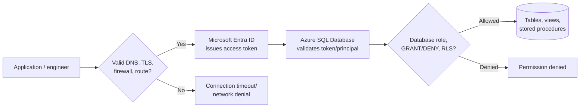
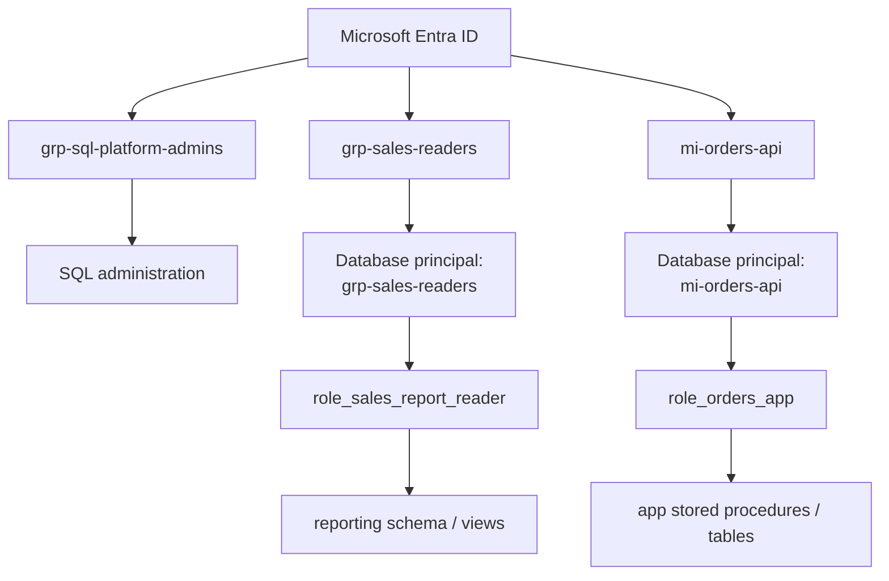
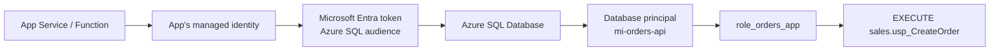
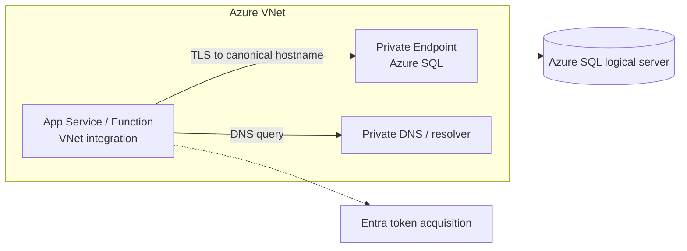
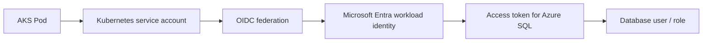
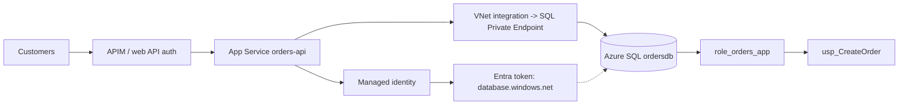

# Microsoft Entra Authentication and Database Access Permissions

A company runs an order-processing API on Azure App Service and stores customer data in **Azure SQL Database**. Initially, the API used a SQL account with its password stored in app settings; development, operations, and reporting teams shared that same account. After a connection string leak, it was hard to tell who accessed which tables or how many apps needed password rotation. The system can improve by using **Microsoft Entra ID** to authenticate humans and workloads, paired with **least-privilege database permissions** instead of overly broad accounts.

However, merely enabling Microsoft Entra authentication **does not mean users automatically gain SELECT, UPDATE, or DELETE on every table**. For an app to read `sales.Orders`, three questions must be solved simultaneously:

1. **Network connectivity:** can the client reach the right database endpoint over DNS, TLS, firewall, or Private Endpoint?
2. **Authentication:** does the database accept the Microsoft Entra token and recognize the principal?
3. **Authorization:** is that principal mapped to a database security principal, and which SQL permissions does it hold?

This lesson belongs to the **Relational Databases** chapter of the **CLOUD_PROVIDERS_AZURE** module. The module explores Azure from subscriptions, resource groups, and Microsoft Entra ID to virtual networking, compute, storage, and data, alongside principles for deploying, monitoring, securing, and cost-controlling application architectures. The lesson uses **Azure SQL Database** as the primary T-SQL example, while distinguishing **Azure SQL Managed Instance**, **Azure Database for PostgreSQL Flexible Server**, and **Azure Database for MySQL Flexible Server** where syntax and identity mechanisms differ.

**After this lesson, you will be able to:**

- Distinguish **Microsoft Entra authentication, Azure RBAC resource management, database permissions, and network controls**.
- Explain the roles of the **Microsoft Entra administrator**, database principals, groups, service principals, and managed identities.
- Grant least privilege using `CREATE USER ... FROM EXTERNAL PROVIDER`, database roles, and `GRANT` in Azure SQL.
- Connect to Azure SQL using a **managed identity** token or user Entra sign-in without storing SQL passwords.
- Understand differences among Entra models for Azure SQL, PostgreSQL Flexible Server, and MySQL Flexible Server.
- Design private access, auditing, permission lifecycles, break-glass access, and login troubleshooting.

## 1. Three-Layer Diagram: Network, Identity, and SQL Permissions



The diagram shows logical flow, not strict packet-by-packet sequence: an app may fetch an Entra token before opening a SQL socket. **Missing network paths**, **invalid tokens**, and **missing SQL permissions** yield distinct symptoms and must be diagnosed at the proper layer.

| Question | Azure/SQL Mechanism | Example |
|---|---|---|
| Who can create or change Azure SQL server configuration? | **Azure RBAC** via Azure Resource Manager | Owner/Contributor/SQL Server Contributor by scope |
| Who can log in using a token? | **Microsoft Entra authentication** and principal recognized by database/server | Employees, Entra groups, managed identities |
| Who can read tables? | **Database authorization**: roles, GRANT/DENY, schema/object permissions | `GRANT SELECT ON SCHEMA::reporting` |
| Who can connect from corporate networks? | **Firewall/VNet/Private Endpoint/DNS** | Only clients from routed private networks |
| Who can view audits and sensitive data? | Azure RBAC for management, permissions on log sinks, and matching DB rights | SOC team views audits without reading invoice data |

**Common mistake:** a user holding `Contributor` on a resource group thinks they can run `SELECT * FROM dbo.Customers`. Azure RBAC governs the resource **control plane**; it **does not automatically create a database user or grant `SELECT`** inside Azure SQL Database.

## 2. How Authentication Differs from Authorization

### 2.1. Authentication

**Authentication** answers: "Who is requesting the connection?" With Microsoft Entra, the client obtains an **OAuth 2.0 access token** for the database service's audience/resource and presents it when connecting via a supported driver.

A principal can be:

- **Entra user:** an engineer or employee signing in interactively, potentially subject to MFA/Conditional Access.
- **Entra group:** a group containing users or principals per supported rules; enables function-based permissions.
- **Service principal:** an Entra application identity, using appropriate credentials/federation mechanisms.
- **Managed identity:** an Azure-managed identity for a resource/workload, avoiding client secrets in code.

A token proves identity only within its claims and auth conditions. A token **does not replace** explicit SQL permissions.

### 2.2. Authorization

**Authorization** answers: "What may the authenticated principal do?" In Azure SQL, objects and permissions typically include:

- **Database user** mapped to an Entra principal.
- **Database role** to group permissions.
- **GRANT/DENY/REVOKE** on databases, schemas, tables, views, or stored procedures per engine capabilities.
- **Row-Level Security (RLS)** and application policies when restricting by row/tenant.
- **Separation of duties:** report readers cannot alter schemas; deployers are not automatically database administrators.

In Azure SQL Database, T-SQL syntax is part of the permissions mechanism. In PostgreSQL/MySQL, **user/role syntax and Entra mapping differ**; do not use SQL Server's `CREATE USER ... FROM EXTERNAL PROVIDER` across all DBMS engines.

### 2.3. Error Types to Distinguish

| Symptom | First Layer to Suspect |
|---|---|
| DNS fails to resolve / TCP timeout | Networking, DNS, Private Endpoint, firewall, port |
| TLS certificate chain/hostname error | Driver, trust chain, SNI, hostname, proxy |
| Token acquisition error | Entra sign-in, managed identity, tenant, audience, Conditional Access |
| Login failed / principal does not exist | Entra authentication and database user/login mapping |
| Login succeeds, `SELECT permission denied` | Roles/GRANT/DENY and object ownership |
| An employee sees another tenant's data | Row-level/application authorization, not just login capability |

## 3. Differences Among Azure SQL Database, SQL Managed Instance, and Flexible Server

| Service | SQL Dialect | Microsoft Entra Integration | Data Permissions |
|---|---|---|---|
| **Azure SQL Database** | T-SQL | Entra admin on logical server; Entra database principals per supported mechanism | Database users, roles, object/schema GRANT |
| **Azure SQL Managed Instance** | T-SQL | Entra integration on managed instance, with additional MI-compatible server/login capabilities | Server/database principals, roles, and permissions |
| **Azure Database for PostgreSQL Flexible Server** | PostgreSQL SQL | Entra authentication configured on server, principal mapping via PostgreSQL/Azure-supported mechanisms | PostgreSQL roles, GRANT, and privileges |
| **Azure Database for MySQL Flexible Server** | MySQL SQL | Entra authentication per supported feature/server mode, MySQL Flexible Server user mapping | MySQL accounts, roles/GRANT per engine version |

**Never copy permission SQL scripts from Azure SQL directly to PostgreSQL or MySQL.** Entra-only support, Entra groups, managed identities, admin defaults, server parameters, and token-based connectivity have limits varying by **service, version, and region**. Verify current support policies for each engine before production deployment.

### 3.1. Scope of Examples

From Section 4 through Section 14, `CREATE USER ... FROM EXTERNAL PROVIDER` and `sys.database_principals` apply to **Azure SQL Database** (and corresponding T-SQL capabilities where supported), **not PostgreSQL/MySQL**. Dedicated sections near the end cover Flexible Server differences.

## 4. Microsoft Entra Administrator in Azure SQL

A **Microsoft Entra administrator** is configured for an Azure SQL logical server or Managed Instance per each service's mechanism. This principal bootstraps and manages Entra access inside SQL.

Example model:

```text
Microsoft Entra tenant
  |
  +-- Group: grp-sql-platform-admins
  |      (assigned as Entra admin per policy)
  |
  +-- Group: grp-sales-readers
  |      -> Database user -> reporting role
  |
  +-- Managed identity: mi-orders-api
         -> Database user -> app role
```

**Recommendation:** use a governed admin group reviewed regularly rather than relying on one individual. Still, confirm which group/principal types the Entra administrator feature supports and ensure organizational workflows handle admin membership changes.

### 4.1. Entra Admin Is Not Azure Subscription Owner

Distinct roles:

- **Azure Owner/Contributor:** controls Azure resources per role definition and can alter certain server settings.
- **SQL Microsoft Entra administrator:** holds SQL login/permission admin rights under the Entra model.
- **SQL database role:** governs ability to query and modify data.

Principals managing Azure SQL resources can affect security settings, so control-plane RBAC still demands least privilege. Yet **do not assume** everyone with ARM permissions receives `db_owner` inside the database.

### 4.2. Entra Administrator and Principal Resolution Rights

When creating a contained database user from an Entra group/managed identity, SQL may need to look up the identity in Microsoft Entra. Depending on connection method, executing principal, server type, and features, directory read rights or appropriate Microsoft Graph permissions may be needed for the **server's managed identity**.

An error like "principal not found" during `CREATE USER ... FROM EXTERNAL PROVIDER` may stem from **directory resolution or Microsoft Entra read permissions**, not a typo in `GRANT SELECT`. Never grant tenant-wide Directory Readers or Graph permissions without least-privilege evaluation and IAM team approval.

## 5. Configuring Entra Authentication for Azure SQL Database

High-level workflow:

1. Identify **Microsoft Entra tenant**, subscription, logical server, and target database.
2. Assign an **Entra administrator** on the logical server per corporate policy.
3. Log into SQL as an Entra principal authorized to create database principals.
4. Create **contained database users** for groups or managed identities needing access.
5. Create **custom database roles** and grant least privilege.
6. Add users/groups to roles and test using the actual target principal.
7. Secure the network, monitor audits, and periodically review memberships/permissions.

### 5.1. Inspecting Status via Azure CLI

The commands below are **read-only** for Azure SQL resources and Entra administrator configs:

```bash
RG="rg-data-prod"
SERVER="sql-orders-prod"
DB="ordersdb"

az account show \
  --query "{subscription:name,id:id,tenant:tenantId}" \
  -o table

az sql server show \
  --resource-group "$RG" \
  --name "$SERVER" \
  --query "{name:name,location:location,fullyQualifiedDomainName:fullyQualifiedDomainName,publicNetworkAccess:publicNetworkAccess,identity:identity}" \
  -o json

az sql server ad-admin list \
  --resource-group "$RG" \
  --server "$SERVER" \
  -o json

az sql db show \
  --resource-group "$RG" \
  --server "$SERVER" \
  --name "$DB" \
  --query "{name:name,status:status,edition:edition,serviceObjective:currentServiceObjectiveName}" \
  -o json
```

Output shows **Azure Resource Manager** state, not all in-database permissions. If a field is missing, inspect full JSON output and check CLI/API versions instead of guessing.

### 5.2. Example Setting Entra Admin — Write Command

In an **approved** test environment, Azure CLI provides an admin setup operation like:

```bash
# WRITE COMMAND — apply only with authorization and an approved change plan.
az sql server ad-admin create \
  --resource-group "$RG" \
  --server "$SERVER" \
  --display-name "<ENTRA_ADMIN_GROUP_NAME>" \
  --object-id "<ENTRA_ADMIN_GROUP_OBJECT_ID>"
```

**Do not execute during this lesson.** Changing the Entra administrator can disrupt existing apps and accounts; verify Object ID, tenant, group, existing access, and a valid admin recovery path before switching.

## 6. Choosing Group-Based Access Over Per-User Grants

Recommended authorization diagram:



### 6.1. Why Groups Are Helpful

- When staff join or leave a team, IAM updates **group membership** instead of editing SQL roles individually.
- Access reviews have a single clear owner and justification.
- Can integrate with PIM/Conditional Access per supported mechanisms.
- Reduces risk of orphaned database users after employees leave the company.

However, groups carry risks too:

- **Deeply nested groups** and dynamic memberships complicate analyzing effective permissions.
- Token/claim lifetimes and group sync delays mean permission changes may not take effect instantaneously.
- A user belonging to **multiple groups** may inherit broader combined permissions than intended.
- Group display names can change or collide; keep **stable Object IDs** in inventory and verify actual mappings.

### 6.2. Which Database Receives the Grant?

With Azure SQL Database contained database users, principals are created **inside the target database**. Having a user in `ordersdb` does not automatically grant read access to another database like `hrdb`. Declare explicit scopes and avoid unnecessary cross-database privileges.

## 7. T-SQL: Creating an Entra User and Read-Only Role

Suppose Entra group display name `grp-sales-readers` needs read access to schema `reporting` in database `ordersdb`. Log in as an Entra admin or authorized principal, select the target database, and run:

```sql
-- Run inside database ordersdb, not default master.
-- WRITE COMMAND: verify real group name, tenant, and approval.

CREATE USER [grp-sales-readers] FROM EXTERNAL PROVIDER;

CREATE ROLE role_sales_report_reader;

GRANT SELECT ON SCHEMA::reporting
    TO role_sales_report_reader;

ALTER ROLE role_sales_report_reader
    ADD MEMBER [grp-sales-readers];
```

**Prerequisites before running:**

1. Schema `reporting` already exists.
2. The Entra group in the correct tenant is confirmed; the T-SQL name must map to your intended principal.
3. The executing account holds `CREATE USER`, `CREATE ROLE`, `GRANT`, and role membership privileges.
4. Directory resolution from Entra may be needed; if display names collide, use the **object-identity syntax supported by your Azure SQL version** rather than picking a name blindly.
5. Verify the role has no unintended broader or inherited permissions.

### 7.1. Why Use a Custom Role?

Instead of granting `db_datareader` across the whole database, `role_sales_report_reader` only gets `SELECT` on schema `reporting`. When new tables appear in that schema, schema-level grants apply automatically per SQL semantics. This is convenient to manage, yet requires review because **schema-wide grants** can grow broader than intended as the schema evolves.

If only a single view is needed, scope even tighter:

```sql
-- Example when the view already exists.
CREATE ROLE role_sales_summary_reader;

GRANT SELECT ON OBJECT::reporting.MonthlySales
    TO role_sales_summary_reader;

ALTER ROLE role_sales_summary_reader
    ADD MEMBER [grp-sales-readers];
```

Avoid creating overlapping roles that accidentally grant broader effective access than required. Maintain an access matrix and review role changes via IaC/migration scripts.

### 7.2. Built-in Roles

| Database Role | Typical Capability | Risk |
|---|---|---|
| `db_datareader` | Reads data across many user tables/views in the database per role scope | Can be far broader than needed for one report |
| `db_datawriter` | Modifies data across many user tables | Unsuitable for read-only accounts |
| `db_ddladmin` | Performs many DDL operations | Can alter schema/security surface |
| `db_owner` | Very broad privileges in the database | Reserved strictly for principals needing administration |
| **Custom role** | Specific `GRANT` permissions | Requires maintaining definitions and reviews |

Never grant `db_owner` to an API's managed identity just to get a connection working. Running `SELECT 1` successfully **does not prove** required read/write permissions are set, and over-granting masks design flaws.

## 8. Granting Permissions by Operation: SELECT, EXECUTE, UPDATE

An ordering API might need:

| Object | Valid Operations | Not Needed |
|---|---|---|
| `sales.Orders` | `SELECT`, `INSERT`, `UPDATE` in approved flows | `ALTER` table, `DROP` table |
| `sales.OrderLines` | `SELECT`, `INSERT` per business flow | Modifying out-of-scope security tables |
| `sales.usp_CreateOrder` | `EXECUTE` | Directly modifying every table in the database |
| `reporting.MonthlySales` | `SELECT` | Inserting/updating/deleting source data |

### 8.1. Stored Procedure Boundary

In suitable architectures, grant **`EXECUTE` on a set of stored procedures** instead of direct DML on all tables:

```sql
-- Example for an app role once schema and procedures exist.
CREATE ROLE role_orders_app;

GRANT EXECUTE ON OBJECT::sales.usp_CreateOrder
    TO role_orders_app;

GRANT EXECUTE ON OBJECT::sales.usp_GetOrder
    TO role_orders_app;
```

Effective permissions depend on ownership chaining, execution context, stored procedure permissions, and referenced objects. **Never treat `EXECUTE` as an absolute security boundary**: procedures must validate inputs, check authorization, and avoid dynamic SQL injection.

### 8.2. GRANT, REVOKE, and DENY

- **GRANT:** gives a permission.
- **REVOKE:** removes a previously set grant/deny at that scope without necessarily negating grants from elsewhere.
- **DENY:** explicitly blocks a permission within its scope, interacting with GRANT/ownership/special roles per SQL rules.

If a user belongs to multiple roles, inspect effective permissions rather than a single GRANT entry. Never apply mass DENYs to "patch" an accidentally granted `db_owner` role; revoke the broad role and re-grant a minimal one.

## 9. T-SQL: Creating a User for an Application Managed Identity

An App Service has a **system-assigned managed identity** or **user-assigned managed identity**. If the API uses a principal with verified Entra display name `mi-orders-api`, create the database user:

```sql
-- Sign in as an Entra principal with sufficient database admin rights.
-- WRITE COMMAND: run inside the target database.

CREATE USER [mi-orders-api] FROM EXTERNAL PROVIDER;

ALTER ROLE role_orders_app
    ADD MEMBER [mi-orders-api];
```

Items to verify:

1. `mi-orders-api` is the exact principal/managed identity needing access, **not an arbitrary App Service name**.
2. Entra Object ID, application/client ID, and Azure resource ID are **different identifiers**.
3. For a **system-assigned identity**, the principal lifecycle is bound to the resource; deleting/recreating the resource changes the principal Object ID.
4. A **user-assigned identity** has an independent lifecycle and can attach to multiple Azure resources within supported bounds.
5. Directory resolution rights are needed to create the user. If names collide, verify the Object ID identification syntax supported by your SQL version to avoid granting to the wrong principal.

### 9.1. Permission to Create Users Differs from Data Access

Migration deployers may need rights to create users/roles, whereas the API runtime managed identity only needs rights to execute procedures. Never grant `ALTER ANY USER` or role management rights to API runtime unless analyzed and approved.

### 9.2. App Identity Is Not Server Identity

An Azure SQL **logical server managed identity** (if configured) serves server-side capabilities like directory lookups or integrations, and **is not automatically the App Service's identity**. Explicitly verify which principal acquires the token on the client side.



## 10. Connecting to Azure SQL with a Microsoft Entra Token

### 10.1. Correct Token Audience Is Mandatory

For **Azure SQL**, a client using the Azure Identity SDK requests scope:

```text
https://database.windows.net/.default
```

In token-based authentication, this is the SQL resource/scope—**not** `https://management.azure.com/.default` (Azure Resource Manager) and **not** the scope for PostgreSQL/MySQL Flexible Server.

The Azure SQL driver presents the access token to prove identity. The database still requires the matching principal and permissions.

### 10.2. Azure SQL Using Python, Azure Identity, and ODBC

The example below uses `azure-identity`, `pyodbc`, and **ODBC Driver 18 for SQL Server**:

```python
import os
import struct

import pyodbc
from azure.identity import DefaultAzureCredential

server = os.environ["AZURE_SQL_SERVER_FQDN"]
database = os.environ["AZURE_SQL_DATABASE"]

# DefaultAzureCredential:
# - In Azure: managed identity if properly configured.
# - Local: Azure CLI/IDE credential per supported credential chain.
credential = DefaultAzureCredential()
access_token = credential.get_token(
    "https://database.windows.net/.default"
).token

# ODBC SQL_COPT_SS_ACCESS_TOKEN = 1256.
# Token passed to ODBC must use UTF-16-LE with a 4-byte length prefix.
token_bytes = access_token.encode("utf-16-le")
token_struct = struct.pack("<I", len(token_bytes)) + token_bytes

conn_str = (
    "DRIVER={ODBC Driver 18 for SQL Server};"
    f"SERVER=tcp:{server},1433;"
    f"DATABASE={database};"
    "Encrypt=yes;"
    "TrustServerCertificate=no;"
    "Connection Timeout=15;"
)

with pyodbc.connect(
    conn_str,
    attrs_before={1256: token_struct},
    timeout=15,
) as conn:
    row = conn.cursor().execute(
        "SELECT DB_NAME() AS database_name, USER_NAME() AS database_user"
    ).fetchone()
    print("Connected to database:", row.database_name)
    print("Resolved database user:", row.database_user)
```

**Conditions and notes:**

- The machine requires compatible ODBC drivers and Python packages.
- `AZURE_SQL_SERVER_FQDN` must be the real Azure SQL hostname, e.g., `sql-orders-prod.database.windows.net`.
- **Do not** include `UID`, `PWD`, or another `Authentication` mode in the same connection string when passing an access token manually via `attrs_before`, unless the specific driver/feature supports that combination.
- Tokens expire. For connection pooling/long-running services, fetch a fresh token **before opening new connections** and manage pool lifetimes per driver capabilities. Never cache one token string in memory assuming it stays valid for days.
- This snippet runs only a read-only identity check `SELECT`; no data is modified.
- Locally, `DefaultAzureCredential` may select a **different** principal than production's managed identity; verify tenant, Object ID, and permissions before claiming "it works locally so it will work in production."

### 10.3. User-Assigned Managed Identity

If App Service has multiple managed identities, the Azure Identity SDK may require specifying the user-assigned identity's **client ID**, for example:

```python
import os
from azure.identity import ManagedIdentityCredential

client_id = os.environ["AZURE_CLIENT_ID"]
credential = ManagedIdentityCredential(client_id=client_id)
token = credential.get_token(
    "https://database.windows.net/.default"
)
```

Here `AZURE_CLIENT_ID` is the **client/application ID**, not the Entra Object ID. This works only when the user-assigned managed identity is actually attached to a supported resource and granted database permissions.

### 10.4. SDK/Driver-Native Entra Authentication

In .NET, `Microsoft.Data.SqlClient` supports multiple Entra authentication modes (depending on version), such as `Active Directory Default` or `Active Directory Managed Identity`. Illustrative connection string:

```text
Server=tcp:sql-orders-prod.database.windows.net,1433;
Database=ordersdb;
Authentication=Active Directory Managed Identity;
Encrypt=True;
TrustServerCertificate=False;
```

Do not confuse **driver-managed identity auth** with SQL username/password connections. For user-assigned identities, the identity property must match the exact syntax/semantics of your driver version (client ID or driver-supported identifier). Never copy `User ID` blindly across drivers assuming it always means a SQL username.

## 11. Using Entra Groups for Human SQL Access

Suppose the analytics team has group `grp-sales-readers`:

1. IAM adds an analyst to the group after approval.
2. The Azure SQL database has a user mapped to that group.
3. The group member signs in with an Entra token.
4. SQL evaluates group membership/claims and role privileges to permit appropriate `SELECT` queries.

### 11.1. Interactive Sign-In and Conditional Access

Operators can use:

- Azure Data Studio or a SQL client supporting Entra authentication (per version).
- SSMS with a supported Microsoft Entra auth mode.
- A `sqlcmd` version supporting Entra login with tool-specific syntax.
- Drivers/SDKs using `InteractiveBrowserCredential` or Azure CLI credentials in development contexts.

MFA and Conditional Access protect **token issuance**, yet their effect on apps/drivers/service principals depends on Entra policies. Never force a non-interactive workload to "click MFA" in production. For applications, use managed identities/workload federation where supported.

### 11.2. Token Caching and Group Changes

If an analyst is removed from a group, cached tokens/sessions may not reflect the updated membership immediately. You should:

- Check Entra membership/claims and when tokens were issued.
- Apply session/token policies and supported revocation mechanisms.
- Review database permissions still held via **other groups or direct user grants**.
- When emergency revocation is required, coordinate IAM, database, network, and active sessions per runbook.

**Never claim "removing from a group instantly kills all SQL sessions"** without verifying engine and token/session behavior.

## 12. Effective SQL Permissions: Multiple Roles, Multiple Paths

A principal may receive:

- Direct permissions on the user.
- Permissions from multiple database roles.
- Permissions from Entra groups mapped into the database.
- Fixed permissions from built-in roles.
- Elevated permissions via stored procedures or ownership/security context.

For instance, if an analyst belongs to both `grp-sales-readers` and `grp-finance-operators` (where finance holds `UPDATE`), `grp-sales-readers` having only `SELECT` **does not make the analyst read-only**.

### 12.1. Inspecting Principals (Read-Only T-SQL)

While connected to the target database:

```sql
SELECT
    DB_NAME() AS current_database,
    USER_NAME() AS current_user;

SELECT
    name,
    type_desc,
    authentication_type_desc
FROM sys.database_principals
WHERE type IN ('E', 'X')
ORDER BY name;
```

`E` and `X` represent external principal types in compatible Azure SQL versions. This query lists **database principals**; it does not show full effective permissions of the logged-in user or all Entra groups in the tenant.

### 12.2. Inspecting Membership and Role Grants

```sql
SELECT
    role_principal.name AS role_name,
    member_principal.name AS member_name
FROM sys.database_role_members AS drm
JOIN sys.database_principals AS role_principal
    ON drm.role_principal_id = role_principal.principal_id
JOIN sys.database_principals AS member_principal
    ON drm.member_principal_id = member_principal.principal_id
ORDER BY role_name, member_name;

SELECT
    dp.state_desc,
    dp.permission_name,
    dp.class_desc,
    USER_NAME(dp.grantee_principal_id) AS grantee
FROM sys.database_permissions AS dp
ORDER BY grantee, dp.permission_name;
```

Most metadata visibility depends on the caller's **metadata view permissions**. A low-privilege account might not see every principal or grant; never conclude "no permissions exist" when a query returns incomplete rows.

### 12.3. Testing Permissions with the Real Principal

At minimum, test:

```sql
SELECT DB_NAME() AS database_name;
SELECT HAS_PERMS_BY_NAME('reporting.MonthlySales', 'OBJECT', 'SELECT')
    AS can_select_report;
```

Interpret `1`/`0`/`NULL` results against actual permissions, metadata visibility, and object names; never treat this single check as **absolute security proof** for all operations. Run both positive and negative tests with the real Entra user/managed identity in lab/staging.

## 13. Row-Level Security, Views, and Sensitive Data Protection

The `db_datareader` role can expose too much data in a *multi-tenant* model. When one table holds orders for many tenants, table-level `SELECT` **does not isolate tenants**.

Additional controls:

| Mechanism | Objective | Notes |
|---|---|---|
| **Views** | Restrict columns/rows for specific consumer groups | Review underlying table permissions, ownership chains, and filters |
| **Row-Level Security (RLS)** | Filter/control rows via predicates/security context | Test bypasses, context spoofing, and performance |
| **Stored procedures** | Permit well-defined business actions | Validate inputs, execution context, SQL injection |
| **Dynamic Data Masking** | Partially mask values for certain principals | **Not** a substitute for RLS/encryption or a hard security boundary |
| **Always Encrypted / encryption** | Protect sensitive fields per architecture | Key management and query limitations |
| **Application authorization** | Verify which orders the caller can see | Never trust client `tenantId` input unverified |

### 13.1. RLS Can Pair with Session Context

If an API uses **one shared managed identity** for all customers, Entra identifies the **API workload**, not whether an HTTP request belongs to customer A or B. For per-tenant RLS, the app must pass **authenticated/authorized** tenant info to SQL using session context and a matching security predicate.

Risks to mitigate:

- Client spoofing `tenantId` in JSON.
- Connection pooling retaining stale session context.
- A code path forgetting to set context before querying.
- API runtime holding rights to alter security policies or bypass onto raw tables.

RLS is strong when carefully designed and tested; never use it to replace API authentication or validation.

## 14. DDL Rights, Migrations, and Database Administration

Application runtime needs **data access**, whereas the migration pipeline needs **schema change** rights. Separate them:

```text
Managed identity: mi-orders-api
  -> role_orders_app
  -> EXECUTE procedures / limited SELECT

Principal: sp-orders-schema-migration
  -> role/schema permissions to run migrations
  -> executes via CI/CD with approval

Group: grp-sql-platform-admins
  -> Entra admin / administration per policy
  -> access reviews + audit
```

If API runtime can `ALTER` any table, an injection flaw or leaked token can alter schemas or wipe data. Never reuse the production runtime principal to execute privileged migration scripts without dedicated risk analysis and extra controls.

### 14.1. Permission Change Lifecycle

Every grant change should document:

1. Business justification and owner.
2. Principal/group Object ID and exact tenant.
3. Specific database, schema, object, and verbs.
4. Data/security administrator review.
5. Expected `allow` and `deny` tests.
6. Audit/ticket reference and review/revocation date.
7. Rollback plan if the app breaks after the change.

Never create SQL users/groups without tracking them in inventory: orphaned principals left behind after identity deletion complicate access audits.

## 15. Entra-Only Authentication vs. Traditional SQL Accounts

Azure SQL supports **Microsoft Entra-only authentication** controls on applicable resource types/features. When enabled, scoped SQL authentication logins are disabled by the service to reduce SQL password reliance.

**However:** this security change can break legacy apps still using `User ID=...;Password=...`. Inventory:

- Applications, reporting tools, ETL jobs, backup/DR scripts.
- Technical accounts using SQL authentication.
- Dependencies on principals or database links with Entra limitations.
- Break-glass procedures following the supported identity model.

Never turn on Entra-only blindly after testing a single Entra admin account; test **every workload** and plan a phased cutover.

### 15.1. Basic Migration Workflow

1. Inventory all SQL logins/users and connection strings.
2. Design Entra groups/managed identities for each application.
3. Create equivalent database principals and roles following **least privilege**.
4. Switch client drivers to Entra auth modes and test in staging.
5. Roll out in waves, monitoring sign-in failures and permission-denied errors.
6. Revoke/seal old SQL passwords within a change window.
7. Only after confirming readiness, enable Entra-only if policy requires and the service supports it.
8. Verify auditing, break-glass access, and recovery policies.

## 16. Private Endpoint, Firewall, and DNS for Databases

A valid Microsoft Entra token **does not open a network path** from App Service to Azure SQL.



### 16.1. Public Network vs. Private Network

- **Public endpoint:** uses firewall rules/authorized paths per configuration and policy.
- **Private Endpoint:** provides private access from a VNet to Azure SQL via Private Link.
- **Private DNS:** canonical SQL FQDN must resolve to the private IP in the client's context.
- **Public network access setting:** controls public reachability per resource capabilities—a **separate** setting from creating a Private Endpoint.

**Creating a Private Endpoint does not automatically disable public network access.** Verify both public network access and firewall rules, rather than relying solely on a Private Endpoint's `Approved` state.

### 16.2. SQL Domain Name

Applications should connect using the canonical hostname, for example:

```text
sql-orders-prod.database.windows.net
```

With Private Link, DNS typically uses zone:

```text
privatelink.database.windows.net
```

Resolvers must return the proper **private IP** for the canonical hostname per configuration. Avoid changing connection strings to raw private IPs: TLS hostname validation and host-based routing can fail. In hub-spoke/hybrid setups, configure zone links and DNS forwarding/Private Resolver properly; VNet peering does not automatically share all private DNS zones.

### 16.3. Three Diagnostic Dimensions

1. **DNS/TCP/TLS:** do hostname resolution, port 1433, and certificates succeed?
2. **Entra:** are token audience, tenant, principal ID, and token acquisition valid?
3. **SQL:** do database users/roles, GRANT, DENY, and Row-Level Security permit the query?

Never elevate a SQL database role to `db_owner` to "fix" a connection timeout. Conversely, never open public networking just because a query returns `SELECT permission denied`.

## 17. PostgreSQL Flexible Server: Key Differences to Remember

**Azure Database for PostgreSQL Flexible Server** supports Microsoft Entra authentication depending on server configuration and supported engine versions. However, **PostgreSQL does not understand T-SQL** and has no `CREATE USER [name] FROM EXTERNAL PROVIDER`.

Items to verify when deploying:

- Is Entra authentication enabled on Flexible Server? Are PostgreSQL password and/or Entra modes enabled per policy?
- Is the Microsoft Entra admin configured for the right tenant/principal?
- Is the Entra principal **mapped to a PostgreSQL role** using the service-supported admin function/mechanism?
- Does the role hold `CONNECT` on the database, `USAGE` on the schema, `SELECT/INSERT/UPDATE` on tables, or `EXECUTE` on functions?
- Do connection drivers support tokens, TLS, and username mapping per service rules?
- Are public/private DNS, firewalls, and token audiences aligned?

### 17.1. Token Audience Differs from Azure SQL

For Entra authentication on supported Azure OSS relational databases, the scope typically belongs to:

```text
https://ossrdbms-aad.database.windows.net/.default
```

**Never substitute SQL scope `https://database.windows.net/.default`** inside a PostgreSQL Flexible Server driver assuming all "Azure databases" share one audience. Before coding, verify the audience and driver authentication for the **actual service and version**.

### 17.2. PostgreSQL GRANT After Mapping the Principal

PostgreSQL SQL example **applying only after role `report_reader` is validly created** via server-supported mechanisms:

```sql
-- PostgreSQL syntax, not T-SQL.
-- Run in target database by an authorized administrator.

GRANT CONNECT ON DATABASE salesdb TO report_reader;
GRANT USAGE ON SCHEMA reporting TO report_reader;
GRANT SELECT ON ALL TABLES IN SCHEMA reporting TO report_reader;
```

Note: privileges on **existing tables** do not automatically apply to future tables. In PostgreSQL, `ALTER DEFAULT PRIVILEGES` may be required for the exact table/schema-creating role per design. Never grant `CREATEDB`, `CREATEROLE`, or admin privileges to an app needing only `SELECT`.

### 17.3. Principal Mapping Uses Dedicated Syntax

Azure PostgreSQL Flexible Server provides version-specific functions/roles for Entra principal mapping. **Never invent admin statements** modeled on SQL Server; follow Flexible Server's exact procedures/extensions/guides when creating principals, especially for groups and managed identities. Once mapped, standard PostgreSQL privileges govern data access.

## 18. MySQL Flexible Server: User Identification and MySQL Privileges

Azure Database for MySQL Flexible Server also separates **Entra authentication** from **MySQL privileges** per supported features/versions.

Key reminders:

1. Enable/configure Entra authentication and administrator per supported server type.
2. Map the Entra principal to a database user/role using **MySQL Flexible Server** methods, not T-SQL.
3. Grant privileges using MySQL `GRANT` per database/table.
4. Use a driver supporting token/password fields or the corresponding authentication plugin per service mechanics.
5. Protect TLS, private networking, and periodically review user privileges.

**MySQL SQL** example after principal `app_reader` is validly created/mapped:

```sql
-- MySQL syntax, illustrating GRANT on a specific database.
GRANT SELECT ON salesdb.* TO 'app_reader'@'%';
```

In MySQL, accounts consist of user and host components; **`'app_reader'@'%'` is only an example** and should not be run if the actual principal uses a different host pattern or mapping. Inspect the user created by Flexible Server's Entra mechanism and scope privileges/hosts accurately before running `GRANT`.

Never assume Azure SQL, PostgreSQL, and MySQL authentication syntaxes are interchangeable simply because they share one Entra tenant.

## 19. Applications Running on Azure: Choosing the Identity Type

| Runtime Environment | Typical Suitable Choice | What to Verify |
|---|---|---|
| App Service/Functions | System-assigned or user-assigned managed identity | Identity enabled/attached to resource, DB user, and role |
| Azure Container Apps | Managed identity per platform mechanism | Runtime SDK, tokens, outbound networking |
| Azure Kubernetes Service | Microsoft Entra Workload ID with service account federation, or supported mechanism | OIDC issuer, federated credential, Azure identity, and DB mapping |
| Azure VM | VM managed identity | Roles, network, SQL principal, and tokens |
| External CI/CD | Federated workload identity/service principal as supported | Avoid long-lived secrets; scope principal to migrations |
| Engineer working locally | Entra interactive/Azure CLI/IDE credentials | Tenant, MFA, actual DB role; no shared accounts |

### 19.1. Workload Identity in AKS

Applications in Pods should not use a cluster-admin kubeconfig to connect to SQL. With Microsoft Entra Workload ID, a Kubernetes service account is **federated** with an Entra identity to acquire Azure SQL tokens, and the database maps that identity to specific SQL permissions.



**Kubernetes RBAC is not SQL `GRANT`.** A Pod permitted to read a ConfigMap in AKS does not automatically hold `SELECT` on Azure SQL tables. Nor does an Azure SQL managed identity gain Kubernetes API admin rights.

### 19.2. Data-Plane Access Is Not a Subscription-Level Role

In Azure SQL, principals require database users/permissions. Never use a subscription-wide Azure Owner role to grant `SELECT`. For some other Azure data services, data-plane authorization can use Azure RBAC; identify the exact **database engine type** rather than applying a blanket rule.

## 20. Managing Identities and Permissions Across Their Lifecycle

A production system needs:

- **Inventory:** principal name, Entra Object ID/client ID, tenant, identity type, database, role, owner.
- **Access requests:** justification, object/verb scope, expiration, and approval.
- **Grant workflow:** peer-reviewed SQL scripts executed by an authorized principal.
- **Verification:** positive and negative tests in staging, followed by safe production validation.
- **Periodic access reviews:** audit group memberships, roles, and orphaned service principals.
- **Revocation:** revoke grants, remove group memberships, disable identities, or adjust resource access per runbook.
- **Break-glass:** audited emergency admin path, never an uncontrolled shared password.

### 20.1. PIM and Admin Groups

If the organization uses **Microsoft Entra Privileged Identity Management (PIM)**, admin privileges can be granted through eligible groups/roles, activated time-boundedly, and audited. Distinguish clearly:

- PIM activating Azure RBAC rights to modify resources.
- PIM activating membership in an Entra group serving as SQL administrator.
- Database role memberships residing inside SQL that may not depend on Azure role assignments.

Never assume enabling PIM on an Azure resource automatically restricts existing `db_owner` members. Review every layer.

### 20.2. Revoking Access Is More Than Deleting a User

When an employee departs:

1. Disable the user per Entra policy.
2. Remove from relevant groups and revoke direct grants.
3. Check cached tokens/sessions and revocation options per engine capabilities.
4. Revoke access to reporting tools, BI gateways, notebooks, and service accounts.
5. Retain audit records for compliance.

Deleting a database user while an application still references that principal can cause an outage. Plan identity/role replacement before revoking application accounts.

## 21. Auditing and Monitoring

### 21.1. Signals to Collect

| Source | What It Monitors | Limitations |
|---|---|---|
| Microsoft Entra sign-in logs | Token issuance, sign-in policies, auth failures where visible | Does not contain every SQL query run |
| Azure Activity Log | Changes to Azure SQL resource, network, admin, policies | Does not replace DB query audits |
| Azure SQL auditing | Database actions/events per enabled audit policy | Must choose audit categories and protect the log sink |
| Defender for SQL / security signals | Anomalous activities and feature-based alerts | Alerts require triage, not automatic verdicts |
| App telemetry | Token errors, pool failures, SQL latency, query outcomes | Never log tokens/passwords/PII |
| Private networking | DNS, firewall/NSG, private endpoint status | Network success does not prove SQL authorization |

Azure SQL auditing can send logs to Azure Storage, Log Analytics, or Event Hubs per configuration. Design **retention, cost, access control, and tamper protection**. Never enable ultra-verbose production logging without controls and accidentally store sensitive query inputs indefinitely.

### 21.2. Correlation from API to SQL

Valid requests should carry a `correlationId` across API, app logs, and audits:

```json
{
  "correlationId": "req-order-42",
  "component": "orders-api",
  "identityType": "managed-identity",
  "database": "ordersdb",
  "operation": "CreateOrder",
  "result": "permission_denied",
  "durationMs": 31
}
```

This is an **illustrative log format**, not Azure SQL's default schema. Never log access tokens, connection strings, or PII payloads. When an app shares one managed identity across all users, database audits see primarily the **app's principal**; implement **application-level user auditing** if end-user traceability is required.

## 22. Troubleshooting: Entra Sign-In or SQL Permission Failures

| Symptom | Possible Cause | Checks |
|---|---|---|
| Managed identity cannot get token | Identity not enabled/attached, wrong client ID, credential endpoint error | Azure identity config, SDK logs without leaking tokens |
| Token acquired, SQL rejects login | Wrong audience/tenant, database principal not created, expired token | Azure SQL scope, Entra principal, `CREATE USER` mapping |
| `CREATE USER ... EXTERNAL PROVIDER` fails | Entra directory lookup/Graph permission, duplicate/missing principal name | Entra Object ID, SQL server identity/permissions |
| User has Contributor, `SELECT` denied | Azure RBAC is not SQL permission | Database user, roles, `GRANT` |
| Login succeeds, cannot query table | Missing `SELECT`/`EXECUTE`, `DENY`, or wrong object scope | Database name, roles, permission grants |
| Works locally, fails in production | Local Azure CLI user differs from managed identity | Token principal, tenant, object mapping |
| App fails only after running a long time | Token expiration/pooling/credential refresh | Pool lifecycle and token lifetime |
| Private Endpoint Approved, cannot connect | DNS still returns public IP; route/NSG/firewall blocks | DNS from client's VNet, TCP 1433, public access |
| SQL ODBC reports TLS certificate error | Wrong hostname/IP, trust chain, or driver setting | Canonical FQDN, `Encrypt`, `TrustServerCertificate` |
| User removed from group can still query | Token/session cache, direct grant/another group | Group membership, token/session, effective permissions |
| RLS returns another tenant's rows | Context unset, filter/bypass logic | Tenant auth, session context, predicate |
| Migration fails with low privilege | Runtime identity used for schema changes | Separate migration principal from runtime principal |
| PostgreSQL role has rights, token fails | Wrong server Entra auth/mapping, audience, or driver | Flexible Server auth config and principal mapping |
| MySQL `GRANT` not applying as expected | Wrong `user@host` or Entra mapping | Actual MySQL principal and grant scope |
| Queries missing from audit logs | Wrong auditing policy/permission/log sink | Azure SQL auditing and diagnostic settings |

### 22.1. Layered Debugging Workflow

1. **Identify engine:** Azure SQL Database/MI or PostgreSQL/MySQL Flexible Server?
2. **Confirm target resource:** tenant, subscription, server, database, region, principal?
3. **Network:** DNS, private/public IP, routing, TLS, and port.
4. **Token:** identity, tenant, audience, expiration, driver config.
5. **Database mapping:** is the Entra principal validly created in the database/server?
6. **Permissions:** roles, GRANT/DENY, schema/object, RLS, and stored procedures.
7. **Token/group cache:** have recent role membership changes propagated?
8. **Audit:** trace failures and recent changes with UTC timestamps.
9. **Fix root cause:** test with a low-privilege principal; never grant `db_owner` unconditionally.

## 23. Case Study A: Ordering API with Managed Identity

**Requirements:**

- API runs in Azure App Service and connects to `ordersdb`.
- No SQL passwords stored in code or app settings.
- API can only call order stored procedures and cannot alter schemas.
- Database accepts connections only from approved app networks.



**Steps:**

1. Enable managed identity on App Service; record exact principal ID/client ID.
2. Assign an Entra admin on the SQL server if none exists, with approval.
3. Create the database user for the identity and add it to `role_orders_app`.
4. Grant `EXECUTE` on business procedures; avoid `db_owner`.
5. Use a driver supporting token-based/Active Directory Managed Identity auth.
6. Provision Private Endpoint/DNS and verify public network access per policy.
7. Test allowed calls, unauthorized calls, and timeouts/token refreshes.
8. Enable auditing and monitor login failures and access-denied events.

**Success criteria:** the API creates orders using managed identity with zero static SQL credentials, cannot `DROP TABLE`, and cannot read out-of-scope schemas; Internet clients cannot connect directly to the database per design.

## 24. Case Study B: BI Team Read-Only Revenue Reporting

**Requirements:** analysts access reporting tables/views without seeing sensitive customer PII or modifying data.

**Design:**

1. Create Entra group `grp-sales-readers` with IAM membership reviews.
2. Create an Azure SQL user mapped to the group.
3. Create a custom role with `SELECT` solely on approved `reporting` views.
4. If row/column protection is needed, use views/RLS or equivalent controls rather than assuming `db_datareader` is safe.
5. Have analysts connect using tools supporting Entra auth/MFA.
6. Test: reading views succeeds, `UPDATE` is denied, and `SELECT` on ungranted base tables fails.
7. Audit data access and review whenever staff change departments.

**Subtle pitfall:** an analyst also belongs to `grp-finance-operators` with broader rights. Evaluate **effective permissions across all roles/groups**, not just the reporting role.

## 25. Case Study C: Multi-Tenant AKS Sharing One Identity to SQL

**Context:** multiple HTTP clients call an API running on AKS. Pods use Microsoft Entra Workload ID to connect to Azure SQL, yet every request shares the API's single Entra principal.

**Risk:** SQL recognizes the "orders-api workload" rather than distinguishing customer A from B; if code runs `WHERE tenantId = @tenantId` from unverified input, a client can request another tenant's data.

**Layered solution:**

- The API authenticates the end user's JWT/Entra identity and **determines the authorized tenant**.
- Pods use workload identity to acquire Azure SQL tokens for the service.
- SQL grants only needed privileges to the API principal.
- Database RLS or controlled stored procedures enforce tenant rules using verified tenant context passed by the app.
- Test connection pooling/session context, bypass paths, batch jobs, and auditing.
- For tenants with strict isolation needs, consider **database-per-tenant** or stronger boundaries instead of relying solely on one logic filter.

**Lesson:** workload Microsoft Entra authentication solves **app-to-SQL identity**; **end-user authorization** must still be enforced in the API and/or database with sound logic.

## 26. Production Deployment Checklist

- [ ] Identified engine and verified Microsoft Entra authentication support for server/region/version.
- [ ] Separated Azure RBAC control plane, Entra login, database authorization, and networking.
- [ ] Entra administrator assigned to the proper principal/group with approval and recovery path.
- [ ] Recorded inventory of Object IDs/client IDs/tenants for users, groups, and identities.
- [ ] All needed database users mapped to exact principals; not relying on ambiguous display names.
- [ ] Apps use managed identity/workload federation instead of SQL passwords where supported.
- [ ] Token audience/scope matches Azure SQL or OSS Flexible Server.
- [ ] Database roles grant only required SELECT/EXECUTE/DML at minimal scope.
- [ ] `db_owner`/admin privileges never used for default app runtime.
- [ ] Migration identity separated from runtime identity.
- [ ] Group memberships, direct grants, and inherited roles audited.
- [ ] Views/RLS/tenant authorization protect sensitive data where needed.
- [ ] Private Endpoint, DNS, TLS, firewalls, and public access match architecture.
- [ ] Connection pooling handles token refresh and transient retries properly.
- [ ] Entra-only auth rollout inventoried all legacy SQL-authentication apps.
- [ ] Auditing, alerts, access reviews, retention, and revocation/rotation plans established.
- [ ] Both positive **and** negative access tests verified with real principals.
- [ ] Runbooks ready for token/login/permission/network failures without granting admin rights as a quick fix.

## 27. Self-Check Questions

1. Why doesn't Azure Contributor on a resource group automatically allow `SELECT` on Azure SQL tables?
2. How does Microsoft Entra authentication differ from database roles/`GRANT`?
3. How does an Azure SQL Entra administrator differ from Azure Owner/Contributor?
4. Why use an Entra group as the database principal for an analytics team?
5. In Azure SQL Database, what does `CREATE USER ... FROM EXTERNAL PROVIDER` accomplish?
6. When should you use a custom role instead of `db_datareader`?
7. Why shouldn't app runtime hold `db_owner` or DDL migration rights?
8. How do a managed identity's Object ID, client ID, and resource ID differ?
9. What is the Azure SQL token scope, and why shouldn't the ARM scope be used?
10. If a Python app acquires a token successfully yet SQL returns login failed, what should be checked?
11. Why does an App Service's managed identity differ from an Azure SQL logical server's managed identity?
12. A user is removed from an Entra group yet still has an active SQL connection: which layers must be checked?
13. In PostgreSQL Flexible Server, can you run `CREATE USER [name] FROM EXTERNAL PROVIDER` like T-SQL?
14. Why does a PostgreSQL user with `SELECT` on tables still need `CONNECT` and `USAGE` checked?
15. A SQL Server Private Endpoint is Approved, yet the client resolves to a public IP. What needs fixing?
16. What problems can Entra-only authentication cause for legacy apps using SQL passwords?
17. Why are RLS or application authorization still needed when all end users share one API managed identity?
18. What does running `SELECT DB_NAME(), USER_NAME()` prove, and what does it not prove?
19. If an employee's access must be revoked urgently, why might deleting only the database user be insufficient?
20. Design roles for app runtime, BI readers, migration pipelines, and DBAs in an Azure SQL Database.

## Conclusion

**Microsoft Entra authentication** lets Azure databases authenticate users and workloads without relying on shared SQL accounts and passwords. Yet security does not come from a token alone: it requires combining a **properly scoped Entra administrator**, **database principals and roles**, **least-privilege `GRANT`s**, **Private Endpoint/DNS/firewalls**, token lifecycle management, and auditing. In **Azure SQL Database**, map Entra groups/managed identities to database users with T-SQL and grant access per schema, view, or stored procedure; in **PostgreSQL/MySQL Flexible Server**, use each engine's native mapping and privilege mechanisms. Separating app identities from end-user identities, separating migrations from runtime, and testing both allowed and denied paths keeps relational data on Azure operational, traceable, and revocable when needed.