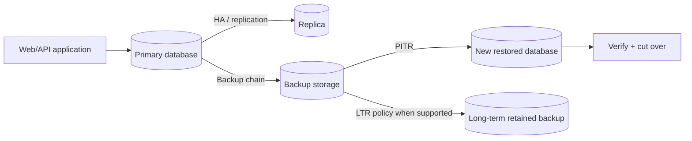
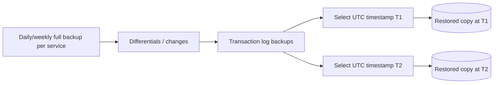
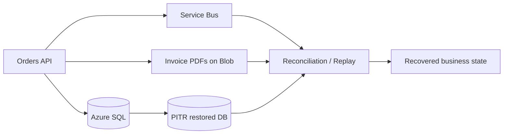

# Automated Backups, Point-in-Time Restore, and Long-Term Retention

An application on Microsoft Azure can run reliably for years yet lose data in seconds: an unfiltered `DELETE` statement, a faulty migration, a compromised admin account, or an app overwriting valid records. **High availability (HA)** keeps the service running when a server or availability zone fails, yet typically **replicates erroneous deletes and updates as well**. Therefore, operating **relational databases** requires three distinct yet complementary capabilities:

- **Automated backups:** creating and managing copies/history of data per service policy.
- **Point-in-time restore (PITR):** restoring a consistent data state to a chosen timestamp within the supported window.
- **Long-term retention (LTR):** retaining backups beyond the short-term backup lifecycle to satisfy audits, regulations, or recovery of late-discovered incidents.

This lesson belongs to the **Relational Databases** chapter of the `CLOUD_PROVIDERS_AZURE` module, within the context of building, securing, monitoring, and cost-controlling applications on Azure. The focus is on **Azure SQL Database**, **Azure SQL Managed Instance**, and **Azure Database for PostgreSQL – Flexible Server**, while distinguishing them from **Azure Database for MySQL – Flexible Server** and **self-managed SQL Server on Azure VM**. These services do not share identical mechanisms, limits, retention windows, or recovery options. Every example operation must be verified against your active SKU, Azure region, CLI/API version, and organizational policy.

## Learning Objectives

After this lesson, you will be able to:

1. Distinguish backups, snapshots, HA, replication, geo-restore, PITR, LTR, and logical exports.
2. Explain why automated backups rely on a **chain of backups and transaction logs/WAL** to support point-in-time recovery.
3. Choose PITR retention, backup storage redundancy, and long-term retention strategies aligned with RPO/RTO/compliance.
4. Apply the mindset **restore to a new resource → verify data → controlled connection cutover**, rather than overwriting production immediately.
5. Understand Azure Portal and Azure CLI steps for Azure SQL Database alongside key differences in PostgreSQL Flexible Server.
6. Design restore tests, consistency reconciliation, access limits, encryption, and resilience against human/app errors.
7. Build an operational runbook for data loss, from incident containment to selecting a restore point and post-cutover checks.
8. Estimate costs and avoid confusing backup retention settings with proven recoverability.

## 1. Mental Model: Backups Are Not High Availability

Consider an e-commerce app where Azure App Service calls Azure SQL Database. An operator mistakenly runs:

```sql
-- Dangerous example: never run on a real database.
DELETE FROM orders;
```

If Azure SQL Database has an HA replica, that valid SQL operation replicates to the replica: **HA does not automatically roll back a `DELETE`**. Similarly, active geo-replication and read replicas propagate erroneous changes to copies. Relying solely on replicas leaves no clean data to recover from.



| Mechanism | Primary Objective | Key Caveats |
|---|---|---|
| **HA / standby** | Maintain or restore availability on node/zone faults. | Typically replicates bad updates/deletes; never replaces backups. |
| **Read replica** | Scale reads; may support some DR strategies. | Does not automatically preserve pre-error logical state. |
| **Geo-replication** | Cross-region availability or DR per service. | Data errors replicate; failover is not PITR. |
| **Automated backups** | Preserve historical versions per retention. | Must track source, schedule, protection scope, window, and cost. |
| **PITR** | Restore to a chosen timestamp within retention. | Restores take time and typically create a new DB/server. |
| **LTR** | Retain backups longer for audits/late recovery. | Does not allow restoring to **every second** across years. |
| **Logical export (BACPAC/`pg_dump`)** | Export logical schema + data where appropriate. | Not equivalent to service-managed PITR backups. |

**Example:** data is deleted at 14:32 UTC and detected at 15:10. If PITR retention still covers 14:31 and required transaction logs are available, you can restore a new copy at 14:31:xx. If only last night's LTR backup exists, you only have a coarser historical point. Both are called "restore," yet they yield very different **data loss (RPO)**.

### 1.1. Protection Mechanisms Must Match Failure Causes

- **Host/infrastructure fault:** rely on HA and failover, backed by backups to protect data.
- **Accidental delete/bad migration:** PITR or restore from a backup taken before the mistake.
- **Error discovered months later:** LTR or external archival per policy.
- **Full region loss:** requires enabled and tested geo-resilience/geo-restore; local backups alone are insufficient.
- **Ransomware/compromised admin rights:** requires identity isolation, change monitoring, least privilege, and protected/isolated backups; never rely on a single admin account.

## 2. Understanding Backup Chains and Transaction Logs

Backup mechanics vary across managed relational services, yet point-in-time recovery generally combines **a baseline state** with **a change history**.

### 2.1. Full, Differential, and Transaction Log Backups

In **Azure SQL Database**, conceptually:

- **Full backup:** complete data state at a point in time.
- **Differential backup:** changes since the corresponding base full backup, shortening recovery work.
- **Transaction log backups:** preserve transaction history needed to roll forward to the target restore point.

The service manages backup cadence automatically per tier and operational state—typically periodic fulls, regular differentials, and frequent log backups. **You do not build SQL Agent jobs to maintain Azure SQL Database's standard PITR chain.** Still, actual frequency and restore-point availability lag depend on service/tier; never assert a log backup happens "every exact 5 minutes" for every SKU or moment.



**PITR requires an intact backup chain**, not one isolated file. Operators should never delete service-managed artifacts or assume copying a standalone `.bak` lets them restore to any timestamp.

### 2.2. WAL in PostgreSQL Flexible Server

PostgreSQL records changes in the **Write-Ahead Log (WAL)**. **Azure Database for PostgreSQL – Flexible Server** combines base backups and WAL history to support PITR within the configured retention period. Detailed schedules depend on the service's backup mechanism and tier.

In PostgreSQL, a **logical dump** (`pg_dump`) helps migrate data or store logical snapshots per policy, yet does not replace service-managed **physical backup + WAL** recovery for PITR. Never delete WAL or tamper with managed backup structures to free space.

### 2.3. Earliest and Latest Restore Points

During an incident, confirm:

- **Earliest restore point:** oldest timestamp still supported within retention.
- **Latest available restore point:** most recent timestamp with complete backups/logs available to restore.
- **Timezone:** restore timestamps in Azure tools are typically entered and displayed in **UTC**; never use local time without converting.
- **Consistency:** the DBMS restores a transaction-consistent state per service semantics; a transaction still uncommitted at time T will not appear in the restored copy.

Suppose an error occurs at **14:32:10 UTC**: picking **14:31:55 UTC** is a candidate, yet you must verify **when the error actually started**, Azure's exposed restore window, and business logic. If a multi-step migration began corrupting rows before 14:32, backing up 15 seconds still retains bad data.

## 3. Retention: Short-Term, Long-Term, and Choosing Policies

### 3.1. Short-Term Backup Retention for PITR

**PITR retention** defines how far back you can select a point in time, within service limits. For Azure SQL Database, the PITR window is commonly **1–35 days** depending on service tier/policy; certain tiers, database types, or deployment modes have distinct constraints. A common default is **7 days**, though **never treat a default as an SLA commitment**.

For PostgreSQL Flexible Server, automated backup retention commonly spans **7–35 days**. Check exact values on the **actual server** and verify supported restore points. If recovery after 90 days is required, raising PITR to 35 days cannot meet that requirement.

### 3.2. Long-Term Retention Is Not Unlimited PITR

**LTR** keeps selected periodic backups—weekly, monthly, or yearly—for extended durations. On **Azure SQL Database** and supported SQL services, an LTR policy can retain weekly/monthly/yearly copies for **multiple years, up to 10 years within feature limits**.

Illustrative business policy:

- Retain weekly backups for **12 weeks**.
- Retain monthly backups for **12 months**.
- Retain yearly backups for **7 years**.
- Retain recent PITR for **14 days** for routine operational mistakes.

LTR does not let you pick **any arbitrary second seven years ago**. An LTR restore brings you back to **a saved backup snapshot**. Changes between snapshots must be reconstructed from logs, upstream sources, or business records if available.

### 3.3. Retention Layer Comparison Table

| Question | Short-Term PITR | LTR | Logical Export / Custom Archive |
|---|---|---|---|
| Recovery window | Recent days per tier. | Older selected backup points. | Per custom export schedule. |
| Time granularity | Any valid timestamp in the window. | Periodic backup points only. | Depends on when export ran. |
| Management | Managed by database platform. | Service LTR policy where supported. | Built and monitored by operations team. |
| Recoverability | Restore DB/server per service semantics. | Restore from retained backup. | Import data/schema per file format. |
| Cost | Per retention, redundancy, and service policy. | Long-term storage grows with retention period. | Storage + compute + management effort. |
| Limitations | Cannot extend indefinitely. | Cannot hit arbitrary timestamps. | May lack transaction consistency if export is misconfigured. |

### 3.4. What Should Drive Retention?

Ask three questions before configuring:

1. **What is the worst-case detection delay?** Yesterday's mistake needs daily PITR; accounting errors found next quarter need LTR/archival.
2. **What is the maximum tolerable data loss?** Define RPO and verify truly available restore points.
3. **How quickly must operations resume?** RTO includes recovery duration **plus** verification/cutover time—not just when Azure marks the resource Ready.

## 4. RPO, RTO, and Restore Reliability

**RPO (Recovery Point Objective)** is the maximum acceptable data loss measured in time. **RTO (Recovery Time Objective)** is the maximum acceptable duration to restore business service to an acceptable level after disruption.

```text
14:00  Valid data exists
14:32  Migration accidentally drops table
14:40  Alert detects incident
14:50  DBA team identifies 14:31 restore point
15:05  Restored copy becomes available
15:25  Verification/reconciliation completes
15:40  Application cutover finishes

Chosen data point: 14:31
Business recovery duration: depends on incident timeline and actual cutover
```

Never treat these illustrative timestamps as an Azure SLA. Restore duration depends on database size, workload, tier, restore type, log history, service capacity, Azure region, and validation effort.

### 4.1. Backups Do Not Guarantee RPO=0

Even with frequent backups/logs, a gap can exist between the failure timestamp and the **latest available restore point**. In regional disasters, **geo-restore** RPO also incurs cross-region backup replication lag. If a business requires **zero lost transactions**, evaluate HA/DR architecture, transaction acknowledgement, synchronous replication within supported limits, and business workflow design—never just write "1-minute PITR equals RPO 0."

### 4.2. Restores May Require Additional Resources

PITR typically creates a **new database/server**, consuming parallel compute and storage. If the subscription hits quota, the target name collides, firewalls/private DNS fail, or the restored target lacks keys/identities, real recovery drags out. Runbooks must pre-check quotas, budgets, naming, permissions, and networking ahead of incidents.

## 5. Comparison Across Azure Database Services

| Service | Automated Backups | PITR | LTR / Archival | Key Differences to Remember |
|---|---|---|---|---|
| **Azure SQL Database** | Service-managed per DB. | Restores a **new database** at a valid timestamp. | **LTR policy** supported with periodic backups. | Configurable backup storage redundancy; support varies by tier. |
| **Azure SQL Managed Instance** | Automated backups per Managed Instance model. | Restores database onto a supported environment/instance per options. | SQL MI supports LTR policies per feature availability. | Scoped to a managed instance with different network/instance constraints than single DB. |
| **Azure Database for PostgreSQL – Flexible Server** | Automated base backups + WAL per service. | Typically restores **to a new server** at a valid timestamp. | Does not share Azure SQL Database's identical LTR UI/policy model. | Retention, geo options, tiers/regions, and HA must be checked separately. |
| **Azure Database for MySQL – Flexible Server** | Service-managed automated backups. | PITR per MySQL service retention/configuration. | Verify long-term retention/archival solutions per service and current features. | Never copy SQL Database commands directly to MySQL. |
| **SQL Server on Azure VM** | Self-managed SQL backups, Azure Backup/VM backups per design. | Depends on self-configured backup chain and recovery model. | Build retention via Azure Backup/Backup vault/Storage per design. | VM/IaaS does not automatically get Azure SQL Database PaaS PITR/LTR. |

**This table defines product boundaries.** An Azure SQL Database LTR policy does not turn on 10-year backups for PostgreSQL Flexible Server. When choosing LTR/geo-backup solutions, check documentation and feature availability for the **exact service, tier, and region** at design time.

## 6. Designing Backups for Azure SQL Database

### 6.1. Platform-Managed Default Backups

Azure SQL Database automatically maintains backups required for PITR per retention and tier. Operationally, DBAs typically decide:

- **PITR retention:** how many days back you can restore.
- **Backup storage redundancy:** local/zone/geo backup redundancy supported by the tier and service.
- **LTR policy:** periodic full backups retained for long-term needs.
- **Restore permissions and auditing:** who can initiate restores, alter retention, or delete resources.
- **Testing:** periodic restore drills to measure RTO and verify applications.

With Azure SQL Database PaaS, backups are built into the service—never create ad-hoc `BACKUP DATABASE TO DISK` jobs as on self-managed SQL Server.

### 6.2. Backup Storage Redundancy

Azure SQL Database supports backup storage redundancy options per configuration/tier, such as:

| Option (When Supported) | Concept | When Evaluating |
|---|---|---|
| **LRS** | Backup copies stored within a single local storage region per service model. | Cost and local fault tolerance. |
| **ZRS** | Backups distributed across Availability Zones in one region. | Zone-level resilience where supported by service/tier. |
| **GRS/GZRS** | Replicates backups to a paired secondary geography per Storage policy. | Cross-region outage recovery and added cost. |

**Never equate ZRS with geo-redundancy**, and never assume every tier supports all four options. Some services/deployments restrict changing redundancy after creation or require impactful operations. Always check the **active backup redundancy** in Portal/resource properties rather than inferring from data-file or HA-replica redundancy.

### 6.3. Azure SQL Database LTR

An LTR policy retains **selected full backups** weekly/monthly/yearly in service-managed storage, specified with ISO 8601 durations like `P12W`, `P12M`, and `P7Y` where APIs require them. The policy defines which snapshots stay and for how long; it **does not directly extend** PITR days.

An operational plan must answer:

1. How many **weekly/monthly/yearly** backups to retain?
2. Which week is selected for yearly backups and how does it align with fiscal year policy?
3. What are data size and annual growth?
4. Who holds permission to delete LTR backups or edit policies?
5. Once retained, what is the procedure to restore to a new resource?

Example policy: `weekly=P12W`, `monthly=P12M`, `yearly=P7Y`. This is **not** a universal default for every Azure SQL Database.

### 6.4. LTR vs. Manual Snapshots/Exports

BACPAC (schema/data export), manual copies, or database clones help with migrations and testing, yet are not equivalent to **service-retained LTR backups** in consistency, restore workflow, operational burden, or metadata. Never replace financial-system LTR by manually copying a `.bacpac` file to a personal account.

## 7. Azure SQL Database PITR Workflow via Azure Portal

Suppose a test system has:

```text
Resource group:        rg-orders-lab
SQL logical server:    sql-orders-lab
Source database:       ordersdb
Restored database:     ordersdb-restored-20261120
Hypothetical incident: 2026-11-20T06:30:00Z
Target restore point:  2026-11-20T06:29:00Z
```

Names and timestamps are **illustrative only**, not commands to run on production. The restore point must fall inside the **currently available PITR window**. If a migration corrupted data between 06:15 and 06:30, 06:29 is still dirty; use logs/audits to pick a point **before the corruption began**.

### 7.1. Step-by-Step in the Portal

1. Confirm the exact **tenant, subscription, resource group, SQL server, database, and owner**.
2. Inspect backup retention, redundancy, earliest/latest restore points, and restore permissions.
3. In **SQL databases**, open the database and select **Restore** with **Point-in-time restore** per current UI.
4. Enter the **UTC timestamp** before the incident, specify a **new target database name**, and configure Portal-supported resources.
5. Review compute/storage quotas, costs, access permissions, and networking before confirming.
6. Monitor deployment/restore progress until the target database is Ready.
7. Connect to the **new database** with an authorized identity and verify schema/data/business invariants.
8. **Cut over** only after validation, coordinating writers, and obtaining business owner approval.

**Azure SQL Database PITR is not an in-place fix for the live database.** Account for apps continuing to write to the source DB during restore; transactions after the restore point **will not automatically appear** in the restored copy.

### 7.2. Azure CLI Policy Inspection — Read-Only Operations

```bash
az login
az account set --subscription "<subscription-id>"

RG="rg-orders-lab"
SERVER="sql-orders-lab"
DB="ordersdb"

az sql db show -g "$RG" -s "$SERVER" -n "$DB" \
  --query "{name:name,status:status,sku:sku.name,backup:currentBackupStorageRedundancy}" \
  -o json

az sql db str-policy show -g "$RG" -s "$SERVER" -n "$DB" -o json
az sql db ltr-policy show -g "$RG" -s "$SERVER" -n "$DB" -o json
```

Property names depend on API/CLI versions. Also read **earliest/latest restore time** from supported UI/resource APIs; never assume 14-day retention always allows restoring **every exact second** right up to the present moment. These commands modify no data.

### 7.3. Azure CLI Creating a Restored Copy

The command below **creates resources and incurs costs**; use only in labs or approved procedures. Check `az sql db restore --help` for your CLI version before running:

```bash
SOURCE_DB="ordersdb"
TARGET_DB="ordersdb-restored-20261120"
POINT_UTC="2026-11-20T06:29:00Z"

az sql db restore \
  --resource-group "$RG" \
  --server "$SERVER" \
  --name "$SOURCE_DB" \
  --dest-name "$TARGET_DB" \
  --time "$POINT_UTC"
```

This illustrates Azure SQL Database PITR. Cross-server/cross-region restores, Managed Instance, or long-term backup restores use different syntax and rules. Never copy these commands verbatim to PostgreSQL/MySQL.

### 7.4. Verifying the Restored Copy Before Cutover

Connect to the **target database** using read-only queries on the actual schema. Example:

```sql
SELECT DB_NAME() AS checked_database;

-- Table names are illustrative; replace with actual schema:
SELECT COUNT_BIG(*) AS order_count FROM dbo.Orders;

SELECT TOP (20) OrderId, Status, UpdatedAtUtc
FROM dbo.Orders
ORDER BY UpdatedAtUtc DESC;
```

Verify far more than row counts: **transactions near the error timestamp, ledger/monetary totals, foreign keys, confirmed order counts, migration version, stored procedures/permissions**, and app integration. Transactions uncommitted before the PITR timestamp will not appear in the restore. If an app spans **multiple databases**, restoring them to the same timestamp does not guarantee cross-DB consistency; perform business-level reconciliation.

### 7.5. Cutover and Rollback Plan

- Record the restore point, source/target resource IDs, writer status, and cutover approval.
- Pause or coordinate API writes, queue consumers, and side-effecting jobs per runbook.
- Identify valid transactions committed **after the PITR point**; plan replay/re-entry or accept RPO by business decision.
- Update connection targets via protected **app configuration/Key Vault**; never hard-code inside images.
- Verify Entra ID auth, firewall/Private Endpoint, connection pools, schema migrations, app health, and smoke tests.
- Shift traffic in a controlled manner, watching errors, latency, and business metrics.
- Retain the old source long enough for investigation per policy while preventing accidental dual writes.
- Clean up old resources only after the observation window closes and approval is granted.

**Rolling back a connection string does not recover rows modified in the target DB after cutover.** Once two databases diverge, merge/compensation plans are required; never treat flipping DNS back as full data recovery.

## 8. Changing PITR Retention and LTR Policies on Azure SQL

Example policy: **14-day** PITR, retaining **12 weekly**, **12 monthly**, and **7 yearly** backups. This is a sample business choice, applicable only where SKU/API support it.

### 8.1. Configuring in the Portal

1. Open the target database and its **Backups/Retention policies** management blade per current Portal UI.
2. Read current retention/redundancy, especially before modifying production policies.
3. Set **short-term retention** within the tier's valid range.
4. Configure **LTR weekly/monthly/yearly** along with the yearly backup week-of-year if needed.
5. Review policy applicability, retention schedule, and cost/compliance impact.
6. Save after review, then **re-read** the policy and check the **available LTR backups** list once periods produce real backups.
7. Schedule an LTR restore drill in operations.

**An LTR policy does not retroactively generate backups for past days.** It governs selecting/retaining periodic backups going forward. Compliance evidence requires the policy, available backup points, and restore drill results.

### 8.2. Illustrative CLI for Changing Policies

These are **configuration-write commands; do not run automatically during the lesson**:

```bash
# 14-day PITR:
az sql db str-policy set \
  --resource-group "$RG" --server "$SERVER" --name "$DB" \
  --retention-days 14

# LTR: ISO 8601 durations; limits vary by tier/service:
az sql db ltr-policy set \
  --resource-group "$RG" --server "$SERVER" --name "$DB" \
  --weekly-retention "P12W" \
  --monthly-retention "P12M" \
  --yearly-retention "P7Y" \
  --week-of-year 1
```

Cross-check syntax with `az sql db str-policy --help` and `az sql db ltr-policy --help` in your environment before running. Avoid shortening retention, deleting LTR backups, or changing redundancy during an active incident before pinning down the exact data-loss timestamp. Policies may have specific application delays/constraints.

### 8.3. Verifying Available Backups

Having `yearly=P7Y` in a policy **does not prove** a 7-year-old backup already exists today. For audits, inspect available LTR backups: **backup timestamp, source database, expiration, region/backup ID**, and service restore eligibility. If a database/server was deleted, locating backups may require legacy resource metadata and specific permissions.

An LTR restore targets the **retained backup's timestamp**, not arbitrary timestamps between monthly/yearly snapshots. Verify data quality and schema/business compatibility for that historical snapshot.

## 9. PostgreSQL Flexible Server: Backups and PITR

**Azure Database for PostgreSQL – Flexible Server** uses automated base backups plus WAL/history to support PITR, commonly with **7–35 days** retention. Unlike Azure SQL Database above, PostgreSQL PITR typically creates a **new Flexible Server**, introducing its own endpoint, networking, and identity setup to address.

### 9.1. Inspecting Backup Configuration

```bash
az login
az account set --subscription "<subscription-id>"

PG_RG="rg-orders-lab"
PG_SOURCE="pg-orders-lab"

az postgres flexible-server show \
  --resource-group "$PG_RG" \
  --name "$PG_SOURCE" \
  --query "{name:name,location:location,state:state,backup:backup,ha:highAvailability}" \
  -o json
```

Verify `backupRetentionDays`, geo-backup/geo-redundancy options if applicable, supported restore points, and tier/region capabilities. **Never assume PostgreSQL shares Azure SQL Database's weekly–monthly–yearly LTR commands/policies**.

### 9.2. Restoring in the Portal

1. Open **Azure Database for PostgreSQL flexible servers** and select the source server.
2. Check **Backup and restore**, retention, and valid PITR bounds.
3. Choose a UTC timestamp before the logic error and select an available restore option.
4. Set a **new server name**; verify compute/storage, tier, quota, subscription, and region.
5. Check VNet/subnet, Private DNS, firewalls, TLS, managed identity/auth, and dependencies.
6. Once the new server is ready, compare databases, users/roles, extensions, server parameters, schemas, and business data.
7. Shift apps to the **new server hostname** via a cutover workflow, coordinating writers and verifying outcomes.

### 9.3. Illustrative Restore CLI

```bash
PG_TARGET="pg-orders-restore-20261120"
POINT_UTC="2026-11-20T06:29:00Z"

az postgres flexible-server restore \
  --resource-group "$PG_RG" \
  --name "$PG_TARGET" \
  --source-server "$PG_SOURCE" \
  --restore-time "$POINT_UTC"
```

This is a **resource-modifying** lab operation—use only with authorization after checking `az postgres flexible-server restore --help`; depending on mode, CLI may require or accept extra network/target flags. Never assume the restored server automatically inherits all identities, secrets, scheduled jobs, or app connection configs from the source.

### 9.4. Verifying PostgreSQL Data

```sql
SELECT current_database(),
       now() AT TIME ZONE 'UTC' AS checked_utc;

-- Example matching your real system schema:
SELECT COUNT(*) AS order_count FROM public.orders;

SELECT order_id, status, updated_at
FROM public.orders
ORDER BY updated_at DESC
LIMIT 20;
```

Beyond row counts, verify **sequences, constraints, extensions, version, role permissions, and external DB integrations**. Logical exports via `pg_dump` serve migrations/archival separately and **do not provide transaction-level PITR** without a WAL/backup chain.

### 9.5. PostgreSQL Long-Term Archives Must Be Designed Separately

If multi-year data retention is required, select a **supported long-term backup solution for PostgreSQL in your tier/region** or build an encrypted logical-export/archival pipeline with schedules, checksums, separated permissions, and restore drills. Never copy `az sql db ltr-policy` onto PostgreSQL assuming identical built-in support. If using object storage, account for storage/retrieval tiers, immutability/permissions where available, and testing actual imports.

## 10. Other Relational Services to Distinguish

**Azure SQL Managed Instance** manages automated backups/PITR/LTR per supported features, yet the target may require an appropriately sized managed instance and VNet. Never rely on Azure SQL Database single-DB commands to manage MI restores; use Managed Instance's Portal/API/CLI.

**Azure Database for MySQL – Flexible Server** provides automated backups and PITR per MySQL service retention. Check MySQL's Backup/Restore docs; long-term retention/archival options may differ from SQL Database, requiring a supported solution or logical backups. Restores typically create a target server per MySQL features, requiring auth/network verification.

**SQL Server on Azure VM** is self-managed. It requires a properly configured SQL Server backup strategy, transaction-log chain, Azure Backup, or SQL workload backups. VM-level backups/snapshots **do not automatically grant SQL PITR** to arbitrary timestamps without proper backup/log semantics. Never label a VM "35-day PITR" solely because it runs on Azure.

## 11. Restoring from LTR and Recovering Historical Data

**Long-term retention** keeps backups at **discrete** intervals—typically weekly, monthly, or yearly. During an LTR restore, you cannot pick any arbitrary second years in the past as with in-window PITR.

### 11.1. LTR Restore Workflow on Azure SQL

1. Identify the exact source database, fiscal year/period, and target backup timestamp.
2. In the Azure Portal, open the SQL service's **Long-term retention backups** view.
3. List **available backups**, verifying source, backup timestamp, expiration, and available locations.
4. Pick an approved backup and a **new target database**.
5. Verify tier, storage/capacity, resource-creation rights, encryption keys, and networking.
6. Initiate the restore, logging backup ID and source/target details in the operations log.
7. Verify schemas, row counts, sensitive data handling, user permissions, and compatibility with query tools.
8. Merge historical records into the live system only through a **controlled business process**.

A three-year-old LTR backup may be great for invoice auditing, yet its schema, roles, and data may be incompatible with current production code. Never switch live production traffic straight onto a historical copy to "recover" one missing invoice.

### 11.2. LTR Does Not Mean Low RTO

Restoring large databases takes substantial time; validation and cutover effort also count toward RTO. If a system requires rapid recovery from host/region faults, combine appropriate HA/DR rather than relying on a single LTR backup. Never publish RTO commitments without a **restore drill** on representative data and topology.

## 12. Recovering When a Database or Server Is Deleted

Some Azure SQL services retain backups enabling recovery of deleted databases within **supported retention windows and conditions**. That does not mean every deletion or post-retention deletion is recoverable.

Runbooks should store **subscription ID, resource group, server ID, database name, region, redundancy, backup/LTR policy, owner, identity, keys, and IaC**. When an accidental deletion is detected:

1. Halt further destructive actions; identify timestamp and actor via Azure Activity Log/audits.
2. Check **deleted database restore / available LTR backups** options for that exact product.
3. Avoid hastily recreating a server/database with the same name if it risks identity/restore metadata collisions.
4. Restore to a compatible new resource and verify data.
5. Reconstruct surrounding infrastructure: networking, Private DNS, authentication, secrets, apps, and monitoring.
6. Verify read/write behavior and execute an approved cutover.

**A database backup does not contain the entire subscription, managed identity role assignments, or Key Vault settings.** If the tenant or Key Vault key required for decryption is inaccessible, recovery can remain blocked even though backup data exists.

## 13. Geo-Restore and Disaster Recovery

### 13.1. Local PITR Differs from Geo-Restore

| Scenario | Mechanism to Consider | Key Caveat |
|---|---|---|
| Accidental data deletion, region still healthy | **PITR** prior to mistake. | Valid transactions after the restore point may be lost. |
| Node/AZ failure, data remains consistent | **HA/standby failover** per tier. | HA does not roll back erroneous changes. |
| Primary region outage | **Geo-failover/geo-restore** per supported config. | Account for backup replication lag and secondary-region readiness. |
| Need a report from 5 years ago | Retained **LTR backup**. | Restores to the backup snapshot, not any second that year. |
| Loss of both database and app configuration | **Backups + IaC + secrets/identity recovery**. | A DB restore alone does not rebuild the system. |

### 13.2. Geo-Redundancy Does Not Guarantee RPO=0

When backups replicate across regions, **replication lag** can occur. If the primary region fails before the latest logs/backups arrive, recent transactions can be lost. Confirm geo-backup/restore is **enabled on the exact SKU/region** and test a real restore.

**Zone-redundant ZRS is not geo-redundancy**; read replicas and active geo-replication can also propagate erroneous deletes. A resilient DR design pairs availability with the ability to revert to a pre-error state.

### 13.3. End-to-End DR Testing

Do not measure only how long the new database takes to provision. Test app routing/DNS, API connection strings, Key Vault, private endpoints/firewalls, Azure SQL logins/Entra auth, dependent Service Bus/Blob resources, schema versions, and queue handling at cutover. A **DR drill** must measure **business RTO**, and RPO must be verified from actual transactions present in the restored copy.

## 14. Backup Security, Encryption, and Restore Permissions

Backups hold the same sensitive data as the source database; restoring into an overly permissive lab environment constitutes a **data leak incident**.

### 14.1. Encryption and Customer-Managed Keys

Azure SQL Database uses encryption at rest such as **Transparent Data Encryption (TDE)**, with service-managed keys or **customer-managed keys (CMK)** where supported. PostgreSQL/MySQL use their own encryption models; never apply SQL TDE configs directly onto them.

When using **CMK**, ensure the required key/version remains available at restore time. A backup can exist yet remain unusable if the key is disabled/purged or the identity loses access. Maintain key rotation, Key Vault protections, access permissions, auditing, and post-rotation restore tests.

### 14.2. Separation of Duties

- **Management plane:** permission to configure backup policies, create restored resources, and alter retention.
- **Data plane:** permission to read/write data inside the restored DB.
- **Key management:** Key Vault/Managed HSM rights for relevant keys.
- **Auditing:** rights to inspect evidence and configs without necessarily reading all PII.
- **Break-glass:** approved emergency access with expiration, logging, and post-incident review.

Never grant subscription `Owner` just to inspect backup policies. Production restores need clear owners/approvers; restoring real production data into test environments requires production-grade security controls or approved data masking.

### 14.3. Backups Guard Against Logic Errors, Not Every Attack

To reduce risk of unauthorized backup tampering/deletion, monitor administrative actions, restrict deletion/retention edits, protect encryption keys, and verify which backup isolation/immutability options the **target service actually supports**. Never claim all automated backups across every Azure relational database are immutable by default under one uniform mechanism.

## 15. Data Consistency Across Databases, Queues, and Blob Storage

An ordering system may span:



Suppose PITR restores SQL to **10:00 UTC**, while Service Bus/Blob still hold data up to **10:30**. If consumers restart and generate invoices from all messages without checking business keys, duplicate invoices can be issued.

### 15.1. Post-Restore Reconciliation

1. Identify the PITR point and transactions rolled back relative to current production.
2. Reconcile **paymentId/orderId, ledger entries, outbox messages, Service Bus events**, and invoice files.
3. Use unique constraints/idempotency keys when replaying compensating work.
4. Never re-charge a payment provider simply because the restored DB lacks a record when the provider already captured funds.
5. Verify figures and obtain final state sign-off from the business owner.

### 15.2. No Automatic Distributed Transactions

Restoring SQL to 10:00 **does not** rewind Event Hubs, Cosmos DB, another PostgreSQL server, and Blob Storage to that same timestamp. Systems need **transactional outbox/inbox, sagas, reconciliation**, or multi-source recovery workflows. Restoring multiple independent databases to the same timestamp does not automatically guarantee business consistency.

## 16. Data-Loss Incident Runbook

| Phase | Required Actions | Evidence / Output |
|---|---|---|
| **Detect** | Record incident ID, timestamp, alert source, and blast radius. | Incident log and stakeholders. |
| **Contain** | Halt faulty job/migration; coordinate writers as needed. | Stabilized system change state. |
| **Find clean point** | Analyze SQL audit/app logs; pick UTC before **first error**. | Target timestamp and projected RPO. |
| **Select option** | PITR, LTR, HA failover, geo-restore, or business-level repair. | Approved recovery strategy. |
| **Restore copy** | Provision target resource and monitor restore operation. | Source/target resource IDs. |
| **Verify** | Schemas, counts, ledgers, constraints, app compatibility. | Pass/fail checks. |
| **Cut over** | Coordinate writers/consumers; switch connection configs. | Actual RTO, health checks. |
| **Monitor** | Exceptions, latency, data divergence, and side effects. | Alert/rollback criteria. |
| **Postmortem** | Root cause, policy/permission hardening, and drill updates. | Postmortem/action items. |

**Never pick "one second before the alert" without knowing when corruption started.** A migration may have corrupted records many minutes earlier. Restore a candidate into an isolated environment, verify business invariants and audits, and only then declare a safe timestamp.

## 17. Restore Drills: Proving Backups Actually Work

A policy showing `retentionDays=14` and green backup statuses proves **configuration**, not that the application will recover cleanly in an incident. Run **periodic restore drills** scaled to environment criticality.

### 17.1. Designing a Repeatable Drill

- **Scope:** a representative database or server with test/properly protected data.
- **Scenario:** one drill restores a UTC PITR timestamp; another restores from an LTR backup.
- **Baseline:** record row counts, checksums/business totals, schema version, and test dataset before the drill.
- **Process:** create the target resource, establish networking/auth/keys, validate data, run app smoke tests.
- **Measurement:** total restore time, validation time, end-to-end RTO, and recovered data window.
- **Cleanup:** delete the target test resource upon approval; never delete the source or shared backups.

### 17.2. Test Matrix

| Test | Expected Outcome |
|---|---|
| Restore a PITR point before a bad change. | Clean pre-error data is present; bad change is absent. |
| Restore while source DB still receives traffic (lab). | Target database is isolated and receives no accidental writes from source. |
| Restore a historical LTR backup. | Data opens at the snapshot time and schema validates. |
| Encrypted with a rotated CMK. | Key/identity access succeeds and restored copy is readable. |
| Database with private networking. | Test app connects via proper DNS/firewall/TLS. |
| Service Bus/Blob side effects after PITR point. | Reconciliation detects transactions absent from restored DB. |
| Restore into supported DR target region. | App dependencies and permissions operate in alternate region. |
| Scheduled cleanup of restored resources. | Source DB, LTR backups, and audit data remain untouched. |

### 17.3. What Counts as a PASS?

A drill **PASSES** only when all critical outcomes are verified:

1. **Valid backup point** and restore successfully creates a supported target resource.
2. **Data integrity** satisfies expected business invariants, schemas, and totals.
3. **Application compatibility** passes across auth, networking, schemas, and service dependencies.
4. **Measured RTO/RPO** meet agreed business targets.
5. **Audit trail** captures operator, UTC timestamps, source/target, errors, and resolutions.

Never substitute "Azure reported restore succeeded" for the entire checklist. A Ready resource that the app cannot reach due to broken Private DNS is an **incomplete recovery**.

## 18. Monitoring Backups and Recoverability

Azure managing PaaS backups does not remove DBA oversight. Dashboards should track **policy**, **restore capability**, **activity**, **cost**, and **drill quality**.

### 18.1. Signals to Track

| Signal | Where to Look | Alert / Verification |
|---|---|---|
| PITR retention | SQL Database/PG/MySQL backup policy. | Retention lowered without approval. |
| Backup storage redundancy | Resource properties, policy. | Redundancy fails geo-DR requirements. |
| LTR policy and available backups | SQL backup management. | Missing required periodic backup or policy disabled. |
| Restore operations | Azure Activity Log/Deployment operations per service. | Restore failed, canceled, or abnormally slow. |
| Database/server deletion | Azure Activity Log and audits. | Unauthorized delete or missing change ticket. |
| CMK/Key Vault | Key status, audit access logs, identity. | Key disabled, purged, or permission/network altered. |
| Drill results | Runbook/test reports, business invariants. | RTO exceeds SLO or integrity check fails. |
| Storage/backup cost | Azure Cost Management and service reports. | Backup/LTR storage spikes or restore spend exceeds forecast. |

Exact names of **Azure Monitor metrics, dimensions, and diagnostic categories** vary by resource/tier. Never build fake alerts on nonexistent metric names; verify available metrics/diagnostic settings on the actual resource first.

### 18.2. Policy and Change Logs

Track who changed backup retention, redundancy, LTR policies, or deleted servers. Azure Activity Log covers management-plane actions; database audits cover SQL statements and data access per service. Both are necessary: a destructive `DELETE` query does not show up as a resource deletion in Activity Log.

### 18.3. Late Detection Is a Major Risk

If corruption began 20 days ago while PITR retention is 14 days, discovering it today puts the clean state outside the PITR window. Quality monitoring, app audits, data validation/reconciliation, and anomaly alerts help **detect errors early enough for valid restore points to exist**. Backup policies never replace daily data validation.

## 19. Controlling Costs for PITR, LTR, and Restore Drills

Potential cost drivers:

- Backup storage for **retention and usage exceeding included allowances**, per service/tier policy.
- Higher redundancy such as geo-redundant storage per service model.
- **LTR backups** retained across months and years.
- **New restored databases/servers** running dedicated compute, storage, and networking.
- Data transfer/cross-region recovery, Key Vault, monitoring, and logs.
- Parallel capacity running during testing, reconciliation, and cutover.

### 19.1. Preliminary LTR Storage Estimate

Suppose an average billable LTR backup is roughly **200 GiB**, and you retain up to **12 selected copies** at a given stage:

```text
Logical estimate: 200 GiB × 12 = 2,400 GiB retained backups
```

**This is not an invoice or universal Azure backup formula**: services may bill differently based on actual backup size, incrementals, dedup/compression, retention, included allowances, redundancy, and tier. Weekly/monthly/yearly LTR snapshots may also overlap on the same point or follow service rules rather than summing `12+12+7` independent full copies.

### 19.2. Restore Drills Cost Money, Yet Are Worth Measuring

A restored database running 24 hours for testing consumes separate resources. Never leave test restores forgotten for weeks racking up unplanned charges. Assign owners/tags/expirations, budget alerts, and approved cleanup steps—while **never deleting source backups or audit data**.

### 19.3. Choose Retention by Risk, Not Price Alone

Cutting PITR from 14 days to 7 days may lower costs in some models, yet eliminates recovery options if an error surfaces late. For financial transactions, data-loss damage vastly outweighs backup storage fees. Retention decisions require joint sign-off from data owners, security/compliance, and SRE/DBAs.

### 19.4. Total Cost of Ownership

Do not count backup storage alone. A 15-minute RTO target may require vastly more complex HA/DR, standby capacity, automation, and networking than a system tolerating a few hours. Use the **Azure Pricing Calculator and Azure Cost Management** for exact services/tiers/regions while explicitly documenting RPO/RTO and scope.

## 20. Troubleshooting: When Recovery Fails

| Symptom | Common Cause | Safe Remediation |
|---|---|---|
| PITR option/restore time missing. | Wrong service/tier, source state, outside retention, or lacking rights. | Verify backup policy and published restore window. |
| Restore timestamp rejected. | Timestamp not yet available, too old, or wrong timezone. | Use UTC; check earliest/latest restore points. |
| DB restore takes a very long time. | Size/log history, quota, backend load. | Check operation progress and resource health; avoid hasty cancellation. |
| Target DB/server name invalid. | Name collision, wrong scope, or naming constraints. | Pick a new name; never delete source just to free the name. |
| Restore fails to create resource. | Missing RBAC/quota/SKU/region availability. | Inspect exact error, permissions, and quotas. |
| DB restored, app cannot connect. | Firewall/Private DNS/TLS/auth/connection config. | Test connectivity in target environment; never open public access blindly. |
| LTR policy exists, expected backup missing. | Backup not yet taken/selected, wrong server, wrong period, or expired. | List available backups and source metadata. |
| Restore of CMK-encrypted DB fails. | Key disabled/deleted or identity lost permissions. | Coordinate with Key Vault owner and security runbook; never export keys manually. |
| New PostgreSQL restore lacks expected config. | Server-level settings, extensions, or networking differ from source. | Compare configs and reapply external settings carefully. |
| Data missing after restore. | PITR timestamp precedes valid transactions. | Reconcile via business keys, apply RPO policy, and replay. |
| Duplicate transactions/invoices after cutover. | Consumers reprocessed non-idempotent events. | Fence writers as needed; use inbox/outbox and ledger conflict checks. |
| Unexpected cost spike. | LTR growth, uncleaned restore test DBs, geo-redundancy. | Analyze Cost Management and tags; clean up with approval. |

### 20.1. Layered Debugging Flow

```text
Cannot recover database
  |
  +-- Is a suitable backup/restore point available?
  |     +-- No: retention, LTR availability, failure timestamp
  |
  +-- Can the target resource be created?
  |     +-- No: RBAC, quota, tier, region, name conflict
  |
  +-- Can the data be opened/read?
  |     +-- No: keys, auth, schema, consistency
  |
  +-- Can the application connect?
  |     +-- No: firewall, VNet, DNS, TLS, secrets
  |
  +-- Is business state consistent?
        +-- No: restore timestamp, queues/Blob, replay and reconciliation
```

**Never resolve restore failures by granting subscription-wide Owner or disabling all firewalls.** Isolate the failure domain first and apply least privilege with approval.

## 21. Design Scenario: Migration Corrupts Order Data

A company runs an ordering API on Azure App Service, Azure SQL Database for Orders, and Service Bus for invoice generation. They configure **14-day** PITR retention plus weekly/monthly/yearly LTR per accounting rules. At 09:10 Vietnam time, a migration erroneously updates `discount_rate` across 30,000 orders; detected 25 minutes later. The API continued accepting new transactions during those 25 minutes.

### 21.1. Identifying the Risk Zone

- 09:10 ICT corresponds to **02:10 UTC** (Vietnam is UTC+7).
- The migration may have started before 09:10; check query audits and deployment logs.
- If the clean timestamp is **02:09:00Z**, restoring a new DB via PITR to that point excludes valid transactions created after 02:09.
- Service Bus/Blob may still hold invoices or messages for those newer transactions.
- An LTR backup from last week loses far too much data and is **not the first choice** when valid PITR exists.

### 21.2. Recommended Recovery Approach

1. Stop the faulty migration and coordinate jobs still writing bad data.
2. Identify the clean transaction cutoff using audits, SQL metrics, and deployment timestamps.
3. Restore a new database to the valid UTC PITR point.
4. Verify order counts, prices/discounts, ledgers, and pre-error data.
5. Reconcile valid orders/transactions created after the PITR point against outbox/Service Bus event IDs.
6. If feasible, **repair only the 30,000 affected rows** using a safe reconciliation workflow instead of replacing the whole database, preserving valid post-02:09 transactions. Choosing targeted repair vs. full DB cutover must be decided by data owners/DBAs based on evidence.
7. If cutting over, ensure events replay with idempotency keys without double-charging or issuing duplicate invoices.
8. Monitor business metrics, write a postmortem, and add migration tests/guardrails.

**Lesson:** PITR is a powerful recovery capability, yet is not automatically the lowest-data-loss option for every incident. A separate restored copy can also be used to **extract clean values and patch corrupted rows** without rewinding all of production.

### 21.3. Self-Check Questions

1. Why doesn't an HA replica protect against a syntactically valid yet erroneous `DELETE`?
2. Does 14-day PITR mean every single second in the last 14 days is guaranteed restorable right now?
3. Does 12-week weekly LTR let you restore to an arbitrary timestamp 11 weeks ago?
4. Does Azure SQL Database PITR normally create a new resource or overwrite the old DB?
5. Why must **UTC** be verified when choosing a restore point?
6. How does PostgreSQL Flexible Server PITR differ from SQL Database regarding the target resource?
7. Do geo-redundant backups guarantee RPO=0 during a region outage?
8. If the app published to Service Bus after the PITR timestamp, what must happen when restoring SQL?
9. Why can losing a Key Vault key render a backup unusable?
10. What separates "Azure restore succeeded" from "the business recovered successfully"?

**Hints:** HA replicates logic errors; PITR depends on earliest/latest availability and log history; LTR restores periodic snapshots; SQL PITR creates a new DB; UTC prevents timezone mistakes; PG typically restores a new server; geo-replication has lag; reconciliation/replay is needed; CMKs must stay accessible; data, permissions, networking, apps, and end-to-end RTO must all be tested.

## 22. Pre-Production Checklist

- [ ] Clearly distinguished HA/failover, backups, PITR, geo-restore, LTR, and logical exports.
- [ ] Documented RPO/RTO per workload with owner sign-off rather than guessed numbers.
- [ ] Verified retention and **earliest/latest restore points** for the target database/server.
- [ ] Selected backup storage redundancy aligned with tier, AZ/region DR, and budget.
- [ ] SQL Database LTR policy covers weekly/monthly/yearly needs if required by compliance.
- [ ] Verified **available LTR backups**, not just policy configuration.
- [ ] Never misapplied SQL Database commands or backup policies to PostgreSQL/MySQL/Managed Instance.
- [ ] Enforced least-privilege restore rights, separation of duties, auditing, and break-glass workflows.
- [ ] Tested recovery plans for CMK/TDE/Key Vault identities and key versions.
- [ ] Periodic restore drills create new target resources, testing data integrity and app connectivity.
- [ ] Cutover plans coordinate writers, connections, queue consumers, and rollbacks.
- [ ] Reconciliation workflows cover Service Bus messages, Blob objects, and payment providers.
- [ ] Policies protect PII when restoring into lab environments; never open public access arbitrarily.
- [ ] Monitoring tracks retention changes, backup availability, restore operations, and resource deletions.
- [ ] DR drills test region, VNet, DNS, identity, Key Vault, and downstream dependencies.
- [ ] Budgeted PITR/LTR storage, redundancy, restore compute, and testing costs.
- [ ] Assigned accountability for cleaning up restored drill resources.
- [ ] Runbook identifies clean UTC timestamps via audits rather than blindly picking before the alert.
- [ ] Old backups/sources are retained until owners confirm recovery results.
- [ ] Restore test evidence and postmortems stored securely per organizational processes.

## Conclusion

**Automated backups** protect data states within a retention window; **point-in-time restore (PITR)** recovers to a chosen consistent timestamp within supported bounds; and **long-term retention (LTR)** keeps historical backups under long-term policies without PITR's second-level granularity. On Azure, distinguish the capabilities of **Azure SQL Database, SQL Managed Instance, PostgreSQL/MySQL Flexible Server, and SQL Server on VM**, especially around retention limits, target restore resources, geo-redundancy, and LTR policies. A trustworthy data-protection strategy requires more than enabling backups: **grounded RPO/RTO targets, strict encryption-key and permission governance, verified restore points, regular restore drills, safe cutovers, cross-system reconciliation, and cost control**. Only when both data and applications operate accurately after a drill do backups become real business resilience.