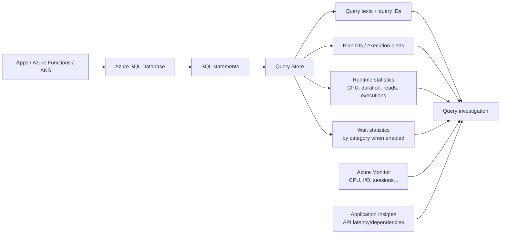
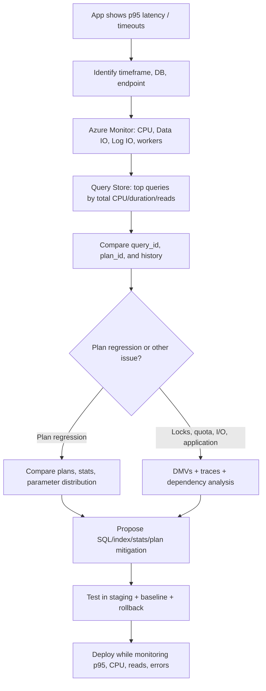

# Query Optimization with Query Store and Monitoring Tools

An ordering system runs reliably for months, then suddenly its order lookup API climbs from 80 ms to 4 seconds as data grows or after a new release rolls out. Azure SQL Database CPU rises and request timeouts climb, yet the SQL statement looks identical to before. The culprit may be a **changed query plan**, stale statistics no longer reflecting actual data distribution, suboptimal indexes, lock contention, or saturated database resources. To fix it properly, the engineering team needs **evidence over time**, not a glance at one SQL query or blindly scaling up compute.

**Query Store** is a SQL Server/Azure SQL family feature that retains a history of **queries, execution plans, and runtime statistics** to identify resource-heavy queries, compare plans, detect performance regressions, and support controlled tuning. Combined with **Query Performance Insight**, **Azure Monitor**, **Application Insights**, execution plans, and **dynamic management views (DMVs)**, you can correlate API symptoms with query behavior and service resource limits.

In the **CLOUD_PROVIDERS_AZURE** module, you explore Azure from subscriptions, resource groups, and Microsoft Entra ID to networking, compute, storage, and data, while learning to deploy, monitor, secure, and cost-control application architectures. This lesson belongs to the **Relational Databases** chapter and focuses on **Azure SQL Database** and corresponding capabilities on **Azure SQL Managed Instance** where supported. Near the end, it explains how to apply similar monitoring principles to PostgreSQL without confusing SQL Server's Query Store with PostgreSQL tools.

> **Safety scope:** Statistics-reading queries are primarily read-only. Enabling/disabling Query Store, creating indexes, updating statistics, forcing plans, or altering configurations can **change database performance and state**; test only in authorized lab/staging environments, verify permissions, and plan rollbacks before touching production. Exact syntax and features depend on engine version, database compatibility level, service tier, and configuration.

## 1. Learning Objectives

After this lesson, you will be able to:

- Distinguish **query latency, CPU, logical reads, physical reads, wait time, blocking**, and overall Azure SQL resource utilization.
- Explain how **Query Store** captures query text, query IDs, plan IDs, runtime statistics, wait statistics, and aggregation intervals over time.
- Check Query Store status and recognize `READ_WRITE`, `READ_ONLY`, or storage-cap exhaustion states.
- Identify queries with high **total CPU, total duration, execution count, and logical reads** from Query Store views.
- Analyze a query with **multiple execution plans** and performance shifts before vs. after an event.
- Use **Query Performance Insight, Azure Monitor, Application Insights**, and execution plans to isolate root causes.
- Choose among rewriting SQL, adding indexes, updating statistics, adjusting workloads, or controlled **temporary plan forcing**.
- Establish baselines, test improvements, monitor regressions, and roll back without exposing SQL text or sensitive data.

## 2. Why a Query Can Be "Slow" for Many Reasons

A 2-second API request does not necessarily mean the SQL statement burned 2 seconds of CPU. Total elapsed time may include:

```text
Client / API receives request
    |
    +-- Waiting for a DB connection from the connection pool
    +-- Network round-trips and authentication
    +-- SQL compile / execute
    |      +-- CPU for filtering, joining, sorting, aggregating
    |      +-- Logical reads (reading pages in buffer pool)
    |      +-- Physical I/O (fetching pages from storage)
    |      +-- Waiting on locks / latches / memory / workers / log I/O
    +-- Returning results to client
    +-- JSON serialization and business logic
```

| Metric | Meaning | Interpretation Caveat |
|---|---|---|
| **Duration / elapsed time** | Wall-clock time to complete execution | Includes wait time; does not equal CPU |
| **CPU time** | CPU time consumed by the query | High values may reflect scans, sorts, hashes, functions, or excessive executions |
| **Logical reads** | Data/index pages accessed in buffer pool | High values suggest large data scans, not necessarily physical I/O |
| **Physical reads** | Pages read from storage | Depends on cache warmth and I/O; review alongside timing |
| **Executions count** | Number of times the query executed | A tiny query called millions of times still consumes huge resources |
| **Waits** | Time waiting on locks, CPU scheduler, I/O, memory, etc. | Interpret by wait category and context |
| **Blocking** | Session waiting on a lock held by another session | Increases timeouts even when the execution plan is fine |
| **Resource utilization** | CPU%, data I/O%, log write%, workers, sessions | Shows whether the database is hitting service-tier limits |

### Quantitative Example

Query A averages **10 ms** but executes **200,000 times/hour**: cumulative duration is ~2,000 seconds. Query B takes **2 seconds** but executes **10 times/hour**: cumulative duration is 20 seconds. Ranking solely by **average duration** can miss Query A despite its massive cumulative load.

That is why Query Store must be analyzed from multiple angles: **total resource consumption**, **per-execution latency**, **frequency**, and **change over time**.

## 3. How Does Query Store Work?

Query Store captures and stores inside the database details on query text, queries, execution plans, and aggregated statistics across **runtime stats intervals**. Instead of showing only a live point-in-time snapshot like many DMVs, Query Store enables **historical analysis across retained time windows**.



### Key Identifiers

| Component | Role | Example |
|---|---|---|
| **Query text** | SQL statement captured by Query Store | `SELECT ... FROM dbo.Orders ...` |
| **query_id** | Identifier for a query entity in Query Store | `123` |
| **plan_id** | Identifier for a captured plan belonging to a query | `456` |
| **runtime stats interval** | Time window over which execution stats are aggregated | 10:00–11:00 UTC |
| **count_executions** | Number of executions contributing to the stats row | `3500` |
| **avg_duration** | Average duration in a stats row; usually measured in **microseconds** | `120000 µs = 120 ms` |
| **avg_cpu_time** | Average CPU time; usually in **microseconds** | `45000 µs = 45 ms` |
| **wait category** | Grouped query wait categories in Query Store wait stats when supported | Lock, CPU, I/O... |

**Never assume one query text maps to only one `query_id`, or one `query_id` has only one `plan_id`.** Differences in SET options/context settings, parameterization, engine behavior, and execution plans can generate multiple IDs/plans for one SQL pattern. When investigating, correlate text, `query_id`, context, and time window.

### Query Store Is Not a Per-Request Trace

Query Store stores **aggregated data** per interval for captured queries and plans. It does not replace **Application Insights distributed tracing**, and does not automatically record every parameter value, client user, HTTP request ID, or every single statement ever run. Plans and stats can also be purged by retention/cleanup or storage caps.

**To find which customer requests slowed down,** use application telemetry to locate the slow dependency/trace, then pair it with Query Store to see which SQL query/plan degraded during that same timeframe.

## 4. Which Data Source Should You Start With?

| Tool | Questions It Answers Well | Limitations to Remember |
|---|---|---|
| **Query Store** | Which queries burn CPU/duration, is there a plan regression, how did behavior shift over time? | History depends on capture/retention; not a per-request trace |
| **Query Performance Insight** | In the Azure portal, which queries are heaviest by metric and time range? | Relies on Query Store; UI/features vary by Azure SQL offering |
| **Azure Monitor metrics** | Is the database hitting CPU, Data I/O, log write, or session/worker limits? | Database-level metrics do not pinpoint the offending query |
| **Application Insights** | Which API endpoints/dependencies are slow, and which requests failed? | Requires proper instrumentation and sampling |
| **Execution plan** | How does the query scan/seek/join/sort, and do row estimates diverge from actuals? | A plan is only partial evidence; queries need representative data/context |
| **Dynamic management views (DMVs)** | Which requests, waits, or blocking chains are active right now? | Live snapshot; many DMVs reset on restart or have scoped visibility |
| **Intelligent Insights / automatic tuning** | Has the platform flagged regressions or automated tuning actions? | Depends on Azure SQL tier/config; effectiveness and risks must be monitored |
| **Database logs / auditing** | Were security/schema changes or errors logged? | Does not capture all parameters/payloads and should exclude PII |

A practical rule: **Azure Monitor shows "when and how much,"** **Query Store shows "which query/plan,"** and **execution plans plus application context** reveal **"why and what to fix."**

## 5. Checking Whether Query Store Is Enabled

In **Azure SQL Database**, Query Store is enabled by default on many modern database types, yet actual live status must still be verified. On SQL Server/Managed Instance, configurations and defaults vary by version.

Run inside the **target database** using an authorized SQL tool:

```sql
SELECT
    DB_NAME() AS database_name,
    desired_state_desc,
    actual_state_desc,
    readonly_reason,
    current_storage_size_mb,
    max_storage_size_mb,
    query_capture_mode_desc,
    interval_length_minutes,
    stale_query_threshold_days
FROM sys.database_query_store_options;
```

### Interpreting the Output

| Column | What to Understand |
|---|---|
| `desired_state_desc` | Configured target state |
| `actual_state_desc` | Live operational state, e.g., `READ_WRITE` / `READ_ONLY` / `OFF` |
| `readonly_reason` | Bitmask explaining why writes stopped; decode per docs/version |
| `current_storage_size_mb` | Storage currently consumed by Query Store |
| `max_storage_size_mb` | Configured Query Store storage cap |
| `query_capture_mode_desc` | Capture policy, e.g., AUTO/ALL/CUSTOM where supported |
| `interval_length_minutes` | Interval length for aggregating runtime statistics |
| `stale_query_threshold_days` | Retention window for query statistics per cleanup policy |

**Do not look only at `desired_state_desc`.** If desired is `READ_WRITE` while actual is `READ_ONLY`, Query Store stops recording new data; concluding "slow queries disappeared" from frozen history is wrong.

### Enabling Query Store on a Lab Database (Modifies Configuration)

Run only when supported by the database/tier/engine and you hold permission:

```sql
-- Run only when authorized to modify the lab database.
ALTER DATABASE CURRENT
    SET QUERY_STORE = ON;

ALTER DATABASE CURRENT
    SET QUERY_STORE (
        OPERATION_MODE = READ_WRITE
    );
```

Never enable `QUERY_CAPTURE_MODE = ALL` arbitrarily on production databases with heavy ad-hoc SQL: metadata volume can surge. If Query Store turned `READ_ONLY` due to size, diagnose the cause and adjust **retention, capture policy, storage cap, or workload** instead of blindly clearing historical data.

## 6. Key Query Store Views to Know

| View | Contents |
|---|---|
| `sys.query_store_query_text` | Query SQL text and `query_text_id` |
| `sys.query_store_query` | Query metadata/`query_id` referencing query text |
| `sys.query_store_plan` | `plan_id`, `query_id`, plan metadata, force state |
| `sys.query_store_runtime_stats` | Aggregated stats rows by plan and interval |
| `sys.query_store_runtime_stats_interval` | Start/end timestamps of stats intervals |
| `sys.query_store_wait_stats` | Wait statistics by plan/interval/category when captured |
| `sys.database_query_store_options` | Current Query Store options and state |

Query Store catalog views are **database-scoped**. SQL executed in `db-orders-dev` does not read Query Store of `db-orders-prod`. Always verify database context before analyzing, especially when one server hosts similarly named databases across environments.

### Reading Query Store Statistics Correctly

Each runtime stats row has `count_executions` and `avg_duration`. To compute an average across multiple intervals/rows, never use plain `AVG(avg_duration)`, because one interval might have 2 executions while another has 20,000.

Weighted average:

\[
\text{Weighted avg duration} =
\frac{\sum_i(\text{avg_duration}_i \times \text{count_executions}_i)}
{\sum_i\text{count_executions}_i}
\]

For Query Store duration/CPU columns, **convert microseconds to milliseconds** when presenting results:

\[
\text{Milliseconds} = \frac{\text{Microseconds}}{1000}
\]

When filtering intervals, figures reflect **executions grouped inside each stats interval**, not exact per-execution timestamps down to boundary microseconds. Open intervals and in-memory flush timing can shift numbers slightly.

## 7. Workflow to Find the "Load-Driving Query" Before Tuning

A pragmatic investigation flow:



**Do not jump straight to creating an index or forcing a plan the moment you spot one slow query.** First verify whether that query contributes materially to the production issue, when behavior changed, and whether overall database resources or networking caused the latency.

## 8. T-SQL: Top Queries by Total Duration, CPU, and Logical Reads

The example below runs on an Azure SQL Database with Query Store actively collecting data. It aggregates stats over the **past 24 hours** by `query_id`, weighting averages by execution count. It only reads Query Store views and does not re-execute the original queries.

```sql
-- Read-only; run inside the database under investigation.
-- Query Store avg_* durations/CPU are typically in microseconds,
-- while logical reads are measured in pages.
WITH Aggregated AS
(
    SELECT
        q.query_id,
        SUM(CONVERT(bigint, rs.count_executions)) AS executions,
        SUM(CONVERT(float, rs.avg_duration)
            * rs.count_executions) AS duration_us,
        SUM(CONVERT(float, rs.avg_cpu_time)
            * rs.count_executions) AS cpu_us,
        SUM(CONVERT(float, rs.avg_logical_io_reads)
            * rs.count_executions) AS logical_reads
    FROM sys.query_store_query AS q
    JOIN sys.query_store_plan AS p
        ON p.query_id = q.query_id
    JOIN sys.query_store_runtime_stats AS rs
        ON rs.plan_id = p.plan_id
    JOIN sys.query_store_runtime_stats_interval AS i
        ON i.runtime_stats_interval_id = rs.runtime_stats_interval_id
    WHERE i.end_time > DATEADD(hour, -24, SYSUTCDATETIME())
    GROUP BY q.query_id
)
SELECT TOP (20)
    a.query_id,
    LEFT(qt.query_sql_text, 1500) AS query_sample,
    a.executions,
    CAST(a.duration_us / 1000000.0 AS decimal(18, 2))
        AS total_duration_sec,
    CAST(a.duration_us / NULLIF(a.executions, 0) / 1000.0
         AS decimal(18, 2)) AS avg_duration_ms,
    CAST(a.cpu_us / 1000000.0 AS decimal(18, 2))
        AS total_cpu_sec,
    CAST(a.cpu_us / NULLIF(a.executions, 0) / 1000.0
         AS decimal(18, 2)) AS avg_cpu_ms,
    CAST(a.logical_reads / NULLIF(a.executions, 0)
         AS decimal(18, 2)) AS avg_logical_reads
FROM Aggregated AS a
JOIN sys.query_store_query AS q
    ON q.query_id = a.query_id
JOIN sys.query_store_query_text AS qt
    ON qt.query_text_id = q.query_text_id
ORDER BY a.duration_us DESC;
```

### Reading the Results

- **High `total_duration_sec`:** query accumulates major execution time in the window; check if it sits on a critical request path.
- **High `avg_duration_ms`:** individual executions are slow; check app p95/p99 because Query Store averages hide tail latency.
- **High `total_cpu_sec`:** query consumes heavy total CPU; may stem from excessive execution count rather than a bad plan.
- **High `avg_logical_reads`:** reads many pages per execution; inspect predicates, indexes, joins, and plans before jumping to index creation.
- **Very high `executions`:** may indicate ORM **N+1 queries**, aggressive polling, or repetitive loops.

To find "top CPU," replace `ORDER BY a.duration_us DESC` with `ORDER BY a.cpu_us DESC`. To find high cumulative logical reads, sort by `a.logical_reads DESC`.

### Aggregation Pitfalls

1. **Never `GROUP BY` `query_sql_text` (`nvarchar(max)`) directly.** Aggregate by `query_id` first, then join for text.
2. Query Store may store **multiple rows per plan/interval** when intervals are active or data flushes; weighted sums across all matching rows are safer than picking a single row.
3. Intervals straddling the 24-hour cutoff are included by interval boundary, **not exact per-execution timestamps**.
4. Query Store capture policies may skip infrequent or ad-hoc queries depending on config; "query not found" does not prove it never ran.
5. Avoid pasting raw `query_sql_text` into tickets/logs if it contains sensitive literals; `LEFT(..., 1500)` caps string length and **is not PII redaction**.

## 9. Tracking Regressions: Same query_id, Changed plan_id

**Plan regression** happens when a previously fast query adopts a new plan that dramatically raises latency/CPU/reads. Common triggers include shifting data distributions or cardinality estimates, compatibility level changes, statistics updates, index changes, or parameter-sensitive behavior.

### Example Progression

| Timeframe | Query ID | Plan ID | Executions | Avg Duration | Avg Logical Reads |
|---|---|---|---:|---:|---:|
| Before deploy | 105 | 302 | 50,000 | 24 ms | 180 |
| After deploy | 105 | 417 | 30,000 | 920 ms | 52,000 |

Assuming request rates and data volume didn't jump proportionally, this strongly signals inspecting **both execution plans**, though not yet absolute proof the new plan alone is responsible. Cross-check overall CPU/I/O, parameter skew, wait stats, locks, and statistics update timestamps.

### 9.1. Querying Stats Per Plan

```sql
DECLARE @QueryId bigint = 105; -- Replace with discovered query_id.

SELECT
    p.query_id,
    p.plan_id,
    p.is_forced_plan,
    SUM(CONVERT(bigint, rs.count_executions)) AS executions,
    CAST(
        SUM(CONVERT(float, rs.avg_duration) * rs.count_executions)
        / NULLIF(SUM(rs.count_executions), 0) / 1000.0
        AS decimal(18, 2)
    ) AS avg_duration_ms,
    CAST(
        SUM(CONVERT(float, rs.avg_cpu_time) * rs.count_executions)
        / NULLIF(SUM(rs.count_executions), 0) / 1000.0
        AS decimal(18, 2)
    ) AS avg_cpu_ms,
    CAST(
        SUM(CONVERT(float, rs.avg_logical_io_reads)
            * rs.count_executions)
        / NULLIF(SUM(rs.count_executions), 0)
        AS decimal(18, 2)
    ) AS avg_logical_reads,
    MIN(i.start_time) AS first_interval_start,
    MAX(i.end_time) AS last_interval_end
FROM sys.query_store_plan AS p
JOIN sys.query_store_runtime_stats AS rs
    ON rs.plan_id = p.plan_id
JOIN sys.query_store_runtime_stats_interval AS i
    ON i.runtime_stats_interval_id = rs.runtime_stats_interval_id
WHERE p.query_id = @QueryId
  AND i.end_time > DATEADD(day, -7, SYSUTCDATETIME())
GROUP BY p.query_id, p.plan_id, p.is_forced_plan
ORDER BY avg_duration_ms DESC;
```

If one `query_id` has multiple `plan_id`s, compare **comparable load windows** or before/after a specific change. A 7-day average can mask a regression that started 30 minutes ago.

### 9.2. Inspecting the Query Execution Plan

```sql
DECLARE @QueryId bigint = 105;

SELECT
    plan_id,
    is_forced_plan,
    force_failure_count,
    last_force_failure_reason_desc,
    query_plan
FROM sys.query_store_plan
WHERE query_id = @QueryId
ORDER BY plan_id DESC;
```

`query_plan` opens in SSMS or compatible SQL tools as a graphical/XML plan. When reviewing plans, record `query_id`, `plan_id`, and execution timestamp; never share a cropped screenshot of one operator without the SQL text and predicates.

### 9.3. Comparing Two Time Windows

To separate pre-deploy and post-deploy data cleanly, bucket intervals by timestamp:

```sql
DECLARE @QueryId bigint = 105;
DECLARE @ChangeUtc datetimeoffset = '2026-11-19T12:00:00+00:00';

WITH PeriodStats AS
(
    SELECT
        CASE WHEN i.start_time >= @ChangeUtc
             THEN 'AFTER' ELSE 'BEFORE' END AS period,
        p.plan_id,
        CONVERT(float, rs.avg_duration) * rs.count_executions
            AS duration_us,
        CONVERT(bigint, rs.count_executions) AS executions
    FROM sys.query_store_plan AS p
    JOIN sys.query_store_runtime_stats AS rs
        ON rs.plan_id = p.plan_id
    JOIN sys.query_store_runtime_stats_interval AS i
        ON i.runtime_stats_interval_id = rs.runtime_stats_interval_id
    WHERE p.query_id = @QueryId
      AND i.start_time >= DATEADD(hour, -24, @ChangeUtc)
      AND i.end_time < DATEADD(hour, 24, @ChangeUtc)
)
SELECT
    period,
    plan_id,
    SUM(executions) AS executions,
    CAST(SUM(duration_us) / NULLIF(SUM(executions), 0) / 1000.0
         AS decimal(18, 2)) AS weighted_avg_duration_ms
FROM PeriodStats
GROUP BY period, plan_id
ORDER BY period, plan_id;
```

**Limitation:** an interval spanning the change timestamp gets bucketed into `BEFORE` or `AFTER` by `start_time`, so exclude overlapping boundary intervals or use wider windows for strict precision. `@ChangeUtc` is a hypothetical timestamp; replace with the real deployment/config-change time.

## 10. Reading Query Store Wait Statistics

When CPU/duration rises while logical reads do not, check what queries are **waiting** on. Query Store wait statistics (when enabled and supported) group wait time by **category** per query/plan.

```sql
DECLARE @QueryId bigint = 105;

SELECT
    p.query_id,
    p.plan_id,
    w.wait_category_desc,
    CAST(SUM(CONVERT(float, w.total_query_wait_time_ms))
         AS decimal(18, 2)) AS total_wait_ms
FROM sys.query_store_plan AS p
JOIN sys.query_store_wait_stats AS w
    ON w.plan_id = p.plan_id
JOIN sys.query_store_runtime_stats_interval AS i
    ON i.runtime_stats_interval_id = w.runtime_stats_interval_id
WHERE p.query_id = @QueryId
  AND i.end_time > DATEADD(hour, -6, SYSUTCDATETIME())
GROUP BY p.query_id, p.plan_id, w.wait_category_desc
ORDER BY total_wait_ms DESC;
```

> **Note:** Query Store wait statistics may not be captured on every version/configuration. If the view is empty, check Query Store options and feature support before concluding "zero waits." A single wait category can encompass multiple distinct wait types.

| Wait Category or Phenomenon | Hypotheses to Check |
|---|---|
| **Lock** | Long-held transactions, contention on the same rows/tables, deadlocks, or isolation level |
| **CPU** | Queries waiting for CPU schedulers, high DB CPU, excessive concurrent workloads |
| **Buffer I/O / Other Disk I/O** | Storage reads/writes, cold cache, large page scans, or I/O caps |
| **Memory** | Memory grants, huge sorts/hashes, memory pressure |
| **Parallelism** | Parallel plan imbalance, exchange overhead, data skew |
| **Transaction log** | Log write throughput limits, oversized or rapid write transactions |

**Not every wait is a bug to "fix."** Normal I/O waits happen; evaluate wait proportion, duration, workload, and trends over time. Also never slap `NOLOCK` around queries just to dodge locks, as dirty reads compromise data correctness.

## 11. Analyzing Actual vs. Estimated Execution Plans

After locating a suspect `query_id`/`plan_id`, inspect the execution plan in SQL Server Management Studio (SSMS) or a compatible SQL tool.

### Operators and Signals to Recognize

| Signal in Plan | Possible Meaning | Verification Step |
|---|---|---|
| **Clustered Index Scan / Table Scan** | Reading many rows or optimizer judged scan cheaper than seek | Measure actual row count, selectivity, logical reads |
| **Index Seek** | Range/key lookup via index | Not automatically fast; per-row lookups can still be costly |
| **Key Lookup / RID Lookup** | Fetching columns missing from the nonclustered index | Consider a covering index or trimming `SELECT` columns |
| **Sort / Hash Match** | Joins/ordering/aggregation requiring memory and CPU | Inspect memory grants, spills, and row counts |
| **Nested Loops** | Good for small inputs; terrible if row estimates are badly off | Compare estimated vs. actual rows |
| **Hash Join / Merge Join** | Suits large or pre-sorted sets | Inspect memory, spills, and join predicates |
| **Implicit conversion** | Type mismatch forcing conversions that hinder index seeks | Align column and parameter data types |
| **Spill warnings** | Sort/hash ran short of memory and spilled to `tempdb` | Check statistics, row estimates, and memory grants |
| **Large Estimated vs. Actual Rows gap** | Cardinality estimation mismatch | Check statistics, parameter skew, and predicates |

### Estimated vs. Actual Plans

- **Estimated plan** shows how the optimizer expects to execute a query; normally does not execute the statement.
- **Actual plan** captures the chosen plan plus runtime details **after execution**; adds overhead and **modifies data** if the statement is DML.

**Never execute production `UPDATE`/`DELETE` statements just to capture an actual plan.** For expensive statements, use lab/replicas and approved measurement techniques. When running `SELECT` in production, limit scope and permissions to prevent excessive load or data exposure.

### Measuring SQL in a Lab with STATISTICS

```sql
-- Run only a known-safe SELECT query on a lab database.
SET STATISTICS IO ON;
SET STATISTICS TIME ON;

DECLARE @CustomerId bigint = 1001;
DECLARE @FromUtc datetime2(3) = '2026-11-01T00:00:00';
DECLARE @ToUtc   datetime2(3) = '2026-12-01T00:00:00';

SELECT o.OrderId, o.CreatedAt, o.Status, o.TotalAmount
FROM dbo.Orders AS o
WHERE o.CustomerId = @CustomerId
  AND o.CreatedAt >= @FromUtc
  AND o.CreatedAt < @ToUtc
ORDER BY o.CreatedAt DESC;

SET STATISTICS IO OFF;
SET STATISTICS TIME OFF;
```

This **illustrative query** assumes `dbo.Orders` and its columns exist in the lab. In SSMS, inspect **logical reads** and CPU/elapsed time in the Messages tab alongside the actual execution plan if enabled. Run multiple trials with representative parameters/data; warm vs. cold caches and concurrent activity change timings.

## 12. Query Performance Insight in the Azure Portal

**Query Performance Insight** provides a visual interface over Query Store to surface resource-heavy queries on supported Azure SQL Database offerings. Instead of immediately writing T-SQL, you can use the UI to spot top queries in a time window.

Reference workflow:

1. Open the [Azure portal](https://portal.azure.com/) in the right tenant/subscription.
2. Open **SQL databases** and select the slow database (not the logical server by mistake).
3. Open **Query Performance Insight** (or equivalent blade under **Intelligent Performance** per current UI).
4. Pick a **time range** and metric such as CPU, duration, or executions where supported.
5. Inspect top queries; click a query to see the SQL text/plan info provided by the UI.
6. Record the **query ID, timeframe, metrics, and findings** to verify via Query Store views/actual plans.
7. Compare charts **before/after** deployments, schema changes, or traffic spikes.

**Condition:** this UI relies on Query Store containing data and feature support for your database/tier/portal version. If the blade is unavailable or empty, use Query Store catalog views and Azure Monitor; never conclude the system is healthy just because the dashboard shows no top queries.

### When Is UI Better Than T-SQL, and Vice Versa?

- **UI** excels for quick triage, spotting suspect queries, and communicating trends to operations teams.
- **T-SQL** excels for reproducible measurements, comparing exact time windows, weighted averages, and controlled verification exports.
- **Both** must be paired with application context, deployment history, instance/tier, UTC timestamps, and real data within the investigated window.

## 13. Azure Monitor: Check Database Health Before Blaming Queries

**Azure Monitor** tracks Azure SQL service-level metrics, alerts, and logs per configuration. When Query Store shows duration rising, inspect the same timeframe for:

| Resource Group | Sample Metrics | Question |
|---|---|---|
| Compute | CPU percentage, vCore/DTU utilization per purchasing model | Is the database under CPU pressure? |
| Storage I/O | Data I/O percentage, read/write throughput, I/O latency where available | Are queries waiting on I/O or tier limits? |
| Transaction log | Log write percentage / throughput | Heavy writes or a log bottleneck? |
| Concurrency | Workers %, sessions %, connections | Hitting connection or worker caps? |
| Availability | Connection failures, errors, deadlocks | Connectivity failures or lock contention? |
| Capacity | Storage used, allocated size, max database size | Database nearing storage limits? |
| Cost | Compute capacity, vCore-hours, storage/backups, logging | Is upgrading tiers worthwhile vs. query tuning? |

**Metric names and units vary by Azure SQL offering, tier, and API.** Never assume serverless SQL Database, provisioned SQL Database, and Managed Instance expose identical metric names; list metric definitions on the actual resource.

### 13.1. Checking in the Azure Portal

1. Open the exact **SQL database** (or Managed Instance/database) in the Azure portal.
2. Go to **Monitoring → Metrics**.
3. Match the exact UTC window of the API latency spike (e.g., 09:00–10:00 UTC).
4. Plot CPU, data I/O, log writes, workers/sessions, or supported metrics.
5. Overlay deployment times, maintenance/scaling events, and app request rates.
6. If CPU sits near ceiling continuously, find top CPU queries in Query Store; if CPU is low while duration spikes, inspect blocking, waits, and external dependencies.
7. Build alerts combining thresholds with **sustained duration** and context—not a 1-minute 80% CPU blip.

### 13.2. Azure CLI — Read-Only Data Retrieval

These commands run in Bash/Azure Cloud Shell and **do not modify Azure resources**:

```bash
az login
az account set --subscription "<subscription-id>"

RG="rg-sql-lab"
SERVER="sql-orders-lab"
DB="ordersdb"

DB_RESOURCE_ID=$(az sql db show \
  --resource-group "$RG" \
  --server "$SERVER" \
  --name "$DB" \
  --query id --output tsv)

# Inspect database service tier/SKU.
az sql db show \
  --resource-group "$RG" \
  --server "$SERVER" \
  --name "$DB" \
  --query "{name:name,location:location,sku:sku.name,tier:sku.tier,status:status}" \
  --output json

# List actual metric definitions before querying.
az monitor metrics list-definitions \
  --resource "$DB_RESOURCE_ID" \
  --output table

# Example CPU metrics if the resource supports metric name cpu_percent.
az monitor metrics list \
  --resource "$DB_RESOURCE_ID" \
  --metric "cpu_percent" \
  --interval "PT5M" \
  --aggregation Average \
  --output json
```

To inspect a historical window, pass `--start-time` and `--end-time` as supported by CLI. If `cpu_percent` is absent from definitions, use the **actual metric name** for that offering. Azure RBAC rights to read Azure Monitor metrics **do not automatically grant** rights to query Query Store SQL text inside the database.

### 13.3. Where Is the API's p95 Metric?

Azure SQL resource metrics measure **database resources**; they do not automatically know the p95 latency of the app's `GET /orders` endpoint. In Application Insights, instrument requests/dependencies with proper sampling and operation IDs, and compare **p95 API request duration** against **p95 SQL dependency duration** where collected.

If a request takes 5 seconds while the SQL dependency takes 20 ms, never force a plan or upgrade database tiers when the real culprit is another network call, connection pool wait, cache, or API code.

## 14. DMVs: Investigating What Is Happening Right Now

Query Store excels at history; during a live production incident, **DMVs** inspect active requests and sessions. The example below reads runtime metadata only; DMV visibility depends on Azure SQL/engine version permissions.

```sql
SELECT
    r.session_id,
    r.status,
    r.command,
    r.cpu_time,
    r.total_elapsed_time,
    r.logical_reads,
    r.reads,
    r.writes,
    r.wait_type,
    r.wait_time,
    r.blocking_session_id
FROM sys.dm_exec_requests AS r
WHERE r.database_id = DB_ID()
  AND r.session_id <> @@SPID
ORDER BY r.total_elapsed_time DESC;
```

### Reading Blocking Information

- **`blocking_session_id > 0`**: this request is waiting on another session; investigate the blocker's transaction and locks rather than rushing to add CPU.
- **`wait_type`**: indicates which resource type is awaited; interpret per engine semantics and context.
- **High `total_elapsed_time` with low `cpu_time`**: substantial wait time or non-CPU work; do not automatically assume locking is the sole cause.
- **High `logical_reads`**: query is scanning many pages; inspect execution plans and Query Store to find out why.

**Never automatically run `KILL <session_id>` in production** solely because a session holds locks. It could be a critical payment or write transaction whose rollback takes a long time and disrupts other workloads. Identify the owner, scope, and impact first.

### Viewing Recent Resource Statistics

On Azure SQL Database versions supporting this DMV, run:

```sql
SELECT TOP (30)
    end_time,
    avg_cpu_percent,
    avg_data_io_percent,
    avg_log_write_percent
FROM sys.dm_db_resource_stats
ORDER BY end_time DESC;
```

This shows database-level aggregated data over a short window; it does not replace long-term Azure Monitor history and does not share the exact schema across every SQL service. If the DMV is unavailable or lacks permissions, use Azure Monitor for your offering.

### Linking Query Store and Live DMVs

A practical triage workflow during API timeouts:

1. Grab the request/correlation ID from Application Insights.
2. Check DMVs during the incident for blocking/waits and resource pressure.
3. Pull Query Store top duration/CPU queries for that same window.
4. Match the query text/`plan_id` to the SQL generated by the endpoint.
5. Inspect index/stats/schema changes or long transactions before picking a fix.

## 15. Optimizing Queries at the SQL Layer Before Adding Compute

In many cases, the sustainable fix is **reducing pages read, CPU burned, or query call counts**, rather than forcing the optimizer onto one plan.

### 15.1. Writing SARGable Filter Predicates

**SARGable** predicates let the optimizer exploit index ordering and seek capabilities. Transforming a column inside `WHERE` can hinder index seeks:

```sql
-- Suboptimal example: transforming CreatedAt column at runtime.
DECLARE @Day date = '2026-11-20';

SELECT OrderId, CustomerId, CreatedAt, TotalAmount
FROM dbo.Orders
WHERE CAST(CreatedAt AS date) = @Day;
```

Prefer an explicit range predicate:

```sql
DECLARE @Day date = '2026-11-20';

SELECT OrderId, CustomerId, CreatedAt, TotalAmount
FROM dbo.Orders
WHERE CreatedAt >= @Day
  AND CreatedAt < DATEADD(day, 1, @Day);
```

**Technical note:** SQL Server's optimizer can optimize certain specific `CAST` expressions; never assert every `CAST(column AS date)` guarantees a scan. **Measure execution plans, reads, CPU, and elapsed time** on realistic data to verify.

### 15.2. Choosing Indexes from Predicates and Projections

Suppose the API frequently queries orders by `CustomerId` and a `CreatedAt` range:

```sql
DECLARE @CustomerId bigint = 1001;
DECLARE @FromUtc datetime2(3) = '2026-11-01T00:00:00';
DECLARE @ToUtc datetime2(3) = '2026-12-01T00:00:00';

SELECT
    OrderId,
    CreatedAt,
    Status,
    TotalAmount
FROM dbo.Orders
WHERE CustomerId = @CustomerId
  AND CreatedAt >= @FromUtc
  AND CreatedAt < @ToUtc
ORDER BY CreatedAt DESC;
```

A candidate index for a **lab database**:

```sql
-- Schema change: run only in an authorized lab.
CREATE NONCLUSTERED INDEX IX_Orders_CustomerId_CreatedAt
ON dbo.Orders (CustomerId, CreatedAt DESC)
INCLUDE (Status, TotalAmount);
```

An index can cut pages read and eliminate Key Lookups in certain plans. However:

- Adding indexes **increases storage and write overhead** on `INSERT`/`UPDATE`/`DELETE`.
- Check whether `OrderId` is already present via the clustered index/row locator or must be explicitly included.
- If `Status` is also a critical selective filter, key order may need rethinking.
- Filtered or columnstore indexes may fit specialized patterns, requiring holistic workload analysis.
- A "covering" index for one query may hurt tables with hundreds of millions of rows and diverse query patterns.

**Never create duplicate/overlapping indexes** just because multiple queries hit the top 20; audit existing indexes and write amplification first.

### 15.3. Avoiding N+1 Queries at the ORM Layer

Suppose an API loads 100 orders and the ORM fires a separate SQL query for each order's customer: roughly **101 round-trips**. Each individual query is fast, yet total request duration balloons.

Options:

- Controlled eager loading or ORM batch fetching.
- Proper joins and pagination, avoiding returning millions of unneeded rows.
- Caching slowly changing read data with appropriate TTL/invalidation.
- Capping query counts and tracking dependency calls per API request in Application Insights.

**Query Store shows a query executing frequently; application tracing reveals whether one request loops or thousands of valid requests call it.** Combine both before changing ORM behavior.

## 16. Statistics, Parameter Sensitivity, and the Plan Cache

### Why Statistics Matter

The SQL optimizer estimates qualifying row counts using data-distribution statistics. When estimates diverge wildly from reality, the optimizer may pick nested loops instead of hash joins, under-allocate memory, or choose suboptimal scans/seeks.

Statistics can grow stale when data changes rapidly or skews heavily. However, **auto-update statistics** and modern engine features cover many cases; avoid cron jobs running database-wide `UPDATE STATISTICS` aggressively without measurements.

### Checks Before Updating

1. Inspect the actual execution plan and compare estimated vs. actual rows.
2. Check for recent **large bulk data loads**, column/index changes, or shifting query patterns.
3. Inspect auto-update statistics settings and when statistics were last updated.
4. Reproduce on a lab database with similar data distribution.
5. If statistics genuinely caused the mismatch, update the **specific statistics** under controlled change management.

Example command **modifying statistics** in a lab:

```sql
-- Run only if the table and index/statistics exist.
-- May generate load and recompile plans for affected queries.
UPDATE STATISTICS dbo.Orders IX_Orders_CustomerId_CreatedAt;
```

Afterward, re-check Query Store/plans and test a representative workload: updating statistics can help one query while flipping another query's plan.

### Parameter-Sensitive Workloads

Suppose `@CustomerId=1` has 2 million orders while `@CustomerId=2` has 10 orders. A plan ideal for customer 2 can perform terribly for customer 1. **Parameter sniffing/parameter-sensitive plan optimization** depends on engine, version, and compatibility level.

Investigation steps:

- Compare query latency across **distinct parameter distributions** in a data-protected environment.
- Inspect statistics, histograms, indexes, and parameterization patterns.
- Check whether your engine/compatibility level supports **Parameter Sensitive Plan (PSP)** optimization or similar features.
- Evaluate SQL-level options (`OPTION (RECOMPILE)`, `OPTIMIZE FOR`, etc.) or Query Store hints **only after benchmarking**.

**Never force a plan tuned for one parameter assuming it works for all parameters.** Plan forcing can mask or worsen parameter skew.

## 17. Plan Forcing: Emergency Mitigation for a Proven Regression

**Plan forcing** lets Query Store instruct the optimizer to attempt using a previously captured plan for a query. It serves as a **temporary incident mitigation** when a new plan clearly causes a regression and code/index fixes cannot ship immediately.

### When to Consider It

- Query Store contains **at least two plans** for the same `query_id` across comparable load windows.
- The older plan was stable while the new plan clearly raised duration/CPU/reads.
- Other root causes (CPU ceiling, blocking, dependency timeouts) were ruled out.
- You have permissions, approval, and an **unforce/rollback plan**.
- A dashboard monitors both the target query and side effects post-change.

**Never force a plan solely because it shows the lowest average duration in a table.** Execution counts, parameter mix, time windows, data volume, and memory grants may differ vastly.

### T-SQL Plan Forcing Example (Changes State)

```sql
-- STOP: state-changing example; run only in lab/staging
-- once query_id and plan_id are verified in Query Store.
EXEC sys.sp_query_store_force_plan
    @query_id = 105,
    @plan_id = 302;
```

Verify status afterward:

```sql
SELECT
    query_id,
    plan_id,
    is_forced_plan,
    force_failure_count,
    last_force_failure_reason_desc
FROM sys.query_store_plan
WHERE query_id = 105;
```

**Forcing a plan does not guarantee it can always be used.** Schema/index changes, plan incompatibility, or engine limits can cause forcing to fail. Query Store tracks `force_failure_count`/`last_force_failure_reason_desc` for diagnostics; inspect actual plans/runtime and errors rather than checking `is_forced_plan = 1` alone.

### Rollback / Unforce

```sql
-- Execute only with a rollback plan and proper permissions.
EXEC sys.sp_query_store_unforce_plan
    @query_id = 105,
    @plan_id = 302;
```

After unforcing, the optimizer picks a plan based on current statistics and state. Rolling back does not automatically guarantee returning to prior latency; monitor closely and revert related schema/stats changes if approved.

### Plan Forcing Treats Symptoms, Not Always Root Causes

Continue investigating:

1. Does the SQL contain inefficient predicates or joins?
2. Do indexes/column statistics reflect current data and parameter distributions?
3. Did a recent deployment alter schemas, data types, indexes, or query text?
4. Does workload skew or concurrency make the old plan suboptimal for large customers?
5. Are resource limits saturated requiring short-term scaling to protect SLOs?

Plan forcing should be governed as a **configuration exception with an owner, justification, and review expiration**.

## 18. Query Store Hints and Automatic Tuning

### Query Store Hints

In supported engines/versions, **Query Store hints** apply **query hints** to a `query_id` without editing source SQL. This helps when you cannot quickly patch ORM-generated SQL or third-party apps.

Relevant tuning directions include:

- Guiding how the optimizer generates plans across varying parameter distributions.
- Controlling supported execution strategies, recompilation, or optimizer behaviors.
- Testing a hint scoped to **one specific `query_id`** rather than changing database-wide settings.

**Risk:** hints are no guarantee across all data shapes and can grow obsolete after schema changes. Check the supported hint list and permissions for your exact Azure SQL version, test in a lab, monitor Query Store runtime stats, and remove hints once no longer needed. Never use hints to mask missing indexes or data skew without evidence.

### Automatic Tuning in Azure SQL

**Azure SQL automatic tuning** can automate actions such as **FORCE_LAST_GOOD_PLAN** or **index recommendations** depending on offering and configuration. The platform evaluates effectiveness and in some cases automatically reverts actions if performance degrades.

Never treat automatic tuning as "set and forget." You must:

1. Check **supported features** for your database/tier.
2. Inspect `ON`/`OFF`/`INHERIT` modes or recommendations in the portal/DMVs.
3. Assess impacts on schema changes, migration workflows, and index governance.
4. Monitor effectiveness and regression alerts after automated tuning actions.
5. Log system-initiated changes so operators don't mistakenly assume "nothing changed."

**Difference:** automatic plan correction is platform-driven policy evaluation; `sp_query_store_force_plan` is an explicit administrator action on a specific `query_id`/`plan_id`. Both depend on high-quality Query Store data.

## 19. Managing Query Store: Storage, Retention, and Capture

Query Store cannot retain unlimited queries and plans forever. Workloads firing hundreds of thousands of distinct ad-hoc SQL strings can create overhead and fill Query Store capacity.

### Parameters Worth Watching

| Config Group | Purpose | Risk If Misconfigured |
|---|---|---|
| **Query capture mode** | Decides which queries are captured | `ALL` floods storage with ad-hoc queries; `AUTO` may skip infrequent queries |
| **Data flush interval** | Frequency flushing in-memory stats to storage | Stats do not appear instantaneously |
| **Statistics interval length** | Time granularity of runtime stats | Overly wide intervals hide short incidents |
| **Stale query threshold** | Retention duration of Query Store data | Too short loses pre-deploy baselines; too long bloats storage |
| **Maximum storage size** | Size cap for Query Store data/metadata | Hitting cap stops new Query Store writes |
| **Size-based cleanup** | Auto-purge policy near storage cap | Must know which history gets evicted |
| **Wait stats capture** | Captures query wait statistics where supported | Account for overhead and capture rules |

### Inspecting Extended Configuration

```sql
SELECT
    actual_state_desc,
    desired_state_desc,
    current_storage_size_mb,
    max_storage_size_mb,
    size_based_cleanup_mode_desc,
    query_capture_mode_desc,
    data_flush_interval_seconds,
    interval_length_minutes,
    stale_query_threshold_days
FROM sys.database_query_store_options;
```

Columns like `wait_stats_capture_mode_desc` exist depending on engine version; include them only when supported by the view.

### When Query Store Switches to READ_ONLY

1. Record `actual_state_desc`, `readonly_reason`, and consumed storage.
2. Inspect storage caps, cleanup settings, workload patterns, and query capture mode.
3. Check whether engine/version and database tier allow raising the max storage cap.
4. Reduce ad-hoc query sprawl, narrow capture mode, or adjust retention/cleanup.
5. Afterward, confirm Query Store actually returns to `READ_WRITE` and records fresh stats.

**Never run `ALTER DATABASE CURRENT SET QUERY_STORE CLEAR` as a first troubleshooting step.** Clearing wipes query/plan history that may be your sole evidence of a regression; require approval and baseline archival first.

## 20. Query Store Permissions and Monitoring Data Security

**Query texts** and execution plans can expose table/column names, business structure, and occasionally **literal values** or sensitive data. Treat Query Store as sensitive operational data requiring authorization, not harmless telemetry.

### Distinct Permission Layers

| Need | Permission Scope to Evaluate |
|---|---|
| View Azure SQL resources and Azure Monitor metrics | Azure RBAC management-plane Reader/Monitoring Reader |
| Connect to SQL database via Microsoft Entra ID | Configured database user/principal with matching grants |
| Read Query Store catalog views | Engine/version-appropriate SQL permissions (e.g., `VIEW DATABASE STATE` or `VIEW DATABASE PERFORMANCE STATE`) |
| View execution plans and certain DMVs | SQL permissions matching the info sensitivity and version |
| Force/unforce plans, edit Query Store config/indexes/stats | Database config/DDL permissions under change approval |
| View Application Insights/Log Analytics | Azure RBAC on workspace/telemetry plus PII policies |

**Azure RBAC Reader on a SQL server does not automatically grant `SELECT` on Query Store inside the database.** When T-SQL throws permission errors, inspect database principals and engine rights instead of granting subscription-wide Owner.

### Safe Operating Rules

- Run monitoring queries only in authorized databases; never reuse production app credentials for manual ad-hoc checks.
- Restrict who can view **raw SQL text** and execution plans that might expose sensitive literals.
- Never paste query text containing emails, phone numbers, tokens, or secret literals into public reports.
- Reference **Query Store `query_id`/`plan_id`** and sanitized metadata whenever possible.
- Audit changes to query hints, forced plans, indexes, and statistics as **configuration changes**.
- Control diagnostic settings, retention, and Log Analytics costs; never log full payloads just to debug.
- Separate **SQL application connection identities** from **operator identities** and portal/monitoring access.

In strictly governed environments, include Query Store/plan comparisons and metrics in pre- and post-migration **performance reviews**.

## 21. Distinguishing Azure SQL, Managed Instance, and PostgreSQL

Sharing the label "relational database" does not mean every engine shares the same Query Store API.

| Service | Notable Monitoring Capabilities | What to Avoid |
|---|---|---|
| **Azure SQL Database** | Query Store, Query Performance Insight in supported configs, Azure Monitor, T-SQL DMVs, execution plans | Confusing Azure RBAC with SQL rights; assuming every feature works on every tier |
| **Azure SQL Managed Instance** | Query Store and SQL Server tooling/DMVs per engine version, Azure Monitor/diagnostics | Assuming portal UI and all DMVs match SQL Database identically |
| **SQL Server on Azure VM** | SQL Server Query Store per version, SSMS, DMVs, OS/VM monitoring | Assuming Azure auto-manages tuning, backups, patching, and capacity like PaaS |
| **Azure Database for PostgreSQL** | PostgreSQL query stats like `pg_stat_statements` and `EXPLAIN (ANALYZE, BUFFERS)` per supported extension/permissions; Azure metrics | Running T-SQL `sys.query_store_*` or `sp_query_store_force_plan` directly |
| **Azure Database for MySQL** | Performance Schema, slow query tools/logs, and offering metrics | Using SQL Server Query Store T-SQL syntax or execution plans |

### PostgreSQL: Same Principles, Different Tooling

On Azure Database for PostgreSQL Flexible Server, when the extension is installed and configured, `pg_stat_statements` aggregates queries by execution count and total time. Example **solely to recognize PostgreSQL syntax**:

```sql
-- PostgreSQL (does not run on Azure SQL Database).
-- Requires pg_stat_statements extension enabled/configured.
SELECT
    queryid,
    calls,
    total_exec_time,
    mean_exec_time,
    rows,
    LEFT(query, 1000) AS query_sample
FROM pg_stat_statements
ORDER BY total_exec_time DESC
LIMIT 20;
```

Exact columns/features depend on PostgreSQL version and extension setup. When inspecting plans:

```sql
-- PostgreSQL (lab): EXPLAIN ANALYZE ACTUALLY EXECUTES the SELECT.
EXPLAIN (ANALYZE, BUFFERS)
SELECT id, created_at
FROM orders
WHERE customer_id = 1001
  AND created_at >= TIMESTAMP '2026-11-01 00:00:00';
```

`EXPLAIN ANALYZE` **actually runs the query**; never run it carelessly on `INSERT`/`UPDATE`/`DELETE` or heavy production queries. PostgreSQL differs from SQL Server in index/stats syntax, permissions, wait events, and plans. Apply the same discipline—**measure → identify query → inspect plan → test tuning → re-measure**—using engine-appropriate tools.

## 22. Real-World Scenario: Order Lookup API Slows Down After a Release

### Context

An Azure Functions/Java API queries Azure SQL Database `ordersdb` to display customer order lists. After a release, p95 of `GET /customers/{id}/orders` jumps from 120 ms to nearly 3 seconds. A few customers have millions of orders, while most have dozens.

**Objective:** restore endpoint p95 to the agreed SLO without corrupting data, causing prolonged downtime, or wasting money on oversized compute.

### Step 1. Confirm Symptoms at the Application Layer

From Application Insights:

- Identify p95/p99 by endpoint, UTC start time of degradation, and timeout rates.
- Check whether SQL dependency duration climbed alongside total request duration.
- Inspect deploy IDs, app instance counts, connection pools, request rates, retries, and errors.
- Identify the SQL query generated by the endpoint **without logging raw customer IDs or sensitive payloads**.

### Step 2. Check Azure Monitor

In that same window:

- Did database CPU jump from 30% to 90%, or remain low?
- Did Data I/O or log writes hit thresholds?
- Did workers/sessions hit caps or connection errors rise?
- Were there tier changes, schema migrations, bulk imports, or index maintenance?

If CPU climbed alongside Query Store CPU, prioritize CPU-heavy queries. If CPU stayed low while duration jumped, check blocking, wait categories, and dependencies/networking.

### Step 3. Query Store Reveals a Regression

Suppose Query Store shows:

| Window | query_id | plan_id | Avg Duration | Avg Reads | Executions |
|---|---:|---:|---:|---:|---:|
| Before deploy | 105 | 302 | 28 ms | 210 | 40,000 |
| After deploy | 105 | 417 | 1,400 ms | 62,000 | 35,000 |

These figures are **illustrative**, not live measurements. Next, inspect both plans 302 and 417, statistics, and parameter skew. Plan 417 may be scanning `Orders` because row estimates for `CustomerId` no longer fit mega-customers.

### Step 4. Evaluate Solutions

**Option A — Fix SQL/indexes:** use SARGable predicates on `CustomerId` and time range; evaluate a suitable index, pagination, trimming `SELECT *`, and eliminating N+1 calls.

**Option B — Inspect statistics:** compare estimated vs. actual rows, index/column statistics, data skew changes, and parameter-sensitive plan behavior.

**Option C — Emergency mitigation:** if Query Store proves plan 302 consistently outperforms across key parameter distributions, consider time-bounded plan forcing with a rollback plan.

**Option D — Capacity:** raising tier/vCores can temporarily protect SLOs if the database is saturated, but weigh TCO against long-term query optimization.

### Step 5. Test and Deploy Safely

1. Build a test suite on lab data matching production distribution, including small and huge customers.
2. Record baselines: execution count, p50/p95 latency, CPU, logical reads, `plan_id`, and errors.
3. Test **one change at a time**: predicate rewrite, index, statistics, or mitigation.
4. Measure side effects on `INSERT`/`UPDATE`, index size, log writes, and other queries.
5. If forcing a plan, document `query_id`/`plan_id`, unforce command, owner, and expiration beforehand.
6. Deploy in a change window with rollback ready; monitor across at least one representative load cycle.
7. Update dashboards, runbooks, and root-cause docs so temporary mitigations never become unowned permanent configs.

### Results to Document

Do not just write "latency dropped." A solid report includes metrics:

| Metric | Baseline | Post-Fix (Illustrative) | Interpretation |
|---|---:|---:|---|
| Endpoint p95 | 3,000 ms | 180 ms | Meets SLO if threshold aligns |
| Weighted avg query duration | 1,400 ms | 40 ms | Query Store measured across equivalent windows |
| Avg logical reads | 62,000 | 320 | Reduced page reads |
| Peak-hour DB CPU | 90% | 45% | Lower compute pressure |
| API error rate | 4% | 0.2% | Verified independently of latency |
| Cost | Baselined | Same workload | Avoid judging purely by vCore count |

These numbers are **illustrative examples only**, not live benchmarks. When production traffic varies seasonally, compare matched load profiles or normalize by request/event counts.

## 23. Troubleshooting Table for Query Store and Monitoring Tools

| Symptom | Possible Cause | Diagnostic Action |
|---|---|---|
| Query Store has no data | `OFF`, `READ_ONLY`, capture mode, insufficient workload/retention | Inspect `sys.database_query_store_options`; run a safe test workload |
| `desired_state=READ_WRITE` yet `actual_state=READ_ONLY` | Storage cap reached, engine/resource state | Inspect `readonly_reason`, size/cleanup policies |
| Query Performance Insight empty | Insufficient Query Store data, unsupported feature/UI, wrong time range | Check Query Store views and portal capability |
| Top duration doesn't match APIM latency | Other dependencies, connection pool waits, network, tracing sampling | Check dependency traces, App Insights, and time range |
| High CPU without one huge slow query | Tiny query called excessively, or many queries sharing load | Sort by **total CPU** and execution count |
| Duration rises while CPU stays flat | Blocking/waits, I/O pressure, external dependencies | Query Store wait stats, DMVs, Azure Monitor |
| Logical reads rise after deploy | New plan, index changes, predicate/parameter skew | Compare `plan_id`s, actual plans, statistics |
| `force_plan` succeeds yet fails to improve | Plan unfit for parameters, force failure, different bottleneck | Check `is_forced_plan`, failure reason, post-change runtime |
| Force plan throws error | Invalid `query_id`/`plan_id`, missing permissions, unsupported engine/plan | Inspect error, Query Store plan metadata, permissions |
| Query Store loses older history | Short retention, cleanup, heavy ad-hoc query churn | Review capture/cleanup policies and storage cap |
| Live DMV misses recent slow query | Query already finished; DMVs are live snapshots | Use Query Store history and App Insights |
| Query text leaks sensitive data in tickets | Literal SQL values or broad exports | Redact, enforce access/retention, use IDs instead of text |
| Queries slow down after adding index | New index shifted plans or raised write/log/maintenance cost | Test overall workload, inspect Query Store, roll back index |
| Every query slows down simultaneously | Database quota, networking, massive blocking, pool exhaustion | Azure Monitor metrics, DMVs, service health/outages |
| PostgreSQL lacks `sys.query_store_plan` | Engine is PostgreSQL, not T-SQL | Use `pg_stat_statements` and PostgreSQL `EXPLAIN` |

### Quick Triage Rules

1. **Right database and timeframe?** Subscription, environment, engine, UTC.
2. **API latency or SQL duration?** Check per-dependency telemetry.
3. **Database under resource pressure?** Azure Monitor CPU/I/O/log/concurrency.
4. **Which query has the biggest total impact?** Query Store weighted aggregates.
5. **Plan/estimate issue or waits/blocking?** Execution plans, Query Store wait stats, DMVs.
6. **What is the smallest safe change?** SQL/index/stats or reversible mitigation.
7. **Did you re-measure real workload post-fix?** p95, CPU, reads, errors, write cost.

**Never clear Query Store history, force random plans, or add vCores before isolating the root cause.** Wiping evidence makes the next regression far harder to diagnose.

## 24. Practice Exercises and Self-Check Questions

### Exercise A. Total CPU vs. Average Duration?

Query A runs 100,000 times averaging 5 ms; Query B runs 10 times averaging 2 seconds. Which has greater total duration?

*Hint:* A = 500 seconds, B = 20 seconds. Evaluate both total time and API criticality; a high average doesn't always mean the highest cumulative load.

### Exercise B. Weighted Average

A query shows:

- Interval 1: 5 executions, avg duration 100 ms.
- Interval 2: 95 executions, avg duration 10 ms.

Calculate the true average across all 100 executions.

*Hint:* `(5 × 100 + 95 × 10) / 100 = 14.5 ms`. Never use `(100 + 10) / 2 = 55 ms`.

### Exercise C. Query Store Stops Recording New Data

`desired_state_desc = READ_WRITE` yet `actual_state_desc = READ_ONLY`. Query Performance Insight charts freeze even as request rate rises. What do you inspect first?

*Hint:* `readonly_reason`, current/max storage, cleanup, and capture policies. Never conclude queries stopped being slow.

### Exercise D. Slow SQL Despite Low CPU

Application Insights shows SQL dependency latency climbing to 8 seconds, while Azure Monitor CPU is only 20%; Query Store wait stats show heavy Lock waits. Where should you start?

*Hint:* Inspect blocking sessions, transaction durations, isolation levels, and queries holding locks. Never force a plan just because duration is high.

### Exercise E. Plan Regression

`query_id` 105 ran plan 302 averaging 25 ms over 40,000 executions before deploy, and plan 417 averaging 800 ms over 50,000 executions after deploy. Should you force plan 302 immediately?

*Hint:* Not yet. Compare data, parameters, time windows, waits, CPU, logical reads, and actual plans; test in a lab with a rollback plan if using forcing as mitigation.

### Exercise F. Index for Customer and Creation Date

An app frequently runs `Orders WHERE CustomerId = ? AND CreatedAt BETWEEN ...`, yet the plan scans a large table. Which index would you examine and test?

*Hint:* SARGable date range, composite index `(CustomerId, CreatedAt)`, consider `INCLUDE` for projected columns, and measure logical reads plus write overhead; avoid duplicate indexes.

### Exercise G. Distinguishing Two DBMS Engines

Operations wants to query `sys.query_store_runtime_stats` on Azure Database for PostgreSQL. What is wrong?

*Hint:* That view belongs to SQL Server/Azure SQL. PostgreSQL uses `pg_stat_statements` and `EXPLAIN` with different syntax per supported extensions/configuration.

### Exercise H. End-to-End Lab

Run only on an **authorized lab** Azure SQL Database:

1. Verify database context and Query Store `READ_WRITE`, capture mode, and retention.
2. Build a `SELECT` workload on a test table with skewed data across `CustomerId`.
3. Capture baselines via `STATISTICS IO/TIME`, actual execution plans, and Query Store.
4. Pull top queries by weighted total duration/CPU; record `query_id`, `plan_id`, and logical reads.
5. Test a SARGable predicate and one controlled index; never change multiple variables at once.
6. Re-read Query Store across the post-change window and compare against baseline.
7. Check Azure Monitor CPU/data I/O and test app SQL dependency p95.
8. Simulate brief blocking **in the lab**, observing DMVs and Query Store waits; stop the test cleanly.
9. Write a before/after report with index/plan rollback steps; clean up **only your lab resources**.

## 25. Pre-Optimization Production Checklist

### Problem Identification

- [ ] Verified exact database, engine, service tier, UTC timeframe, and environment.
- [ ] Captured baseline API p95/p99, execution counts, CPU/reads, waits/blocking, and throughput.
- [ ] Used Query Store to identify `query_id`/`plan_id` across a representative history.
- [ ] Computed execution-weighted total and average durations.
- [ ] Checked Query Store capture policy, `actual_state`, retention, and storage cap.

### Analysis and Solution

- [ ] Compared actual/estimated plans, rows, scans/seeks/joins/lookups/spills.
- [ ] Reviewed parameter distributions, statistics, and query text changes.
- [ ] Considered SQL/ORM/index fixes before scaling up compute.
- [ ] Updated statistics, added indexes, or applied hints only with a verified hypothesis and measurements.
- [ ] Documented exact `query_id`/`plan_id`, owner, rationale, expiration, and unforce command for any plan forcing.
- [ ] Tested side effects on write workloads, other queries, and overall app SLOs.

### Operations and Security

- [ ] Azure Monitor/Application Insights/Query Store have proper retention and read permissions.
- [ ] SQL text/plans/telemetry never expose credentials, PII, or customer data.
- [ ] Alerts configured for p95 latency, CPU/I/O pressure, timeouts, deadlocks, and plan regressions where viable.
- [ ] Every change carries a change record, monitoring window, and prepared rollback.
- [ ] Never run heavy measurement queries or actual DML plans directly in production unconditionally.
- [ ] Never clear Query Store history to "clean up errors" without preserving evidence and approval.
- [ ] Weighed index/monitoring/tier costs against business transaction benefits.

## Conclusion

**Query Store** turns a vague feeling that "the database is slow" into concrete evidence across **`query_id`, `plan_id`, CPU, duration, logical reads, wait categories, and historical trends**. Paired with **Query Performance Insight, Azure Monitor, Application Insights, execution plans, and DMVs**, engineering teams can distinguish query regressions from blocking, I/O saturation, or application bugs. A reliable workflow is **capture baseline → pinpoint query and plan → understand root cause → test the smallest change → re-measure with rollback ready**. Fixing SQL, indexes, and statistics delivers durable gains; plan forcing and automatic tuning must be governed by evidence and ongoing monitoring. The true goal is not a pretty Query Store chart, but **accurate queries, satisfied application SLOs, and controlled Azure costs**.