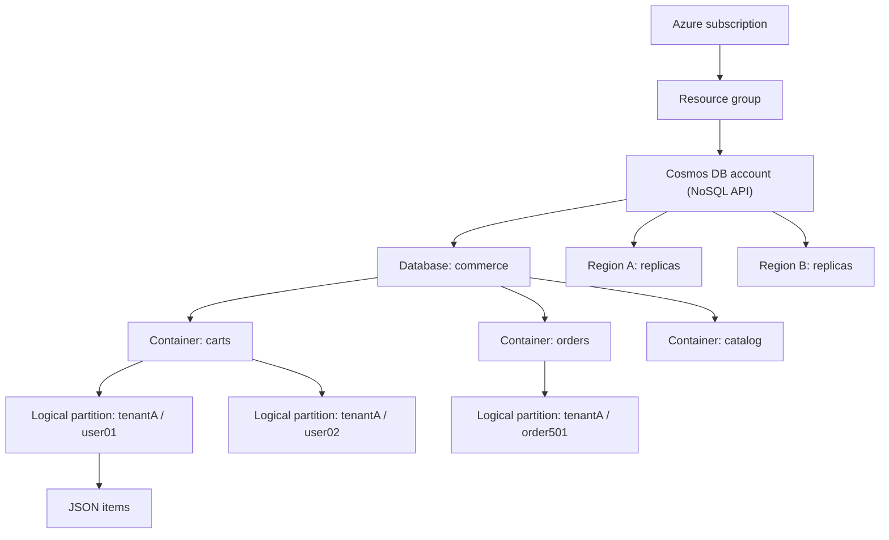
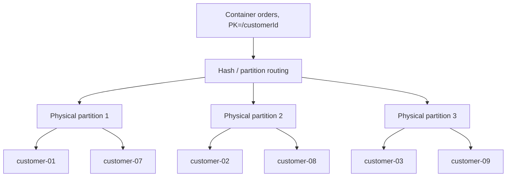
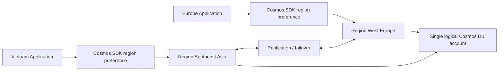
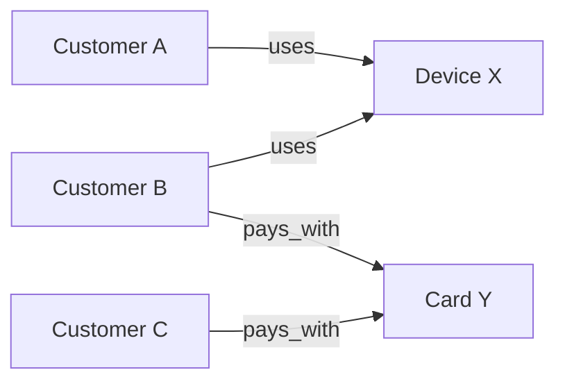
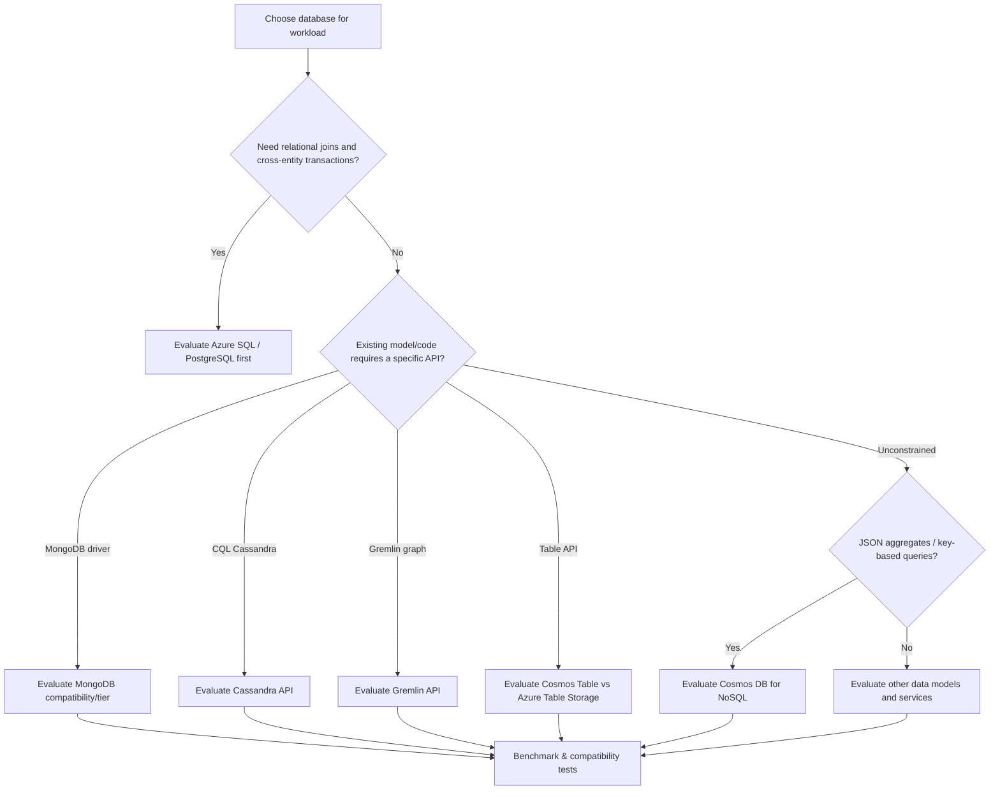
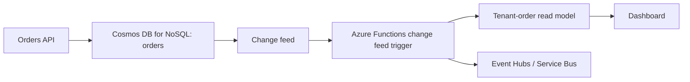
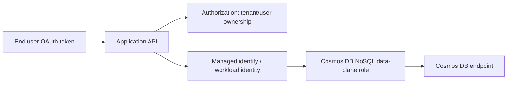
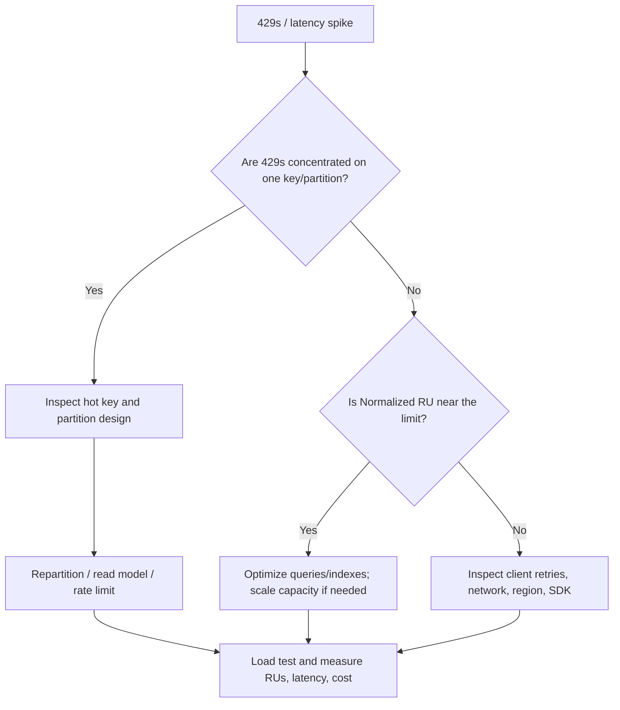
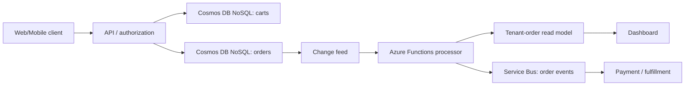

# Azure Cosmos DB Architecture and API Selection

An e-commerce platform serving customers in Vietnam, Singapore, and Europe needs to read shopping carts with low latency, store order histories, update product information, and scale during promotional events. Data continues to grow; a centralized relational table might still handle it, but the development team must weigh **data locality, request volume, access patterns, partitioning, consistency, and cost**. If another application uses a MongoDB driver, a legacy system uses Apache Cassandra, and a repository tracking relationships between customers and products has a graph shape, the choice of communication API also has a major architectural impact.

**Azure Cosmos DB** is a family of managed database services on Microsoft Azure, notable for multi-region data distribution, partition-based scaling, and multiple data access interfaces. With **Azure Cosmos DB for NoSQL**, data is organized into **account → database → container → item**, queried using a JSON query language with SQL-like syntax, and read/write capacity is typically measured in **Request Units (RUs)**. Other interfaces such as **MongoDB, Apache Cassandra, Apache Gremlin, and Table** serve different SDK ecosystems, data models, and workloads.

This lesson belongs to the **NoSQL Data with Cosmos DB** chapter of the `CLOUD_PROVIDERS_AZURE` module. Along the path of exploring Azure from subscriptions, resource groups, and Microsoft Entra ID to virtual networks, compute services, storage, and data, you will learn how to **choose an API and design a Cosmos DB architecture**, and connect those choices to deployment, monitoring, security, availability, and cost control requirements.

> **Scope:** Primary examples use **Azure Cosmos DB for NoSQL**. Resource limits, supported regions, API/driver compatibility, pricing models, and specialized features vary by service and over time. CLI/Python examples use placeholder names and sample data; only run write commands in an authorized sandbox subscription. API selection here is based on technical requirements and does not assume Cosmos DB is the optimal choice for every application.

## Learning Objectives

After this lesson, you will be able to:

1. Describe the **Cosmos DB account, database, container, and item** architecture and the role of logical/physical partitions.
2. Distinguish the **API model** from the **deployment and pricing model**, especially MongoDB-compatible RU-based offerings versus other MongoDB/document database options.
3. Make an informed choice among **for NoSQL, for MongoDB, for Apache Cassandra, for Apache Gremlin, and for Table** based on data, SDKs, queries, migration, and operational requirements.
4. Design a **partition key** based on access patterns, cardinality, distribution, and transaction scope.
5. Understand **RU/s**, HTTP 429 throttling, manual throughput, autoscale, and serverless according to supported capabilities.
6. Explain the **five consistency levels**, session tokens, geo-replication, and trade-offs in multi-region writes/failover.
7. Differentiate **point reads, in-partition queries, and cross-partition queries**, indexing, and how cost depends on access type.
8. Identify **atomic transaction** boundaries, `ETag`/optimistic concurrency, TTL, and the change feed.
9. Apply managed identity/RBAC, private endpoints, diagnostic settings, backup/restore, and budget controls.
10. Carry out a minimal lab and interpret operational symptoms to re-evaluate the API or improve the design when needed.

## 1. NoSQL Does Not Just Mean “No SQL”

**NoSQL** is a broad term for databases designed around various data models: document, key-value, wide-column, graph, or others. They are often optimized for flexible schemas and distributed scale, yet can still support query languages, indexes, transactions, and consistency guarantees.

| Model | Data | Common Queries | Application Examples |
|---|---|---|---|
| **Document** | JSON/BSON documents | Filter by attributes, access documents by key | Customer profiles, shopping carts, product catalogs |
| **Key-value** | Keys and corresponding records | Lookup by key/partition | Configuration, metadata, simple profiles |
| **Wide-column** | Rows keyed by partition/clustering keys | Access following pre-designed access patterns | Telemetry, activity logs, Cassandra workloads |
| **Graph** | Vertices, edges, properties | Multi-hop relationship traversal | Fraud detection, social/recommendation relationships |
| **Relational** | Tables, rows, foreign keys | Schema-enforced multi-entity JOINs/transactions | Finance, ledgers, ERP, and transactional reporting |

**Azure Cosmos DB for NoSQL has a SQL-like query language**, which does not mean it is Azure SQL Database or supports all RDBMS `JOIN`s and transactions. Having “SQL syntax” does not replace understanding **partition boundaries, indexing, and RU charges**.

### When Should You Consider Cosmos DB?

- Applications with geographically distributed users requiring low-latency reads and writes.
- Document data suited to an aggregate-oriented model with predictable access patterns.
- Need to scale throughput with load without self-managing an entire database cluster.
- Need change feed, TTL, multi-language SDKs, and configurable availability.
- Need integration with Azure services such as Functions, AKS, App Service, Event Hubs, or Synapse/Fabric through currently supported capabilities.

### When Is Cosmos DB Not Necessarily a Good Fit?

- Applications heavily dependent on **SQL joins** and ACID transactions across many tables/keys.
- Small, rarely accessed workloads where maintaining multiple regions or provisioned capacity would inflate costs.
- Data with an indivisible **hot key** where the business model cannot be reshaped.
- Workloads dominated by large analytical scans and ad hoc queries rather than partition-scoped operational transactions.
- Migrations requiring **100% compatibility** with every MongoDB/Cassandra/Gremlin/PostgreSQL feature without prior verification.

Always compare against **Azure SQL Database, Azure Database for PostgreSQL, Azure Data Explorer, Azure Table Storage, Blob Storage**, or other appropriate data services before choosing.

## 2. Overview of the Cosmos DB for NoSQL Architecture



The **Account** is the top-level configuration boundary: API, declared regions, default consistency, certain networking/security settings, and billing. A **Database** organizes collections of containers. A **Container** is typically the unit that defines the **partition key**, indexing policy, TTL, and throughput scope. An **Item** is a JSON document stored inside a container.

### Three Levels to Distinguish

| Level | Primary Concerns | What You Should Usually Avoid |
|---|---|---|
| **Account** | Select API, regions, consistency, security, backup options | Packing unrelated workloads with different isolation needs together without controls |
| **Database** | Group containers by application/domain; can be a throughput scope in some models | Treating a database as a logical partition |
| **Container** | Choose partition key, indexing, TTL, throughput, logical partitions | Treating a container as a relational table with free JOINs across all rows |
| **Item** | JSON document with `id`, partition key, and business fields | Using an oversized document or unbounded nested arrays |

When creating a container, the **partition key path** must be specified upfront by design. Changing the partition key of an existing container typically requires **creating a new container and migrating the data**, rather than flipping a setting like renaming a column.

### Sample JSON Item

```json
{
  "id": "order-2026-00501",
  "tenantId": "tenant-a",
  "customerId": "cust-19",
  "status": "Paid",
  "orderDate": "2026-11-20T09:45:00Z",
  "currency": "VND",
  "total": 1250000,
  "lines": [
    {"sku": "SKU-101", "quantity": 2, "unitPrice": 450000},
    {"sku": "SKU-204", "quantity": 1, "unitPrice": 350000}
  ]
}
```

The `orders` container could use `/tenantId`, `/customerId`, or a synthetic/hierarchical key. There is no universally best key for every problem; the choice determines **how queries are routed, how load is distributed, and what the transaction scope is**.

### JSON Does Not Mean Zero Schema Governance

Cosmos DB for NoSQL supports flexible document fields, but applications should still govern:

- `schemaVersion`.
- Required fields: `id`, partition key, timestamps, status.
- Currency formats and units of measurement, avoiding floats for monetary amounts when high precision is needed.
- Compatibility across SDK and consumer versions.
- Validation at the API/worker layer and a schema migration process.

An uncontrolled container holding many unmanaged document versions can become harder to query than a relational table with an explicit schema.

## 3. Partitioning Is the Foundation of Scalability

Cosmos DB organizes data into **logical partitions** and maps them onto **physical partitions**.

### Logical Partition

A **logical partition** holds all items that share the **same partition key value** within a container. For example, if the partition key is `/tenantId`:

```text
tenant-a → order-501, order-502, order-503, ...
tenant-b → order-504, order-505, ...
tenant-c → order-506, order-507, ...
```

Each logical partition is subject to service-enforced storage and operational limits. More important than memorizing a specific limit number is this rule: **a single key value that grows too large or too hot cannot be automatically split into new logical partitions by Cosmos DB simply by increasing RU/s**.

### Physical Partition

A physical partition is an underlying storage and capacity unit managed by the service. Multiple logical partitions can reside on one physical partition, and Cosmos DB can **automatically split physical partitions** as data or throughput grows within supported limits and modes.



This diagram is illustrative only: Cosmos DB **does not guarantee** that example keys will map to specific physical partitions. Never design an application around fixed internal physical partition IDs.

### What Does Partitioning Affect?

1. **Read/write routing:** Requests with a known partition key usually avoid fanning out across the entire container.
2. **RU distribution:** A single hot key value can be throttled even when total provisioned RU/s is large.
3. **Data size:** Oversized logical partitions require redesigning keys or using hierarchical keys where appropriate.
4. **Transactions:** Atomic transactional batches and stored procedures in the NoSQL API are typically scoped to **a single logical partition**.
5. **Query latency:** Cross-partition queries may read multiple partitions, increasing RU consumption and latency.
6. **Scale:** More distinct, evenly balanced keys make better use of physical partitions.

## 4. Choosing a Partition Key Based on Access Patterns

### Design Thinking Process

Do not pick `/tenantId` just because an application is multi-tenant. First, write down the questions:

- Do 70% of requests read **a single user's shopping cart** by user ID?
- Do 20% of requests read **an order by order ID**?
- Do 8% of requests list orders by tenant and time range?
- Do 2% of requests run dashboards across all tenants?
- How many GB and requests/s can the largest tenant generate?

A good key typically has:

1. **High cardinality:** Many distinct values, avoiding one or just a few values.
2. **Relatively even load distribution:** No single key consumes most of the RUs.
3. **Alignment with query filters:** Most requests know the key upfront.
4. **Sustainable growth as data volume increases:** Avoids hitting logical partition limits.
5. **Alignment with transaction boundaries:** Items that must be updated atomically share the same logical partition when designed for that purpose.

### Comparing Candidate Keys

| Container / Workload | Candidate Partition Key | Strengths | Weaknesses |
|---|---|---|---|
| Shopping carts | `/userId` | Point reads/updates by user, many user keys | One unusually active user could become a hot key |
| Multi-tenant orders | `/tenantId` | Easy listing per tenant | Large tenants can hit size limits or become hot keys |
| Orders | `/orderId` | High spread, fast access by order ID | Listing by tenant requires cross-partition queries without another model |
| Telemetry | `/deviceId` | Keeps a device's data grouped together | Long-lived devices easily create oversized logical partitions |
| Daily events | `/deviceDay` or a designed composite key | Bounds growth per key value | Queries spanning multiple days need extra routing steps |
| Global catalog | `/categoryId` | Queries by category if moderately sized | Popular categories easily become hot partitions |

**You cannot choose “both `/tenantId` and `/orderId`” as two independent partition keys on a standard single container.** You can design a synthetic key or use hierarchical partition keys where the API and environment support them, or maintain separate read models/containers for different query patterns.

### Hierarchical Partition Keys

Azure Cosmos DB for NoSQL supports **hierarchical partition keys** in compatible configurations, allowing multiple key levels such as:

```text
/tenantId → /customerId → /orderId
```

They help organize large multi-tenant datasets and route queries using a **leading prefix** better than a flat key in supported scenarios. However:

- This is not a SQL composite primary key; you must understand how the SDK/container declares multiple key paths.
- Queries providing a valid prefix can be routed more efficiently; queries filtering only on a non-prefix field may still fan out.
- Transaction/batch scope still needs careful design around the full partition key.
- Not every API, SDK, or version shares identical hierarchical key capabilities.

### Separating Read Models

An application that frequently reads orders by `orderId` while also listing the “100 most recent orders per tenant” can:

- Store **source-of-truth orders** partitioned by `orderId`.
- Create a separate **tenant-order-summary** container partitioned by a tenant/date structure.
- Synchronize the read model via the **change feed** or an idempotent event stream.

In exchange, the two representations will not always be instantaneously synchronized; you must accept and monitor the **eventual consistency of the projection**.

## 5. Point Reads, In-Partition Queries, and Cross-Partition Queries

These three access types form the primary axis of latency and RU charges.

### Point Read

Retrieving a single item using **id + partition key**:

```python
# Illustrates a NoSQL SDK operation with an existing container client.
order = container.read_item(
    item="order-2026-00501",
    partition_key="tenant-a"
)
```

When both the item ID and partition key are known, a point read generally consumes fewer RUs and delivers lower latency than an index-scanning query for the same item. The partition key parameter must **match the container configuration**; if the container uses `/orderId`, you cannot pass `tenant-a`.

### In-Partition Query

Filtering within a single logical partition:

```sql
SELECT c.id, c.status, c.total
FROM c
WHERE c.tenantId = "tenant-a"
  AND c.status = "Paid"
```

When the SDK supplies the exact partition key, the request can be scoped to a single logical partition. Simply having `c.tenantId = ...` in the query text does not guarantee optimal SDK routing across every API or query form; pass partition key query options per SDK guidance.

### Cross-Partition Query

For example, querying all `Paid` orders across every tenant:

```sql
SELECT c.tenantId, c.id
FROM c
WHERE c.status = "Paid"
```

If the container is partitioned by `/tenantId` and no key filter is provided, the query may need to **fan out** across many partitions. This is valid, but can increase:

- Request Units consumed.
- Latency, pagination, and continuation token handling.
- Impact on transactional workloads sharing the same throughput.

Avoid running cross-partition full scans every second for dashboards when a projection or analytical store would fit better.

## 6. Request Units: Cost Is a Property of the Operation

A **Request Unit (RU)** is the composite resource cost unit for a database operation in RU-based Cosmos DB. Read and write operations consume different RUs depending on item size, indexing, query shape, consistency level, and other system factors.

Intuitive examples:

| Operation | RU Consumption Characteristics | Recommendation |
|---|---|---|
| Point read of a small item | Usually low and predictable | Know `id` + partition key |
| Write of a large document | Depends on size and indexing | Avoid bloated payloads, control indexing |
| Query with exact partition key | Usually more efficient than fan-out | Design for access patterns upfront |
| Cross-partition aggregate | Can grow with partitions/data scanned | Use read models or analytical design |
| Updating a single field | Can use partial document update where supported by the API | Evaluate RU cost and concurrency |
| TTL expiration/delete | Has storage, background, and billing effects depending on mechanism | Set TTL/retention per requirements |

**RUs are not byte counts or vCPUs.** Never assume “1,000 RU/s = 1,000 requests/s” without measuring how many RUs each request consumes.

### Throughput Estimation Example

Suppose a measured workload shows:

```text
Point reads:      600 requests/s × 2 RU ≈ 1,200 RU/s
Writes:           100 requests/s × 8 RU ≈   800 RU/s
Queries:           20 requests/s × 15 RU ≈  300 RU/s
                                           -----------
Total average load                          2,300 RU/s
```

This is a **mathematical illustration** with hypothetical measured RU values, not a pricing table or guaranteed quota. If the workload experiences 3x traffic spikes or queries/documents change, throughput provisioning needs corresponding headroom.

### HTTP 429 Throttling

When requests exceed available throughput on a partition, container, or account, they can receive **HTTP 429 (Request rate too large)**. The SDK may automatically retry according to `Retry-After` and its configured retry policy, which can keep application success rates high on dashboards while **increasing latency**.

When encountering 429s:

1. Measure **Normalized RU Consumption**, RU charges, and 429 distribution by key/partition where available.
2. Determine whether it is a normal traffic spike or a **hot partition**.
3. Check the retry policy to ensure you are not creating a retry storm.
4. Optimize queries, indexes, and document size before raising RUs indefinitely.
5. If load has grown steadily, consider adjusting autoscale or manual throughput.
6. If only one partition is hot, increasing total throughput may not fix the root cause.

### Observing RU Charges in Responses

With Cosmos DB for NoSQL, SDK or REST responses can return the **request charge** and diagnostics for each operation. In the Python SDK, how charges are read depends on the SDK version and API; do not hardcode a header access pattern without checking the current version's documentation. Emit RU charges into your data-layer telemetry when tuning performance.

## 7. Provisioned Throughput, Autoscale, and Serverless

| Model | How Capacity Works | Suitable Workloads | Trade-offs |
|---|---|---|---|
| **Manual provisioned throughput** | Provision RU/s at a configured level | Steady, predictable load | Pay for provisioned capacity even during idle periods |
| **Autoscale throughput** | Service adjusts RU/s within a configured range | Fluctuating load, periodic spikes | Billing/calculation follows autoscale tier rules and limits |
| **Serverless** | Billed per RU operations and storage in supported modes, without fixed RU/s provisioning | Sporadic traffic, dev/test, unpredictable load within limits | Subject to serverless throughput, storage, region, and feature limits |

**Serverless is not just a billing toggle on any provisioned account.** Capacity mode, region, API, and feature options carry account-creation constraints and are not always freely convertible in place. Verify compatibility before choosing.

### Database-Level or Container-Level Throughput?

Cosmos DB can support:

- **Dedicated throughput** for a container.
- **Shared throughput** at the database level across eligible containers.

When multiple containers share an RU/s pool, one container's workload can contend with others for capacity. This works well for low-traffic workloads, but **one hot container** can starve sibling containers sharing the pool.

### Autoscale Does Not “Fix” a Bad Partition Key

Suppose one tenant generates 90% of requests and the partition key is `/tenantId`. Raising the autoscale max RU/s can help up to a point, but that single logical partition remains constrained by the capacity distribution and limits of its underlying physical partition. Do not rely purely on scaling up when **the bottleneck is a single partition key**.

### Estimating Cost Accurately

Beyond RU/s or RU operations, account for:

- Number of replicated regions and write-region configuration.
- Data/index storage volume and backups.
- Autoscale min/max or manual provisioned hours under the billing model.
- Request count, query RU cost, and document sizes.
- Private endpoints, network egress, and log ingestion.
- Associated resources or add-on features such as Functions, AKS, or analytics.

With multiple regions, a configuration of “4,000 RU/s” does not mean you are billed for just a single copy regardless of geography.

## 8. Geo-Distribution: Closer to Users, More Decisions to Make

Azure Cosmos DB supports deployment across **multiple Azure regions** according to the chosen API and tier's capabilities. Key decisions include:

- **Single-region write** with one or more read regions.
- **Multiple write regions** in compatible configurations.
- **Automatic/manual failover**, preferred region ordering, and SDK behavior.
- **Consistency level** across replicas/regions.
- **Data residency**, network paths, pricing, and conflict handling.



This diagram is conceptual. Specific region choices must satisfy availability, residency, quota, and customer requirements; never assume an Azure region exists in every city. The SDK can route reads/writes based on account configuration and preferred regions, while the application must still handle network faults, region switching, retries, and consistency.

### Reading Close to Users, Writing to One Region

For mostly read-heavy catalog applications:

- Writes go to the configured write region.
- Read replicas in other regions can reduce read latency.
- Changes take time to replicate depending on the consistency level.

If an application requires **read-your-writes** after a client writes and hits another region, using **Session consistency with session tokens** is an important detail.

### Multi-Region Writes and Conflict Resolution

In supported multi-write-region configurations, the same item can be updated nearly simultaneously in different regions. You must evaluate the **conflict resolution policy** and business invariants:

- Last-writer-wins based on a property/policy can silently drop updates if domain concurrency is missing.
- Custom conflict resolution via supported APIs/features requires thorough verification.
- Financial wallets, orders, and inventory should not rely solely on “Cosmos will pick one record” when strict financial invariants apply.
- Strong consistency and multi-region writes have support constraints; do not assume every consistency level combines arbitrarily with every write-region topology.

Choosing a **single write region** for financial operations is often a deliberate decision to preserve consistency guarantees while keeping global reads separate.

## 9. Five Consistency Levels in Cosmos DB for NoSQL

| Level | Read Intuition | Trade-offs |
|---|---|---|
| **Strong** | Reads observe the latest committed version under supported strong semantics | Latency/availability trade-offs and multi-region configuration limits |
| **Bounded Staleness** | Staleness is bounded by a configured number of versions or time window | Stronger than weaker levels, carries overhead/limits |
| **Session** | Read-your-writes, monotonic reads/writes, and guarantees within a client session | Requires understanding session tokens and user sessions |
| **Consistent Prefix** | Reads see a prefix of write operations in order, never out-of-order writes | May lag behind the latest write |
| **Eventual** | Replicas eventually converge if writes stop | May temporarily return stale data; typically offers high flexibility |

**Do not equate Eventual with “no consistency”:** it still provides convergence semantics, though clients are not guaranteed to see the latest write immediately. Conversely, **Strong** does not create ACID transactions across multiple logical partitions.

### Session Consistency: A Practical Middle Ground

A user adds an item to their cart and immediately reloads the page. The application needs to read back what was just written without requiring global strong consistency for everyone worldwide. Session consistency is often well-suited here:

```text
Client writes cart revision 12
→ receives session token via SDK mechanism
→ client/session reads again
→ must observe state at least as recent as the token
```

If a frontend routes through multiple backend instances without propagating the session context/token, read-your-writes behavior may not hold as expected in some cross-region scenarios. Use the Cosmos SDK with proper token handling and test during failover.

### Consistency Does Not Replace Partition Design

Choosing Strong instead of Session does not turn a cross-partition query into a point read, nor does it spread a hot partition. Consistency, indexing, and partitioning are **three independent design dimensions**.

## 10. Region Failover, RTO/RPO, and Resilience

A multi-region account can help maintain availability during a regional outage, but the engineering team must define:

- **RTO:** How long does it take for the application to return to acceptable operation?
- **RPO:** How much data delay or loss is possible under the configured consistency level and replication/failover scenario?
- **SDK behavior:** Timeouts, retries, preferred regions, and circuit breakers if used.
- **Read vs. write availability:** Having read regions does not automatically make all of them write regions.
- **Application dependencies:** Do App Service/AKS, Key Vault, VNet/DNS, event streams, and caches fail over as well?

### Adding a Read Region Is Not a Complete DR Plan

An application with a multi-region Cosmos DB account but an Azure Function deployed in only one region will still go down if that compute region fails. Map the **entire architecture** and test failover across compute, secret stores, networking, and downstream systems.

### Backup Is Not Replication

- **Replication** improves availability and latency, but it can also replicate accidental updates or deletes.
- **Backup/PITR** supports data recovery according to the supported backup mode and retention policy.
- **Change feed** helps detect changes and build projections; it is not by default a permanent full-history backup.

Select the backup type when creating the account and verify restore capabilities, regions, retention, and cost; do not assume all backup modes offer identical features.

## 11. What Does “API” Mean in Cosmos DB?

Here, **API** refers to the **application protocol/interface and data model** that clients use to interact with the database—not simply a REST service URL.

| Interface | Core Data Model | Familiar SDK/Driver/Query | Best Suited When |
|---|---|---|---|
| **Azure Cosmos DB for NoSQL** | JSON documents | Cosmos DB SDK, SQL-like query | Cloud-native apps needing RU/partition control, point reads, and change feed |
| **Azure Cosmos DB for MongoDB (RU-based)** | BSON/documents with MongoDB-compatible protocol | MongoDB drivers / MQL subset per compatibility | Teams/apps already using MongoDB and willing to validate compatibility |
| **Azure Cosmos DB for Apache Cassandra** | Wide-column | CQL / Cassandra drivers per compatibility | Systems built on Cassandra data models and clients |
| **Azure Cosmos DB for Apache Gremlin** | Property graph | Gremlin traversal API/driver per compatibility | Multi-hop relationships and graph traversals |
| **Azure Cosmos DB for Table** | Key-value / entities | Azure Table API/SDK | Apps using partition/row keys requiring a key-value table model |

**No single API fits every data pattern.** Choose an API from the **application contract, drivers/libraries, query model, partitioning, and requirements**, not just because records happen to be JSON.

### A Cosmos DB Account Chooses Its API at the Resource Model Level

Typically, you select the API when creating the Cosmos DB account. Different APIs have distinct namespaces, SDKs, and resource structures. **You cannot convert a NoSQL account into a Cassandra account just by renaming the endpoint** and expect data and queries to work unchanged.

Changing models generally requires:

1. Creating a compatible target resource.
2. Transforming schemas, documents, and partition keys.
3. Migrating data using supported tools or pipelines.
4. Updating SDKs, connections, and queries.
5. Validating correctness, consistency, performance, and cost.
6. Executing a cutover with rollback and reconciliation plans.

### Note on MongoDB vCore and Other Document Products

When evaluating the MongoDB ecosystem on Azure, you may encounter both the **RU-based Cosmos DB for MongoDB model** and **vCore-based MongoDB-compatible/document database** services introduced or branded separately over time. **Do not treat them as the exact same API or capacity model:** pricing, execution engines, query/indexing behavior, feature support, API versions, and migration paths can differ significantly.

For actual purchasing or migration decisions, verify the **exact product name and tier in the Azure Portal and current documentation** rather than relying on the generic phrase “Cosmos MongoDB.” This lesson focuses on **Cosmos DB for MongoDB (RU-based)** within the Cosmos DB API comparison.

## 12. API for NoSQL: The Default Choice for New Cloud-Native Apps When Appropriate

### Data Model

The application stores JSON items in containers:

```json
{
  "id": "cart-19",
  "userId": "user-19",
  "tenantId": "tenant-a",
  "items": [
    {"sku": "SKU-101", "quantity": 2},
    {"sku": "SKU-204", "quantity": 1}
  ],
  "updatedAt": "2026-11-20T09:50:00Z"
}
```

If the `carts` container is partitioned by `/userId`, the application can read by `id=cart-19` and `partition_key=user-19`, then update the cart with concurrency control if needed.

### Strengths

- Cosmos DB SDKs and JSON model suited to many backend languages.
- SQL-like queries, indexing policies, point reads, and partition routing.
- RU-based throughput or serverless in supported modes.
- Transactions scoped to a logical partition as supported by the API.
- Change feed for processing updates and maintaining downstream projections.
- TTL and other cloud-native features.
- Configurable consistency levels, geo-distribution, backup, and security.

### Trade-offs

- Not a relational database with cross-table joins and foreign keys.
- Cross-partition queries require explicit optimization.
- Partition key selection is a long-term architectural commitment.
- Requires measuring RU charges, document sizes, and indexing costs.
- If multiple documents updated in the same business transaction have **different partition keys**, you need sagas/idempotency or aggregate redesign.

### When Should You Choose It?

A new application built in Java/Spring Boot or .NET/Node/Python, with millions of independent shopping carts mostly looked up by `userId`, is a strong candidate for **for NoSQL**. However, if accounting rules require transactions across multiple accounts and complex SQL reporting, consider an RDBMS or clear service boundaries.

## 13. API for MongoDB (RU-Based): Driver Compatibility Does Not Mean Identical to MongoDB

### Model

MongoDB uses collections, BSON-style documents, and drivers/queries from the MongoDB ecosystem. Azure Cosmos DB for MongoDB (RU-based) provides a **MongoDB-compatible interface** backed by Cosmos DB's data platform, with capabilities and limits depending on the supported API version and server features.

Example of a familiar query in a MongoDB application:

```javascript
db.orders.find(
  { tenantId: "tenant-a", status: "Paid" },
  { _id: 1, total: 1, orderDate: 1 }
)
```

The snippet above illustrates MongoDB client syntax; it **does not guarantee** that every MongoDB server option or behavior acts identically in Cosmos DB for MongoDB. You must run integration and compatibility tests against the actual API version and indexing strategy.

### When to Choose It?

- The team already has MongoDB drivers, schemas, tooling, and portable query patterns.
- You want to avoid rewriting the entire data access layer to the Cosmos SDK for NoSQL.
- The workload fits within the commands, indexes, transactions, and aggregation operations supported by Cosmos DB's MongoDB interface.
- You have measured RUs, cost, and partition keys with realistic data and queries.

### What to Verify Before Migration

| Topic | Questions |
|---|---|
| **Server/API compatibility** | Which driver versions, commands, and MongoDB feature levels are supported? |
| **Query operators** | To what extent are aggregation pipelines, geospatial, text/vector search, and indexes supported? |
| **Transactions** | Do transaction boundaries and session semantics match business needs? |
| **Sharding/partitioning** | How should shard/partition keys be chosen, and are there hot-key risks? |
| **Change streams/CDC** | Is there an equivalent to what you currently use, and what are its limits? |
| **Consistency** | How do driver read/write semantics map to Cosmos consistency levels? |
| **RU/cost** | Do aggregation pipelines or indexes consume excessive RUs? |
| **Security** | Are driver authentication, connection encryption, and private networking compatible? |

**Never go to production just because `MongoClient.connect()` succeeded.** A successful connection only verifies networking and auth—not business queries, transactions, indexes, or failover behavior.

## 14. API for Apache Cassandra: Optimized for Cassandra-Oriented Workloads

### Data Model

Apache Cassandra uses a **wide-column** model with **partition keys** and **clustering keys**, queried via **CQL**. Table design typically starts from specific query patterns.

Example event-oriented data model:

```sql
-- Illustrative CQL syntax example:
CREATE TABLE device_events (
  device_id text,
  event_date date,
  event_time timestamp,
  event_id text,
  temperature double,
  PRIMARY KEY ((device_id, event_date), event_time, event_id)
);
```

Here `(device_id, event_date)` is a compound partition key in the CQL model; the remaining columns handle clustering/ordering per Cassandra rules. Syntax and execution behavior must be verified against the current Cassandra API/service version.

### When to Choose the Cassandra API?

- You have an existing Cassandra/CQL application and need a migration or hybrid plan.
- Write-heavy workloads accessed by partition/clustering keys.
- The team already understands Cassandra data modeling and denormalization.
- You want a managed service while retaining a Cassandra interface within confirmed compatibility bounds.

### What to Avoid

- Treating CQL like SQL Server and expecting arbitrary JOINs or ad hoc groupings to work.
- Keeping an ever-growing partition just to read ten years of events for a single device in one partition.
- Assuming all native Apache Cassandra driver/protocol features, LWT, materialized views, secondary indexes, or consistency semantics behave identically.

**The Cassandra API implements compatibility for a specific protocol and model.** If a new workload has no Cassandra dependency and primarily stores JSON documents, for NoSQL may be simpler.

## 15. API for Apache Gremlin: Graphs and Relationship Traversals

### When Is a Graph Model Useful?

A fraud-detection system needs to discover:

```text
Customer A → uses Device X
Customer B → uses Device X
Customer B → pays with Card Y
Customer C → uses Card Y
```

In a document database, tracing multi-hop relationships requires multiple queries, joins, or precomputed views. A graph model represents **vertices** and **edges**, enabling traversals.



An illustrative Gremlin query:

```groovy
g.V().hasLabel('customer').has('customerId', 'A')
  .out('uses')
  .in('uses')
  .hasLabel('customer')
```

The idea is to find customers who share a device with Customer A. Syntax must be tested against the Gremlin server steps supported by Cosmos DB; **do not treat the Gremlin API as an unconstrained TinkerPop server supporting every arbitrary step or strategy**.

### Trade-offs

- Deep or high-fan-out traversals can consume significant capacity and incur high latency.
- Graph partitioning must be designed carefully; traversals crossing partition keys can be expensive.
- Not all graph algorithms run natively inside the Gremlin API.
- Indexing, consistency, and limits differ from the document model and Cassandra API.

**Choose Gremlin when the core business question is relationship traversal**, not merely because your data happens to have Customer and Product collections.

## 16. API for Table: Key-Value/Entities and Azure Table Compatibility

### Model

The Table API works with entities keyed by **PartitionKey** and **RowKey** along with arbitrary properties. Example:

```json
{
  "PartitionKey": "tenant-a",
  "RowKey": "feature-flags",
  "enabled": true,
  "updatedAt": "2026-11-20T09:55:00Z"
}
```

A common access pattern is reading an entity by `PartitionKey + RowKey`, suited to near key-value profile lookups.

### How Does Cosmos DB Table API Differ from Azure Table Storage?

| Aspect | Cosmos DB for Table | Azure Table Storage |
|---|---|---|
| Service family | Cosmos DB | Azure Storage |
| Access pattern | PartitionKey + RowKey / Table SDK | PartitionKey + RowKey / Table SDK |
| Throughput/latency | Cosmos DB capacity/SLA/geo features per mode | Azure Storage capacity/billing per Storage tier |
| Consistency/regions | Capabilities of the compatible Cosmos DB API/tier | Separate Storage replication/consistency semantics |
| Cost model | Cosmos DB RUs/throughput/storage per mode | Storage transactions/storage per tier |
| Feature compatibility | Requires checking Table API-specific support | Requires checking Azure Table Storage-specific support |

**Sharing the word “Table” does not make the two services identical.** If an application only stores small metadata without specific global distribution or low-latency requirements, Azure Table Storage may be more economical; measure rather than guess.

### When to Choose the Table API?

- Existing systems or SDKs rely on the Azure Table model and need supported Cosmos DB capabilities.
- Queries are primarily key-based with flexible entity properties.
- You accept the data model and throughput API constraints.

If the application needs complex queries over nested JSON objects or the NoSQL change feed/indexing model, do not pick the Table API just to avoid designing keys.

## 17. API Decision Table

| Primary Requirement | API/Solution to Evaluate First | Eliminating Question |
|---|---|---|
| New app, JSON items, point reads, TTL/change feed | **Cosmos DB for NoSQL** | Do you need SQL transactions/joins across partitions? |
| Migrating an app using MongoDB drivers | **Cosmos DB for MongoDB (RU-based)** and other MongoDB-compatible options | Are any required MongoDB features unsupported? |
| App written in CQL with a Cassandra data model | **Cosmos DB for Apache Cassandra** | How do LWT/index/driver/query compatibilities hold up? |
| Recommendations/fraud via graph traversals | **Cosmos DB for Apache Gremlin** | Do traversals have excessive fan-out or unsupported steps? |
| Entity lookup by partition/row key | **Cosmos DB for Table**, compared with **Azure Table Storage** | Do you need Cosmos SLA/global replication enough to justify cost? |
| ERP/ledger/SQL JOINs and multi-table ACID | **Azure SQL/PostgreSQL** | Is there a clear reason to denormalize into Cosmos? |
| Large-scale logs/time-series analytics | **Azure Data Explorer/data lake/analytics** | Is this an operational store or an analytical workload? |
| Raw files/media/document archives | **Blob Storage/Data Lake** | Should binary blobs really live in a document database? |

### A Pragmatic “Decision Tree”



### Seven Decision Questions Before Selecting an API

1. **Data model:** Document, key-value, wide-column, graph, or relational?
2. **Client contract:** Greenfield or migration? Which SDK/driver/query/version is mandatory?
3. **Access patterns:** What percentage are point reads, updates, range scans, and JOINs/traversals?
4. **Partitioning:** What is the routing key? Hot keys? Multi-tenant isolation? Logical partition growth?
5. **Transactional semantics:** Is atomic commit needed within or across a partition?
6. **Global operations:** Regions, latency, consistency, failover, backup, compliance?
7. **Economics:** RU/request, product-specific vCore/compute mode, storage, network, logs, downtime, and migration effort?

Only after answering these seven questions and running a test workload should you lock in a service for production.

## 18. Multi-Tenant Architecture on Cosmos DB

### Single Shared Account or Multiple Accounts?

| Pattern | Advantages | Trade-offs |
|---|---|---|
| **Shared account/container**, tenants separated by partition key | Low operational overhead, easy onboarding | Noisy neighbor, requires app-level auth/tenant isolation |
| **Container per tenant** | Easy to separate indexing/TTL policies and isolate some workloads | Many containers, throughput/operational overhead |
| **Database per tenant** | Governance separation by domain/tenant | Resource limits, policies, and shared resources |
| **Account per tenant** | Stronger isolation for networking, RBAC, region/backup settings | Higher cost and management/IaC overhead |

**A partition key is not a security boundary.** A credential with read permissions on the container can read other tenants' data; the application must verify `tenantId` from the authenticated identity and enforce authorization in every query and write. For customers demanding strict isolation, an account or container per tenant may be more appropriate.

### Noisy Neighbor

A traffic spike from one tenant can consume RUs from a shared-throughput container or account. Mitigations include:

- Well-distributed partition keys, or hierarchical keys where supported.
- Tenant-level rate limiting/quotas at the API layer.
- Monitoring RUs and 429s by tenant/key.
- Dedicated containers or accounts for large tenants.
- Autoscale with clear headroom, budgets, and capacity limits.

Never assume shared throughput guarantees fair per-tenant quotas out of the box.

## 19. Indexing: Convenient by Default, Costs Must Be Understood

Cosmos DB for NoSQL typically enables **automatic indexing** of JSON properties under its default indexing policy. While convenient for queries, **index maintenance** increases write RU consumption and storage costs.

### Common Indexing Options

| Index / Configuration Type | Purpose |
|---|---|
| **Included/excluded paths** | Index only queried fields; omit large payload fields not used in filters |
| **Range indexes** | Filter and sort on supported types |
| **Composite indexes** | Improve queries with multiple `ORDER BY` fields or filter + sort in supported scenarios |
| **Spatial indexes** | Location/geometry queries for supported data types |
| **Conditional vector/full-text capabilities** | Use when actually supported by the current API, tier, and feature set |

Example query:

```sql
SELECT c.id, c.orderDate, c.total
FROM c
WHERE c.tenantId = "tenant-a"
  AND c.status = "Paid"
ORDER BY c.orderDate DESC
```

If this is a high-throughput critical query, evaluate an appropriate **composite index** and measure RU charges. **Do not blindly add indexes for every combination of fields**; indexes carry storage and write overhead.

### Indexing Policy Changes Can Trigger Rebuilds

Updating an indexing policy can trigger an index transformation/rebuild in Cosmos DB, affecting query behavior, cost, and monitoring. Never make major policy changes in production without testing, a rollback plan, and a performance baseline.

### Not Every Item Should Be Treated as an Analytics Row

A document may have a `lines` array and deeply nested properties; intra-item array queries, self-joins, or flattening are distinct from cross-container joins. When you need total revenue across millions of orders, design an **analytical pipeline or read model** rather than scanning the operational container indefinitely.

## 20. Transaction Boundaries and Optimistic Concurrency

### Transactions Within a Single Logical Partition

In **Cosmos DB for NoSQL**, **Transactional Batch** and certain server-side operations (such as stored procedures) support atomic operations **within the same logical partition**, subject to service-enforced size and execution limits.

Suppose the `orders` container uses partition key `/orderId` and stores:

```text
PK=order-501:
  item id="order-501": Order status
  item id="payment-501": Payment tracking
  item id="audit-501": Order audit metadata
```

Items sharing the same partition key are candidates for a supported atomic batch. However, if payment processing is actually handled by an external bank or a separate Azure SQL database, a Cosmos DB transaction **does not span** the bank or SQL database.

### Transactions Across Two Logical Partitions?

Consider transferring money from wallet A to wallet B in two different partitions:

```text
Debit(wallet-A) → Credit(wallet-B)
```

Never assume a Cosmos DB NoSQL transactional batch can guarantee ACID across different partition keys. Consider:

- Redesigning the aggregate if items in the same transaction can share a partition without creating a hot key.
- Transactional outbox + saga/compensation patterns.
- A relational database for financial ledgers.
- Idempotent event processing and reconciliation workflows.

### Optimistic Concurrency with `_etag`

Cosmos DB items include system metadata such as `_etag`, enabling **conditional updates**/compare-and-swap via supported SDK/API options.

Example:

```text
Client A reads cart revision ETag=abc
Client B reads cart revision ETag=abc
Client A updates cart with If-Match: abc → succeeds, ETag changes to xyz
Client B updates with If-Match: abc → fails precondition check
Client B re-reads, merges changes, and retries in a controlled way
```

**Never perform blind read-then-write updates** when multiple clients can modify the same item; last-write-wins can silently overwrite updates. Conditional writes require the appropriate SDK/REST option and application handling for HTTP `412 Precondition Failed`.

## 21. TTL, Change Feed, and Event-Driven Architecture

### Time-to-Live (TTL)

TTL automatically expires items after a configured duration when container/item TTL is enabled and supported. Examples:

- Temporary shopping carts expiring after inactivity.
- Session metadata that does not need long-term retention.
- Event caches bound by a retention policy.

However, TTL is **not a legal compliance substitute for full retention/deletion governance**:

- Copies of the data may still exist in backups, read models, event streams, or logs.
- You must understand how TTL start timestamps interact with item updates.
- Do not rely on TTL to delete data at an exact second if strict timing guarantees are required.
- Check change feed modes if you need to observe deletes or TTL expirations.

### Change Feed

The **Change feed** lets downstream consumers process changes in a container via supported API mechanisms. A common architecture:



A container can use the change feed to:

- Maintain materialized views / read models.
- Sync data to a search index.
- Trigger change-processing workflows.
- Drive downstream event pipelines.

### Key Limitations

- The change feed is **not by default an exactly-once queue**. Consumers must be idempotent because items may be reprocessed when checkpoints or leases shift.
- The common **latest-version mode** has different semantics from conditionally supported **all versions and deletes** modes; do not assume every delete or historical edit is captured on every account.
- Processing order is scoped to a **logical partition**; do not assume global ordering across all partition keys.
- Avoid retaining sensitive data indefinitely just because an event was emitted.
- If events must be published strictly alongside DB commits, evaluate outbox/change feed patterns together with business state and downstream idempotency.

### Change Feed vs. Stream Analytics

The **Change feed** reflects data mutations inside a container; **Azure Stream Analytics** computes directly over event streams like Event Hubs or IoT Hub. They can be used together, but they do not replace each other: one focuses on database changes, the other on windowed stream processing.

## 22. Security: Control Plane, Data Plane, and Private Networking

A Cosmos DB account storing user profiles, order states, or operational data must be protected across **multiple layers**.

### Management Azure RBAC and Data-Plane RBAC Are Not the Same

| Layer | Tasks | Mechanism to Check |
|---|---|---|
| **Management/control plane** | Create account, modify regions, networking, backups, tags | Azure RBAC at subscription/resource group/account |
| **NoSQL data plane** | Read/write items, run queries, read data metadata | Cosmos DB for NoSQL **data-plane RBAC** or supported credentials |
| **Managed identity** | Grant workload identity to App Service/AKS/Functions | Microsoft Entra ID / managed identity |
| **Network access** | Allow TCP/HTTPS traffic to the right endpoint | Firewall, private endpoint, VNet/DNS |
| **Application authorization** | User A reads only their own carts/orders | Claims/tenant checks and business logic |

For example, granting an app the Azure `Contributor` role on a resource group **should not be assumed** to grant Entra ID permissions to query Cosmos DB for NoSQL data. On the NoSQL data plane, roles such as **Cosmos DB Built-in Data Reader** or **Cosmos DB Built-in Data Contributor** must be assigned via Cosmos DB's role assignment mechanism when using Entra data-plane authentication.

**Data-plane RBAC can differ across APIs.** Do not assume assigning a NoSQL SQL role covers MongoDB, Cassandra, or Table APIs. Each connector/driver has its own supported authentication schemes and network endpoints.

### Managed Identity from Azure Functions / AKS



The application must enforce **two separate control steps**:

1. Verify that the caller is authorized to view or update the specific business document.
2. Use the workload identity with appropriate data permissions to operate on Cosmos DB.

Managed identity **does not automatically verify** whether a document's `tenantId` matches the caller's tenant. Multi-tenant isolation vulnerabilities still occur if the API forgets to filter or trusts a client-supplied partition key.

### Private Endpoint

If an account allows private access only:

- You need a private endpoint targeting the correct **Cosmos DB account/subresource API** as supported.
- DNS / Private DNS zones must resolve the endpoint to the private IP from the application environment.
- NSGs, UDRs, firewalls, VNet peering, or VPNs must permit routing.
- Client App Service, Functions, AKS, or VMs need proper outbound networking.
- The Cosmos DB account must allow the configured network access method.
- Authentication and data-plane RBAC remain mandatory.

For **for NoSQL**, endpoints typically use the `documents.azure.com` domain with a matching private DNS configuration; MongoDB, Cassandra, Gremlin, and Table use different endpoints and private link group IDs. **Do not configure a NoSQL API private DNS zone and assume every Cosmos DB API routes through it.**

### Do Not Distribute Account Keys Carelessly

Account keys and connection strings grant broad access and risk exposure via:

- source code;
- unprotected CI variables;
- request URLs/logs;
- browser frontends;
- screenshots or support tickets.

Prefer managed identity / Entra auth wherever the API and SDK support it. When keys are required, store them in **Azure Key Vault** with restricted access and controlled rotation. **Never ship account keys to a frontend**; frontends should call an authenticated API that enforces authorization.

## 23. Monitoring: Metrics to Check Before Raising RU/s

Increased workload latency is not necessarily caused by insufficient RUs. Observe signals across the application, SDK, and Azure Monitor.

| Metric Group | What You Want to Know | Symptoms |
|---|---|---|
| **Total Requests** | Read/write/query load over time | Unusual traffic spikes |
| **Total Request Units** | Actual RUs consumed | Queries or writes costlier than baseline |
| **Normalized RU Consumption** | Capacity utilization per partition/region per supported metric | Approaching 100%, likely triggering 429s |
| **Throttled Requests (429)** | Rate of throttled requests | Backoff/retries, rising latency |
| **Server-side latency** | Processing time inside the service | Slow in DB or slow in network/client? |
| **Client-side diagnostics** | End-to-end SDK latency, retries, region, connections | Network timeouts, session tokens, retry storms |
| **Data usage/storage** | Data and index growth | Exceeding storage/key size projections |
| **Availability/failover** | Region health and SDK failover | Access errors or cross-region latency |
| **Query metrics** | Index hits/scans, query RUs, pagination | Cross-partition queries or missing indexes |
| **Change feed lag** | Are projections keeping up? | Stale dashboards/read models |
| **Cost/budget** | RU/s, regions, storage, egress, logs | Exceeding budget thresholds |

Metric names and drill-down capabilities vary by API, tier, and over time. Never conclude “autoscale is on, so 429s are impossible”: **autoscale still has upper limits**, especially when a single logical partition runs hot.

### Application-Level Telemetry

Alongside Azure Monitor, emit structured logs:

```json
{
  "operation": "ReadCart",
  "container": "carts",
  "requestType": "point-read",
  "tenantAlias": "tenant-a-anonymized",
  "latencyMs": 19,
  "requestChargeRU": 2.4,
  "statusCode": 200,
  "retryCount": 0,
  "clientRegion": "Southeast Asia",
  "correlationId": "trace-lab-1001"
}
```

This is **custom application telemetry**, not default output from every SDK. Avoid logging raw PII partition keys or entire JSON items; `tenantAlias` should be suitably pseudonymized.

### 429 Throttling Runbook



### Alerts to Configure

- RU consumption sustained near capacity limits.
- 429 rate or retry latency breaching SLOs.
- A single tenant, device, or partition key consuming an abnormal share of RUs.
- Storage or index size growing faster than forecasted.
- Anomalies in region availability or failover events.
- Backup/restore job failures, change feed lag, or projection errors.
- Cost increases driven by autoscale, added regions, or query/indexing policy changes.

## 24. Troubleshooting: Separating App, Data, and Infrastructure Issues

| Symptom | Possible Cause | How to Investigate |
|---|---|---|
| HTTP 401 with Entra | Wrong identity, token audience, missing role | Workload identity, data-plane role assignment |
| HTTP 403 | Network firewall, permissions, or other policy | Account networking, RBAC, error substatus |
| Endpoint timeout | Private DNS/routing/NSG, SDK mode, region | DNS/routing from the app, latency diagnostics |
| HTTP 404 for an expected item | Wrong `id`/partition key, TTL/deleted, region/token | Point read keys, item data, consistency |
| HTTP 409 Conflict | Inserting duplicate `id` in same partition, uniqueness policy | Check `id`+PK and unique key constraints |
| HTTP 412 Precondition Failed | `_etag` changed | Re-read, merge, and retry conditional update |
| Frequent 429s | Insufficient RUs, hot key, or expensive query scans | RU metrics, partition usage, query diagnostics |
| Query consumes too many RUs | Cross-partition, missing index, over-fetching data | Query plan/metrics, key filter, projection |
| One tenant hot, others normal | `/tenantId` partition key creating hot logical partition | Per-key rates, hierarchical keys, or split container |
| Large container with uneven RUs | Partition/data skew and hotspots | PK cardinality, physical partition usage |
| Session read returns stale data | Missing session token, cross-region, consistency | SDK settings, token propagation, writes |
| Unexpected state after failover | Consistency, write region, and RPO assumptions | Region config, failover drill, app retries |
| Change feed misses deletes | Feed mode does not include deletes | Check feed mode and account prerequisites |
| Change feed processes duplicates | Lease/checkpoint/retry behavior | Idempotency, lease container, checkpoints |
| TTL does not delete “on the exact second” | TTL expiration semantics and asynchronous cleanup | Container/item TTL config, retention |
| MongoDB driver query fails | Unsupported command/operator/version | API version compatibility matrix + integration tests |
| Cassandra app returns unexpected results | Non-equivalent CQL/consistency/index semantics | API feature compatibility, data model |
| Gremlin traversal is slow | Deep fan-out, cross-partition traversal | Traversal plan, partitioning, data model |
| Table API point read fails/mismatches | Wrong `PartitionKey`/`RowKey` | Key contract, encoding/casing |
| Analytics queries degrade OLTP | Cross-partition scans sharing RUs | Read model/analytics pipeline, dedicated throughput |
| Cost jumps after adding a region | Multi-region data/throughput replication billing | Cost Management and account topology |

**Never fix an error by opening the firewall wide or enabling broad account keys.** Use error details, substatus codes, client diagnostics, and the active identity to isolate the exact root cause.

## 25. Architecture Lab: Creating a for NoSQL Account and Two Containers

### Objective

Build a minimal workload:

- A `carts` container with partition key `/userId`.
- An `orders` container with partition key `/orderId` or an appropriate key per your chosen design.
- Run point reads and queries, and measure request charges.
- Test an optimistic concurrency scenario.
- Observe autoscale/manual/serverless behavior according to your chosen account mode.
- Document security, networking, and budget details.

**Do not use real customer data.** If your environment does not allow creating Azure resources, complete this as a **paper design exercise** analyzing query and partition access patterns.

### Step A — Preflight

1. Select a sandbox subscription, region, and budget.
2. Confirm the Cosmos DB API is **for NoSQL**—do not confuse it with MongoDB or Gremlin.
3. Choose a capacity mode supported by the region, account, and API (serverless, manual, or autoscale) per lab goals.
4. Confirm management permissions to create resources and an identity for data-plane access.
5. Plan cleanup; record the lab-only account name and resource group.

### Step B — Create the Account in the Azure Portal

1. Open **Azure Cosmos DB → Create**.
2. Select **Azure Cosmos DB for NoSQL**.
3. Choose the subscription and resource group, e.g., `rg-cosmos-lab`.
4. Set a globally unique account name following Azure naming rules, e.g., `cosmos-commerce-lab-<unique>`.
5. Choose the region, geo-replication/write region, consistency, and capacity mode.
6. Select a backup policy and network access setting compliant with policy.
7. Review pricing/estimated cost and tags, then create the account.

This step uses a **Portal workflow** rather than forcing an IaC command with flags that frequently vary across CLI versions.

### Step C — Create the Database and Containers

In **Data Explorer** or an equivalent interface:

| Level | Name | Partition Key | Purpose |
|---|---|---|---|
| Database | `commerce` | — | Groups both containers |
| Container | `carts` | `/userId` | Point reads for shopping carts |
| Container | `orders` | `/orderId` | Point reads per order |

Choose a throughput mode compatible with the account and container/database scope. If the account is serverless, do not try to assign provisioned RU/s that it does not support. If using shared database throughput, note that both containers share the capacity pool.

### Step D — Seed Sample Data

`carts` container:

```json
{
  "id": "cart-user-19",
  "userId": "user-19",
  "tenantId": "tenant-a",
  "items": [
    {"sku": "SKU-101", "quantity": 2}
  ]
}
```

`orders` container:

```json
{
  "id": "order-501",
  "orderId": "order-501",
  "tenantId": "tenant-a",
  "customerId": "user-19",
  "status": "Paid",
  "total": 900000
}
```

Note: if `/orderId` is chosen as the partition key, **the item must contain an `orderId` field**, not only `id`. Omitting it is a very common mistake when seeding data.

### Step E — Point Read

In the SDK or Data Explorer, retrieve the cart using:

```text
Item id: cart-user-19
Partition key: user-19
```

Retrieve the order using:

```text
Item id: order-501
Partition key: order-501
```

Compare this against a query that omits the partition key, and inspect the RU charge and latency. Numbers will vary by SDK, account mode, indexing, and caching; **you do not need to generate thousands of records just to illustrate the difference**.

### Step F — Run a Query

`orders` container:

```sql
SELECT c.id, c.status, c.total
FROM c
WHERE c.orderId = "order-501"
```

The learning goal is to see why using a point read when `id + partition key` are known generally outperforms a text query locating the same item.

### Step G — Record Parameters

```text
Account name: <name>
API: Azure Cosmos DB for NoSQL
Capacity: serverless / provisioned / autoscale
Region(s): <list>
Consistency default: <level>
Backup mode: <mode>
Container carts PK: /userId
Container orders PK: /orderId
Point-read status/latency/RU: <measured>
Query status/latency/RU: <measured>
Data-plane identity/role: <verified>
Network path: public restricted / private
Cost estimate: <value>
Security/cleanup owner: <owner>
```

### Step H — Cleanup

When finished:

1. Verify that the account and containers belong solely to the lab and hold no shared data.
2. If permitted, delete the lab resources following your standard procedure.
3. Revoke any temporary role assignments or credentials.
4. Check whether related resources such as private endpoints, logs, or Functions still exist.
5. Check Cost Management: deleting the Cosmos DB account may not automatically remove related resources outside its resource group.

## 26. Python SDK Sample: Identity and Point Read

This example uses **Azure Cosmos DB for NoSQL** and does not apply directly to MongoDB, Cassandra, Gremlin, or Table SDKs. Prerequisites:

- Compatible versions of `azure-cosmos` and `azure-identity`.
- An existing NoSQL account and `commerce/carts` database/container.
- A managed identity or developer credential selectable by `DefaultAzureCredential`.
- A Cosmos DB **NoSQL data-plane role assignment** with appropriate read/write permissions and network access.

Install packages in your **learning environment**, not inside this module workspace:

```bash
python -m pip install azure-cosmos azure-identity
```

Set the endpoint environment variable:

```bash
export COSMOS_ENDPOINT="https://<cosmos-account>.documents.azure.com:443/"
```

Illustrative script:

```python
import os

from azure.cosmos import CosmosClient
from azure.identity import DefaultAzureCredential


endpoint = os.environ["COSMOS_ENDPOINT"]
credential = DefaultAzureCredential()

client = CosmosClient(url=endpoint, credential=credential)
database = client.get_database_client("commerce")
container = database.get_container_client("carts")

# Practice: only write inside an authorized Cosmos DB sandbox.
cart = {
    "id": "cart-user-19",
    "userId": "user-19",
    "tenantId": "tenant-a",
    "items": [{"sku": "SKU-101", "quantity": 2}]
}

container.upsert_item(body=cart)

# A point read requires both the item id and the partition key value.
saved = container.read_item(
    item="cart-user-19",
    partition_key="user-19"
)
print("Cart ID:", saved["id"])
print("Number of lines:", len(saved.get("items", [])))

# In-partition query, parameterized to avoid arbitrary string concatenation.
query = """
SELECT c.id, c.userId
FROM c
WHERE c.userId = @userId
"""
results = list(
    container.query_items(
        query=query,
        parameters=[
            {"name": "@userId", "value": "user-19"}
        ],
        partition_key="user-19"
    )
)
print("Query item count:", len(results))
```

### Important Notes

- `DefaultAzureCredential` tries multiple credentials in a chain depending on the environment. In production, configure an explicit identity so developer credentials do not inadvertently leak into prod behavior.
- `upsert_item` **can overwrite** an existing item with the same `id` and partition key. Real applications should evaluate optimistic concurrency and business ownership; the lab uses upsert for simple data seeding.
- SDK methods and signatures can change; verify against the library version pinned in your project.
- Printing `saved` verbatim could expose personal information; log only necessary metadata.
- If you encounter HTTP 403, check the **Cosmos DB NoSQL data-plane role**, not only Azure RBAC `Contributor`.
- If requests time out from an app running in a VNet, verify Private DNS, networking, and endpoints before altering permissions.

### Moving from Static Keys to Identity

Code might initially look like:

```python
# Storing account keys in source code is not recommended.
from azure.cosmos import CosmosClient

# Prefer:
# client = CosmosClient(url=endpoint, credential=DefaultAzureCredential())
```

Never place real keys into test fixtures or READMEs. If an application cannot yet use Entra data-plane auth because a specific API or driver does not support the desired model, use a secret store with a proper rotation plan instead of hardcoding secrets.

## 27. Azure CLI: Inspecting Configuration Without Modifying Data

The commands below are **read-only** against resources you are authorized to access:

```bash
az login --tenant "<tenant-id>"
az account set --subscription "<subscription-id>"

az cosmosdb show \
  --resource-group "rg-cosmos-lab" \
  --name "<cosmos-account>" \
  --query "{name:name,locations:locations,consistency:consistencyPolicy.defaultConsistencyLevel,kind:kind}" \
  --output json

az cosmosdb sql database list \
  --resource-group "rg-cosmos-lab" \
  --account-name "<cosmos-account>" \
  --output table

az cosmosdb sql container list \
  --resource-group "rg-cosmos-lab" \
  --account-name "<cosmos-account>" \
  --database-name "commerce" \
  --output table
```

The `az cosmosdb sql ...` command group here is **for Cosmos DB for NoSQL**. MongoDB, Cassandra, Gremlin, and Table APIs use different command groups and management structures. Never run `sql container list` and conclude a MongoDB account has no data.

### Inspecting a Container's Partition Key

```bash
az cosmosdb sql container show \
  --resource-group "rg-cosmos-lab" \
  --account-name "<cosmos-account>" \
  --database-name "commerce" \
  --name "carts" \
  --query "{id:resource.id,partitionKey:resource.partitionKey,indexingPolicy:resource.indexingPolicy}" \
  --output json
```

Output JSON field paths may vary by Azure CLI and API version. If a projection returns `null`, inspect the full response and command help rather than assuming the partition key is missing. Do not run update/replace container commands just to “test things out.”

## 28. Case Study: Multi-Region E-Commerce Platform

### Context

An e-commerce platform has:

- 800,000 registered users and roughly 40,000 daily active users.
- Shopping carts read and written frequently.
- Orders requiring auditing and duplicate-creation prevention.
- A read-heavy product catalog.
- Customers in Vietnam and Europe.
- Dashboards requiring daily revenue reports by tenant.

### Proposed Design

| Data | Initial Solution | Partition / Access Pattern |
|---|---|---|
| **Shopping carts** | Cosmos DB for NoSQL | `/userId`; point reads and cart updates |
| **Product catalog** | Cosmos DB for NoSQL or relational/search service per requirements | Read by product ID; cache/search projection |
| **Orders** | Cosmos DB for NoSQL if transaction boundaries fit, or RDBMS for complex transactions | `/orderId`, idempotent order creation |
| **Payments** | Dedicated payment service/ledger with controlled transactions | Do not rely on multi-region LWW for monetary guarantees |
| **Revenue reporting** | Data lake / analytical pipeline / read model | Avoid global operational container scans every few seconds |
| **Event notifications** | Change feed → Functions / Service Bus | Idempotent projections and downstream processing |

### Application Flow



### Non-Negotiable Decisions

1. Per-user shopping carts need **read-your-writes**: evaluate Session consistency and token handling.
2. Product traffic is often skewed: avoid letting one hot category bottleneck RUs.
3. Orders partitioned by `orderId` optimize point reads, so listing by tenant will need a read model.
4. Payments are a separate business domain: enforce idempotency/transactions rather than assuming guarantees from event delivery alone.
5. Multiple regions introduce cost and consistency trade-offs; add read regions only with SLO/latency evidence.
6. Every request must enforce tenant authorization rather than trusting a client-supplied `tenantId`.
7. Establish query RU and client latency baselines before peak traffic seasons.

### When Should the Architecture Change?

If 90% of customers are in a single region, read volume is modest, and the workload requires heavy SQL joins, Azure SQL Database may be simpler, cheaper, and transactionally cleaner. Conversely, if shopping carts serve hundreds of thousands of concurrent users across regions primarily via point reads, Cosmos DB for NoSQL is worth benchmarking.

## 29. Case Study: IoT Device Telemetry

### Context

A company operates 30,000 sensors, each sending one event every 10 seconds. Required access patterns:

- Latest reading for a device.
- 24-hour history for a device.
- Anomaly detection over time.
- Monthly statistical reports across all devices.

Average event rate:

\[
30\,000/10 = 3\,000\ \text{events/second}.
\]

In one day:

\[
3\,000 \times 86\,400 = 259\,200\,000\ \text{events}.
\]

This is the **theoretical event count** without packet loss, duplication, or frequency changes, before factoring in document size or indexing.

### Which API Fits?

Options to evaluate:

- **Cosmos DB for NoSQL:** Store latest device state or a short operational history with appropriate partition keys and TTL.
- **Cosmos DB for Apache Cassandra:** If the system and data already follow a wide-column/CQL model with validated compatibility.
- **Azure Data Explorer / Time-series analytics:** For multi-month ad hoc queries, time-windowed aggregations, and large-scale analytics.
- **Event Hubs + Azure Stream Analytics/Functions:** Real-time stream processing before persisting projections.
- **Blob / Data Lake:** Store raw events with cost-effective storage and retention.

**Never store all 259 million events/day in one Cosmos DB container by default and run `SELECT *` for annual reports.** Combine hot operational data in Cosmos DB with historical analytics in Data Lake or Azure Data Explorer.

### Choosing a Partition Key

If the key is `/deviceId` and devices run continuously for years, a single logical partition can grow too large. Adding a time bucket such as `deviceId+month` or using supported hierarchical keys can bound growth per key, though it changes how 24-hour and cross-month queries are structured.

### TTL

If only 7 days of operational history are needed, consider a 7-day TTL in the operational container and archive raw data long-term elsewhere. Verify how data is retained across backups, logs, and downstream projections per retention policy.

## 30. Case Study: Migrating MongoDB to Azure

An enterprise currently runs:

```text
MongoDB application:
  12 collections
  MongoDB drivers for Java
  Aggregation pipelines + compound indexes
  Some multi-document transactions
  Change streams for event emission
  Latency SLO p95 < 100 ms
```

### API and Service Selection Process

1. Inventory the **exact MongoDB server version, driver version, query operators, and index types** in use.
2. Identify workloads that must retain the MongoDB protocol versus workloads that can be rewritten for Cosmos DB for NoSQL.
3. Compare **Cosmos DB for MongoDB (RU-based)** against currently available MongoDB-compatible/vCore-based offerings.
4. Verify support for transactions, aggregations, change streams, and sharding/partitioning behavior on each option.
5. Use **representative sample data** to benchmark latency, throughput, cost, 429/retry behavior, and correctness.
6. Design the migration: initial copy, incremental sync/CDC, cutover, and rollback.
7. Test failover, backup/restore, secret rotation, and multi-region setups if needed.
8. Finalize the service choice only after validating **feature and business semantic compatibility**, not just connection tests.

### Common Failure Modes

| Sign | Risk |
|---|---|
| Driver connects successfully | Does not prove all commands are supported |
| Query runs but sort/collation differs | Incorrect business results or poor performance |
| Indexing policy is not equivalent | Different RU, cost, and latency profile |
| Multi-document transaction exceeds supported scope | Loss of atomicity |
| Change stream behaves differently than expected | Missed or duplicate events during migration |
| One shard/partition key is too hot | Scaling falls short of projections |

For systems requiring full MongoDB compatibility with minimal migration effort, consider a **managed MongoDB service** or an equivalent database rather than forcing a fit onto an API simply because it is labeled “MongoDB-compatible.”

## 31. Pre-Production Cosmos DB Design Checklist

### Data and API Selection

- [ ] Workload classified as operational vs. analytical.
- [ ] Correct API selected based on data model, SDK, queries, and transactions.
- [ ] Compatibility tests completed if migrating from MongoDB/Cassandra/Gremlin/Table.
- [ ] Partition key has appropriate cardinality, load distribution, and growth bounds.
- [ ] Point reads, in-partition queries, cross-partition queries, and their ratios accounted for.
- [ ] Strategy in place for hot partitions and noisy tenants.
- [ ] Schema versioning, item validation, and canonical IDs defined.
- [ ] Indexing policy tuned for critical queries.

### Availability, Consistency, and Transactions

- [ ] Consistency level chosen from SLO and business semantics.
- [ ] Session token handling designed if read-your-writes is required across backend instances/regions.
- [ ] Read/write regions and failover drills planned.
- [ ] Transaction boundaries align with a logical partition; no assumption of global ACID.
- [ ] ETags/conditional writes or business version guards protect concurrent updates.
- [ ] Duplicate, retry, and change feed handlers are idempotent.
- [ ] Backup mode, restore drills, and retention meet RPO/RTO.

### Security, Monitoring, and Cost

- [ ] Managed identity and **NoSQL data-plane RBAC** used where supported, with least privilege.
- [ ] Frontend has no account keys; tenant authorization is enforced in the API.
- [ ] Public/private networking, Private DNS, and firewall rules verified.
- [ ] No raw sensitive documents or credentials logged.
- [ ] Dashboards track RU charges, normalized RU, 429s, latency, storage, and change feed lag.
- [ ] Budgets and alerts configured for throughput, regions, backups, logs, and egress.
- [ ] Simulated production load tested with traffic spikes and hot keys.
- [ ] Migration/repartitioning plan prepared in case access patterns evolve.

## 32. Common Misconceptions

**“NoSQL means Cosmos DB for NoSQL has no query language.”** False. It provides a SQL-like query language for JSON documents, though with different semantics than SQL Server.

**“A Cosmos DB API is just an endpoint; swap the driver to swap the database.”** False. The API selects the data model, operations, compatibility, and resource architecture; migration requires its own plan.

**“One account always supports all APIs simultaneously.”** Not in the standard account/API model. APIs are distinct resource/interface choices with different characteristics.

**“RU-based Cosmos MongoDB and all MongoDB vCore services are the same system.”** False. You must distinguish the operational, pricing, and capability models of each specific product.

**“A successful MongoDB driver connection guarantees 100% compatibility.”** False. You must validate query operators, indexes, transactions, versions, and migration semantics.

**“If a `tenantId` field exists, `/tenantId` is always the right partition key.”** No. Large or hot tenants can create bottlenecks; choose keys based on data distribution and access patterns.

**“Adding more RU/s will automatically split a hot logical partition into multiple keys.”** No. Increasing RUs does not fix partition key design.

**“A point read only needs `id`, not the partition key.”** In the NoSQL API, an optimal point read requires both **`id` + the configured partition key value**.

**“Cross-partition queries are forbidden.”** Incorrect. They are usually supported, but can consume more RUs and increase latency; evaluate them carefully.

**“1 RU equals 1 request.”** False. An operation can cost fewer or many more RUs depending on operation type and payload.

**“Autoscale means you will never see HTTP 429.”** False. Upper limits and hot partitions still trigger throttling.

**“Serverless is always cheaper than provisioned throughput.”** No. High sustained workloads may cost more, and serverless has its own limits.

**“Indexing every JSON document is free.”** No. Index maintenance incurs RU and storage overhead.

**“Strong consistency guarantees ACID transactions across all items in an account.”** False. Consistency and transaction scope are two separate dimensions.

**“Session consistency always requires reading the globally latest data.”** No. It provides per-session/token guarantees, not global strong consistency.

**“Enabling multi-region means you already have complete disaster recovery.”** No. You must also account for compute, networking, dependencies, failover, RPO, and RTO.

**“Replication is backup.”** False. Accidental edits or deletes can replicate; backup/restore is a separate mechanism.

**“The change feed guarantees zero duplicates and captures every delete.”** Not by default. Feed mode, leases, checkpoints, and idempotency depend on configuration.

**“A partition key enforces tenant security.”** No. Authorization must be enforced separately at the application and data-plane access layers.

**“The Table API and Azure Table Storage have identical SLAs, pricing, and consistency.”** False. Compare the specific services directly.

**“Gremlin graph is ideal for any relationship between two documents.”** Not necessarily. Graphs shine for multi-hop traversals; simple lookups rarely require a graph database.

**“Cosmos DB beats relational databases for every large workload.”** No. Cross-entity transactions, complex JOINs, and historical analytics often suit an RDBMS or analytics engine better.

**“HTTP 404 always means the document never existed.”** Not necessarily. Wrong partition keys, TTL expiration, deletes, and read consistency state must also be checked.

**“HTTP 429 is strictly a service outage.”** Not necessarily. It usually signals throughput or partition capacity saturation; SDK retries help, alongside query tuning and capacity planning.

**“Copying the account key into the frontend reduces latency.”** Never do this. It exposes a broad credential, risks leakage, and bypasses tenant isolation.

## 33. Self-Check Questions

**Question 1.** Distinguish between account, database, container, and item in Cosmos DB for NoSQL.

**Answer:** The account holds API, region, consistency, and network configuration; the database organizes containers; the container defines the partition key, indexing, TTL, and throughput scope; and the item is a JSON document.

**Question 2.** How do logical partitions differ from physical partitions?

**Answer:** A logical partition contains items sharing the same partition key value; a physical partition is a service-managed infrastructure unit holding multiple logical partitions that can split under supported conditions.

**Question 3.** Why can choosing `/tenantId` as the partition key cause issues?

**Answer:** A large or hot tenant can concentrate storage and RUs onto a single logical partition; you must evaluate cardinality, request distribution, and growth.

**Question 4.** Which values are required to read a shopping cart efficiently using the API for NoSQL?

**Answer:** The item's `id` and its corresponding partition key value, such as `cart-user-19` and `user-19` for a container partitioned by `/userId`.

**Question 5.** A read request costs 2 RUs and a write costs 8 RUs. With 300 reads/s and 50 writes/s, what is the theoretical load?

**Answer:** `300×2 + 50×8 = 1,000 RU/s`, before accounting for spikes, other queries, and headroom.

**Question 6.** What does HTTP 429 typically indicate in Cosmos DB?

**Answer:** Throughput or partition resources are being throttled; inspect RUs, hot keys, SDK retries, capacity, and query design.

**Question 7.** Does raising RU/s eliminate a hot partition key?

**Answer:** No. A single logical partition key is not split into separate key values; you must re-evaluate key design and access patterns.

**Question 8.** What are three common capacity models in Cosmos DB for NoSQL?

**Answer:** Manual provisioned RU/s, autoscale throughput, and serverless (when supported by the account and API).

**Question 9.** When should you choose for NoSQL instead of for MongoDB?

**Answer:** For new applications needing JSON, Cosmos SDKs, and NoSQL/RU/change feed strengths; for MongoDB fits migrations where existing MongoDB drivers/query contracts must be preserved and compatibility is verified.

**Question 10.** Why is further testing required even if a MongoDB driver connects successfully?

**Answer:** Connecting only verifies auth and networking; operators, aggregations, transactions, indexes, change streams, and protocol versions may differ.

**Question 11.** What data and query models fit the Cassandra API?

**Answer:** A wide-column data model with partition/clustering keys, CQL, and workloads or applications tied to the Cassandra ecosystem.

**Question 12.** What problems does the Gremlin API solve better than simple documents?

**Answer:** Multi-hop graph traversals across vertices and edges, such as detecting multiple accounts sharing the same device or payment card.

**Question 13.** Are the Table API and Azure Table Storage the same service?

**Answer:** No. They share the PartitionKey/RowKey model, but differ in underlying service, cost, latency, consistency, regions, and features.

**Question 14.** What are the five consistency levels in Cosmos DB for NoSQL?

**Answer:** Strong, Bounded Staleness, Session, Consistent Prefix, and Eventual.

**Question 15.** In what scenario is Session consistency useful?

**Answer:** Reading a shopping cart immediately after writing it, requiring read-your-writes and monotonic guarantees within a session with proper session token management.

**Question 16.** Do multi-region writes require evaluating conflict resolution?

**Answer:** Yes, because the same item can be written nearly concurrently in multiple regions; you must understand the policy and protect business invariants.

**Question 17.** Can a Transactional Batch in the NoSQL API replace a SQL transaction across multiple partition keys?

**Answer:** No. Atomicity is primarily scoped to a single logical partition; cross-partition workflows require patterns such as sagas and idempotency.

**Question 18.** What is `_etag` used for?

**Answer:** Optimistic concurrency / conditional writes to prevent lost updates when multiple clients edit the same item.

**Question 19.** Why must a change feed consumer be idempotent?

**Answer:** Items may be replayed or delivered more than once due to checkpoints or leases, and feed modes have constraints around versions and deletes.

**Question 20.** Why is backup not the same as geo-replication?

**Answer:** Replication serves availability and latency and can propagate accidental deletions; backup/restore recovers historical state according to policy.

**Question 21.** When should you use Azure SQL instead of Cosmos DB for NoSQL?

**Answer:** When you rely heavily on relational joins/foreign keys, multi-entity ACID transactions, and schemas/reporting suited to a relational model.

**Question 22.** An application runs 95% of its queries by `orderId` but needs daily tenant reports. What partition key and design make sense?

**Answer:** Consider partitioning by `orderId` for operational point reads and maintaining a separate read model or analytics pipeline for tenant reports; measure and verify business requirements.

**Question 23.** Why isn't managed identity alone enough to protect multi-tenant data?

**Answer:** The workload identity may have access across the entire container; the API must also authenticate the end user and enforce tenant ownership on each request.

**Question 24.** Why can a new query sharply increase costs even if request volume stays flat?

**Answer:** The query may shift from a point read or in-partition lookup to a cross-partition scan, lack an index, or return larger payloads, raising RUs per request.

**Question 25.** An IoT system generates 259.2 million events/day. Should all history always be stored in Cosmos DB for NoSQL?

**Answer:** Not by default; evaluate keeping hot operational data with TTL in Cosmos DB while using Event Hubs, Data Lake, and Azure Data Explorer for long-term analytics.

## Summary

**Azure Cosmos DB** provides database models and access interfaces built for workloads requiring elastic scale, data distribution, and low-latency queries. With the **API for NoSQL**, the core hierarchy is **account → database → container → item**, where the **partition key** governs logical partitions, routing efficiency, transaction boundaries, and load distribution; **Request Units, indexing, consistency, and regions** serve as separate tuning dimensions for performance and cost.

When **selecting an API**, start from the **data model and application contract**: for NoSQL for JSON, point reads, and cloud-native patterns; for MongoDB when verified MongoDB driver compatibility is needed; for Apache Cassandra for CQL and wide-column models; for Apache Gremlin for graph traversals; and for Table for PartitionKey/RowKey key-value workloads with Table API requirements. Never mistake a compatibility interface for full parity with every native engine feature, and never choose Cosmos DB simply to force every database workload onto a single service.

An effective production architecture requires **deliberate partitioning, idempotent and concurrency-safe writes, appropriate consistency, tested multi-region failover, managed identity with data-plane RBAC, network protection, backup/restore, query and index observability, and budget controls**. Measure real workloads with SDK metrics, inspect hot keys and RU charges, test failure and replay scenarios before scaling out, and select the API and capacity mode that fit your actual business requirements rather than optimizing for a single isolated metric.
