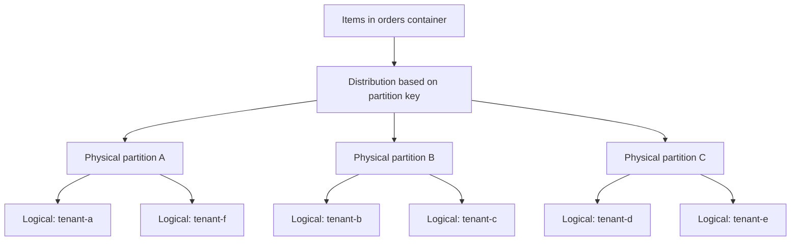
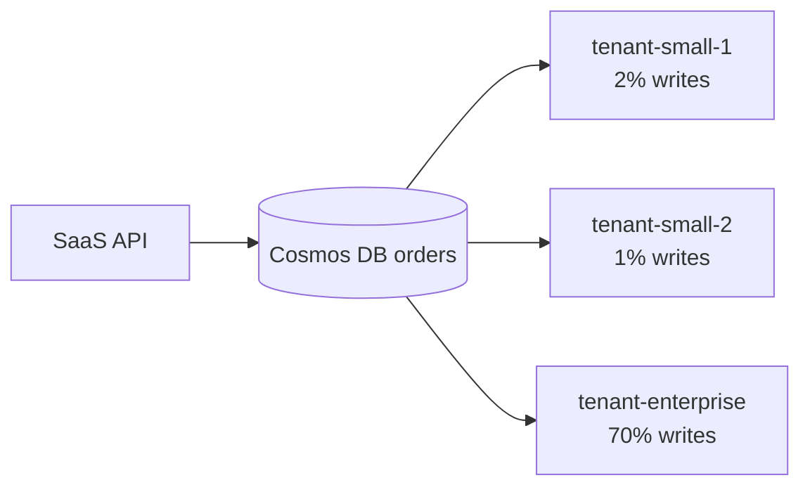
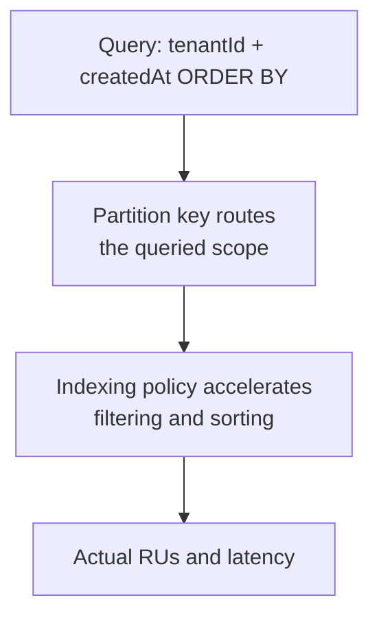
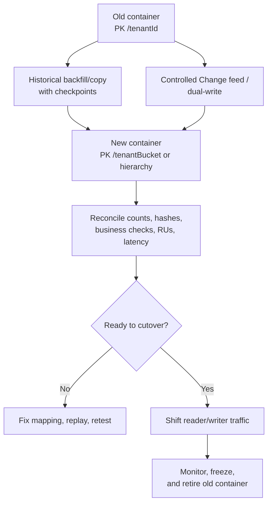

# Partition Keys and Workload-Driven Data Distribution

An e-commerce system stores millions of orders in **Azure Cosmos DB**. Users frequently look up a single order by its ID and business tenant, customer support staff list recent orders for a customer, and executives need revenue reports across all tenants. If a **partition key** is chosen merely because that field happens to exist in the JSON document, the system can suffer three problems: queries routinely scan multiple partitions, one large customer monopolizes write capacity, or a data group grows past the limits of a single logical partition. Selecting a partition key is therefore a **workload-driven architectural decision**, not just filling in a field name during container creation.

This lesson belongs to the **NoSQL Data with Cosmos DB** chapter of the **CLOUD_PROVIDERS_AZURE** module. The module explores Microsoft Azure from subscriptions, resource groups, and Entra ID to virtual networks, compute services, storage, and data, while teaching how to deploy, monitor, secure, and control the cost of Azure application architectures. In this chapter, the partition key connects **data modeling**, **scalability**, **latency**, **transactional consistency**, and **Request Units (RUs)**.

**Scope:** Examples focus on **Azure Cosmos DB for NoSQL**, where containers have a partition key path such as `/tenantId` and queries use the Cosmos DB SQL query API. Azure Cosmos DB supports other APIs such as MongoDB, Cassandra, Gremlin, and Table with different sharding terminology, mechanisms, and tooling; do not assume all SDK statements and limits in this lesson apply verbatim to those APIs.

**After this lesson, you will be able to:**

- Distinguish **partition key path**, **partition key value**, **logical partition**, and **physical partition**.
- Choose keys based on query patterns, load distribution, data growth, and transaction scope.
- Explain why a **point read** requires both `id` and the partition key and why cross-partition queries can consume high RUs.
- Identify **hot partitions**, low-cardinality keys, write skew, time-based keys, and noisy tenants.
- Evaluate **synthetic partition keys** and **hierarchical partition keys** when a single field is insufficient.
- Use the SDK and CLI to inspect partition keys, measure RU charges, and optimize data access.
- Plan **data migration to a container with a new partition key** when workloads evolve.

## 1. What Is a Partition Key?

In Azure Cosmos DB for NoSQL, each item typically has an `id` property and a value for the field chosen as the container's **partition key**. When creating a container, you configure a **partition key path**, such as `/tenantId`. Every item stored in the container carries a corresponding value at that path.

Example `orders` container with partition key path `/tenantId`:

```json
{
  "id": "order-1001",
  "tenantId": "tenant-a",
  "customerId": "customer-77",
  "status": "Paid",
  "amount": 850000,
  "createdAt": "2026-11-20T09:15:00Z"
}
```

**Distinguish two concepts:**

- **Path**: `/tenantId` — configured at the container level.
- **Value**: `tenant-a` — present on a specific item, determining which logical partition it belongs to.

Multiple items sharing the same partition key value belong to the **same logical partition**. A container can hold vast numbers of logical partitions depending on the number of distinct key values.

### 1.1. `id` Does Not Replace the Partition Key

For a container partitioned by `/tenantId`:

```text
(id = order-1001, partitionKey = tenant-a)  -> item A
(id = order-1001, partitionKey = tenant-b)  -> item B
```

Two items with the same `id` but different partition key values can coexist, because `id` uniqueness is scoped to a logical partition by default. Therefore, `id` alone is **not sufficient** to perform a point read when the SDK requires the partition key.

**Rule:** If an API route is `GET /orders/{id}`, determine how the client or service obtains the **partition key value**. Often a cleaner route is `GET /tenants/{tenantId}/orders/{id}`.

## 2. Logical Partitions and Physical Partitions

Azure Cosmos DB uses partitioning to distribute data and processing resources across multiple physical units.

| Concept | Meaning | Who Decides? |
|---|---|---|
| **Partition key path** | Field or set of paths configured when creating the container | Architect / developer |
| **Partition key value** | Key value stored on an item | Producer / application |
| **Logical partition** | Set of items sharing the same partition key value | Application data model |
| **Physical partition** | Underlying storage and request-serving unit managed by Cosmos DB | Azure Cosmos DB |
| **Throughput RU/s** | Request Unit budget serving data operations | Account/database/container config and service |



This diagram illustrates **one possible distribution**, not a fixed mapping rule. Cosmos DB manages placement and can add or split physical partitions as data or throughput grows.

### 2.1. A Logical Partition Is Not Split by a Physical Split

A **logical partition** corresponds to a single key value; items in that logical partition live together on one physical partition at any given time under the standard partitioning model. When Cosmos DB splits a physical partition, it can move **different logical partitions** onto new physical partitions, but **it cannot split a single logical partition sharing the same key** into multiple logical partitions to cure an overheated key.

Consequence: If **70% of all write traffic** targets `tenant-giant`, increasing total RU/s or physical partition count will not necessarily resolve the bottleneck on that **single logical partition**.

### 2.2. Storage and Throughput Limits

Logical and physical partitions have service-defined **size and throughput limits**. Exact figures depend on API, features (such as hierarchical partition keys), throughput mode, and current platform limits. Therefore:

- Estimate **maximum data size and RU/s per key value**, not just for the entire container.
- Check current Cosmos DB for NoSQL limits before choosing a key that can grow indefinitely.
- If a tenant or device can become massive, plan for **sub-keys, buckets, or hierarchical keys** upfront.
- Never assume raising container RU/s lets a single logical key bypass all limits.

## 3. What Are RU/s and How Do They Relate to Partitions?

Azure Cosmos DB measures request cost in **Request Units (RUs)**, representing the compute, memory, and I/O resources required to read, write, query, or execute operations. RU charges depend on many factors:

- Item size and property count.
- Point read vs. query, and how many items and partitions are examined.
- Indexing policy, filters/sorts, result count, and selectivity.
- Consistency level, query options, serialization, and active features.
- Update/upsert frequency, TTL, and background operations that carry resource costs.

**RU/s** is the provisioned throughput budget or capacity managed under supported autoscale/serverless modes. When total request demand exceeds provisioned capacity or concentrates on an overheated partition, **HTTP 429 / throttling** occurs in the corresponding API/protocol.

### 3.1. Total Throughput Does Not Mean Every Key Can Consume It All

Illustrative example:

```text
Container total budget:         12,000 RU/s
Illustrative physical layout:    3 partitions
Hot key: tenant-giant            7,500 RU/s demand
All other keys combined:         2,000 RU/s demand
```

Even though total demand (`9,500 RU/s`) is below the container's `12,000 RU/s` budget, the partition holding `tenant-giant` can still be throttled if its demand exceeds the capacity allocated to that physical partition. This illustrates **skew and hot partitions**, not the exact RU allocation algorithm of every throughput or autoscale mode.

### 3.2. Indexing Does Not Replace the Partition Key

Indexing `createdAt` makes filtering and sorting faster, but it does not turn a query missing `tenantId` into a point read. **The partition key routes the request**; **indexes locate and sort data within the queried scope**. Both must be designed well to optimize total RUs and latency.

## 4. Point Reads, Single-Partition Queries, and Cross-Partition Queries

### 4.1. Point Read: Exact Access to One Item

With `id="order-1001"` and `tenantId="tenant-a"`, the SDK performs a **point read**:

```python
# Azure Cosmos DB for NoSQL Python SDK, illustrative.
order = container.read_item(
    item="order-1001",
    partition_key="tenant-a"
)
```

A point read is typically one of the most RU- and latency-efficient operations because both `id` and the partition key are known upfront. If the application only knows the order ID, it needs a way to **resolve the partition key**:

- Include `tenantId`/`customerId` in the route or authenticated request context.
- Encode a deterministic key inside the ID under a stable contract.
- Maintain an auxiliary lookup/mapping table with controlled consistency and lifecycle.
- Or accept cross-partition queries when unavoidable and after measuring costs.

### 4.2. Partition-Filtered Query

Example listing orders for one tenant:

```sql
SELECT c.id, c.customerId, c.status, c.amount
FROM c
WHERE c.tenantId = @tenantId
  AND c.status = @status
```

When the query is executed with the corresponding partition key value, Cosmos DB can route it directly to the target logical partition per SDK/API capabilities. RU cost still depends on item count, indexing, and result payload.

### 4.3. Cross-Partition Query

Example aggregating all paid orders across every tenant:

```sql
SELECT VALUE SUM(c.amount)
FROM c
WHERE c.status = "Paid"
```

A query without a `tenantId` constraint may need to inspect multiple logical/physical partitions. Cost scales with data volume and query execution; not every cross-partition query is wrong, but if one sits on a hot path triggered on every HTTP request, **the partition design is likely misaligned**.

When global aggregations are large and frequent, consider:

- Maintaining **materialized views / aggregate containers** via the change feed or a suitable pipeline.
- Offloading to a dedicated analytics/ETL platform instead of continuously scanning the operational container.
- Running batch reports off-peak if SLAs allow.
- Storing and indexing only required attributes to reduce RUs.

### 4.4. Decision Questions Before Choosing a Key

Estimate at minimum:

1. What percentage of requests are **point reads**?
2. What percentage of queries filter by tenant, user, order, device, or time?
3. Does a business workflow need to update multiple items **in the same transaction**?
4. Which key values could be many times larger or hotter than average?
5. Do you need aggregations across tenants or regions?

If 80% of traffic is `GET order by tenantId + id`, `/tenantId` is a strong candidate. If 70% of traffic is `GET event by deviceId` but a few devices are ultra-hot, stress-test `/deviceId` before committing.

## 5. Four Criteria for Selecting a Partition Key

No single partition key fits every workload. A solid design balances at least four criteria:

| Criterion | Evaluation Question | Desired Outcome |
|---|---|---|
| **Query affinity** | Do requests usually know the key value upfront? | High ratio of point reads / single-partition queries |
| **Cardinality** | Are there many distinct key values? | Enough diversity to distribute data |
| **Even distribution** | Are data size and read/write RUs dominated by a few keys? | Avoids hot logical partitions |
| **Transaction boundary** | Do items needing transactions share the same key? | Co-located in one logical partition when atomicity is needed |

Add two long-term constraints:

- **Stable value:** The key value does not change over the item's lifecycle.
- **Growth headroom:** Every key has headroom for its projected peak item count and request rate.

### 5.1. High Cardinality Does Not Guarantee Even Distribution

A system with one million tenant IDs where the largest tenant drives 65% of write RUs will still run hot. Never just count distinct partition key values; inspect **traffic distribution per key value** across p50/p95/p99 and heavy hitters.

### 5.2. A Stable Value Does Not Mean Low Cardinality

`status` changes from `Pending` to `Paid`, making it a poor key for mutable items. `tenantId` is typically stable; `orderId` has high cardinality and stability, though listing all orders for a tenant requires a secondary pattern if that is a primary query.

### 5.3. Access Permissions Do Not Replace Partition Design

An app using managed identity and Cosmos DB data-plane RBAC properly can still burn excessive RUs if queries fan out. Conversely, a well-chosen partition key does not protect Tenant A's data from Tenant B: **authentication, authorization, and tenant filtering** must still be enforced independently.

## 6. Common Partition Keys and Their Risks

| Candidate | Strengths | Weaknesses / Risks |
|---|---|---|
| `/tenantId` | Easy per-tenant queries, convenient logical isolation and intra-tenant transactions | Large or noisy tenants can run hot or outgrow limits |
| `/customerId` | Fits customer profiles and shopping carts | High-volume customers; tenant-wide summaries require fan-out |
| `/orderId` | High cardinality, co-locates an order's items | Listing orders by customer or tenant requires secondary views/queries |
| `/deviceId` | Useful for per-device telemetry | Chatty devices or long-range time queries |
| `/region` | Simple when business is regionally segmented | Few values; prone to skewed distribution and oversized partitions |
| `/status` | Queries by status seem intuitive | Low cardinality, mutable values, hot spot on `Pending` |
| `/date` | Organizationally neat for daily batches | Current day receives nearly all writes (hot key); multi-day queries fan out |
| `/id` | Maximum distinct values, point reads when ID is known | A single user/tenant/order spreads across partitions; no grouped transactions |
| **Synthetic key** | Actively adds buckets to spread writes | Complex routing/reassembly; loses co-location on the natural key |
| **Hierarchical key** | Multi-level grouping and prefix routing | Requires alignment with query patterns and SDK/API support |

**Never choose `/status` just because 70% of queries include `WHERE status='Pending'`.** Almost all writes pile onto a handful of values, and items would have to move when status changes—two clear disqualifiers.

## 7. Transaction Boundaries: When Is Co-Location Needed?

In Azure Cosmos DB for NoSQL, mechanisms like **transactional batch** and stored procedures operate within the scope of **a single logical partition**. This means:

- If an operation needs to update multiple items atomically, they must share the **same partition key value** to use these transactional features.
- Two items with different partition key values do not automatically get **a cross-partition ACID transaction** via transactional batch.
- Cross-partition workflows require **sagas, compensating actions, outbox/change feed, idempotency, or an alternative database choice**.

### 7.1. Shopping Cart Example

```text
logical partition /cartId = cart-42
  item: cart-summary
  item: cart-line-1
  item: cart-line-2
```

If a workflow updates a cart line and the cart total in the same transaction, `/cartId` helps because related items are co-located.

However, stuffing every entity type of varying sizes and traffic rates into one `/tenantId` partition solely to “make transactions easy” can create massive logical partitions. Balance size limits, throughput, and transactional needs.

### 7.2. Item Identity + Partition Key in Transactions

In a `/cartId` container, these two items:

```json
{
  "id": "line-001",
  "cartId": "cart-42",
  "productId": "sku-7",
  "quantity": 2
}
```

```json
{
  "id": "summary",
  "cartId": "cart-42",
  "totalItems": 2
}
```

Can participate in the same transactional boundary. If their `cartId` values differ, transactional batch will not span them.

### 7.3. The Change Feed Does Not Guarantee Container-Wide Ordering

The change feed is useful for updating materialized views or reacting to mutations. However, never treat event ordering across **all logical partitions** as a single globally ordered stream. If a workflow requires strict ordering per order or customer, align the **key and consumer model** so related events are processed safely; every downstream processor still needs idempotency.

## 8. Workload-First: Building a Query and Load Matrix

Before creating a container, tabulate the top request paths:

| Request | Example Share | Needed Inputs | Partition Candidate |
|---|---:|---|---|
| GET order by ID within tenant | 45% | `tenantId + id` | `/tenantId` |
| List latest orders for a customer | 25% | `tenantId + customerId` | `/tenantId` or hierarchical key |
| Update order status | 18% | Single order, mutable status | Stable tenant or order key |
| Monthly reporting across tenants | 10% | Org-wide aggregation | Aggregate / analytics sink |
| Admin search across accounts | 2% | Cross-tenant search | Auxiliary search index / view |

These percentages are **hypothetical illustrations of the methodology**, not actual Azure metrics. In production, measure logs/APM and calculate p95/p99 latency, payload byte sizes, query fan-out, write RUs, and key growth.

### 8.1. Scoring Candidates

You can score candidates on a 1–5 scale across criteria:

| Candidate | Query Affinity | Load Distribution | Transaction Fit | Growth Headroom |
|---|---:|---:|---:|---:|
| `/tenantId` | 5 | 2–4 depending on tenant skew | 4 | 2–4 |
| `/orderId` | 2–3 | 5 | 5 if each order is an aggregate | 5 |
| `/customerId` | 4 for customer queries | 3–5 | 4 | 3–5 |
| `/status` | 2–3 | 1 | 1 | 1 |

**Scores are heuristics**, not a substitute for load testing. Weight criteria by business priority: low p99 checkout latency usually outweighs a monthly report that runs for 30 minutes.

### 8.2. Design for Growth, Not Just Day One

Estimate:

- Number of tenants/users/devices at Year 1 and Year 3.
- Maximum item count for the **largest tenant**, not just the average.
- Peak read and write rates for a single key.
- Trends in item size and retention/TTL.
- Concurrent requests hitting one key and cross-partition query ratio.
- Data that must stay co-located for transactions.

A key that looks fine on 1,000 test items can break once a single tenant grows to tens of millions of items.

## 9. Case Study 1: Multi-Tenant SaaS Where One Large Tenant Dominates

**Context:** An accounting SaaS serves many small businesses alongside a few huge enterprise customers. The app usually reads data by tenant.

**Initial option:** `/tenantId`.



In terms of query locality, `/tenantId` is strong: most requests know the tenant. However, `tenant-enterprise` could exceed practical logical partition limits or overheat its underlying physical partition.

### 9.1. Options

1. **Keep `/tenantId`** if load tests prove every tenant stays safely within limits, favoring simplicity.
2. **Hierarchical key** such as `/tenantId`, `/customerId`, `/orderId` when supported and large tenants need finer sub-partitioning.
3. **Synthetic bucket** like `tenantId + bucket` to split writes, with intentional routing and reassembly.
4. **Isolate large tenants** into dedicated containers or accounts when strict capacity, cost, or compliance isolation is needed.

Never scale RU/s endlessly assuming a hot key will automatically split into multiple logical partitions.

### 9.2. Noisy Neighbors and Fairness

When tenants share container throughput, a traffic surge from one tenant can impact others depending on partition placement and workload. Alongside the partition key, implement:

- Per-tenant rate limiting at the API layer.
- Appropriate autoscale or provisioned throughput.
- Per-tenant SLOs and metrics, not just aggregate RU/s.
- Capacity isolation (dedicated containers/accounts) for tenants with strict SLAs.
- Per-tenant chargeback/showback built from application telemetry.

**A partition key is not a security boundary.** The API must authenticate the tenant, query only authorized tenants, and apply data-plane RBAC and authorization per the application model.

## 10. Case Study 2: IoT Telemetry, Write-Heavy and Time-Series

**Context:** A platform ingests telemetry from many devices. Devices emit readings every few seconds, while some industrial machines send thousands of events in bursts. Primary queries:

- View the last 15 minutes of data for one device.
- Compute per-device alerts.
- Compute daily factory totals and fleet dashboards.

### 10.1. `/deviceId` and Its Limits

`/deviceId` provides strong query affinity, but if a device sends high-frequency bursts or data is retained long-term, its logical partition can grow too large or too hot.

### 10.2. `/date` Is a Dangerous Key for Hot Writes

If the entire system writes to `date = "2026-11-20"`, nearly every write for that day lands on the same logical partition. Each new day creates a new key, yet today's write load remains unspread. This is an example of **low effective cardinality at the current point in time**, even though many dates accumulate over the long run.

### 10.3. A Balanced Design Candidate

```text
partition key candidate: /deviceBucket
deviceBucket = deviceId + "#" + yyyyMM

id = <eventId>
deviceId = <device-id>
eventTime = <timestamp UTC>
```

This creates logical partitions per **device + month**, capping unbounded growth per device. Still, a device running extremely hot within a single month remains a hot key; evaluate extra event-hash buckets or hierarchical keys if needed.

If 15-minute queries know `deviceId` and the month, they route cleanly; querying a device's full multi-year history scans multiple buckets. There is a clear trade-off between **growth headroom** and **query locality**.

### 10.4. TTL and Analytics

Telemetry often pairs well with TTL to expire operational data after its active retention window. However:

- TTL does not replace partition design.
- TTL deletions and write amplification can affect RUs and cost depending on throughput mode.
- Fleet dashboards should read from **aggregates / analytics sinks** at scale.
- If long-term compliance storage is required, evaluate a cold storage or analytics engine rather than retaining every raw event in an operational Cosmos container at high RU cost.

## 11. Case Study 3: Orders Requiring Per-Order Transactions

**Context:** An order has a header, lines, discounts, and status. Updates frequently modify multiple items of the **same order**.

Candidate `/orderId`:

```text
Logical partition order-1001:
  header
  line-001
  line-002
  discount-01

Logical partition order-1002:
  header
  line-001
  line-002
```

Strengths:

- All items for an order are co-located.
- Can use transactional batches scoped to the same order per SDK support.
- High key cardinality scaling with order volume.

Weaknesses:

- Listing all orders for a customer must query across many `orderId` partitions if this is the only container.
- Queries filtering by `tenantId + createdAt` lack the full partition key.

### 11.1. Modeling the Read Shape to the Query

You can **embed order header and order lines in a single item** when size and atomicity permit, instead of splitting into multiple items:

```json
{
  "id": "order-1001",
  "orderId": "order-1001",
  "tenantId": "tenant-a",
  "customerId": "customer-77",
  "lines": [
    {"sku": "sku-1", "qty": 2},
    {"sku": "sku-2", "qty": 1}
  ],
  "status": "Paid"
}
```

A single item with nested lines updates atomically at the item level, though you must weigh **item size, write amplification, concurrency, and per-line update frequency**. When orders are huge or lines are updated independently, the co-located multi-item pattern can work better.

### 11.2. Materialized Read Model

If a primary requirement is “list a customer's 20 latest orders,” maintain **customer-order summaries** in a read-model container partitioned by `/customerId`, fed via the change feed or an outbox.

This trades controlled **data duplication** for lower RUs and query latency. You must account for event propagation lag, eventual consistency, and recovery when the read model falls behind.

## 12. Synthetic Partition Keys

A **synthetic key** is a value computed by the application from multiple fields—or one field plus a bucket—and stored as **a single property** used as the partition key.

Example:

```text
tenantBucket = tenantId + "#" + bucketNumber
bucketNumber = hash(orderId) mod 16

tenant-a#0
tenant-a#1
...
tenant-a#15
```

This distributes items from a large tenant across up to 16 key values. The number 16 is an **illustrative parameter**, not a universal default.

### 12.1. Advantages

- Spreads writes for an overheated tenant if the hash distributes evenly.
- Increases effective headroom compared to a single logical partition.
- Knowing both `tenantId` and `orderId`, the application can compute the bucket for a **point read**.

### 12.2. Trade-offs

- Querying “all orders for a tenant” must fan out across buckets or use a read model.
- Transactions are atomic only within a single **tenantBucket**, losing tenant-wide co-location.
- Changing the bucket count or hash algorithm later breaks routing unless versioned or migrated.
- If a single entity is hot and all writes share the same `orderId`, hashing `orderId` still routes all of that entity's traffic into **one bucket**.

### 12.3. The Hash Must Be Deterministic

Never use a language's built-in `hash()` if its implementation randomizes seeds across processes or restarts. Use a **deterministic algorithm** (e.g., SHA-256, taking fixed bytes modulo `bucket_count` per spec) and write cross-service compatibility tests.

Illustrative Python example:

```python
import hashlib


def stable_bucket(order_id: str, bucket_count: int = 16) -> int:
    if bucket_count <= 0:
        raise ValueError("bucket_count must be positive")
    digest = hashlib.sha256(order_id.encode("utf-8")).digest()
    number = int.from_bytes(digest[:8], byteorder="big")
    return number % bucket_count


def tenant_partition_key(tenant_id: str, order_id: str) -> str:
    return f"{tenant_id}#{stable_bucket(order_id)}"


print(tenant_partition_key("tenant-a", "order-1001"))
```

Production code must also handle encoding, delimiter escaping in tenant IDs, hash versioning, key consistency across services, and input validation. Changing `bucket_count` on existing data does not relocate old items automatically; plan for versioned keys or explicit migration.

## 13. Hierarchical Partition Keys

Azure Cosmos DB for NoSQL supports **hierarchical partition keys** on supported resource types and features. Instead of one synthetic string, a container defines **multiple hierarchical paths**, such as:

```text
Level 1: /tenantId
Level 2: /customerId
Level 3: /orderId
```

A leaf logical partition is identified by the **tuple of values across all levels**. This spreads large tenants across many key combinations while enabling **prefix-hierarchy** queries to route more efficiently than unkeyed fan-outs.

### 13.1. When Are Hierarchical Keys Useful?

- Multi-tenant SaaS where each tenant has many users and orders.
- Common queries always know `tenantId`, and often know `customerId` or `orderId`.
- You want to avoid packing an entire large tenant into one logical partition.
- You need hierarchical grouping plus deeper load distribution.

### 13.2. Limitations to Understand

- **A prefix query does not necessarily touch just one logical partition:** one `tenantId` may span many `customerId/orderId` leaf partitions.
- A single leaf value can still run hot; hierarchical keys do not cure write skew on one entity.
- Point reads and transactions must supply **all partition key components** per API/SDK rules.
- Feature availability and exact SDK/version signatures must be verified before coding.
- Level ordering **matters**: `tenantId → customerId → orderId` routes very differently from `orderId → tenantId → customerId`.

### 13.3. Comparing Synthetic vs. Hierarchical Keys

| Criterion | Synthetic Key | Hierarchical Key |
|---|---|---|
| Representation in item | One app-computed field | Multiple fields along hierarchical paths |
| Prefix routing | Usually requires manually computing/scanning buckets | Supports optimized prefix routing where supported |
| Bucket distribution control | Flexible, app-controlled | Depends on natural data cardinality at each level |
| Migration / hash versioning | Must manage hash/bucket changes | Must manage schema/key path changes |
| Transactions | Scoped to same synthetic value | Scoped to same full partition key tuple |
| Risks | Multi-bucket query fan-out, inconsistent key calculation | Overly broad top level, hot leaf, SDK compatibility |

Do not pick hierarchical keys just because they are “newer.” If the workload always uses `/orderId` and never needs tenant prefixes, a flat key is simpler to operate.

## 14. Matching Key Levels to Real Queries

Suppose a SaaS orders container uses the hierarchical key:

```text
(/tenantId, /customerId, /orderId)
```

| Query | Known Keys? | Routing / Trade-off |
|---|---|---|
| Read order by full composite key + `id` | All three levels | Targeted, efficient access |
| List orders for a customer | Tenant + customer | Prefix routing reduces fan-out |
| List orders for a tenant | Tenant only | Can fan out across many leaf partitions within the tenant |
| Report across all tenants | No prefix | Cross-partition / analytics |
| Update multiple items of one order | Full key together | Can leverage transactional boundary |

If 70% of queries only know `orderId` without tenant or customer, a hierarchy starting with `tenantId` will force extra lookups. A good key reflects **what real requests actually know**, not just an idealized JSON hierarchy on paper.

### 14.1. “Prefix” Is Not an Arbitrary Secondary Index

Hierarchical partition keys do not turn queries on **any arbitrary level** into routed queries. If a query only knows `customerId` without the top-level `tenantId`, never assume it routes as efficiently as a Level-1 prefix query. Measure **RU charges and query metrics** with realistic skewed datasets.

## 15. Partition Keys and Indexing Policies

The two components serve distinct purposes:



In Cosmos DB for NoSQL, multi-property `ORDER BY` queries may require a matching **composite index** per engine rules. Indexing policies can also exclude unqueried paths to cut write RUs and storage, though you must never drop queried paths without testing.

### 15.1. Do Not Change the Partition Key to Fix Every Slow Query

If 95% of traffic consists of fast point reads and a single `ORDER BY createdAt` report burns too many RUs, start by:

1. Inspecting query and indexing metrics.
2. Evaluating composite indexes or tighter filters.
3. Enforcing pagination and bounded result sets.
4. Moving the report to a materialized view or analytics store.

Only re-evaluate the partition key and plan a migration when **workload routing** or key hotspots are the root cause.

### 15.2. Write Indexing Overhead

Large items with many indexed paths cost more RUs on writes and upserts. Frequent updates on the same hot key also add contention on a single partition. Distinguish:

- **Partitioning issue:** Uneven data and throughput distribution.
- **Indexing issue:** High write RUs caused by the indexing policy.
- **Application issue:** Excessive updates, duplicate writes, or retry storms.

Each requires a different fix; never throw extra RUs at the problem just to mask it.

## 16. Modeling Items and Partition Key Paths

### 16.1. Use a Stable Field Present on Every Item

Good example for a tenant-partitioned container:

```json
{
  "id": "order-1001",
  "tenantId": "tenant-a",
  "type": "order",
  "customerId": "customer-77",
  "status": "Paid"
}
```

Error-prone example:

```json
{
  "id": "order-1002",
  "organization": {
    "tenant": "tenant-a"
  },
  "status": "Pending"
}
```

If the container uses `/tenantId` and the second item omits `tenantId`, the SDK/service handles the **undefined/missing** value per partition key semantics. Piling many keyless items into the same bucket is a **major distribution risk**; depending on validation/SDK rules, operations may either be rejected or silently grouped into a missing-key partition. Never assume missing keys are harmless.

### 16.2. Nulls, Missing Fields, and Data Types

When using string keys, standardize:

- Do not allow `tenant-a`, `Tenant-A`, and `TENANT-A` to represent the same tenant unless explicitly normalized.
- Do not mix numbers and strings (`42` vs. `"42"`) across microservices.
- Do not use client-generated timestamps with missing timezones or inconsistent formats as keys.
- Disallow null or missing values on business items requiring deterministic partitioning.
- If keys contain sensitive values, evaluate exposure in logs, diagnostics, and query parameters.

### 16.3. Avoid Keys That Change Over Time

Fields like `status`, `assignedTeam`, or a mutable `region` are poor partition keys for items that get updated. In Cosmos DB, **changing an item's partition key value is not a normal field update**; it typically requires creating a new item in the target partition and deleting/cutting over the old item safely, with no simple cross-partition transaction wrapping both steps.

## 17. Queries and SDK: Separating Point Reads from Fan-Out

Examples use the **Azure Cosmos DB for NoSQL Python SDK** in an authorized environment. This snippet is **read-only**.

### 17.1. Connecting with Microsoft Entra ID

```python
import os
from azure.identity import DefaultAzureCredential
from azure.cosmos import CosmosClient

endpoint = os.environ["COSMOS_ENDPOINT"]
credential = DefaultAzureCredential()
client = CosmosClient(url=endpoint, credential=credential)

database = client.get_database_client("commerce")
container = database.get_container_client("orders")
```

**Prerequisites:**

- `azure-cosmos` and `azure-identity` versions supporting `TokenCredential`/Entra authentication for NoSQL accounts.
- The principal holds an appropriate **Cosmos DB data-plane role** for reads; **Azure RBAC Contributor/Reader on the resource group does not grant data-plane reads**.
- Correct account endpoint, networking/DNS, and firewall/Private Endpoint rules.
- Proper connection/client reuse; avoid instantiating a new client on every HTTP request.

### 17.2. Point Read

```python
item = container.read_item(
    item="order-1001",
    partition_key="tenant-a",
)

print(item["status"])
```

This supplies both **`id` + partition key value**. Passing the wrong `tenant-b` returns `NotFound` even though `order-1001` exists under `tenant-a`.

### 17.3. Partition-Routed Query

```python
query = """
SELECT c.id, c.status, c.createdAt
FROM c
WHERE c.tenantId = @tenant
  AND c.status = @status
"""

results = container.query_items(
    query=query,
    parameters=[
        {"name": "@tenant", "value": "tenant-a"},
        {"name": "@status", "value": "Paid"},
    ],
    partition_key="tenant-a",
)

for row in results:
    print(row["id"], row["status"])
```

SDK versions and options can affect syntax and how partition keys are supplied. Verify arguments against the exact **SDK for NoSQL** version in use, especially for hierarchical keys. Even a partition-scoped query incurs RU charges based on document count and indexing.

### 17.4. Cross-Partition Query — Only When Intentional

```python
# Reporting example: spans all tenants, can consume significant RUs.
query = "SELECT VALUE COUNT(1) FROM c WHERE c.status = @status"

results = list(container.query_items(
    query=query,
    parameters=[{"name": "@status", "value": "Paid"}],
    enable_cross_partition_query=True,
))
print(results)
```

This query can fan out across partitions. Never run it thousands of times per second in production just because it returned quickly on a tiny test dataset. For large-scale aggregations, use a pipeline or read model.

## 18. Creating a Container: Partition Keys Are Durable Decisions

Example creating the `orders` container with `/tenantId` via the SDK:

```python
from azure.cosmos import CosmosClient, PartitionKey
from azure.identity import DefaultAzureCredential
import os

# WRITE OPERATION: run only in an approved lab environment.
client = CosmosClient(
    url=os.environ["COSMOS_ENDPOINT"],
    credential=DefaultAzureCredential(),
)
database = client.get_database_client("commerce")

container = database.create_container_if_not_exists(
    id="orders",
    partition_key=PartitionKey(path="/tenantId"),
)
```

**Warnings:**

- This code writes a resource and requires **data-plane container-management permissions**; never run it against production just to “test.”
- If the container already exists with a different partition key, `create_container_if_not_exists` does not rewrite its path. Inspect the actual definition.
- Throughput can be provisioned on the container or shared at the database level; capacity configuration is a separate concern.
- For hierarchical partition keys, use the definition syntax supported by your SDK/service version; do not pass a `#`-joined string and call it native hierarchical partitioning.
- Test only in accounts/environments with proper quotas and cost controls.

### 18.1. You Cannot Change the Partition Key Path Directly

For an existing NoSQL container, the partition key path is **not an attribute you can arbitrarily alter to reshuffle all data in place**. Changing keys normally requires **creating a new container with the new partition key and migrating data and traffic**.

Treat pre-go-live partition key reviews with the same rigor as a major production schema migration review.

## 19. Azure CLI: Inspecting Container Partition Key and Throughput

The commands below are **read-only** against Azure Cosmos DB for NoSQL container metadata and verify the active partition key.

```bash
RG="rg-data-prod"
ACCOUNT="cosmos-commerce-prod"
DATABASE="commerce"
CONTAINER="orders"

az account show \
  --query "{subscription:name,id:id,tenant:tenantId}" \
  -o table

az cosmosdb sql container show \
  --resource-group "$RG" \
  --account-name "$ACCOUNT" \
  --database-name "$DATABASE" \
  --name "$CONTAINER" \
  --query "{id:id,partitionKey:partitionKey,indexingPolicy:indexingPolicy,defaultTtl:defaultTtl}" \
  -o json
```

Inspect:

- `partitionKey.paths` or the corresponding structure.
- `partitionKey.kind`/definition if using multi-level hierarchical keys.
- `indexingPolicy` and included/excluded paths.
- `defaultTtl` if automatic retention is configured.

### 19.1. Inspecting Throughput Mode

```bash
# Read-only: if the container uses dedicated throughput, inspect its setting.
az cosmosdb sql container throughput show \
  --resource-group "$RG" \
  --account-name "$ACCOUNT" \
  --database-name "$DATABASE" \
  --name "$CONTAINER" \
  -o json
```

If the container shares **database-level** throughput or uses another capacity mode, the container-level throughput command may not return the expected object. In that case, inspect **database throughput** or account settings per current Azure CLI behavior—never assume a workload has zero RU capacity just because one management query returned empty.

### 19.2. Do Not Measure RU Health by Reading Azure CLI Metadata

Metadata reveals the partition key and throughput settings, **not whether live traffic is balanced**. Combine Azure Monitor/Insights with SDK diagnostics and response headers to inspect **RU charges and hotspots** under real traffic.

## 20. Measuring RUs, Latency, and Hot Partitions

Key metrics to watch:

| Metric | Meaning | Warning Signal |
|---|---|---|
| **Normalized RU consumption** | Capacity utilization per partition/aggregate where available | A few partitions pinned near 100% |
| **Total requests and 429 rate** | Request volume and throttling rate | Rising 429s alongside SLO latency degradation |
| **RU charge/request** | Operation efficiency per request | Common query RU jumps after a deploy |
| **p95/p99 latency** | End-user experience | Tail latency spikes even when averages look fine |
| **Data size by partition key** | Storage concentration per key | One key far larger than all others |
| **Hot key distribution** | Read/write RUs by logical key | One key dominates total load |
| **Storage growth and TTL** | Capacity headroom and retention | Partitions growing faster than projected |
| **Cross-partition query ratio** | Share of unrouted queries | Rising fan-out on hot request paths |

Exact metric names and dimensions vary by Cosmos DB API, account type, and Azure Monitor capabilities. Azure Portal Insights and diagnostic logs may expose partition-level or partition-key statistics where supported; **never assume every tenant key is individually plotted in a summary chart**.

### 20.1. Interpreting 429s Properly

Occasional 429s in some workloads are handled transparently by the SDK's **automatic retry policy**. Look deeper at:

- Are 429s causing final request failures or only internal retries?
- How much is latency increasing, and is it breaching SLOs?
- Are 429s **container-wide** or isolated to specific physical/logical keys?
- Does autoscale/provisioned throughput have sufficient headroom?
- Are queries or indexing inflating RU per request?

**Raising total RU/s** helps when the whole system is near capacity with balanced distribution. If only one key is hot, you must **reshape workload distribution**, not just buy more throughput.

### 20.2. Auditing Key Distribution

Use application telemetry (without logging sensitive payloads) to capture:

```json
{
  "operation": "CreateOrder",
  "partitionKeyClass": "tenant-large",
  "ruCharge": 9.7,
  "durationMs": 43,
  "statusCode": 201,
  "activityId": "diagnostic-example"
}
```

This is an **illustrative log**, not a default SDK schema. Hash or classify tenant keys instead of logging raw values to avoid leaking customer data. Include a correlation ID linking API requests, Cosmos diagnostics, and downstream events.

## 21. Practical Sizing Formula

Suppose:

```text
Peak point reads:            3,000 requests/s
Average RU per point read:     1.2 RU (assumed lab measurement)
Peak writes:                   800 requests/s
Average RU per write:            8 RU (assumed lab measurement)
Cross-partition reporting:     500 RU/s (assumed)
```

Estimate:

\[
\begin{aligned}
RU_{\mathrm{reads}} &= 3000 \times 1.2 = 3600 \ \mathrm{RU/s} \\
RU_{\mathrm{writes}} &= 800 \times 8 = 6400 \ \mathrm{RU/s} \\
RU_{\mathrm{total}} &\approx 3600+6400+500 = 10500 \ \mathrm{RU/s}
\end{aligned}
\]

This is a **starting sizing estimate**, not Azure pricing or fixed operation RU guarantees. Real sizing must also factor in:

- Headroom for bursts, retries, batches, and maintenance.
- Distribution across physical partitions and hot logical keys.
- Indexing, consistency, and changing item sizes.
- Peak vs. steady-state traffic ratios.
- Multi-region topologies, SLAs, and failover load shifts.

A sizing model that only calculates **total RU/s** without checking **RU/s on the hottest single key** can badly misjudge scalability.

## 22. Partition Keys and Consistency

Azure Cosmos DB supports multiple **consistency levels** configured at the account or request level. The partition key affects data locality and transaction boundaries, but **does not directly dictate global consistency guarantees**.

For example:

- A transactional batch in one logical partition executes atomically within the engine.
- A query reading from **two logical partitions** does not magically become a cross-partition business snapshot transaction.
- A read model updated via the change feed can lag behind the write model.
- Multi-region writes require conflict resolution, versioning, and idempotency tailored to the active mode.

**Never treat a partition key as a guarantee that all replicas see writes simultaneously.** When business logic requires read-your-writes or strict update ordering, choose appropriate consistency levels, session tokens, version checks, and API semantics.

### 22.1. Multi-Region Does Not Fix a Hot Key

Adding regions to cut latency or boost availability does not split a hot logical partition in **one region** into smaller keys. Multi-region topology and partition design are orthogonal axes: one governs geographic placement and replication, while the other governs data, query routing, and throughput distribution.

## 23. TTL, Lifecycle, and Data Costs

Partitioning choices also interact with item lifecycles:

| Workload | Retention | Partition Design Considerations |
|---|---|---|
| Orders | Years per legal/business policy | Growth per tenant/order, long-term reporting |
| Shopping carts | Hours/days | TTL, frequent updates, per-cart transactions |
| IoT telemetry | Short to medium | Write-heavy, hot devices, time buckets, analytics |
| Session state | Minutes/hours | Key by session/user, low latency and TTL |
| Event inbox/dedup | Per retry/replay window | Key by consumer/aggregate; avoid overly short TTL |

### 23.1. Partitioning by Date Does Not Replace Retention Policies

To purge telemetry after 30 days, use TTL alongside an appropriate time-aware schema. You are **not forced to use `/date`** as the partition key. Picking `/date` funnels all of today's writes into one logical partition; TTL expires old data later, doing nothing to fix today's write hotspot.

### 23.2. Costs Extend Beyond Storage GB

Total cost of ownership includes:

- Provisioned/autoscale RU/s or request-based serverless charges.
- Data storage, index storage, and replication multipliers.
- Cross-partition queries and duplicated read models.
- Change feed workers, analytics pipelines, and networking.
- Metrics/logging, multi-region copies, and backups.
- Engineering and operational migration costs if the initial key is wrong.

Adding an extra **read model** increases storage slightly while **dramatically cutting operational query RUs**; optimize for total cost and SLOs rather than a single line item.

## 24. When the Partition Key Is Wrong: Migration Plan

Because an existing container's partition key path **cannot be altered in place**, migration typically follows this flow:



**Never simply copy all data and immediately swap connection strings** while the system is actively taking writes. You must capture mutations occurring during the copy without dropping or duplicating updates.

### 24.1. Detailed Migration Runbook

1. **Capture workload baseline:** p95/p99 latency, RU charges, 429s, data size, key skew, top queries.
2. **Select the new key:** Driven by telemetry, limits, and query patterns; record an ADR (Architecture Decision Record).
3. **Provision the new container:** Partition key, indexing policy, throughput/TTL, RBAC, and networking as planned.
4. **Backfill:** Read historical data in checkpointed batches; transform key fields; throttle to protect source/target.
5. **Catch up live changes:** Use the change feed, dual-write, or a controlled sync mechanism to apply in-flight writes.
6. **Idempotent upsert:** Preserve item IDs and business versions, handling deletes/tombstones and concurrent updates safely.
7. **Validation:** Compare per-tenant counts, hashes/checksums where appropriate, sample reads, duplicates/misses, and transaction constraints.
8. **Canary reads/writes:** Route a small traffic slice and watch RUs, latency, 429s, and permission errors.
9. **Cutover:** Shift routing cleanly with a defined freeze/rollback boundary and stakeholder communication.
10. **Post-cutover:** Monitor lag, stale reads, hot partitions, and cost; archive/delete the old container per retention and approvals.

### 24.2. Migration Pitfalls

- **The change feed is not a full deletion log in every mode/configuration:** verify how deletes are captured for your active change feed mode.
- Copying in chronological order does not prevent older data from overwriting newer writes.
- Blind `upsert` can clobber fresher updates.
- Changing a synthetic bucket algorithm shifts where IDs route.
- Stale legacy clients pointing at the old container cause split-brain state.
- SDK queries might silently fall back to cross-partition scans after changing keys.

### 24.3. Practical Rollback Planning

Rollback is rarely just “pointing the connection string back to the old container,” because fresh writes may already reside in the new container. Define the **source of truth** for each migration phase and prepare reverse sync or reconciliation if a rollback is triggered.

## 25. Security and Multi-Tenant Partitioning

Partition keys **route data**, they do not enforce authorization:

```text
Client sends tenantId = tenant-b
API authenticates user as belonging to tenant-a
=> API must REJECT the query for tenant-b
```

If an API blindly takes a client-supplied `tenantId` and passes it straight as the partition key without verifying ownership, a user can read another tenant's data even though the query hits a single logical partition.

Defense-in-depth layers:

1. Microsoft Entra ID / OAuth / JWT authenticates the principal.
2. API authorization checks which tenants and objects the principal may access.
3. Cosmos DB data-plane RBAC restricts application identities to the narrowest supported scope.
4. Query and container routing always use the **verified tenant**, never untrusted client input.
5. Private Endpoints, firewalls, and TLS secure the network path.
6. Auditing and tracing avoid dumping raw sensitive partition keys into uncontrolled logs.

### 25.1. When Is Database-per-Tenant Better?

If tenants demand strict isolation for throughput, cost, security, or retention, evaluate:

- Container-per-tenant.
- Database-per-tenant.
- Account-per-tenant for stringent isolation requirements.

The trade-offs are resource sprawl, IaC/monitoring complexity, quotas, minimum throughput floors, and operational overhead. A single `/tenantId` partition key cannot solve every noisy-neighbor or compliance mandate.

## 26. Troubleshooting: Wrong Key or Misconfiguration?

| Symptom | Common Cause | How to Verify |
|---|---|---|
| `read_item` returns `NotFound` despite item visible in Portal | Wrong `partition_key` or `id` | Check exact ID, value, path, and JSON item |
| 429s concentrated on a few tenants | Hot logical/physical partition, key skew | Normalized RU/partition metrics, top keys |
| Queries burn high RUs | Cross-partition fan-out, missing index, huge items | Query metrics, RU charge, query diagnostics |
| Few tenants yet high scaling needed | Low cardinality, narrow key distribution | Inspect distinct key counts and write distribution |
| Daily hotspots appear reliably | Partition key based on current date | Write distribution by timestamp and key |
| Transactional batch fails | Items have different partition key values or bad request | Verify full partition key on every item |
| Item update cannot change `tenantId` | Partition key value is immutable per item | Move item via controlled copy+delete workflow |
| Another tenant's data is readable | Missing tenant authorization in API | JWT claims, access checks, audit logs |
| 429s persist after scaling up autoscale | Hot key, RU skew, high per-operation RU | Physical partition metrics and key distribution |
| Need to query all orders for a customer | Partitioned by `orderId` without a read model | Review query patterns and materialized views |
| SDK point read fails on hierarchical key | Missing composite PK components | Check SDK API/version and container PK definition |
| Migration overwrites newer data with old data | Backfill lacks version/CDC ordering guards | Check `_etag`/version, change feed lag, cutover |
| Latency jumps after indexing edit | Policy missing filter/sort paths or higher write RUs | Query plan/metrics and indexing policy |
| Storage grows unexpectedly fast | Unsuitable TTL/retention, bloated logical key | Container size/key growth and lifecycle policy |
| Driver returns 403 | Missing Entra/Cosmos data-plane role or network block | Identity, data roles, firewall/Private Endpoint |

### 26.1. Do Not Fix 429s with Infinite Retries

The Cosmos DB SDK handles transient throttling with bounded retries. However, when a producer hammers a hot key relentlessly:

- Infinite retries inflate tail latency and exhaust client resources.
- Smooth or reshape writes, or increase capacity where effective.
- Consider batching, durable buffering, token buckets, and bounded concurrency.
- Evaluate whether a **key redesign** is needed rather than just raising timeouts.

### 26.2. Be Careful with Diagnostic Logging

Cosmos DB diagnostics can expose resource names, partition keys, or request details. Scrub personal data, access tokens, and document bodies before sharing logs. Rely on correlation and activity IDs for troubleshooting without dumping full payloads.

## 27. Testing Partition Keys with Representative Data

A meaningful test does more than insert 100 uniform items and run `SELECT *`.

### 27.1. Simulated Dataset

Build a dataset containing:

- 1–5 massive tenants generating a large share of traffic.
- Many small tenants forming a long-tail distribution.
- Items of varying sizes and shapes.
- Read-heavy, write-heavy, and mixed workloads.
- A batch workload reporting across the dataset.
- Items undergoing frequent state transitions.
- TTL expirations, deletes, and retry bursts if applicable.

### 27.2. Test Scenarios

1. Measure **point read RUs** using `id + PK`.
2. Measure a partition-filtered query versus the same query without the filter.
3. Ramp write throughput against **one hot key** and observe 429s and latency.
4. Scale tenant count to observe physical partition distribution.
5. Benchmark synthetic or hierarchical candidates in a dedicated lab container.
6. Test transactions scoped to a single logical partition.
7. Test read-model updates via the change feed and measure downstream lag.
8. Test failover/multi-region behavior if required by the architecture.

### 27.3. Example Acceptance Criteria

```text
Business:
  - P95 point-read latency meets internal SLO
  - 0 unauthorized cross-tenant reads in security tests
  - Transactional operations uphold required atomicity

Capacity:
  - No sustained hot-key throttling under projected peak load
  - Headroom available for peak RU/s and data growth
  - Cross-partition query costs remain within budget

Operational:
  - Dashboards distinguish global RUs from partition skew
  - Migration/rollout plan ready if key design must evolve
```

These criteria are **testing templates**, not numerical SLA commitments from Cosmos DB. Always derive thresholds from your actual region, consistency level, SDK, and workload measurements.

## 28. Production Design Checklist

- [ ] Confirmed API choice (**Cosmos DB for NoSQL**) and supported partitioning features.
- [ ] Documented top reads, writes, queries, traffic shares, and p95/p99 SLOs.
- [ ] Most point reads have **both item ID and partition key** available.
- [ ] Evaluated **data size and RU/s distribution per key**, not just distinct key count.
- [ ] Selected candidate has high cardinality and avoids write hotspots.
- [ ] Partition key values are immutable with strict type and normalization rules.
- [ ] Avoided `/status` or `/today` as keys merely for query convenience.
- [ ] Transactional batch and stored procedure scopes match a single logical partition.
- [ ] Evaluated hot tenants/devices and long-term growth headroom.
- [ ] Hierarchical or synthetic keys justified by routing needs and verified for SDK compatibility.
- [ ] Indexing and query strategy kept distinct—composite indexes are not mistaken for partition keys.
- [ ] Global reporting offloaded to read models or analytics when fan-out is costly.
- [ ] Autoscale or provisioned throughput sized for both **total RUs and skew**.
- [ ] TTL/retention and item sizes factored into capacity and cost models.
- [ ] Microsoft Entra/RBAC, tenant authorization, and Private Endpoints designed independently.
- [ ] Telemetry tracks 429s, normalized RUs, partition hotspots, RU charges, and latency.
- [ ] Load-tested with realistic skewed datasets and peak traffic bursts.
- [ ] Migration plan prepared for moving to a new container if the partition key ever changes.
- [ ] ADR documented with an owner responsible for reviewing design as traffic grows.

## 29. Self-Check Questions

1. How does a partition key path differ from a partition key value? Illustrate with `/tenantId`.
2. How do logical partitions differ from physical partitions?
3. Why doesn't a physical partition split automatically fix an extremely hot logical key?
4. Which two pieces of information are typically needed for a point read in Cosmos DB for NoSQL?
5. Why can two items with the same `id` but different partition keys coexist?
6. What are the RU and latency risks of querying without a partition key filter?
7. Total RU/s is high, yet one tenant still receives 429s—what is a likely cause?
8. Does high cardinality guarantee even load distribution? Give a counterexample.
9. Why do `/status` and `/date` often fail as keys for write-heavy workloads?
10. When is `/orderId` a better fit than `/tenantId`?
11. Can a transactional batch atomically update two items with different partition keys?
12. What does a synthetic `tenantId#bucket` key solve, and which queries does it complicate?
13. If you use SHA-256 to assign buckets, what happens when you change `bucket_count` from 16 to 32?
14. How do hierarchical partition keys differ from synthetic keys? Does a prefix query equal a point read?
15. Why might a hierarchical key `(tenantId, customerId, orderId)` perform poorly if requests only know `orderId`?
16. Does an index on `createdAt` replace a partition filter in a query?
17. A container uses `/tenantId`, yet an item omits the `tenantId` field: what risks must you check?
18. Why can't you simply edit the partition key path of an active container in place?
19. Outline the steps required to backfill and use the change feed to migrate to a new container.
20. In a multi-tenant architecture, does the partition key stop Tenant A users from querying Tenant B?
21. Why should cross-tenant reporting use read models or analytics instead of fanning out on hot request paths?
22. Name three metrics that distinguish global throughput exhaustion, hot keys, and query indexing issues.

## Conclusion

Selecting a **partition key** in Azure Cosmos DB for NoSQL must start from the **workload**: what requests read, which attributes queries know upfront, how key values distribute, how large a single entity can grow, and which items must share a transaction. **Logical partitions** group data by key value, while **physical partitions** are Azure's mechanism for distributing storage and throughput. A strong key enables **point reads**, avoids **hot partitions**, and aligns with business **transaction boundaries**. When a tenant or device grows too hot, evaluate **synthetic/hierarchical keys**, read models, or stronger isolation—always weighing routing and fan-out trade-offs. Never confuse a partition key with an index or a security boundary, and always measure **RU charges, normalized RUs, 429s, p95 latency, and key skew** with representative data before production. Because a container's partition key path cannot easily be changed afterward, a data-driven decision upfront prevents costly migrations down the road.
