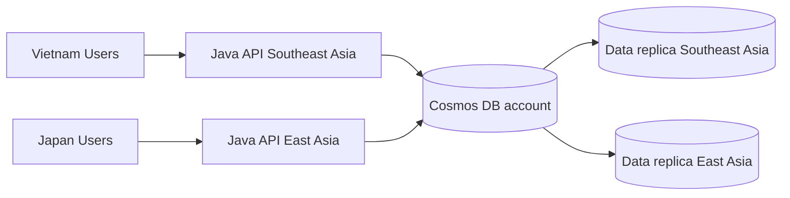
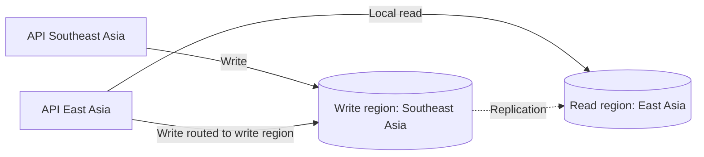
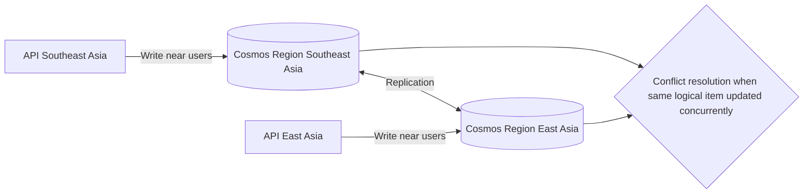
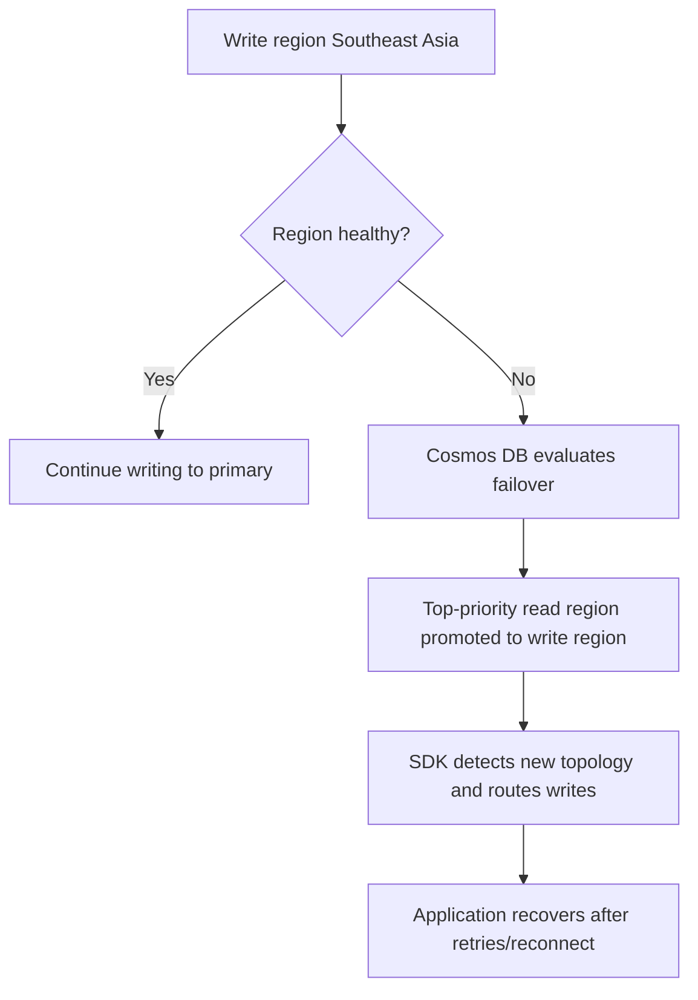
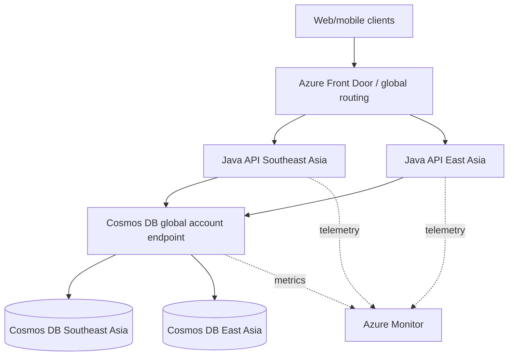

# Multi-Region Distribution and Failover Mechanisms

An e-commerce system serving users in Vietnam and Japan has three requirements: customers in both locations must read orders with low latency, order placement must not halt completely if an Azure region experiences an outage, and data must remain consistent enough to never confirm duplicate transactions. The system runs a Java Spring Boot API on Azure App Service or Azure Kubernetes Service (AKS), storing JSON order documents in **Azure Cosmos DB for NoSQL**.

**Multi-region distribution** enables an Azure Cosmos DB account to replicate data across multiple geographic regions. **Failover** is the mechanism for shifting serving roles—especially the primary write region in a single-write model—when the current region becomes unavailable or when an organization intentionally switches regions. However, simply enabling two regions **does not guarantee continuous application availability, instantaneous global data synchronization, or zero data loss**. Actual behavior depends on read/write settings, consistency levels, SDK configuration, networking, compute resources, and business logic design.

This lesson belongs to the **NoSQL Data with Cosmos DB** chapter of the **CLOUD_PROVIDERS_AZURE** module: exploring Microsoft Azure from subscriptions, resource groups, and Entra ID to virtual networks, compute, storage, data, monitoring, security, and cost management. Here, “Cosmos DB” refers primarily to **Azure Cosmos DB for NoSQL**. Other APIs such as MongoDB, Cassandra, Gremlin, and Table have their own capabilities and SDKs; do not apply these Java, KQL, or CLI examples verbatim across all APIs.

> **Note:** Multi-region writes, conflict resolution, consistency, Private Link, availability zones, pricing, and Azure CLI flags vary by API, SKU, region, and SDK version. Adding regions and triggering failover are infrastructure changes that affect production; execute them only in test environments or approved change windows. No live Azure account was created, modified, or tested while authoring this lesson.

## Learning Objectives

After this lesson, you will be able to:

1. Distinguish **read region**, **write region**, **preferred region**, and **failover priority** within an Azure Cosmos DB account.
2. Explain cross-region replication and the difference between single-region high availability and multi-region disaster recovery.
3. Compare **single-region write** and **multi-region write**, choosing based on latency, data contention, and RPO/RTO.
4. Describe **automatic failover**, **manual failover**, failback, and the SDK's role.
5. Evaluate the five consistency levels and Session consistency behavior when clients switch regions.
6. Analyze multi-region write conflicts, Last Writer Wins, versioning, and conflict-avoiding data models.
7. Configure the Java SDK with preferred region lists, Microsoft Entra managed identity, and transient error handling.
8. Design VNet/Private Endpoint/DNS connectivity and end-to-end multi-region applications.
9. Monitor availability, replication, request units, throttling, errors, region health, and costs.
10. Plan failover drills, data recovery, business reconciliation, and production operations.

## 1. From a Single Region to a Multi-Region System

An application with its database in a single Azure region may serve nearby users well. Yet if that entire region goes down, the database becomes unreachable, and distant users also suffer high network latency.



In a multi-region Cosmos DB account:

- **The account** manages region configuration, API, consistency, and capacity.
- **Databases and containers** are logical datasets belonging to the account.
- **Replication** propagates mutations to configured regions.
- **Clients/SDKs** select appropriate endpoints for reads and writes based on topology.
- **Region configuration** determines which regions serve reads and which accept writes.
- **Failover policy** determines which region is promoted to write region when the model uses a single primary writer.

### What Multi-Region Does Not Automatically Provide

A multi-region database **does not automatically deploy** your Java API in a second region, does not automatically route Azure Front Door to a healthy API, does not fix your application's DNS/Private Endpoints, and cannot keep external SQL databases or payment gateways consistent with Cosmos DB. You must design **both the application plane and the data plane**.

## 2. Distinguishing Location, Region, Availability Zone, and Replica

These terms are often conflated but are not synonymous:

| Concept | Meaning |
|---|---|
| **Azure region** | An Azure geographic deployment location, such as Southeast Asia or East Asia |
| **Availability zone (AZ)** | Physically isolated infrastructure zones inside a zone-enabled region |
| **Cosmos DB region** | A location hosting a data replica in the account's geographic distribution |
| **Replica** | Service-managed data copy at the storage/partition level per Cosmos DB architecture |
| **Write region** | A region permitted to accept writes under the active configuration |
| **Read region** | A region capable of serving read queries per topology and consistency |
| **Preferred region** | Client/SDK-configured preference order for routing requests |
| **Failover priority** | Account-level priority order for promoting a write region in single-write mode |

### Zone Redundancy Does Not Replace Multi-Region

**Zone redundancy** helps supported Cosmos DB configurations survive an availability zone failure **within one region**. **Multi-region replication** adds resilience against a **full-region outage** and lowers read latency across wide geographies. The two can be combined per the support matrix, each carrying distinct **costs and prerequisites**.

An application running in only one region—even with a three-region database—will still go down if its App Service/AKS region fails. RTO targets must cover APIs, routing, identity, networking, and third-party dependencies.

## 3. Single-Write Account: One Write Region, Multiple Read Regions

In the **single-region write** model, an account has **one active write region at a time**, while data replicates to one or more read regions.



### Advantages

- Minimizes **cross-region write conflicts** on the same data via a single primary writer.
- Simpler ownership and audit rules.
- Fits orders and payments requiring ordered processing.
- Leverages **local reads** across multiple regions when consistency permits.
- Supports **automatic/manual write-region failover** per configuration and service health.

### Trade-offs

- Users far from the write region experience higher write latency due to network distance.
- If the write region becomes unavailable, writes may pause briefly during failover.
- Replication to read regions and local reads remain governed by **consistency semantics**.
- Read regions cannot arbitrarily accept writes unless promoted to a write role.

### Suitable Example

An ordering system has its primary region in Southeast Asia and a backup/read region in East Asia. The East Asia API reads locally from East Asia, while order writes route under the **single-write policy** to the active write region. If the primary fails, failover promotes the secondary region to resume writes.

## 4. Multi-Write Account: Writing Across Multiple Regions

**Multi-region writes** let multiple configured regions accept writes closer to users. This fits geographically distributed workloads that tolerate or explicitly handle **concurrent updates**.



### Advantages

- Lower write latency because apps write to nearby regions.
- If one region goes down, other write regions keep accepting writes per SDK and configuration.
- Boosts write availability for globally distributed workloads.

### Risks and Limitations

- **Two regions can update the same logical item before learning of each other's changes.**
- Conflict resolution must reflect **business rules**, not blindly accept a default setting.
- Do not assume every consistency level supports multi-write like single-write; **Strong consistency is not supported with multi-region write configurations**.
- Costs, throughput, operational complexity, and monitoring needs can climb sharply.
- API-supported partition/region transactions do not equal **synchronous distributed ACID transactions across all regions**.

### When Is It Worth Considering?

- User profiles partitioned by tenant/region with minimal cross-region edits.
- Append-only events with unique IDs avoiding concurrent overwrites on the same item.
- Domains with clean merge semantics.
- Workloads demanding low local write latency backed by strict conflict-handling logic.

**Never enable multi-write for financial balances just for speed.** You must know exactly how concurrent updates to a transaction are resolved and whether losing a valid update is ever tolerable.

## 5. Comparing Single-Write and Multi-Write

| Criterion | Single-Write | Multi-Write |
|---|---|---|
| Write regions | One active region | Multiple regions accept writes |
| Read regions | Multiple allowed | Multiple allowed |
| Write latency for distant users | Higher due to round-trip to primary | Lower when writing locally |
| Conflicts from concurrent multi-region writes | Greatly reduced by single write path | Must be explicitly managed |
| Switching writers on outage | Automatic/manual failover as supported | Clients fail over to another write region; no single-primary election |
| Consistency | All levels supported per topology | Constrained; no Strong with multi-region writes |
| Business design | Easier serialization control | Requires conflict avoidance/resolution |
| Operations | Manage failover priority and failback | Monitor write distribution, conflicts, and app routing |
| Cost | Scales with regions and capacity | Can add multi-write pricing/capacity multipliers |
| Starting fit | Order OLTP, conflict-sensitive data | Geo-distributed, independent updates |

**Selection tip:** Start with **single-write + multiple read regions + automatic failover** if your primary goals are DR and local reads. Move to **multi-write** only when local write latency is genuinely required and conflict semantics are proven in testing.

## 6. Cross-Region Data Replication Process

Cosmos DB manages data replication between regions under the hood. At the application layer, understand this flow:

1. The application sends a write request to an eligible region.
2. The receiving region executes the write under supported consistency and transaction semantics.
3. Mutations propagate asynchronously or synchronously (depending on mode) to other configured regions.
4. Read requests are served from local or preferred regions where permitted.
5. When mutations have not yet finished propagating, read outcomes depend on the **consistency level** and session context.

### Replication Does Not Mean “Instantaneous Everywhere”

In asynchronous replication modes, **replication lag** exists between regions. If the write region fails immediately after acknowledging a write, whether that write survives failover depends on consistency and replication state. Design, measure, and verify **RPO** against your configuration rather than guessing from region counts.

### You Do Not Manage Replication Jobs Directly

You do not configure SQL log shipping or manage replica VMs. However, you still manage:

- Selected regions and priority order.
- Consistency level.
- Single-write vs. multi-write mode.
- Throughput and partitioning.
- SDK routing, availability, and retries.
- DR and recovery testing with business data.

## 7. Five Consistency Levels in Cosmos DB for NoSQL

Azure Cosmos DB for NoSQL defines five consistency levels answering: **“Once a write succeeds, what guarantees govern when readers in other regions observe it?”**

| Consistency | General Meaning | Trade-offs |
|---|---|---|
| **Strong** | Reads observe latest committed data under the service's linearizable guarantees | Topology, latency, and availability limits; unsupported with multi-region writes |
| **Bounded staleness** | Staleness bounded by configured time interval or operation/version count | Weigh replication lag, latency, and regional limits |
| **Session** | Guarantees within a client session, notably read-your-writes | Ideal for many web apps; external sessions may see different timestamps |
| **Consistent prefix** | Reads reflect an ordered prefix of write history, never out-of-order writes | Data may lag behind latest writes |
| **Eventual** | Replicas converge once writes stop, with no immediate freshness guarantee | Flexible latency/availability; apps tolerate stale reads |

### Session Consistency Is Usually the Starting Point

When a user updates their profile, their own session expects to see the change immediately. Session tokens/SDKs maintain read-your-writes where supported, without **promising that every other user in every other region sees the update instantaneously**.

### Common Misconceptions

- **Strong** does not give a multi-write app Strong consistency everywhere; multi-write forbids it.
- **Session** does not equal global Strong consistency.
- **Eventual** does not mean data stays “permanently inconsistent”; it just lacks a Bounded Staleness cap.
- Consistency levels do not turn **operations across multiple logical partitions or external systems** into a global ACID transaction.
- Choosing stricter levels can impact latency, availability/throughput, and cost—benchmark first.

## 8. Impact of Consistency on Business Experience

### Case A: User Profiles

A user updates their display name and immediately reloads their profile. **Session** fits well when the app preserves session context/SDK state. Users in other sessions may see the old name during replication lag; UIs can handle eventual sync naturally.

### Case B: Inventory and Stock Reservations

Two regions writing inventory concurrently can conflict if each reads stale local stock. Even with stricter read consistency, invariants like “never oversell” require a **single owner per SKU, intra-partition transactions, or a dedicated coordination layer**.

### Case C: Product Catalog Listings

Product prices and descriptions change infrequently and can tolerate a few seconds of propagation lag. Eventual or Session often suffices, depending on SLAs.

### Case D: Payments

Never rely solely on Last Writer Wins for payment states assuming transactions will sort themselves out. Maintain an **authoritative transaction source**, idempotency keys, event logs, and reconciliation.

### Questions Before Choosing Consistency

1. Which users must **immediately see a write they just made**?
2. Is a few seconds of staleness acceptable?
3. Are there business invariants spanning regions or partitions?
4. What happens if the write region goes down before replication finishes?
5. Should writes funnel to a single region or partition owner?
6. Do latency and RU costs satisfy your SLOs?

## 9. What Is Failover and What Scenarios Exist?

**Failover** shifts traffic or read/write roles from an impaired region to a healthy one. Distinguish four layers:

- **Database region failover:** Changing Cosmos DB's serving regions or primary write region.
- **SDK endpoint failover:** The client SDK switching to another healthy regional endpoint based on topology, preferred regions, and retries.
- **Application failover:** Azure Front Door or Traffic Manager routing clients to the Java API in another region.
- **Dependency failover:** Independent recovery plans for Key Vault, Storage, Queues, Azure SQL, DNS, and identity infrastructure.

### Reasons for Failover

- An Azure region suffers an outage.
- Planned maintenance or migration requiring a write-ownership transfer.
- Staging DR drills.
- Relocating the primary closer to business operations.
- Adjusting topology to optimize latency or cost under a change plan.

### Failover Is Not Routine Traffic Balancing

**Load balancing** between two Java API instances happens continuously. **Cosmos DB write-region failover** is a major data-plane transition affecting write availability, SDK routing, and session consistency. Monitor each layer separately.

## 10. Automatic Failover in Single-Write Accounts

When an account spans **multiple regions**, **automatic failover** allows the service to promote a new **write region** per policy if the current write region becomes unavailable and service conditions are met.



### Required Configuration

- Account deployed across **two or more eligible Azure regions**.
- **Single-region write** mode.
- Automatic failover enabled and supported by account configuration.
- **Failover priorities** ordered intentionally.
- Application/SDK configured for topology refresh, retries, and health tracking.
- Sufficient throughput and networking in the secondary region to absorb failover traffic.

### What Is Not Guaranteed

- Zero application errors **during the failover transition**.
- Not every 429, 403, or 500 indicates a region outage.
- Zero data loss across all consistency levels and failure modes.
- Automatic failover of your Java API or external gateway session tokens.
- Automatic failback making the original region the primary writer as soon as it recovers.

### Failback

Once the original region recovers, it rejoins the topology as a read region in a single-write account. **Returning write ownership to the original region** follows supported failback/priority-change procedures under an approved change plan—never flip it back during peak traffic just to “restore defaults.”

## 11. Manual Failover and Planned Write-Region Changes

**Manual failover** is an administrator-initiated switch of the write region (where supported), typically for DR drills or planned maintenance.

### Safe Procedure

1. Verify the current primary and ensure the secondary is added and synchronized.
2. Check account consistency, write mode, and region priorities.
3. Assess live application traffic, running jobs, and in-flight transactions.
4. Schedule a maintenance window, notify stakeholders, and prepare a rollback plan.
5. Trigger failover via the Azure Portal or supported management APIs.
6. Observe the new write region, Cosmos DB availability metrics, and SDK retries.
7. Reconcile records and transactions around the failover timestamp.
8. Verify application health from **both application regions**, not just an admin terminal.
9. Record observed RTO/RPO, client errors, and remediation steps.
10. If failing back, treat it as a separate change with topology and data validation.

### Do Not Confuse Manual Failover with “Removing the Primary Region”

Removing a region from a Cosmos DB account is a **geo-distribution topology change**. It is not equivalent to a write-role failover drill and can cause regional outages or impact billing and capacity. Never delete a region to simulate a production outage.

## 12. Failover Priorities

In single-write accounts, regions are ordered by **failover priority**. This order determines which region is promoted next when failover triggers per service rules.

Example design:

| Region | Initial Role | Desired Priority |
|---|---|---|
| Southeast Asia | Write region | Primary |
| East Asia | Read region | Secondary |
| Australia East | Read region | Next fallback |

If Southeast Asia goes down, write ownership shifts to the highest-priority healthy region. The application must still verify connectivity, routing, and transient error handling.

### Priority Does Not Equal Proximity for Every Client

Even if Australia East has lower latency for some users, failover priority might favor East Asia due to data residency, compliance, API infrastructure, or capacity. SDK **`preferredRegions`** sets **client-side routing preference**, whereas **failover priority** sets **account-level write promotion** in single-write mode. Never treat them as aliases for the same setting.

## 13. Multi-Write When One Region Loses Connectivity

In a **multi-write account**, any configured write region accepts local writes. When one region goes down, clients there fail over to another healthy region per SDK and network design.

### Differences from Single-Write

- No single-primary write election as in single-write mode.
- Does not guarantee in-flight requests to the failed region succeeded.
- Unpropagated writes, conflicts, or indeterminate write outcomes can still occur.
- Applications and SDKs still require retries, idempotency, and reconciliation.

### Example

A user in Southeast Asia updates their profile during a regional disruption. If the API stays up and the SDK routes to East Asia, the write succeeds there. However, if another session edits the same profile concurrently in East Asia, conflict resolution must handle it.

### Financial Operations

If two regions can debit the same balance concurrently, “write to whichever region is healthy” is unsafe. Enforce a single-owner partition model or external transactional authority to prevent **double spending** and lost updates.

## 14. Conflict Resolution When Multiple Regions Write the Same Item

Consider this item:

```json
{
  "id": "ORD-1001",
  "tenantId": "tenant-a",
  "status": "PENDING",
  "version": 3
}
```

Two regions both read version 3 and write:

```text
Southeast Asia: status = PAID, version = 4
East Asia:      status = CANCELLED, version = 4
```

Both writes succeed locally before replication detects the collision. **Cosmos DB must pick a winner or merge state** according to its conflict resolution policy and API support.

### Last Writer Wins (LWW)

A common option is **Last Writer Wins** based on a service-supported property/tie-breaker (such as system timestamp or a configured numeric field). **LWW simply picks a winning document**—it has no business awareness that “PAID must never revert to CANCELLED after payment capture.”

### Application-Defined Conflict Resolution

Certain **custom conflict resolution** procedures may be used where supported by the API and service capabilities. Availability, rules, and constraints must be verified for **Cosmos DB for NoSQL and your account settings**; never assume a SQL Server handler or arbitrary Java function acts as a server-side conflict resolver without supported integration.

### Better Ways to Avoid Conflicts

- **Partition ownership:** Assign each tenant or order an authoritative write region.
- **Append-only events:** Write immutable event items with unique IDs instead of overwriting status, and derive state deterministically.
- **Optimistic concurrency:** Use ETags/conditional writes where supported, remembering local ETags do not prevent asynchronous cross-region collisions.
- **Business version/idempotency:** Tag each command with an operation ID and validate state transitions in the backend.
- **Single-write for strict invariants:** Route strict invariant mutations to one authoritative region or transactional store.

**Never use client machine timestamps to prove which event is “latest.”** Clock skew, client retries, and out-of-order arrivals cause time-based LWW to corrupt business state.

## 15. How Partition Keys Directly Affect Multi-Region Design

Cosmos DB for NoSQL distributes data by **partition key**. A logical partition governs queries, transactions, and isolation.

Example `orders` container:

```text
Partition key path: /tenantId
Item id:            ORD-1001
Partition key:      tenant-a
```

An item's ID must be paired with its partition key to uniquely address a document. Multiple items with the same `id` can exist in different logical partitions per API rules.

### Good Choices

- Evenly distribute reads and writes across tenants, users, or customers when patterns fit.
- Common queries supply the partition key to avoid cross-partition fan-out.
- Operation idempotency operates within unique key scopes.
- Avoid funneling all traffic into one hot logical partition.
- Evaluate growth, per-partition limits, and peak loads before locking schemas.

### Partition Keys Do Not Cure Multi-Write Conflicts

A stable partition key routes and co-locates data, yet **does not stop two regions from modifying the same item** under multi-write. Preventing conflicts requires region ownership, routing, append-only logs, or authoritative transactions.

### Transaction Boundaries

Supported transactional batches operate within **one logical partition**, not across all partitions or regions globally. Migrating from SQL Server while assuming cross-table/cross-region ACID transactions is an architectural mismatch.

## 16. The SDK Is a Critical Part of Failover

Azure Cosmos DB SDKs track account topology and route to regional endpoints. Always use a **supported SDK** instead of hardcoding a regional IP or writing custom infinite retry loops.

### What Client Region Selection Depends On

- Account topology: which regions accept reads and writes.
- Application-configured `preferredRegions`.
- Single-write vs. multi-write mode.
- Consistency level and session tokens.
- Network connectivity and transient error responses.
- Connection mode (Gateway vs. Direct) and SDK version.

### Best Practices

1. Instantiate **one long-lived `CosmosClient`** per configuration and reuse it across the application.
2. Align `preferredRegions` with each deployment's region—do not give a Japan-hosted API a Vietnam-first preference list unintentionally.
3. Let the SDK manage endpoint discovery and failover rather than pinning a single region or IP.
4. Keep SDK retry/backoff enabled alongside application-level timeouts and retry budgets.
5. Identify which operations are **idempotent** when a client faces an indeterminate write timeout.
6. Monitor SDK diagnostics, status/substatus codes, RU charges, and latency.
7. Verify your SDK version supports the chosen authentication, routing, and conflict features.

### Global Endpoint

A for NoSQL account uses an account-level endpoint like:

```text
https://<COSMOS_ACCOUNT>.documents.azure.com:443/
```

The SDK discovers and routes to published regional endpoints from this root. **Never replace the endpoint with a bare private IP**, because DNS, TLS verification, region routing, and failover depend on the valid hostname.

## 17. Java SDK v4: Preferred Regions and Microsoft Entra ID

The Java snippet below illustrates a document reader using **Azure Cosmos DB Java SDK v4** and a compatible Azure Identity library.

### Required Maven Dependencies

```xml
<dependencies>
  <dependency>
    <groupId>com.azure</groupId>
    <artifactId>azure-cosmos</artifactId>
    <version><!-- Select and pin a compatible SDK v4 version --></version>
  </dependency>
  <dependency>
    <groupId>com.azure</groupId>
    <artifactId>azure-identity</artifactId>
    <version><!-- Select a compatible version --></version>
  </dependency>
</dependencies>
```

This is an illustrative excerpt, not a complete standalone `pom.xml`. Choose versions matching your project, JDK, and dependency management BOM.

### Java Example

```java
package vn.example.cosmos;

import com.azure.cosmos.CosmosClient;
import com.azure.cosmos.CosmosClientBuilder;
import com.azure.cosmos.CosmosContainer;
import com.azure.cosmos.models.CosmosItemResponse;
import com.azure.cosmos.models.PartitionKey;
import com.azure.cosmos.ConsistencyLevel;
import com.azure.identity.DefaultAzureCredentialBuilder;

import java.util.List;
import java.util.Map;

public class RegionalCosmosReader {

    public static void main(String[] args) {
        String endpoint = System.getenv("COSMOS_ENDPOINT");

        if (endpoint == null || endpoint.isBlank()) {
            throw new IllegalArgumentException(
                "Missing COSMOS_ENDPOINT");
        }

        CosmosClient client = new CosmosClientBuilder()
            .endpoint(endpoint)
            .credential(new DefaultAzureCredentialBuilder().build())
            .preferredRegions(List.of("Southeast Asia", "East Asia"))
            .consistencyLevel(ConsistencyLevel.SESSION)
            .gatewayMode()
            .buildClient();

        try {
            CosmosContainer container = client
                .getDatabase("shop")
                .getContainer("orders");

            CosmosItemResponse<Map> response =
                container.readItem(
                    "ORD-1001",
                    new PartitionKey("tenant-a"),
                    Map.class
                );

            System.out.println(
                "Request RU charge: " + response.getRequestCharge());
            System.out.println(
                "Status: " + response.getItem().get("status"));
        } finally {
            client.close();
        }
    }
}
```

### Prerequisites Before Running

- Cosmos DB for NoSQL account, `shop` database, and `orders` container exist with partition key path `/tenantId`.
- Item with `id=ORD-1001` and `tenantId=tenant-a` exists.
- Azure runtime has a managed identity, or local dev has a credential supported by `DefaultAzureCredential`.
- The identity holds a **Cosmos DB for NoSQL data-plane role** to read items at the proper scope.
- Network and DNS reach the Cosmos account (via Private Endpoint if public access is disabled).
- Compatible JDK, Azure Cosmos SDK v4, and Azure Identity versions.
- `gatewayMode()` uses HTTPS and is often simpler in labs; **Direct mode** has different latency, connection management, and firewall trade-offs to measure for production.

**`preferredRegions` is a client preference** and does not alter the account's failover priority. A JVM deployed in East Asia can reverse the list to `East Asia, Southeast Asia` to prefer local reads.

## 18. Handling Java SDK Errors During Failover

The SDK retries and switches endpoints according to responses and topology, yet **applications still need error budgets and handling for indeterminate write outcomes**.

### Classifying Error Groups

| Symptom | Typical Meaning | How to Handle |
|---|---|---|
| HTTP **429** | Throughput/RU limit or throttling | Respect `Retry-After`, inspect RUs/hot partitions; do not panic-failover write regions |
| HTTP **401/403** | Token, permission, or network policy rejection | Verify managed identity, data roles, firewall, and error message |
| HTTP **404** | Missing item/container, wrong partition key, or consistency/read issue | Verify ID, partition key, session, region, and response details |
| HTTP **409** | ID/unique-key or operation conflict | Check idempotency/unique constraints; never blindly retry creates |
| HTTP **412** | ETag/conditional write mismatch | Re-read latest version and apply concurrency logic |
| HTTP **5xx / timeout** | Transient service/network or backend error | SDK retry/backoff; check availability and diagnostics |
| DNS / connection failure | Networking, Private Link, resolver, Gateway/Direct mode | Verify hostname, DNS resolution, and endpoint reachability |
| Session-related read issue | Stale context/session token or lagging read region | Let SDK handle it; avoid stripping session tokens carelessly |

**Never treat a bare status code as the complete root cause.** Combine exception messages, substatus codes, request diagnostics, contacted regions, session tokens, and platform health events.

### On Write Timeouts, Outcomes May Be Indeterminate

Suppose the Java API calls `createItem` to place an order and times out. The database may have committed the item even though the response never reached the client. Retrying with a new random `id` creates two orders.

Mitigations:

- Use **deterministic item IDs / idempotency keys** on the backend.
- Rely on unique key constraints within the logical partition where appropriate.
- On 409, read the existing item to verify whether it came from the same business operation.
- Use optimistic concurrency / ETags for updates.
- Never retry a financial mutation without verifying whether the prior attempt committed.
- Build reconciliation around business event and transaction records.

## 19. Multi-Region Applications Need Their Own Failover

Cosmos DB multi-region only protects the **data plane** of the database account; it does not keep your whole application running from a standby region.

### Recommended Architecture



### Requirements

1. Deploy the API in **at least two regions** if full-region fault tolerance is required.
2. Configure global routing with proper health probes and client failover.
3. Align DR across AuthN/AuthZ, Entra ID, Key Vault, Storage, and message brokers.
4. Configure Java SDK, identity, and `preferredRegions` per regional deployment.
5. Ensure DNS, VNets, and Private Endpoints work in every surviving region.
6. Ensure retries and idempotency prevent duplicate transactions during regional cutovers.
7. Monitor **business transaction success**, not just Cosmos DB availability.

### Note

An active-passive Java API paired with a multi-write Cosmos DB account gains little local-write benefit. Conversely, an active-active API paired with single-write Cosmos DB still delivers frontend resilience, while routing writes to the current active write region.

## 20. Private Endpoints and DNS in Multi-Region Cosmos DB

If public network access is disabled in favor of **Azure Private Link / Private Endpoints** for Cosmos DB for NoSQL, network routing and DNS must work **across all application regions**.

### Relevant Hostnames

Global account endpoint:

```text
<COSMOS_ACCOUNT>.documents.azure.com
```

Private DNS zone typically associated with Cosmos DB for NoSQL Private Link:

```text
privatelink.documents.azure.com
```

A Private Endpoint exposes private IPs so clients inside connected VNets can reach Cosmos DB privately. Regional routing also involves region-specific records managed via DNS zone groups per service guidance.

### Common Mistakes

- Deploying a Private Endpoint in the Southeast Asia VNet while the **East Asia Java API lacks network routing or DNS** during failover.
- VNet peering exists, yet Private DNS zone links or forwarders are missing.
- Disabling public network access before testing the app through the Private Endpoint.
- Resolving the public hostname to a public IP inside a private-only network.
- Enabling `Direct mode` when firewalls only permit Gateway mode ports.
- Hardcoding a Private Endpoint IP instead of the account FQDN.
- Mixing API endpoints: Cosmos DB for NoSQL uses a different endpoint format than other APIs.
- Testing only from a laptop or Cloud Shell instead of from the **live Java runtime in each region**.

### Connectivity Checklist

| Layer | Verification |
|---|---|
| Identity | Does the workload have a valid credential / managed identity? |
| DNS | Do global and regional hostnames resolve to private IPs from each app subnet? |
| Routing | Does each app subnet have routes to a Private Endpoint per topology? |
| Firewall / NSG | Are Gateway or Direct mode SDK ports permitted? |
| TLS | Are hostnames and certificates valid without disabling validation? |
| Region failover | If one region fails, are surviving endpoints still reachable? |
| Cost | Are Private Endpoints, DNS Resolvers, firewalls, peering, and transfer accounted for? |

**Never assume a single Private Endpoint covers every geo-failover path.** Verify current regional endpoint and Private Link support and run failover drills over the real network.

## 21. Security: Control Plane, Data Plane, and Identity

A Cosmos DB account spans at least three security boundaries:

1. **Azure Resource Manager control plane:** Creating/editing accounts, adding regions, changing write modes, triggering failover.
2. **Cosmos DB data plane:** Reading and writing databases, containers, and items.
3. **Network plane:** Whether clients can reach the endpoint at all.

### Azure RBAC Does Not Grant Data-Plane Authorization

Having `Contributor` on a resource group **does not automatically grant permission** to read items through the data-plane SDK. For Cosmos DB for NoSQL, assign appropriate **data-plane RBAC roles** such as built-in Data Reader or Data Contributor at the narrowest approved scope.

### Managed Identity for Java

- Enable managed identity on App Service, AKS, or VMs per supported workflow.
- Assign the proper Cosmos DB data-plane role at the account, database, or container scope.
- Use `DefaultAzureCredential` / `TokenCredential` in the SDK.
- Never commit primary keys or connection strings to Git.
- Verify application identities in both regions.
- Restrict who can modify account failover or multi-write settings.

### Networking and Keys

Disable or restrict public access once Private Endpoints are verified. If key-based authentication is unavoidable, protect keys in Key Vault with rotation and evaluate disabling shared-key auth where supported by policy and features.

**A valid managed identity role cannot bypass a firewall.** Conversely, Private Endpoint connectivity grants zero access without data-plane authorization.

## 22. Provisioning Multiple Regions: Deployment Order

Plan both application and data layers before adding regions.

### Pre-Flight Checks

- Account API = **Azure Cosmos DB for NoSQL**.
- Sufficient subscription quotas, regional availability, and capacity.
- Explicit choice of **single-write** vs. **multi-write**.
- Defined consistency level, conflict policy, and SLOs.
- Verified throughput model: manual/autoscale, container-level or database shared.
- Reviewed data residency/compliance rules and backup policy.
- Prepared networking, Private Endpoints, and DNS in every app region.
- Estimated costs for replicated storage, provisioned RU/s, and data transfer.
- Designated change-window and rollback owner.

### Azure Portal Workflow (Conceptual)

1. Open the **Cosmos DB account** in the target subscription and resource group.
2. Go to **Replicate data globally / Global Distribution** (or the current region management blade).
3. Inspect existing regions, read/write roles, and multi-region write status.
4. Select the new region per architecture and confirm costs and limits.
5. Save changes and monitor region provisioning progress.
6. Wait for provisioning and initial replication to finish before treating the region as ready.
7. Test SDK reads from the new region and measure latency.
8. Configure failover priorities or multi-write settings per design.
9. Verify monitoring, identities, networking, and app health in both regions.

**Adding a region does not create a second independent Cosmos DB account.** This lesson covers **one account replicated across regions**; active-active synchronization between **two separate accounts** is an entirely different replication and application architecture problem.

## 23. Azure CLI: Inspecting Accounts, Regions, and Failover Settings

The commands below are **read-only** against authorized account configurations.

### Verify Subscription

```bash
az account show --output table

az account set --subscription "<SUBSCRIPTION_ID>"

RG="<COSMOS_RESOURCE_GROUP>"
ACCOUNT="<COSMOS_ACCOUNT_NAME>"
```

### Read Account Metadata

```bash
az cosmosdb show \
  --resource-group "$RG" \
  --name "$ACCOUNT" \
  --output json
```

Targeted projection:

```bash
az cosmosdb show \
  --resource-group "$RG" \
  --name "$ACCOUNT" \
  --query "{name:name,locations:locations,readLocations:readLocations,writeLocations:writeLocations,automaticFailover:enableAutomaticFailover,multipleWriteLocations:enableMultipleWriteLocations,consistencyPolicy:consistencyPolicy}" \
  --output json
```

Depending on **Azure CLI and API versions**, property names may vary or return `null`. Inspect the full JSON and current schema documentation before assuming a missing field indicates a broken account.

### Read Resource ID

```bash
COSMOS_ID=$(az cosmosdb show \
  --resource-group "$RG" \
  --name "$ACCOUNT" \
  --query id --output tsv)

echo "$COSMOS_ID"
```

### List NoSQL Databases

```bash
az cosmosdb sql database list \
  --resource-group "$RG" \
  --account-name "$ACCOUNT" \
  --output table
```

Inspect a specific container:

```bash
az cosmosdb sql container show \
  --resource-group "$RG" \
  --account-name "$ACCOUNT" \
  --database-name "shop" \
  --name "orders" \
  --output json
```

These commands inspect metadata only and do not verify data-plane access. Never print master keys or connection strings into logs or chat during investigations.

## 24. Designing RU/s Throughput Across Multiple Regions

Azure Cosmos DB bills operations in **Request Units (RUs)** based on item size, query complexity, indexing, consistency, and related factors. **RU/s** is the provisioned or autoscaled throughput at the database or container level.

### Example

A container has **10,000 RU/s** in one region and replicates to a second region. Never assume “with two regions, the total bill stays identical to 10,000 RU/s in one region.” Across provisioned models, throughput capacity is billed **per region** or with multipliers for multi-region writes and enabled features.

### Cost and Performance Factors

| Factor | Impact |
|---|---|
| Region count | Replicated storage, throughput capacity, and multi-region operations |
| Single vs. multi-write | Write availability and associated pricing/capacity model |
| Manual vs. autoscale throughput | Compute billing per provisioned/max/autoscale rules |
| Partition key | Hot partitions trigger 429s even when overall RU/s remain |
| Cross-partition queries | Higher RUs and latency |
| Indexing policy | Extra indexes increase write costs |
| Consistency | Can affect RUs, latency, and availability per semantics |
| Item size | Larger documents consume more RUs and network bandwidth |
| Backup/restore | Storage and feature charges per model |
| Private Endpoint, monitoring | Additional network and Log Analytics/Azure Monitor charges |

### A 429 Does Not Mean You Need Failover

**HTTP 429 Too Many Requests** indicates throughput saturation. Appropriate fixes include:

- Analyzing RU consumption and hot logical partitions.
- Respecting `retry-after` with bounded retries.
- Optimizing partition keys, queries, and indexing.
- Controlling Spring Boot/API concurrency.
- Scaling throughput/autoscale within budget if needed.

Repeatedly failing over regions whenever 429s appear **increases latency, triggers extra retries**, and masks the true bottleneck.

## 25. Multi-Region Reads and User Latency

An application has two regional deployments:

| Application Region | Preferred Read Regions | Expectation |
|---|---|---|
| Southeast Asia | Southeast Asia → East Asia | Faster local reads when Southeast Asia is healthy |
| East Asia | East Asia → Southeast Asia | Faster local reads for customers in Japan |

### Measuring Latency Properly

- Measure from **live Java API hosts**, not just a developer laptop.
- Capture p50/p95/p99 read latency and end-to-end HTTP latency.
- Track RU charges, document sizes, and partition keys.
- Log the serving endpoint/region from SDK diagnostics where available.
- Verify networking, VNets, and Private Endpoints in both regions.
- Separate database latency from Java serialization, service meshes, and HTTP proxies.
- Compare before and after adding a region rather than guessing from map distance.

### Reading Data Before Full Synchronization

When consistency permits, users in another region can observe slightly older versions. UX and business mitigations include:

- Reading within the same session context whenever read-your-writes is required.
- Displaying a “processing/syncing” state when appropriate.
- Routing sensitive reads to the primary write region or using stricter consistency.
- Tracking object versions to detect stale data.
- Never authorizing financial mutations from unverified eventual snapshots.

## 26. Failover RTO, RPO, and Indeterminate States

**RTO (Recovery Time Objective):** Maximum tolerable downtime during a disruption.

**RPO (Recovery Point Objective):** Maximum tolerable data loss window in an incident.

### Example Targets

```text
Target RTO: 15 minutes
Target RPO: 5 minutes
Scope: Ordering API + Cosmos DB + order confirmation jobs
```

These numbers are **hypothetical enterprise targets**, not a blanket SLA from Cosmos DB.

### Measure the Entire Chain

Even if Cosmos DB promotes a new write region in minutes, if:

- Front Door has not shifted API traffic,
- the standby API lacks Key Vault permissions,
- Private Endpoint DNS fails to resolve,
- order confirmation queues sit in the impaired region,
- or the Java SDK has a stale hardcoded endpoint in configuration,

then the **end-to-end business RTO** still fails.

### RPO Requires Data Reconciliation

In failover scenarios under asynchronous replication, recent acknowledged writes may not yet have reached the secondary. Observed RPO must be verified against **accepted writes, replicated state, and business records**—never declare RPO = 0 just because the Portal shows a new write region.

## 27. Failover Does Not Replace Backup and Point-in-Time Restore

This rule is mandatory: **replication copies bad changes too**—including accidental deletes, application bugs corrupting records, or ransomware using valid credentials. Across multiple regions, an accidental delete propagates everywhere.

Combine:

- **Periodic backup** or **continuous backup** per service capabilities, account settings, and policy.
- **Point-in-time restore (PITR)** when using a supported backup mode.
- Tested restore workflows to target accounts/resources per API.
- Protected backup access roles and encryption.
- Real restore drills validating representative data and schemas.
- Business audit/event logs for non-losable operations.
- Post-failover and post-restore reconciliation.

### Distinguishing Three Mechanisms

| Mechanism | What It Solves |
|---|---|
| Multi-region replication | Cross-region data copies, local read latency, and regional DR |
| Automatic / manual failover | Shifting active read/write routing per topology |
| Backup / restore | Recovering prior data state after logic bugs, deletions, or corruption |

A three-region account with no backup can lose data to an accidental delete across **all three regions** via replication.

## 28. Availability Zones and Intra-Region Database Resilience

Not every incident takes out an entire region. An availability zone, network segment, or infrastructure component may fail locally.

**Zone redundancy**—where supported by the service, region, and tier—increases fault tolerance **within a single region**. Cosmos DB also manages internal replication automatically; applications do not pick individual server replicas per read.

### Decisions to Make

1. Does the target region support Availability Zones?
2. Do your account and throughput mode support zone redundancy?
3. Are there cost differences or deployment requirements?
4. Do your App Service/AKS deployments also have zone resilience?
5. Do you still need multi-region replication beyond zone-level HA?
6. Have SLA and DR assumptions been verified against the final configuration?

### Do Not Confuse the Two Failure Scopes

- **Zone failure:** The platform protects resources inside the region without changing write regions.
- **Region outage:** Multi-region distribution and failover are needed for recovery.
- **Application deployment failure:** May require app rollback or API region shifting even while Cosmos DB is healthy.

Runbooks must map alerts to the right failure scope to avoid unnecessary regional failovers.

## 29. Metrics and Diagnostics for Geo-Distributed Cosmos DB

A multi-region account requires monitoring across **service health**, **request success**, **replication**, and **business outcomes**.

### Signals to Observe

- Request volume, status codes, substatus codes, and failed requests.
- **Server-side latency** and end-to-end SDK latency.
- **RU consumption**, normalized RU consumption, provisioned throughput, and 429 throttling.
- Storage usage, index size, and growth rate.
- Region availability/status and active read/write locations.
- Replication telemetry where exposed by the service/API.
- Read requests per region or per application deployment.
- Conflict metrics when multi-region writes are enabled.
- Backup, restore, and failover management events.
- Client exception rates, retry counts, timeouts, and session errors.
- **Business metrics:** orders created, orders confirmed, duplicate rate, processing lag.

### Checking Metric Definitions via Azure CLI

```bash
az monitor metrics list-definitions \
  --resource "$COSMOS_ID" \
  --output table
```

Design queries and alerts only after listing the exact metric names and dimensions available on your account. Never hardcode an assumed metric name that does not exist for your API, region, or SKU.

### Azure Monitor and Application Insights

- **Azure Monitor Metrics** detect error/latency spikes and capacity saturation.
- **Diagnostic settings** forward supported log categories to Log Analytics, Storage, or Event Hubs.
- **Application Insights** on Java App Service/AKS surfaces API latency, dependencies, and exceptions when instrumented.
- **Azure Activity Log** records control-plane events such as region or failover changes.
- **Service Health** tracks Azure platform incidents, though it never replaces workload telemetry.

Never treat “Cosmos DB 200 OK” as proof that a customer was charged or an order completed end-to-end.

## 30. KQL and Correlated Logging

If Azure Cosmos DB diagnostic logs flow to a Log Analytics workspace, table names and schemas depend on diagnostic mode and configuration. Start by **discovering active log tables** instead of guessing field names:

```kusto
AzureDiagnostics
| where TimeGenerated > ago(1h)
| summarize Records = count() by ResourceProvider
| order by Records desc
```

With resource-specific tables enabled, logs may not land in `AzureDiagnostics`. Use the Log Analytics schema explorer to inspect exact table names rather than assuming an empty `AzureDiagnostics` table means Cosmos DB is silent.

### Querying Java App Telemetry (When Instrumented)

In workspace-based Application Insights:

```kusto
AppExceptions
| where TimeGenerated > ago(1h)
| summarize Failures = count() by Type
| top 20 by Failures desc
```

```kusto
AppDependencies
| where TimeGenerated > ago(1h)
| summarize Requests = count(),
            Failed = countif(Success == false)
  by bin(TimeGenerated, 5m), Target
| order by TimeGenerated asc
```

Not every Cosmos Java SDK call automatically appears in `AppDependencies` across all runtimes and instrumentation modes. If dependency rows are missing, verify SDK diagnostics/tracing, OpenTelemetry/Azure Monitor instrumentation, and sampling settings.

### Recommended Log Format

```text
event=cosmos_read
account=<account>
appRegion=Southeast Asia
preferredRegion=Southeast Asia
container=orders
operationId=op-1001
partitionKeyHash=<hash>
requestCharge=3.1
status=200
durationMs=24
```

This is illustrative only. Never log access keys, session tokens, full document payloads, or personal data. Even hashed partition keys must be reviewed against re-identification policies.

## 31. Costs of Multi-Region Cosmos DB

Multi-region improves latency and resilience, while scaling costs with region count and features.

| Cost Component | Questions to Ask |
|---|---|
| Provisioned / autoscale throughput | How are RU/s billed per region and write mode? |
| Replicated storage | How are data/index footprints billed in each region? |
| Multi-region writes | Do multi-write pricing or capacity multipliers apply? |
| Zone redundancy | Does zone redundancy carry additional regional/tier charges? |
| Backup / restore | What do the chosen backup mode, retention, and PITR cost? |
| Networking | Private Endpoints, DNS Resolvers, peering, firewalls, data transfer |
| Applications | Must two regional Java app deployments stay running continuously? |
| Monitoring | Application Insights and Log Analytics ingestion/retention |
| DR testing | Load test environments, staging accounts, and operational drills |

### Avoid Flawed Cost Assumptions

Suppose a container has baseline throughput in Region A. Adding Region B **does not automatically mean** you get double the global capacity for the same single-region bill. Region counts and RU/s pricing models directly shape your invoice.

### Controlling Costs Without Sacrificing Resilience

1. Measure real request charges and optimize indexes and queries.
2. Design partition keys to prevent hot partitions.
3. Match manual vs. autoscale throughput to traffic patterns and SLAs.
4. Add only regions that deliver concrete latency or DR value.
5. Avoid enabling multi-write without a clear need and conflict-handling design.
6. Right-size backup and storage retention.
7. Track App Service/AKS, Private Endpoint, and egress transfer charges.
8. Set **Azure Cost Management budgets and alerts** with owner/costCenter tags per policy.
9. Run performance tests in staging and sum RU/s across all regions.
10. Consult **current Azure Cosmos DB pricing** for your region, API, and tier before approval.

Budget alerts notify you—they **do not automatically cap spending** or prevent production incidents.

## 32. Common Multi-Region Issues

| Symptom | Likely Cause | How to Investigate |
|---|---|---|
| Clients in Region B read slowly | Wrong `preferredRegions`, traffic hairpinning via Region A, costly queries | SDK diagnostics, latency, query plans, endpoints |
| App reads stale data | Consistency/session context, replication lag, caching | Consistency level, session token, item version |
| API receives **429** | RU/s limit or hot partition—not a region outage | RU metrics, `retry-after`, partition key |
| API receives 403 | Data-plane RBAC, tokens, firewall, or wrong write location | Exception/substatus, identity, account topology |
| Write timeouts during failover | Impaired endpoint, region switch, service/network transition | SDK retries, write outcome reconciliation |
| Duplicate orders after retries | Missing idempotency keys / unique constraints | Business logs, item IDs, operation records |
| Multi-write conflicts | Concurrent edits to the same item in two regions | Conflict policy, version, source region |
| One app region fails Private Link | Missing DNS, VNet link, route, or firewall rule | Test from app host; check Private Endpoint records |
| Client still hits old region | Outdated SDK, hardcoded regional endpoint, misconfiguration | SDK version, `preferredRegions`, diagnostics |
| Automatic failover does not fire as expected | Single-write/priority/settings or service criteria | Account config, Azure Service Health |
| App UI stays down after DB failover | Only data plane recovered; API, queue, or Key Vault down | Global routing and dependency health |
| Transactions missing after failover | Replication lag, consistency, or RPO assumptions | Accepted write logs, business reconciliation |
| Restore cannot find target timestamp | Backup policy, retention, or restore scope mismatch | Backup config and PITR window |
| Sharp cost spike | Added regions, raised RU/s, multi-write, verbose logs | Cost analysis + Cosmos metrics |
| Whole system slows under load | App connection storms, retry storms, cross-region hops | App metrics, `CosmosClient` reuse |

### When Debugging, Do Not Change Too Many Layers at Once

Separate **authentication, networking, SDK routing, throughput, consistency, and business logic**. Raising RU/s, changing regions, and disabling firewalls simultaneously makes it impossible to know what fixed the issue and introduces security risks.

## 33. Runbook 1: Write Region Becomes Unavailable

**Context:** Single-write account in Southeast Asia, read region in East Asia, automatic failover enabled. The Java ordering API reports rising timeouts and 5xx errors.

### Step 1 — Define Scope

- Account, subscription/resource group, and API for NoSQL.
- Impaired application deployments and regions.
- Current read/write locations in Azure management view.
- UTC timestamps, operation IDs, and last accepted writes.
- Active Azure Service Health incidents, if any.
- Business SLO, RTO, and RPO targets.

### Step 2 — Separate Region Outage from Throttling

Check 429 RU throttling, identity errors, DNS failures, and app deployment health. If 429s hit only one logical partition, **that is not a reason to fail over the write region**.

### Step 3 — Observe Account Failover

Inspect the active write region, healthy regions, automatic failover status, and priorities. Avoid changing multiple account settings simultaneously while the platform is actively failing over.

### Step 4 — Verify SDK Behavior in Each App Region

- Is the SDK using the global account endpoint and valid `preferredRegions`?
- Were any IPs or regional endpoints accidentally pinned?
- Are retries/backoff working without creating retry storms?
- Are managed identities and private networking healthy in surviving regions?
- Are diagnostics, request charges, and status codes being logged?

### Step 5 — Protect Business Data

- Halt non-idempotent retries.
- Collect accepted write IDs and indeterminate request outcomes.
- Use keys and transaction state to block duplicates.
- Confirm writes succeed in the newly promoted write region.
- Reconcile records and events spanning the outage window.

### Step 6 — End-to-End Recovery

Confirm the API reads and writes cleanly in surviving regions, order confirmation workflows complete, error rates drop, and reporting data matches SLAs.

### Step 7 — Planned Failback

Once the original region recovers, shift primary back only if justified technically or by business needs, after verifying replication state, networking, and an approved change window. Document observed RTO/RPO and update the runbook.

## 34. Runbook 2: Multi-Write Order Status Conflict

**Context:** APIs in both Southeast Asia and East Asia can update `status` on order `ORD-1001`.

### Steps

1. Capture both item ID and partition key, not just order ID.
2. Record region, operation ID, timestamp, and version/ETag before every write.
3. Inspect multi-write configuration and conflict resolution policy.
4. Check the latest visible state in both regions and session contexts.
5. Reconcile database state against the payment gateway, inventory reservations, and business event log.
6. Never manually overwrite a status before confirming whether payment settled.
7. Establish domain-level authoritative ownership or merge rules.
8. Enforce idempotency, append-only events, or single-writer ownership per entity.
9. Run concurrency tests in staging with both regions updating the same item closely in time.
10. Add conflict/reconciliation alerts and write the RCA report.

### Business State Machine Example

```text
Allowed status flow:
PENDING -> PAID -> FULFILLED
PENDING -> CANCELLED

If payment has been captured:
  Do not silently replace PAID with CANCELLED.
  Use refund/compensation workflow if cancellation is requested.
```

This is a **business state machine**, not a built-in Cosmos DB conflict policy. Eventual consistency or Last Writer Wins cannot understand what “payment captured” means.

## 35. Hands-On Lab: Evaluating Two Regions on a Lab Account

This lab prioritizes safe observation and controlled testing. **Do not spin up an expensive new Cosmos DB account** if your organization provides an approved staging account. Adding regions, switching write modes, or triggering failover **can incur costs and disrupt workloads**.

### Prerequisites

- An Azure Cosmos DB for NoSQL account in a lab resource group.
- Two regions already configured, or administrator approval to add a second region.
- Database `shop` and container `orders` with partition key `/tenantId`.
- Test Java app in one or two regions with an identity holding a data-plane role.
- Permission to view Azure Monitor metrics and account settings.
- An approved rollback/cutover runbook if running a failover drill.
- Never use real production orders or payments.

### Step 1: Snapshot Baseline Configuration

```bash
az account show --output table

az cosmosdb show \
  --resource-group "<COSMOS_RG>" \
  --name "<COSMOS_ACCOUNT>" \
  --query "{locations:locations,automaticFailover:enableAutomaticFailover,multipleWriteLocations:enableMultipleWriteLocations,consistencyPolicy:consistencyPolicy}" \
  --output json
```

Save the configuration snapshot (**without secrets**) into your lab report. If only one region exists, limit the lab to a read-only assessment or ask an admin to prepare two regions before drilling failover.

### Step 2: Test the SDK with Preferred Regions

Run the Java reader from Section 17 in Southeast Asia and record:

- Timestamp and deployment region.
- Cosmos client `preferredRegions`.
- Request latency, RU charge, and success/error status.
- Network path (public vs. Private Endpoint).
- Returned item and partition key match.

If you have a second deployment in East Asia, reverse `preferredRegions`, re-measure, and compare. Never assume requests always hit the first listed region if that region is unhealthy.

### Step 3: Design Test Data

In container `orders`, an admin or test app creates:

```json
{
  "id": "ORD-1001",
  "tenantId": "tenant-a",
  "status": "PENDING",
  "version": 1,
  "operationId": "lab-init-001"
}
```

Use distinct, deterministic IDs so duplicates are easy to spot. Never modify another user's items.

### Step 4: Test Reads from Both App Regions

Read the item from both regions sequentially. Log timestamps and operation IDs to verify consistency. When updating the test item in the write region, measure when each reader observes the new version. **This is an observational measurement, not a fixed latency guarantee for all workloads.**

### Step 5: Drill Single-Write Failover (Only If Approved)

- Record original primary and read locations.
- Notify all application and database owners.
- Pause any non-idempotent lab jobs.
- Have an administrator trigger a planned/manual failover via the Azure Portal or supported management API.
- Observe SDK requests from both regional deployments.
- Record errors, retries, and time until the first successful write in the new region.
- Reconcile items written before, during, and after the transition.
- Do not fail back immediately without a change plan.

**Never break networking, delete regions, or alter shared account policies** to simulate failures.

### Step 6: Simulate Multi-Write Conflicts (Optional)

Only if you have an **approved multi-write staging account**: have two test clients update `ORD-1001` nearly simultaneously with distinct operation IDs. Observe conflict policy behavior, versioning, and final state. Never use real production tenants or orders.

If the account is single-write, **do not enable multi-write just to peek** without approval, as doing so affects consistency, pricing, and conflict handling.

### Step 7: Collect Evidence and Reconcile

| Item | What to Record |
|---|---|
| Account | Resource ID, API for NoSQL, consistency |
| Regions | Read/write locations before and after |
| Write mode | Single-write or multi-write |
| Failover | Automatic setting, priorities, transition time |
| Java | SDK version, `preferredRegions`, connection mode |
| Identity | Data-plane roles, endpoint networking |
| Operations | Operation IDs, latency, RU charges, errors/retries |
| Consistency | Observed item versions by client/session |
| Data | Accepted writes, duplicates, missing/late writes |
| Business | Workflow outcomes and reconciliation |
| Cost | Region count, throughput, storage, monitoring |
| DR | Observed RTO/RPO and limitations |

### Step 8: Restore and Clean Up

Restore configuration strictly per the **approved runbook**. Delete **lab items** if permitted and safe for other users. Do not delete shared accounts, databases, or regions. Verify app routes, Private Endpoints, and permissions remain intact, and archive results for QA review.

## 36. Production Checklist for Multi-Region Cosmos DB

- [ ] Selected **Cosmos DB API for NoSQL** and verified account geo-distribution capabilities.
- [ ] Defined business SLOs, RTO, RPO, and end-to-end scope.
- [ ] Distinguished AZ, region, API/app, network, and backend dependency failures.
- [ ] Chosen regions based on latency, availability, residency/compliance, and cost.
- [ ] Selected single-write vs. multi-write from business invariants, not just latency.
- [ ] For single-write, configured failover priorities and automatic failover where appropriate.
- [ ] For multi-write, designed conflict prevention/resolution and tested concurrency.
- [ ] Chosen consistency level intentionally; understand Session read-your-writes and Strong constraints.
- [ ] Partition key balances RU/s, aligns with queries, and avoids hot logical partitions.
- [ ] Idempotency keys, optimistic concurrency, and compensation implemented where needed.
- [ ] Supported Java SDK uses long-lived clients, `preferredRegions`, and bounded retries.
- [ ] No unintended IP or regional endpoint pinning; SDK routing telemetry enabled.
- [ ] Managed identities and scoped Cosmos DB data-plane RBAC configured.
- [ ] Private Endpoints, DNS, routing, and firewalls tested from **every application region**.
- [ ] Application/API tier also has regional redundancy if full-region resilience is required.
- [ ] Global routing includes health probes and traffic cutover handling.
- [ ] Azure Monitor tracks per-region RUs, latency, errors, 429s, availability, and cost.
- [ ] Alerts cover app errors, stalled workflows, and missing business outputs.
- [ ] Backups, PITR, and restore drills validated—never rely on replication as backup.
- [ ] Runbooks cover automatic/manual failover, failback, and data reconciliation.
- [ ] Procedures handle indeterminate write outcomes and post-retry duplicates.
- [ ] Latency measured from live Java hosts and costs modeled per region.
- [ ] Change control governs adding/removing regions, write modes, consistency, and credentials.
- [ ] Secrets, session tokens, and raw PII kept out of logs and diagnostics.
- [ ] Periodic DR drills scheduled with observed RTO/RPO reporting.

## 37. Self-Check Questions

1. What problem does multi-region Cosmos DB solve, and does it automatically deploy a Java API in the standby region?
2. How does a region differ from an availability zone in fault-isolation scope?
3. How do single-write and multi-write differ in latency and conflicts?
4. When should you choose single-write with multiple read regions?
5. Does multi-write guarantee concurrent updates to the same item will never overwrite each other?
6. Is cross-region replication always instantaneous?
7. How do the five consistency levels differ in read guarantees?
8. Why doesn't Session consistency mean every user worldwide sees the same version immediately?
9. Is Strong consistency compatible with multi-region write mode?
10. Does automatic failover require at least two regions?
11. How does account failover priority differ from SDK `preferredRegions`?
12. How does manual failover differ from removing a region from an account?
13. Why doesn't failover always mean zero downtime or RPO = 0?
14. In multi-write, how can an item with the same ID and partition key experience conflicts?
15. Does Last Writer Wins understand whether a payment has actually been captured?
16. Why don't local ETags eliminate all cross-region conflicts?
17. What role does the partition key play in queries, throughput, and transaction boundaries?
18. Should a Java `CosmosClient` be recreated on every HTTP request?
19. What do `preferredRegions` optimize for the client, and do they change the account write region?
20. When receiving HTTP 429, should you immediately fail over to another region? Why or why not?
21. If a write times out, how do you avoid creating duplicate orders on retry?
22. What must you test for Region B's Private Endpoint/DNS before Region A fails?
23. Does a managed identity automatically grant a Cosmos data-plane role?
24. Why does replication not replace backup/PITR?
25. What causes application RTO to exceed database RTO?
26. Which failures can Application Insights and Azure Monitor help uncover?
27. Why are two independent Cosmos accounts not equivalent to one multi-region account?
28. Which cost categories grow when adding regions?
29. What prerequisites and approvals are needed for a production failover drill?
30. When recovering from an outage, why must you reconcile business records instead of trusting HTTP 200?

## Conclusion

**Azure Cosmos DB multi-region distribution** expands geographic read/write reach, boosts fault tolerance, and cuts latency for global users. In **single-write mode**, an account uses one write region paired with multiple read regions, using **automatic/manual failover** and priorities to transfer write ownership when needed. In **multi-write mode**, multiple regions accept local writes, requiring applications to manage **concurrent updates, conflict resolution, and business correctness**.

Production readiness takes far more than clicking two regions in the Portal: you must align **consistency and partition keys**, configure **Java SDK `preferredRegions` and idempotent retries**, secure **managed identities, Private Endpoints, and DNS**, implement **application-tier failover**, monitor **RU/s, latency, availability, and business outcomes**, and maintain **backups, restores, and DR drills**. A system is truly resilient after failover only when **users can keep completing transactions, records reconcile cleanly, and end-to-end application RTO/RPO targets are proven**—not merely when the Cosmos DB account reports `Available`.
