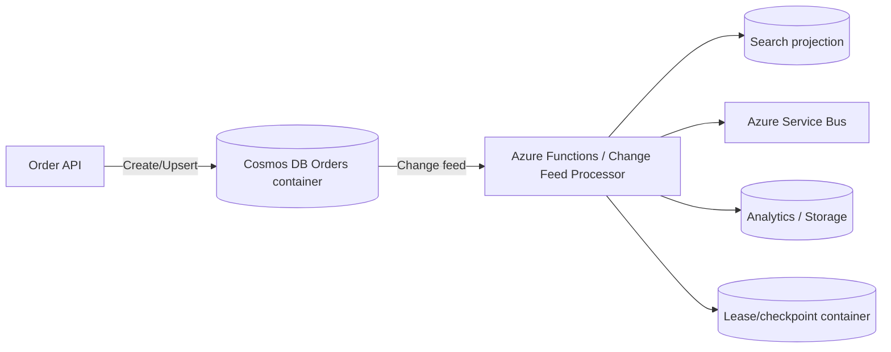
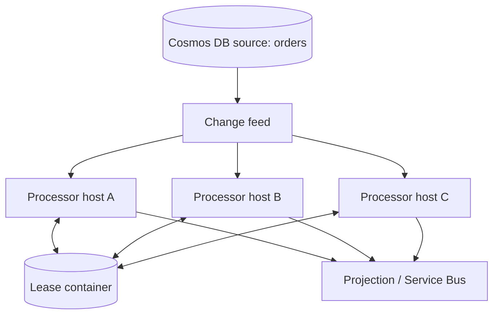
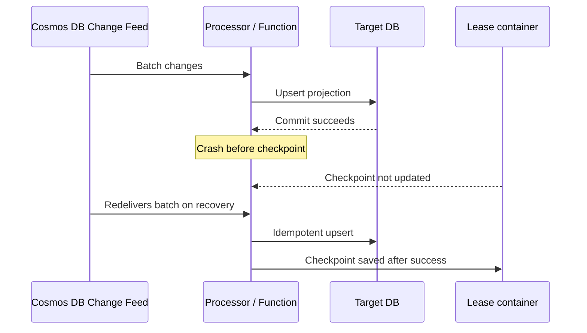
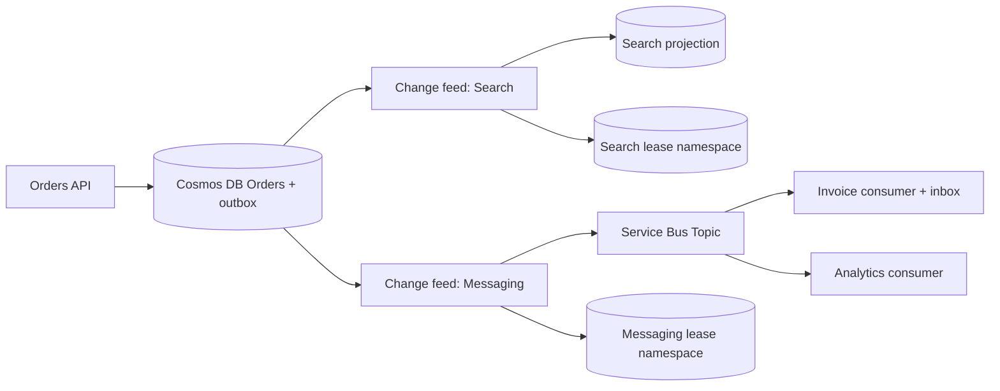
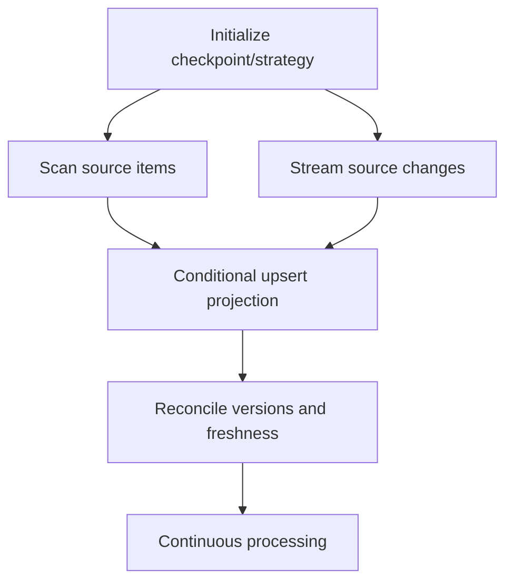
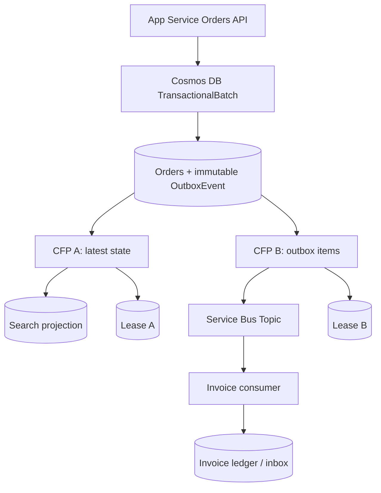

# Change Feed and Change Data Processing Pipelines

In a **NoSQL architecture with Azure Cosmos DB**, many systems need to react right after data changes: when an order transitions to `PAID`, update a search table; when an IoT device writes a new reading, refresh a dashboard; when a customer profile changes status, notify a partner system. A naive yet inefficient approach is polling continuously with `WHERE updatedAt > lastTime`. That wastes **Request Units (RUs)** on repeated queries, depends on application clocks, struggles with multiple workers, and easily drops mutations during errors or rapid updates.

The **Change feed** in **Azure Cosmos DB for NoSQL** provides an ordered stream of item mutations scoped by partition. Applications can consume it via the **Azure Functions Cosmos DB trigger**, the SDK **Change Feed Processor (CFP)**, or a suitable pull model to process changes asynchronously. However, the change feed is **not an exactly-once message broker**, **does not by default emit full deletion history**, and **does not replace backups or long-term audit systems**. A reliable pipeline combines partition keys, checkpoints/leases, idempotency, retries, monitoring, and cost controls.

This lesson belongs to the **NoSQL Data with Cosmos DB** chapter of the `CLOUD_PROVIDERS_AZURE` module: exploring the Azure ecosystem from subscriptions, resource groups, and Microsoft Entra ID to networking, compute, data, monitoring, security, and cost. Examples primarily use **Azure Cosmos DB for NoSQL**, **Azure Functions**, **Service Bus**, **Azure Storage**, and Java. APIs or change mechanisms for Azure Cosmos DB for MongoDB, Cassandra, Gremlin, or Table **must not be assumed identical to API for NoSQL**.

## Learning Objectives

After this lesson, you will be able to:

1. Explain how the Cosmos DB change feed works and distinguish it from polling, SQL CDC, Event Hubs, Service Bus, and backups.
2. Compare **latest-version mode** with **all-versions-and-deletes mode**, including prerequisites and limits for each.
3. Understand **logical partition keys**, event ordering, continuations/checkpoints, lease containers, and Change Feed Processor scale-out.
4. Design **at-least-once** consumers handling duplicates, retries, poison data, and idempotent writes.
5. Build a Java Azure Function reading the change feed, identifying events, and updating projections or publishing messages.
6. Design initial loads, replays/backfills, deletes/TTL handling, and avoid infinite loops when reading and writing the same container.
7. Estimate RU/s, identify partition hotspots, monitor processing lag, and handle `429` throttling.
8. Configure Microsoft Entra ID, managed identity, Azure RBAC, lease permissions, networking, and data protection.
9. Test crashes, splits/scaling, rapid updates, and recovery using verified runbooks.

## 1. The Problem: Turning Data Changes into Actions

Suppose an Orders API writes the following document:

```json
{
  "id": "ORD-1057",
  "tenantId": "tenant-a",
  "orderId": "ORD-1057",
  "status": "PENDING",
  "totalVnd": 450000,
  "version": 1,
  "updatedAtUtc": "2026-11-20T09:00:00Z"
}
```

Once the customer pays, the API changes `status` to `PAID`, bumps `version` to `2`, and writes back the same document. A background workflow must:

- Update the `orders-search` view so customers can search quickly.
- Send `OrderPaid` to Service Bus for invoicing.
- Persist analytical records into a reporting store.
- Recover cleanly if a consumer fails and resume after worker restarts.

The HTTP API should not run all of this synchronously: if search is down for 20 seconds, checkout should not stall. One design uses the **change feed** as the signal that a **document was written**.



This flow **does not mean the source document write and downstream side effects commit in one transaction**. The document is already committed in Cosmos DB while consumers catch up asynchronously. That introduces **eventual consistency in derived stores**, requiring lag monitoring and error handling.

### 1.1. What Is the Change Feed?

In API for NoSQL, the change feed exposes mutations to **items** in a container under supported modes. Consumers read change batches from appropriate sources and continuation positions. The service maintains ordering within the relevant scope while the processor tracks progress via **leases/checkpoints**.

Change feed excels at **event-driven processing**, projection syncing, and downstream pipelines. It does not mean every field edit turns into a permanent immutable event in every mode, nor does it guarantee business semantics like `PaymentChargedExactlyOnce` when one document is edited multiple times.

### 1.2. How Does the Change Feed Differ from Polling by `updatedAt`?

| Aspect | Query Polling | Cosmos DB Change Feed |
|---|---|---|
| Change detection | Periodic queries on timestamp/status fields | Managed feed reading container change history |
| Risk of missed changes | Clock skew, filter gaps, pagination, rapid updates | Depends on mode, start position, checkpoints, retention, error handling |
| Cost | Repeated query RUs even when idle | RUs for feed reads plus processor/lease overhead (not free) |
| Parallelism | Must hand-roll partitioning, locking, and offsets | CFP manages leases and distributes partitions across instances |
| Deletes | Standard queries miss deleted items | Latest-version lacks full delete history; AVD mode supports conditionally |
| Latency | Polling interval + processing time | Near-real-time per polling/processor/throughput, not hard real-time |

**Not every requirement needs the change feed.** For hourly summary reports, an indexed query or pre-aggregated table may suffice. For strict business commands with explicit contracts, emitting events via a **transactional outbox** is often clearer than inferring intent from final document snapshots.

## 2. Differences Between the Change Feed and Related Technologies

| Component | Role | What It Does Not Guarantee |
|---|---|---|
| **Cosmos DB change feed** | Streams item mutations in a container | Not a standalone event bus; not exactly-once business effects by default |
| **Service Bus** | Queues/topics, routing, delivery/settlement/DLQ for business messages | No automatic transaction spanning arbitrary Cosmos DB writes |
| **Event Hubs** | High-throughput ingestion with partitions, offsets, consumer groups | Not an automatic mirror of Cosmos DB changes without a connector/pipeline |
| **Event Grid** | Routes resource/app events to subscribers | Does not replace document change feeds or historical state |
| **Azure Functions Cosmos DB trigger** | Invokes function with batches from the change feed | Does not guarantee single execution per document or business op |
| **Cosmos DB Backup/PITR** | Data protection and recovery per backup mode | Not a real-time sync pipeline to external stores |
| **SQL CDC** | Captures relational DB changes per product engine | Shares no offsets or APIs with Cosmos DB change feed |

Systems often combine them: Cosmos DB change feed → Functions → Service Bus or Event Hubs, while backups protect against accidental deletes. Never replace backups with a change feed consumer: consumers can fail, drop checkpoints, or miss external writes.

## 3. Two Primary Change Feed Modes in Cosmos DB for NoSQL

The single most important setting when using the change feed is its **mode**. Never assume output always includes every intermediate version and every delete.

### 3.1. Latest-Version Mode (Standard / Default)

In **latest-version mode**, the feed reflects **item creations and updates** as the current version of each item per feed semantics. It excels at keeping projections synced with the **latest state** of each item.

Example rapid update sequence:

```text
T1: Order.status = PENDING, version=1
T2: Order.status = PAID,    version=2
T3: Order.status = SHIPPED, version=3
```

A consumer in latest-version mode **must never assume** it will observe **all three intermediate versions** if the item updates multiple times in rapid succession. Because it may surface only the latest state per read mechanics, it is **unsuitable for building a per-transition audit ledger** purely by diffing snapshots.

Typical characteristics:

- Sees **created or updated** items as full documents, not field-level diffs.
- **Does not emit physical deletes as full delete events** by default.
- Reads changes in order within a logical partition key.
- May redeliver items after crashes or checkpoint losses; downstream must be idempotent.
- Can start from the beginning of retained feed history or a chosen point per API/continuation, though not every replay demand is satisfied if the wrong mode or start point was chosen.

### 3.2. All Versions and Deletes Mode

**All versions and deletes (AVD) mode** is designed to read **intermediate versions and delete operations** when knowing more than the latest state is required. For **Azure Cosmos DB for NoSQL**, this mode has **continuous backup prerequisites** plus SDK/API, retention, and account constraints. Do not assume it works on accounts using periodic backup, every API, or the Cosmos DB emulator.

Key differences:

- Exposes modified versions and operation types, including deletes, within supported API/mode limits.
- **Historical reach is bounded by the supported continuous backup retention window**; it is not an infinite event archive.
- Metadata fields identifying operation types and versions depend on **SDK, response schema, and mode**; inspect actual payloads rather than assuming `operationType` always sits inside the document body.
- Abstractions like the standard **Azure Functions Cosmos DB trigger / Change Feed Processor** do not necessarily support all AVD capabilities; check **SDK pull models or supported APIs** and verify versions.
- Can carry different costs, RUs, and backup/storage requirements than latest-version; review budgets and compliance.

### 3.3. Comparison Table

| Criterion | Latest-Version | All Versions and Deletes |
|---|---|---|
| Goal | Sync latest state / projections | Version history and deletes within retention window |
| Creates / updates | Yes | Yes, for mode-supported mutations |
| Physical deletes | Do not expect delete events | Yes, within supported mode limits |
| Intermediate updates | Not guaranteed per rapid edit | Designed to surface multiple versions per retention and feed contract |
| Backup prerequisite | Does not require continuous backup | Requires continuous backup per current feature rules |
| Replay capability | Based on API, checkpoints, and available history | Strictly bounded by continuous backup retention window |
| Functions / SDK support | Standard trigger/CFP normally targets latest-version | Check supported SDK pull APIs; do not assume trigger support |
| Best fit | Caches, search projections, denormalized views | Auditing/change history or delete-aware sync within supported window |

**Mode selection rule:** If you only need the latest device reading or current order state, latest-version suffices. If you must maintain an immutable ledger of **every payment transaction**, emit **explicit business events** or immutable transaction records instead of relying solely on a latest-state feed.

## 4. Handling Deletes and TTL: Common Data-Drift Pitfalls

Suppose an item has:

```json
{
  "id": "P-1009",
  "tenantId": "tenant-a",
  "type": "CustomerProfile",
  "status": "ACTIVE",
  "ttl": 86400
}
```

Once TTL expires, Cosmos DB **deletes the item** per TTL policy. If a consumer only reads **latest-version mode**, it **receives no delete event** to purge the matching search index entry. As a result, search keeps showing expired records that no longer exist in the source container.

### 4.1. Three Strategies for Deletions

1. **Soft delete / tombstone:** Set `isDeleted=true` or `status=DELETED` (retaining the document until consumers process it) so latest-version mode surfaces the update. Later, purge via TTL or physical delete per policy.
2. **All versions and deletes:** Use when the account, backup mode, and SDK support it, retention suffices, and tombstone/replay handling is designed.
3. **Explicit delete business event:** Write an independent event such as `CustomerProfileDeleted` into a container/outbox/message bus per business contract.

Each carries trade-offs: **soft delete** needs policies preventing premature physical deletion; **AVD mode** has retention and support limits; **explicit events** require atomicity with the delete or reconciliation to avoid drift.

### 4.2. Never Create Feedback Loops on the Source Container

If a Function watches container `orders` and **updates the exact same item inside that same container** on every trigger, its write generates a **new change**, looping continuously:

```text
Order updated
  → Function writes processed=true on Order
  → Change feed emits Order updated again
  → Function writes a new processedAt
  → ...
```

Solutions include writing outputs to a **different container**, checking versions/fields and **writing only when state genuinely changed**, or structuring transactional patterns/partitions cleanly. If you ever stamp markers onto the source item, enforce strict loop guards and test thoroughly.

## 5. Partition Keys, Ordering, and Consistency Limits

Cosmos DB uses the **partition key** to distribute items and throughput. In API for NoSQL, an item's true identity is **`id` paired with its logical partition key value**. Item `id="ORD-1"` in Tenant A is distinct from `id="ORD-1"` in Tenant B. Change feed and downstream keys must preserve that distinction.

### 5.1. Ordering Within a Logical Partition Key

In standard change feed semantics, **change ordering is preserved within a single logical partition key value** per mode/API contract, with no global ordering across different logical partitions. For example:

```text
tenant-a / order-1: Created(v1) → Paid(v2) → Shipped(v3)
tenant-b / order-9: Created(v1) → Paid(v2)

There is no guaranteed global ordering between tenant-a and tenant-b.
```

If a critical workflow requires sequential steps, use a matching partition strategy, **business version numbers**, and optimistic concurrency. Never assume a multi-partition change feed batch arrives in global wall-clock write order.

### 5.2. Physical Partitions, Logical Partitions, and Splits

A **logical partition** groups items sharing a partition key value. A **physical partition** is the backend unit storing data and serving throughput, splitting automatically as data or RU/s grows. The **Change Feed Processor** manages reading feed ranges and partition leases across backend splits and rebalances as supported.

Never hardcode `partition 0, 1, 2` as a permanent list. When physical partitions split, lease distribution and continuation handling must rely on the SDK/processor rather than manually stitching offsets.

### 5.3. Partition Skew Hurts Both Writes and Feed Reads

If all documents use `tenantId="global"` in a multi-tenant account, the source becomes a **hot logical partition**. Consequences include per-partition throughput ceilings, higher latency, hotspots, and uneven downstream processing.

A strong partition key balances:

- Value diversity and even load distribution.
- Queries and intra-partition transactions.
- True business ordering requirements.
- Data growth over time.
- Multi-tenant isolation and container partitioning strategy.

**Changing the partition key of an existing container** is not a simple property edit; it normally requires migrating to a new container with controlled synchronization.

## 6. Change Feed Processor: Multi-Partition Reading Without Custom Schedulers

The **Change Feed Processor (CFP)** is an SDK component for batch-processing changes that automatically coordinates progress across multiple host instances using a **lease container**. The Azure Functions Cosmos DB trigger uses the same lease-and-feed model via its extension.

Example deployment:



The processor uses **lease ownership**, checkpoints/continuations, and load balancing to divide work. When an instance disconnects or scales in, another host takes over its leases. Consequently, **the same batch or item can be delivered again**—never treat lease ownership as an exactly-once guarantee.

### 6.1. What Is a Lease Container?

It is a **separate Cosmos DB container** storing CFP/trigger metadata: lease ownership, work distribution state, and continuation checkpoints. A lease container is **not a copy of source documents** or an event history store.

Best practices:

- Create the lease container in the right database, account, and location per SDK/extension rules and permissions.
- Use a partition-key configuration **supported by your extension/SDK version**; never guess `/tenantId` is right for leases.
- Grant **read/write** data-plane RBAC on lease documents to the runtime identity.
- Provision adequate RU/s for lease operations and monitor `429`s and latency.
- Protect lease data from manual edits or accidental deletion.
- Separate **independent consumer groups** cleanly.

### 6.2. Workers in One Pipeline Share Leases; Independent Pipelines Do Not

If three instances all update `orders-search`, they share **the same lease set** to split work. However, if one pipeline updates search while another feeds accounting, they need **independent checkpoints**; sharing the same lease/checkpoint causes one pipeline to skip changes for the other.

Use **separate lease containers** or distinct **lease prefixes / processor names** where supported by the extension and explicitly designed. Never casually rename a lease prefix in production: it can cause consumers to re-read or jump to a different start point.

### 6.3. When Are Checkpoints Written?

In standard CFP/trigger flows, the processor updates the checkpoint only after the **callback reports batch success**. If the callback writes to the target projection and crashes **before the checkpoint saves**, the batch is redelivered. If the callback **swallows an exception and returns success** even though outputs failed to commit, the processor advances the checkpoint and loses retries.



This diagram illustrates the **failure window** conceptually; exact batch retry and checkpoint behavior vary by trigger and SDK version.

### 6.4. CFP Does Not Replace a Dead-Letter Queue

A batch containing one malformed document can fail on every retry and stall progress on that feed range. CFP **does not automatically create a Service Bus DLQ** for individual documents. Your app must choose: retry transient errors, **quarantine permanent poison items** (with durable state and audit) before advancing, or halt the pipeline to preserve correctness. Never just `catch(Exception)` and ignore silently.

## 7. Azure Functions Cosmos DB Trigger: Batch Processing

The **Azure Functions Cosmos DB trigger** runs a serverless consumer whenever a Cosmos DB for NoSQL source mutates. The extension embeds the change feed processor and **lease container** to distribute work. This section illustrates **latest-version processing**, which does not inherently support AVD mode by default.

### 7.1. Resources in the Example

```text
Azure resource group
├── Cosmos DB account (API for NoSQL)
│   └── database: commerce
│       ├── container: orders             partition key /tenantId
│       ├── container: leases             partition key configured per extension
│       └── container: orders-projection  partition key aligned with target queries
└── Function App: fn-orders-projection
    ├── Managed identity
    ├── Cosmos DB trigger (compatible extension)
    ├── Application Insights
    └── Connection settings + networking
```

**Source** needs feed-read permissions; **leases** need create/read/write lease metadata permissions; **projection** needs write permissions. These data-plane permissions are distinct from Azure RBAC resource management roles. Verify your Cosmos DB extension version and supported identity-based connection settings before deploying.

### 7.2. Illustrative Java Function

Example annotations for Azure Functions Java and a compatible Cosmos DB extension. Exact annotation/binding property names can vary across extension versions; verify against your deployed dependencies. This code handles a JSON array provided by the binding:

```java
import com.fasterxml.jackson.databind.JsonNode;
import com.fasterxml.jackson.databind.ObjectMapper;
import com.microsoft.azure.functions.ExecutionContext;
import com.microsoft.azure.functions.annotation.CosmosDBTrigger;
import com.microsoft.azure.functions.annotation.FunctionName;

public class OrderChangeFunction {
    private static final ObjectMapper JSON = new ObjectMapper();

    @FunctionName("OnOrderChanged")
    public void run(
        @CosmosDBTrigger(
            name = "changes",
            databaseName = "commerce",
            containerName = "orders",
            leaseContainerName = "leases",
            createLeaseContainerIfNotExists = false,
            connection = "CosmosConnection")
        String changesJson,
        final ExecutionContext context) {

        try {
            JsonNode documents = JSON.readTree(changesJson);
            if (!documents.isArray()) {
                throw new IllegalArgumentException("Expected a document batch");
            }

            for (JsonNode doc : documents) {
                String id = required(doc, "id");
                String tenant = required(doc, "tenantId");
                long version = doc.path("version").asLong(-1);
                if (version < 0) {
                    throw new IllegalArgumentException("Missing business version");
                }

                // Business service: implement durable conditional upsert yourself.
                OrderProjectionService.upsertIfNewer(tenant, id, version, doc);
            }
        } catch (Exception error) {
            context.getLogger().warning(
                "Change-feed batch failed: " + error.getClass().getSimpleName());
            // Signal to the runtime that batch processing did not succeed.
            throw new IllegalStateException("Change-feed processing failed", error);
        }
    }

    private static String required(JsonNode obj, String key) {
        JsonNode value = obj.path(key);
        if (!value.isTextual() || value.asText().isBlank()) {
            throw new IllegalArgumentException("Missing " + key);
        }
        return value.asText();
    }
}
```

**Note:** `OrderProjectionService.upsertIfNewer` is **not a built-in SDK API**; it is application logic you write using the Cosmos SDK/SQL/Storage and test for concurrency. You will need Java Functions dependencies, Jackson, and compatible runtime/extensions. Never log raw `changesJson` as it may contain PII.

### 7.3. Connections and Managed Identity

`connection = "CosmosConnection"` is a **binding configuration prefix**, not a URI or password hardcoded in Java. Locally, keep parameters in protected local settings; **never commit `local.settings.json` containing secrets**. In Azure, prefer **managed identity and identity-based connections** where supported by the extension version. Verify account endpoint property names, data-plane role assignments, and networking (Private Endpoints, VNet Integration, DNS, firewalls). Resource-group management roles do not grant change feed read permissions.

### 7.4. Why Batch Semantics Matter

Suppose a Function receives 50 documents, updates projections for 49, and hits a schema error on document 50. Throwing an exception causes the batch/range to retry: **the first 49 operations must be safe to execute again**.

```java
// Anti-pattern: swallowing errors so the callback returns success.
try {
    publishToServiceBus(item);
} catch (Exception ex) {
    logger.info("Ignored");
}
// Checkpoint may advance even though the message was never published.
```

For transient faults, throw so the processor retries per policy. For permanent poison records, **quarantine durably with source/identity metadata**, alert operators, and only then advance checkpoints. Never silently drop critical records just to keep throughput moving.

### 7.5. Batch Size and Timeouts

Larger batches reduce per-invocation overhead, yet lengthen callbacks and increase the number of operations retried if the tail fails. Options like `maxItemsPerInvocation`, `feedPollDelay`, and polling/scaling behavior depend on extension version and hosting plan. Never copy an old `host.json` expecting identical behavior on a newer extension. Measure change feed lag, RU consumption, downstream 429s, and execution duration before tuning.

## 8. CFP SDK vs. Azure Functions Trigger

You can run the **Change Feed Processor (CFP)** inside a Java worker on Azure Container Apps, AKS, App Service, or VMs when you need tighter control over host lifecycles, scaling, or integrations. The Functions trigger simplifies serverless hosting without removing your responsibility for business concurrency and idempotency.

| Criterion | Azure Functions Trigger | Change Feed Processor SDK |
|---|---|---|
| Host management | Functions runtime / hosting plan | Self-managed service deployment and scaling |
| Leases / checkpoints | Managed by extension per config | Managed by CFP SDK per source/lease config |
| Callback | Function receives batch via binding | SDK callback receives changes via API |
| Customization | Fits common serverless workflows | More flexible for specialized hosting |
| Runtime behavior | Depends on trigger/extension version | Depends on SDK version, config, host lifecycle |
| Feed modes | Check which modes the trigger supports | Separate CFP vs. SDK pull API for required modes |

### 8.1. CFP Lifecycle (Pseudocode)

```text
processor = buildProcessor(
    sourceContainer = commerce.orders,
    leaseContainer = commerce.leases,
    hostName = uniqueStableHostId,
    onChanges = handleBatch
)
start(processor)
waitForShutdown()
stopGracefully(processor)

function handleBatch(docs):
    for doc in docs:
        upsertProjectionIfNewer(doc)
    return SUCCESS_ONLY_AFTER_DURABLE_EFFECTS
```

This is **pseudocode**, not exact API method names for a specific SDK version. Give each instance a distinct `hostName` to track lease ownership; share the same lease/checkpoint identity across instances of **the same pipeline**, while isolating lease namespaces across **independent pipelines**.

### 8.2. Modifying Leases Is Not Harmless

Changing the lease container or lease prefix can cause consumers to re-read from a different point or start from “now” by default. Plan replays intentionally using isolated lease state and idempotency. **Never delete a production lease container** to “clear lag” without understanding how many records will be reprocessed.

## 9. At-Least-Once Delivery and Idempotent Processing

A change feed callback can fire again for the same logical change or batch after worker crashes, timeouts, lease rebalances, or unsaved checkpoints. Never equate one Function invocation with an exactly-once business operation.

### 9.1. Crash After Target Write, Before Checkpoint

```text
T1. Receives Order.version=8
T2. Writes OrdersSearch(version=8) successfully
T3. Host crashes before updating lease checkpoint
T4. Another processor re-reads version=8
T5. Consumer attempts to write OrdersSearch a second time
```

If a consumer blindly runs `inventoryCount -= 1` on every delivery, inventory gets decremented twice. If it performs a **version-guarded projection write** accepting only newer versions, redelivery becomes a harmless no-op.

### 9.2. Conditional Updates by Business Version

```text
function upsertIfNewer(tenantId, id, newVersion, payload):
    existing = readProjection(tenantId, id)
    if existing != null and existing.sourceVersion >= newVersion:
        return ALREADY_APPLIED

    candidate = project(payload)
    candidate.sourceVersion = newVersion

    conditionalWrite(
        candidate,
        expectedETag = existing.ETag if existing else CREATE_ONLY
    )
    if PRECONDITION_FAILED:
        rereadAndRetryWithBoundedBackoff()
    else:
        return APPLIED
```

**Never** run `read → compare → blind upsert` across concurrent workers. Enforce optimistic concurrency via `_etag`/`If-Match`, or transactions/unique constraints at the target. Never compare two `_etag` strings with `>`: ETags are **opaque** tokens. Application-managed business versions must increment atomically on source writes; `_ts` alone is not a unique per-transaction version key.

### 9.3. Inbox / Ledger for External Side Effects

For emails, invoices, or payments, an idempotent projection alone does not protect external side effects. A durable inbox can store `(consumerName, tenantId, businessEventId, payloadFingerprint)` with a **unique key** and `PROCESSING/SUCCEEDED/FAILED` states. Claiming must be atomic, with lease timeouts/fencing for long tasks.

Marking `SUCCEEDED` **before sending an email** risks dropping the email if the host crashes. Sending the email **before saving the marker** risks sending duplicates if the response drops. Use transactional outboxes, provider idempotency keys, or reconciliation matched to the target system—never claim a Cosmos DB transaction atomically commits an external HTTP call.

## 10. Transactional Outbox in Cosmos DB

An `Order` document transitioning `PENDING → PAID` can mutate multiple times rapidly; a latest-version feed is **not an immutable ledger of every transition**. For critical business events, write an **outbox event item** atomically alongside the source mutation within Cosmos DB's limits.

### 10.1. `TransactionalBatch` Scoped to One Logical Partition

**Cosmos DB for NoSQL `TransactionalBatch`** executes multiple operations atomically across **items in the same container sharing the same logical partition key value**, within service limits. It **never** spans two containers, two tenants/partitions, Service Bus, or external payment APIs.

Example inside a `commerce` container partitioned by `/tenantId`, creating both Order and OutboxEvent for Tenant A:

```json
{
  "id": "ORD-1057",
  "tenantId": "tenant-a",
  "type": "Order",
  "status": "PAID",
  "version": 2
}
```

```json
{
  "id": "evt-ORD-1057-PAID-v2",
  "tenantId": "tenant-a",
  "type": "OutboxEvent",
  "eventType": "OrderPaid",
  "eventId": "evt-ORD-1057-PAID-v2",
  "orderId": "ORD-1057",
  "schemaVersion": 1
}
```

Within partition `tenant-a`:

```text
TransactionalBatch(PartitionKey="tenant-a"):
  1. Conditional Patch/Replace Order ORD-1057 to PAID, version=2
  2. Create OutboxEvent evt-ORD-1057-PAID-v2 (deterministic unique id)
  3. Commit both or roll back both
```

If Orders live in `orders` and events live in a separate `outbox` container, you cannot run one atomic `TransactionalBatch` **across two containers**. Reshape the data model or use reconciliation.

### 10.2. Feed Dispatches Only `OutboxEvent` Items

```text
if item.type != "OutboxEvent": skipDispatch()
else:
    ServiceBus.Send(MessageId=item.eventId, Body=eventPayload)
    trackDurablePublishOutcome(item.eventId)
```

Each event is **a separate immutable item**: latest-version mode sees every creation without having to reconstruct intermediate order states. Still, the dispatcher can resend after a crash before checkpointing. **Service Bus duplicate detection** (when enabled on supported tiers) filters duplicates within its window, while subscribers still need idempotency for redeliveries or replays outside that window.

### 10.3. Avoid Marker Feedback Loops

If the dispatcher updates `publishedAt` on the `OutboxEvent` inside the source container after sending, the change feed emits that update too. Consumers must **filter out already-published events cleanly** to avoid infinite timestamp-bumping or re-publishing loops.

A **failure window** still exists: saving `published` before broker ACK risks dropping events; saving it after broker ACK risks duplicates if the ACK is lost. Outbox provides **at-least-once publishing**, not cross-service exactly-once.

## 11. Fan-Out Pipelines to Multiple Downstream Consumers

One Cosmos DB source can feed multiple independent pipelines. They **must not share checkpoints** if each has its own progress and SLA.



**Search** uses conditional upserts by `sourceVersion`. **Messaging** dispatches only `type=OutboxEvent` items with stable `eventId`s. Downstream, the invoice consumer enforces a unique business key while analytics maintains its own watermarks/dedup. An inbox **without consumer scoping** could let Search mark an event processed and accidentally block Invoice from handling the same valid event.

### 11.1. Eventual Consistency and Freshness Targets

After the source commits `PAID`, a projection can still show `PENDING` briefly while Functions reads the batch or the target experiences throttling. Publish clear **freshness SLOs** and know which flows must read the source directly for immediate read-your-writes. The change feed does not give read-your-writes across downstream stores.

### 11.2. Business Events Need Unique Identities

For invoice creation events, use deterministic `eventId`/`invoiceId`/`paymentId` values. If a producer emits the same logical event under a brand-new ID, Service Bus duplicate detection misses it; consumers still need dedup on **business keys**. Conversely, never collapse two legitimate partial payments for one order by using only `orderId` as the key.

## 12. Initial Loads, Start Positions, and Replay/Backfill

A new pipeline typically needs both **existing historical data** and **live incoming mutations**. Starting a feed only from “now” leaves a new projection empty of millions of pre-existing items.

### 12.1. Existing Checkpoints vs. Fresh Leases

Depending on the SDK/Functions extension, consumers can start from `now`, `beginning`, or a continuation/timestamp. Settings like `startFromBeginning` on some triggers take effect **only when no lease checkpoint exists yet**. Flipping that flag to `true` while keeping old leases **does not replay history**.

Never delete a production lease container to “reset everything.” For controlled replays, use a **separate lease namespace/prefix**, pick the mode-appropriate start point, and verify downstream idempotency.

### 12.2. Backfilling Without Missing Live Writes

Suppose 10 million documents already exist while users actively update orders during the backfill scan. One approach:

1. Select source, scope, schema, and mode, establishing a **continuation/checkpoint** strategy to capture changes occurring during backfill.
2. Run a paginated, partition-aware **snapshot/scan**, writing to the target via conditional upserts.
3. Apply changes captured via the feed concurrently or sequentially after the scan.
4. Compare `incomingVersion` against `target.sourceVersion` so the snapshot never overwrites newer versions.
5. Verify sample IDs, counts, version distributions, and lag before routing traffic to the projection.
6. Switch to continuous processing while retaining evidence to recover if drift appears.



**Race condition:** Snapshot reads version 8 while the feed already applied version 9; a blind snapshot write would regress the projection back to 8. Version guards paired with ETags/conditional writes must protect **both backfill and streaming**. Standard scans never provide a frozen container-wide transaction snapshot.

### 12.3. Replay Limits Depend on Mode

- **Latest-version:** Does not guarantee every intermediate version or delete like an audit log.
- **All versions and deletes:** Bounded by continuous backup retention and mode/SDK support.
- **Multi-year history requirements:** Store immutable business events or dedicated archives with explicit retention—never treat lease checkpoints as backups.

Once source mutations age out of the readable feed window, resetting leases **cannot resurrect lost history**.

### 12.4. Backfill Impact on Production

Scanning millions of items burns RUs and can trigger `429` throttling and higher API latency on the source. Cap concurrency, use partition-aware reads, schedule off-peak, and watch normalized RU consumption. Never crank up throughput unboundedly just to speed up a backfill without checking quotas and budgets.

## 13. RU/s, Performance, and Cost

Cosmos DB bills data operations in **Request Units (RUs)**. Change feed reads, lease metadata writes, projection updates, and backfill scans each consume RUs; total cost also depends on document sizes, indexing, consistency, throughput mode, Functions/container compute, networking, and downstream services.

### 13.1. Where RUs Are Consumed

```text
Source container:
  - API writes
  - Change feed reads
  - Backfill queries/scans

Lease container:
  - Ownership/lease reads and writes
  - Checkpoint/metadata updates

Target container:
  - Conditional reads/updates
  - Projection indexing and validation
```

There is no rule that `1 document = 1 RU`. Measure request charges, CPU/batch duration, and metrics separately for **source, lease, and target**.

### 13.2. Handling 429s Properly

`429 Too Many Requests` indicates capacity/workload throttling. SDKs include retry policies and honor `retry-after` hints. When 429s appear:

1. Identify **which resource** is throttling (source, lease, or projection).
2. Inspect hot partitions, RU/s, batch sizes, and downstream bottlenecks.
3. Apply bounded retries with backoff and jitter per SDK—avoid retry storms.
4. Throttle concurrent backfill scans or batch work when the source is busy.
5. Re-evaluate autoscale RU/s, tiers, or partition strategy after measuring load.
6. Monitor change feed lag during recovery.

Never catch a 429 and return success before committing output: the processor will advance the checkpoint and **silently drop unfinished work**.

### 13.3. More Instances Are Not Always Faster

CFP distributes work by feed ranges and leases, yet a hot logical partition remains bounded. Once host instances outnumber distributable work units, scaling out yields no further throughput gain. Fix partition keys and data models before blindly adding Functions instances.

### 13.4. Cost Model

```text
Approximate total cost
  = Source RU/Storage + Lease RU/Storage + Target RU/Storage
  + Functions / Container compute
  + Service Bus / Storage / Search (if used)
  + Networking + Azure Monitor / Log Analytics
```

Running three independent pipelines increases feed reads and lease traffic; fanning out via one dispatcher → Service Bus Topic cuts source reads while adding broker operations, DLQs, and ops overhead. **Never assume one pattern is universally cheaper**; measure against real volumes and SLAs with the Azure Pricing Calculator and Cost Management.

## 14. Entra ID, Managed Identity, RBAC, and Private Networking

The change feed can carry **full mutated documents**, including PII. Functions should never hold broader read/write permissions than required, and downstream targets must enforce the same data governance as the source.

### 14.1. Management Plane vs. Data Plane

Azure Cosmos DB for NoSQL supports **native data-plane RBAC** per account/API and SDK capabilities. Distinguish three permission roles:

| Principal | Actions | Permission Boundary |
|---|---|---|
| **Resource operator** | Create Cosmos accounts/containers, adjust throughput/networking, assign roles | Azure management-plane RBAC at subscription/resource group |
| **Change feed processor** | Read source changes, read/write leases and checkpoints | Native Cosmos DB data-plane permissions on source and lease containers |
| **Projection writer** | Upsert/index into target Cosmos DB, Search, or SQL | Target system's data-plane write permissions—not inherited from source |

`Contributor` on a resource group **does not grant permission to read Cosmos DB items** via SDK Entra auth. Conversely, sharing broad account keys expands the blast radius. Prefer **managed identities and least-privilege data-plane role assignments** wherever supported by your SDK and Functions extension.

### 14.2. Managed Identity for Azure Functions

Logical setup:

1. Enable system-assigned or user-assigned managed identity on the Function App.
2. Identify the exact **principal ID** (do not confuse it with client ID or resource ID).
3. Grant data-plane feed read permissions on the **source container** and lease read/write permissions on the **lease container** per SDK/extension requirements.
4. Grant target write permissions separately (projection store or Service Bus).
5. In Function bindings, configure the **connection configuration prefix** and Entra identity properties matching your extension version.
6. Verify connectivity, role propagation, and trigger logs in staging before production.

Never commit `local.settings.json` with secrets, and never log access tokens. For Azure Container Apps or AKS workloads, the same identity principles apply, though workload-identity attachment differs from Functions.

### 14.3. Private Endpoints, VNets, and DNS

If the Cosmos DB account blocks public access, the Function/processor must connect over **VNet Integration, Private Endpoints, Private DNS zones, and network rules** supported by its hosting plan. Even perfect RBAC times out if DNS resolves wrongly or outbound routes are blocked.

Never fix 403s or timeouts by opening the Cosmos DB public endpoint globally. Inspect separately: identity tokens, native RBAC scopes, account endpoints, Private DNS resolution, outbound routing, and firewalls. If the lease container lives in a separate account (where supported), it may need its own routing and permissions.

### 14.4. PII, Encryption, and Auditing

A `CustomerProfile` source can contain addresses, phone numbers, and sensitive attributes. When projecting to search or analytics, apply **data minimization**, masking/tokenization per policy, and independent retention. Azure Cosmos DB encryption at rest does not protect data once exported into logs or external stores.

Practices:

- Log sanitized business event/document IDs, statuses, and latencies—never raw change feed payloads.
- Never store access tokens, account keys, connection strings, or SAS tokens in docs or telemetry.
- Assign clear owners for source, leases, projections, and dead-letter/quarantine queues.
- Separate permissions to read raw source data from dashboard access.
- Audit role changes, network edits, and accidental container/lease deletions.

### 14.5. Backup Does Not Equal the Change Feed

The change feed powers **change processing**, whereas Cosmos DB periodic/continuous backups handle **data recovery** within retention bounds. Continuous backup may be a prerequisite for AVD mode, yet it does not turn AVD into permanent archival storage. If a source is wiped and leases advance, only restoring a backup or reading an independent archive recovers long-term state.

## 15. Hands-On Lab: Tracing a Mutation from Cosmos DB to a Projection

This is a **learner guide for a lab environment**, not live deployments run while writing this lesson. Use only authorized resources and synthetic data.

### 15.1. Provision / Verify Source Structure

Resources:

```text
Account:      cosmos-orders-lab
Database:     commerce
Container:    orders        partition key /tenantId
Lease:        leases        configured per extension/SDK
Projection:   orders-view   partition key /tenantId
Function App: fn-orders-view-lab
```

With proper permissions and quotas, create containers via Portal or IaC matching the partition key design. **Never alter a production container's partition key** for a lab exercise. Keep leases and projections separate so the processor writes targets without looping back on the source.

### 15.2. Inspect the Account with Azure CLI

These commands **read metadata only** without creating or modifying data:

```bash
az login
az account set --subscription "<subscription-id>"

RG="rg-cosmos-lab"
ACCOUNT="cosmos-orders-lab"
DB="commerce"
SOURCE="orders"

az cosmosdb show \
  --resource-group "$RG" \
  --name "$ACCOUNT" \
  --query "{name:name,location:location,kind:kind,consistency:consistencyPolicy,backup:backupPolicy}" \
  --output json

az cosmosdb sql container show \
  --resource-group "$RG" \
  --account-name "$ACCOUNT" \
  --database-name "$DB" \
  --name "$SOURCE" \
  --query "{id:id,partitionKey:partitionKey,indexingPolicy:indexingPolicy}" \
  --output json
```

Inspect `partitionKey.paths`, consistency policy, and `backupPolicy`. These require management-plane read permissions; they **do not prove** your runtime identity holds data-plane feed read permissions. Check `az cosmosdb ... --help` if output schemas differ by CLI version.

### 15.3. Trigger a Test Mutation

In Cosmos DB **Data Explorer** inside the lab environment, create an item:

```json
{
  "id": "ORD-DEMO-1",
  "tenantId": "tenant-demo",
  "type": "Order",
  "version": 1,
  "status": "PENDING"
}
```

Next, update `status` to `PAID` and `version=2`, saving with the exact partition key and concurrency policy. Note that this is a **committed source mutation**. Never put real money, tokens, or PII into lab items.

### 15.4. Observe the Function / Processor

In Function monitoring, Application Insights, or configured logs:

- Confirm the binding connects to the right account, database, container, and lease container.
- Inspect batch/document counts, callback durations, exceptions, and 429s.
- Verify the target projection holds `ORD-DEMO-1` with the expected `sourceVersion`.
- If a callback fails, verify the processor retries and the projection **prevents duplicate writes**.
- If the source item mutates rapidly, do not assume every intermediate version appeared under latest-version mode.

### 15.5. Controlled Replay Test

In an isolated staging environment, use a fresh lease namespace or SDK-supported replay mechanism—**never delete production leases**—and re-read the target change window. Confirm target versions never regress and no duplicate business side effects occur. To test AVD mode, first verify **continuous backup retention, SDK pull mode, and feature limits** rather than just toggling a flag on the standard Cosmos DB trigger.

### 15.6. Record Observations in Your Lab Log

```text
Source item id / partition key:    ORD-DEMO-1 / tenant-demo
Source version after update:       2
Processor identity / lease scope:  <observed value>
Batch received at UTC:             <observed timestamp>
Projection version:                <observed version>
Change feed lag:                   <measured estimate>
Duplicate after controlled replay: <yes/no + evidence>
Error/429 count:                   <observed value>
```

The `<...>` placeholders must hold **real observed values**, never fabricated figures. For cleanup, verify resource ownership and ensure no shared data exists; never delete shared resource groups or production accounts.

## 16. Monitoring, Alerting, and Data Observability

A pipeline that throws zero exceptions can still **stall checkpoints or fall hours behind**. Monitor **source, leases, targets, and business outcomes**—not just Function invocation counts.

### 16.1. Key Signals

| Signal | Where to Observe | Meaning |
|---|---|---|
| Change feed processing lag / estimated remaining work | CFP estimator / SDK telemetry where supported | Is the backlog growing or shrinking? |
| Functions failures, duration, restarts | Azure Monitor / Application Insights | Are callbacks erroring, timing out, or restarting? |
| Source RU consumption / 429s | Cosmos DB metrics | Are API traffic and feed reads contending for capacity? |
| Lease RU / 429s, lease churn | Lease container metrics / processor logs | Is lease ownership or checkpointing slow/unstable? |
| Target write failures, 409 / 412 | Projection DB logs / metrics | Expected version/unique conflicts or real failures? |
| Duplicate skip rate | Application logs / inbox store | Is at-least-once replay deduplicating cleanly? |
| Quarantine / poison count | App-managed quarantine / DLQ | Are permanent poison records stuck? |
| Source-to-target freshness | Business timestamps / version checkpoints | How stale is data seen by users? |
| Total cost | Azure Cost Management / RU metrics | Unusual autoscale, telemetry, or target spend spikes? |

Exact metric and estimator names depend on **SDK/runtime versions and resource support**. Never invent an Azure Monitor metric name assuming it exists. Measure freshness directly by comparing `sourceUpdatedAt` against `targetAppliedAt`.

### 16.2. Structured Logs with Correlation and Idempotency Keys

Sample structured log:

```json
{
  "component": "order-change-processor",
  "tenantScope": "tenant-demo",
  "documentId": "ORD-DEMO-1",
  "sourceVersion": 2,
  "result": "already_applied",
  "processingDurationMs": 74
}
```

Never log full payloads containing PII. Use `FunctionInvocationId` to debug a single execution, and `businessEventId` or `(tenantId, id, version)` to correlate retries. Never use invocation ID as a deduplication key. Because logs may be sampled, rely on durable inbox/outbox/ledger tables for auditing rather than sampled telemetry alone.

### 16.3. Alerts Must Distinguish an Idle Source

If the source receives zero writes for 30 minutes, zero Function invocations is completely normal. Pair “no trigger calls” alerts with **source write activity** and lag/freshness SLOs. During peak traffic, rising lag with zero errors often signals a downstream target bottleneck—monitor both throughput and processing rate.

## 17. Symptom-Based Troubleshooting

| Symptom | Likely Cause | How to Verify / Fix |
|---|---|---|
| Trigger never fires despite writes | Wrong account/container, lease config, identity, start position, or networking | Check binding/lease logs, Cosmos data-plane RBAC, DNS, and endpoint |
| Invocations run yet projection lacks records | Callback swallows exceptions, bad filter, or target write failures | Compare business outcomes, checkpoints, and `sourceVersion`/`targetVersion` |
| Missing delete events | Running latest-version mode | Use soft deletes/tombstones, explicit events, or AVD where supported |
| Missing intermediate updates | Latest-version semantics are not a full audit trail | Use immutable event records or AVD per requirements |
| Same event processed twice | Crash before checkpoint, lease handoff, batch retry | Enforce idempotent conditional writes and durable inboxes |
| Checkpoints stop advancing | Poison document, lease 429s, or failing callback | Inspect exceptions, source/lease RUs, and quarantine |
| Rapid 429 spike | Insufficient RUs, burst traffic, hot partition | Isolate source/lease/target; apply backoff and tuning |
| Old version overwrites newer version | Blind upsert or snapshot/backfill race | Enforce ETag/conditional writes and business version checks |
| Two pipelines interfere with each other | Shared lease/checkpoint namespace | Separate consumer groups / lease namespaces |
| Only new items appear | Missing initial backfill or started at “now” | Design snapshot + safe feed replay |
| Function loops infinitely | Trigger mutates source items indiscriminately | Separate output container or apply strict filter + write guards |
| 403 / Unauthorized | Missing native data-plane role or wrong identity | Check principal ID, scope, and permissions |
| Timeouts with Private Endpoint | Misconfigured VNet, DNS, firewall, or outbound routing | Test connectivity from the live Function hosting environment |
| Scaling workers fails to cut lag | Hot logical partition or target bottleneck | Revisit partition model, leases, and RU sizing |
| AVD cannot read older history | Continuous backup mode/window or SDK limits | Check retention bounds and external archives |

### 17.1. Ordered Diagnostic Flow

```text
Search / Projection is not updating
  |
  +-- Did the source write commit?
  |      +-- No: check API producer / RUs / conflicts
  |
  +-- Does the active feed mode emit this mutation?
  |      +-- Deletes / intermediate edits: verify mode
  |
  +-- Did the processor acquire leases and read the feed?
  |      +-- No: check connections, RBAC, networking, lease RUs
  |
  +-- Did the callback commit to the target cleanly?
  |      +-- No: check schema, 429s, retries, downstream outage
  |
  +-- Does the target guard versions and idempotency?
         +-- No: add conditional writes, inbox, race/replay guards
```

Never wipe leases, over-grant permissions, or throw unlimited RUs to mask errors. Isolate the **failure domain** first while preserving replayability and data evidence.

## 18. Reliability Testing: Fault Injection and Replay

Inserting one document and seeing a Function fire **does not prove** a change feed pipeline is reliable. You must test both **safety** (no wrong or duplicate side effects) and **liveness** (recovery after failures).

### 18.1. Test Matrix

| Test | How to Stage in Lab | Expected Outcome |
|---|---|---|
| **Create item** | Insert new document with valid partition key | Projection receives matching record |
| **Update item** | Bump `version`, change one field | Projection updates to newer version; never regresses |
| **Rapid consecutive updates** | Write versions 2, 3, 4 rapidly | Recognizes latest-version may coalesce intermediates; final projection is accurate |
| **Soft delete** | Set `isDeleted=true` | Consumer applies tombstone/projection deletion cleanly |
| **Physical delete / TTL** | Delete item or let TTL expire | Latest-version **must not be assumed** to emit deletes; verify chosen pattern/mode |
| **Crash before target commit** | Inject fault prior to target write | Callback fails, checkpoint does not advance; retry succeeds later |
| **Crash after target commit** | Throw/restart after upsert before callback exits | Replay creates zero duplicate side effects; target version never drops |
| **Two concurrent workers** | Scale out with overlapping replay/batches | Conditional writes / unique keys resolve races without blind overwrites |
| **Source 429** | Generate controlled lab load within quota | Backoff/retries recover without false successes |
| **Lease 429** | Constrain lease RU/s in controlled lab | Lag alert fires; recovers once RUs suffice with zero data loss |
| **Malformed document** | Omit `tenantId` or `version` | Quarantined with audit or halted per policy—never silently skipped |
| **Backfill overlapping streaming** | Snapshot version 8 alongside feed version 9 | Target retains version 9 |
| **Lease namespace switch** | Point isolated test to a new lease prefix | Verifies start position/replay and deduplication |
| **Partition split / rebalance** | Environment supporting scale/partition ops | CFP rebalances work seamlessly without hardcoded partition IDs |
| **Downstream outage** | Temporarily pause mock Service Bus/target | Errors surfaced, bounded retries hold, zero committed events lost |

Never overload production accounts or mutate real data. For every test, record **source event ID/version, expected target state, actual state, invocation/lease traces, and business invariants**.

### 18.2. PASS Criteria

The test suite passes when:

1. **Safety:** Retried events/batches never create duplicate invoices, payments, or ledger entries, and projections never regress in version.
2. **Liveness:** Transient faults recover and checkpoints advance; permanent errors trigger quarantine and operator workflows.
3. **Observability:** Logs/metrics (free of PII) pinpoint root causes, gaps, and lag.
4. **Security:** Identities access source, lease, and target strictly within least-privilege scopes over protected networks.
5. **Recovery:** Replays and backfills work cleanly within documented mode and retention bounds.

**Never cite “Function invocations equals created documents”** as proof of exactly-once delivery. Batching, retries, coalescing, and scale-out naturally make those counts differ.

## 19. Design Scenario: Order Sync and Invoicing

An enterprise runs an e-commerce platform using Azure App Service, Azure Cosmos DB for NoSQL, and Azure Functions. The API stores orders partitioned by `tenantId`. Requirements:

- Let customers view near-real-time order lists.
- On payment success, generate **exactly one invoice** per payment.
- Emit events to accounting via Service Bus.
- Lose zero events if Functions hosts restart or leases move.
- Handle high load without triggering 429s on the primary API.
- Handle order cancellations/deletions per policy.
- Support backfilling when building a new search projection.

### 19.1. Splitting into Two Pipelines

**Pipeline A — Search projection:** Reads latest-version change feed for `Order` documents; upserts only when `incomingVersion > target.sourceVersion`. For deletions, uses `isDeleted` tombstones or dedicated delete-aware handling since latest-version does not emit physical deletes. Pipeline A owns its own lease namespace.

**Pipeline B — Invoice events:** The API uses **Cosmos DB `TransactionalBatch`** within the same container and partition key to update the Order and create an **immutable `OutboxEvent(OrderPaid, paymentId)`**. Processor B filters solely for `OutboxEvent` items and publishes to Service Bus with `MessageId=eventId`. The invoice consumer enforces a durable unique key `(tenantId, paymentId)` so redeliveries never issue a second invoice. Pipeline B owns its own separate lease namespace.



### 19.2. Handling Each Failure Point

| Failure Point | What Remains? | Protection Mechanism |
|---|---|---|
| API crashes **before `TransactionalBatch` commits** | Neither Order update nor OutboxEvent exists | API retry using idempotency key / optimistic concurrency |
| API crashes **after commit, before HTTP response** | Order and OutboxEvent both exist | API retry checks business payment ID instead of minting a new event |
| CFP B publishes to Service Bus, crashes before checkpoint | Event may sit in broker; feed checkpoint lags | Re-publishes with same `MessageId`; invoice consumer is idempotent |
| Invoice consumer commits ledger, Service Bus lock expires | Ledger committed; message may redeliver | Unique `(payment, invoice)` key; safely completes duplicate |
| CFP A reads version 7 while backfill writes version 8 | Two competing updates | Conditional target version check keeps latest version |
| User physically deletes an Order | Latest-version lacks delete event | Soft delete, explicit delete event, or AVD mode where supported |
| Processor hits a poison document | Checkpoint stalls on one feed range | Durable quarantine, alert, schema fix, and replay |

### 19.3. Self-Check Questions

1. Why shouldn't the Cosmos DB change feed be treated as a Service Bus queue by default?
2. Does latest-version mode guarantee delivering every intermediate version during rapid item updates?
3. Why can a TTL-expired item linger in a projection under latest-version mode?
4. What backup prerequisite applies when using all-versions-and-deletes mode?
5. Why doesn't logical-partition-key ordering mean all tenants are processed in one global order?
6. What does a lease container store, and why shouldn't two independent pipelines share checkpoints?
7. If a Function writes to the target and crashes before checkpointing, what happens next?
8. Why can't `TransactionalBatch` atomically update an Order in Container A and an Outbox in Container B?
9. If Service Bus `Send` succeeded right before CFP crashed, what stops duplicate invoicing?
10. Why can a backfill scan overwrite fresher updates without version checks?
11. Does having Azure RBAC `Contributor` on a Cosmos DB account automatically let a Function read the feed?
12. If the source receives zero writes for an hour, is an absence of Function invocations always an outage?

**Hints:** The change feed is a source mutation feed, not broker semantics; latest-version coalesces intermediate edits; physical/TTL deletes emit no events in latest-version; AVD requires continuous backup/retention and specific APIs; ordering is per logical partition, not global; leases track ownership/checkpoints; at-least-once callbacks cause replays; `TransactionalBatch` is scoped to one container and one logical PK; invoice consumers rely on inbox/idempotency keys; version guards block stale backfill overwrites; native data-plane RBAC is separate from management-plane RBAC; zero invocations is normal when the source is quiet.

## 20. Production Checklist

- [ ] Verified **API for NoSQL**, source database/container, partition key, and data contract.
- [ ] Selected **latest-version** or **all-versions-and-deletes** understanding all limits and support rules.
- [ ] For AVD, verified continuous backup retention and SDK/API support—never assumed trigger defaults emit deletes.
- [ ] Defined policies for physical deletes, TTL, soft deletes/tombstones, and marker retention.
- [ ] Avoided using latest-version feed as the sole audit ledger for intermediate state transitions.
- [ ] CFP/Functions trigger has a valid lease container, data-plane permissions, and sufficient RU/s.
- [ ] Instances of **the same pipeline** share leases properly; **distinct pipelines** isolate checkpoints.
- [ ] Start positions and initial backfills designed to avoid missing legacy data or unintended replays.
- [ ] Target writes enforce **business versions + ETags/conditional writes or transactions**, never blind upserts.
- [ ] Critical external side effects enforce **business idempotency keys** and durable deduplication.
- [ ] When using outbox, items share container and logical partition key for atomic `TransactionalBatch`.
- [ ] Change feed callbacks surface failures on uncommitted work; poison documents have quarantine runbooks.
- [ ] Processors do not write back to the source in uncontrolled feedback loops.
- [ ] Audited partition hotspots, source RUs, lease RUs, target RUs, and `429` handling.
- [ ] Tested managed identity, native Cosmos DB RBAC, outbound VNet/Private Endpoints, and DNS.
- [ ] Logs exclude secrets and PII while preserving correlation IDs, `sourceVersion`, and audit trails.
- [ ] Metrics and alerts cover lag, retries, lease churn, schema failures, source-to-target freshness, and cost.
- [ ] Ran fault-injection drills: crashes before/after commit, concurrent edits, lease handoffs, replays, 429s, and bad schemas.
- [ ] Backup/restore plan documented—never relying on feed continuations as long-term storage.
- [ ] Ownership, change reviews, RU/compute budgets, rollbacks, and safe lab cleanup in place.

## Conclusion

The **Azure Cosmos DB change feed** enables resilient asynchronous pipelines reacting to NoSQL mutations to refresh projections, emit events, and feed analytics. Yet **latest-version mode** focuses on current state without natively tracking deletes or every intermediate edit, while **all-versions-and-deletes mode** carries continuous backup prerequisites, retention windows, and SDK/API constraints. Whether using **Azure Functions triggers or the Change Feed Processor**, you must explicitly design **leases/checkpoints, partition ordering, at-least-once retries, idempotency, backfills, and RU/lag monitoring**. For critical business workflows, **`TransactionalBatch` with immutable outbox events** inside the same logical partition binds source mutations to event intent while downstream consumers enforce deduplication. Pairing **Microsoft Entra ID, native RBAC, private networking, observability, backups, and cost controls** yields a scalable, resilient change-processing architecture on Azure that protects business correctness end-to-end.
