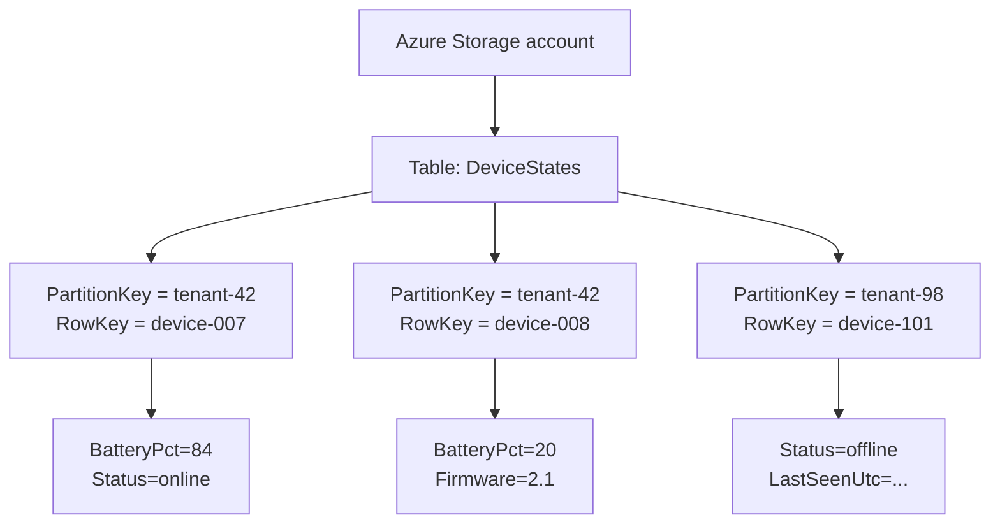
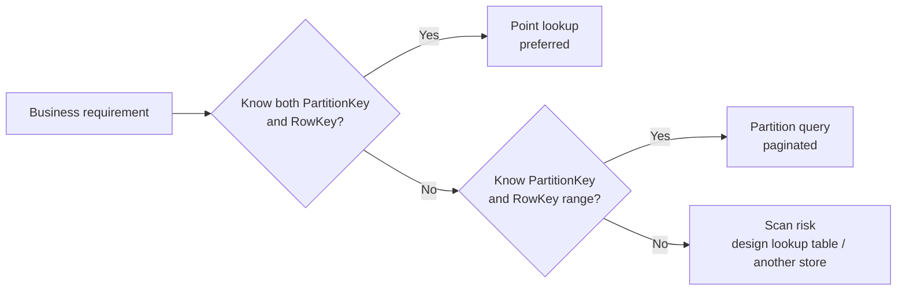
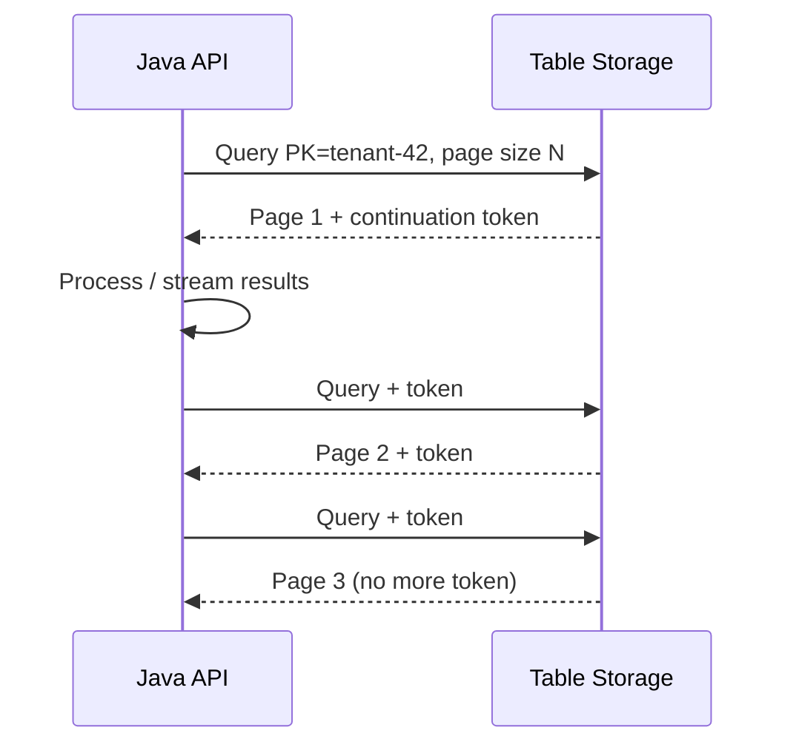
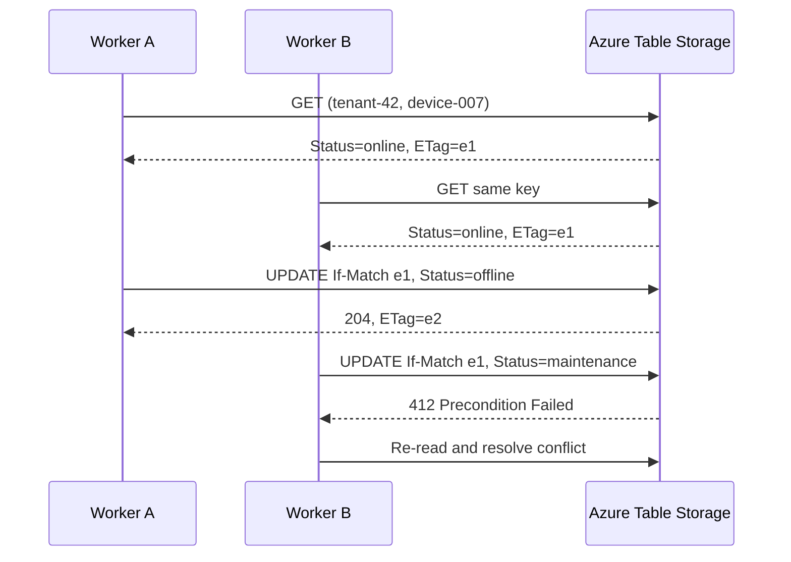
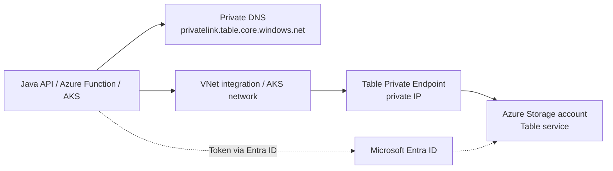
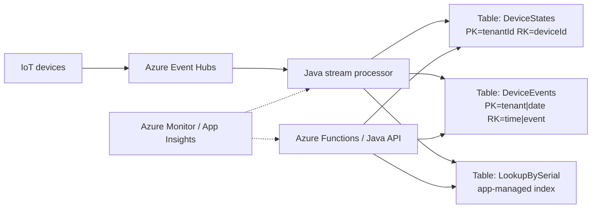

# Azure Table Storage and the Key-Value Data Model

An IoT device management application needs to store the latest state of millions of devices: which customer each device belongs to, its last check-in time, temperature, battery level, and alert status. Common queries are "get device `device-007` for customer `tenant-42`" or "list devices belonging to customer `tenant-42`." Building a multi-table relational database with joins for a straightforward key-based lookup problem can make the architecture more complex than necessary.

**Azure Table Storage** is a NoSQL **key-value / key-attribute (schemaless entities)** storage service within Azure Storage. Each entity is uniquely identified by a **`PartitionKey` + `RowKey`** pair, holds flexible properties, and can be queried via the Table service API. Key design directly governs **access patterns, load distribution, latency, scalability, and transaction costs**.

In the **CLOUD_PROVIDERS_AZURE** module, you explore Microsoft Azure from subscriptions, resource groups, and Microsoft Entra ID through virtual networking, compute, storage, data, deployment, monitoring, security, and application cost optimization. This lesson belongs to the **NoSQL Data with Cosmos DB** chapter, but focuses on **Azure Table Storage** while explaining how it differs from **Azure Cosmos DB for Table** so you can select the right service for your requirements.

## 1. Learning Objectives

After completing this lesson, you will be able to:

- Explain tables, entities, properties, `PartitionKey`, `RowKey`, `Timestamp`, and `ETag`.
- Identify NoSQL/schemaless characteristics, differences from relational databases, and Table service limits.
- Design keys around **access patterns** rather than copying SQL primary keys verbatim.
- Distinguish **point queries**, **partition queries**, and **table scans**, as well as pagination and continuation tokens.
- Perform CRUD operations from Java using the **Azure Data Tables SDK** and Microsoft Entra ID.
- Explain **Merge/Replace/Upsert**, optimistic concurrency with `ETag`, and transactional batches within a **single partition**.
- Choose appropriate Azure RBAC roles, managed identities, Private Endpoints, and network configurations.
- Analyze hot partitions, denormalization, indexing, transactions, and costs before choosing between Table Storage and Cosmos DB for Table.
- Establish monitoring, testing, error-handling, and data recovery workflows for production applications.

## 2. The Key-Value Nature of Azure Table Storage

Table Storage stores **entities** inside **tables**. Each entity behaves like a typed bag of properties; entities in the same table **do not have to share the same set of properties**.



Example represented in JSON-like format for readability:

```json
{
  "PartitionKey": "tenant-42",
  "RowKey": "device-007",
  "Timestamp": "2026-11-20T09:30:00Z",
  "BatteryPct": 84,
  "Status": "online",
  "LastSeenUtc": "2026-11-20T09:29:40Z",
  "Firmware": "2.1"
}
```

**Note:** This is a logical representation, not the exact wire JSON returned by every SDK/REST response. `Timestamp` is managed by the service; `ETag` is entity metadata typically exposed separately by the SDK rather than as an arbitrary business column.

| Component | Meaning | Who manages it? |
|---|---|---|
| **Table** | Collection of entities within a Storage account | Created and deleted by application/admin |
| **PartitionKey** | Partitioning key of the entity | Chosen by application on write |
| **RowKey** | Entity identifier within a partition | Chosen by application on write |
| **PartitionKey + RowKey** | Unique composite key within a table | Uniqueness enforced by service |
| **Timestamp** | Last-modified time updated by the service | Service-managed |
| **ETag** | Version/precondition token for concurrency-checked updates | Issued by service, used by client |
| **Custom properties** | Business data: Status, BatteryPct, LastSeen... | Defined/written by application |

Here, **key-value** does not mean each record stores only a single string value. Each entity is looked up by a **key pair**, while the "value" is a **flexible set of properties**. That is why Table Storage is often described as a **wide-column or key/attribute store** in NoSQL contexts, though it does not offer SQL joins or secondary indexes like a relational database.

## 3. Primary Keys, Sort Order, and Uniqueness

### 3.1. PartitionKey

`PartitionKey` defines the group of entities belonging to the same logical partition. If the application frequently fetches all devices for a customer, `PartitionKey = tenantId` can be a reasonable choice:

```text
Table DeviceStates
  (tenant-42, device-001)
  (tenant-42, device-002)
  (tenant-42, device-007)
  (tenant-98, device-101)
```

Entities sharing the same PartitionKey can be **queried by a PartitionKey filter** and participate in **transactional batches** if service limits are satisfied. However, choosing too coarse a PartitionKey can create a **hot partition** when most traffic hits a single value.

### 3.2. RowKey

`RowKey` distinguishes entities **within the same partition**. Because a table can hold two entities with the same RowKey in different partitions, the pair together forms the full identifier.

| PartitionKey | RowKey | Valid for uniqueness? |
|---|---|---|
| `tenant-42` | `device-001` | Yes |
| `tenant-42` | `device-002` | Yes |
| `tenant-98` | `device-001` | Yes: different partition |
| `tenant-42` | `device-001` | No if performing a second `Insert` for an existing entity |

If you use `Upsert`, an operation on an existing key updates the entity using Merge/Replace semantics instead of inserting a second record with the same key.

### 3.3. Lexicographical Key Ordering

Table Storage maintains an index ordered by **PartitionKey and RowKey**; queries filtering on an exact PartitionKey and a RowKey range can leverage key ordering. Therefore, for timestamps that need **string sorting**, use a consistent, UTC, fixed-width format:

```text
PartitionKey = tenant-42|202611
RowKey       = 20261120T091520Z|evt-000001
```

If `RowKey` values are `1`, `2`, `10`, lexicographical order differs from numeric order: `1` → `10` → `2`. For numeric keys, apply **zero-padding** (`000001`, `000002`, `000010`) or structured encoding so range scans behave accurately.

Do not pick arbitrary delimiters without checking **disallowed characters and key size limits** in the Table service. Characters such as `/`, `\`, `#`, `?`, and control characters are invalid in PartitionKey/RowKey. If business IDs contain such characters, encode/normalize them consistently rather than relying on ad-hoc client URL encoding.

## 4. Schemaless Model and Property Types

Example of two entities in the same table without identical fields:

```json
[
  {
    "PartitionKey": "tenant-42",
    "RowKey": "device-007",
    "Status": "online",
    "BatteryPct": 84
  },
  {
    "PartitionKey": "tenant-42",
    "RowKey": "device-008",
    "Status": "maintenance",
    "Firmware": "v2.1",
    "LastErrorCode": 503
  }
]
```

Table Storage does not require table-level schema migrations for each new property. Yet **schemaless does not mean zero data contract**. Applications must still define:

1. Consistent **field names**, respecting case sensitivity per SDK/contract handling.
2. Compatible **data types**: string, Boolean, Int32/Int64, Double, DateTime, Guid, Binary per supported EDM types.
3. **Required fields** and fallback behavior when a property is absent.
4. **SchemaVersion** to manage upgrades per entity type.
5. **UTC timestamps** and rounding/precision rules; avoid timezone-less local time strings.
6. **Payload size and data protection**, especially when PII is involved.

Technical limits such as the **maximum entity size of roughly 1 MiB**, maximum property counts, and per-property length/type limits must be verified for your API/version. Never stuff images, multi-megabyte logs, or unbounded JSON arrays into an entity; store large blobs in **Azure Blob Storage** and keep only references and metadata in the entity.

### Null Properties vs. Missing Properties

Do not rely on a `null` field being persisted as an explicit value like SQL `NULL`. Certain Table Storage SDK/REST semantics treat null properties as **absent properties**. Always check for **missing properties** rather than assuming every entity contains `BatteryPct` with a null value.

## 5. Start Designing from Access Patterns

NoSQL performs best when data modeling follows the **queries it must serve**. Rather than putting entities into tables and hoping to join later, list your queries first:

| Access pattern | Business query | Suggested key design |
|---|---|---|
| **Point lookup** | Get status of one device for a tenant | `PK=tenantId`, `RK=deviceId` |
| **Partition range** | Get a tenant's events for a month | `PK=tenantId|yyyyMM`, `RK=UTCtimestamp|eventId` |
| **Owner listing** | List devices for a tenant | `PK=tenantId`, RowKey by ID |
| **Read by order ID** | Find an order by orderId when tenant is known | `PK=tenantId`, `RK=orderId` |
| **Lookup by email** | Find a device/customer by email | Needs a secondary lookup table or another store; no built-in global secondary index |
| **Multi-tenant sales totals** | Monthly SUM / join OrderDetails | Analytical pipeline or suitable database; never scan all of Table Storage per request |

### Point Query — Typically the Most Efficient Query

When you know **both `PartitionKey` and `RowKey`**, the client fetches a single entity directly by full key. This is the primary access pattern for Table Storage.

### Partition Query — Effective When Scoped

When `PartitionKey` is known and paired with a `RowKey` filter, the application can scan a **small, meaningful range** within one partition. Paginate results because a single partition can hold millions of entities.

### Table Scan — Requires Careful Scrutiny

Filtering solely on `Status = 'online'` without bounding PartitionKey/RowKey may force the service to inspect huge numbers of entities. **Server-side filtering does not imply secondary-index optimization.** Scans across large tables can be slow, transaction-heavy, and put pressure on partitions.



## 6. Designing Keys for Multi-Tenant Data

Suppose the application tracks device operational events per tenant:

```text
Table: DeviceEvents

PartitionKey: tenant-42|202611
RowKey:       20261120T091520Z|device-007|evt-001
EventType:    temperature_high
TempC:        82.5

PartitionKey: tenant-42|202611
RowKey:       20261120T091612Z|device-008|evt-002
EventType:    battery_low
BatteryPct:   9
```

**Benefit:** querying a tenant's events for a given month filters directly by PartitionKey and a time-bounded RowKey range, minimizing scanned data. Each new month rolls into a fresh logical partition.

**Trade-off:** a tenant producing tens of thousands of events per second can still cause a **hot partition** for that month. For such tenants, consider sharding by device, hash bucket, or finer time windows (`yyyyMMdd`/hour), accepting fan-out across several partitions when querying.

### Comparing Two Key Designs and Their Consequences

| Key design | Strengths | Weaknesses |
|---|---|---|
| `PK=tenantId, RK=deviceId` | Fast device point lookup; easy tenant listing | Ultra-large/hot tenants can concentrate load |
| `PK=tenantId|yyyyMM, RK=timestamp|eventId` | Time-range scans per tenant | Multi-month queries must query multiple partitions |
| `PK=tenantId|bucket, RK=deviceId` | Spreads load for large tenants | Must compute bucket from ID; full-tenant listing fans out |
| `PK=deviceId, RK=timestamp` | Easy single-device history queries | Tenant-wide aggregation queries are difficult |

**No single PartitionKey fits every query.** When multiple critical access patterns exist, you typically **denormalize** deliberately (multiple tables / materialized lookup indexes) or pick a database with richer indexing capabilities.

## 7. Secondary Lookup Tables and Denormalization

Suppose the main table `DevicesByTenant` stores entities with `PK=tenantId, RK=deviceId`. An API occasionally needs to look up a device by **serialNumber** without knowing the tenant. Scanning the main table on every call would be expensive.

You can maintain a companion table `DeviceLookupBySerial`:

```text
DevicesByTenant:
    PK = tenant-42, RK = device-007
    SerialNumber = SN-ABC-007
    Status = online

DeviceLookupBySerial:
    PK = serial-prefix-ABC, RK = SN-ABC-007
    TenantId = tenant-42
    DeviceId = device-007
```

Lookup flow:

1. Derive `serial-prefix-ABC` from the serial number by rule.
2. Point lookup in `DeviceLookupBySerial` to obtain `TenantId`/`DeviceId`.
3. Point lookup in `DevicesByTenant` to retrieve the current state.

This is an **application-managed index**, not a secondary index automatically maintained by Azure Table Storage. When devices are added, removed, or transferred between tenants, the application must update both tables. Because **Table Storage has no atomic transactions across tables or partitions**, you may need outbox/queues, retries, reconciliation jobs, and idempotency to maintain eventual consistency.

**Never store sensitive data directly in `RowKey`** (email addresses, phone numbers, tokens) just to get a point lookup: keys can surface in logs and telemetry and leak confidential data. If lookups on sensitive values are needed, evaluate keyed/salted hashing with proper normalization, enumeration risks, and alternative database options.

## 8. Querying and Filtering Limitations

Azure Table Storage executes **OData-style filter queries** over the Table API. In the Java SDK, `ListEntitiesOptions` supplies filter predicates and projected properties.

### Point Lookup

```text
Table = DeviceStates
PartitionKey = tenant-42
RowKey = device-007
```

This fetches the exact entity by its two keys rather than scanning the table. For a route like `GET /tenants/42/devices/007`, the application already knows or derives both keys directly from the URL.

### Single-Partition Query

```text
PartitionKey eq 'tenant-42'
```

When listing a tenant's devices with pagination, this query works well as long as the partition is not overloaded or extraordinarily huge. **Never pull all entities into RAM and paginate inside the API layer.**

### RowKey Range Filter

```text
PartitionKey eq 'tenant-42|202611'
and RowKey ge '20261120T000000Z'
and RowKey lt '20261121T000000Z'
```

When RowKey starts with a fixed-width UTC timestamp, lower and upper bounds read a specific time slice cleanly.

### Filtering on Regular Properties

```text
Status eq 'online'
```

The service can evaluate this filter, but **there is no default secondary index** on `Status` like a relational B-tree index. On large tables, filtering on non-key properties triggers scans. Even when paired with `PartitionKey`, only the key conditions prune the search space effectively.

### No Joins or Arbitrary SQL ORDER BY

Azure Table Storage does not support native SQL joins, group-by aggregations, full-text search, or arbitrary secondary indexes on custom properties. Sort order follows the composite key, so "get the latest 20 events" requires **explicit RowKey/PartitionKey design** and pagination strategy. Never mistake a `RowKey ge ...` OData filter for a SQL engine capable of optimizing arbitrary `ORDER BY`/`LIMIT` clauses.

## 9. Pagination, Continuation Tokens, and Large Result Sets

A table query may return multiple **segments/pages** rather than all matching rows in one response. The SDK exposes pagination and continuation tokens to resume where the service left off. The Table Query Service enforces segment size, entity count, and execution time caps per API version; never assume a single request returns an entire partition.



### Operational Rules

1. Enforce a **page size** and an overall cap on entities per API response.
2. Never run an unbounded listing query that buffers all entities on the heap.
3. Pair continuation tokens strictly with the **same table, filter, select/projection, and query context**; never reuse tokens across different queries.
4. Treat continuation tokens as opaque internal structures; **do not decode or mutate them**.
5. If returning tokens to public clients, consider encrypting/signing and validating authorization to prevent query-state leaks or tampering.
6. When data changes between page fetches, do not assume the entire result set forms a SQL-style snapshot-isolated view.

In Java, use `PagedIterable`/`PagedResponse` from the Azure SDK to process pages sequentially. If an API offers 100 entities per page, preserve SDK continuation tokens instead of implementing "page number N" by scanning and discarding earlier records.

## 10. Insert, Update, Merge, Replace, Upsert, and Delete

Write operations must be distinguished clearly because they determine **whether two concurrent writers can lose data**.

| Operation | Practical semantics | Risks / checks |
|---|---|---|
| **Insert/Create** | Creates an entity only if the key pair does not exist | Returns conflict if present; helpful for duplicate detection |
| **Merge update** | Updates/adds only the properties included in the payload | Unspecified existing properties are preserved |
| **Replace update** | Replaces custom properties with the new payload | Existing properties omitted from payload can be removed |
| **Upsert merge** | Creates if missing; merges if present | Easy to overwrite newer changes without preconditions |
| **Upsert replace** | Creates if missing; replaces if present | Can drop properties written by another writer |
| **Delete** | Deletes entity by key/precondition | Decide whether ETag is checked or concurrency is bypassed |

### Example: Why Merge Differs from Replace

Original entity:

```json
{
  "PartitionKey": "tenant-42",
  "RowKey": "device-007",
  "Status": "online",
  "BatteryPct": 84,
  "Firmware": "2.1"
}
```

Writer A sends a payload containing only `Status="offline"`:

- With **Merge**, `BatteryPct=84` and `Firmware="2.1"` are preserved.
- With **Replace**, those two omitted properties can disappear.

**Never assume Merge is concurrency-safe.** If Writer A and Writer B both update `Status` from stale reads, the second write still overwrites the first. Whenever lost updates are unacceptable, enforce **ETag with If-Match**.

## 11. Optimistic Concurrency with ETag

When a client reads an entity, the service returns an `ETag` representing that entity version. The client can pass that ETag on update or delete with **If-Match** to ensure the entity has not changed since it was read. If another writer modified the entity first, the service rejects the call with **`412 Precondition Failed`**.



### Strategy When Encountering 412

1. Re-read the current entity.
2. Compare the latest state against business intent.
3. If the change remains valid, recompute the payload and retry **a bounded number of times**—never loop forever.
4. If the conflict cannot be auto-resolved, surface `409`/application conflict or route to reconciliation.
5. Track collision-rate metrics to spot hot keys or writer contention.

**Never strip ETag checks just "to make updates succeed."** Doing so turns visible concurrency failures into silent data corruption. Alongside ETags, keep an **idempotency key** so the same business command is not applied twice.

### Timestamp vs. ETag

`Timestamp` is useful for seeing the service's last modification time, but it is not a replacement for ETag version control. Use **ETag** for optimistic concurrency, and maintain a separate **LastUpdatedAt** property if your domain needs producer-confirmed business timestamps.

## 12. Transactional Batch: Atomicity Within One Partition

Azure Table Storage supports **entity group transactions (transactional batches)** for qualifying operations, notably:

- Entities in the **same table** and **same PartitionKey**.
- At most **100 operations per batch** and a **4 MiB** payload limit per transaction in standard Table Storage APIs.
- Processed **atomically**: either every operation succeeds or the batch fails together per transaction semantics.
- Subject to rules regarding duplicate keys within a batch and concurrency checks; verify exact SDK/API constraints.

**There are no atomic transactions across two PartitionKeys or two tables**, even within the same Storage account.

### Same-Partition Batch Example

```text
Table OrderState
  PK = tenant-42|order-1001, RK = header
  PK = tenant-42|order-1001, RK = line-001
  PK = tenant-42|order-1001, RK = line-002
```

Because all three entities share the same PartitionKey, they can be committed in one entity group transaction within limits. However, if an order has hundreds of thousands of lines, cramming everything into one batch fails limits. Break up transactions with checkpointed completion states, or use a relational database if large multi-row ACID transactions are mandatory.

### An Important Note on "Business Partitioning"

Grouping every entity of an order under `PK=tenant|order` enables atomic batches per order, but makes "list all orders for a tenant" fan out or require a **secondary lookup table**. This highlights the core trade-off between:

- Order-scoped group transactions;
- Tenant-scoped queries;
- Load distribution and partition count;
- Maintenance cost of duplicated materialized views.

**PartitionKey design must consider queries and transaction boundaries together**, rather than optimizing one in isolation.

## 13. Consistency, Replication, and Recovery Limits

Azure Storage provides strong consistency for operations against the primary endpoint per service semantics: once a write succeeds, subsequent reads at the primary observe that update. However:

- **Geo-replication** in RA-GRS/RA-GZRS accounts replicates **asynchronously** to the secondary region; reading from secondary can return stale data, and unplanned failover involves RPO considerations.
- Multi-page reads **do not guarantee table-wide snapshot isolation** while concurrent writes modify rows.
- Workflows writing to **two tables or partitions** lack cross-partition atomicity and can expose intermediate states.
- ETags prevent lost updates when used correctly, but do not coordinate external side effects outside Table Storage.

### Do Not Confuse Redundancy with Backup

LRS/ZRS/GRS protect against hardware/datacenter failures per chosen redundancy tier; they **do not automatically recover an entity accidentally deleted or overwritten by buggy application code**. For real RPO/RTO requirements, design application-level exports/snapshots or approved backup pipelines, versioned records, retention policies, and recovery drills supported by your architecture.

For example, if an application accidentally runs a Replace that strips `Firmware`, geo-replication dutifully replicates that bad write too. You need audit/history logs or replayable source events to restore prior values.

## 14. Preparing Azure Table Storage for Hands-On Practice

Lab examples use illustrative names; **never run modifying commands directly against production**:

| Component | Sample value | Purpose |
|---|---|---|
| Subscription | `<subscription-id>` | Authorized subscription |
| Resource group | `rg-tables-lab` | Resource management boundary |
| Storage account | `sttablelab001` | Hosts the Table service |
| Table | `DeviceStates` | Stores device states |
| Java application | `device-api` | Performs CRUD operations |
| App principal | Managed identity or authorized developer identity | Authenticates via Entra ID |

### 14.1. Inspect an Existing Storage Account

```bash
az login
az account set --subscription "<subscription-id>"

az storage account show \
  --resource-group "rg-tables-lab" \
  --name "sttablelab001" \
  --query "{name:name,location:location,kind:kind,sku:sku.name,publicAccess:publicNetworkAccess}" \
  --output json
```

This is a **read-only** command. Ensure you select a Storage account kind/SKU that supports the **Table service** and meets network policy requirements. Never assume every Storage account type or SKU offers identical service capabilities.

### 14.2. Creating a Table via Azure Portal

1. Open the [Azure portal](https://portal.azure.com/) and verify the active tenant and subscription.
2. Select the lab Storage account.
3. Open **Tables** under Data storage / Table service if supported by the account.
4. Create a table named `DeviceStates`, following Azure Storage Table naming rules.
5. Verify the account's Table service endpoint, typically structured as:

   `https://sttablelab001.table.core.windows.net`

6. Inspect **Networking**, data-plane permissions, and reachability from your Java runtime.

You can also create tables via the **Azure SDK** or IaC depending on infrastructure governance. In production, manage table names, RBAC/network rules, and provisioning inside Terraform/Bicep/ARM or approved deployment pipelines rather than having arbitrary web requests auto-create tables at runtime.

### 14.3. Local Development with Azurite?

**Azurite** is a local Storage emulator supporting several Azure Storage services, including Table service features depending on version. When using it, check the local Table endpoint, local connection string, and API parity of your Azurite release. Emulators never replace testing **Microsoft Entra ID, Azure RBAC, Private Endpoints, quotas, and network latency** on real Azure.

Never use a production connection string as a default developer workstation setting.

## 15. Authentication and Authorization: Entra ID, RBAC, and SAS

Azure Table Storage supports Storage authentication mechanisms including **Microsoft Entra ID with Azure RBAC**, account keys, or SAS where permitted. For new Azure applications, **prefer managed identity / Workload Identity** to minimize long-lived shared secrets.

### Data-Plane Roles

| Principal | Need | Role to evaluate |
|---|---|---|
| Device state read API | Read-only entity queries | **Storage Table Data Reader** |
| State update worker | Create, update, delete entities | **Storage Table Data Contributor** |
| Operator viewing account settings | Manage/read resource properties | Corresponding Azure RBAC management Reader |
| Pipeline configuring account/network | Modify management resource settings | Least-privileged management role at narrowest scope |

**Storage account Azure RBAC Reader/Contributor roles do not automatically grant data-plane read/write access via Microsoft Entra tokens.** Explicitly assign `Storage Table Data Reader` or `Storage Table Data Contributor` at the appropriate supported scope (account or table).

### Assigning Roles via CLI

Example granting access to an existing managed identity; run only if you hold role-assignment permissions at the target scope:

```bash
STORAGE_ID=$(az storage account show \
  --resource-group "rg-tables-lab" \
  --name "sttablelab001" \
  --query id --output tsv)

# Replace with the actual principalId of the app's managed identity.
APP_PRINCIPAL_ID="<managed-identity-principal-object-id>"

az role assignment create \
  --assignee-object-id "$APP_PRINCIPAL_ID" \
  --assignee-principal-type ServicePrincipal \
  --role "Storage Table Data Contributor" \
  --scope "$STORAGE_ID"

# Verify the assignment afterward.
az role assignment list \
  --scope "$STORAGE_ID" \
  --include-inherited \
  --output table
```

**Distinguish IDs:** `principalId/objectId` is used for role assignments; `clientId` typically identifies a user-assigned managed identity in SDK configuration. On AKS, workload identity must bind properly to the ServiceAccount and federated identity credential; assigning a role to the AKS control-plane identity does not grant permissions to your Java Pod.

### SAS and Account Keys

- **Account keys** grant broad access across Storage account data; avoid them in runtime applications whenever possible.
- **SAS tokens** grant scoped, time-bound access per SAS type; protect tokens carefully and rotate them regularly.
- In production, evaluate **disallowing Shared Key authorization** where supported after auditing all clients and integrations still relying on Shared Key; verify Table service and integration compatibility before switching.
- Never commit connection strings, account keys, or SAS tokens into Git, container images, logs, tickets, or training examples.

Role assignments can take time to propagate. If a newly granted identity gets `403`, verify the **effective principal, scope, token cache, and network rules** before granting overly broad roles.

## 16. Network Protection: Public Endpoints, Firewalls, and Private Endpoints

Storage accounts support network rules and **Azure Private Link** where supported by account type and service. Table data-plane access is distinct from Blob or Queue access: **a Blob Private Endpoint does not automatically cover Table access**.

### Common Connectivity Options

| Connectivity method | Characteristics | When to use |
|---|---|---|
| Public endpoint with TLS + identity | Client uses `https://<account>.table.core.windows.net` | Labs or controlled apps allowed public reachability |
| Firewall / IP allowlists / network rules | Restricts public access by IP/VNet rules | Known egress IPs where policy permits |
| VNet service endpoints / rules | Controls access over Azure backbone per Storage features | Approved Azure VNets without Private Link private IPs |
| **Private Endpoint for Table** | Table service accessed via private IP inside a VNet | Data requires private networking per security policy |

### Table Endpoints and DNS

Application endpoint remains:

```text
sttablelab001.table.core.windows.net
```

Typical Private DNS zone:

```text
privatelink.table.core.windows.net
```

When you create a Private Endpoint targeting **subresource/group ID `table`**, a private IP is allocated inside your VNet. With properly linked Private DNS zones and routing, the standard Table hostname resolves to that private IP from authorized networks.



**A Private Endpoint does not authorize entity reads or writes**: clients still need a valid TokenCredential/RBAC role or approved auth mechanism. Conversely, a properly authorized identity still fails if DNS, routing, or firewalls block connectivity.

### Network Troubleshooting Sequence

1. Confirm the exact Storage account and **Table endpoint**.
2. Verify the Private Endpoint connection status is **Approved** for subresource `table`.
3. Check the Private DNS zone, VNet links, and forwarding (especially with custom DNS or hub-and-spoke topologies).
4. From inside the actual VM, Pod, or Function worker, run `nslookup sttablelab001.table.core.windows.net`.
5. Confirm the hostname resolves to the **expected private IP**.
6. Verify HTTPS **TCP 443**, NSGs, UDRs/firewalls, and TLS handshakes.
7. Only then troubleshoot tokens, RBAC, and table/entity names.

Diagnostic commands:

```bash
nslookup sttablelab001.table.core.windows.net

# Where netcat is available:
nc -vz sttablelab001.table.core.windows.net 443
```

**TCP 443 connectivity does not prove valid RBAC roles.** Conversely, if public access on the Storage account is disabled, a local laptop lacking VPN/private routing will be blocked even when `az login` and RBAC are completely correct. Never re-enable wide public Internet access as a default "fix."

### Creating a Private Endpoint in the Lab

In the Azure portal, open your Storage account → **Networking → Private endpoint connections** (exact label varies by UI), create a Private Endpoint, choose the **Table service** subresource rather than Blob, select an authorized VNet/subnet, and integrate with the Private DNS zone. Verify approval status, private IP allocation, and DNS resolution before disabling public access. If the environment already has Blob or Queue Private Endpoints, **never assume they cover Table**.

## 17. Java SDK: Dependencies, Client Setup, and Secure Configuration

The Azure SDK for Java provides **`com.azure:azure-data-tables`** with `TableClient` and `TableServiceClient`. For Azure Table Storage, this example uses **Microsoft Entra tokens** via `com.azure:azure-identity` and `DefaultAzureCredential`.

### 17.1. Dependencies

In Maven, declare **organization-approved versions** or use the Azure SDK BOM; illustrative Maven structure (replace placeholders with approved versions):

```xml
<dependencies>
    <dependency>
        <groupId>com.azure</groupId>
        <artifactId>azure-data-tables</artifactId>
        <version>REPLACE_WITH_APPROVED_VERSION</version>
    </dependency>
    <dependency>
        <groupId>com.azure</groupId>
        <artifactId>azure-identity</artifactId>
        <version>REPLACE_WITH_APPROVED_VERSION</version>
    </dependency>
</dependencies>
```

```text
AZURE_STORAGE_TABLE_ENDPOINT=https://sttablelab001.table.core.windows.net
AZURE_STORAGE_TABLE_NAME=DeviceStates
```

These two variables hold an endpoint URL and table name, **not secrets**. Local developers can use `az login` with an account holding Storage Table Data Contributor in the lab; Azure runtimes use managed identity or Workload Identity. For user-assigned managed identities, configure `AZURE_CLIENT_ID` or an explicit credential builder per SDK version and deployment model.

### 17.2. Creating a TableClient

```java
import com.azure.data.tables.TableClient;
import com.azure.data.tables.TableClientBuilder;
import com.azure.identity.DefaultAzureCredentialBuilder;

public final class TableClients {
    static String requiredEnv(String name) {
        String value = System.getenv(name);
        if (value == null || value.isBlank()) {
            throw new IllegalArgumentException("Missing env var: " + name);
        }
        return value;
    }

    static TableClient deviceStatesClient() {
        return new TableClientBuilder()
                .endpoint(requiredEnv("AZURE_STORAGE_TABLE_ENDPOINT"))
                .tableName(requiredEnv("AZURE_STORAGE_TABLE_NAME"))
                .credential(new DefaultAzureCredentialBuilder().build())
                .buildClient();
    }
}
```

**Replace the endpoint with your real account** and verify Data Contributor/Reader roles. In production, reuse the client across the application lifecycle instead of creating a new one on every HTTP request. Never log exceptions containing secrets or sensitive payloads.

### 17.3. Creating a Table When Needed (Provisioning)

Table creation is a **provisioning operation**, best run in an infrastructure pipeline with appropriate permissions rather than calling `createTableIfNotExists` on every request. SDK representation:

```java
import com.azure.data.tables.TableServiceClient;
import com.azure.data.tables.TableServiceClientBuilder;
import com.azure.identity.DefaultAzureCredentialBuilder;

// Place in a provisioning method with appropriate permissions.
TableServiceClient serviceClient = new TableServiceClientBuilder()
        .endpoint(System.getenv("AZURE_STORAGE_TABLE_ENDPOINT"))
        .credential(new DefaultAzureCredentialBuilder().build())
        .buildClient();

serviceClient.createTableIfNotExists("DeviceStates");
```

This snippet belongs **inside an appropriate provisioning method or setup block** and works only when the principal holds permission to create tables on the Storage Table service. Production resources should be provisioned via controlled IaC/pipelines. When targeting **Azure Cosmos DB for Table**, endpoints, auth/RBAC models, and capacity provisioning differ—do not blindly copy-paste Storage RBAC configurations.

## 18. Java CRUD: Create, Read, Merge, Upsert, and Delete Entities

The following Java examples assume the `TableClients` helper from the previous section, an existing `DeviceStates` table, and write permissions for the identity. Note that `TableEntity` stores PartitionKey/RowKey alongside a property map; avoid coercing every property into strings if you need numeric or date-based logic/filters.

### 18.1. Insert and Point Lookup

```java
import com.azure.data.tables.TableClient;
import com.azure.data.tables.models.TableEntity;
import java.time.OffsetDateTime;
import java.time.ZoneOffset;

public final class DeviceTableCrud {
    public static void main(String[] args) {
        TableClient table = TableClients.deviceStatesClient();

        String partitionKey = "tenant-42";
        String rowKey = "device-007";

        TableEntity newDevice = new TableEntity(partitionKey, rowKey)
                .addProperty("Status", "online")
                .addProperty("BatteryPct", 84)
                .addProperty("Firmware", "2.1")
                .addProperty("SchemaVersion", 1)
                .addProperty("LastSeenUtc",
                        OffsetDateTime.now(ZoneOffset.UTC));

        // CREATE succeeds only if the key pair does not already exist.
        table.createEntity(newDevice);

        TableEntity stored = table.getEntity(partitionKey, rowKey);
        System.out.println("PK=" + stored.getPartitionKey());
        System.out.println("RK=" + stored.getRowKey());
        System.out.println("Status=" + stored.getProperty("Status"));
        System.out.println("ETag=" + stored.getETag());
    }
}
```

Re-running the same code with the same key triggers **`409 Conflict`** from `createEntity` because the entity already exists—useful behavior for detecting duplicate inserts. With **upsert**, you intentionally accept create-or-update semantics; never use upsert when business rules require "insert once only."

### 18.2. Merge and Upsert

```java
import com.azure.data.tables.TableClient;
import com.azure.data.tables.models.TableEntity;
import com.azure.data.tables.models.TableEntityUpdateMode;

TableClient table = TableClients.deviceStatesClient();

TableEntity statusPatch = new TableEntity("tenant-42", "device-007")
        .addProperty("Status", "offline");

// UPSERT_MERGE: insert if absent, or merge if already present.
table.upsertEntity(statusPatch, TableEntityUpdateMode.MERGE);

// For version-checked updates, see the ETag section below.
```

This is a **snippet inside a Java method**, not a standalone class. `upsertEntity` does not provide `If-Match` version checking, so limit it to properties where last-write-wins or idempotent updates are acceptable.

### 18.3. Delete

```java
TableClient table = TableClients.deviceStatesClient();

// Delete only in labs after verifying the target keys.
table.deleteEntity("tenant-42", "device-007");
```

This illustrates a **key-based delete**. If business logic must prevent deleting a newer version updated concurrently by another worker, use an **ETag/If-Match-enabled** delete overload rather than unconditional deletion.

### 18.4. Handling Missing Entities

The SDK commonly throws `TableServiceException` with HTTP `404` when a point lookup finds no match, `409` on duplicate inserts, and `412` on ETag precondition failures. In the business API layer:

- Map genuine **404s** to "not found" responses (or an intentional default).
- Never swallow all exceptions and return `null`; a `403` or network failure does not mean "entity does not exist."
- Include correlation IDs/tracing while avoiding logging full entities that may contain personal data.

## 19. Java: Querying a Partition and Handling Pagination

When the client knows the tenant, filter by PartitionKey. Example using SDK `ListEntitiesOptions`:

```java
import com.azure.data.tables.TableClient;
import com.azure.data.tables.models.ListEntitiesOptions;
import com.azure.data.tables.models.TableEntity;
import java.util.List;

TableClient table = TableClients.deviceStatesClient();

ListEntitiesOptions options = new ListEntitiesOptions()
        .setFilter("PartitionKey eq 'tenant-42'")
        .setSelect(List.of(
                "PartitionKey", "RowKey", "Status", "BatteryPct"));

int maxItemsForThisRequest = 100;
int count = 0;
for (TableEntity entity : table.listEntities(options, null, null)) {
    System.out.printf("%s / %s: %s%n",
            entity.getPartitionKey(),
            entity.getRowKey(),
            entity.getProperty("Status"));
    if (++count >= maxItemsForThisRequest) {
        break;
    }
}
```

**This example simply caps client-side iteration count**, rather than implementing complete HTTP API pagination. When an API needs to fetch subsequent pages:

- Use `PagedIterable.iterableByPage(...)` or equivalent SDK paging APIs to retrieve pages and continuation tokens.
- Cap both page size and **total resource budget** consumed per API request.
- Return opaque tokens safely to callers instead of faking page numbers by scanning and skipping thousands of entities.
- When building filters from user input, **escape OData values** (especially single quotes) or use safe query-building utilities; never concatenate untrusted strings blindly.

Example time-range query within a partition:

```java
String partition = "tenant-42|202611";
String filter = "PartitionKey eq '" + partition
        + "' and RowKey ge '20261120T000000Z'"
        + " and RowKey lt '20261121T000000Z'";

ListEntitiesOptions dayQuery =
        new ListEntitiesOptions().setFilter(filter);
for (TableEntity event : table.listEntities(dayQuery, null, null)) {
    // Process and collect only the needed fields.
    System.out.println(event.getRowKey());
}
```

This snippet uses hardcoded partition values in a lab to demonstrate query shape. Production code requires input validation/escaping per your key contract and pagination. If a single day holds millions of events, never scan all of them every time a user opens a dashboard screen.

## 20. Java ETag: Preventing Lost Updates from Concurrent Writers

Suppose two workers receive updates for the same device concurrently. Worker 1 reads `BatteryPct=84`, Worker 2 updates it to 81, and then Worker 1 overwrites based on stale data. With optimistic concurrency, read the current entity and conditionally update using its ETag.

```java
import com.azure.core.util.Context;
import com.azure.data.tables.TableClient;
import com.azure.data.tables.models.TableEntity;
import com.azure.data.tables.models.TableEntityUpdateMode;
import com.azure.data.tables.models.TableServiceException;

public final class DeviceConditionalUpdate {
    public static void main(String[] args) {
        TableClient table = TableClients.deviceStatesClient();
        TableEntity current =
                table.getEntity("tenant-42", "device-007");
        current.addProperty("BatteryPct", 81);

        try {
            // ifUnchanged=true: require ETag to match before updating.
            table.updateEntityWithResponse(
                    current,
                    TableEntityUpdateMode.MERGE,
                    true,
                    null,
                    Context.NONE);
            System.out.println("Updated with ETag check");
        } catch (TableServiceException e) {
            if (e.getResponse() != null
                    && e.getResponse().getStatusCode() == 412) {
                System.err.println("Concurrent update; reload and reconcile");
                return;
            }
            throw e;
        }
    }
}
```

Across Azure Data Tables SDK versions, verify the exact `updateEntityWithResponse` overloads and `ifUnchanged` parameter in your dependency version. **Never ignore 412 and blindly retry with the stale entity**: re-read the entity, recompute the new state under business rules, and retry a bounded number of times.

### Do Not Use ETag as a Substitute for Business Deduplication

If the same `ViewCount` increment event is delivered twice, two writes each using a fresh ETag will still increment the count twice. Maintain an **event ID / idempotency record** in your message processor; ETags solve **concurrent modification of a single version**, not "process each event exactly once."

## 21. Java Transactional Batch Within a Partition

Suppose an order consists of a header and two line items. When creating entities in the same partition requires **all-or-nothing atomicity**, use a transactional batch. The Azure SDK provides `TableTransactionAction` and `TableTransactionActionType`.

```java
import com.azure.data.tables.TableClient;
import com.azure.data.tables.models.TableEntity;
import com.azure.data.tables.models.TableTransactionAction;
import com.azure.data.tables.models.TableTransactionActionType;
import java.util.List;

public final class OrderBatchExample {
    public static void main(String[] args) {
        TableClient table = TableClients.deviceStatesClient();
        // Real lab: target the OrderState table instead of DeviceStates.
        // This snippet simply demonstrates the shared PartitionKey requirement.
        String pk = "tenant-42|order-1001";

        TableEntity header = new TableEntity(pk, "header")
                .addProperty("Status", "created")
                .addProperty("OrderId", "order-1001");
        TableEntity line1 = new TableEntity(pk, "line-001")
                .addProperty("Sku", "SKU-A")
                .addProperty("Quantity", 2);
        TableEntity line2 = new TableEntity(pk, "line-002")
                .addProperty("Sku", "SKU-B")
                .addProperty("Quantity", 1);

        List<TableTransactionAction> actions = List.of(
                new TableTransactionAction(
                        TableTransactionActionType.CREATE, header),
                new TableTransactionAction(
                        TableTransactionActionType.CREATE, line1),
                new TableTransactionAction(
                        TableTransactionActionType.CREATE, line2));

        table.submitTransaction(actions);
        System.out.println("Committed order entities atomically");
    }
}
```

**Important lab note:** this example calls `TableClients.deviceStatesClient()` purely to reuse the client helper; in any real implementation, construct a `TableClient` pointing to a provisioned **`OrderState` table**. Never write order entities into `DeviceStates` as a production pattern.

If any one of the three entities already exists and `CREATE` fails, the entire transactional batch rolls back atomically per service semantics. Operations must share the **same table and same PartitionKey**, stay within action-count/payload limits, and respect any ETag preconditions.

### Why Can't a Batch Replace a Saga?

If placing an order requires:

1. Creating an order entity in Table Storage;
2. Reserving inventory in another database;
3. Sending a message to Azure Service Bus;

a Table transaction **covers only operations in the same partition of one table**. There is no automatic distributed transaction spanning Table Storage, external databases, and Service Bus. Use **outbox patterns, idempotent consumers, retries, and Sagas/compensations** when workflows span multiple systems.

## 22. Performance Optimization: Hotspots, Partitioning, and Retries

Table Storage scales well overall, but **uneven partitioning** creates bottlenecks. For instance, having every worker update a single `PK=all, RK=counter` entity to count requests triggers constant ETag contention and creates a hot key.

### Signs of a Hot Partition

- `503 Server Busy` or throttling spikes on specific keys even when overall Storage account usage looks healthy.
- Latency climbs for specific PartitionKey values.
- Frequent `412 Precondition Failed` errors from contention on the same entity.
- Queries listing a large tenant run slowly or iterate excessive pages.
- Event spikes direct most writes onto a single partition.

### Load-Spreading Strategies

| Strategy | Example | Trade-off |
|---|---|---|
| **Hash bucket sharding** | `PK=tenant-42|b03` | Tenant-wide queries must fan out across buckets |
| **Time-based partitioning** | `PK=tenant-42|20261120` | Multi-day queries require merging partitions |
| **Finer-grained entity keys** | `PK=device-007` | Tenant-level listing needs a lookup table |
| **Same-partition batching** | Atomic updates of related entities | Does not relieve a hot partition if all calls hit the same key |
| **Skip redundant writes** | Write only when state actually changes | Requires comparison/idempotency and may add reads |
| **Asynchronous aggregation** | Sharded counters aggregated periodically | Near-real-time totals may lag slightly |

Never add random sharding before verifying how clients will **compute the bucket deterministically** from the request. For point lookups, the bucket must derive deterministically from an ID or reside in a secondary lookup table. Using `bucket=RANDOM()` on write forces readers to scan every bucket to locate an entity.

### Retrying on Throttling

For transient errors such as `503`/throttling, SDKs often apply default retries. When customizing:

- Use **bounded exponential backoff with jitter**.
- Configure request timeouts and overall operation deadlines.
- Never infinitely retry missing roles (`403`), missing entities (`404`), or malformed payloads (`400`).
- Handle `409` and `412` using **business semantics** (duplicate inserts / ETag conflicts), not by sleeping and resending the exact stale request.
- Enforce concurrency limits/bulkheads per worker while monitoring account and partition pressure.
- Never spin up unbounded client threads to "push past throttling"; that almost always worsens contention.

### Avoid Unnecessary Scan and Egress Costs

If an API needs only `Status`, fetching every custom property, binary blobs, or oversized pages wastes bandwidth and RAM. Use **projection/select** to fetch essential properties only; offload heavy payloads to Blob Storage and store an authorized reference.

## 23. Cost: Billed by Storage Capacity and Transactions, Not RU/s

**Azure Table Storage** belongs to Azure Storage and follows a billing model based on storage capacity and service operations (transactions), plus redundancy, network egress, and monitoring depending on configuration and region. **It does not use Azure Cosmos DB for Table's RU/s model.**

### Preliminary Cost Estimation Framework

| Cost component | Example cost drivers | Optimization approach |
|---|---|---|
| **Storage capacity** | Entity count × average size, redundancy factor | Keep only necessary properties; schedule cleanup/archival |
| **Read operations** | Point gets, multi-page queries, unindexed scans | Key design for access patterns; appropriate lookup tables |
| **Write operations** | Insert, Merge, Replace, Upsert, Delete, retries | Batch where valid; skip no-op writes; enforce idempotency |
| **Network egress** | Cross-region or public egress, oversized query responses | Co-locate compute and storage; project fields; paginate |
| **Private Link / DNS / firewall** | Private Endpoints, networking, DNS services | Minimal compliant topology without duplicate resources |
| **Monitoring** | Metrics, log ingestion, retention | Track errors/latency concisely; do not log full payloads |
| **Backup/export** | App-level backups/archives and restores | Align RPO/RTO and retention with real business needs |

An API doing 100,000 point lookups per day has a dramatically different cost profile from one running **100,000 full table scans across millions of entities** per day. Fixing query shape yields far greater savings than shaving a few bytes off a property name.

**Do not rely on outdated pricing tables as fixed rates.** Check the Azure Pricing Calculator and Cost Management for your exact Storage account tier, region, redundancy, and operation mix across transactions, storage, and networking. For consistently high throughput workloads, measure latency/throttling and compare total cost against Cosmos DB for Table using real RU/s measurements.

### Do Old Records Expire Automatically?

Azure Table Storage does not provide a **built-in per-entity TTL with identical semantics across all NoSQL engines**. To purge expired state or history:

1. Include an `ExpiresAtUtc` field or partition by date/month.
2. Run a scheduled cleanup worker with least-privileged permissions.
3. Query and delete in throttled batches respecting request limits.
4. Maintain audits and recovery safeguards in case cleanup deletes wrong data.

Never assume adding a property `TTL=30` automatically deletes entities. TTL capabilities differ between Azure Table Storage and Azure Cosmos DB for Table by product and configuration.

## 24. Monitoring the Table Service and Investigating Latency

Azure Monitor exposes metrics covering transactions, availability, latency, ingress/egress, and response types per Storage service and account type. Always **check metric definitions on the exact resource** rather than assuming Blob or Queue metric names apply unchanged to Table.

| Perspective | Recommended metrics/logs | Question |
|---|---|---|
| Table service | Successful/failed operations, availability, end-to-end latency | Is the Table endpoint throwing errors or slowing down? |
| Storage account | Total transactions, capacity, network/egress | Is the account seeing abnormal load? |
| Java app | Point get/query/update latency, retry counts, exception status codes | Which queries are slow, and is a retry storm happening? |
| Partitions | Operation count per PartitionKey **instrumented by the app** | Which tenant or key is hot? |
| Concurrency | `409`, `412` counts, retry attempts, lost-update alerts | Are multiple writers contending on the same entity? |
| Network/auth | DNS, TCP 443, `401/403`, role changes | Is the root cause network, identity, or data plane? |
| Data lifecycle | Expired entity counts, cleanup failures, size growth trend | Is data growing unexpectedly? |
| Cost | Transactions, storage, egress, monitoring | What is the cost per successful operation? |

### Reading Metric Definitions via Azure CLI

```bash
ACCOUNT_ID=$(az storage account show \
  --resource-group "rg-tables-lab" \
  --name "sttablelab001" \
  --query id --output tsv)

az monitor metrics list-definitions \
  --resource "$ACCOUNT_ID" \
  --output table

# The Table service uses a child resource path under the Storage account.
TABLE_SERVICE_ID="$ACCOUNT_ID/tableServices/default"
az monitor metrics list-definitions \
  --resource "$TABLE_SERVICE_ID" \
  --output table
```

If tooling, permissions, or tiers hide a specific metric, verify the **resource type, metric namespace, and scope** in Azure Monitor/portal. The commands above list metric definitions only; they do not directly report per-PartitionKey operation counts, which usually must be **instrumented** in application client/server telemetry.

### Correlation and Data Protection

Log trace ID, table name, operation type, latency, status code, and a **hashed/normalized partition ID** when diagnosing hot partitions. Avoid logging raw RowKeys containing phone numbers or emails, or full payloads; restrict log retention and access.

## 25. When to Choose Azure Table Storage vs. Cosmos DB for Table?

Both services share a **similar Table API surface** for many operations, yet they differ fundamentally in architecture, SLAs, indexing, throughput models, billing, and operations.

| Criterion | **Azure Table Storage** | **Azure Cosmos DB for Table** |
|---|---|---|
| Storage model | NoSQL key + attributes on Azure Storage | Table API built on Cosmos DB |
| Optimal access | `PartitionKey` + `RowKey` | Table API with Cosmos indexing and query engine |
| Secondary indexing | No arbitrary built-in secondary indexes | Cosmos DB for Table provides property indexing per policy/features |
| Throughput & billing | Storage transactions/operations + capacity | Provisioned/autoscale RU/s or supported throughput modes, storage, extras |
| Global distribution | Storage geo-redundancy with Storage replication behavior | Multi-region/global distribution capabilities per Cosmos settings |
| Latency/SLA | Follows Azure Storage service characteristics and workload | Cosmos DB SLA and latency targets per tier/configuration |
| Query richness | OData filters, primarily optimized for key lookups | Different query/index behavior; measure actual RU costs per query |
| Auth/network | Storage Table data RBAC, Shared Key/SAS, Storage Private Endpoint | Cosmos DB auth/RBAC/networking for Table offering; **do not reuse Storage Table roles verbatim** |
| Best fit | Simple key-value lookups, predictable ops/storage economics | Rich property queries/indexes, global scale/latency needs, comfortable with RU/capacity management |

**There is no universal rule saying "Cosmos DB is always faster or more expensive."** For straightforward point lookups with moderate traffic, Table Storage keeps operations simpler and cost-effective. When workloads require secondary indexes across multiple attributes, global distribution, or specific latency/throughput SLAs, evaluate Cosmos DB for Table using **realistic benchmarks and cost estimates**.

### Pre-Migration Checklist

1. Confirm which Table API/SDK versions and features the application uses.
2. Check differences in **endpoints, credentials, RBAC**, encryption, and networking.
3. Evaluate indexing, partition distribution, query semantics, and property type mappings.
4. Estimate RU/s throughput before migrating to Cosmos; never compare storage GB alone.
5. Test sample data, pagination, batch/ETag behavior, 429/503 handling, concurrency, and DR.
6. Design cutover, dual-write, and reconciliation steps—never assume raw data copy alone suffices.

Azure Cosmos DB for NoSQL (SQL API) is a distinct API model from **Azure Cosmos DB for Table**; do not confuse Cosmos NoSQL SQL-like queries with Azure Table Storage OData queries.

## 26. Case Study: Multi-Tenant IoT Device State System

A company operates 500,000 devices across 2,000 enterprise customers. The backend ingests status messages via Azure Event Hubs, a worker updates each device's latest state, and an admin API supports looking up a device by tenant/device ID and listing devices per tenant.

### Requirements and Model Choices

| Requirement | Recommended model | Rationale |
|---|---|---|
| Get current state of one device | Table `DeviceStates`, `PK=tenantId`, `RK=deviceId` | Fast, explicit point lookup |
| List device states for a tenant | Query PartitionKey with pagination | Avoids full table scans |
| Store historical events over time | `DeviceEvents`, `PK=tenantId|yyyyMMdd`, `RK=timestamp|eventId` | Time-range query per tenant/day |
| Very large write-heavy tenant | Shard by device/bucket or narrower time windows | Mitigates hot partitions |
| Ad-hoc lookup by serial number | Lookup table `DeviceLookupBySerial` | Avoids scanning non-key attributes |
| Store images/firmware/large logs | Azure Blob Storage; entity stores reference | Prevents exceeding entity size limits |
| Fleet-wide regional analytics | Stream to a dedicated analytics system | Avoids heavy table scans/joins |

### Architecture



### Single-Device Update Flow

1. Device emits an event containing `eventId`, `tenantId`, `deviceId`, `occurredAtUtc`, and payload.
2. Java processor validates schema, authorization, and tenant identity.
3. From `tenantId`/`deviceId`, derive `DeviceStates` PartitionKey and RowKey.
4. Read current state/ETag and check `occurredAtUtc`: **never overwrite newer state with an older delayed event**.
5. Perform conditional upsert/update per business rules; handle `412` with bounded re-reads.
6. Append history to `DeviceEvents` using a timestamp + eventId RowKey; deterministic keys guard against duplicate inserts.
7. Checkpoint the Event Hubs consumer only after business writes are durably persisted.
8. If multi-table writes partially fail, rely on **outbox/repair jobs/reconciliation**; never assume atomic transactions across `DeviceStates` and `DeviceEvents`.

### Out-of-Order Events

Suppose `Status=online` at 10:10 is processed first, and an earlier `Status=offline` from 10:05 arrives late over a flaky network. Naive last-write-wins based on **worker arrival time** would regress current status to stale data. Solutions:

- Include `EventOccurredAtUtc` and reliable producer sequence/version numbers whenever possible.
- Inside the optimistic concurrency loop, apply the update only if the incoming event is **newer in business ordering**.
- Break equal-timestamp ties deterministically via sequence/eventId, never local wall-clock timezones.
- Store history separately and reconcile periodically if duplicates or reordering occur.

### When to Replace Table Storage with Another Service?

If requirements evolve toward real-time queries like "find all devices with `BatteryPct < 10` across all tenants sorted by battery level" over massive datasets, Table Storage lacks default secondary indexes on `BatteryPct`. Options include:

1. Maintaining a dedicated materialized table `LowBatteryDevices` if query dimensions are narrow and simple;
2. Streaming events into Azure Data Explorer or an analytics platform for analytical queries;
3. Evaluating Cosmos DB for Table or another database if multi-attribute querying and indexing become core requirements.

**Never cram incompatible new access patterns onto an old partition key.** Re-evaluate your NoSQL data model whenever query shapes change fundamentally.

## 27. Common Errors and Troubleshooting Table

| Symptom | Possible cause | What to check |
|---|---|---|
| `404` on point get | Table missing or wrong key pair | Verify account/table, PK/RK, environment mismatch |
| `409 Conflict` on insert | PartitionKey + RowKey already exists | Implement idempotency or handle intentional duplicates |
| `412 Precondition Failed` on update | ETag mismatch due to concurrent modification | Re-read, compare business state, bounded retry |
| `403 AuthorizationFailure` | Missing Table Data role, wrong scope, Shared Key policy | Check effective credential, data RBAC, role propagation |
| DNS returns public IP inside VNet | Missing/mislinked Private DNS zone or resolver | Check `privatelink.table.core.windows.net` and forwarding |
| Private DNS resolves but HTTP times out | NSG, route, unapproved Private Endpoint, outbound firewall | Verify TCP 443 and full network path |
| Blob API works, Table API fails | Only Blob Private Endpoint or Blob Data role configured | Create Table Private Endpoint and assign Table Data role |
| Queries on `Status` are very slow | Full scan on non-indexed property | Design key/lookup table; add PartitionKey filter |
| Listing a tenant never finishes | Too many entities without pagination | Continuation tokens, page limits, time budgets |
| Table transaction fails | Mixed PartitionKeys, >100 actions, >4 MiB, or single action failed | Group in one partition; inspect batch request and error |
| Properties "disappear" after update | Used Replace instead of Merge | Pick proper update mode, ETag, and data contract |
| Frequent `503 Server Busy` | Hot partition/account throttling or traffic burst | Backoff/jitter, sharding, reduce scans and concurrency |
| "Committed" write unseen in another region | Reading geo-secondary or replication lag | Check primary vs. secondary reads and replication behavior |
| Java fails to acquire token | Misconfigured managed identity, tenant, or Workload Identity | Check `DefaultAzureCredential`, principal, roles, token endpoint |
| Table name rejected | Invalid naming characters/length | Normalize table name prior to provisioning |
| Key rejected | Disallowed characters in PK/RK | Encode/normalize consistently |
| Entity too large | Stuffing huge JSON/files into properties | Move large payloads to Blob Storage; store metadata/ref |
| Read costs spike unexpectedly | Table scans, N+1 queries, excessive retries/pagination | Track ops per request; use caching or lookup tables |
| API loses updates under concurrent writes | Unconditional Upsert/Replace without ETag | Enforce conditional updates and idempotency |

### Seven-Step Diagnostic Workflow

1. **Right account, table, and region?** Confirm endpoint, table name, and Storage account SKU.
2. **Network path healthy?** DNS resolution, `table` Private Endpoint, TCP 443, and firewalls.
3. **Correct identity and permissions?** Data Reader/Contributor roles, scope, and propagation delay.
4. **Correct keys?** PartitionKey/RowKey formatting, normalization, casing/encoding, and uniqueness.
5. **Correct operation mode?** Create vs. Upsert, Merge vs. Replace, `If-Match` preconditions.
6. **Load and query shape?** Point lookup vs. scan, hot partitions, pagination, retry counts.
7. **Business correctness?** Duplicate events, out-of-order delivery, multi-table partial failures, reconciliation.

**Never "fix" issues by granting subscription-wide Owner, opening public access to the entire Internet, dropping ETag checks, or hardcoding account keys in source code.** Those shortcuts weaken security and data integrity without fixing root causes.

## 28. Exercises and Self-Check Questions

### Exercise A. Identifying Key Pairs

Two entities share `RowKey=device-001` with `PartitionKey` values `tenant-42` and `tenant-98` respectively. Do they violate uniqueness?

**Hint:** No. Uniqueness applies to the **pair** PartitionKey + RowKey within a table.

### Exercise B. Choosing the Optimal Query

An API already knows `tenantId=tenant-42` and `deviceId=device-007`. Should it call a point get by both keys, query `Status='online'`, or scan the table?

**Hint:** Point get using the key pair. Queries on custom properties lack default secondary indexes.

### Exercise C. Choosing a PartitionKey for History

An application needs to view all events for a tenant **by day**, while one large tenant emits hundreds of thousands of events per second. Is `PK=tenantId` suitable?

**Hint:** A single large tenant can create a hot partition. Consider tenant + date/hour + hash bucket, trading off fan-out when reading a full day.

### Exercise D. Merge or Replace?

An entity has `Status`, `BatteryPct`, and `Firmware`. A worker sends only `Status="offline"` and expects the other two fields to remain intact. Should it use Merge or Replace?

**Hint:** Merge. Replace would remove properties omitted from the update payload.

### Exercise E. Concurrent ETags

Two workers read the same ETag `e1`. Worker A updates successfully and advances the ETag to `e2`, while Worker B submits an update with `If-Match e1`. What happens and how should B respond?

**Hint:** B is rejected with `412`, re-reads current state, evaluates business rules, and performs a bounded retry.

### Exercise F. Transactional Batch

A batch contains 70 entities sharing one PartitionKey plus one entity with a different PartitionKey, totaling 2 MiB. Although under 100 actions and 4 MiB, is the batch valid?

**Hint:** No: transactional batches require all entities to share the **same PartitionKey** (and the same table).

### Exercise G. Security and Private Link

A Java app has Storage Blob Data Contributor and Private DNS configured for Blob, yet calling Table Storage returns `403`/timeout. What should you inspect?

**Hint:** Storage Table Data roles, a **Table** Private Endpoint, `privatelink.table.core.windows.net`, outbound routing, effective identity, and exact status codes.

### Exercise H. Comparing with Cosmos DB for Table

A system frequently queries across multiple attributes like `Status`, `City`, and `BatteryPct` over millions of records and requires predictable multi-region latency. What challenges might Table Storage face?

**Hint:** Non-key property filters lack default secondary indexes, leading to expensive scans. Benchmark Cosmos DB for Table, its indexing, global distribution, and RU/capacity costs realistically.

### Exercise I. End-to-End Lab on Azure

Run only on authorized resources with synthetic data:

1. Create or verify a Storage account with Table service enabled and a `DeviceStates` table.
2. Assign `Storage Table Data Contributor` to your lab principal.
3. Configure `AZURE_STORAGE_TABLE_ENDPOINT` and table name, authenticating with the proper identity.
4. Run Java `createEntity` followed by `getEntity` to verify PK/RK, properties, and ETag.
5. Run `upsertEntity(MERGE)` and observe `Firmware`/`BatteryPct` preserved; test Replace on a separate lab entity.
6. Trigger a stale-ETag update to observe `412` and implement safe conflict handling.
7. Submit entities sharing a PartitionKey in a transactional batch; test a mixed-PK batch to observe failure.
8. Run a filtered, paginated partition query and measure operations and latency.
9. If a private VNet environment is available, test a Table Private Endpoint/DNS and confirm the private path.
10. Document results: latencies, operation counts, 409/412/503 counts, limits, and estimated costs.
11. Clean up **only the lab resources you created**; leave shared tables, identities, and network resources untouched.

## 29. Production Readiness Checklist for Azure Table Storage

### Data Model and Queries

- [ ] Core access patterns are documented and prioritized by frequency and SLO.
- [ ] PartitionKey/RowKey enable efficient point gets and meaningful range queries.
- [ ] Keys are normalized, free of disallowed characters, and avoid raw sensitive data.
- [ ] Hot partitions, tenant skew, and sharding plans (if needed) have been assessed.
- [ ] Queries filter on PartitionKey/RowKey wherever possible; APIs enforce paging/continuation tokens.
- [ ] Design does not assume joins, arbitrary ORDER BY, or built-in secondary indexes.
- [ ] Secondary lookup tables have clear synchronization and repair workflows.

### Consistency and Error Handling

- [ ] Appropriate Create/Merge/Replace/Upsert/Delete semantics are chosen for each operation.
- [ ] Updates requiring concurrency safety enforce ETag/`If-Match`.
- [ ] Message/event workflows implement idempotency for redeliveries.
- [ ] Batch transactions target a single table and partition within size/action limits.
- [ ] Reconciliation handles partial failures across multiple partitions or tables.
- [ ] Lifecycle cleanup, backup/export, DR, RPO/RTO, and restore drills are established.

### Security and Operations

- [ ] Java SDK and runtime run supported versions with client reuse.
- [ ] Entra managed identity or workload identity holds scoped Storage Table Data Reader/Contributor roles.
- [ ] No account keys or SAS tokens exist in source, logs, CI artifacts, or container images.
- [ ] **Table** Private Endpoint, `privatelink.table.core.windows.net` DNS, and routing are verified when required.
- [ ] Azure Monitor/telemetry alerts cover 4xx/5xx errors, latency, throttling, 412 conflicts, and operation volume.
- [ ] Pricing, redundancy, egress, Private Link, and retention costs are verified by region.
- [ ] Table Storage is benchmarked against Cosmos DB for Table when rich indexing/geo-scale is needed.
- [ ] Runbooks diagnose failures cleanly across network → auth → key → operation → workload.

## Conclusion

**Azure Table Storage** is a strong NoSQL fit when an application relies primarily on **key-value lookups by `PartitionKey` and `RowKey`**, needs flexible entity schemas, and does not depend on complex joins or secondary indexes. Good design begins with **access patterns and transaction boundaries**: prefer point lookups, paginate partition range queries, and avoid full property scans by redesigning keys or maintaining secondary lookup tables. **ETags** prevent lost updates, **transactional batches** guarantee atomicity strictly within a single partition, and **RBAC/Private Endpoints** protect access without replacing idempotency, reconciliation, or backups. When workloads demand multi-attribute filtering, global distribution, or explicit RU/latency SLAs, evaluate **Azure Cosmos DB for Table** with real benchmarks. The goal is a system that **reads and writes accurately, scales predictably, recovers cleanly, and keeps costs under control**.
