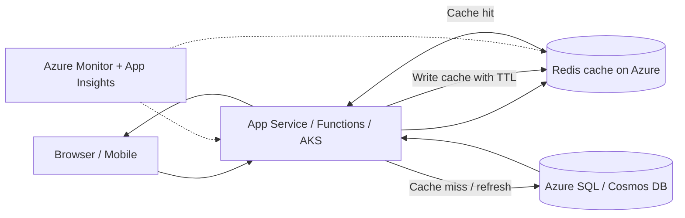
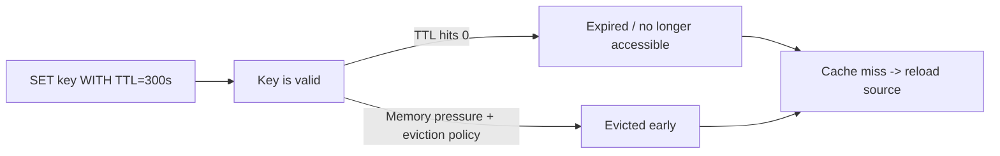
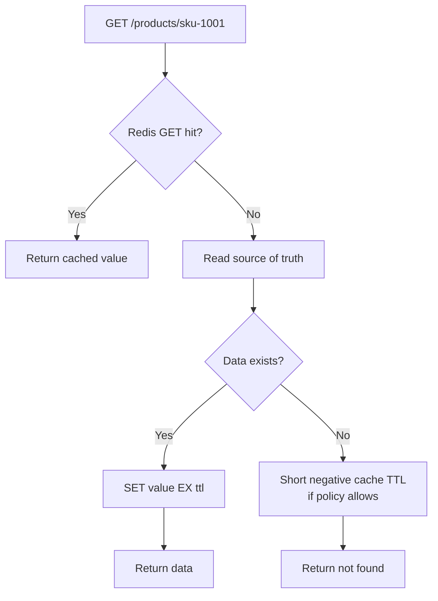
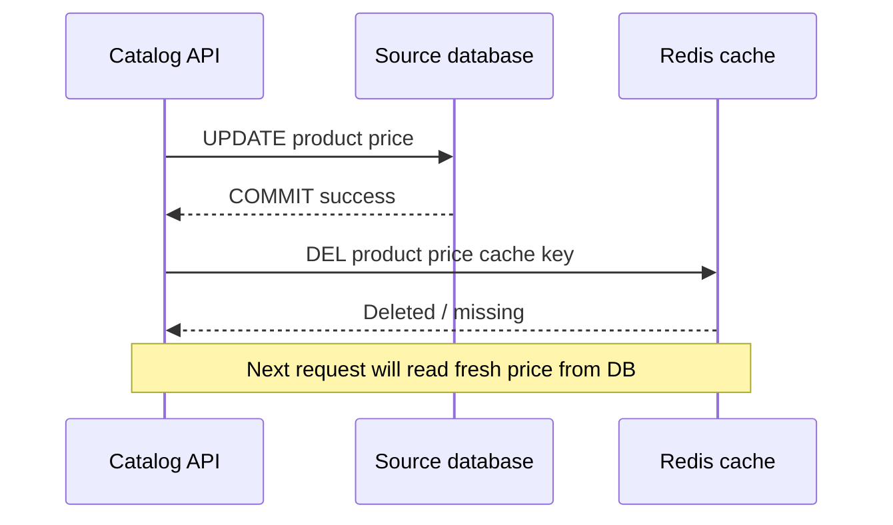
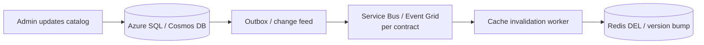
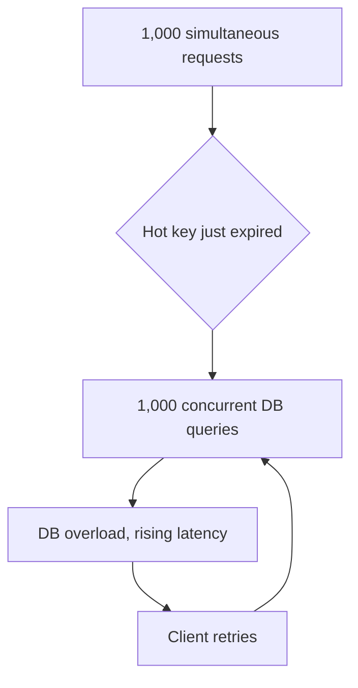
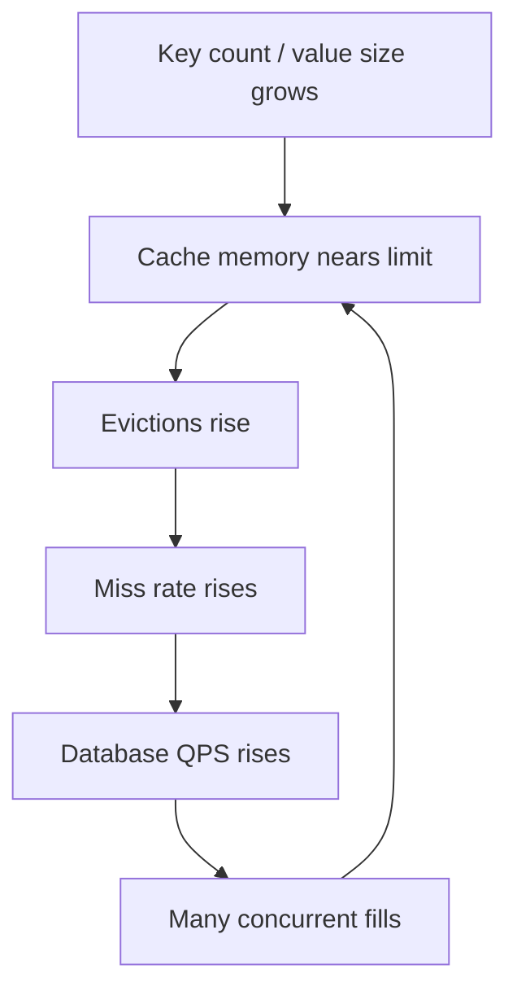
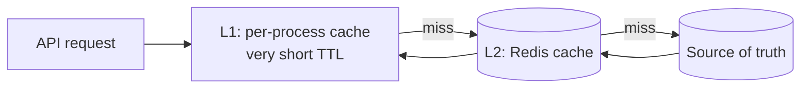

# Designing Keys, TTL, and Eviction Policies

An e-commerce website on Azure serves 20,000 product views per minute. Names, images, and descriptions change a few times a day, while **prices, inventory, and promotions** can change within seconds. If every request queries the database, the system incurs high cost and latency; if everything is cached for 24 hours without an update mechanism, users may see outdated prices or attempt to buy an out-of-stock item. If the cache fills up and the **eviction** policy drops critical keys, the cache miss rate and database load suddenly spike.

To use Redis effectively as a cache, you must design **three related but distinct decisions**:

1. **Key design** — which exact data item, tenant/user scope, schema version, and query conditions a key identifies.
2. **TTL (Time To Live)** — how long data is permitted to remain in the cache before being considered expired.
3. **Eviction policy** — when memory is under pressure, which keys the engine prioritizes removing to free space.

This lesson belongs to the **Caching and Real-time Communication** chapter of the **CLOUD_PROVIDERS_AZURE** module. The module path explores Azure from subscriptions, resource groups, and Microsoft Entra ID to networking, compute, storage, and data, while teaching deployment, monitoring, security, and cost control. Examples use a **Redis-compatible cache on Azure**, covering scenarios with **Azure Managed Redis** as well as existing **Azure Cache for Redis** deployments in current architectures. Product names, SKUs, service lifecycles, eviction settings, and identity/network options can vary by service or tier; verify supported capabilities before applying operational commands.

**After this lesson, you will be able to:**

- Define consistent cache keys with versioning, namespaces, tenant isolation, and PII avoidance.
- Choose TTLs based on **staleness tolerance** and the volatility of each data type.
- Distinguish **absolute TTL**, **sliding expiration**, **negative caching**, invalidation, and stale-while-revalidate.
- Explain Redis `EXPIRE`, `TTL`, `PTTL`, `SET EX`, `GETEX`, and pitfalls that accidentally strip TTLs.
- Compare `allkeys-lru`, `allkeys-lfu`, `volatile-lru`, `volatile-ttl`, and `noeviction` with accurate semantics.
- Mitigate cache stampedes, hot keys, eviction storms, and duplicate loads using jitter, single-flight/locking, and backpressure.
- Estimate RAM requirements and monitor **hit rate, evictions, expirations, memory usage, and database load**.
- Implement safe cache-aside in Python with TLS/identity connectivity and build a runbook for cache degradation.

## 1. Where does caching sit in an Azure architecture?

Caching avoids repeating an expensive operation when its result can be reused for a reasonable period.



The **source of truth** is usually SQL, Cosmos DB, or a core business system. A Redis cache holds a **reproducible copy**, not the sole record of balances, payments, unpersisted orders, or critical access permissions.

### 1.1. Distinguishing caching from adjacent services

| Component | Primary role | Should it substitute for a cache? |
|---|---|---|
| **Redis cache** | Holds fast-access results in RAM with TTL/eviction | Ideal for reproducible data |
| **Azure SQL / Cosmos DB** | Business data requiring durability/transactions | Source of truth; never replace casually with a cache |
| **Azure Service Bus** | Message delivery, retries, DLQ, producer-consumer decoupling | Not for cache lookups |
| **Azure Event Grid** | Change event routing with delivery retries per mode | Useful for invalidation, does not hold cache state itself |
| **Azure SignalR Service** | Real-time message distribution to connected clients | Not a database or key-value cache |
| **In-process memory cache** | Ultra-fast single-process access | Consistency issues when scaling across multiple replicas |

**Good example:** caching product descriptions or aggregate pages; whenever the catalog changes, update the database first and then emit an invalidation. **Dangerous example:** storing payment completion only in Redis and letting eviction erase the payment record.

### 1.2. Load reduction depends on hit rate

Suppose an API handles 10,000 reads/second and achieves an actual 90% cache hit rate:

```text
Reads served from cache: 9,000 requests/s
Reads hitting the DB:    1,000 requests/s
```

If the hit rate suddenly drops to 50%, the database must serve **5,000 requests/s**—a fivefold surge. That is why key design, TTL, and eviction must be treated as **part of database capacity planning**, not an isolated cache optimization.

## 2. Cache key design: every key must represent a deterministic result

A well-designed key lets two requests with the **same meaning** share a result while preventing two requests with **different permissions or data** from receiving the wrong result.

Reference pattern:

```text
<environment>:<service>:<tenant>:<entity>:<entity-id>:<variant>:v<schema-version>
```

Examples:

```text
prod:catalog:public:product:sku-1001:detail:vi:v3
prod:catalog:public:product:sku-1001:detail:en:v3
prod:orders:tenant-42:order:order-9001:summary:v2
staging:catalog:public:product:sku-1001:detail:vi:v3
```

In this pattern:

- `prod` / `staging`: **environment**, preventing cross-environment data mixing.
- `catalog` / `orders`: **service/ownership namespace**.
- `public` / `tenant-42`: **data visibility/tenant scope**.
- `product` / `order`: **entity type**.
- `sku-1001`: **business identity**.
- `detail:vi`: **projection and locale**.
- `v3`: **cache payload/contract version**.

This is an application convention, not a mandatory Redis format. Delimiters must be **escaped or normalized** if identifiers can contain `:`, so different field combinations cannot collide.

### 2.1. Avoid overly generic keys

**Wrong:**

```text
product:sku-1001
search:shoes
profile:123
```

If data varies by tenant, language, country pricing, permissions, or feature flags, these keys can serve **another user's price, state, or data**.

**Better:**

```text
prod:catalog:tenant-42:product:sku-1001:price:VND:v4
prod:search:public:query:qhash-7c3a:page-1:vi:v2
prod:profile:tenant-42:user:sub-8f9e:public-view:v1
```

Never use raw emails, phone numbers, tokens, JWTs, card numbers, or customer addresses as keys: Redis commands, metrics, traces, or admin tools can expose key names. Use non-sensitive IDs or appropriate tokenization/HMAC when needed.

### 2.2. Keys should be concise without losing uniqueness

Keys are bytes stored in memory. One million 200-byte keys can consume substantial RAM just to **store key names**, before even counting values, metadata, and allocator overhead.

However, shrinking keys down to `p1`, `p2` makes debugging hard and invites collisions. Pick names that are **short, namespaced, and stable**; measure memory footprint on real data.

### 2.3. Choose identifiers that do not change with mutable metadata

Do not bake selling prices, product names, shipping statuses, or volatile timestamps into the primary key without good reason:

```text
Product is renamed:
  Old key: catalog:shoes-blue-2026
  New key: catalog:shoes-navy-2026
```

Without deleting the old key, stale data continues occupying RAM. Use a stable product ID; mutable attributes belong in the **value** or a versioned attribute with an explicit invalidation strategy.

## 3. Canonical keys for queries, filters, and pagination

Not everything is fetched by a single entity ID. Caching search results must include **every input that affects the output**.

Example endpoint:

```text
GET /products?category=shoes&color=blue&sort=price_asc&page=2&lang=vi
```

The cache key must account for:

- category, color, and all filters actually participating in the query;
- sort order;
- page index/page size or cursor;
- locale, currency, and market;
- visibility/tenant/authorization scope;
- search algorithm or data schema version.

### 3.1. Canonicalize before hashing

These two query strings can be semantically identical:

```text
?color=blue&category=shoes&page=2
?page=2&category=shoes&color=blue
```

Using the raw query string as the key caches the same result twice. You should:

1. Parse against an allowed schema.
2. Apply default values consistently.
3. Normalize data types and letter casing according to semantics.
4. Sort parameter names when order does not matter.
5. Distinguish ordered lists from unordered lists.
6. Serialize deterministically, then hash if the string is too long.

```python
import hashlib
import json


def search_cache_key(tenant_id: str, filters: dict, version: int = 2) -> str:
    # Caller must validate/authorize tenant_id and filters beforehand.
    canonical = json.dumps(
        filters,
        sort_keys=True,
        separators=(",", ":"),
        ensure_ascii=False,
    )
    digest = hashlib.sha256(canonical.encode("utf-8")).hexdigest()[:24]
    return f"prod:search:{tenant_id}:query:{digest}:v{version}"


print(search_cache_key(
    "tenant-42",
    {"category": "shoes", "color": "blue", "page": 2, "sort": "price_asc"},
))
```

This snippet **illustrates canonical serialization**. Before production, define how values and list ordering are normalized; use a longer digest if key counts are massive or collision risk is unacceptable. If the goal is hiding sensitive identifiers from someone who might guess the input, **a plain hash is insufficient**; consider HMAC with a securely managed key, and never treat a digest as an access control mechanism.

### 3.2. Caching by access permissions

Search results may depend on roles or entitled product lists. If users A and B have different visibility, **never share a single `search:shoes` key**.

Depending on the application, you can cache:

- public data by locale/market;
- tenant-wide data by tenant ID;
- user-specific data by user identifier and permission version;
- role/view-specific projections;
- or **avoid caching** data whose permissions change too frequently.

A partition/tenant ID in the key **does not replace API authorization**: the server must still verify the caller is authorized for that tenant.

## 4. Cache values and schema versioning

Redis supports structures such as **string, hash, list, set, and sorted set**, plus additional types/features depending on version and service. For cache-aside, a string containing JSON or serialized binary data is the most common choice.

```json
{
  "schemaVersion": 3,
  "productId": "sku-1001",
  "name": "Sports Jacket",
  "language": "vi",
  "currency": "VND",
  "displayPrice": 499000
}
```

### 4.1. Why is versioning needed?

After a deployment, service v4 might read a key written by service v3 whose schema lacks a field. If code does not distinguish versions, parsing failures or corrupted displays appear sporadically.

Two approaches:

- **Version in the key** such as `:v3` allows two application versions to coexist during a rollout.
- **Version in the payload** lets consumers validate before deserializing.

Both can be combined. **Changing the version namespace does not automatically delete old keys**; they can remain in memory until TTL/eviction/invalidation, so plan cleanup accordingly.

### 4.2. Redis hashes and key-level TTL

A Redis hash groups multiple fields under **one Redis key**:

```text
HSET product:sku-1001 name "Jacket" stock "15"
EXPIRE product:sku-1001 300
```

Under traditional Redis semantics, **TTL applies to the Redis key**, not automatically per field inside the hash. Some newer versions/features support **field-level expiration** via specific APIs; do not assume that feature exists across every Azure tier/engine. If price and stock require very different TTLs, **split them into separate keys** or manage data age explicitly.

## 5. TTL: how stale is data allowed to be?

**TTL (Time To Live)** is the remaining time before a key **expires**. TTL answers "until when is this key valid in the cache?" rather than "is this key guaranteed to survive until then?"—because **eviction** can remove a key earlier.



### 5.1. Absolute expiration

The key expires after a fixed duration from creation or TTL update:

```text
10:00:00 SET catalog:sku-1001 EX 300
10:04:59 Key is still valid
10:05:00 TTL expires by elapsed time
```

Normal `GET` calls **do not extend TTL**. This is the simplest option, making it easy to bound maximum staleness since the last cache refresh.

### 5.2. Sliding expiration

Sliding expiration extends key lifetime upon each **valid access**, for example resetting TTL to 30 minutes on every read.

Pros: keeps hot data cached longer, reducing misses. Cons: a very hot key may **never expire on its own**, serving stale data indefinitely without invalidation or an additional absolute cap.

**Safe design:** if sliding TTL is needed, store an **absolute maximum age** in the payload or key version so data cannot stay stale forever.

### 5.3. TTL and consistency are two separate decisions

A 60-second TTL means the cache may serve data from the last fill for roughly up to that duration if no invalidation/refresh occurs. It is **not a guarantee that data is always fresher than 60 seconds compared with the database** across all failures: the source read might already have been delayed, replication can lag, and clients may have other cache layers.

If prices or permissions require strong consistency, use the **source of truth or version/conditional checks** at the decision point rather than hoping a short TTL suffices.

## 6. Redis TTL commands: semantics and common pitfalls

The examples below demonstrate **Redis command syntax** for learning semantics. Do not run them against production without confirming the target key/namespace.

### 6.1. Setting key and TTL in one operation

```redis
SET prod:catalog:sku-1001:detail:v3 "{\"name\":\"Jacket\"}" EX 300
TTL prod:catalog:sku-1001:detail:v3
PTTL prod:catalog:sku-1001:detail:v3
```

`SET ... EX 300` sets the value and a 300-second expiration in a **single command**, shrinking the failure window compared with separate `SET` and `EXPIRE` calls.

| Command | Meaning |
|---|---|
| `EXPIRE key seconds` | Set/update TTL in seconds |
| `PEXPIRE key milliseconds` | Set TTL in milliseconds |
| `EXPIREAT key unixTime` | Expire at a Unix timestamp in seconds |
| `TTL key` | Remaining seconds |
| `PTTL key` | Remaining milliseconds |
| `PERSIST key` | Remove expiration, turning it into a non-TTL key |
| `GETEX key EX seconds` | Read string value and update expiration atomically if supported |
| `SET key value KEEPTTL` | Overwrite value while retaining existing TTL if supported |

In standard Redis, `TTL`/`PTTL` can return:

- **-2:** key does not exist or has already expired.
- **-1:** key exists but **has no expiration**.
- **Non-negative integer:** remaining time in the command's unit.

Do not confuse `-1` with "one second left": it means **no TTL**, which can cause unbounded memory growth if the app expects every cache key to expire automatically.

### 6.2. Overwriting a key can wipe its TTL

Example:

```redis
SET demo:product "old" EX 300
TTL demo:product
SET demo:product "new"
TTL demo:product
```

Under standard Redis semantics, `SET key value` without an expiration option **clears the old TTL**. After the last line, `TTL` can return `-1`. This is a common bug when refactoring code from `setex` to `set`.

Fix: pass `SET ... EX ...` explicitly on every fill, or use `KEEPTTL` if you truly want to keep the existing expiration and the engine version supports it.

### 6.3. `GETEX` for sliding TTL

```redis
SET demo:session "payload" EX 1800
GETEX demo:session EX 1800
```

`GETEX` (when supported) reads and resets expiration in a single operation, enabling sliding expiration. Still, a session **should not live forever** just because a request arrives every minute: you may need an absolute cap or independent server-side session revocation.

### 6.4. Modifying a field in a hash

`HSET` on an **existing hash key with a TTL** normally preserves the key-level TTL because it modifies hash contents rather than replacing the key with `SET`. However, if code creates a brand-new hash key and forgets `EXPIRE`, that new key can persist indefinitely.

When designing a cache service, never assume "all writes preserve TTL" or "all writes clear TTL": **each Redis command has its own semantics**.

## 7. Choosing TTL by data type and SLO

TTL should not be a single constant applied to every key.

| Data | Trial TTL | Update strategy / trade-off |
|---|---:|---|
| Rarely changing product categories | 15–60 minutes | Event invalidation on catalog edits |
| Public product descriptions | 30–120 minutes | Short staleness allowed; version key on deploy |
| Market-specific display prices | 30–120 seconds | Invalidate on price change; checkout re-validates price |
| Display inventory counts | 5–30 seconds | Informational only; order placement checks source |
| Search results | 30–180 seconds | Key includes filters, locale, page, and version |
| Negative cache: SKU not found | 5–30 seconds | Avoids DB miss storms; keep short when new SKUs launch |
| Permission snapshot | Very short or uncached | Revocation/authorization must have an independent mechanism |
| Ephemeral session/presence | Per heartbeat and session contract | Sliding + absolute cap, failover semantics |
| Daily published exchange rates | Per publication cycle/data source | Event refresh or absolute deadline |

**These figures are starting points for load testing, not Azure or Redis defaults.** Pricing, inventory, and sessions carry specific business requirements; at payment or authorization boundaries, always verify authoritative state.

### 7.1. Calculating TTL from staleness budget

Suppose a product price may be shown stale for at most **60 seconds**. If the cache read the source 20 seconds before writing to Redis, a 60-second TTL counted from write time allows total staleness to reach roughly 80 seconds. Designs should track **data timestamp/version**, not just `EX 60`.

If the freshness SLO is `F` and normal source data lag is `L`, a conservative TTL should stay below the remaining budget, or be paired with event invalidation/version checks:

\[
TTL_{\mathrm{max}} \lesssim F-L
\]

This is a **heuristic**, not a consistency guarantee. Source lag can fluctuate, so monitor actual data age and maintain fallbacks.

### 7.2. Never cache decisions that cannot be wrong

Examples where standalone cache reads must not be the final authority:

- Checking account balance before debiting funds.
- Checking access to medical records or PII after permissions could have just been revoked.
- Confirming stock availability during order placement.
- Preventing duplicate payments, idempotency ledgers, or finalized transaction records.

A cache can assist with **display or hints**, while business transactions must verify the authoritative source.

## 8. TTL jitter: preventing mass simultaneous expirations

Suppose 50,000 products are warmed into the cache at 09:00 with an exact 300-second TTL. At 09:05, many keys expire together; a burst of requests hits the database.

```text
09:00:00 warm 50,000 product keys, TTL = 300 seconds
09:05:00 many keys expire simultaneously
09:05:01 5,000 requests miss and hit the database together
=> Cache stampede / thundering herd
```

**TTL jitter** spreads out expiration timestamps:

\[
TTL_{\mathrm{key}} = TTL_{\mathrm{base}} + U(0,J)
\]

For example, base TTL 300 seconds and jitter 0–60 seconds spreads TTLs across 300–360 seconds. If the requirement enforces a **hard maximum freshness of 300 seconds**, the formula above is **unsuitable** because keys can outlive 300 seconds. Instead:

\[
TTL_{\mathrm{key}} = TTL_{\mathrm{max}} - U(0,J)
\]

With `TTL_max = 300s` and `J = 60s`, TTLs fall between 240 and 300 seconds.

### 8.1. Bounded implementation

```python
import secrets


def ttl_with_jitter(max_ttl_seconds: int, jitter_seconds: int) -> int:
    if max_ttl_seconds <= 0:
        raise ValueError("max_ttl_seconds must be positive")
    if jitter_seconds < 0 or jitter_seconds >= max_ttl_seconds:
        raise ValueError("invalid jitter_seconds")
    # Never exceed the hard maximum freshness TTL.
    return max_ttl_seconds - secrets.randbelow(jitter_seconds + 1)


print(ttl_with_jitter(max_ttl_seconds=300, jitter_seconds=60))
```

Choose jitter relative to key cardinality and source capacity. Too wide a jitter lowers hit rate; too narrow fails to spread refreshes. **TTL jitter does not replace request coalescing, rate limiting, and database capacity** when a single ultra-hot key expires.

## 9. Cache-aside: the most common access pattern

In **cache-aside (lazy loading)**, the application checks the cache first; on a miss, it fetches from the source and populates the cache.



**Pros:** caches only accessed data, reducing unnecessary writes. **Cons:** the first miss pays database latency, stampedes can occur, and invalidation is needed when the source changes.

### 9.1. Python example with a Redis client

This snippet illustrates Redis-py cache-aside; **repository** is an application-provided data layer. The Redis connection must be configured via a secret store or supported identity method—never hardcode passwords:

```python
import json
import logging
import os

from redis import Redis, RedisError

# REDIS_URL is a secret/config injected securely at runtime.
# With Azure-managed Redis, use TLS and verify the supported auth method.
cache = Redis.from_url(
    os.environ["REDIS_URL"],
    decode_responses=True,
    socket_connect_timeout=1.0,
    socket_timeout=1.0,
)


def product_key(product_id: str, lang: str) -> str:
    # Caller must validate product_id/lang against the allowed contract.
    return f"prod:catalog:public:product:{product_id}:detail:{lang}:v3"


def get_product(product_id: str, lang: str, repository):
    key = product_key(product_id, lang)

    try:
        cached = cache.get(key)
        if cached is not None:
            envelope = json.loads(cached)
            if envelope["kind"] == "not-found":
                return None
            if envelope["kind"] == "value":
                return envelope["data"]
    except (RedisError, ValueError, KeyError, TypeError) as exc:
        # Cache errors or corrupt payloads must not break read availability.
        logging.warning("Cache read unavailable or invalid: %s", type(exc).__name__)

    # Source of truth must enforce authorization at the appropriate layer.
    result = repository.get_product(product_id, lang)

    if result is None:
        payload = {"kind": "not-found"}
        ttl = 20  # Short negative caching, only when business rules permit.
    else:
        payload = {"kind": "value", "data": result}
        ttl = ttl_with_jitter(max_ttl_seconds=300, jitter_seconds=60)

    try:
        cache.set(key, json.dumps(payload, ensure_ascii=False), ex=ttl)
    except (RedisError, TypeError, ValueError) as exc:
        # Database is the source; do not treat a cache write failure as a DB failure.
        logging.warning("Cache fill skipped: %s", type(exc).__name__)

    return result
```

In production applications:

- `ttl_with_jitter` is the helper defined in section 8.
- `repository.get_product` is an illustrative database-access API, **not a built-in Azure SDK function**.
- Cache clients should be **reused per process**, avoiding a new TCP connection on every request.
- The `kind` envelope cleanly separates **negative caching** from a JSON `null` value that might be valid in another domain.
- `lang` and data visibility must be validated so wrong keys are never served.
- If the database fails, **do not** falsely return success from absent data; define fallbacks/SLOs.
- If payloads are large or non-JSON-serializable, use a contracted serializer with schema validation and size caps.

### 9.2. Why ignoring cache errors can make sense

For cache-aside holding **reproducible data**, the cache is a performance dependency; when Redis times out, the API can fall back to the database if the database can absorb the load. However, fallback must not be **unbounded**: if a full Redis outage dumps 100% of load onto SQL, SQL can collapse too. Use rate limiting, circuit breakers, and appropriate degraded modes.

## 10. Negative caching: "not found" can be cached too

If bots or users repeatedly request a nonexistent SKU, every request hits the database unless "not found" is cached.

```text
GET product-404 -> DB NotFound
GET product-404 -> DB NotFound
GET product-404 -> DB NotFound
```

A **negative cache** stores a `not-found` sentinel with a short TTL, such as 10–30 seconds, reducing repeated lookups for missing keys.

**However:** if a new product is created with that ID, negative caching can make the app keep returning 404 until the TTL expires or invalidation runs. Therefore:

- Negative TTLs are typically **much shorter** than positive TTLs.
- Avoid caching **403 permission denied** errors as if the resource does not exist globally.
- Never cache 500 errors, timeouts, or unreliable database responses as "not-found".
- When an entity is created, delete the negative key or bump the namespace/version per policy.
- Bound cardinality; an attacker could send **millions of nonexistent IDs**, filling Redis with negative entries.

### 10.1. Negative caching and security

A user lacking permission to view product X is different from product X **not existing**. Writing `not-found` into a public key just because one unauthorized request was blocked could cause authorized users afterward to receive wrong answers. Enforce **authorization before caching**, or embed the authorization scope properly in the key.

## 11. Cache invalidation: TTL doesn't solve every update

**Invalidation** means deleting or marking a key obsolete when source data changes, rather than waiting for TTL to expire.

Example:



**Order matters:** in simple cache-aside, update the database first and invalidate the cache **after commit**. Deleting the cache before transaction commit allows a concurrent request to immediately refill the old price.

### 11.1. Race condition between cache fill and invalidation

Even "update DB then DEL" has a race window:

```text
T1: Reader sees cache MISS.
T2: Reader queries DB, receives price = 100.
T3: Writer commits DB price = 120.
T4: Writer DELs cache key.
T5: Reader writes price = 100 into cache (after DEL).
T6: Subsequent requests receive stale price until next TTL/invalidation.
```

Options depending on strictness:

- Use a **short TTL** as a safety bound for simple read cache-aside.
- Include **source version/ETag/updatedAt** in the payload and accept only matching/newer versions.
- Use a **versioned key** tied to a reliable business version from the source.
- Separate critical price/stock keys from descriptive metadata.
- Use event-driven invalidation with retry/outbox and version checks.
- For checkout/inventory decisions, re-verify against the **transactional database source**.

**Do not claim "DELETE after commit guarantees zero staleness".** It lowers the probability but does not eliminate every concurrent fill race.

### 11.2. Event-driven invalidation



The worker must:

1. Carry an event ID and business entity version.
2. Handle duplicate events idempotently.
3. Tolerate late or out-of-order events.
4. Retry on transient Redis errors with monitoring.
5. Never report invalidation as applied while the event is still sitting in a queue.

When event-based invalidation fails, **TTL acts as the final backstop** against infinite stale keys—unless strict consistency demands an alternative mechanism.

## 12. Cache stampede, single-flight, and distributed locks

A **cache stampede** occurs when many requests miss the same key simultaneously and query an expensive dependency at once.



Mitigation layers in increasing complexity:

1. **TTL jitter** across different keys.
2. **Per-process single-flight**: concurrent requests inside one instance coalesce on a single cache fill.
3. **Distributed lock/lease** for a hot key across multiple instances.
4. **Stale-while-revalidate** within the allowed freshness window.
5. **Bounded fallback** to the database, circuit breakers, and capped warm-up.

### 12.1. Redis lock with `SET NX EX` — only a lease

```redis
SET lock:prod:catalog:sku-1001 "unique-token" NX EX 10
```

- `NX` creates the lock key only if it does not already exist.
- `EX 10` sets a 10-second lease TTL so the lock does not stick forever if the holder crashes.
- `unique-token` identifies the holder so unlocking does not delete another process's lock.

**Important:** a TTL lock is a **lease**, not an eternal mutex guarantee. If the DB query takes 20 seconds, the 10-second lease expires; another worker can acquire the lease and update the cache concurrently. Use versioning/fencing if side effects outside the cache require strict consistency.

### 12.2. Safe unlock by token comparison

Never do:

```redis
DEL lock:prod:catalog:sku-1001
```

because a slow previous holder might delete a newer holder's lock. Use an atomic operation supported by your Redis version—for example, **Lua compare-and-delete**:

```lua
-- KEYS[1] = lock key; ARGV[1] = caller's token.
if redis.call("GET", KEYS[1]) == ARGV[1] then
    return redis.call("DEL", KEYS[1])
end
return 0
```

This is **best-effort coordination for cache fills**, not a distributed transaction primitive. Account for Redis failovers, lock expiration, stale fills, and network partitions. Never use a cache lock like this as the sole safeguard for "exactly-once payment" or financial ledger writes.

### 12.3. What should requests without the lock do?

Do not make the other 999 requests **spin every 1 ms**:

- Wait briefly with jitter, then re-check the cache.
- Serve a stale value if business rules permit.
- Allow a small number of requests to fall back to the DB via a semaphore.
- Return a controlled degraded/503 response if the dependency is overloaded.
- Monitor lock wait duration and lock contention.

## 13. Stale-while-revalidate and dual expiration thresholds

For data tolerating brief staleness, you can use a **soft TTL** and a **hard TTL**:

- **Soft expiry:** after this timestamp, the data should be refreshed, but stale reads are still permitted per policy.
- **Hard expiry:** after this timestamp, the data **must no longer be served**; fetch from source or fail.

Example envelope:

```json
{
  "schemaVersion": 3,
  "value": {
    "productId": "sku-1001",
    "name": "Sports Jacket"
  },
  "softExpiresAtUtc": "2026-11-20T10:02:00Z",
  "hardExpiresAtUtc": "2026-11-20T10:07:00Z",
  "sourceVersion": "product-v145"
}
```

The Redis key TTL can match the **hard expiry**, while application logic handles soft expiry. A request arriving after soft expiry can immediately receive the stale value while **a single worker** refreshes in the background.

### 13.1. Never serve stale data for sensitive operations

Public product catalogs may tolerate a few minutes of staleness. Access permissions, checkout prices, payments, security quotas, or physical safety controls may **tolerate zero staleness**. Policy should be defined by the data owner, not solely by the cache team.

### 13.2. Clocks and absolute timestamps

Soft/hard expiry timestamps must use **UTC** across synchronized clocks; clock skew can cause premature or overdue data serving. For strict policies, use versions or source validation instead of relying purely on web worker clocks.

## 14. Eviction vs expiration vs invalidation

Three distinct ways keys disappear:

| Mechanism | Cause | Who decides? | Impact |
|---|---|---|---|
| **Expiration** | TTL reaches 0 | Key TTL + Redis runtime | Key is no longer served; next request misses |
| **Eviction** | Redis must free RAM per policy | Engine and memory policy | Key may be removed before TTL expires |
| **Invalidation** | Source data changed or explicit purge | Application/worker/operator | Next request must refresh |
| **Manual delete** | `DEL`/`UNLINK` command | Authorized user or software | Can accidentally cause a cold cache |
| **Instance loss/flush** | Outage, reset, migration, persistence config | Infrastructure/operations | Many keys may be lost depending on tier |

**Eviction is not a freshness guarantee.** An old but frequently accessed key may survive until TTL; a brand-new rarely accessed key may be evicted early under memory pressure.

### 14.1. Redis expired key deletion may lag memory reclamation

Redis uses **lazy expiration** on key access and **active expiration** scanning expired keys. An expired key is never served as valid upon access, yet full RAM reclamation may not happen at the exact millisecond of expiration. When reading memory metrics, distinguish key validity from physical cleanup timing.

### 14.2. Never use Redis keyspace notifications as a durable event log

Redis supports keyspace notifications in certain versions/configurations, but expire/evict notifications are generally not a **durable event delivery contract**. Disconnected subscribers miss events, and emission timing depends on expiration sweeps. If you need a reliable business event like "order expired", use a database/job/queue with proper transactions and retries rather than waiting on Redis expiration events.

## 15. Common Redis eviction policies

Depending on the engine and service tier, Redis provides typical policies:

| Policy | Candidate key set | Strategy | When to consider |
|---|---|---|---|
| `noeviction` | Does not evict to accept writes | When hitting memory limit, operations needing more RAM may fail | Never want early key loss; requires strict capacity planning |
| `allkeys-lru` | All keys | Prioritizes removing **least recently used** keys | Working-set read caches with temporal locality |
| `allkeys-lfu` | All keys | Prioritizes removing **least frequently used** keys | Retaining popular items longer; heavy-hitter workloads |
| `allkeys-random` | All keys | Random selection | Minimal locality/frequency sensitivity |
| `volatile-lru` | Only keys **with a TTL** | LRU within expiring keys | Mixing non-TTL and TTL keys, letting non-TTL persist longer |
| `volatile-lfu` | Only keys **with a TTL** | LFU within expiring keys | Evicting only ephemeral keys by frequency |
| `volatile-random` | Only keys **with a TTL** | Random within expiring keys | Specialized workloads |
| `volatile-ttl` | Only keys **with a TTL** | Prioritizes keys **closest to expiration** | When soon-to-expire items are least valuable |

**Important:** these names and semantics describe standard Redis policies; **Azure Managed Redis, the Redis Enterprise engine, and Azure Cache for Redis tiers may differ in supported policies or configuration methods**. Never run `CONFIG SET maxmemory-policy` in production without verifying Azure Portal/API/SKU support and change management rules.

### 15.1. LRU and LFU are heuristics, not exact global sorted lists

In Redis, LRU/LFU algorithms use sampling/approximations and internal tuning rather than always picking the **strictly exact** least-accessed key across all history.

- **LRU (Least Recently Used):** prioritizes evicting keys untouched for the longest time.
- **LFU (Least Frequently Used):** prioritizes evicting keys with low access frequency via decayed counters.

For instance, a `homepage` key accessed 100,000 times/day vs a report key read once: LFU retains `homepage` better. Yet if product trends shift hourly, decay parameters and TTLs still need tuning so the cache does not cling to formerly hot keys that are now cold.

### 15.2. How do `allkeys-*` and `volatile-*` differ?

Suppose a cache contains:

```text
key A: product:1001     TTL 300s
key B: product:1002     TTL 300s
key C: feature-config   no TTL
key D: admin-report     no TTL
```

With `allkeys-lru`, A/B/C/D are all eviction candidates. With `volatile-lru`, only A and B (which have TTLs) are eligible. If no TTL keys remain or RAM cannot be freed sufficiently, memory-allocating writes can **be rejected** even though `volatile-lru` is active.

**Do not think volatile policies protect non-TTL keys as durable storage.** They merely exclude non-TTL keys from eviction, which can push the app into OOM/rejected writes.

### 15.3. `volatile-ttl` does not mean "longer TTLs get evicted first"

`volatile-ttl` targets keys **with shorter remaining time to expiration**. That differs from LRU/LFU: a very hot key that is about to expire can still be evicted ahead of a cold key with a longer TTL.

### 15.4. `noeviction` is not a free safety net

Once memory hits the limit, Redis rejects writes requiring additional memory. In cache-aside apps, this turns **cache fill failures** into a routine error case that must be handled; without fallback handling, the API can fail en masse.

`noeviction` suits cases where data should not silently vanish under pressure, yet if the data truly **cannot be lost**, a Redis cache with `noeviction` still **does not replace a durable database or transaction log**.

## 16. Selecting an eviction policy by workload

| Scenario | Policy to evaluate | Rationale / conditions |
|---|---|---|
| Product/catalog cache, all data reproducible | `allkeys-lru` or `allkeys-lfu` | Not restricted to TTL keys; clear locality/frequency |
| Many TTL keys, want to retain certain non-TTL metadata | `volatile-lru` / `volatile-lfu` | Ensure ample RAM and do not assume protected keys are durable |
| Short-lived cache where expiring keys lose value | `volatile-ttl` | Weigh hit rate and session semantics |
| Requirement not to lose data under memory pressure | Evaluate `noeviction` and **change storage architecture** | Rejecting writes is risky; critical data must be durable elsewhere |
| Workload shifts from evergreen hot keys to trending items | Tuned LRU or LFU | Observe hit rate, churn, and hot-key lifespan |

In production, never pick a policy by name alone. Use **workload traces**, TTL vs non-TTL proportions, hit/miss ratios, key sizes, and memory budgets to test supported policies in staging.

### 16.1. A multi-purpose Redis database can be hard to tune

Mixing:

- Product cache needing flexible eviction;
- Session state needing strict TTLs and logout/revocation;
- Rate-limiter counters needing atomicity without early eviction;
- Lock keys needing lease semantics;

inside one memory pool with **one eviction policy** can create unpredictable interactions. Consider **separating caches/instances/services** by data class and SLA when isolation and cost permit.

**Do not rely on a Redis key prefix like `session:` to give those keys their own eviction policy** if the engine enforces a single database/instance-wide policy. Namespaces do not create capacity boundaries.

## 17. Memory sizing: payloads are not the whole footprint

Cache RAM estimation must include:

\[
M_{\mathrm{total}} \approx
N \times (S_{\mathrm{value}}+S_{\mathrm{key}}+S_{\mathrm{metadata}})
+ M_{\mathrm{fragmentation}}+M_{\mathrm{overhead}}
\]

Where:

- `N`: concurrent keys/objects.
- `S_value`: average serialized value size.
- `S_key`: key size.
- `S_metadata`: Redis structure/object/allocator overhead (variable).
- `M_fragmentation`: allocator slack and fragmentation.
- `M_overhead`: runtime, connection buffers, replication/persistence, or system reserve depending on tier.

### 17.1. Memory calculation example

Assumptions:

```text
Entry count:                     1,000,000
Average value payload:           1,000 bytes
Estimated key + metadata:          200 bytes
Simple model total:      1,200,000,000 bytes (~1.12 GiB)
```

Adding 35% headroom for a test baseline:

\[
1.12 \times 1.35 \approx 1.51\ \mathrm{GiB}
\]

This is an **illustrative estimate**, not an Azure minimum memory specification. Actual overhead varies by Redis data type, encoding, cluster topology, replicas, connection buffers, TLS, persistence, reserves, and fragmentation. Measure with real data on the target tier.

### 17.2. Service memory limits may not equal advertised RAM

In managed Redis, part of memory may be reserved for the engine, OS, replication, persistence, and platform functions. **Available cache data memory** can differ from plan/node RAM. Memory policies and headroom safeguards may be service-managed; do not assume identical `maxmemory` behavior across every Azure Redis tier.

### 17.3. Item size distribution

Average value size can mislead:

- 95% of keys are 1 KB, while 5% are 500 KB;
- a few huge keys consume most of the RAM;
- an API accidentally caches an entire table inside one JSON string;
- serialization retains unused fields or duplicate copies of the same data.

Measure p50/p95/p99 value size, key count, memory per namespace/tenant, and growth over time. Shrink footprints via lean projections, stripping unused fields, or CPU/latency-aware compression.

## 18. Capacity planning: cache budgets and eviction storms

### 18.1. When full, eviction can amplify load



An **eviction storm** happens when memory pressure evicts keys that are still actively needed, forcing the app to regenerate them repeatedly and hammering the source.

### 18.2. Sizing source capacity for degraded cache scenarios

Suppose:

```text
API reads:                   8,000 requests/s
Normal cache hit rate:           95%
DB load from cache misses:       400 requests/s

Degraded cache hit rate:         60%
DB load when degraded:         3,200 requests/s
```

The data source now faces **eight times** its normal read volume. If SQL only sustains 1,000 reads/s, simply "skipping cache errors" fails. You need:

- Bounded concurrent DB fallback.
- Request coalescing.
- Graceful degradation/stale-if-error where policy permits.
- API rate limiting.
- Read replicas/materialized views when suitable.
- Rate-limited cache recovery and warm-up.

### 18.3. Cold caches must be planned for

Restarts, failovers, maintenance, scale-out, or cache replacements can drop hit rates depending on persistence/replication settings. Maintain a **cold start runbook**: prioritize top hot keys, warm gradually, and avoid creating 10 million keys with identical TTLs at once.

## 19. Hot keys, hot tenants, and hash tags

A **hot key** receives disproportionately high reads/writes compared with the rest of the keyspace. Even though Redis runs in RAM, an extremely hot key can bottleneck network, shard, CPU, or client capacity.

### 19.1. Hot key vs cache stampede

- **Hot key:** traffic continuously concentrates on one key.
- **Stampede:** a key misses/expires and many clients concurrently reload the source.

A key can be both hot and prone to stampedes. Mitigations include single-flight, a local near-cache if consistency permits, proactive refresh before expiry, or partitioning workloads appropriately.

### 19.2. Redis Cluster and hash slots

In Redis Cluster and Azure services using compatible sharding, keys map to hash slots/shards. Certain multi-key operations are supported only when keys share the **same hash slot**.

**Hash tags** use `{...}` to co-locate keys in the same slot, for example:

```text
cart:{cart-42}:summary
cart:{cart-42}:line:001
cart:{cart-42}:line:002
```

This helps when atomic/multi-key operations are required within one slot, **but**:

- Putting all keys of `{tenant-42}` into one slot can create a **hot shard**.
- Hash tags do not create transactions across multiple services or databases.
- Never confuse a **Redis hash slot** with a **Cosmos DB partition key**; algorithms and limits differ.
- Verify the topology/cluster API of the specific Azure Managed Redis / Redis-compatible tier in use.

### 19.3. Isolating contending workloads

If a catalog cache sees bursts of 50,000 reads/s while a session store demands steady latency, consider separate Redis services or capacity tiers rather than merely prefixing `catalog:` and `session:`.

## 20. Multi-layer caching: local cache, Redis, and database

An architecture can combine multiple tiers:



**Pros:** eliminates network round-trips to Redis for hot keys. **Trade-offs:** replicas hold diverging L1 caches, invalidation is harder, and total staleness can exceed expectations.

If L2 has a 60-second TTL and L1 is populated from L2 with a fresh 60-second TTL, a value already 59 seconds old in L2 can remain in L1 for another 60 seconds. **Never blindly add TTLs** when the freshness budget is 60 seconds from the source. Propagate **source fetchedAt/hardExpiresAt** and cap L1 TTL to the **remaining lifetime**, never resetting data age from zero.

### 20.1. CDN/HTTP caching and Redis

If responses also pass through a CDN, browser, proxy, or HTTP cache, manage `Cache-Control`, `ETag`, `Vary`, and per-layer invalidation. Redis TTL **does not control CDN TTL**. For user-specific data, configure headers and cache keys carefully so private data never leaks through a shared HTTP cache.

## 21. Sessions, presence, and real-time features

This chapter focuses on **caching and real-time communication**. Redis can store transient state such as session metadata, presence, subscription counters, or recent events, though reliability requirements vary across them.

### 21.1. Presence heartbeat

Example:

```text
presence:tenant-42:user-19:device-7
  value: {"lastSeenAt":"2026-11-20T10:00:00Z"}
  TTL: 90 seconds
```

The client sends a heartbeat every 30 seconds; the server refreshes the presence TTL. If connectivity drops, the key expires and the user appears offline after the timeout window. Systems must accept that **presence is approximate**: brief network blips, mobile sleep, retries, or failovers can lag status by tens of seconds.

### 21.2. Presence is not security logout proof

If a presence key disappears due to eviction, a connected user may appear offline. Conversely, a lingering key may reflect a delayed heartbeat. Never use a presence cache as sole proof for authorization or billing rules.

### 21.3. Session TTL and revocation

Session caches may require a sliding idle timeout alongside an absolute lifetime and revocation. On logout:

- Delete/invalidate the session key or increment a session version per design.
- Align with the token/identity provider and refresh token policy.
- Provide fallback behavior when the cache is unreachable.
- Do not rely on `volatile-lru` to guarantee a session survives until expiry; handle early eviction gracefully in UX/recovery.

For high-assurance session/authorization constraints, evaluate a **durable session store or identity service** and failure model instead of relying purely on cache as truth.

## 22. Redis caching with Azure security and networking

### 22.1. TLS and authentication

Applications connect to Redis-compatible services over **TLS** using an authentication mechanism supported by the tier. Options may include Redis AUTH/access keys or **Microsoft Entra authentication** on supported services/tiers.

**Not every Redis product/tier supports the same Entra, ACL, or client credential formats.** Verify before implementing. Never embed keys or passwords in source code, Docker images, Git-committed connection strings, or logs.

Principle flow:

```text
App Service / AKS / Azure Functions
    -> identity or secure secret injection
    -> TLS Redis client
    -> Azure Managed Redis / Redis-compatible endpoint
```

When using managed identity and token-based authentication, clients must implement **token/connection refresh** rather than caching a static access token for days. In the cache-aside snippet, `Redis.from_url` shows how to connect **once a valid credential is supplied**—it does not provide Entra authentication automatically.

### 22.2. Private Endpoint, DNS, and outbound access

When a Redis service requires private connectivity:

1. Verify whether the service/SKU uses Private Endpoint or VNet injection and its DNS model.
2. Provision the outbound network path from App Service/AKS/VM/Functions to the endpoint as supported.
3. Ensure the Redis FQDN resolves to the appropriate private IP from the application runtime.
4. Allow the exact service TLS port/transport; do not assume all Redis endpoints share one port.
5. Verify NSGs/UDRs/firewalls, hub-spoke DNS forwarding, and auth dependencies.
6. Confirm public network access separately—an Approved Private Endpoint does not guarantee public access is disabled.

**A network route does not grant Redis login permission**, and valid credentials do not punch through a firewall. Troubleshoot layer by layer instead of granting Administrator permissions to fix timeouts.

### 22.3. Tenant separation and sensitive data

A key containing `tenant-42` is only namespacing. The API must still authenticate the user and authorize tenant access before reading or writing Redis. When one Redis endpoint serves multiple tenants:

- Never let browsers or mobile clients connect directly to Redis.
- Restrict Redis credentials to trusted backends.
- Do not grant all-key read permissions to untrusted services.
- Consider separate cache instances when strong isolation or capacity guarantees are needed.
- Never treat Redis key names as secrets or security boundaries.

## 23. Redis CLI: observing TTL and memory safely

The following commands are for learning. Before running them, connect to the target cache using managed TLS and authentication. **Never paste credentials into command lines or logs** in shared environments.

### 23.1. Read-only commands

```redis
PING
TTL prod:catalog:public:product:sku-1001:detail:vi:v3
PTTL prod:catalog:public:product:sku-1001:detail:vi:v3
MEMORY USAGE prod:catalog:public:product:sku-1001:detail:vi:v3
INFO memory
INFO stats
INFO keyspace
```

Depending on the engine, `INFO` exposes useful stats like memory, keyspace hits/misses, and evicted/expired keys. Some managed Redis services **restrict admin commands or omit certain fields**; when denied, use Azure metrics/diagnostics instead of escalating privileges to run unsupported commands.

### 23.2. Inspecting a namespace subset with SCAN

```redis
SCAN 0 MATCH prod:catalog:* COUNT 100
```

`SCAN` is an **iterative cursor-based scan** that can return partial results or duplicates and must iterate until the cursor returns `0`. `COUNT 100` is only a hint, not a guarantee of 100 keys.

**Avoid running `KEYS *` on large production caches** for stats, as it can block and spike latency. Even `SCAN` carries cost on huge datasets and should not be run aggressively during peak traffic.

### 23.3. Data-mutating commands — lab only

```redis
SET lab:product:sku-1 "{\"name\":\"Demo\"}" EX 120
TTL lab:product:sku-1
EXPIRE lab:product:sku-1 60
TTL lab:product:sku-1
DEL lab:product:sku-1
```

These commands write/delete keys—**never** run them in production. Never use `FLUSHALL` or `FLUSHDB` for routine cache cleanup without approval, a recovery plan, and blast-radius assessment.

### 23.4. Checking the eviction policy

In self-managed OSS Redis, `maxmemory-policy` can be inspected via admin commands if permitted. However, many Azure-managed Redis configurations are controlled through the **Portal/management API** and may block `CONFIG GET`/`CONFIG SET`. Use the supported interface of your **actual service/tier**; never inject policy-changing commands into read-only diagnostic runbooks.

## 24. Monitoring: measuring hit rate, eviction, and downstream load

Basic **cache hit rate**:

\[
\mathrm{HitRate}=\frac{\mathrm{hits}}{\mathrm{hits}+\mathrm{misses}}\times 100\%
\]

For example, with 90,000 hits and 10,000 misses in an observation window:

\[
\mathrm{HitRate}=\frac{90000}{90000+10000}\times100\%=90\%
\]

Yet **overall hit rate** can mislead. If the critical checkout endpoint hits 40% while product descriptions hit 99%, a 95% global average does not mean checkout meets its SLO.

| Metric | What it evaluates | Investigate further when |
|---|---|---|
| **Cache hit/miss ratio** | Data reusability | Hits drop after deploy, TTL too short, overly fragmented keys |
| **Evicted keys/s** | Policy-driven memory pressure | Evictions climb steadily while working set is stable |
| **Expired keys/s** | Natural expiration rate | Expiration bursts, synchronized TTLs |
| **Used memory / memory utilization** | Active capacity usage | Near threshold and climbing continuously |
| **Memory fragmentation / RSS** | Engine overhead and fragmentation | RSS high relative to used memory |
| **Client connections** | Connection counts and pool health | Connection churn or hitting tier limits |
| **Redis CPU / p95–p99 latency** | Server/client/network bottlenecks | Tail latency rises before 429/rejected writes |
| **Cache GET/SET failure rate** | Availability and auth/network health | Timeouts, TLS/credential errors, OOM |
| **DB read QPS/latency** | Real offloading benefit | Cache miss storms push DB over capacity |
| **Key count + average size** | Cardinality and memory growth | Key leaks, unbounded query variants |
| **Hot-key traffic** | Load concentration | Single key/shard overheating |
| **Stale reads and invalidation lag** | Data correctness | Cache still serves old versions after updates |

Exact metric names/dimensions vary by Redis service/tier and Azure Monitor. Not every item exists as a built-in metric with that exact name; you may need **Application Insights custom metrics**, Redis INFO/SDK telemetry, and database metrics.

### 24.1. Zero evictions does not guarantee health

Under `noeviction`, evictions stay at 0 even while writes fail because RAM is full. Monitor **OOM/rejected operations, failed cache fills, and application errors**; never rely on evicted keys/s alone to judge capacity health.

### 24.2. Staleness SLO

If serving a price older than 2 minutes constitutes an incident, track:

```text
sourceUpdatedAtUtc
cacheFilledAtUtc
responseServedAtUtc
sourceVersion
```

From these you can measure actual data age at response time. **A 99% hit rate is worthless** if those hits serve wrong data.

### 24.3. Structured logging

```json
{
  "component": "product-cache",
  "operation": "GET",
  "keyClass": "catalog-product-detail",
  "tenantClass": "public",
  "cacheOutcome": "miss",
  "latencyMs": 9,
  "sourceFallback": true,
  "servedStale": false
}
```

This is an illustrative log format, not a Redis-emitted schema. Never log access keys, raw PII, full payloads, or cache keys containing sensitive identities.

## 25. Case study A: e-commerce catalog, pricing, and inventory

**Requirements:**

- Product descriptions are read-heavy and change rarely.
- Prices vary by currency/market and promotions.
- Inventory changes constantly.
- Checkout must never confirm wrong prices or stock.

### 25.1. Proposed keys and TTLs

```text
prod:catalog:public:product:sku-1001:detail:vi:v3
  TTL ~ 30 minutes + invalidation on description edit

prod:catalog:market-vn:product:sku-1001:price:VND:v5
  TTL ~ 30–60 seconds + price-version invalidation

prod:inventory:warehouse-hcm:sku:sku-1001:display:v2
  TTL ~ 5–15 seconds, display use only
```

These numbers are **initial test assumptions**, not Redis-guaranteed SLAs.

**Workflow on price change:**

1. Pricing service commits the new price in the source of truth.
2. Emits a change event/outbox containing product ID, market, currency, and version.
3. Cache invalidation worker deletes or version-bumps the exact price key.
4. Next request populates price from the source with a short TTL and version.
5. Checkout performs authoritative price/stock validation inside an appropriate transaction.

### 25.2. Eviction policy

Catalog descriptions are reproducible; `allkeys-lru` or `allkeys-lfu` are worth evaluating if supported by the tier. Early eviction of display inventory causes more cache misses, yet **never** treat Redis inventory as authoritative.

**Validation:** measure p95 page load, hit rate per key class, stale price observations, evictions, and SQL read QPS during flash sales.

## 26. Case study B: multi-tenant SaaS with key explosion

**Scenario:** each tenant has custom dashboards and filters. Initially the system used:

```text
dashboard:<tenantId>:<rawQueryString>
```

A single tenant could send thousands of query variants with different parameter orders, filling Redis with near-duplicate keys.

### 26.1. Risks

- **High cardinality:** more cache key variants than actual reuse.
- **Low reuse:** many keys are read only once.
- **RAM growth:** evictions push out important keys belonging to other tenants.
- **PII leak:** raw query strings can contain user IDs or emails.
- **Cross-tenant leak:** a canonicalization bug drops tenant scope.

### 26.2. Solution

1. Validate and canonicalize the filter schema.
2. Deterministically hash the normalized query payload.
3. Bound page sizes and allowed filter combinations.
4. Embed tenant/role/locale/permission version in the key.
5. Use shorter TTLs for low-reuse custom searches; skip caching queries with near-zero reuse.
6. Enforce per-tenant rate/capacity budgets at the API; consider cache isolation.
7. Track key count, hit rate, memory, and evictions per tenant class.

Not every key is worth caching: if storage and invalidation cost exceed query savings, **skipping the cache** is the right choice.

## 27. Case study C: sessions/presence and unexpected eviction

**Scenario:** a chat app uses Redis for presence and lightweight session metadata. Both the catalog cache and presence share one Redis instance.

**Incident:** after a marketing campaign, catalog keys surge; `allkeys-lru` evicts many presence keys before their TTL expires. In the UI, active users appear offline.

### 27.1. Diagnosis

1. Check evicted keys/s and memory utilization.
2. Break down key namespaces, sizes, and TTLs.
3. Clarify how reliable presence actually needs to be.
4. Inspect heartbeat intervals, reconnects, and key TTLs.
5. Check whether catalog key explosion or batch warm-up drove the churn.

### 27.2. Improvements

- Separate catalog caches and presence/sessions with differing SLAs when operations/TCO allow.
- Define presence as **ephemeral approximate state**, with adequate heartbeats and a UI tolerant of brief jitter.
- For session security, use durable/revocable mechanisms so eviction never compromises authorization.
- Choose eviction policies and memory headroom **per workload**.
- Test failover/cold starts so real-time apps do not show "everyone offline" without a recovery path.

**Remember:** a `presence:` prefix does not reserve dedicated RAM for that key group.

## 28. Runbook: dropping hit rates, rising evictions, or stale data

### Phase 1 — Triage symptoms

1. **Is the cache failing connections or missing keys?** Separate TLS/auth/network timeouts from absent keys.
2. **Are TTLs set properly?** Inspect sample keys with `TTL`/`PTTL`, watching for `-1`/`-2`.
3. **What is the active eviction policy?** Verify via Portal/management plane rather than assuming defaults.
4. **Is memory pressure real?** Check used memory, reserves, fragmentation, and OOM/rejected writes.
5. **Where are misses concentrated?** Top endpoints, tenants, versions, locales, and query variants.
6. **Can the database handle fallback?** Watch QPS, 429/throttling, and p95/p99 latency.
7. **Is stale data appearing?** Compare source version, cached version, and invalidation lag.

### Phase 2 — Stabilize

1. If Redis is unavailable: engage circuit breakers and bounded fallback so the database stays up.
2. If many keys expire together: apply single-flight, TTL jitter, or background refresh.
3. If key explosion occurs: block unbounded query variants and stop caching non-reused queries.
4. If memory is full: analyze key sizes and capacity; scale headroom per plan instead of deleting randomly.
5. If hot shard/key: throttle concurrency, add an L1 cache, or isolate workloads by consistency needs.
6. If prices/permissions are stale: **bypass the cache** on critical paths, check the authoritative source, and fix invalidation before re-enabling.

### Phase 3 — Recover

1. Restore connectivity/auth/Redis health and verify test GET/SET in lab/staging.
2. Warm hot keys **gradually** within what source QPS can sustain.
3. Monitor hit rate, evictions, expired keys, OOM errors, and downstream DB load.
4. Reconcile cache versions against source data on a sample set.
5. Verify cold-start/namespace migration if a new version was just deployed.
6. Update root-cause notes, memory budgets, alerts, TTLs, and load tests.

### 28.1. Dangerous actions during an incident

- **`FLUSHALL`/`FLUSHDB`:** wipes the entire working set, often triggering a secondary database outage.
- **`KEYS *` on a large cache:** can block the server, spike latency, and is not a production telemetry tool.
- **Indefinitely extending all TTLs:** masks stale data and worsens memory leaks.
- **Switching to `noeviction` when RAM is nearly full:** can trigger widespread write failures.
- **Opening broad public Redis admin access:** fails to fix DNS/Private Link and expands security risk.
- **Scaling cache indefinitely without inspecting queries/data models:** wastes money and ignores key explosion.

## 29. Testing keys, TTL, and eviction before production

A load test that only measures `GET` latency on a pre-populated sample cache misses major failure modes.

### 29.1. Test data

- Dataset with **Zipf-like popularity**: a few very hot keys, many cold keys.
- Product values of varying sizes.
- Multiple tenants and query variants, including distinct user/permission groups.
- Keys that are frequently overwritten and carry TTLs.
- Non-TTL keys to catch leaks.
- Batches warmed simultaneously to simulate expiration bursts.
- Cache outages, failovers, and source DB throttling.

### 29.2. Test scenarios

1. **Key collision:** distinct tenants/currencies/locales never receive each other's values.
2. **Schema version:** v3/v4 coexist without deserialization errors.
3. **Absolute TTL:** keys are never served past hard expiry per contract.
4. **Sliding TTL:** hot keys still respect any required absolute cap.
5. **SET overwrite:** overwrites never accidentally strip TTL.
6. **Negative cache:** 403/500 errors are never cached globally as NotFound.
7. **Stampede:** 1,000 concurrent misses do not generate 1,000 database queries.
8. **Eviction pressure:** cache hit ratio and DB load at 60%, 80%, and 95% memory.
9. **Noeviction mode:** the app handles rejected writes gracefully instead of crashing.
10. **Invalidation race:** a DB write occurring between miss and fill does not leave stale prices cached long.
11. **Key explosion:** varied query params do not create unbounded keys.
12. **Security:** access control and tenant scope are enforced before caching.
13. **Cold start:** the source survives rate-limited cache warm-up.
14. **Cost:** measure memory footprint, RU/SQL load, network traffic, and managed cache spend.

### 29.3. Reference acceptance criteria

```text
Correctness:
  - Zero cross-tenant cache leaks
  - Checkout prices/inventory come from authoritative source
  - Cached schema version matches application contract

Performance:
  - Hit rate per key class meets defined baseline
  - p95/p99 cache latency stays within SLO
  - DB fallback QPS stays within budget during cache outage

Resilience:
  - No TTL-less key leaks outside approved allowlist
  - Eviction does not trigger secondary outages
  - Alerts active for OOM, auth errors, stale reads, invalidation lag
```

These are sample criteria, not an Azure-guaranteed SLA. Organizations should set thresholds from real workload and hosting-tier measurements.

## 30. Production design checklist

- [ ] Clarified whether the Redis cache is a **reproducible copy** or a state store with different guarantees.
- [ ] Defined key conventions including environment, service, tenant/visibility, entity, variant, and schema version.
- [ ] Keys omit secrets/PII, are canonicalized, and respect size bounds.
- [ ] Query cache keys capture locale, currency, permission scope, filters, and pagination.
- [ ] Serializer/schema version contract exists; version transitions and rolling deployments tested.
- [ ] Each key class has a TTL tied to its freshness SLO rather than one blanket TTL.
- [ ] `SET`/`EXPIRE` semantics verified so TTLs are never stripped unintentionally.
- [ ] TTL jitter and concurrency controls implemented for hot-key misses.
- [ ] Negative caching applies only to true NotFound, uses short TTLs, and isolates permissions.
- [ ] Invalidation runs after source commit with race/version guards where needed.
- [ ] Stale-while-revalidate applies only to stale-tolerant data with a hard expiry.
- [ ] Cache stampedes mitigated via single-flight/lease, bounded fallback, and monitoring.
- [ ] Eviction policy selected based on **service/tier support** and real workload behavior.
- [ ] Clear understanding of `allkeys-*` vs `volatile-*` and the risks of `noeviction`.
- [ ] Ephemeral caches are not mixed with critical state when eviction policies conflict.
- [ ] RAM sizing accounts for keys/values/metadata, fragmentation, reserves, and growth.
- [ ] Telemetry covers hits/misses, evictions, expirations, OOM, p95, DB fallback, and key cardinality.
- [ ] Redis is secured with TLS, proper credentials/managed identity, networking, and Azure RBAC.
- [ ] Tenant authorization is enforced **independently** of cache keys.
- [ ] Tested cache outage, cold start, failover, stampede, and invalidation races.
- [ ] Recovery runbook exists without relying on `FLUSHALL`/`KEYS *` shortcuts.
- [ ] Cost budget and owner assigned for ongoing review as workloads grow.

## 31. Self-check questions

1. Why is a high cache hit rate alone insufficient to prove cached data is correct?
2. Why can a key like `product:sku-1001` leak data if pricing depends on tenant or currency?
3. Design a key for a product scoped by tenant, language, market, and version.
4. When caching search results, which components must be included in the key?
5. Why must query strings be canonicalized before hashing?
6. How do key schema versions help during rolling deployments?
7. How does absolute TTL differ from sliding expiration?
8. What do Redis `TTL key` return values `-1` and `-2` mean?
9. Why can `SET key value` erase an existing expiration?
10. How does `GETEX` support sliding TTL, and when is an absolute cap required?
11. Why does TTL jitter have two different formulas when a hard maximum freshness applies?
12. What load does negative caching reduce, and why must 403/500 errors not be cached as NotFound?
13. Explain the race condition between a cache fill and a post-commit `DEL`.
14. Why does a distributed lock `SET NX EX` not guarantee an exactly-once business transaction?
15. Compare `allkeys-lru` and `allkeys-lfu` in how they select keys.
16. How does `volatile-lru` differ from `allkeys-lru`, and what happens when no TTL keys remain?
17. Which keys does `volatile-ttl` prioritize for removal?
18. Why can `noeviction` still cause application failures when RAM fills up?
19. Contrast expiration, eviction, and invalidation; when can each happen?
20. Why can `cart:{tenant-42}:id-1` create a hot slot if all cart keys share the tenant hash tag?
21. How can an L1 cache extend data staleness if it resets TTL from scratch?
22. Why should presence never serve as proof of logout or authentication?
23. List metrics used to diagnose a hit-rate drop caused by **key explosion**, **memory pressure**, or **network outage**.
24. At 8,000 reads/s, if hit rate drops from 95% to 60%, by what factor does DB load increase?
25. Why does including `tenantId` in a cache key not automatically guarantee tenant security isolation?
26. When should you separate two managed Redis instances even if one shared cache is initially cheaper?
27. After a complete Redis outage, how do you recover without triggering a stampede on SQL?
28. Why is `SCAN` safer than `KEYS *` for inspecting large keyspaces, and why does it still require caution?

## Conclusion

Good cache design starts with **the data contract and workload**, not by picking a Redis command. **Keys** must unambiguously identify results by environment, service, tenant, locale, variant, and version; **TTL** bounds allowable staleness and pairs with invalidation, jitter, negative caching, or stale-while-revalidate according to data semantics; **eviction policies** govern which keys are dropped under RAM pressure without replacing expiration or durable storage. Choices like `allkeys-lru`, `allkeys-lfu`, `volatile-ttl`, or `noeviction` must be validated against engine/tier behavior and realistic load traces. On Azure, combine **the right managed Redis service, TLS/Entra or secure credentials, Private Endpoint/DNS, Azure Monitor, cache-aside with bounded fallbacks, idempotent invalidation, and database capacity planning**. Only when keys, TTLs, and eviction are designed and tested together does caching reliably improve latency, availability, and cost without sacrificing business data correctness.
