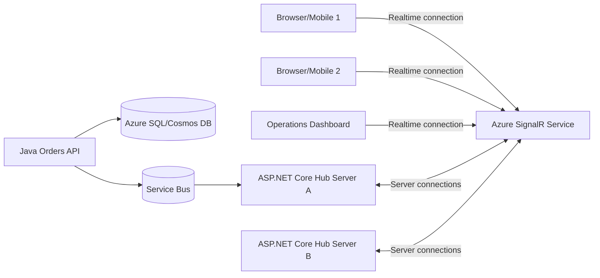
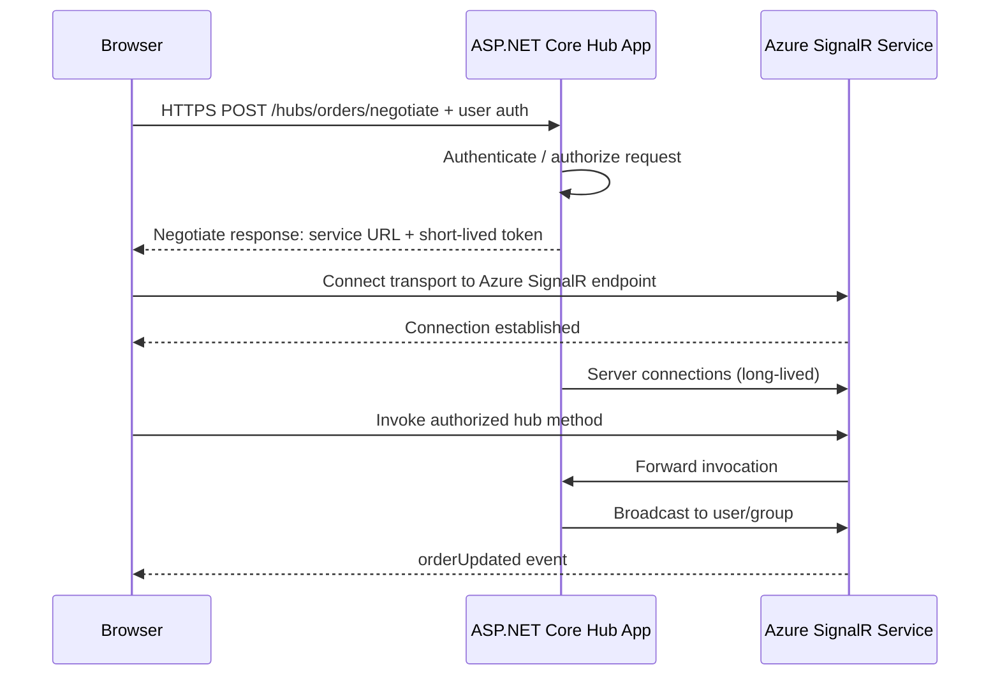
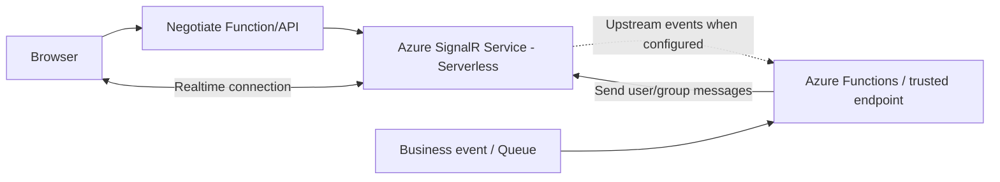
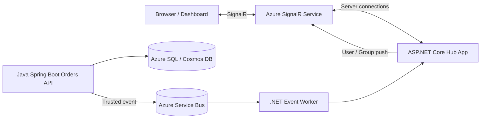
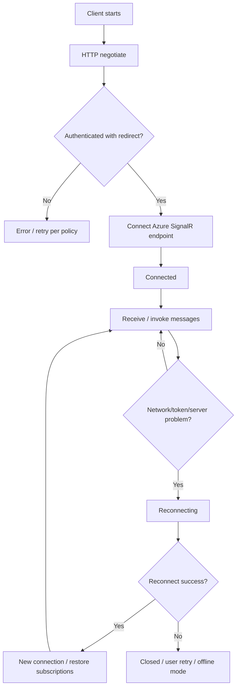
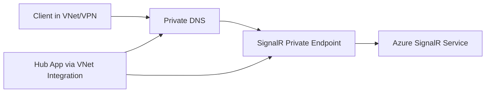
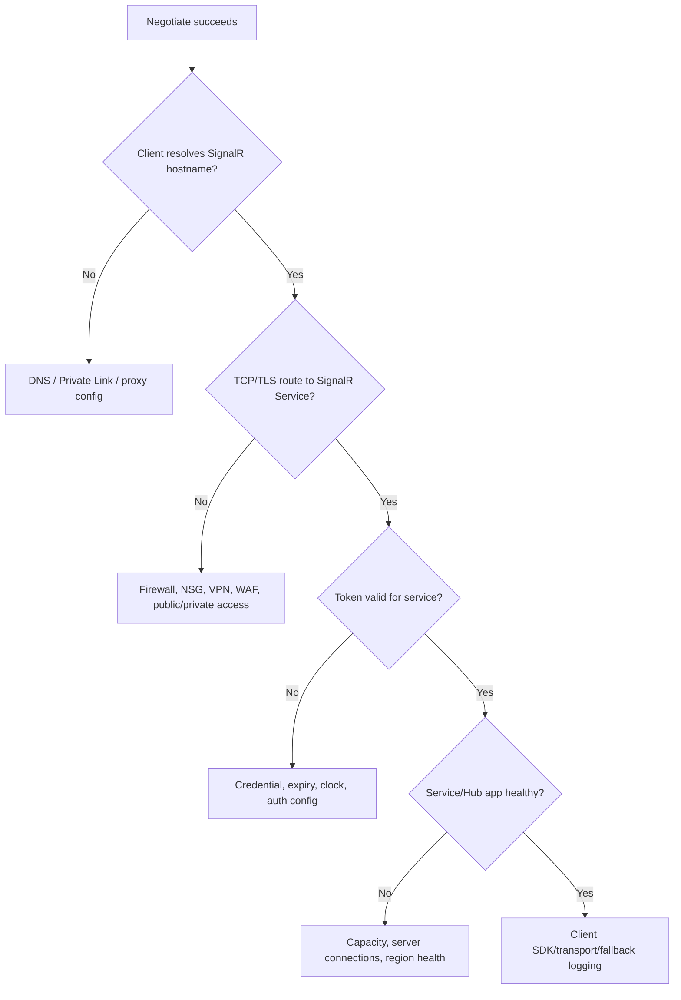

# Azure SignalR Service and Real-time Connection Management

An e-commerce system sends a "Order has been packed" notification the moment warehouse processing finishes. Users viewing the web app should see the updated status **without reloading the page or polling an API every few seconds**. Another system runs an operations dashboard for thousands of staff members that needs near-real-time updates on pending order counts. Managing tens of thousands of WebSocket connections across multiple app servers directly forces the engineering team to solve scale-out, dropped connections, cross-instance message fan-out, and latency monitoring.

**Azure SignalR Service** is a managed Azure service supporting real-time connections built on **ASP.NET Core SignalR** and client/server capabilities per service mode. It offloads most of the burden of maintaining client connections onto Azure-operated infrastructure. The application remains responsible for **user authentication, authorization, business data, notification design, reconnect handling, and business outcome correctness**.

This lesson belongs to the **Caching and Real-time Communication** chapter of the **CLOUD_PROVIDERS_AZURE** module. It connects Azure subscriptions, resource groups, Microsoft Entra ID, VNet/Private Endpoints, App Service, Azure Functions, Service Bus, data stores, monitoring, and cost control. Although grouped in the same chapter as caching, **SignalR Service is not a database or durable cache**: real-time notifications should always be backed by an authoritative state store such as Azure SQL, Cosmos DB, or Storage.

> **Scope:** This lesson focuses on **Azure SignalR Service**, which is distinct from **Azure Web PubSub**. Examples use an ASP.NET Core SignalR hub server and illustrate a **Java/Spring Boot** app emitting events over Service Bus to a .NET bridge that dispatches notifications. Capabilities, SDKs, service modes, tiers, connection limits, and networking vary by version and region; verify current configurations before deploying to production. No Azure resources were created or executed during the authoring of this lesson.

## Learning objectives

After this lesson, you will be able to:

1. Distinguish polling, Server-Sent Events, WebSockets, and SignalR in a real-time application.
2. Trace the path **negotiate → client connects to service → hub server → send notification**.
3. Contrast **Default**, **Serverless**, and **Classic** service modes along with each model's limitations.
4. Distinguish **connection**, **user**, **group**, **hub**, and **server connection**, and manage their lifecycles.
5. Configure an ASP.NET Core hub using Azure SignalR Service and a JavaScript client with reconnect logic.
6. Build the pattern **Java business service → Service Bus → .NET notification bridge → SignalR clients**.
7. Understand JWT authentication, Microsoft Entra ID, group join authorization, identity mapping, and token protection.
8. Design presence, state synchronization, duplicate/out-of-order handling, and recognize reliability limits.
9. Evaluate Private Endpoints, DNS, and network paths for both clients and app servers.
10. Monitor concurrent connections, message delivery, server connections, latency, errors, and cost.
11. Write runbooks for negotiate 401 errors, failed connections, missed events, and reconnect storms.
12. Design an order dashboard with real-time updates that preserves business correctness.

## 1. Why real-time instead of polling?

Suppose 10,000 browsers keep an order-status page open simultaneously. If each client polls a REST API every 2 seconds, the system absorbs roughly **5,000 HTTP requests/second**, even when only a tiny fraction of orders actually changed.

| Mechanism | How it works | When it fits | Trade-offs |
|---|---|---|---|
| **Short polling** | Client queries API periodically | Small apps, low change frequency | Wasted requests or update lag |
| **Long polling** | Server holds request until data or timeout, then client re-requests | Fallback when other transports fail | Repeated HTTP round-trips, proxy timeouts |
| **Server-Sent Events (SSE)** | Server → client channel over HTTP | One-way notifications | Does not replace full bidirectional messaging |
| **WebSocket** | Long-lived bidirectional connection | Chat, dashboards, collaboration | Requires connection lifecycle, scale, auth, reconnect |
| **ASP.NET Core SignalR** | Real-time abstraction with hubs and transport negotiation | Apps needing groups, users, and hub methods | Tied to SignalR ecosystem and hub semantics |
| **Azure SignalR Service** | Managed service for SignalR connectivity and scale-out | High connection counts, multiple app servers | Adds another service, network/auth/cost, and operational boundaries |

SignalR selects WebSockets or fallback transports depending on client, server, and proxy support. **Never assume every client always uses WebSockets.** Azure SignalR Service manages connections at scale, yet does not replace security or data architecture.

## 2. What Azure SignalR Service is—and is not

**Azure SignalR Service** provides the managed connection layer between clients and a SignalR application. In **Default mode**, the service maintains client connections and relays messages/hub invocations between clients and **hub servers**. App servers maintain **server connections** to the service.



**What the service handles well:** real-time connections, message routing, offloading socket management from app servers, SignalR user/group routing, and scaling service units per tier capabilities.

**What the service does not do for you:**

- Persistently store every notification like a message broker.
- Guarantee offline users automatically receive missed messages upon reconnecting.
- Execute Java business logic, SQL transactions, or order-read authorization checks.
- Maintain a business-accurate presence table on its own.
- Provide a REST API for order history or data caching.
- Protect your app if the server grants tokens or group access to the wrong user.
- Guarantee end-to-end exactly-once delivery from database to browser.

### Distinguishing caching from real-time messaging

A **cache** stores data for fast reads over time; a **SignalR connection** pushes notifications to currently connected clients. For a dashboard, a sound design is:

1. Client calls a REST API to fetch the latest state from the database/cache.
2. Client receives a SignalR event as a hint that something changed.
3. On arrival or reconnect, the client fetches/applies state updates by version.
4. Authoritative durable data stays in the designated system of record.

## 3. Core concepts: hub, connection, user, and group

| Concept | Meaning | Notes |
|---|---|---|
| **Hub** | Logical endpoint used by SignalR servers/clients to invoke methods and receive messages | An app may expose multiple hubs |
| **Client connection** | One transport connection session between a client and Azure SignalR Service | Has a connection ID that changes on reconnect |
| **Server connection** | Connection from an ASP.NET Core hub server to Azure SignalR Service in Default mode | Distinct from client connections; carries relayed traffic and control |
| **User identifier** | Logical key representing a user in SignalR | Must come from verified identity; avoid cross-tenant collisions |
| **Group** | Logical collection of connections for targeted broadcasts | Membership must be governed by authz and rebuilt on reconnect |
| **Hub method** | Server method callable by clients in the hub model | Must authorize callers, validate inputs, and bound side effects |
| **Negotiation endpoint** | HTTP endpoint used during connection setup | Returns redirect URL and short-lived credentials per service mode |
| **Connection token** | Short-lived credential allowing a client to connect to the service endpoint | Not the account access key; never log it |
| **Management plane / API** | Managing groups/users/connections or sending messages via SDK/REST | Requires dedicated auth and RBAC |

One user can be signed in across **web, mobile, and multiple browser tabs** at once. Sending to a user targets multiple connections mapped to that user. Conversely, one connection can belong to multiple groups.

### Groups are not access control lists

Never assume knowing a group name like `order:ORD-1001` entitles a user to join it. The server must verify the user's authorization for that order before adding the connection to the group. Never expose an unauthenticated/unchecked `JoinAnyGroup(string groupName)` hub method.

## 4. Negotiation and connection establishment flow

In **Default mode** with ASP.NET Core SignalR and Azure SignalR Service, the client typically starts with an HTTP negotiate call to the **hub server app**. The client is then redirected to the Azure SignalR Service endpoint with a short-lived credential issued by the server/service.



Conceptual diagram; exact byte-level frames and handshake steps vary across SDK versions.

### Why shouldn't clients connect directly with the service key?

An account key or connection string carries broad authority to manage the service or mint tokens. **Never embed service connection strings in browsers or mobile apps.** Clients need only short-lived tokens minted via a trusted negotiate endpoint per service mode.

### Both sides must be secured

- **Client → hub negotiate:** app auth (Microsoft Entra ID/JWT/cookie), TLS, CORS/origin rules, and rate limits.
- **Client → Azure SignalR endpoint:** valid token, network/TLS reachability to the service.
- **Hub servers → Azure SignalR Service:** connection credentials or managed identity per capability.
- **Hub/app → database, queue:** workload identity and data-plane RBAC.

A successful negotiate call does not guarantee the client can connect: the client still must resolve DNS and route to the **Azure SignalR Service endpoint**, not merely the App Service hostname.

## 5. Default mode: servers hosting hubs and app logic

**Default mode** is the standard choice for **ASP.NET Core SignalR** applications running persistent hub servers.

- Hub servers run on App Service, containers, or AKS/VMs per supported patterns.
- Azure SignalR Service holds client connections and proxies traffic to hub servers.
- Hub methods, authentication, group authorization, and event handling live on app servers.
- App servers can scale out while the service routes messages to the right connections/groups.
- Monitor **server connections** and hub server health; if all hub servers go down, hub-driven interactions stall.

### When to use Default mode

- Existing ASP.NET Core SignalR hubs.
- Hub methods and lifecycle hooks run in app code.
- Requires ASP.NET Core authentication/authorization and DI.
- Needs broadcasts from `IHubContext`, background workers, or .NET services.
- Team can operate hub app servers to meet SLOs.

### Mistakes to avoid

- Never store business-critical connection state solely in a **static dictionary** inside one hub server: scale-out and failovers cause drift.
- Never treat a hub class as a stateful singleton; hub instances are transient.
- Never let arbitrary clients send notifications impersonating another user.
- Never treat in-RAM messages as a substitute for event queues or databases.
- Never assume server connections stay healthy automatically if hub apps crash or lose network.

## 6. Serverless mode: no persistent hub servers

In **Serverless mode**, the application typically **does not deploy persistent ASP.NET Core hub servers maintaining server connections** like Default mode. A trusted service (such as Azure Functions using supported bindings/SDKs) handles negotiation and pushes messages via management APIs or bindings.



### When does it fit?

- Application primarily **pushes notifications** to clients.
- Already using Azure Functions or an event-driven backend.
- Prefer not to operate dedicated ASP.NET Core hub servers just to hold connections.
- Serverless negotiation and upstream event webhooks match supported capabilities.

### Limitations to understand

- No persistent C# hub server executing Hub methods as in Default mode.
- Bindings/SDKs and **client invocation / upstream event** support depend on runtime, language, and extension version.
- Still requires a trusted backend to authorize users and issue connection info/tokens.
- Group/user logic, delivery tracking, and authentication do not vanish automatically.
- If using Java Azure Functions, **verify SignalR binding language support for that exact Functions runtime**; never copy .NET/JavaScript annotations assuming Java supports identical bindings.

**Pseudocode (not directly runnable Functions code):**

```text
POST /realtime/negotiate
  -> authenticate user
  -> generate SignalR connection info for authorized user

Business event arrives at Azure Function
  -> validate source, schema and recipient
  -> send SignalR message to authorized user/group

Browser connects to service URL with token
  -> receive message
  -> refetch authoritative state when necessary
```

## 7. Classic mode and selecting a mode for new apps

Some legacy resources/deployments run **Classic mode**, provided for backwards compatibility. Its behavior depends on how app servers or serverless endpoints connect, and it is not the default choice for new designs.

| Service mode | Hub server | Strengths | Notes |
|---|---|---|---|
| **Default** | ASP.NET Core hub servers | Full hubs, methods, groups, and scale-out | Requires healthy server connections and hub apps |
| **Serverless** | No persistent hub-server model | Push via Functions/REST/management APIs | Negotiate/upstream flows and SDKs differ from Default |
| **Classic** | Legacy compatibility mode | Supports specific older applications | Never pick assuming "best automatic mode"; check docs/capabilities |

### Never switch modes casually in production

Changing service mode alters negotiation, upstream events, and hub server connectivity, breaking live clients. Test on a staging instance, verify compatibility, and plan migration and rollback carefully.

## 8. How does Azure SignalR Service differ from Azure Web PubSub?

**Azure Web PubSub** is a separate Azure service for building real-time applications over raw **WebSockets / pub-sub** with its own protocols and APIs.

| Perspective | Azure SignalR Service | Azure Web PubSub |
|---|---|---|
| Primary model | SignalR clients/hubs and Azure SignalR protocol/integration | WebSocket/pub-sub with native protocol/service API |
| ASP.NET Core SignalR | Direct integration via hub server SDK | Cannot replace a SignalR Hub simply by changing URLs |
| Java systems | Usually integrates via trusted bridge/REST per support matrix | Often fits well if Java needs direct WebSocket/pub-sub |
| User/connection groups | SignalR user/group semantics | Service-native group/pub-sub semantics |
| Client SDK | Supported SignalR clients per language/platform | Supported Web PubSub clients/SDKs |
| Migration | Requires aligning service mode, negotiate, hub contract | Likely requires changing protocol, auth, and client library |

**Do not confuse the two services as drop-in replacements.** If your organization chooses Azure SignalR Service, client and hub contracts follow SignalR. If a pure Java system wants direct WebSockets using its own subprotocols, evaluate Azure Web PubSub separately before deciding.

## 9. Real-world architecture: Java business backend + .NET SignalR hub

A Spring Boot API processes orders, writes to the database, and emits a **business event** to Service Bus. An **ASP.NET Core notification bridge** consumes the event and pushes updates via `IHubContext` to SignalR Service.



In real deployments, the **.NET Event Worker can run inside the same process as the Hub App** and inject `IHubContext` directly; the arrow between Worker and Hub represents logical collaboration rather than requiring a separate HTTP hop.

### Why put Service Bus in between?

- Java business logic avoids coupling directly to live WebSocket lifecycles.
- Events sit durably in the broker until processed under configured settlement, TTL, and DLQ policies.
- If hub servers restart or fail temporarily, the worker retries and drains backlogs smoothly.
- Java and .NET deployments scale independently.
- Every event carries `eventId`, `orderId`, and `tenantId` for correlation.

### Reliability boundaries

When the worker dispatches a notification to SignalR and **completes the Service Bus message**, that **does not prove the browser received or rendered it**. Offline clients will miss it. Therefore the backend must persist order state so browsers fetch snapshots after reconnecting. If notification history and read receipts are required, build a durable **notification inbox** tracking read state.

## 10. Preparing the ASP.NET Core Hub App

The illustrative example uses **ASP.NET Core** with the SignalR Service package (typically `Microsoft.Azure.SignalR`), ASP.NET Core JWT Bearer Authentication, and configuration matching your .NET version.

### Required setup

- An Azure SignalR Service instance in **Default mode**.
- Trusted hub app with outbound connectivity to SignalR Service.
- A hub route, such as `/hubs/orders`.
- Client authentication config (Microsoft Entra ID/JWT or an approved provider).
- Hub-to-SignalR credentials, such as `Azure:SignalR:ConnectionString` in a lab; prefer managed identity / secret stores in production where supported by service/SDK versions.
- App endpoint TLS and DNS.
- Hub server count and service units sized to SLOs.

### `appsettings` structure (without secrets)

```json
{
  "Azure": {
    "SignalR": {
      "ConnectionString": ""
    }
  },
  "Entra": {
    "TenantId": "<TENANT_ID>",
    "Audience": "<API_APPLICATION_ID_URI_OR_AUDIENCE>"
  }
}
```

**Never put real connection strings in source files.** On App Service, an environment setting like `Azure__SignalR__ConnectionString` maps to `Azure:SignalR:ConnectionString` via .NET configuration conventions; use Key Vault references, approved secret stores, or identity-based SDK configuration when supported by your service/SDK version.

### Authorization goal

Every connection needs a trustworthy identity. Never trust a client-supplied nickname as user identity when real accounts/tenants exist. With Microsoft Entra ID, claims like `tid` (tenant) and `oid` (object ID) construct a **unique per-tenant user key** after JWT validation.

## 11. ASP.NET Core `Program.cs`: authenticating and wiring SignalR

The snippet below illustrates a modern .NET host setup. It requires compatible .NET packages/versions, a configured identity provider, and Azure SignalR Service in Default mode.

```csharp
using Microsoft.AspNetCore.Authentication.JwtBearer;
using Microsoft.AspNetCore.SignalR;
using Microsoft.IdentityModel.Tokens;

var builder = WebApplication.CreateBuilder(args);

var tenant = builder.Configuration["Entra:TenantId"]
    ?? throw new InvalidOperationException("Missing Entra:TenantId");
var audience = builder.Configuration["Entra:Audience"]
    ?? throw new InvalidOperationException("Missing Entra:Audience");

builder.Services
    .AddAuthentication(JwtBearerDefaults.AuthenticationScheme)
    .AddJwtBearer(options =>
    {
        options.Authority =
            "https://login.microsoftonline.com/" + tenant + "/v2.0";
        options.Audience = audience;

        // Browser SignalR transports may pass the bearer token in a
        // query value for WebSockets/SSE. Restrict parsing to hub path.
        options.Events = new JwtBearerEvents
        {
            OnMessageReceived = context =>
            {
                var token =
                    context.Request.Query["access_token"].ToString();

                if (!string.IsNullOrWhiteSpace(token)
                    && context.HttpContext.Request.Path
                        .StartsWithSegments("/hubs/orders"))
                {
                    context.Token = token;
                }

                return Task.CompletedTask;
            }
        };
    });

builder.Services.AddAuthorization();

// Microsoft.Azure.SignalR integration for Default mode.
builder.Services.AddSignalR().AddAzureSignalR();

var app = builder.Build();

app.UseAuthentication();
app.UseAuthorization();
app.MapHub<OrdersHub>("/hubs/orders")
    .RequireAuthorization();

app.Run();
```

### Explanation

- `AddSignalR().AddAzureSignalR()` connects managed SignalR Service with ASP.NET Core hubs.
- `AddJwtBearer` demonstrates validating JWTs issued by Microsoft Entra ID.
- `RequireAuthorization()` enforces authentication before accessing the hub.
- Query-string `access_token` extraction is restricted strictly to the **hub path** where browser transports need it; suppress query-string logging so tokens never leak.
- `Authority` and `Audience` must match your Entra app registration; never reuse a frontend ID token as an API access token.
- In multi-tenant systems, enforce an **issuer/tenant allowlist and policy** rather than trusting an unvalidated `tid` claim.

**This is a learning skeleton**: you still need `OrdersHub`, business authorization, pinned dependency versions, and deployment config. Do not assume this snippet was compiled or run on Azure.

## 12. Hub: adding connections to groups from verified identity

This code prevents clients from picking arbitrary group names. After JWT validation, each connection joins a group scoped to its **user object ID within the tenant**.

```csharp
using Microsoft.AspNetCore.Authorization;
using Microsoft.AspNetCore.SignalR;

[Authorize]
public sealed class OrdersHub : Hub
{
    public static string UserGroup(string tenantId, string userObjectId)
        => "user:" + tenantId + ":" + userObjectId;

    public override async Task OnConnectedAsync()
    {
        var tenantId = Context.User?.FindFirst("tid")?.Value;
        var userObjectId = Context.User?.FindFirst("oid")?.Value;

        if (string.IsNullOrWhiteSpace(tenantId)
            || string.IsNullOrWhiteSpace(userObjectId))
        {
            Context.Abort();
            return;
        }

        await Groups.AddToGroupAsync(
            Context.ConnectionId,
            UserGroup(tenantId, userObjectId));

        await base.OnConnectedAsync();
    }
}
```

### Why must the server decide group membership?

If clients could invoke `JoinOrder("ORD-1001")`, a user might guess another customer's order ID. The example uses `tid` and `oid` from a **verified JWT**. When dispatching updates, backend services must look up the **true order owner** from the database or a trusted event.

### When per-order groups are needed

You can expose a hub method:

```text
SubscribeOrder(orderId)
  1. Authenticate caller
  2. Verify user/tenant permission to view orderId in database
  3. If unauthorized: reject
  4. If authorized: add Context.ConnectionId to group order:<tenant>:<order>
```

This is **pseudocode**, never deploy an unguarded method directly. If permissions are revoked mid-connection, **remove group membership or reauthorize** rather than treating initial group membership as permanent.

### Lifecycle

- `OnConnectedAsync` fires when a hub connection establishes under the runtime model.
- `OnDisconnectedAsync` may fire on disconnect; never treat it as guaranteed across hard crashes or network partitions.
- When a client reconnects with a new connection, application-managed group memberships must be **re-established**.
- `Context.ConnectionId` identifies one ephemeral connection session; never use it as a permanent user ID.

## 13. Sending notifications from .NET backend using `IHubContext`

Hubs are not singletons holding mutable state. Code outside the hub sends messages using dependency-injected `IHubContext<OrdersHub>`.

```csharp
using Microsoft.AspNetCore.SignalR;

public sealed record OrderUpdate(
    string EventId,
    string OrderId,
    string Status,
    long Version);

public sealed class OrderRealtimeNotifier
{
    private readonly IHubContext<OrdersHub> _hub;

    public OrderRealtimeNotifier(IHubContext<OrdersHub> hub)
    {
        _hub = hub;
    }

    public Task NotifyOwnerAsync(
        string tenantId,
        string userObjectId,
        OrderUpdate update,
        CancellationToken cancellationToken)
    {
        string group = OrdersHub.UserGroup(
            tenantId, userObjectId);

        return _hub.Clients.Group(group)
            .SendAsync("orderUpdated", update, cancellationToken);
    }
}
```

### Dispatching a notification is not a transaction

`SendAsync` performs the **send operation** toward SignalR infrastructure per library semantics. It does not prove every client rendered the message or record a "read receipt". If read confirmation is required, clients must send an explicit **business acknowledgment** stored via an authorized API/DB call.

### Keep payloads small and stable

Prefer sending:

```json
{
  "eventId": "evt-ORD-1001-v4",
  "orderId": "ORD-1001",
  "status": "PACKED",
  "version": 4
}
```

Never embed access tokens, SQL connection strings, full payment details, or large blobs in notifications. When the UI needs full details, call an authorized REST API by version.

## 14. Browser JavaScript: connecting, receiving events, and reconnecting

Using the `@microsoft/signalr` JavaScript package (version-matched to the backend), clients connect to the **app's hub route**, never minting keys to hit SignalR Service directly.

```javascript
import * as signalR from "@microsoft/signalr";

async function getAccessTokenForApi() {
  // Implement with MSAL or another approved auth flow.
  // Return an access token whose audience is the hub API.
  throw new Error("Configure a real token provider");
}

const connection = new signalR.HubConnectionBuilder()
  .withUrl("/hubs/orders", {
    accessTokenFactory: getAccessTokenForApi
  })
  .withAutomaticReconnect([0, 2000, 10000, 30000])
  .configureLogging(signalR.LogLevel.Warning)
  .build();

let lastVersionByOrder = new Map();

connection.on("orderUpdated", async update => {
  const current = lastVersionByOrder.get(update.orderId) ?? -1;
  if (update.version <= current) {
    return; // Duplicate or stale event; not authoritative state.
  }

  lastVersionByOrder.set(update.orderId, update.version);

  // Fetch authoritative state if security/accuracy require it.
  // const order = await fetchAuthorizedOrder(update.orderId);
  console.log("Order changed", update.orderId, update.status);
});

connection.onreconnecting(error => {
  console.warn("SignalR disconnected", error?.message);
  // UI should display reconnecting/offline status.
});

connection.onreconnected(async newConnectionId => {
  console.info("SignalR reconnected", newConnectionId);

  // Reconcile real order data from a secured REST endpoint.
  // await refreshCurrentOrders();
});

connection.onclose(error => {
  console.error("SignalR connection closed", error?.message);
  // Consider bounded initial/new connection retry or user action.
});

async function start() {
  try {
    await connection.start();
    console.info("Realtime connection established");
  } catch (error) {
    console.error("Initial connection failed", error);
    // withAutomaticReconnect does NOT retry initial start().
    // Implement bounded retry/backoff or show reconnect button.
  }
}

start();
```

### Production notes

- `getAccessTokenForApi` is intentionally left unimplemented to **avoid fake tokens**.
- Use a secure token provider that refreshes expired tokens automatically.
- `withAutomaticReconnect` only retries **after an active connection drops**, not on initial `start()`; handle initial connection failures separately.
- UI handlers must tolerate duplicate and out-of-order events.
- On reconnect, fetch fresh snapshots and re-establish app-managed subscriptions/group memberships if required.
- Never log tokens or credential-bearing negotiation redirect URLs.
- Behind a reverse proxy, verify routing, CORS, and HTTPS for negotiation.

## 15. A Java backend is not an ASP.NET Core SignalR hub server

A **Java/Spring Boot** app can emit business events and integrate with real-time pipelines, yet you cannot turn a Java `@RestController` into an **ASP.NET Core SignalR Hub** just by pointing it at Azure SignalR Service.

Architectural options:

1. **Java API → Service Bus → .NET Hub/Worker bridge**: decouples business logic from WebSocket management when running a small .NET service is feasible.
2. **Java API → trusted backend → SignalR Service management SDK/REST** when API/language support, auth, and service mode are verified.
3. **Java API → Azure Functions/Logic Apps → Serverless mode** when bindings, runtime, and upstream semantics align.
4. If Java needs direct WebSocket/pub-sub without SignalR hub contracts, evaluate **Azure Web PubSub** separately.

### Are Java SignalR clients supported?

ASP.NET Core SignalR provides client SDKs for several non-.NET platforms, including Java/Android within supported ecosystems. However, **a Java client is not a Java server hub**; verify SDK APIs and behavior for your exact version and environment (server JVM, Android, WebSocket transports).

### Never emit notifications from uncommitted transactions

If Java creates an order and emits a real-time event **before database commit**, the browser may see the update while the database still lacks the row. Use a **transactional outbox** or guaranteed post-commit publish flow so crashes between steps never lose events.

## 16. Java publishing business events to Azure Service Bus

This Java snippet shows a reliable event producer: sending from a Spring Boot/Java backend after business state has been durably persisted via an outbox/integration pattern. It uses Microsoft Entra identity rather than hardcoded connection strings.

### Maven dependencies (excerpt)

```xml
<dependencies>
  <dependency>
    <groupId>com.azure</groupId>
    <artifactId>azure-messaging-servicebus</artifactId>
    <version><!-- Pin a compatible version --></version>
  </dependency>
  <dependency>
    <groupId>com.azure</groupId>
    <artifactId>azure-identity</artifactId>
    <version><!-- Pin a compatible version --></version>
  </dependency>
</dependencies>
```

`version` placeholders must be pinned in real projects; add a JSON serialization library (e.g., Jackson) instead of building strings manually.

### Illustrative code

```java
package vn.example.orders;

import com.azure.identity.DefaultAzureCredentialBuilder;
import com.azure.messaging.servicebus.ServiceBusClientBuilder;
import com.azure.messaging.servicebus.ServiceBusMessage;
import com.azure.messaging.servicebus.ServiceBusSenderClient;

public final class OrderEventPublisher {

    private OrderEventPublisher() { }

    public static void publish(
            String eventId,
            String tenantId,
            String recipientObjectId,
            String orderId,
            String status) {

        String namespace = System.getenv("SERVICE_BUS_NAMESPACE");
        if (namespace == null || namespace.isBlank()) {
            throw new IllegalStateException(
                "SERVICE_BUS_NAMESPACE is required");
        }

        // Example input is trusted business data. Production:
        // serialize JSON with a real library and validate each field.
        String payload = String.format(
            "{\"eventId\":\"%s\",\"tenantId\":\"%s\","
            + "\"recipientObjectId\":\"%s\","
            + "\"orderId\":\"%s\",\"status\":\"%s\"}",
            eventId, tenantId, recipientObjectId, orderId, status);

        try (ServiceBusSenderClient sender =
                new ServiceBusClientBuilder()
                    .credential(
                        namespace,
                        new DefaultAzureCredentialBuilder().build())
                    .sender()
                    .queueName("order-notifications")
                    .buildClient()) {

            sender.sendMessage(
                new ServiceBusMessage(payload)
                    .setMessageId(eventId));
        }
    }
}
```

**Intentional simplification:** `String.format` here assumes trusted lab values, not arbitrary untrusted data. Production must use Jackson or equivalent, validate schemas, avoid string-escaping/injection flaws, and never accept `tenantId`/`recipientObjectId` directly from untrusted clients.

### Prerequisites

- `SERVICE_BUS_NAMESPACE` is a fully qualified namespace like `orders-bus.servicebus.windows.net`.
- Workload identity holds **Azure Service Bus Data Sender** or equivalent data-plane permissions on the queue/namespace.
- Queue `order-notifications` exists; never target production namespaces/queues in a lab.
- Network path to Service Bus is valid.
- Events are published **after transaction commit**, ideally via an outbox/relay so app crashes never drop events.
- In production, reuse sender/client instances per SDK lifecycle guidance rather than opening and closing a client per event.

## 17. .NET bridge consuming Service Bus events and pushing via SignalR

A `BackgroundService` hosted alongside `OrdersHub` reads committed events from the queue and invokes `IHubContext<OrdersHub>` to notify the target user.

### Recommended processing flow

```text
Receive Service Bus message
  -> parse and validate event schema
  -> verify business source / recipient tenant-user
  -> query DB or verified business state if needed
  -> call IHubContext.Clients.Group(...)
  -> record SignalR dispatch outcome
  -> complete message
```

### Illustrative C# bridge code

```csharp
using System.Text.Json;
using Azure.Messaging.ServiceBus;
using Microsoft.AspNetCore.SignalR;

public sealed record OrderEvent(
    string EventId,
    string TenantId,
    string RecipientObjectId,
    string OrderId,
    string Status,
    long Version);

public sealed class OrderNotificationWorker : BackgroundService
{
    private readonly ServiceBusClient _bus;
    private readonly IHubContext<OrdersHub> _hub;
    private readonly ILogger<OrderNotificationWorker> _log;

    public OrderNotificationWorker(
        ServiceBusClient bus,
        IHubContext<OrdersHub> hub,
        ILogger<OrderNotificationWorker> log)
    {
        _bus = bus;
        _hub = hub;
        _log = log;
    }

    protected override async Task ExecuteAsync(
        CancellationToken stoppingToken)
    {
        await using var processor = _bus.CreateProcessor(
            "order-notifications",
            new ServiceBusProcessorOptions
            {
                AutoCompleteMessages = false,
                MaxConcurrentCalls = 4
            });

        processor.ProcessMessageAsync += async args =>
        {
            OrderEvent? e = JsonSerializer.Deserialize<OrderEvent>(
                args.Message.Body.ToString());

            if (e == null || string.IsNullOrWhiteSpace(e.EventId))
            {
                await args.DeadLetterMessageAsync(
                    args.Message,
                    "InvalidEvent",
                    "Missing required fields",
                    args.CancellationToken);
                return;
            }

            // Production: validate source, tenant/user ownership,
            // schema and event version against trusted business state.
            await _hub.Clients.Group(OrdersHub.UserGroup(
                    e.TenantId, e.RecipientObjectId))
                .SendAsync(
                    "orderUpdated",
                    new OrderUpdate(
                        e.EventId, e.OrderId, e.Status, e.Version),
                    args.CancellationToken);

            await args.CompleteMessageAsync(
                args.Message, args.CancellationToken);
        };

        processor.ProcessErrorAsync += args =>
        {
            _log.LogError(args.Exception,
                "Service Bus notification processing error");
            return Task.CompletedTask;
        };

        await processor.StartProcessingAsync(stoppingToken);
        try
        {
            await Task.Delay(
                Timeout.InfiniteTimeSpan, stoppingToken);
        }
        catch (OperationCanceledException)
            when (stoppingToken.IsCancellationRequested)
        {
        }
        finally
        {
            await processor.StopProcessingAsync(
                CancellationToken.None);
        }
    }
}
```

To run this, the app must register `ServiceBusClient` with the namespace and `TokenCredential`, register `OrderNotificationWorker` via `AddHostedService`, reference `Azure.Messaging.ServiceBus` and `Azure.Identity`, and hold the **Azure Service Bus Data Receiver** role. This snippet omits full DI/configuration setup, schema validation, and outbox handling.

### One crucial reliability point

A successful `SendAsync` **does not mean the client received and displayed the event**, because the user could be offline or disconnected mid-flight. If guaranteed user delivery is needed, persist an inbox/event feed and replay via REST API after reconnect.

### If the worker fails

- Never complete the Service Bus message before fulfilling the broker/hub bridge contract.
- Configure bounded retries, DLQs, and alerts.
- Include an `EventId` so backend/clients can deduplicate.
- If the backend sends a message, misses confirmation, and the worker retries, the browser can receive **duplicate events**.
- For critical events, never treat a successful broadcast as a substitute for database updates.

## 18. Targeting all clients, specific users, and groups

Common SignalR targets:

| Target | Example | Use case |
|---|---|---|
| **All clients** | Public system announcement | Public dashboards, non-sensitive maintenance banners |
| **Specific connection** | Single connection ID | Transient channel reply; connection may disappear |
| **User** | One authenticated user ID | Notify all active devices for a user per mapping |
| **Group** | `tenant:<id>` or `order:<id>` | Broadcast to authorized group members |
| **All except some** | Exclude originating connection | Avoid echoing back to sender clients when API supports |

In Default mode, `IHubContext`/Hub Clients expose these options via SignalR APIs. In Serverless mode, management APIs/output bindings have distinct capabilities; verify for your mode and SDK.

### Never broadcast to a whole tenant when an event belongs to one user

Invoices and payments can contain sensitive details. Sending to `tenant:acme` exposes metadata to every connection in that tenant. Scope cleanly to `user:<tenant>:<oid>` or `order:<tenant>:<id>` with policy-aligned authorization.

### Are group names secret?

No. Group names are not credentials. Security rests on **server-side authorization** and controlled group membership. Never rely on unguessable group names as a data-protection mechanism.

## 19. Lifecycle of a SignalR connection

A connection moves through logical states:



### Reality is rarely tidy

- Sleeping browser tabs or dropped mobile networks may not fire disconnect immediately.
- Server and client can detect drops at different times.
- A client may receive a **new connection ID** upon reconnecting.
- One user holds multiple connections; closing one tab does not mean the user went offline.
- Hub server restarts are not identical to SignalR Service outages.
- While disconnected, clients can miss emitted messages.

**Presence** and business state must tolerate **eventual observations**—never treat a single disconnect callback as absolute proof a user left.

## 20. Presence: who is online?

Answering "Is the user currently online?" is harder than counting connection IDs.

### Simple model

```text
Presence key: tenantId + userObjectId
Observed connections: conn-A, conn-B, conn-C
LastHeartbeatUtc: 2026-11-20T09:15:00Z
Status: probably-online
```

This is illustrative data, not a mandatory built-in SignalR API.

### Sources of drift

- One user opens multiple tabs or devices.
- Client loses network before the server detects it.
- Hub server crashes before executing its disconnect handler.
- Reconnect generates a new ID while the old key lingers.
- Clock skew across machines.
- App scale-out blinds process-local dictionaries.

### Production design

- Use service/SDK presence APIs if they fit requirements and are supported.
- When business presence is needed, use a distributed store like a Redis-compatible cache or database with TTLs/leases.
- Pair heartbeats/last-seen timestamps with expiration instead of trusting disconnect callbacks blindly.
- Define "online" as a **time-windowed observation**, not proof someone is actively looking at the screen.
- Avoid storing sensitive personal/location/activity telemetry in presence stores unnecessarily.
- Separate UI presence display from security authorization.

### Never drive payments from presence

A user going offline must never roll back a committed transaction. Payment and order workflows continue independently through databases, queues, and orchestrators.

## 21. Reconnect, resubscribe, and state resynchronization

**Automatic reconnect** smooths UI disruptions, yet **does not replay missed messages**. Build a recovery sequence:

1. Client detects disconnect and displays a "reconnecting" indicator.
2. Client reconnects with a valid or refreshed token.
3. Hub/service establishes a new connection per flow.
4. Backend re-verifies identity and re-attaches authorized groups.
5. Client calls **GET snapshot** or `/orders?sinceVersion=...` if supported to catch up.
6. Client applies state by version, discarding duplicate/out-of-order events.
7. Telemetry records reconnect and error metrics.

### `EventId` vs `version`

Two fields with distinct jobs:

- `eventId`: identifies a specific notification/event for deduplication and correlation.
- `version`: monotonic update sequence for an order/item, preventing stale regressions.

```text
Order ORD-1001:
  Event v5: PACKED
  Event v4: PAID arrives later
  UI rule: do not replace v5 by v4
```

Note: versions must be **generated consistently by the backend**, never incremented independently by browsers. If multi-region concurrent writes prevent linear versions, design a deterministic state machine or merge policy around real data.

### Durable records

If notifications carry legal mandates or require read confirmation, persist a **notification inbox** with ID, recipient, timestamps, unread/read flags, and TTL/retention—and use SignalR merely as the **"new message available"** ping.

## 22. Do messages guarantee ordering and exactly-once delivery?

**Never build business correctness on the assumption that SignalR guarantees end-to-end exactly-once, durable delivery, and global ordering.**

Over a healthy single connection, libraries/transports preserve partial order; however, once you introduce:

- Multiple producers or worker instances,
- Service Bus / HTTP retries,
- Client reconnects,
- Routing across multiple groups/connections,
- Multiple Azure regions or replicated databases,

**global business ordering** cannot be inferred from SignalR callback arrival order.

### Patterns to apply

- **Idempotent event handlers:** processing the same event ID repeatedly produces the same state.
- **Monotonic business versions:** apply state updates conditionally by version.
- **Snapshot synchronization:** re-fetch DB state after reconnects.
- **Transactional outbox:** emit events only after state commits.
- **Poison/DLQ:** isolate malformed messages after retry budgets exhaust.
- **Backpressure:** coalesce or debounce high-frequency updates for the same entity.
- **Client acknowledgments** if application-level read/delivery receipts are required.

### Example of a missed event

1. Worker sends "Order delivered".
2. Browser is offline.
3. SignalR does not buffer messages indefinitely for offline browsers.
4. When the user reopens the app, the REST API returns the delivered status.

This is **expected behavior** when the database is the source of truth; the system need not replay every historical WebSocket frame to reconstruct state.

## 23. User authentication and authorization

Real-time channels do not relax authN/authZ requirements.

### Client-side setup

Clients sign in via Microsoft Entra ID or an approved identity provider, acquiring an **access token** scoped for the hub app/backend. The token travels on the negotiate request. The server validates signature, issuer, audience, expiry, and policy.

### Hub-side setup

- Hub route requires authentication.
- Group/user mappings derive strictly from **validated claims**.
- Clients may invoke only server-approved hub methods.
- Parameters such as `orderId` require explicit authorization checks.
- Handle mid-session permission revocations (remove from group, disconnect, or reauthorize).
- Never trust a client-supplied `tenantId` when a tenant claim exists in the JWT.

### Tokens to SignalR Service

The token issued by a trusted service for connecting to Azure SignalR Service is a **bearer credential** while valid. Protect it from logs, analytics, URL sharing, and untrusted browser extensions. If connections stay open long, understand **token lifetime / connection re-authentication behavior** on expiry, reconnect, and revocation.

### CORS/origin is not authorization

CORS restricts certain browser-origin requests; native clients and scripts ignore CORS completely. **Never use CORS as a user authentication mechanism.**

## 24. Server-to-service authentication and secret management

App servers and trusted serverless endpoints must authenticate to Azure SignalR Service.

### Options

- **Connection string / access key**: convenient for labs; keys must be secured and rotated.
- **Microsoft Entra ID / managed identity**: preferred with Azure RBAC when supported by SDK, service mode, and tier.
- **Key Vault references / named secret stores**: keep secrets out of source code and CI logs.

### Shared responsibility

| Layer | Responsibility |
|---|---|
| Azure control plane | Who can create/delete the service, scale units, and edit network rules |
| SignalR data plane | Who can open server connections, negotiate, send, and manage connections |
| Hub application | User identity, authorization, groups, and messages |
| Java event producer | Service Bus send permissions and event source integrity |
| Notification bridge | Service Bus receive permissions and Azure SignalR access |
| Client | Never receives service keys; guards its own access tokens |

**Being Owner of a resource group does not automatically let a browser user read every message.** Control-plane RBAC and application-level authorization are distinct boundaries.

### Secrets in configuration

- Never commit `Azure:SignalR:ConnectionString` or Service Bus connection strings.
- Never embed credentials in JavaScript.
- Never log `Authorization` headers or full negotiate responses.
- Never reuse unrotated keys across dev and prod.
- Use least-privilege Azure RBAC / managed identities where supported.
- When rotating keys, assess impact on active server connections and live client tokens.

## 25. Private Endpoint and private networking for Azure SignalR Service

For strict security requirements, Azure SignalR Service supports **Private Endpoint / Private Link** depending on SKU and features. This affects **network paths for both clients and hub servers**, not just the backend.



### Paths to verify

1. Browser/mobile clients can reach the app server's **negotiate endpoint**.
2. Browser/mobile clients can reach the **service endpoint** after redirect.
3. Hub servers have outbound connectivity to Azure SignalR Service to maintain server connections.
4. DNS from **every client type** and every app deployment resolves the endpoint properly.
5. Firewalls/NSGs/routes/VPNs permit paths to the Private Endpoint as designed.
6. Backends retain proper Microsoft Entra / credential permissions.

### A common design mistake

A web app exposes a public HTTPS endpoint on App Service. Public Internet browsers call negotiate successfully, yet Azure SignalR Service is configured **private-only**. After redirect, browsers have no route to the private endpoint and **real-time connections fail**.

**Private Endpoint is not a public reverse proxy** for arbitrary Internet users. If external Internet users need access, design public/private endpoints against your threat model—never disable private restrictions for a quick demo and forget to restore them.

### DNS

The Private DNS zone typically associated with Azure SignalR Service Private Link is:

```text
privatelink.service.signalr.net
```

Verify exact hostnames and records from the **Private Endpoint DNS zone group / Portal of your real resource**. Never hardcode private IPs or guess endpoint URLs from service names. With custom DNS, configure forwarding and zone links so apps and clients across networks resolve properly.

## 26. App Service, AKS, network egress, and WebSockets

### Default-mode hub servers on App Service

- App Service outbound traffic must reach Azure SignalR Service on supported endpoints/ports and networking modes.
- With a SignalR Private Endpoint, App Service requires **VNet Integration** and matching routes/DNS.
- An App Service **inbound Private Endpoint** is separate from outbound connectivity to SignalR Service.
- Scaling out app servers does not bypass server-connection or configuration requirements.
- Monitor client lifecycle and recovery during hub server deploys and restarts.

### Hub servers on AKS

- Pods need outbound access to SignalR Service via NAT, Private Endpoints, and network policies.
- Check in-pod DNS, CoreDNS, NSGs, Azure Firewall, and SNAT/egress capacity.
- Hub app ingress must route `/negotiate` cleanly and preserve user auth headers.
- Pod replica counts and CPU/memory govern server-side event throughput.
- Never confuse Kubernetes `Service type=LoadBalancer` with the Azure SignalR Service resource.

### Browsers and proxies

Corporate proxies, WAFs, or client networks may block WebSockets. When fallback transports are enabled, verify HTTP transport routes, timeouts, and CORS. When fronting negotiate with APIM, Front Door, or Application Gateway, ensure headers, paths, and auth pass intact without breaking protocol negotiation.

**Clients contact two potentially different hostnames**: the app's negotiate endpoint and Azure SignalR Service. Allowlisting only the app hostname fails if the service endpoint is blocked.

## 27. Service units, concurrent connections, and scaling

SignalR Service capacity depends on **tier/SKU, units, quotas, and service limits** at deployment time. When planning capacity, account for:

- Peak **concurrent client connections**.
- **Server connections** from hub apps/instances to the service.
- Messages/second, payload size, and fan-out factor.
- Reconnect/negotiate frequency, session length, and traffic bursts.
- Number of groups/users and broadcast patterns.
- Application CPU/IO, database dependencies, and queue throughput.
- Network egress and WebSocket compatibility.
- SLA/availability targets and Azure resource limits.

### Load estimation example

Suppose 20,000 clients are online and every 10 seconds, 2,000 clients receive a 1 KiB message. That **hypothetical workload** excludes protocol framing, reconnect churn, and fan-out multipliers.

One workload hits **connection** limits while another hits **message fan-out** or app-server CPU limits. Never choose service units solely from concurrent user counts.

### Scaling does not fix every bottleneck

- Adding service units expands managed SignalR layer capacity per tier limits.
- Adding App Service instances scales hub code, auth, and event processing.
- Adding Service Bus consumers scales the event bridge.
- Databases, Redis, or downstream backends can still bottleneck.
- Excessive `Clients.All` broadcasts can overwhelm browsers even while the service is healthy.

### When to coalesce notifications

A dashboard receiving 100 counter updates/second does not need to push 100 frames/second to every browser. Instead:

1. Update durable state continuously.
2. Aggregate/snapshot every few hundred milliseconds per SLO.
3. Push a single "counter changed" notification to the relevant group.
4. Browser fetches the fresh version or applies the latest valid payload.

## 28. Connection lifetimes, heartbeats, and tokens

Real-time connections outlive single HTTP requests. Monitor:

- **Connection keepalive/heartbeats** across client, server, and service settings.
- Idle network timeouts and proxy cutoffs.
- Access token lifetimes, refreshes, and reconnects.
- Server connection health in Default mode.
- Browser tab sleeping / background throttling.
- Device sleep and Wi-Fi ↔ 4G handoffs.
- Impacts of deployments, restarts, and failovers.

### Never apply one timeout across every layer

API Management / Front Door HTTP timeouts, proxy WebSocket idle timeouts, SignalR keepalive intervals, and client `serverTimeout` serve distinct purposes. Arbitrary values can cause **reconnect storms** or drop healthy connections.

### When tokens expire

Depending on SignalR/transport/server configuration, an active connection behaves differently from a new negotiate request. Production designs must define token lifetimes, revocation policies, pre-reconnect token refreshes, and clean 401 handling. Never hand clients an account key to "avoid token expiry".

## 29. Multi-region and real-time disaster recovery

An application with APIs in two regions and replicated Cosmos DB/SQL still needs a plan for **real-time connectivity**.

### Scenario

- Region A hosts primary hub apps; Region B hosts standby/secondary hub apps.
- Azure SignalR Service resources/capacity live in their configured regions.
- If a region or service fails, clients must **re-negotiate and connect to an active endpoint**, not retry a dead endpoint forever.
- Azure Front Door / Traffic Manager can fail over **hub app routes** using health probes, yet **cannot live-migrate open SignalR WebSocket connections**.
- Multi-region SignalR setups require dedicated provisioning, routing, auth, group membership rebuilds, and quota management per capability.

### Never confuse app DR with SignalR DR

| Component | What to prepare |
|---|---|
| Java Order API | Multi-region deployment, global routing, and identity |
| Azure SQL / Cosmos DB | Replication/failover or DR per service |
| Azure Service Bus | Geo-DR features or suitable recovery strategy |
| Hub app servers | Multi-region deployment/failover, server connections, and auth |
| Azure SignalR Service | Endpoint/service continuity, resource strategy, connection rebuild |
| Client | Reconnect, fresh negotiate, snapshot sync, and token refresh |
| Observability | Cross-region correlation and end-to-end RTO/RPO |

**Never assume a client WebSocket connected to SignalR in region A survives intact if region A goes down.** Connections are runtime state; clients must re-establish sessions and reconcile state.

### RTO/RPO

RTO for the order-status page equals **app routing + negotiate + real-time reconnect + snapshot fetch**. Order data RPO is governed by the database and queues; SignalR message delivery is never a data backup mechanism.

## 30. Monitoring: measuring connections and business outcomes

An operations dashboard needs two telemetry layers:

**Service/network metrics:** active connections, connection failures, message throughput, server connection health, errors, and quota/capacity.

**Business metrics:** database order events, notification dispatch latency, client reconnect success rate, UI time-to-fresh-version, and rate of users needing snapshot refreshes.

| Signal | Question answered |
|---|---|
| Connected client count | How many connections are open right now? |
| Server connection count | Are hub servers still connected to the service? |
| Negotiation success/failure | Are clients receiving redirects and tokens? |
| Connection errors / reconnect rate | Are network/auth/service faults or reconnect bursts happening? |
| Messages sent/received (per supported metrics) | Is message volume abnormal or spiking? |
| Queue backlog / DLQ | Are Java business events stuck before the bridge? |
| Hub invocation latency/errors | Is hub code or a dependency slowing down? |
| Client-observed update latency | Do users see updates quickly and at the right version? |
| App/database availability | Is the business source of truth healthy? |
| Cost per active connection | Is capacity right-sized for the workload? |

Actual Azure Monitor metric names depend on the **SignalR Service resource, SKU, and API version**. When creating alerts, pick from the exact resource's metric list/definitions rather than guessing names.

### Never equate connection count with online user count

One user with multiple tabs/devices or repeated reconnects opens multiple connections. Concurrent connections do not equal distinct authenticated users. Counting online users requires deduplication and a presence TTL.

## 31. Azure CLI: inspecting the service before troubleshooting

In Bash/Cloud Shell authenticated with read permissions:

```bash
az account show --output table
az account set --subscription "<SUBSCRIPTION_ID>"

RG="<RESOURCE_GROUP>"
SIGNALR="<SIGNALR_SERVICE_NAME>"

az signalr show \
  --resource-group "$RG" \
  --name "$SIGNALR" \
  --output json
```

Project only required fields:

```bash
az signalr show \
  --resource-group "$RG" \
  --name "$SIGNALR" \
  --query "{name:name,location:location,sku:sku,hostName:hostName,features:features,provisioningState:provisioningState}" \
  --output json
```

Property names can vary across Azure CLI/API versions; if a field returns null, inspect the raw JSON and resource settings before assuming a service fault.

### Listing metric definitions

```bash
SIGNALR_ID=$(az signalr show \
  --resource-group "$RG" \
  --name "$SIGNALR" \
  --query id --output tsv)

az monitor metrics list-definitions \
  --resource "$SIGNALR_ID" \
  --output table
```

These commands are read-only. **Never run key-listing commands and paste raw output** into incident tickets, as keys are service-level secrets.

### Service mode and tier

From the Portal or resource properties, record Default/Serverless mode, tier/units, public/private network access, and Private Endpoint links. Never toggle mode or scale in production to probe a fault without configuration backups, change approval, and a rollback plan.

## 32. Application Insights and structured logging

In Default mode, observability spans several sources:

1. **Azure SignalR Service metrics/diagnostic logs**.
2. **ASP.NET Core hub app logs / Application Insights**.
3. **Java Orders API logs/traces**.
4. **Service Bus queue/DLQ metrics**.
5. **Browser client telemetry** shipped safely without secrets.

### Correlation IDs

Example:

```text
eventId=evt-ORD-1001-v4
orderId=ORD-1001
notificationType=OrderUpdated
source=JavaOrdersApi
queueMessageId=evt-ORD-1001-v4
hubDispatchId=notify-1831
clientSession=web-4821
status=PACKED
version=4
```

Sample data; not all of these IDs are generated automatically by SignalR—applications must propagate correlation IDs across tiers.

### KQL in an Application Insights workspace

When the ASP.NET Core / .NET worker is instrumented and the workspace populates `AppExceptions`:

```kusto
AppExceptions
| where TimeGenerated > ago(1h)
| summarize Failures = count() by Type
| top 20 by Failures desc
```

And when structured traces land in `AppTraces`:

```kusto
AppTraces
| where TimeGenerated > ago(1h)
| where Message contains "orderUpdated"
| project TimeGenerated, OperationId, SeverityLevel, Message
| order by TimeGenerated desc
```

Tables and columns depend on instrumentation; classic Application Insights schemas differ. If queries return nothing, check connection strings, sampling, log levels, target resource, region, and time window before concluding the app isn't logging.

### Diagnostic settings

SignalR Service diagnostic logs/metrics can route to Log Analytics, Storage, or Event Hubs depending on supported categories. Available categories vary by resource/tier, so check the Portal/CLI before hardcoding KQL queries.

## 33. Runbook: client negotiate 401/403 or 404

When browsers fail to establish real-time connections:

### Step 1 — Identify the failing request

Using Browser DevTools → Network (careful never to share tokens), distinguish:

- The `/hubs/orders/negotiate` request to the app server.
- The WebSocket/fallback connection request to Azure SignalR Service.
- Other REST API calls on the page.

### Step 2 — If negotiate returns 401

- Was the access token actually sent?
- Is the token unexpired with the right issuer, tenant, and audience?
- Does app auth middleware run before `MapHub`?
- Is the browser blocking cookies or CORS?
- Is an API gateway/WAF stripping or altering the `Authorization` header?

### Step 3 — If negotiate returns 403

- Did an authorization policy, user role, or group check reject the caller?
- Are CORS, IP rules, network restrictions, or Conditional Access blocking it?
- Did the app backend mis-evaluate tenant/entitlement checks?
- Did the 403 come from the **hub app**, an upstream gateway, or SignalR Service?

### Step 4 — If 404

- Does the hub route match `/hubs/orders`?
- Was the app version containing `MapHub` actually deployed?
- Is a reverse proxy or API Management rewriting the path incorrectly?
- Is the client hitting the wrong base URL, hostname, or deployment slot?

### Step 5 — Protect secrets

Never paste raw `Authorization` headers, token-bearing negotiate responses, or connection strings into tickets. Share only status codes, request IDs, UTC timestamps, masked issuer/audience, and correlation IDs.

## 34. Runbook: negotiate succeeds, yet WebSocket fails to connect

Symptom: browser receives the redirect/URL, but the real-time connection fails with a WebSocket close code, timeout, or fallback failure.



### Primary causes

- Service allows Private Endpoint only while client is outside the VNet.
- Misconfigured Private DNS zone link or DNS forwarding.
- Corporate proxy blocking WebSockets.
- TLS certificate/hostname mismatch.
- Expired or invalid token.
- Service unit or connection quota reached.
- Hub app server connections down in Default mode.
- Mismatched SignalR client/server/service SDK versions.
- Many open browser tabs triggering a burst of negotiate/connect calls.

### Avoid unsafe shortcuts

Never embed the service key in the browser to "connect straight to the service", disable TLS validation, or open public access to all IPs in production just to test quickly.

## 35. Runbook: client connected, yet misses `orderUpdated`

This is a **message delivery or business logic** issue, not a connection issue.

1. Confirm the Java Orders API **actually committed** the order update.
2. Check the outbox/business event for accurate `eventId` and recipient.
3. Inspect Service Bus queue depth, DLQ, message IDs, and delivery counts.
4. Confirm the notification bridge is running, holds Data Receiver rights, and has no parse errors.
5. Verify `IHubContext` targeted the **right user/group**.
6. Verify group membership was rebuilt from **authenticated user claims** after reconnect.
7. Check SignalR Service message and server-connection metrics.
8. Confirm the browser registered `connection.on("orderUpdated", ...)` **before or when** events arrive.
9. Check schema/method-name casing and version fields.
10. Call the REST API to confirm authoritative order state.
11. Check whether client version deduplication discarded a late/duplicate event.
12. Record the root cause and close any telemetry gaps.

### Two classic bugs

**Wrong target group:** the worker pulls `recipientObjectId` from an untrusted payload or omits `tenantId`, so the group key never matches the connection. Derive verified identities and authorized recipients from the database.

**Swallowing errors:** the worker catches an exception and still completes the Service Bus message, silently losing events instead of dead-lettering them. Never complete a broker message unless required work finished per contract.

## 36. Runbook: reconnect storms and surging costs

After a brief network blip, thousands of clients reconnecting together can hammer negotiate endpoints, identity providers, hub servers, and service units.

### Symptoms

- Spike in concurrent connection attempts.
- Wave of 401 errors from expired tokens post-outage.
- Rising app CPU and memory.
- Service Bus workers falling behind while flushing backlogs.
- 429/quota throttling at network, auth, or backend layers.
- Abnormal spike in Log Analytics ingestion.

### Remediation

- Use **exponential backoff with jitter** for both initial connection retries and client reconnects.
- Enforce sensible negotiate and transport timeouts.
- Refresh tokens cleanly before reconnecting.
- Scale gateways, hub apps, and service units deliberately within quotas and SLOs.
- Coalesce burst notifications and avoid pushing huge snapshots down every socket.
- Ensure REST snapshot endpoints absorb post-reconnect bursts (with caching and rate limits).
- Cap debug telemetry and avoid logging tokens or payloads.
- Diagnose the root trigger: service outage, deployment, DNS, proxy, or certificate expiry.

**Never disable authentication or turn off all rate limiting as a permanent workaround.**

## 37. Data security, abuse prevention, and multi-tenant isolation

Real-time channels leak data faster than REST if routed to the wrong group. Design from a threat model:

| Threat | Control |
|---|---|
| User joins someone else's group | Server-side authorization before adding to group |
| Exposed connection string | Managed identity / Key Vault and RBAC |
| Exposed negotiate/access token | TLS, log redaction, short lifetimes |
| User spoofs tenant ID | Claims from validated JWT + issuer/tenant policy |
| Client spams hub methods | Authentication, input validation, rate limits/backpressure |
| Group message leaks PII | Send minimal metadata; fetch full data via authorized REST |
| Accidental broadcast to all clients | Code review and integration tests for recipient routing |
| Cross-tenant user ID collision | Group key combines tenant + principal ID |
| Revoked access while connection stays in group | Reauthorize, remove membership, or disconnect cleanly |
| Connection-creation abuse | Quotas, monitoring, auth checks, WAF/proxy policies |
| Browser XSS | Output encoding, CSP, never render raw untrusted payloads |
| Tokens in query logs | Mask query strings/headers and lock down diagnostics |

### User authentication ≠ order access

A valid JWT only proves who the caller is to the identity provider. If `user-a` invokes `SubscribeOrder("ORD-B")`, the hub must still check the business authorization service or database before adding the group—never assume a valid JWT grants access to every order.

### Separate notifications from sensitive payloads

Sending "New invoice available" is far safer than broadcasting an entire invoice containing addresses, phone numbers, and payment details to a group. Clients then fetch authorized details over REST.

## 38. Pricing and cost optimization

Azure SignalR Service tiers bill based on **units/capacity, connections, messages, and usage characteristics** per current SKU pricing. Budget for:

- Tier (Free/Standard/Premium or current regional offerings).
- Provisioned service units.
- Concurrent client connection capacity and real utilization.
- Message volume and fan-out operations.
- Server connections and app server compute.
- App Service / AKS / Functions for negotiate, hubs, and bridges.
- Azure Service Bus queues, DLQs, and transactions.
- Private Endpoints, VNets, Firewalls, NAT, and DNS Resolvers if used.
- Application Insights / Log Analytics ingestion and retention.
- Azure SQL / Cosmos DB for business state and notification inboxes.
- Multi-region DR/test environments and network data transfer.

### Never estimate bills strictly from user count

A user with 5 open tabs consumes 5 connections; a group broadcast to 10,000 connections behaves differently from 10,000 individual messages. Size units from **connections, message fan-out, bandwidth, protocol overhead, and SLOs** against actual tier limits.

### Optimization tips

1. Keep notification payloads tiny; avoid pushing full objects repeatedly.
2. Target interested groups/users only—never use `Clients.All` for every change.
3. Debounce/coalesce rapid updates.
4. Fix buggy clients opening duplicate connections or stuck in reconnect loops.
5. Measure connection lifetimes, peak concurrency, and messages/second.
6. Pick the right mode: Default for full hubs; Serverless for compatible event-driven push.
7. Set budgets/alerts and verify SKUs/rates in Azure Cost Management.
8. Scale deliberately; adding SignalR units won't fix a Java DB query or Service Bus bottleneck.
9. Tune telemetry retention and sampling without blinding incident investigation.
10. Price out Private Link and DR data transfer before expanding across regions.

Never hardcode price tables in lessons: pricing changes by region, tier, and date.

## 39. Comprehensive lab: real-time order updates

### Lab goal

Provision or reuse an authorized **Default-mode SignalR Service instance** in a lab resource group alongside an ASP.NET Core JWT-authenticated hub app and a browser client. If a Java Orders API is available, emit a test event for `ORD-1001` through Service Bus to the notification bridge.

**Never provision expensive high-tier SKUs** or change service modes on shared resources. Use an approved lab resource group and never use production order data.

### Step 1: record preconditions

- Subscription, resource group, and SignalR resource name.
- Service mode = Default.
- Available tier, units, and quotas.
- Public/private endpoint, DNS, and permitted network paths.
- Entra tenant and audience for the hub API.
- App Service/.NET host and Java API/Service Bus if used.
- Access to Azure Monitor / Application Insights.

### Step 2: read-only resource check

```bash
az account show --output table
az signalr show \
  --resource-group "<RESOURCE_GROUP>" \
  --name "<SIGNALR_NAME>" \
  --query "{name:name,sku:sku,location:location,hostName:hostName,features:features}" \
  --output json
```

### Step 3: prepare the .NET hub app

- Create an ASP.NET Core app targeting a supported .NET SDK.
- Install the Azure SignalR Service integration package.
- Configure `Azure:SignalR:ConnectionString` via user-secrets, Key Vault references, or identity-based config per SDK.
- Add `Program.cs` and `OrdersHub` from sections 11–12.
- Confirm JWT Authority and Audience.
- Deploy to test App Service/AKS or run locally against the authorized lab service.

### Step 4: open the browser client

- Use the SignalR JavaScript client.
- Replace the placeholder with a real MSAL/token provider.
- Connect to `/hubs/orders`, inspecting negotiate and WebSocket/fallback traffic.
- Observe `connected`, `reconnecting`, and `reconnected` callbacks.
- Redact access tokens before saving DevTools screenshots.

### Step 5: send a test notification

If using the Java backend, persist test event `ORD-1001` and publish to Service Bus after committing the lab transaction. The .NET bridge reads the queue and pushes `orderUpdated` to the `tenantId:oid` group.

Without a Service Bus bridge, a **protected** internal test endpoint or background job in the .NET test app can call `OrderRealtimeNotifier.NotifyOwnerAsync` with sample data. Never expose an unauthenticated public "broadcast to arbitrary group" endpoint just for convenience.

### Step 6: test multiple connections

- Open 2 tabs as the same user: both connections receive the user's notifications.
- Sign in as another user: receives none of the first user's notifications.
- Toggle Wi-Fi off and back on for one tab: watch reconnect, new connection ID, and snapshot sync.
- Send duplicate event ID/version: UI never reverts or duplicates state.
- Close one tab: user remains reachable on the other tab.

### Step 7: explore Serverless mode (on paper only)

Diagram an equivalent Serverless architecture using Azure Functions and management APIs; **never switch a live Default-mode resource serving clients** without change approval. Note which negotiate/upstream bindings your target runtime actually supports.

### Step 8: test networking

- Can the client call the negotiate URL?
- Can the client resolve DNS and reach the SignalR Service endpoint over HTTPS?
- Are Hub App server connections healthy?
- If using Private Link, is the client in the right VNet/VPN and resolving `privatelink.service.signalr.net` per config?
- With App Service VNet Integration, does outbound routing reach the service?
- Are proxies or firewalls blocking WebSockets?

### Step 9: record metrics and cost

| Check | Evidence |
|---|---|
| Client connection | `connected` callback, timestamp, and test session ID |
| Auth | Valid audience token; second user blocked from receiving events |
| Group membership | Trusted claims map to the right recipient |
| Publish event | Java/Service Bus `eventId` and committed DB state |
| Bridge | Message processed cleanly; no unexpected DLQ growth |
| SignalR dispatch | Hub logs and resource message metrics |
| UI | `orderUpdated` and version rendered accurately |
| Reconnect | Client recovers and reloads state via REST |
| Network | DNS/route/TLS verified from actual host |
| Cost | Tier/units, peak connections, message volume |
| Limitations | Untested areas or permission constraints |

### Step 10: cleanup

- Never delete a shared SignalR Service resource.
- Clean up test messages/items per policy without affecting other users.
- Revoke any temporary test credentials.
- Never retain logs holding access tokens or raw private data.
- Save the lab report and failure findings for QA/production readiness.

## 40. Production checklist

- [ ] Chose Azure SignalR Service deliberately without confusing it with Redis cache or Azure Web PubSub.
- [ ] Selected appropriate Default/Serverless mode and verified SDK/runtime support.
- [ ] Documented negotiate, client connection, and server connection/upstream flows.
- [ ] Hub servers/APIs/Functions run on hosting plans sized for load and uptime.
- [ ] Zero SignalR access keys or connection strings embedded in browsers or Git.
- [ ] Client auth uses Microsoft Entra ID/OIDC or an approved identity provider.
- [ ] Server validates tenant/user claims and authorization before adding groups.
- [ ] Group/user mappings prevent cross-tenant collisions.
- [ ] No arbitrary group joins or unauthenticated public broadcast endpoints exist.
- [ ] Token refresh, reconnect strategy, and snapshot resync implemented.
- [ ] `ConnectionId` is never used as a primary user key; presence/last-seen defined properly.
- [ ] Multi-tab/multi-device behavior and stale connection cleanup handled.
- [ ] Java producers emit trusted events post-commit/outbox via Service Bus where suitable.
- [ ] Notification bridge enforces retry budgets, DLQs, and safe message completion.
- [ ] Clients render events idempotently using event IDs/versions and handle out-of-order arrivals.
- [ ] Persistent state/inbox exists if offline or historical notifications are required.
- [ ] Private Endpoint/DNS/routes verified from **both clients and hub/Function hosts**.
- [ ] Private-only SignalR is never enabled when public clients lack a private route.
- [ ] TLS, CORS/origin, and proxy/Front Door/APIM settings verified.
- [ ] Measured peak connections, fan-out, app CPU, and Service Bus backlogs.
- [ ] Dashboards track service connections, messages, errors, reconnect rates, and UI latency.
- [ ] Correlation IDs link Java → queue → bridge → SignalR → client logs.
- [ ] Budget covers service units, connections/messages, compute, queues, networking, and logs.
- [ ] Regional outage/failover and client re-negotiate plan documented.
- [ ] Runbooks exist for 401/403, 404, disconnects, missed events, and reconnect storms.
- [ ] Tested cross-tenant isolation and token expiry/revocation.
- [ ] Policies block logging secrets/PII and restrict service admin permissions.
- [ ] Staging/canary, IaC, and rollback plans cover service mode, tier, auth, and networking.

## 41. Self-check questions

1. Why can polling every 2 seconds generate excessive redundant requests?
2. How does SignalR Service differ from a self-hosted WebSocket server?
3. How do hubs, client connections, and server connections differ?
4. Why can a single user have multiple connection IDs?
5. When a client calls negotiate, what must the backend verify?
6. How does a redirect token to Azure SignalR differ from an account access key?
7. Why can a client succeed at negotiate yet fail to open the WebSocket connection?
8. How do Default mode and Serverless mode differ regarding hub servers?
9. Why is Classic mode not the default choice for new systems?
10. Can Azure SignalR Service and Azure Web PubSub swap places simply by changing a URL?
11. Can a Spring Boot app become an ASP.NET Core SignalR Hub directly?
12. Why choose Java → Service Bus → .NET bridge for business events?
13. When should you use `IHubContext<OrdersHub>`?
14. Why must clients never join arbitrary groups just by knowing a group name?
15. Why include validated `tid` and `oid` in user group keys?
16. When a user reconnects, how must group membership and business state be handled?
17. Does `withAutomaticReconnect` retry the initial `connection.start()`?
18. Does connection count equal the number of distinct online users?
19. Why can `OnDisconnected` never be treated as an absolute source of truth?
20. How do you stop the UI from reverting to stale state when an older event arrives late?
21. Does SignalR guarantee offline users receive every missed message?
22. Why doesn't a successful broadcast prove the user read the message?
23. When a Java DB transaction commits but queue publishing fails, what does an outbox solve?
24. If the worker retries and emits a duplicate event, how must the system respond?
25. What DNS and networking do clients → Azure SignalR Service need over Private Endpoint?
26. If SignalR Service is private-only, what problem do public Internet browsers hit?
27. Does an App Service inbound Private Endpoint grant outbound reachability to a SignalR private endpoint?
28. When negotiate returns 401, how do you isolate issuer, audience, and token expiration issues?
29. When connected yet missing events, in what order should you troubleshoot?
30. Why do reconnect storms drive up both costs and authentication load?
31. Which metrics help identify a service-capacity bottleneck?
32. During an Azure regional outage, do open client connections survive automatically?
33. Why must database state stay durable even while the real-time service is healthy?
34. Besides Azure SignalR Service units, what other cost layers must be budgeted?

## Conclusion

**Azure SignalR Service** lets applications deliver **real-time** updates to large client fleets without running WebSocket scale-out infrastructure yourself. In **Default mode**, ASP.NET Core hub servers coordinate with managed SignalR Service; in **Serverless mode**, trusted Functions/APIs negotiate and push messages via supported bindings and management APIs. In either mode, the application owns **authentication, authorization, group membership, reconnects, presence, and business data**.

When Java is part of the architecture, a clean integration path is **Spring Boot persisting durable data → outbox/Service Bus events → .NET notification bridge → Azure SignalR Service → browser**. Clients must handle duplicate/out-of-order events and resync snapshots after reconnects, because SignalR **is neither a durable message queue nor a source of truth**. A solid production design pairs **strict identity and authorization, Private Endpoint/DNS where appropriate, connection/message monitoring, capacity planning, DR drills, and budgeting** so real-time experiences stay fast, accurate, secure, and operable.
