# Azure Web PubSub for WebSocket Applications

Imagine a delivery management platform: dispatchers monitor an order map, couriers push status updates, customers track location alerts, and support teams chat in real time. If browsers poll HTTP every second asking "anything new?", request volume and latency climb rapidly. If the engineering team runs its own WebSocket server cluster, they must solve **thousands of long-lived connections, load balancing, recipient groups, authentication, disconnects, horizontal scaling, and recovery**.

**Azure Web PubSub** is a managed real-time messaging service on Microsoft Azure that maintains **WebSocket connections** between clients and the service and routes messages to **all clients, a single connection, a user, or groups**. The backend application owns connection authorization, business orchestration, and event handling. As a result, app servers focus on authentication and data rather than holding raw TCP/WebSocket sockets themselves.

This lesson belongs to the **Caching and Real-time Communication** chapter of the `CLOUD_PROVIDERS_AZURE` module. Along the Azure learning path from subscriptions, resource groups, and Microsoft Entra ID through virtual networks, compute, storage, and data, this lesson shows how to **design, deploy, monitor, secure, and control the cost of a WebSocket application** with Azure Web PubSub.

> **Scope:** This lesson focuses on **Azure Web PubSub with WebSocket clients** and the Web PubSub client protocol. Features, SDKs, SKUs, quotas, networking, and pricing vary by region, tier, and version; verify documentation for your exact resource before production. Identifiers, endpoints, rooms, users, and payloads below are illustrative. Only create Azure resources in an authorized sandbox subscription.

## Learning objectives

After this lesson, you will be able to:

1. Explain **WebSockets** and how they differ from HTTP polling, Server-Sent Events (SSE), and message brokers.
2. Describe the **client → Web PubSub service ↔ application server/event handler** architecture and the roles of **hub, connection, user, and group**.
3. Design a **negotiate endpoint** that issues short-lived WebSocket URLs and access tokens without exposing service keys to browsers.
4. Distinguish **server-to-client**, **client-to-group**, and **client-to-server/upstream events** alongside their permissions.
5. Use the Web PubSub **JSON subprotocol** to connect, join groups, send/receive messages, and handle ACKs.
6. Handle **connect, connected, disconnected, and user events** through configured event handlers.
7. Manage **authentication, authorization, userId, claims, group membership, token expiry, and reconnects**.
8. Understand the limits of **ordering, acknowledgments, delivery, presence, and durability** on real-time channels.
9. Integrate with App Service / Azure Functions / Service Bus / SQL or Cosmos DB with clear boundaries of responsibility.
10. Monitor connection counts, send failures, reconnects, latency, capacity, security, and cost.

## 1. Why do real-time applications need WebSockets?

HTTP request/response works great for fetching lists, creating orders, or updating state; however, when the server needs to push updates proactively to clients, continuous HTTP polling adds cost and delay.

| Technology | Exchange model | Advantages | Limitations |
|---|---|---|---|
| **Short polling** | Client polls server on a timer | Simple, easy HTTP integration | Wasted requests when idle; delay bounded by poll interval |
| **Long polling** | HTTP request blocks until event/timeout | Cuts empty requests | Still requires connection, reconnect, and timeout handling |
| **SSE** | Server pushes events over one HTTP stream | Clean for server → browser text events | Unidirectional by default; doesn't fit every bidirectional flow |
| **WebSocket** | Long-lived bidirectional connection | Low latency, server push, real-time interactivity | Requires managing connections, auth, backpressure, reconnects |
| **Message broker** | Services exchange queues/topics/events | Buffering, retries, delivery semantics | Does not terminate browser WebSocket sessions directly |

Azure Web PubSub solves WebSocket connectivity at scale. **It does not replace Azure Service Bus, Event Hubs, or databases** where message durability, business transactions, or historical storage are required.

### Selection example

An operations team wants order status updates right after ERP processing:

```text
Client creates order → HTTP API → Service Bus → Worker updates database
                                                   |
                                                   v
                                           Azure Web PubSub
                                                   |
                                                   v
                                          Browser receives alert
```

In this pipeline:

- The HTTP API authenticates and accepts the command.
- Service Bus holds the work durably with broker guarantees.
- The worker updates authoritative state in the database.
- Web PubSub sends a **near-real-time notification** that state changed.
- The client can call the API to read authoritative state when needed.

**Never treat an "OrderPaid" WebSocket message as proof of a committed payment** if it was emitted before an authoritative transaction committed. Browsers can also drop connectivity briefly and miss alerts.

## 2. Azure Web PubSub architecture overview

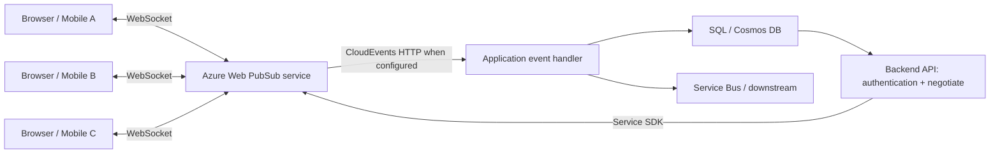

### Components

| Component | Responsibility |
|---|---|
| **Web PubSub resource** | Azure resource terminating WebSocket clients, routing messages, and managing connections per service capabilities |
| **Hub** | Logical namespace for an application/real-time feature, such as `orders` or `chat` |
| **Connection** | A single WebSocket session with a unique **connectionId** |
| **User** | Logical identity assigned by a trusted backend; may span multiple connections |
| **Group** | Set of connections receiving shared messages, such as `order-501` or `room-7` |
| **Negotiate endpoint** | App HTTP endpoint issuing scoped client access URLs/tokens for a user/room |
| **Application server** | Backend performing auth, business validation, message dispatch, and state persistence |
| **Event handler / upstream** | HTTP endpoint or Function handling events forwarded by the service to the app |
| **Server SDK / REST API** | Server tools for sending messages, minting client tokens, and managing groups/users |

### One resource can host multiple hubs

Example:

```text
Azure Web PubSub resource: wp-realtime-prod
  Hub: orders
    Group: order-501
    Group: order-502
  Hub: chat
    Group: support-room-17
    Group: support-room-18
  Hub: notifications
    Group: tenant-a
    Group: tenant-b
```

A **hub is a routing namespace**, not a database table. A **group is an ephemeral set of active connections**, not a persistent membership table.

### Hubs, users, and groups do not replace authorization

If a token grants permission to join `order-501`, the user can hear updates for that order. Generating a group string in backend code **does not prove** the user owns the order. Before minting tokens or assigning groups, the backend must verify the user's permission against the business resource.

## 3. How does a WebSocket connection work?

A WebSocket begins with an HTTP Upgrade handshake over a suitable transport and upgrades to a full-duplex channel. Azure Web PubSub connection URLs use **`wss://`** in production.

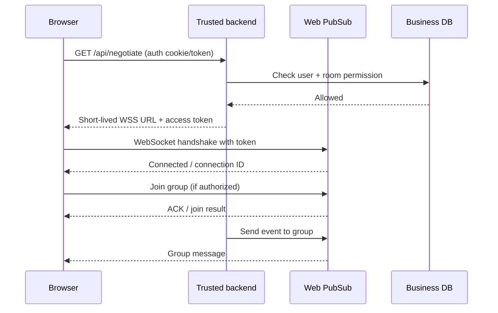

### Why must clients never use the service connection string?

The **service key / connection string** is a high-privilege server secret used to manage the resource, mint access tokens, and publish messages. If copied into HTML or JavaScript:

- Anyone opening DevTools can steal the key.
- Clients could mint tokens or roles for other users' groups.
- You lose control over who can broadcast messages.
- Key rotation could disrupt every client.

**Browsers should only receive a client access URL/token with least-privilege roles and a short lifetime.** The token URL itself is sensitive—avoid logging it or leaking it via analytics or referrers.

## 4. Negotiate endpoint: the bridge between identity and WebSocket

A common flow:

1. User signs in to the web app via Microsoft Entra ID/OIDC or an approved provider.
2. Browser calls `/api/negotiate` on the app backend.
3. Backend validates the session/JWT and checks room/order permissions in the database.
4. Backend mints a **client access token** scoped to the right hub, `userId`, and minimal roles.
5. Backend returns the `wss://...` URL to the browser over HTTPS.
6. Browser opens a direct WebSocket connection to the service.

**Never accept a client-supplied `userId` from a query string** as proof of identity. For example:

```text
GET /api/negotiate?userId=ceo&group=payroll
```

Trusting this query blindly lets clients walk straight into sensitive rooms. Always extract the user from **verified claims**, then look up which groups that user may join.

### Access token attributes

| Attribute | Meaning | Rule |
|---|---|---|
| **Hub** | Target hub for the client | Scope strictly to the required hub |
| **userId** | Logical identity bound to the connection | Derived by the trusted backend |
| **Roles** | Actions the client may perform | Least privilege; scope to specific groups when possible |
| **Expiration** | Token validity window to establish connection | Keep short with a refresh/re-negotiate path |
| **Groups / initial groups** | Groups allowed or pre-attached per supported flow | Verify business permission before assigning |

### Token expiration and open connections

Token expiration **must not be assumed to automatically kill an already-open WebSocket at the exact second of expiry**. Token lifetimes and connection lifecycles follow distinct service/protocol rules. Design for:

- short-lived URLs/tokens;
- refresh/re-negotiate on reconnect;
- explicit connection revocation/closure when user access is revoked;
- backend authorization checks on every state-changing action.

**Never rely solely on token expiration to immediately cut off an active user whose permissions were revoked.**

## 5. Client WebSocket protocols: raw vs JSON subprotocol

Azure Web PubSub supports multiple WebSocket client modes:

- **Plain/raw WebSocket client:** sends/receives raw frames using default protocol behavior; upstream delivery and message handling depend on hub/event-handler configuration.
- **Web PubSub client protocol** such as `json.webpubsub.azure.v1`: clients send structured commands to **join/leave groups, sendToGroup**, and receive events, ACKs, and system messages.

Subprotocol selection must match your SDK/client implementation. **Do not invent an arbitrary subprotocol expecting Web PubSub to parse JSON commands**, and do not assume raw payloads broadcast automatically to groups without configuration.

### WebSocket JSON subprotocol

A client can connect with:

```javascript
const ws = new WebSocket(accessUrl, "json.webpubsub.azure.v1");
```

Upon connecting, the service can send a system connection-status message such as:

```json
{
  "type": "system",
  "event": "connected",
  "connectionId": "example-connection-id",
  "userId": "demo-user-1"
}
```

This payload is illustrative; exact fields depend on protocol version and context. Browsers should dispatch on **`type` and `event`**, never hardcoding field order or assuming every optional field is always present.

### Common commands

| Command | Purpose | Precondition |
|---|---|---|
| **`joinGroup`** | Adds current connection to a group | Appropriate token role or server-controlled membership |
| **`leaveGroup`** | Leaves a group | Permission/conditions per protocol |
| **`sendToGroup`** | Publishes a message to a group | Send permission for that group |
| **ACK response** | Reports whether the service processed or rejected a command | Client attaches `ackId` and tracks response |
| **Group message** | Delivers messages published to joined groups | Connection open and in group at publish time |

### Client roles in Web PubSub

Illustrative scoped roles:

```text
webpubsub.joinLeaveGroup.demo-room
webpubsub.sendToGroup.demo-room
```

Here, the token restricts the client to joining/leaving and sending only to **`demo-room`**. Compatible SDK/protocol versions may support broader roles; **avoid issuing hub-wide roles** when a single group suffices.

Client roles **do not grant permission to read databases or invoke order APIs**. Those belong to separate backend authorization checks.

## 6. Group messaging: broadcast, user, and connection

### Four recipient targets

| Target | Question | Use case |
|---|---|---|
| **All clients in hub** | Who is connected to this hub? | Public maintenance notices |
| **One connection** | One specific tab/device? | Transient connection-specific feedback |
| **One user** | All connections sharing `userId`? | Personal notifications across multiple tabs |
| **One group** | All connections currently in a room? | Chat rooms, order tracking, tenant alerts |

**One user can open multiple tabs.** Sending "to user" delivers across all active connections for that user. One connection can also join multiple groups. Never use `connectionId` as a durable user ID, since each reconnect issues a new `connectionId`.

### Entity-scoped groups

Example group `order-501`:

```text
Client buyer-A  ─┐
Client courier-7 ├─> group order-501
Support agent-3 ─┘
```

Before joining:

- The buyer must own or be authorized to view the order.
- The courier must currently be assigned to that order.
- The support agent must hold an active authorized case.

**Group names are not secrets**; security depends on token authorization and membership controls, not trying to pick unguessable group names.

### Group membership lacks database durability

When a client disconnects and reconnects:

- `connectionId` can change.
- Old connection memberships do not automatically transfer to the new connection across all client paths.
- Client or server must rejoin authorized groups.
- Messages sent while offline may be missed.

Persist authoritative **subscriptions/room memberships** in your business database or source of truth; Web PubSub groups represent only live real-time routing state.

## 7. Sequence for sending a reliable notification

Notifications should be emitted only after business state commits:

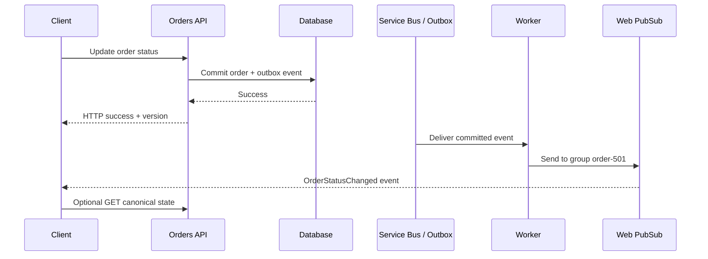

**If sending the notification fails after DB commit**, an outbox/queue retries without mutating the order again. If the send succeeds while the browser is offline, the client **reconciles** upon reconnecting.

### Keep event payloads small and versioned

```json
{
  "eventId": "evt-501-12",
  "eventType": "OrderStatusChanged",
  "orderId": "order-501",
  "version": 12,
  "status": "Shipped",
  "occurredAt": "2026-11-20T09:30:00Z"
}
```

Do not broadcast full customer profiles, tokens, or payment details when a status update is all that's needed. For sensitive details, deliver an ID/version and let the client fetch authorized content over REST.

### Client-side version guard

Suppose the client already knows order version 13 when an older version 12 message arrives after a retry or reconnect. The UI must not regress to version 12:

```javascript
function applyOrderUpdate(incoming, localState) {
  if (incoming.version <= localState.version) {
    return localState; // old/duplicate event
  }
  if (incoming.version > localState.version + 1) {
    // Gap detected: query API to resync rather than guessing state.
    return { ...localState, requiresRefresh: true };
  }
  return {
    ...localState,
    version: incoming.version,
    status: incoming.status
  };
}
```

**WebSocket delivery does not guarantee business ordering.** When multiple workers emit updates for the same entity, include backend `eventId` and `version`—never treat browser arrival order as final truth.

## 8. Python Server SDK: minting tokens and sending messages

Azure provides **service-side SDKs** for supported languages. In Python, the Azure Web PubSub service library is `azure-messaging-webpubsubservice`. Server code can:

- mint client access tokens for a hub;
- publish to a hub, group, user, or connection via supported methods;
- manage service-level group membership and connection state;
- authenticate via supported server credentials.

### Example: generating a client access token

```python
import os

from azure.messaging.webpubsubservice import WebPubSubServiceClient


connection_string = os.environ["WEB_PUBSUB_CONNECTION_STRING"]
hub_name = os.environ.get("WEB_PUBSUB_HUB", "chat")

service = WebPubSubServiceClient.from_connection_string(
    connection_string=connection_string,
    hub=hub_name
)

# In production, identity must come from a verified login session.
access = service.get_client_access_token(
    user_id="lab-user-01",
    roles=[
        "webpubsub.joinLeaveGroup.demo-room",
        "webpubsub.sendToGroup.demo-room"
    ],
    minutes_to_expire=10
)

# access["url"] is returned only in a trusted negotiate response.
print("Token URL generated:", bool(access.get("url")))
```

This snippet uses a **backend service connection string** for a lab, never exposing keys to clients. Verify parameter signatures against your installed SDK version before production use.

### Sending a message to a group from the backend

```python
# Assumes service was initialized via WebPubSubServiceClient.
service.send_to_group(
    group="demo-room",
    message="Notification from backend",
    content_type="text/plain"
)
```

When sending `content_type="application/json"`, serialize payloads properly rather than passing Python's single-quoted `str(dict)` as JSON. For example:

```python
import json

payload = {
    "eventId": "evt-100",
    "eventType": "ShipmentUpdated",
    "orderId": "order-501",
    "version": 12
}
service.send_to_group(
    group="order-501",
    message=json.dumps(payload),
    content_type="application/json"
)
```

A successful send call means **the service accepted/dispatched the call per contract**—not that offline devices received it, the frontend updated the DOM, or customers read it.

### Using Microsoft Entra ID in production

For backends on App Service, Azure Functions, VMs, or AKS, prefer **Microsoft Entra ID with managed identity or workload identity** when supported by the SDK/service:

```python
# Conceptual pattern; verify constructor/credential for your SDK version.
from azure.identity import DefaultAzureCredential
from azure.messaging.webpubsubservice import WebPubSubServiceClient

credential = DefaultAzureCredential()
service = WebPubSubServiceClient(
    endpoint="https://<resource-name>.webpubsub.azure.com",
    hub="chat",
    credential=credential
)
```

Checklist:

1. Enable identity on compute.
2. Assign the **Web PubSub data-plane role** granting token/messaging permissions.
3. Verify the endpoint, tenant, and identity selected by the SDK.
4. Verify networking from backend to the Web PubSub endpoint.
5. Retire legacy connection strings only after end-to-end verification.

**Azure RBAC `Reader` on the resource group does not grant permission to mint tokens or send messages on the Web PubSub data plane.** Meanwhile, high-privilege service connection strings must be restricted, stored in a secret store, and rotated.

## 9. Minimal lab: FastAPI negotiate + browser WebSocket

This lab uses **one Python backend** to mint tokens and **one HTML page** to connect. Every test tab joins a shared `demo-room` group; this is a **public localhost simulation** with no real login or tenant isolation.

### Lab architecture

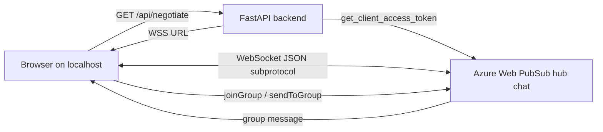

**Never deploy this lab code to internet-facing production.** The backend lacks user authentication, room ownership checks, rate limiting, auditing/revocation, and abuse controls.

### Step 1 — Prepare Azure resources

In the Azure Portal:

1. Select a sandbox subscription and a dedicated lab resource group, e.g., `rg-webpubsub-lab`.
2. Create an **Azure Web PubSub** resource in an approved region/SKU.
3. Note the resource endpoint, e.g., `https://<resource>.webpubsub.azure.com`.
4. Prepare the logical hub name `chat` (hubs can be referenced by endpoints/SDKs; configuring hub upstream handlers is a separate step).
5. Verify pricing, concurrent connection quotas, and budgets.
6. Set up the connection string for the **local backend only**, outside source code.

For a demo using only client-side group commands and scoped tokens, you can test basic group messaging without configuring upstream event handlers. If your service/hub configuration requires handlers for connect/user events, configure those handlers before opening clients.

### Step 2 — Install dependencies

In an **isolated lab project**:

```bash
python -m pip install fastapi uvicorn azure-messaging-webpubsubservice
```

Set environment variables securely:

```text
WEB_PUBSUB_CONNECTION_STRING=<server-side secret, never commit>
WEB_PUBSUB_HUB=chat
```

Never paste real connection strings into Git, public docs, screenshots, or shared terminal histories. Prefer a local secret manager or approved environment profile over committing keys inside repository files.

### Step 3 — Create `server.py`

```python
import os
import uuid

from fastapi import FastAPI, Response
from fastapi.responses import FileResponse
from azure.messaging.webpubsubservice import WebPubSubServiceClient


app = FastAPI()
hub = os.environ.get("WEB_PUBSUB_HUB", "chat")

service = WebPubSubServiceClient.from_connection_string(
    connection_string=os.environ["WEB_PUBSUB_CONNECTION_STRING"],
    hub=hub
)


@app.get("/")
def index():
    return FileResponse("index.html")


@app.get("/api/negotiate")
def negotiate(response: Response):
    # LAB ONLY: creates a synthetic user per request with no authentication.
    # PRODUCTION: derive user_id from a verified identity.
    user_id = "lab-" + uuid.uuid4().hex[:12]
    room = "demo-room"

    access = service.get_client_access_token(
        user_id=user_id,
        roles=[
            "webpubsub.joinLeaveGroup.demo-room",
            "webpubsub.sendToGroup.demo-room"
        ],
        minutes_to_expire=10
    )
    response.headers["Cache-Control"] = "no-store"

    return {
        "url": access["url"],
        "userId": user_id,
        "group": room
    }
```

Key takeaways:

- The backend keeps the secret; the browser receives only a short-lived token URL.
- Each `/api/negotiate` call generates a new `userId`; in production, bind `userId` to a stable signed-in identity so reconnects preserve it.
- The lab group is a public demo; production backends must authorize room membership before issuing roles.
- Never log `access["url"]` or full negotiate responses.

### Step 4 — Create `index.html`

```html
<!doctype html>
<html lang="en">
<head>
  <meta charset="utf-8">
  <title>Web PubSub WebSocket Demo</title>
</head>
<body>
  <h1>Web PubSub Demo: demo-room</h1>
  <p id="status">Disconnected</p>
  <input id="message" placeholder="Enter message" maxlength="500">
  <button id="send" disabled>Send</button>
  <ul id="feed"></ul>
  <script>
    const statusEl = document.getElementById("status");
    const inputEl = document.getElementById("message");
    const feed = document.getElementById("feed");
    const sendButton = document.getElementById("send");
    let socket = null;
    let room = null;
    let nextAckId = 1;

    function show(text) {
      const li = document.createElement("li");
      li.textContent = text; // Never inject raw HTML from user input.
      feed.appendChild(li);
    }

    async function connect() {
      const response = await fetch("/api/negotiate", {
        credentials: "same-origin",
        cache: "no-store"
      });
      if (!response.ok) {
        throw new Error("Negotiate failed: " + response.status);
      }

      const access = await response.json();
      room = access.group;
      socket = new WebSocket(access.url, "json.webpubsub.azure.v1");

      socket.onopen = () => {
        statusEl.textContent = "WebSocket open; joining group";
        socket.send(JSON.stringify({
          type: "joinGroup",
          group: room,
          ackId: nextAckId++
        }));
      };

      socket.onmessage = (event) => {
        let message;
        try {
          message = JSON.parse(event.data);
        } catch {
          show("Unable to parse message");
          return;
        }

        if (message.type === "ack") {
          show("ACK: " + JSON.stringify(message));
          if (message.success) {
            sendButton.disabled = false;
            statusEl.textContent = "Joined group";
          }
        } else if (message.type === "message") {
          show("Received: " + JSON.stringify(message.data));
        } else if (message.type === "system") {
          show("System: " + message.event);
        }
      };

      socket.onerror = () => {
        statusEl.textContent = "WebSocket error";
      };

      socket.onclose = () => {
        statusEl.textContent = "WebSocket closed";
        sendButton.disabled = true;
      };
    }

    sendButton.onclick = () => {
      if (!socket || socket.readyState !== WebSocket.OPEN) return;
      const text = inputEl.value.trim();
      if (!text) return;

      socket.send(JSON.stringify({
        type: "sendToGroup",
        group: room,
        dataType: "text",
        data: text,
        ackId: nextAckId++
      }));
      inputEl.value = "";
    };

    connect().catch((error) => {
      statusEl.textContent = error.message;
    });
  </script>
</body>
</html>
```

**Important:** this lab illustrates one specific WebSocket JSON subprotocol. If your SDK/protocol version uses different ACK shapes or message structures, follow the exact specification. `ACK.success` reflects protocol command execution, **not a read receipt from recipients**.

### Step 5 — Run the local server

```bash
uvicorn server:app --host 127.0.0.1 --port 8000
```

Open `http://127.0.0.1:8000/` in **two browser tabs** on the same machine. Because both connections receive access to `demo-room`, messages sent from one tab appear on the other while both are online and joined.

### Step 6 — Verify behavior

| Action | Expected result |
|---|---|
| Open Tab A | Negotiate succeeds, WebSocket opens, `joinGroup` ACK arrives |
| Open Tab B | Distinct user/connection, `joinGroup` succeeds |
| Tab A sends "Hello" | Command ACK returns and group message renders on connected tabs |
| Close Tab B | Tab B stops receiving messages while offline |
| Reopen Tab B | Must negotiate and rejoin; missed messages do not appear automatically |
| Stop backend after tabs connect | Existing connections may stay active per model/token, but new negotiates fail |
| Revoke credentials or change permissions | Requires explicit revocation/reconnect flow; old permissions do not vanish instantaneously |

If connections fail immediately, inspect **subprotocol, access token, hub, service SKU/endpoint, connection quotas, and browser console**. Never paste token-bearing URLs into public tickets while debugging.

### Step 7 — End the lab

Stop the local server. Verify and delete the Web PubSub resource only if it is dedicated to this lab and not shared. Check any related resources (App Service, Functions, Key Vault, Private Endpoints, logs) and billing if left active.

## 10. Event handlers: forwarding WebSocket events to the backend

To run business logic when clients connect or send custom events, Azure Web PubSub supports hub/service **event handlers** delivering events via **CloudEvents over HTTP** or supported extensions.

### Event types to know

| Event | Timing | Typical responsibility |
|---|---|---|
| **Connect** | When a client requests connection and service triggers connect per config | Validate/shape permissions, return contract response |
| **Connected** | After connection is established | Update presence/metrics, send optional welcome message |
| **Disconnected** | When connection terminates | Clean up transient state, update last-seen |
| **User-defined event** | Client emits a custom event per protocol/mode | Validate payload, authorize, run business logic |

**Never configure one event handler assuming every event type automatically routes to it.** Declare the exact event subscriptions, filters, and mappings supported by Web PubSub and test each event type and name casing.

### Connect handlers vs message handlers

The `connect` event participates in connection establishment and must respond **within the protocol timeout**. Blocking for 30 seconds on an ERP call during `connect` times out handshakes. User-event handlers handle incoming client messages, validate them, and enqueue work; response/ACK behavior depends on the event type and Web PubSub protocol.

### Event payloads and CloudEvents metadata

Commonly needed fields:

```text
hub
event type / event name
connectionId
userId (if assigned)
request trace / correlation identifier
event payload / data type
```

CloudEvents can carry metadata in **HTTP headers** and data in the body per service bindings. **Never assume all of those fields arrive in an identical JSON object** across every handler type. Inspect the exact headers/fields sent by Web PubSub for your supported binding version.

### Endpoint validation and caller trust

When configuring HTTP handlers, the service performs **abuse-protection validation handshakes**; your endpoint must respond per protocol. That alone is not full security. Production also requires:

- valid HTTPS endpoint URLs and access controls;
- verifying requests truly originate from your Web PubSub service per supported mechanism;
- protecting event handlers against spoofed HTTP requests from the Internet;
- short timeouts, retries, and idempotency;
- never trusting `userId` in a payload without authenticating the upstream source;
- avoiding logging full sensitive payloads.

**Never trust a self-asserted header alone to authenticate requests.** When using Azure Functions or official SDKs, leverage built-in service validation middleware where appropriate.

## 11. Client-to-server events vs client-to-group messaging

This distinction shapes chat and collaboration design:

### Client sends directly to a group

```text
Browser A → Web PubSub sendToGroup → Browser B/C
```

Pros: fast and avoids a backend round-trip per message. However, granting clients direct `sendToGroup` rights delivers messages **before the backend can moderate, audit, or persist business state**. Systems requiring moderation, history, or per-message authorization need careful design.

### Client sends custom events to the backend

```text
Browser A → Web PubSub user event → Backend event handler
         → Validate/moderate/save to database
         → Server SDK sendToGroup
         → Browser B/C
```

This pattern fits whenever every message must:

- validate identity and room membership;
- enforce size, content, and moderation policies;
- persist durably or enqueue for processing;
- receive an `eventId`/sequence after commit;
- route cleanly to authorized recipients.

**Never let a client mutate business state just because it holds a group-send token role.** Group messaging roles govern real-time routing; backend code governs application authorization.

### When can you skip upstream mediation?

A public ephemeral demo room without history may allow direct client-to-group sends under narrow roles. A customer support room carrying sensitive data, moderation, and audit trails generally requires backend-mediated delivery.

## 12. Azure Functions and Web PubSub

Azure Functions provides an event-driven backend without running an always-on web server solely for notifications:

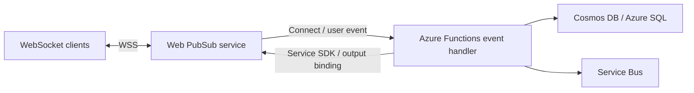

### Common Function roles

1. **Negotiate Function:** authenticated HTTP trigger calling the Web PubSub server SDK to mint client access tokens.
2. **Event Function:** Web PubSub trigger/binding or CloudEvents HTTP endpoint where supported by runtime/extension.
3. **Queue-to-WebSocket Function:** Service Bus trigger consuming post-commit events and pushing group notifications.
4. **Timer cleanup:** audits heartbeats/presence projections—never use a timer ping just to fake keeping idle clients online.

### Watch extension compatibility

Functions Web PubSub bindings/triggers vary by **Functions runtime, programming language, and extension version**. Never mix Azure Web PubSub SDK snippets, Azure SignalR bindings, and Event Grid triggers assuming identical signatures.

If building a raw HTTP event handler instead of the extension:

- Implement CloudEvents headers, validation, and responses accurately.
- Watch execution timeouts and cold-start latency.
- Enforce retries and idempotency since events can be redelivered.
- Never assume scaling out Function instances adds WebSocket connection capacity; connection capacity belongs to the Web PubSub resource.

### Does the backend still need to stay online?

For authorized **client-to-group messaging**, frames flow through the service without touching your backend per message. For **custom events requiring handlers** or **negotiate endpoints**, your backend must meet availability SLOs; cold starts or timeouts break handshakes and workflows. Never confuse "serverless" with "zero server-side responsibility".

## 13. Delivery, ordering, and ACKs: what Web PubSub does not promise

Web PubSub uses WebSockets to deliver messages to active connections. However, a real-time channel **is not a durable message queue for offline devices**.

| Property | What you can rely on | What you must not assume |
|---|---|---|
| **WebSocket transport order** | Frames on one live WebSocket connection arrive in transport order | Global business order across workers, connections, or reconnects |
| **Client command ACK** | Service processed or rejected the command per protocol | Recipients saw or read the message |
| **Server send result** | Service API accepted/executed the send per contract | Message was stored durably or will replay when offline users return |
| **Group delivery** | Delivered to active connections in the group at send time | Groups have automatic offline inboxes |
| **Connection ID** | Identifies one connection during its lifetime | ID stays unchanged across reconnects |
| **User ID** | Logically groups connections per backend assignment | Acts as an auth credential itself or resists bad backend assignment |
| **Presence** | Connection/online signals observable per service capability | Proof a human is actively reading the screen |

### An ACK is not a read receipt

Suppose Client A sends:

```json
{
  "type": "sendToGroup",
  "group": "demo-room",
  "dataType": "text",
  "data": "Hello",
  "ackId": 20
}
```

A success ACK confirms the service processed the command per protocol—**not** that Client B rendered the message. If your app needs "read receipts":

1. Backend persists the message with a durable `messageId`.
2. Client B renders the content.
3. Client B sends an authenticated **application-level read acknowledgment**.
4. Backend stores the read receipt in the database.
5. Backend publishes a read-receipt notification to interested participants.

Never trust a client asserting `readBy="user-CEO"` without backend authentication and authorization.

### Ordering inside a chat room

Users A and B can send messages simultaneously; services, routers, and clients do not automatically impose a **global monotonically increasing room sequence** across sources. When a room needs a single authoritative timeline:

- assign a canonical `sequence` or authoritative timestamp/ID **at the system of record** upon persistence;
- never trust client clocks for canonical ordering;
- use database transactions, conditional counters, or an event log;
- include `roomId`, `messageId`, and `sequence` in notifications;
- sort and reconcile against the database after reconnects.

Games or telemetry preferring low latency over history can accept best-effort updates for ephemeral positions. Business requirements—not the mere choice of WebSockets—dictate guarantees.

## 14. Reconnect and synchronizing missed events

Switching from Wi-Fi to 4G, laptop sleep, page refreshes, or token expiration for new sessions all close WebSockets.

### Client-side state machine

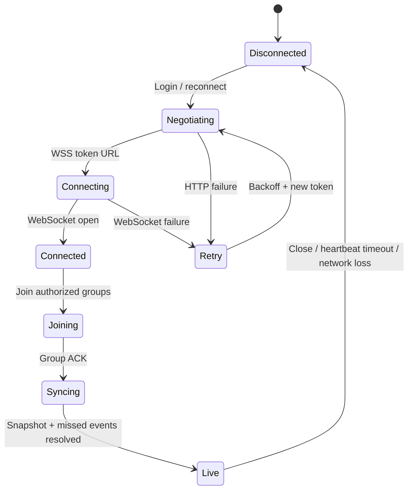

### Safe reconnect algorithm

1. Detect `onclose`, network failures, or revoked sessions.
2. Transition UI to `Reconnecting` and disable unsafe mutations.
3. Wait with **exponential backoff and jitter**, bounding retry counts/intervals.
4. Re-call the **negotiate endpoint** after verifying the auth session to obtain a fresh token.
5. Open a new WebSocket—never reuse expired URLs/tokens.
6. Rejoin **groups the user is still authorized for**.
7. Sync a **snapshot or event history since the last known version** from the API/DB.
8. Deduplicate and order events using `eventId` and `version`.
9. If an unrecoverable gap occurs, **refresh the full snapshot** rather than guessing state.

### Why snapshot sync is mandatory

```text
09:00:00  Client receives order version 7
09:00:05  Connection drops
09:00:08  Order updates to version 8
09:00:09  Service emits v8 while client is offline
09:00:20  Client reconnects
09:00:21  Client still shows v7 unless it calls the API
```

Azure Web PubSub **does not replay v8 automatically** on reconnect. Expose an API endpoint:

```text
GET /api/orders/order-501
→ { "orderId": "order-501", "version": 8, "status": "Shipped" }
```

### Avoiding the race between snapshot and join

If a client **fetches the snapshot first** and joins the group afterward, updates occurring in between can be missed. A safer sequence:

1. Connect and **confirm `joinGroup` succeeds**.
2. Buffer incoming real-time events in memory by `version`.
3. Fetch the API snapshot at version `V`.
4. Apply buffered events with `version > V`, checking for contiguous sequences.
5. If a gap appears, re-fetch the snapshot or history endpoint.

This narrows the race window without guaranteeing universal exactly-once delivery. High-reliability apps need versioned/continuation history APIs at the source of truth.

### Backoff with jitter

Never let 100,000 clients reconnect on the exact same second after an outage. Use:

```text
delay = min(maxDelay, baseDelay * 2^attempt) + randomJitter
```

Cap retries appropriately for UX, support offline views, and notify users during prolonged outages. On mobile, cache only safe last-known state—avoid storing sensitive data unencrypted or without retention limits.

## 15. Preventing data loss and duplicates with durable state

Web PubSub serves as the **real-time delivery data plane**, while the application database and broker own **durable state**.

### Example: chat messaging with persisted history

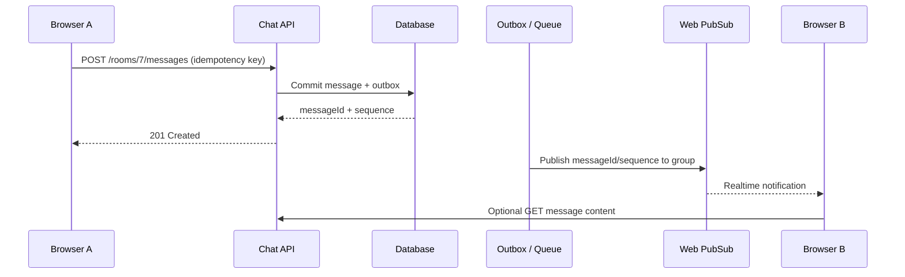

### Failure windows

| Fault | Risk | Recovery mechanism |
|---|---|---|
| API crashes before DB commit | Message never created | Client retries with same idempotency key |
| DB commits, worker hasn't published | Message saved in DB; peers unaware | Transactional outbox / queue retry |
| Service send succeeds, worker fails to ack | Notification redelivered | Client deduplicates via `eventId`/version |
| Browser B is offline | B misses real-time ping | History endpoint upon reconnect |
| Two messages sent concurrently | UI receives in differing arrival order | Canonical DB sequence |
| User access revoked while online | Connection still holds active token/group | Backend revokes, removes from group, closes connection, re-authorizes |

### Idempotency keys

For browser-submitted messages:

```json
{
  "clientMessageId": "client-msg-7f31",
  "roomId": "support-room-17",
  "text": "I need help with order #501"
}
```

Bind `clientMessageId` to the authenticated user/room with a unique constraint so browser retries never create duplicate database rows. Even if Web PubSub delivers a notification twice, the database records **exactly one business message**.

## 16. Connection presence and last-seen

"Presence" carries several distinct meanings:

- **Connected:** the service observes an open WebSocket connection.
- **Online user:** at least one active connection maps to `userId` per policy.
- **Active user:** user interacted recently.
- **Read/seen:** user viewed specific content.
- **Available agent:** support staff ready to accept a new chat.

These are not identical. A browser tab left open in the background keeps its WebSocket open long after the user walked away.

### Presence store

A system may track:

```text
userId
connectionId
hub
connectedAt
lastHeartbeatAt
lastBusinessActivityAt
status
```

Notes:

- One user holds multiple connections; never mark them offline just because **one** tab closed while another remains open.
- `disconnected` events can lag or get dropped during backend outages.
- Use TTLs, heartbeats, and reconciliation rather than treating a single event as absolute final state.
- Do not abuse presence telemetry for undisclosed employee surveillance outside approved policies.

### Server-side presence APIs

Web PubSub services/SDKs offer operations to query connection/user/group state within supported scopes. However, **querying current connections is not a historical online log**. Reporting agent uptime or online duration requires a dedicated state store, session definitions, and late-event handling.

## 17. Defense-in-depth security for Web PubSub

### 17.1 Identity

Browsers authenticate with the app via Entra ID, OIDC/cookies, or an approved provider. The backend verifies:

- JWT signature, issuer, audience, and expiration;
- session/cookie policies and CSRF defenses when using cookies;
- that the user remains active and entitled to the room/tenant;
- negotiate rate limits to prevent abuse.

**Never treat `userId` in a URL or JSON body as proof of identity.**

### 17.2 Authorization

Enforce authorization across at least two layers:

1. **Application authorization:** may the user join `order-501`, send messages, or read private details?
2. **Web PubSub roles/groups:** scoped tokens permit only WebSocket actions matching the app's authorization decision.

When access changes, update group memberships and connection state promptly. Previously minted tokens remain valid briefly until expiry; design explicit revocation controls.

### 17.3 Tokens and secrets

- Issue short-lived WSS URLs strictly over HTTPS.
- Never embed service keys in frontend code.
- Never log URLs containing `access_token`.
- Never leak tokens via analytics, emails, chat logs, or third-party query params.
- Use Key Vault for any required secrets and managed identity for server SDKs where supported.
- Restrict CORS/Origin on the **negotiate API** to approved origins; verify WebSocket Origin handling separately per service docs.
- Tokens do not sanitize business payloads; backends must validate every state-mutating request.

**CORS is not authorization.** CORS governs browser HTTP rules; native apps and scripts bypass CORS completely.

### 17.4 Payload security

- Never inject chat messages via `innerHTML`; use `textContent` or safe sanitization.
- Cap message lengths and content types to block spam/DoS.
- Handle file attachments via Storage upload APIs and short-lived SAS URLs instead of streaming large binaries over WebSockets.
- Never broadcast full user objects containing emails, addresses, or cards when `orderId + version` suffices.
- Guard event handlers against injection, JSON bombs, and oversized payloads.
- Implement moderation and auditing where chat workflows require them.

### 17.5 Tenant isolation

One Web PubSub resource/hub can serve multiple tenants by design, yet:

```text
tenant-a / room-1
tenant-b / room-1
```

If the group name is simply `room-1`, tenants can cross-contaminate on a role-minting bug. Prefix groups with stable tenant IDs:

```text
tenant-a:room-1
tenant-b:room-1
```

Still, **group naming is not a security boundary**. Backends must verify the user belongs to that tenant and room from an authoritative source, never allowing browsers to choose arbitrary group names.

### 17.6 Network security

Depending on SKU and features, Web PubSub supports **network access controls, firewalls, and Private Link / private endpoints**. Patterns:

| Model | Where clients live | What to verify |
|---|---|---|
| Public endpoint + auth token | Public Internet browsers | WSS/TLS, tokens, origin/security policies, quotas |
| Private endpoint | Clients/backends in routed private network | VNet, DNS, VPN/ExpressRoute, firewalls |
| Private backend; public browsers | API and browsers take separate paths | Both negotiate and WebSocket paths reach appropriate endpoints |

If the resource restricts access to private networks only, **public Internet browsers cannot connect** just because the backend has a managed identity. Private endpoints change network routing—they do not grant user auth or build a VPN automatically.

### 17.7 Upstream handler security

Backend event handlers receive HTTP CloudEvents requests. Enforce:

- validation handshake and caller verification per Web PubSub contract;
- allowlists, identity, or signature checks where supported;
- checks on `hub`, event type, `userId`, and resource scope;
- payload caps, short timeouts, retries, and replay defenses;
- never trust arbitrary `X-User-Id` headers sent to a public endpoint.

**Private networking and upstream caller authentication are separate controls.** Even a private handler needs validation if reachable from other internal services.

## 18. Session management, revocation, and changing permissions

Suppose Courier-7 is assigned to `order-501`, and a dispatcher later reassigns the order to Courier-8.

If the backend updates only the database while Courier-7's WebSocket **stays in group `order-501`**, Courier-7 keeps hearing notifications.

Workflow:

```text
1. Application commits assignment change.
2. Authorization state/version increments.
3. Server-side group membership updates:
   - remove Courier-7 connections from order-501 group;
   - grant Courier-8 per policy.
4. Backend avoids pushing sensitive payloads during transition windows.
5. For immediate revocation, close/revoke matching connections
   via supported service APIs.
6. Reconnecting clients must re-negotiate and rejoin under new permissions.
```

### Systems must define revocation RTO

"Immediate revocation" involves more than shortening token TTLs. Measure:

- lag from DB commit to group membership update;
- whether notifications can slip through between those two steps;
- connection disconnect and rejoin behavior;
- handling multiple open tabs/devices;
- auditing and alerts when membership updates fail.

For highly sensitive data, push only **event metadata** over WebSockets and require an authorized HTTPS GET for details—limiting exposure if group membership lags briefly.

## 19. Backpressure, message size, and overload protection

WebSockets hold persistent channels; backend push rates can outpace slow clients.

### Three bottlenecks

1. **Ingress:** rate at which clients or backends publish into the service.
2. **Fan-out:** one message broadcast to a group holding hundreds of thousands of connections.
3. **Egress:** network/browser/client capacity to drain incoming frames.

Example:

```text
1,000 events/second × 1,000 recipients/event
= 1,000,000 deliveries/second (estimated fan-out deliveries)
```

This does **not directly equal 1,000,000 Web PubSub billable messages** under a fixed formula—billing and quotas depend on your exact tier and metering rules. Still, it shows how fan-out magnifies network and client load.

### Optimizations

- Batch or coalesce UI updates when source data mutates rapidly.
- Throttle location pings (send major status transitions immediately, throttle GPS ticks to a sensible cadence).
- Send deltas, IDs, or versions rather than multi-KB JSON blobs.
- Never broadcast single-tenant updates across the whole hub.
- Scope groups to actual recipients and data boundaries.
- Apply retry/backoff on the backend without blindly replaying stale real-time events.
- Rate-limit client `sendToGroup` calls to prevent spam.

### Browser backpressure

`WebSocket.bufferedAmount` reports queued outbound bytes waiting in the browser buffer. Continuous growth indicates the client is sending faster than the network drains. The UI can pause sends or drop/coalesce **low-value telemetry**—never dropping committed business mutations.

```javascript
function safeSend(ws, payload) {
  if (!ws || ws.readyState !== WebSocket.OPEN) {
    return false;
  }
  const MAX_BUFFERED_BYTES = 256 * 1024;
  if (ws.bufferedAmount > MAX_BUFFERED_BYTES) {
    return false; // caller must decide how to retry/throttle
  }
  ws.send(JSON.stringify(payload));
  return true;
}
```

The 256 KiB cap is an **illustrative local policy**, not a Web PubSub quota. Verify exact message size, connection count, throughput, and group limits for your chosen SKU before setting production thresholds.

## 20. Network connectivity, heartbeats, and idle connections

A `wss://` WebSocket traverses:

```text
Client DNS
→ TLS / proxy / corporate firewall / NAT
→ Azure Web PubSub endpoint
→ WebSocket handshake
→ keep connection alive and exchange frames
```

Causes of dropped connections:

- Mobile network switches or battery-saver modes.
- Reverse proxies or firewalls terminating idle sockets.
- Service-enforced token/connection lifetimes.
- Device sleep or browser tab suspension.
- Quota/capacity limits, regional network faults, DNS, or TLS issues.
- Backend connect handler rejecting the connection per policy.

### Heartbeats

The WebSocket protocol defines low-level ping/pong frames, yet the **browser WebSocket API does not let JavaScript emit raw control ping frames directly**. When an application heartbeat is needed, design a lightweight app-level message at a sensible interval with server validation—and never equate heartbeats with proof a user read content.

### Never ping too aggressively

A 100 ms heartbeat across 100,000 clients generates massive message volume and network cost. Pick intervals from presence SLAs, idle proxy timeouts, and network constraints; track the gap between "connected" and "active".

### Connection quotas

Each Azure Web PubSub SKU/tier has distinct limits and scaling rules for:

- concurrent connections;
- message size and throughput;
- unit/replica counts and scaling ceilings;
- event handler latency and availability;
- data transfer and management API quotas.

Before launch, estimate **peak concurrent connections**, not just registered accounts. Having 200,000 accounts with 5,000 concurrently online behaves very differently from 200,000 simultaneous WebSockets.

## 21. Choosing Azure Web PubSub vs Azure SignalR Service

Both are Azure real-time services built for different ecosystems.

| Requirement | Azure Web PubSub | Azure SignalR Service |
|---|---|---|
| Browser/native clients using **raw WebSockets** | Fits directly | Expects SignalR protocol/SDK |
| Explicit control over JSON subprotocol/groups | Fits Web PubSub client protocol | Follows SignalR Hub/client model |
| Existing **ASP.NET Core SignalR** app | Requires migration/compatibility work | Natural fit |
| Hub methods and strongly typed SignalR clients | Not compatible just by sharing WebSockets | Better fit |
| Backend REST/Functions pushing to groups/users via SDK | Supported | Supported via matching SDKs/bindings |
| Existing Socket.IO clients | Do not assume plain Web PubSub is compatible | Do not assume SignalR is compatible |
| Web PubSub for Socket.IO | Separate Socket.IO product/mode to evaluate | Not Azure SignalR |

**WebSocket is a transport protocol**, whereas **SignalR and Socket.IO are distinct application-level frameworks/protocols**. You cannot swap a `ws://` URL to Web PubSub and expect SignalR or Socket.IO framing and APIs to keep working unchanged.

### Choosing by team and application

- .NET teams with existing SignalR Hubs/clients: evaluate **Azure SignalR Service** first.
- Cross-platform apps needing raw WebSockets with service-managed groups/users: **Azure Web PubSub** is a strong candidate.
- Socket.IO apps: evaluate **Web PubSub for Socket.IO** or a version-compatible Socket.IO host.
- Apps needing infrequent alerts on offline mobile devices: **push notification services**, email/SMS, or durable storage often fit better than holding persistent WebSockets.

## 22. Distinguishing Web PubSub, Service Bus, and Event Hubs

| Service | Optimized for | Never assume it provides |
|---|---|---|
| **Azure Web PubSub** | Online WebSocket clients, groups/users, real-time fan-out | Durable queues, offline inboxes, business transactions |
| **Azure Service Bus** | Durable enterprise messaging, queues/topics, sessions, DLQs | Direct browser WebSocket connections |
| **Azure Event Hubs** | High-throughput telemetry/event stream ingestion | Chat room memberships or read receipts |
| **Azure Event Grid** | Event routing and integration across publishers/subscribers | WebSocket session management |
| **Azure SignalR Service** | Apps using the SignalR framework | Compatibility with raw Web PubSub commands |
| **Azure Cache / Redis-compatible cache** | Caching, ephemeral state, select Pub/Sub patterns | Durable audit logs or standalone Web PubSub |

### Combined architecture

A common robust pipeline:

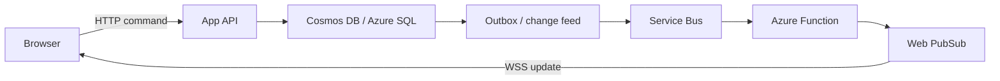

**Do not funnel every event type blindly through Web PubSub.** APIs handle business commands, databases hold truth, brokers guarantee durable delivery, and Web PubSub acts strictly as the live real-time channel to connected clients.

## 23. Capacity planning: sizing concurrent connections and fan-out

### Workload sketch

Suppose a logistics app has:

```text
Registered users:                    500,000
Peak concurrent online users:         20,000
Online tabs/devices per user:            1.4
Concurrent WebSocket connections:     28,000
Groups per connection:                     3
Server notification events/second:       200
Average recipients per event:            100
```

Connection estimate:

\[
20\,000 \times 1.4 = 28\,000\ \text{connections}.
\]

Average fan-out deliveries for server notifications:

\[
200 \times 100 = 20\,000\ \text{recipient-deliveries/second}.
\]

This is a **learning workload model**, not a guaranteed capacity limit or billing formula for a specific SKU. Also factor in client-sent messages, traffic peaks, payload sizes, reconnect bursts, event handler invocations, server SDK calls, network bytes, and other fees.

### Questions before choosing SKU/capacity

- What are **peak concurrent connections** on normal days and campaigns?
- How many tabs/devices does a user keep open?
- What is the average and p99 fan-out per message?
- Are there **hot groups** holding most connected clients?
- What are average and p99 payload sizes in bytes?
- What target latency applies from DB commit to browser render?
- How large are new-connection/second rates during outages and reconnect storms?
- How many upstream handler requests/second hit Functions or App Service?
- How critical are notifications, and what loss tolerance exists?
- Are private endpoints, high availability, or DR required per tier?

### Hot groups and fan-out

Broadcasting one order's GPS coordinates into a 50,000-connection `all-users` group is poor design. Publishing to `order-501` with 3 interested participants cuts traffic and prevents data leaks. For genuine system-wide announcements, use rate-limited broadcasts, caching, and dedicated channels.

### Autoscaling backends ≠ autoscaling Web PubSub capacity

Adding Azure Functions instances does not raise the concurrent WebSocket limit on your Web PubSub resource. Conversely, adding Web PubSub units will not rescue a CPU-bound event handler or throttled database. **Every tier has its own bottleneck**; measure and scale the right layer.

## 24. Availability, regional strategy, and disaster recovery

WebSocket connections bind to a specific endpoint and runtime session. If a region or resource fails, clients must detect the drop and reconnect per your recovery plan.

### Never confuse geo-availability with session durability

Even in multi-region architectures:

- an existing WebSocket connection does not seamlessly teleport to another region;
- clients must re-negotiate against the healthy endpoint/resource;
- group memberships must be re-established;
- real-time messages emitted while disconnected can be missed;
- authoritative databases and history endpoints must recover independently.

### Multi-region strategy

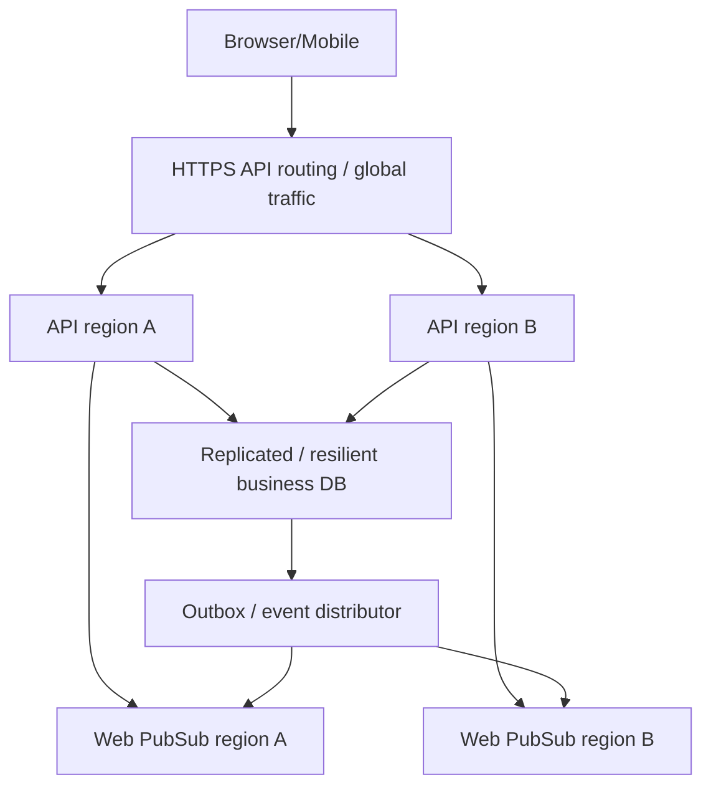

This diagram shows an **architectural pattern**, not automatic replication across resources. When running two regional Web PubSub resources, the application must dispatch events to the appropriate resource—never assuming groups span both resources automatically.

### Distinguishing two availability planes

1. **Backend availability:** negotiate endpoint, auth, event handlers, queues, and database remain healthy.
2. **Real-time delivery availability:** Web PubSub endpoint, network path, and client reconnects work.

If the backend fails while Web PubSub remains up, previously authorized client-to-group traffic may continue without validating new business workflows. If Web PubSub fails while APIs/DB remain healthy, the app can keep updating durable data and **reconcile** via HTTP.

### DR runbook

- Detect regional/resource connection errors early.
- Shift HTTP negotiate traffic to the healthy region per routing plan.
- Clients reconnect with backoff and obtain fresh tokens.
- Rejoin groups after re-validating permissions.
- Fetch snapshots/history from the database.
- Ensure backend outbox/event processors do not duplicate business side effects.
- Monitor lag and active user recovery after failover.
- Conduct controlled drills without causing unscheduled production outages.

### RTO/RPO

**Real-time RTO**: how fast do clients reconnect and resync UIs? **Business RPO**: how much committed database/queue data could be lost in a disaster? These are separate metrics. When WebSocket notifications fire only after DB commit, users may miss a toast alert without **losing order state**, provided durable storage works properly.

## 25. Azure Monitor: observing connections, messages, and the application

A Web PubSub resource exposes metrics and diagnostics tracking connections, messages, and requests per service/SKU capabilities. Pair them with Azure Monitor, Application Insights / Log Analytics, and business telemetry.

| Layer | Signals to measure | Action when abnormal |
|---|---|---|
| Web PubSub resource | Connected clients / concurrent connections | Check capacity, connection quotas, reconnect storms |
| Web PubSub traffic | Send/receive operations, ingress/egress bytes | Inspect fan-out, payload sizes, hot groups |
| WebSocket handshake | Success/failure/close reasons if logged | Check tokens, hub, origin/network |
| Client commands | Join/send ACK success/failure | Check token roles, group names, command schemas |
| Event handlers | Handler latency, HTTP statuses, retries | Check 5xx/timeouts, validation, auth |
| Negotiate API | HTTP 2xx/401/403/429/5xx, latency | Check login/authz abuse, credential issues |
| Business events | DB-commit-to-delivery latency, version gaps | Check queue lag, lost alerts, stale client state |
| Presence | Online user counts, disconnect/reconnect ratios | Check network faults, stale presence records |
| Security | Role/group denials, suspicious token minting | Check authz bugs or abuse |
| Costs | Connection usage, units/capacity, messages, logs, egress | Optimize traffic and budget |

**Exact metric names** vary by tier and Azure Monitor resource. Use **Metrics → Metric definitions/selector** on your deployed Web PubSub resource rather than assuming a metric name exists.

### Correlation IDs

An event log entry might record:

```json
{
  "correlationId": "trace-order-501",
  "eventId": "evt-501-12",
  "eventType": "OrderStatusChanged",
  "businessVersion": 12,
  "targetHub": "orders",
  "targetGroup": "order-501",
  "sendOutcome": "acceptedByService",
  "sentAtUtc": "2026-11-20T09:30:01Z"
}
```

This is an **application-defined log**. Never log tokens, connection strings, sensitive chat text, or keys. `acceptedByService` is a technical status, not `readByCustomer`.

### Measuring end-to-end latency

Event milestones:

```text
T0: Business DB commit
T1: Outbox event published
T2: Worker calls Web PubSub send
T3: Web PubSub API returns result
T4: Browser receives and renders
```

Total user-perceived latency:

\[
L_{\text{end-to-end}} = T_4 - T_0.
\]

Backends know T0–T3; capturing T4 requires correlated client telemetry with reasonably synchronized clocks or relative client timings. **Never rely solely on server-side send latency to claim users see notifications in under 100 ms.**

### Alerts you should have

1. Concurrent connections nearing quota/capacity.
2. Abnormal spike in join/send command errors.
3. Event handler 5xx/timeouts exceeding SLO.
4. Sharp spike in negotiate 401/403 or 429 responses.
5. Surging reconnect rate or plunging online client counts.
6. DB commit → notification delivery latency breaching target.
7. Spike in client event gaps or stale-state refreshes.
8. Fan-out/message/traffic spend exceeding budget.
9. Private endpoint/DNS faults following infra releases.

## 26. Cost of Web PubSub and the full architecture

Never claim "WebSockets connect once and send messages for free afterward." Costs depend on your Web PubSub SKU/billing model and surrounding infrastructure.

| Component | Cost drivers to estimate |
|---|---|
| **Azure Web PubSub** | SKU/units/capacity, concurrent connections, messages/operations, and traffic per pricing model |
| **App Service / Azure Functions** | HTTP negotiate calls, event handler executions, compute/memory, and plan capacity |
| **Service Bus** | Durable message operations, queue/topic capacity, and retention |
| **Cosmos DB / Azure SQL** | Reads/writes, RU/s or database compute, storage, indexes |
| **Azure Monitor** | Logs/traces, ingestion volume, and retention |
| **Networking** | Data transfer, private endpoints, NAT/gateways per topology |
| **Authentication** | Identity services, Key Vault operations, and security controls where billed |
| **Global routing / DR** | Multi-region resources, traffic managers, and standby capacity |

### Example calculation

Suppose:

```text
5,000 peak concurrent connections
100 notification events/second
50 average recipients/event
600 bytes average payload
```

Raw payload delivery throughput before framing/protocol overhead:

\[
100\times50\times600 = 3\,000\,000\ \text{bytes/second}.
\]

Roughly **3 MB/second** is raw payload math only—excluding client sends, message headers, TLS/TCP overhead, reconnects, authentication, retries, and billing units. Never extrapolate a dollar bill from this formula; use the **Azure Pricing Calculator / official SKU pricing**, review quotas, and measure real usage in a sandbox.

### Six optimization techniques

1. **Target the exact group** instead of broadcasting hub-wide unnecessarily.
2. **Coalesce rapid updates**—push GPS coordinates on a cadence rather than every raw sensor tick.
3. Shrink payloads by sending only `eventId`/version and fetching details on demand.
4. Prevent reconnect storms caused by overly aggressive token or idle policies.
5. Keep connections open only while users actively need real-time features; disconnect cleanly when idle per UX.
6. Size tiers/units from measured concurrent connections and fan-out, backed by budgets and alerts.

**Never add a Redis cache or extra queue just hoping to "save money" by routing every message through two more services** unless they solve a real requirement; every extra hop adds latency, complexity, and operational cost.

## 27. Layer-by-layer troubleshooting

| Symptom | Possible cause | How to investigate |
|---|---|---|
| Negotiate returns 401 | Unauthenticated user, invalid session/JWT | API auth logs, identity, cookies/OIDC |
| Negotiate returns 403 | User barred from room/tenant | Authorization policy, resource ownership |
| Negotiate returns 500 | Missing SDK credential, role, or wrong endpoint | Server logs, Key Vault, managed identity |
| WSS handshake fails 401/403 | Expired token, wrong hub/role/endpoint | Mint time, hub URL, browser console, service diagnostics |
| Browser cannot connect | TLS, DNS, firewall, proxy, or private-only endpoint | Client network path, corporate proxy, Private DNS |
| Socket opens but `joinGroup` fails | Missing role, wrong group name, bad protocol command | ACK error details, token roles, subprotocol |
| No ACK received | Not using JSON subprotocol, bad `ackId`, error path, or network | `ws.protocol`, raw frames, close reason |
| A sends, B receives nothing | B not joined, B offline, wrong room, or membership revoked | Join ACK, group name, presence, handler logs |
| Only one tab receives messages | Other tab hasn't joined, separate connection, or offline | Per-connection events/ACKs |
| User sees another tenant's message | Wrong roles/groups minted or colliding group names | Negotiate authz and group naming |
| Event handler not invoked | Hub handler unconfigured or wrong filter/type | Hub settings, CloudEvents endpoint, logs |
| Event handler returns 401/403 | Validation/auth mismatch | Upstream origin/identity config |
| Connect slow then times out | Slow handler startup or DB call | Handler latency, cold starts, timeouts |
| Messages lost during browser sleep | WebSocket closed; no durable inbox | Reconnect + history API |
| UI regresses to older state | Out-of-order/duplicate events | `eventId`, business version guard |
| Client receives twice on retry | Publish retry or backend/outbox duplicate | Idempotency, event IDs, logs |
| ACK succeeded yet recipient sees nothing | ACK is not a read receipt | Delivery/visibility/client telemetry |
| Low backend CPU yet connections hit quota | Web PubSub capacity is separate from backend compute | Concurrent connection metrics and SKU |
| Traffic spikes on one order update | Broadcast to whole hub or overly broad group | Fan-out count, group scoping |
| Cannot revoke access immediately | Old token/connection still active | Server leave/close calls, revocation plan |
| SDK send fails on permissions | Identity lacks data-plane role | Role assignments, credential chain, endpoint |
| Private endpoint works from VM, fails in public browser | Browser lacks private network route | Client DNS/routing, endpoint architecture |
| Rising bills | Fan-out, reconnects, logging/compute/network | Usage/Cost Management, traffic profile |

### Root-cause flowchart

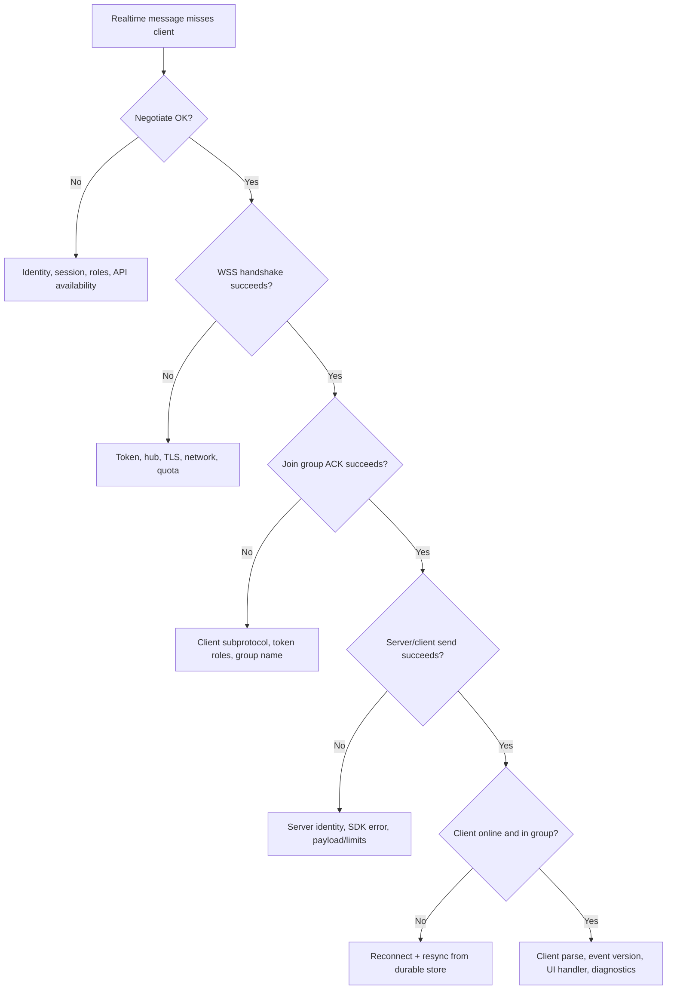

### "Quick fixes" you must never apply

- Never ship the service connection string to browsers.
- Never grant hub-wide `joinLeaveGroup`/`sendToGroup` roles when a single room is needed.
- Never disable all authorization because a WSS handshake is failing.
- Never turn Web PubSub into the sole store for critical records.
- Never open public network access violating policy on a private-only resource.
- Never log full token URLs so teammates can "copy and test".
- Never scale capacity blindly when the real bug is group routing or backend errors.

## 28. Reference architecture: authorized live order tracking

### Requirements

Customers, couriers, and support agents need live status for `order-501`. The system must:

- prevent other customers from receiving the data;
- update in near real time;
- never lose business state when WebSockets drop;
- display the accurate version after reconnect;
- revoke the old courier's access when an order is reassigned;
- monitor lag and disconnect rates.

### Component layers

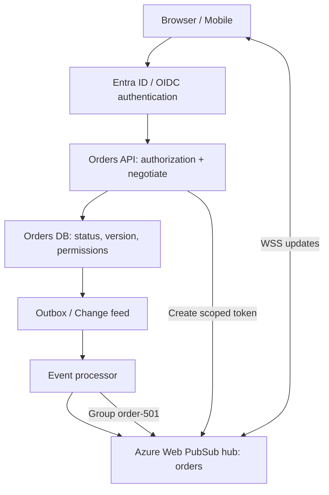

### Group policy

```text
hub: orders
group: order-501

Allowed:
  - Customer who owns order-501
  - Courier currently assigned to order-501
  - Authorized support agent with active case

Client roles:
  - join/leave authorized group if required by client flow
  - no client-to-group send for read-only order tracking
```

Because clients only **receive notifications**, omit `webpubsub.sendToGroup.order-501`. Once authorized, the backend can either add connections via the server SDK or grant scoped join roles per app design—this is a key security decision.

### Sample event protocol

```json
{
  "eventId": "evt-order-501-v12",
  "eventType": "OrderStatusChanged",
  "orderId": "order-501",
  "version": 12,
  "newStatus": "OutForDelivery",
  "occurredAtUtc": "2026-11-20T10:10:00Z"
}
```

Upon receiving an event, the client:

1. Verifies the event belongs to the currently viewed order.
2. Compares `version` with local state.
3. If it is the next sequential version, updates the UI smoothly.
4. If a version gap exists, calls GET order status.
5. If access is revoked, clears sensitive displayed fields per policy and tears down the subscription.

### Security questions

**What if the group name leaks?** Group names are never secrets. Backends still enforce group authorization and prevent users from minting their own tokens.

**What if Courier-7 keeps the app open after reassignment?** Enforce server-side group removal/connection closure, issue updated token scopes, and guard detailed payloads behind live-authorized APIs.

**What if a client goes offline for 20 minutes?** Fetch the snapshot/history API—never expect Web PubSub to replay every missed frame.

## 29. Reference architecture: support chat with persisted history

A support room needs far more than a demo chat channel:

| Capability | Design |
|---|---|
| Create room | Authenticated/authorized API |
| Send message | API or upstream event → validate/moderate → database |
| New message | Publish `messageId + roomId + sequence` via Web PubSub |
| History | Query database with pagination and auth |
| Read receipts | Application-level read receipts, never Web PubSub ACKs |
| Typing indicator | Ephemeral `typing` events with TTL; droppable under load |
| Attachments | Upload to Storage via scoped auth; WebSocket carries metadata only |
| Offline delivery | Notification service, history API, or mobile push |
| User blocking | Revoke membership, app-level ban, token revalidation |
| Moderation | Backend moderation, never pure direct client-to-group |
| Agent metrics | Business state and last-seen; presence events are signals only |

### Three event classes

**Business-critical:** `SupportTicketClosed`, `RefundApproved` — require database transactions and durable history.

**User-visible yet recoverable:** `NewChatMessage` — backed by a database `messageId` and paginated history API.

**Ephemeral:** `TypingStarted`, `CursorMoved` — safely dropped under poor networks or offline clients.

Never apply the same delivery pipeline to all three. In particular, never queue typing indicators into durable Service Bus queues only to replay them 15 minutes later when they are meaningless.

## 30. Inspecting infrastructure with Azure CLI

Given an existing Azure Web PubSub resource in a sandbox, the CLI verifies subscription, endpoint, SKU, and provisioning state.

### Safe read-only commands

```bash
az login --tenant "<tenant-id>"
az account set --subscription "<subscription-id>"

az account show \
  --query "{subscription:id,tenant:tenantId,name:name}" \
  --output json

az resource show \
  --resource-group "rg-webpubsub-lab" \
  --resource-type "Microsoft.SignalRService/webPubSub" \
  --name "<webpubsub-resource-name>" \
  --query "{name:name,location:location,sku:sku,properties:properties}" \
  --output json
```

Resource provider type casing and output schemas can vary across Azure CLI/API versions; if a projection returns null, inspect the full JSON and CLI reference rather than assuming missing properties. ARM read commands **do not prove** browser WebSockets joined groups or tokens minted correctly.

### Granting data-plane permissions

For a backend managed identity:

1. Confirm the identity principal and tenant of your App Service or Function App.
2. Assign an Azure role granting **send message / mint client token** permissions per Web PubSub data-plane RBAC at the resource scope.
3. Wait for role assignment propagation.
4. Invoke the server SDK from the real backend runtime.
5. Verify end-to-end with browser negotiation and WebSocket connection.

Never assign subscription-wide ARM `Owner` when the app only needs send-to-group permissions.

### Never execute production mutations ad hoc

Commands creating Web PubSub resources, editing network ACLs, rotating keys, altering hub/event handlers, or scaling units can incur charges or downtime. Manage configuration via Bicep/ARM/Terraform or approved pipelines with review, rollback, and budgets.

## 31. Phased production rollout

### Phase 1 — Design the event contract

Define:

- `eventId`, `eventType`, business entity ID, `version`, `occurredAt`;
- public vs private payload fields;
- group naming conventions and tenant isolation;
- read/write/join permissions per user role;
- business persistence and history APIs;
- handling for duplicates, gaps, reconnects, and offline states.

### Phase 2 — Infrastructure and security

- Provision the Azure Web PubSub resource in the right SKU and region.
- Configure required hub and event handlers.
- Set up managed identities, roles, and Key Vault.
- Decide public vs private networking for both clients and backends.
- Enable diagnostic settings/monitoring per policy.
- Protect negotiate endpoints with auth, authz, and rate limits.

### Phase 3 — Backend

- Build the negotiate endpoint minting short-lived tokens.
- Implement group authorization and revocation.
- Use the server SDK to publish only after business commits.
- Use an outbox/queue for critical notifications.
- Add event handlers only where client events require backend processing.
- Return clear HTTP statuses when tokens are denied.

### Phase 4 — Client

- Connect WebSockets with the right subprotocol.
- Handle system messages, ACKs, and errors.
- Join authorized groups.
- Reconnect with backoff and fresh tokens.
- Resync snapshots/history to recover missed events.
- Update UI by business version and guard against XSS.

### Phase 5 — Release and operations

- Load-test peak concurrent connections and hot-group fan-out.
- Test network drops, revocations, token expiry, and event-handler outages.
- Set alerts on connections, latency, errors, and spend.
- Rehearse failover/reconnects while observing DB state.
- Establish canary rollouts, rollbacks, and an incident owner.

### Deployment success is not the finish line

An Azure deployment reporting "Succeeded" proves only that Azure accepted the configuration/code. Production readiness requires **real browser connectivity, verified group authorization, accurate recipient delivery, state recovery after drops, and costs inside budget**.

## 32. Controlled failure-injection tests

Run only in a sandbox or planned staging environment—never generate load or fault-inject against production.

| Case | Test action | Acceptance criterion |
|---|---|---|
| Expired token before handshake | Use an old URL/token in lab | Rejected; client re-negotiates cleanly |
| Unauthorized room request | Call negotiate for another user's room | HTTP 403 / no roles issued; no token leaked |
| Client joins unauthorized group | Send `joinGroup` outside token scope | Error ACK or rejected per protocol |
| Rapid client message burst | Small burst below lab caps | Rate limits/backpressure engage |
| Client disconnects mid-publish | Close tab then emit notification | No assumption of delivery; snapshot syncs on reopen |
| Two tabs, one user | Open two connections | Presence behaves accurately; one connection ≠ one user |
| Failure after DB commit | Simulate worker send failure | Outbox retries without duplicating business transaction |
| Duplicate publish | Resend same `eventId` | Client prevents duplicate side effects or corrupt state |
| Out-of-order events | Deliver version 13 before version 12 | Client detects gap and refreshes |
| Event handler returns 500 | Controlled staging fault | Retries/monitoring behave per contract; business action idempotent |
| Room access revoked | Remove membership while connected | Stops receiving unauthorized updates per revocation target |
| Broken private endpoint routing | Test from unauthorized network | Connection blocked; public access never opened against policy |
| Small reconnect storm | Reconnect an authorized batch of test clients | Backoff works, quota alerts fire, servers stay healthy |
| App backend failover | Route negotiate to standby backend | Clients re-negotiate and resync cleanly |

### Measurements to record

```text
Resource/SKU/region: <value>
Hub name: <value>
Auth mode: <Entra / backend demo>
Token TTL: <value>
User/room authorization: PASS/FAIL
Connections peak: <value>
Join/send ACK result: <value>
Fan-out group size: <value>
Client reconnect latency: <value>
DB commit-to-client latency p95: <value>
Duplicate/version gap handling: PASS/FAIL
Event handler status/errors: <value>
Network route + private DNS: <value>
Diagnostic collection: <value>
Estimated cost: <value>
Cleanup owner: <owner>
```

## 33. Pre-go-live checklist

### Scope and contracts

- [ ] Confirmed WebSockets are genuinely needed rather than HTTP/SSE/push notifications.
- [ ] Selected the right Web PubSub / SignalR / Socket.IO offering.
- [ ] Clear conventions exist for hub names, user IDs, and group names.
- [ ] Events include `eventId`, `eventType`, business `version`, and minimal payloads.
- [ ] Ephemeral vs durable data classes separated.
- [ ] Reconnect, offline reconciliation, and deduplication designed.

### Security

- [ ] Backend authenticates users via trusted sessions/JWTs.
- [ ] Tenant/room/resource authorization checked before issuing roles.
- [ ] Short-lived WSS tokens; URLs never logged; service keys never sent to browsers.
- [ ] Managed identity/roles or Key Vault secrets properly governed.
- [ ] Upstream event handlers verify caller origin and CloudEvents validation.
- [ ] Revocation, group removal, and connection closure work across multiple tabs.
- [ ] XSS, payload sizes, rate limits, and sensitive data exposure controlled.
- [ ] Public/private network paths, TLS, and DNS verified for both clients and backends.

### Operations and cost

- [ ] Load-tested peak concurrent connections, fan-out, and hot groups.
- [ ] Telemetry tracks SDK errors, ACKs, reconnects, stale state, and latency.
- [ ] Runbooks and idempotency cover event handler, DB, and queue failures.
- [ ] Quota, capacity, and budget alerts configured per SKU.
- [ ] Reconnect/DR plan exists if a Web PubSub resource fails.
- [ ] CI/CD and IaC configurations support review and rollback.
- [ ] Account/role/secret rotation, incident owner, and cleanup policies documented.

## 34. Common misconceptions

**"Web PubSub is a queue that holds every message while a user is offline."** False. It is a real-time delivery service; use databases, brokers, and history APIs to recover missed state.

**"WebSockets are always faster than HTTP in every scenario."** False. WebSockets excel for persistent streams, whereas brief request/response calls can be simpler and faster over HTTP.

**"Having a `wss://...` URL means anyone can connect."** False. Connections still require valid tokens, permissions, and network reachability; token URLs are sensitive credentials.

**"Service connection strings can live in JavaScript because the site uses HTTPS."** False. Any browser or script can read client-side secrets.

**"A `userId` query parameter is a verified identity."** False. The backend must verify claims or sessions.

**"When a token expires, every active WebSocket closes immediately."** Never assume this; build explicit revocation logic.

**"One user always has exactly one `connectionId`."** False. Multiple tabs, devices, and reconnects generate multiple connections and IDs.

**"Group membership is persisted and auto-restored on reconnect."** Not by default. Rejoin groups from an authoritative permission source.

**"Random group names are enough to secure private rooms."** False. Always enforce authorization when issuing tokens/roles.

**"A successful `sendToGroup` ACK means everyone read the message."** False. Service ACKs confirm protocol handling, not application read receipts.

**"Backends can trust every incoming user event."** False. Handlers must verify event origin, user identity, and business permissions.

**"Direct client-to-group sends always work for audited chat."** False. Moderation, persistence, and per-message authz usually require backend mediation.

**"Because Azure Functions has a Web PubSub extension, WebSocket clients connect directly to the Function."** False. Clients still connect to the Web PubSub service; Functions handle negotiate, events, and publishing.

**"Web PubSub automatically orders events by database version."** False. Applications must supply business ordering and versions.

**"Browsers automatically receive missed alerts after reconnecting."** False. Fetch snapshots or history from the database.

**"Adding Azure Functions instances increases concurrent WebSocket capacity."** Not directly; concurrent WebSockets are served and capped by the Web PubSub resource.

**"Use Web PubSub instead of Service Bus for payment workflows."** False. Real-time push is not durable business messaging.

**"Data sent with `dataType=json` is automatically safe to render."** False. Validate schemas, bound fields, and prevent XSS.

**"Browser JS sends standard WebSocket protocol ping frames via a built-in method."** False. The browser WebSocket API does not expose control ping frames.

**"Counting registered users is enough for capacity planning."** False. Size from peak concurrent connections, tabs per user, fan-out, and payload traffic.

**"Adding a Private Endpoint lets public Internet users connect automatically."** False. Clients still need an authorized network route to the endpoint.

**"If Web PubSub in Region A fails, live connections fail over seamlessly to Region B."** Not by default. Clients must re-route, re-negotiate, reconnect, rejoin, and resync.

**"A successful server SDK send means the browser updated the UI."** False. Verify via client telemetry or read receipts if needed.

**"Logging the full access token URL makes support debugging easier."** Bad practice. Token URLs are replayable bearer secrets while valid.

**"Web PubSub is always cheap because one connection sends unlimited free messages."** Baseless. Account for resource SKUs/units, connection/message billing, networking, and supporting services under current pricing.

## 35. Self-check questions

**Q1.** What part of a real-time application architecture does Azure Web PubSub solve?

**Answer:** Managing WebSocket connections, group/user/connection messaging, and real-time routing. The application still owns authentication, business state, history, and business permissions.

**Q2.** Why is polling HTTP every second suboptimal for many real-time dashboards?

**Answer:** It generates wasted requests even when nothing changed and adds polling-interval latency; WebSockets enable immediate server push.

**Q3.** How do hub, group, `userId`, and `connectionId` differ?

**Answer:** A hub is a real-time namespace, a group is a set of connections sharing broadcasts, `userId` is a backend-assigned logical identity, and `connectionId` identifies one specific connection.

**Q4.** How many connections can one user open across three browser tabs?

**Answer:** Typically three distinct WebSocket connections with separate `connectionId`s, all sharing the same `userId` if the backend assigns the same identity.

**Q5.** Why is a negotiate endpoint required?

**Answer:** So the backend can authenticate and authorize the caller before minting a scoped, short-lived WSS URL/token without exposing the service key to browsers.

**Q6.** Should `/api/negotiate` trust a `userId` passed by the browser in query parameters?

**Answer:** No. The backend must read verified identity/session/JWT claims and determine authorized groups itself.

**Q7.** How do `webpubsub.joinLeaveGroup.demo-room` and `webpubsub.sendToGroup.demo-room` differ?

**Answer:** The first grants permission to join/leave the group per supported model; the second grants permission to publish messages to that group—neither grants access to backend business resources.

**Q8.** Which subprotocol must browsers specify to send JSON `joinGroup` and `sendToGroup` commands under the Web PubSub client protocol?

**Answer:** `json.webpubsub.azure.v1` for the compatible protocol version.

**Q9.** Does an ACK after `sendToGroup` prove Client B read the message?

**Answer:** No. It confirms the service processed the command per protocol; read receipts require explicit app-level tracking.

**Q10.** If a user loses connectivity while the server sends `OrderShipped`, does Web PubSub retain and replay it automatically on reconnect?

**Answer:** Never assume so. Clients must resync from a history/snapshot API or an appropriate broker/database.

**Q11.** Why is `connectionId` unsuitable as a long-term user primary key?

**Answer:** `connectionId` is bound to a single WebSocket lifecycle; every tab or reconnect creates a new ID.

**Q12.** After reconnecting, what steps must the client perform?

**Answer:** Re-authenticate/re-negotiate, open a new WSS connection, rejoin authorized groups, fetch a snapshot/history, and handle duplicates and version gaps.

**Q13.** If a client receives order version 15 and then version 14 arrives, what should it do?

**Answer:** Never regress to version 14; ignore the stale/duplicate event using a source-of-truth version guard.

**Q14.** What if the client is at version 12 and version 15 arrives?

**Answer:** A gap exists; call an API to fetch the latest snapshot or missing events rather than guessing versions 13 and 14.

**Q15.** How do direct client-to-group messages differ from client-to-server events?

**Answer:** Direct messages are fanned out to the group by the service per token roles, whereas client-to-server events hit backend handlers for business logic, moderation, and persistence before optional dispatch.

**Q16.** When should backends publish messages only after a database commit?

**Answer:** Whenever events reflect authoritative, durable business state—such as delivered orders or payments—so clients never receive alerts for uncommitted changes.

**Q17.** Does Web PubSub replace Azure Service Bus for order workflows needing retries and DLQs?

**Answer:** No. Service Bus handles durable commands/events, retries, and dead-lettering; Web PubSub handles real-time delivery to online clients.

**Q18.** Why are random group names insufficient to protect private data?

**Answer:** Group names are not credentials; backends must authenticate and authorize users before minting roles or adding connections to groups.

**Q19.** If a courier is unassigned from an order yet stays in its group, what is the risk?

**Answer:** The courier keeps receiving unauthorized updates. Backends must remove membership, close/revoke connections, and guard details behind live API authorization.

**Q20.** What does `WebSocket.bufferedAmount` measure?

**Answer:** Queued bytes waiting to leave the browser buffer; continuous growth signals backpressure requiring throttling or coalescing.

**Q21.** For capacity planning, should you size by registered users or peak concurrent connections?

**Answer:** Peak concurrent connections, tabs per user, fan-out, payload/traffic, and reconnect bursts matter far more than total registered accounts.

**Q22.** Does one notification to 200 users always cost the same as sending to one recipient?

**Answer:** Never assume that; fan-out multiplies deliveries and traffic, and actual billing follows current Web PubSub SKU pricing rules.

**Q23.** Is Web PubSub automatically compatible with SignalR and Socket.IO clients just because all use WebSockets?

**Answer:** No. SignalR and Socket.IO define distinct protocols, handshakes, and framework semantics; pick the matching service/mode.

**Q24.** Does a backend managed identity allow public Internet browsers to reach a private-only Web PubSub resource?

**Answer:** No. Browsers need a reachable network route and DNS; identity does not replace networking.

**Q25.** Why monitor both app event handlers and the Web PubSub service?

**Answer:** The service can handle connections cleanly while backend auth/negotiate/handlers fail—or backends look healthy while WebSocket quotas saturate. Each layer has distinct metrics and bottlenecks.

**Q26.** Can the browser WebSocket API emit standard protocol control ping frames like server libraries?

**Answer:** No. Browser APIs do not expose raw protocol ping frames; rely on runtime/service keepalives or app-level heartbeats where needed.

**Q27.** If Web PubSub in Region A fails, does a client seamlessly keep the same connection in Region B?

**Answer:** Not by default. Clients must route, re-negotiate, reconnect to a healthy resource, rejoin groups, and resync state from a durable backend.

**Q28.** When should you add a durable history store instead of relying solely on WebSockets?

**Answer:** Whenever data needs offline recovery, auditing, read receipts, business transactions, or long-term retention.

**Q29.** What controls are required to secure a production negotiate endpoint?

**Answer:** Identity verification, room/tenant authorization, short-lived least-privilege tokens, rate limits, HTTPS, `no-store` headers, redacted logs, and revocation support.

**Q30.** Beyond "send API returned success", what proves a Web PubSub application passes acceptance?

**Answer:** Real browsers receive expected messages, zero data leaks occur, versioning/reconnects work, business state stays durable, and telemetry/errors/capacity/cost stay within targets.

## 36. Self-design exercise

**Prompt:** A university runs an online classroom platform with 10,000 signed-in students and 2,000 attending a live stream simultaneously. Instructors push class announcements, students chat, and moderators can mute rule-breaking students. Video streaming runs on a separate media platform; Web PubSub handles only alerts and chat.

**Design:**

1. Hub/group naming so Class A never leaks into Class B.
2. Negotiate endpoint verifying identity and class enrollment.
3. Instructor/moderator/student permissions: who may send vs receive?
4. If chat requires pre-display moderation, choose direct client send or server-mediated flow?
5. How do you stop a banned student from sending or receiving?
6. When a student drops offline for 5 minutes, where do missed messages come from?
7. How does the system store chat history and read receipts?
8. What should load tests measure for peak concurrent connections, fan-out, and handler latency?
9. Which ephemeral traffic can be coalesced or dropped to save cost?
10. Which runbooks are needed for service outages, secret leaks, and reconnect storms?

### Reference approach

| Component | Suggested design |
|---|---|
| Hub | `classrooms` |
| Group | `course:<courseId>:session:<sessionId>`, preventing cross-class/tenant collisions |
| Identity | OIDC/Entra ID; `userId` from verified claims |
| Negotiate | Check enrollment, session status, and ban list |
| Permissions | Students may join; sending routes through moderated API |
| Moderator | Backend updates ban list and updates connection/group state |
| Chat persistence | Database + idempotency + room sequence |
| Delivery | Backend publishes moderated messages to the Web PubSub group |
| Reconnect | Re-negotiate, rejoin, GET history from last sequence |
| Notifications | Message metadata/ID rather than full student profiles |
| Monitoring | Active connections, ban/revocation lag, dropped/retried events, p95 latency |

**Never stream live video over WebSocket connections** when a dedicated streaming/media platform exists; Web PubSub fits metadata, interactivity, status, and alerts—not video distribution.

## Summary

**Azure Web PubSub** gives WebSocket applications bidirectional communication and **server push** by hub, user, connection, and group without self-managing WebSocket infrastructure. The core flow pairs a **trusted backend authenticating callers and minting tokens via a negotiate endpoint**, browsers connecting over **`wss://`** with the right subprotocol, joining authorized groups, exchanging events, and app servers executing business logic or publishing via SDKs.

To build reliable, secure real-time features, distinguish **service ACKs from read receipts**, **group membership from business authorization**, and **connection state from durable data**. Design **reconnect + snapshot/history sync**, event IDs/business versions, idempotency/outboxes, group revocation, short token TTLs, private networking, and server-side validation from day one—never expecting WebSockets to hold offline messages or run business transactions.

In operations, track **peak concurrent connections, fan-out, payload sizes, handler latency, reconnect errors, client delivery lag, and costs**. Combining Web PubSub with Azure Functions/App Service, Service Bus, Azure SQL/Cosmos DB, and Azure Monitor along clear layer boundaries delivers near-real-time experiences while protecting **reliability, security, correctness, and budget**.
