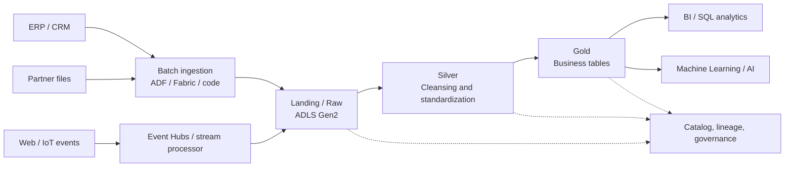
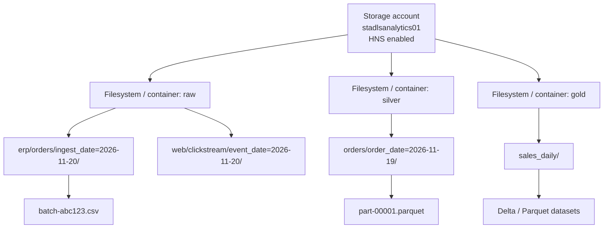
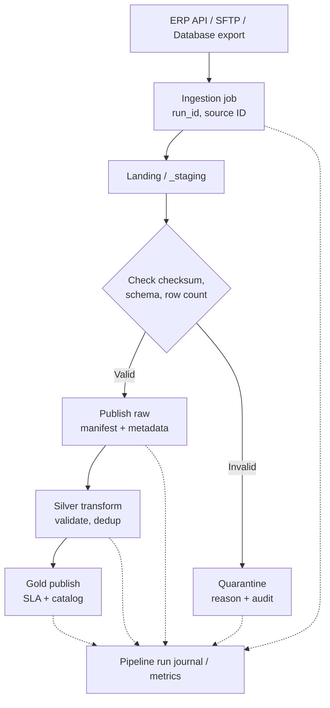
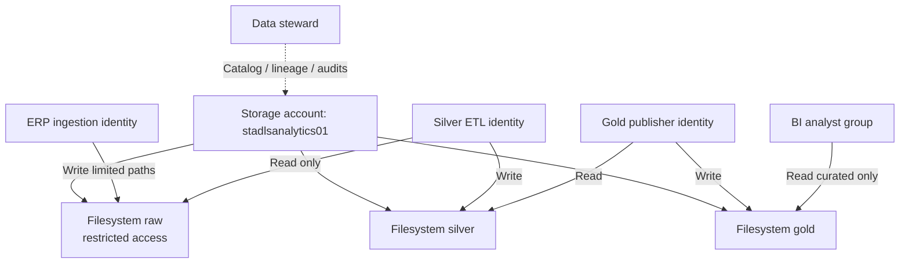
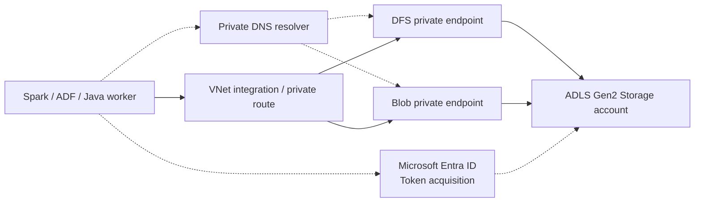
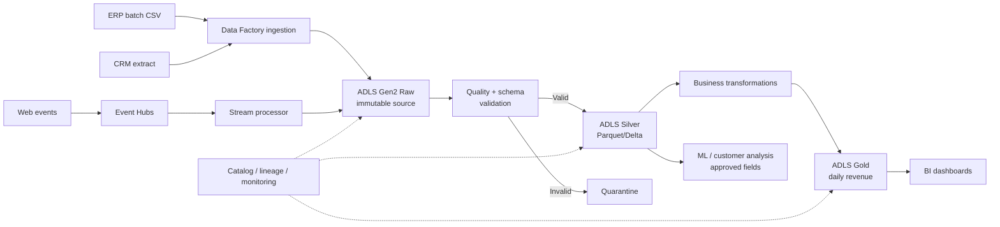

# Designing a Data Lake with Azure Data Lake Storage Gen2

A retail enterprise receives data from its enterprise resource planning (ERP) system, website, mobile applications, IoT devices, and partners. Data arrives in multiple formats at varying frequencies, sometimes with missing fields or resent payloads. The data team needs to preserve raw copies for investigation, cleanse and consolidate them into reliable tables, and then serve reports, data science, and AI applications. If every team freely overwrites a shared directory, before long no one will know which file is the original source, who is allowed to read personal data, or where to rerun a pipeline from when it fails.

A **data lake** is an architecture for storing diverse data at scale, preserving source data while allowing multiple tools to process and consume it as needed. **Azure Data Lake Storage Gen2 (ADLS Gen2)** provides data lake capabilities on top of **Azure Blob Storage** through a **hierarchical namespace (HNS)**, enabling files and directories to be organized in a directory tree, performing operations suited to analytics workloads, and integrating with Azure identity, authorization, and the data processing ecosystem.

In the **CLOUD_PROVIDERS_AZURE** module, you explore Microsoft Azure from subscriptions, resource groups, and Microsoft Entra ID to virtual networks, compute, storage, data, deployment, monitoring, protection, and cost control. This lesson belongs to the **Data Platforms and Analytics** chapter. The focus is on **designing a data lake with ADLS Gen2**: choosing structures, protecting data, building pipelines, controlling quality, operating, recovering, and estimating costs — not just creating a Storage account and uploading files.

> **Scope:** The resource names, addresses, and commands below are examples for an **authorized lab**. Configurations for HNS, networking, ACLs, data deletion, lifecycle, and role assignments can impact production; always test in an isolated environment and verify support by Storage account type, region, SDK version, and organizational policy.

## 1. Learning Objectives

After this lesson, you will be able to:

- Explain how a data lake, data warehouse, and lakehouse address different needs.
- Describe the **Storage account → filesystem/container → directory → file** relationship and the HNS characteristics of ADLS Gen2.
- Distinguish between the **`dfs.core.windows.net`** and **`blob.core.windows.net`** endpoints; read `abfss://` paths.
- Design **landing, raw/bronze, standardized/silver, curated/gold, and quarantine** zones along with appropriate data boundaries.
- Name files/directories and partition by source, time, tenant, and data type without creating too many small files.
- Configure **Microsoft Entra ID, Azure RBAC, POSIX-like ACLs**, and default ACLs following the principle of least privilege.
- Understand the differences between **Private Endpoint**, Storage firewall, VNet integration, and private DNS for Blob/DFS.
- Upload, list, and organize files with Azure CLI/Java SDK; know when to use Spark/ADF for data transformations.
- Design pipelines with checkpoints, data quality, schema evolution, idempotency, auditing, and replayability.
- Identify trade-offs across performance, security, lifecycle, monitoring, redundancy, recovery, and cost.

## 2. What Problem Does a Data Lake Solve?

Data systems are usually distinguished by their **primary purpose**, not merely by the storage service:

| Architecture | Core Idea | Best Suited When |
|---|---|---|
| **Operational database (OLTP)** | Updates application records and transactions per request | Order processing, inventory, accounts |
| **Data warehouse** | Data modeled for SQL analytics and governed BI | KPIs, revenue reports, consistent dashboards |
| **Data lake** | Stores diverse data types, including raw and processed data, using schema-on-read or schema-on-write by layer | Source data, telemetry, logs, ML, ETL |
| **Lakehouse** | Combines a data lake with a table/metadata layer and transactional, analytical capabilities | Using a single file foundation for ETL, BI, and data science with a table format |

**ADLS Gen2 is a storage foundation**; it does not automatically provide a SQL warehouse, schema registry, data catalog, or ACID transactions across sets of multiple files. To build a lakehouse, compute systems can use **Delta Lake, Apache Iceberg, or compatible table formats**, along with supported catalogs and engines.

### A Typical Data Flow



For example, an ERP source delivers CSV files into `landing/erp/orders/`; the pipeline verifies checksums, writes the original copy to `raw/erp/orders/`, reads and validates the schema, routes invalid records to `quarantine/`, and outputs standardized Parquet data to `silver/orders/`. A subsequent job joins orders with product data to produce the `gold/daily_sales/` dataset for reporting.

**Key takeaway:** every zone has a different **owner, quality bar, retention, and access permissions**. A data lake is poorly designed if "everyone can read/write everywhere" and there is no traceable input data or state.

## 3. How Is ADLS Gen2 Built on Blob Storage?

An Azure Storage account is the resource configuration boundary: region, redundancy, networking, identity, encryption, and supported storage services. With **hierarchical namespace enabled**, Blob Storage provides an explicit **directory/file** namespace for data lake workloads.



### Concepts to Distinguish

| Concept | Meaning |
|---|---|
| **Storage account** | Azure resource containing storage services and infrastructure configuration |
| **Hierarchical namespace (HNS)** | Feature that organizes files/directories in a hierarchy and supports filesystem-style operations |
| **Filesystem** | In ADLS Gen2, corresponds to a **Blob container**, with its own root namespace |
| **Directory** | A folder in an HNS filesystem, with its own metadata and ACLs |
| **File** | Binary data and metadata stored at a path within a filesystem |
| **Blob service endpoint** | Endpoint of the form `https://<account>.blob.core.windows.net` |
| **Data Lake/DFS endpoint** | Endpoint of the form `https://<account>.dfs.core.windows.net` |
| **ABFS/ABFSS** | Filesystem driver URI commonly used from Spark/Hadoop |

**HNS is not just naming blobs with `/` characters.** When HNS is enabled, a directory is a manageable filesystem object; operations such as rename/move within the namespace are supported with dedicated semantics, which helps when publishing data from a temporary directory to a finalized directory.

### Choosing HNS from the Start

When creating a new Storage account for ADLS Gen2, you typically choose **General-purpose v2 (StorageV2)** and **Enable hierarchical namespace** according to supported configurations. Some compatible Storage accounts can be **upgraded to enable HNS** through an Azure-supported procedure; however, **do not assume it can be toggled on and off** like a simple flag. HNS affects APIs, feature compatibility, and the cost of certain operations. Verify prerequisites before upgrading an existing account.

### Rename/Move Differs from Copy/Delete

In many file-based workflows, Spark/jobs create temporary files and then **rename** a directory/file into its final published location. HNS supports efficient rename/move within a supported filesystem, typically avoiding copying every data byte as in prefix-emulated folders. However:

- Do not treat a rename across **two storage accounts** or two different filesystems as an atomic metadata operation.
- Do not treat renaming a directory as a **multi-table ACID transaction**.
- Verify ACL permissions, leases/locks, destination name conflicts, and SDK semantics before building a commit protocol.

## 4. ADLS Gen2 Paths and the Two Endpoints

An illustrative Storage account named `stadlsanalytics01` has filesystem `raw`, directory `erp/orders/ingest_date=2026-11-20`, and file `batch-001.csv`.

| Representation | Example |
|---|---|
| **DFS HTTPS** | `https://stadlsanalytics01.dfs.core.windows.net/raw/erp/orders/ingest_date=2026-11-20/batch-001.csv` |
| **Blob HTTPS** | `https://stadlsanalytics01.blob.core.windows.net/raw/erp/orders/ingest_date=2026-11-20/batch-001.csv` |
| **ABFSS (Spark/Hadoop)** | `abfss://raw@stadlsanalytics01.dfs.core.windows.net/erp/orders/ingest_date=2026-11-20/batch-001.csv` |

`abfss` is commonly used to access ADLS Gen2 data via the Hadoop ABFS driver over a secure connection. In Spark, supported engines can use this URI to read Parquet, Delta, or other formats.

### DFS and Blob: Not Two Separate Copies

Both endpoints point to the **same data in the same account** but expose different APIs/semantics. The Blob and Data Lake Storage services are integrated, yet certain operations/features require the right endpoint. For example, the Java `DataLakeFileSystemClient` uses the **DFS endpoint**, while some Blob SDK tools/portal operations may use the **Blob endpoint**.

In particular, with **Private Link**, a Storage account may need **two separate private endpoints** for the `dfs` and `blob` subresources: some workflows use the DFS API while performing operations or redirects involving the Blob API. Creating only a private endpoint for DFS **does not guarantee** that all requests touching the Blob endpoint can connect over the private network. Verify the actual network path and private DNS for each application.

### Naming Rules

- Storage account: globally unique name following Azure rules; never embed secrets in the name.
- Filesystem/container: follow Blob container naming rules, avoiding case confusion.
- Directory/path: standardize on lowercase, allowed characters, and encoding; avoid whitespace, localized diacritics, or characters requiring escaping across different processing tools.
- File name: stable and unique when needed, including `batch_id` or `event_id` rather than a generic `data.csv` that always gets overwritten.
- Never store tokens, passwords, emails/phone numbers, or sensitive identifiers in paths where logs or catalogs might record the path.

## 5. Zone Architecture: landing → raw → silver → gold

Zone organization is often called the **medallion architecture**. This is an **architectural convention**, not a mandatory feature or an automatically generated configuration of ADLS Gen2.

| Zone | Stored Data | Typical Read/Write Permissions | Operational Policy |
|---|---|---|---|
| **Landing** | Newly arrived files, before virus/schema/checksum checks | Ingestion service writes; validation pipeline reads | Short TTL, moved to raw/quarantine after validation |
| **Raw/Bronze** | Near-source original copy, plus ingestion metadata | Ingestion writes; ETL reads; restricted modify/delete | Logically immutable, replayable, contract-based retention |
| **Standardized/Silver** | Cleansed data, standardized types, deduplicated, schema-versioned | Transformation jobs write; data engineers/consumers read within scope | High quality, analytical format, rebuildable from raw |
| **Curated/Gold** | Data products, aggregates, business definitions | Pipeline/owner writes; BI/analytics read | Clear SLA, schema contract, lineage, and freshness |
| **Quarantine** | Files/rows failing schema, checksum, or rule checks | Validation job writes; designated team reads | Stores reason/trace and short controlled retention |
| **Sandbox** | Approved data science experiments | Restricted group/identity | Quotas, no indiscriminate PII access, scheduled cleanup |

### One Filesystem or Multiple Filesystems?

There are two strategies:

**One `lake` filesystem with directories** `/raw`, `/silver`, `/gold`: easy to start with, shares one namespace, and allows folder-level ACLs, but managing retention, ownership, sharing, and team boundaries requires care.

**Multiple filesystems** `raw`, `silver`, `gold`: separates permission surfaces, lifecycle, and orchestration more cleanly in many organizations, though they still share the same Storage account boundary for networking and capacity. Some filesystem-level policies must be evaluated against actual configuration capabilities.

If **strong security isolation** is required (for example, PII by tenant, geography, encryption rules, networking, or distinct lifecycle requirements), a **separate Storage account** may be more appropriate than simply separating folders. Never treat a folder named `restricted` as a security wall if an identity already holds account-wide data-plane permissions.

## 6. Recommended Directory Structure by Domain, Source, and Time

Example organization with multiple filesystems in account `stadlsanalytics01`:

```text
stadlsanalytics01
├── landing/
│   ├── erp/orders/arrival_date=2026-11-20/run_id=r001/orders.csv
│   └── partners/pricing/arrival_date=2026-11-20/batch-93.json
├── raw/
│   ├── erp/orders/ingest_date=2026-11-20/run_id=r001/orders.csv
│   └── web/clickstream/ingest_date=2026-11-20/hour=09/events.jsonl
├── silver/
│   ├── sales/orders/order_date=2026-11-19/part-0001.parquet
│   └── customer/profile_snapshot/as_of_date=2026-11-20/part-0001.parquet
├── gold/
│   ├── finance/daily_revenue/business_date=2026-11-19/...
│   └── operations/fulfillment_kpis/business_date=2026-11-19/...
└── quarantine/
    └── erp/orders/ingest_date=2026-11-20/run_id=r001/...
```

The `/` characters in the diagram above represent logical paths; `landing`, `raw`, `silver`, and `gold` are **filesystems/containers** if you adopt this separation model. Do not simultaneously assume they are both containers and folders inside a `lake` container without explicitly documenting the design.

### Naming Along Access Axes

1. **Data domain:** `sales`, `finance`, `operations` — with an owner and data contract.
2. **Source:** `erp`, `web`, `iot` — for lineage and replay.
3. **Dataset:** `orders`, `customers` — defines schema and SLA.
4. **Partition column:** `business_date=YYYY-MM-DD`, `hour=HH` — aligned with actual queries.
5. **Run/batch ID:** aids reconciliation, replay, and preventing accidental overwrites.
6. **File part:** `part-0001.parquet` when jobs write in parallel, with a manifest/checksum if needed.

**Folder-based partitioning only helps when the query engine understands the partitioning scheme and performs partition pruning.** Creating thousands of directories does not automatically make queries faster; poor design can increase list operation costs and metadata overhead.

## 7. Designing Partitioning Around Read Patterns

**Partitioning** in a data lake is typically a convention for splitting data into directories by column value, distinct from physical partitions in a database. An orders dataset is commonly filtered by date:

```text
silver/sales/orders/
  order_date=2026-11-18/part-0001.parquet
  order_date=2026-11-18/part-0002.parquet
  order_date=2026-11-19/part-0001.parquet
  order_date=2026-11-20/part-0001.parquet
```

When a query only needs `2026-11-20`, Spark/Synapse/Fabric engines can skip other partitions **if the format, catalog, and query predicate support partition pruning**. This reduces bytes read and processing time.

### Choosing Partition Columns

| Strategy | Best Suited When | Risks |
|---|---|---|
| `event_date=YYYY-MM-DD` | Daily analytical data with steady volume | Daily volume too small or too large depending on source |
| `event_date=.../hour=HH` | High-volume streams requiring hourly filtering | Many directories and small files when volume is low |
| `region=.../date=...` | Frequently filtered by region and date | Skew if one region holds most of the data |
| `tenant_id=...` | Workloads commonly query per tenant | High cardinality, exposing tenant ID in paths, metadata explosion |
| `source=.../ingest_date=...` | Raw zone supporting replay by source/batch | Does not always match business-date queries |

**Ingest date differs from business date.** A file received on November 20 may contain transactions executed on November 19. Raw is typically partitioned by **`ingest_date`** for batch reconciliation, whereas silver/gold can be partitioned by **`business_date`** to optimize queries. Do not blindly overwrite the November 19 partition when late data arrives without an upsert strategy.

### Cardinality and Folder Explosion

Partitioning by `order_id` or `user_id` when there are millions of values can create millions of tiny directories, inflating metadata, list operations, and query planning cost. If point lookups by ID are the primary need, consider an **index/catalog/database** instead of relying solely on data lake folders.

### Timezone Conventions

- Timestamps passed between systems should have an **explicit timezone**, preferring UTC for ingestion/event time.
- Business date must follow the published business timezone.
- A job running at 00:00 UTC does not inherently share the same business date as stores in Vietnam or other markets.
- Store `ingested_at_utc`, `event_occurred_at_utc`, and `business_date` separately when needed.

## 8. Choosing File Formats and Table Formats

ADLS Gen2 stores **bytes**. Ingestion/query tools decide how to interpret bytes into records. Format choices directly impact performance, schema evolution, auditability, and cost.

| Format | Characteristics | Recommendation |
|---|---|---|
| **CSV** | Easy exchange, minimal data-type metadata | Suitable for landing/raw when source is CSV; specify encoding, delimiter, quote, timezone |
| **JSON / JSON Lines** | Flexible for event/nested data | Raw events; avoid a single giant JSON array that is hard to stream |
| **Parquet** | Columnar, compression and statistics supporting column scans | Preferred for many analytics silver/gold datasets |
| **Avro** | Row-oriented, schema support in compatible ecosystems | Event serialization and data exchange |
| **ORC** | Columnar format for supported tools | Certain analytics ecosystems |
| **Delta Lake** | Table format built on Parquet and a transaction log | Upsert/merge, schema enforcement/evolution, ACID via supported engines |
| **Apache Iceberg** | Table format with metadata/snapshots and table management features | Multi-engine lakehouse architectures where compatible |

**Do not confuse a file format with a table format.** Parquet is a columnar storage format; Parquet files alone **do not provide multi-file transactional commits, time travel, or concurrent writer conflict handling**. Delta/Iceberg add metadata and protocols enforced by supporting engines. Simply naming a folder `delta` does not turn a set of CSV files into a Delta table.

### Example: Why Parquet Helps Queries

Suppose a dataset has 100 columns, but a report only reads `business_date`, `region`, and `revenue`. With a columnar file and a query engine supporting projection pushdown, the system can read far less data than parsing every column of a CSV. When properly partitioned by `business_date`, it also reduces the number of files opened.

However, for a small 10 KiB CSV file, converting to Delta/Iceberg may add unnecessary complexity. Choose based on **volume, update frequency, query patterns, tooling, and SLA**.

### Data Compression

Parquet is commonly paired with codecs like Snappy or Zstandard depending on engine support. Compression saves storage and reduces I/O, but consumes CPU for encoding/decoding. Compare **total read latency, CPU, file size, and compatibility**, rather than simply picking the highest compression ratio.

## 9. The Small Files Problem: Why Writing Many Tiny Files Is Dangerous

A stream processor creating **one 1 KiB file per event** generates an enormous file count; when Spark reads the dataset, the overhead of opening files, listing metadata, and planning execution can far exceed the time spent reading data.

A general principle:

```text
Total query time
  ≈ file listing time + file open time + planning time
    + data reading + decompression + processing
```

### Mitigations

1. **Buffer/micro-batch:** group multiple events into each file when SLA allows.
2. **Compaction:** merge small files into fewer larger files via a controlled maintenance job.
3. **Partition sizing:** avoid hourly partitions if an hour only has a few rows.
4. **Columnar format:** convert analytics data to Parquet/Delta where appropriate.
5. **Do not put all data into a single file:** oversized files sacrifice read parallelism, complicate retries, and make incremental updates harder.

There is no single optimal file size for every engine. For example, you can test files ranging from tens to hundreds of MiB in analytical environments, then **benchmark the query engine, concurrency, and object count** instead of assuming a fixed number. For table formats, prefer using the proper **compaction/optimize protocol**; never arbitrarily delete data files while transaction metadata still references them.

## 10. Designing Resilient Ingestion Pipelines

A good pipeline does not stop at "file copied successfully." It must answer **which source was loaded, what checks ran, whether errors occurred, and how to replay accurately**.

### Batch Ingestion Workflow



### Required Steps

1. **Define the source contract:** schema version, owner, update schedule, timezone, expected row count, and personal data scope.
2. **Generate a durable run ID:** e.g., `erp-orders-20261120-001` for the ingestion run; link it to the source snapshot/version.
3. **Write to a staging path:** prevent downstream consumers from mistaking partially uploaded files for a complete batch.
4. **Validate files:** size, checksum/hash, file count, encryption, format, and virus scanning if required.
5. **Write a manifest/journal:** file list, checksums, source watermark, ingestion timestamp, and status.
6. **Publish:** move/rename or finalize commit using HNS/table format capabilities, publishing only once all files are valid.
7. **Handle errors:** classify transient/retryable failures, schema violations, duplicates, and partial uploads.
8. **Transform to silver/gold:** read the exact raw batch, validate data, and write outputs following the corresponding protocol.
9. **Mark complete:** publish the marker/metadata/catalog/checkpoint **after data is complete**, never earlier.

### Do Not Use File Name as the Sole "Already Loaded" Signal

A source may resend a file with the same name containing corrected data, or a retry may generate a new file name for the same batch. Record **source ID + snapshot/watermark + checksum + run ID** in the journal. On re-ingestion:

- If checksum/schema match an already completed batch, decide to **skip or confirm idempotently**.
- If the same logical batch arrives with a different checksum, route to a **new version or review**, without silently overwriting raw.
- If an upload is interrupted, clean up staging according to retention and record a failed/retry status.

### Which System Orchestrates?

| Tool | Suitable Role |
|---|---|
| **Azure Data Factory / Synapse pipelines** | Copy Activity, scheduling, parameterized pipelines, and activity monitoring |
| **Azure Databricks / Spark** | Batch/stream transformations, Parquet/Delta operations, large-scale compute |
| **Azure Functions / Container Apps** | Event handling or lightweight orchestration, validation/lightweight work |
| **Event Hubs** | Stream ingestion and forwarding to suitable processors/data lakes |
| **Microsoft Fabric / other analytics engines** | BI, lakehouse, and data engineering per supported integrations |
| **Microsoft Purview** | Catalog, lineage, data classification, and governance per configured capabilities |

ADLS Gen2 **does not execute ETL itself**. It provides storage; scheduling, schema validation, compute, and querying reside in connected tools. Before selecting an engine, confirm its identity/network model, quotas, and cost.

## 11. Streaming Ingestion and Late-Arriving Data

For example, web clickstream events arrive via **Azure Event Hubs**. The stream processor writes micro-batches into the raw zone by **ingest timestamp**; silver processes by **event timestamp**, watermark, and deduplication.

```text
raw/web/clickstream/
  ingest_date=2026-11-20/hour=10/run_id=stream-20261120T10/part-0001.jsonl

silver/web/clickstream/
  event_date=2026-11-19/part-0001.parquet
```

An event emitted at `2026-11-19T23:59Z` might not reach the pipeline until `2026-11-20` due to network delays or reconnects. Using ingest date as business date will make daily reports inaccurate.

### Watermarks, Replay, and Checkpoints

- **Source offset/sequence:** tracks reading progress in Event Hubs/Kafka/CDC.
- **Checkpoint:** progress state of the stream processor; does not replace durable business data.
- **Watermark:** threshold allowing late-arriving data to be processed; must be tuned to SLA/source behavior.
- **Idempotency:** include an event ID or business key to avoid duplicate writes when a processor restarts/retries.
- **Late arrival policy:** append late data and update silver/gold partitions using appropriate table transactions/merges rather than silently dropping records.

If a processor writes to the data lake successfully but crashes before checkpointing, the next run may write the same events again. Output commit and deduplication must be designed explicitly. **Exactly-once processing** must be evaluated across the **entire chain: source → compute → sink**, not assumed solely because a service offers checkpoints.

## 12. Multi-Source Data: Schema Evolution and Data Quality

Raw allows storing the original payload even when a new field appears; silver/gold must enforce a **data contract** and clear schema handling rules.

### Schema Change Scenarios

| Change | Risk | Handling Approach |
|---|---|---|
| Optional field added | Older consumers do not recognize the field | Allow backward-compatible additions when the contract permits |
| `customer_id` renamed to `client_id` | Old mappings become null or lose data | Bump schema version, test transformations thoroughly |
| Numeric `amount` changed to string with currency symbol | Parse errors or rounding issues | Validate, use decimal and separate currency field |
| Required field missing | Wrong reports or broken joins | Quarantine per rule, log reason |
| Timezone changed | Business date shifts | Normalize to UTC and preserve source timezone |
| Duplicate event ID sent | Total revenue gets doubled | Deduplicate by eventId/source/version |

### Minimum Checks

1. **Schema:** data types and required fields.
2. **Completeness:** null rate / missing record rate and acceptable thresholds.
3. **Uniqueness:** duplicate keys or event IDs.
4. **Validity:** values within valid domain (e.g., non-negative revenue when not a refund).
5. **Timeliness:** data arrives within SLA/freshness targets.
6. **Reconciliation:** row counts / monetary totals / checksums between source and sink.
7. **Privacy:** PII fields classified, masked/encrypted, or removed before serving unauthorized consumers.

### Quarantine Is Not a "Trash Bin"

Each failed record/file needs a **reason code, source ID, schema version, run ID, and failure timestamp**. Only authorized teams should inspect sensitive raw payloads. Quarantine requires retention and a reprocessing workflow; a bad file should not necessarily fail an entire batch if the business contract allows isolating bad rows, nor should a batch be marked "100% quality" after dropping rows.

## 13. ADLS Gen2 Security: Microsoft Entra ID, Azure RBAC, and ACLs

A data lake often stores both general data and **PII, financial records, and trade secrets**. Security cannot rely merely on obscure paths like `raw/restricted/`. ADLS Gen2 integrates:

1. **Microsoft Entra ID**: user identities, service principals, or managed/workload identities.
2. **Azure RBAC data-plane roles**: data access permissions at supported Azure Resource Manager scopes.
3. **POSIX-like access control lists (ACLs)**: granular permissions on directories/files when using compatible authentication and operations.
4. **Storage network rules/Private Link**: restricting network paths to Storage endpoints.
5. **Encryption, audit/monitoring, policies, and lifecycle**: protecting data, detecting changes, and governing lifecycles.

### Management Plane Differs from Data Plane

| Need | Appropriate Permission/Mechanism |
|---|---|
| View Storage account configuration | Azure RBAC **Reader** at the management plane |
| Create/modify Storage account, network rules, redundancy | Management role with corresponding resource permissions |
| Read Blobs/files with an Entra token | **Storage Blob Data Reader** or permitted ACL |
| Write/rename/delete files with an Entra token | **Storage Blob Data Contributor** or ACL permitting the operation |
| Manage ownership/ACLs and broader data permissions | **Storage Blob Data Owner** or appropriate owner/superuser permissions |
| Create role assignments | Role with RBAC management permissions at the appropriate scope, e.g., RBAC Administrator/Owner |

**Azure RBAC Reader on a Storage account does not grant permission to read file contents.** Conversely, granting **Storage Blob Data Contributor** at the account scope to a worker can nullify folder ACLs as an effective boundary.

### How Do RBAC and ACLs Coexist?

In the Entra authorization model, Azure Storage evaluates permissions via Azure RBAC data actions and the ACL mechanism. If a data-plane role already **permits the operation**, ACLs cannot act as a **deny** layer to revoke an operation allowed by the role. When the role does not grant permission for the operation, ACLs are evaluated based on identity and path.

**Consequence:** If an identity must only read `gold/finance/`, do not grant `Storage Blob Data Reader` across the **entire account** and place a "deny" ACL on `raw/pii/`. ACLs are not a negative filter over broad roles. Narrow the RBAC scope or design appropriate folder/filesystem/account boundaries and ACLs.

### Permissions by Business Role

| Principal | Access Goal | Recommended Scope |
|---|---|---|
| ERP ingestion worker | Write landing/raw for specific source | Data Contributor or write ACL on the specific filesystem/path |
| Validation/transform job | Read raw, write silver, write quarantine on error | Separate read/write by zone, restrict raw writes |
| Gold publishing job | Read silver, write gold | Data-plane rights scoped to outputs |
| BI analyst | Read curated datasets only | Data Reader at appropriate scope/ACL, no raw write |
| Data steward | Manage catalog and inspect quality | Corresponding governance/audit rights, not all PII by default |
| SRE | Observe storage/metrics and perform controlled incident response | Read/monitoring + temporary elevated access only when truly needed |

Do not use account keys across every pipeline simply for convenience: **account keys/SAS** follow a different authorization model than ACLs/RBAC and can bypass boundaries intended via Entra. When SAS is unavoidable, limit resources, permissions, and lifetime per supported SAS type, store securely, and maintain a revocation/rotation plan.

## 14. Directory ACLs: `r`, `w`, `x`, and Default ACLs

ADLS Gen2 supports POSIX-style ACLs for files and directories when HNS is enabled:

- **`r` (read):** read a file or list a directory according to semantics.
- **`w` (write):** write data/files or modify directory contents when accompanied by required permissions.
- **`x` (execute/traverse):** traverse through a directory to reach child paths.
- **Access ACL:** permissions on an existing object.
- **Default ACL:** permission template applied to **newly created children** under a directory, following inheritance rules.

### Traverse Permission Is Easily Forgotten

Suppose an analyst has read permission on a file:

```text
raw/finance/2026/11/orders.parquet
```

To access it by path, the identity needs appropriate **traverse (`x`)** permission on the parent directories `raw/`, `raw/finance/`, `raw/finance/2026/`, and `raw/finance/2026/11/`, not just `r` on the target file. In deeply nested data lakes, `403` errors are often caused by missing `x` on an intermediate directory.

### Conceptual ACL Example

```text
Directory: /sales/silver

owner::rwx
user:etl-service-principal-id:rwx
group:data-engineers-group-id:r-x
mask::rwx
other::---

Default ACL for new children:
default:user::rwx
default:user:etl-service-principal-id:rwx
default:group:data-engineers-group-id:r-x
default:mask::rwx
default:other::---
```

This is an **illustrative ACL model**, not a copy-pasteable command. Actual syntax and how object IDs/UPNs, owner/group, mask, and default entries map must be verified against the API/CLI and environment. Effective permissions of named user/group entries can be constrained by the **ACL mask**; never look solely at `rwx` next to an entry and conclude full access applies.

### Default ACLs Do Not Retroactively Fix Existing Data

If you add a default ACL to `/silver/sales` today, files that existed last month **do not automatically receive the new ACL** just because default entries changed. For existing data, run a recursive/ACL update procedure supported by the service, with a rollback plan and impact measurement for large file counts.

### Checking Permissions from a Runtime Perspective

1. Identify the exact **principal ID** used by Spark/ADF/Functions, not just the developer's user identity.
2. Check Azure RBAC data permissions and inherited role assignments.
3. Verify the full path and **`x`** permissions on parent directories.
4. Inspect the access ACL and mask on the directory/file.
5. Check default ACLs for **newly created** files, remembering they do not apply to old files.
6. Distinguish ACL errors from firewall/Private DNS and token errors.

**Never resolve a `403` by granting Storage Blob Data Owner across the entire subscription.** That is an overly broad permission that masks RBAC/ACL design flaws and increases data exposure risk.

## 15. Authorization Model by Zone and Data Domain

A practical security strategy is **data ownership by domain**, not solely by engine/pipeline.



### Choosing Boundaries

- **Filesystem boundary:** useful when each zone has distinct principals, retention, and operational practices.
- **Directory/ACL boundary:** useful when multiple domains share a filesystem and you want to avoid creating excessive containers.
- **Storage account boundary:** stronger separation for differing network rules, encryption keys, regions, redundancy, or organizational policies.
- **Subscription/resource group boundary:** serves management plane, billing, and infrastructure team separation; **does not create row-level access** inside files.

For data containing PII, create a dedicated restricted zone and grant permissions only to approved service principals. Gold datasets can be **aggregated or de-identified** to serve broader analytics teams, provided de-identification is verified to meet requirements.

### File Read Permission Is Not "Single-Column Read" Permission

ACLs and RBAC apply primarily at the file/directory/object level. If a Parquet file contains both `email` and `revenue`, anyone with read permission on the file can potentially read both fields even if a report only selects `revenue`. **Column-level security** typically belongs to query/catalog/governance engines, not as an automatic consequence of folder ACLs.

Therefore, if PII must be restricted, create a **separate restricted dataset** or publish a gold dataset with sensitive fields removed or encrypted. Do not allow users to download raw files directly and expect SQL view policies to protect file contents.

## 16. Private Networking: Storage Firewall, Private Link, and DNS

A data lake is often accessed by ADF, Spark clusters, Azure Functions, AKS, BI engines, and on-premises machines. **Having valid RBAC without a network path** still prevents reading data. Conversely, a working private endpoint does not automatically grant client authorization.

### Public Endpoint vs. Private Endpoint

| Mechanism | Purpose | What Not to Assume |
|---|---|---|
| TLS to public endpoint | Encrypts traffic and uses the Azure Storage endpoint | Does not mean the endpoint is accessible only from a VNet |
| Storage firewall/network rules | Restricts allowed source IPs/VNets per configuration capabilities | Does not automatically assign a private IP |
| VNet service endpoint | Identifies/restricts subnets allowed to reach the service endpoint per policy | Not Private Link |
| **Private Endpoint** | Network interface/private IP for a Storage subresource | Does not grant Azure RBAC/ACL |
| Private DNS | Resolves standard hostname to private IP inside appropriate networks | Does not automatically create routes/peering |

### Two Private DNS Zones to Consider

```text
DFS API:
  stadlsanalytics01.dfs.core.windows.net
  privatelink.dfs.core.windows.net

Blob API:
  stadlsanalytics01.blob.core.windows.net
  privatelink.blob.core.windows.net
```

For an HNS-enabled Storage account with private networking, typically consider **private endpoints for both `dfs` and `blob`** along with appropriate private DNS zones/links. Some Data Lake/Blob operations or redirects may involve the other endpoint. Configuring only DFS can lead to confusing failures on Blob API operations.



### Testing Networking from the Real Workload

```bash
# Run inside the actual VM/container or VNet-integrated environment of the workload.
nslookup stadlsanalytics01.dfs.core.windows.net
nslookup stadlsanalytics01.blob.core.windows.net

# When netcat is available, verify HTTPS connectivity.
nc -vz stadlsanalytics01.dfs.core.windows.net 443
nc -vz stadlsanalytics01.blob.core.windows.net 443
```

If the hostname resolves to a public IP inside a VNet that should be private, check zone links, DNS forwarding, hub/spoke DNS, and caches. If the private IP is correct but TCP times out, check routes, NSGs/firewalls, private endpoint approval, and subnets. **Successful DNS/TCP does not prove ACL/RBAC correctness**; test actual read/write operations after confirming networking.

### Caution Before Locking Down Public Network Access

Before disabling public access or tightening the firewall:

1. Inventory **all clients**: Spark, ADF managed integration runtimes, automation, monitoring/exports, partners, and operator workstations.
2. Verify each client has a **supported private path** from its real runtime environment.
3. Verify **both DFS and Blob endpoints** and DNS.
4. Verify Microsoft Entra token acquisition and data-plane permissions.
5. Prepare an approved rollback/change window plan.

Do not disable public access immediately after creating a private endpoint for one lab VM and assume all production clients will work. In particular, managed runtimes/linked services may have their own managed private endpoint or network integration mechanisms depending on the product.

## 17. Azure CLI Practice: Create Filesystem, Directory, and Upload

### 17.1. Preparation

Assume a Storage account `stadlsanalytics01` **already exists with HNS enabled**, the operator has appropriate permissions on the Storage account, and networking allows reaching the DFS endpoint.

| Resource | Lab Value | Requirement |
|---|---|---|
| Subscription | `<subscription-id>` | Approved |
| Resource group | `rg-data-lab` | Resource group for practice |
| Storage account | `stadlsanalytics01` | HNS enabled, correct location/SKU |
| Filesystem | `raw` | Stores raw data |
| Directory | `erp/orders/ingest_date=2026-11-20` | Partitioned by ingest date |
| Input file | `orders-sample.csv` | Synthetic data, no real PII |

Verify the account configuration from Azure CLI:

```bash
az login
az account set --subscription "<subscription-id>"

az storage account show \
  --resource-group "rg-data-lab" \
  --name "stadlsanalytics01" \
  --query "{name:name,location:location,kind:kind,sku:sku.name,isHnsEnabled:isHnsEnabled}" \
  --output json
```

**Do not run a Storage account creation command without reviewing the lab's HNS/region/network requirements.** If `isHnsEnabled` is incorrect, you need a different account or an approved conversion procedure; do not assume changing the endpoint URL enables ADLS Gen2.

### 17.2. Create Filesystem and Directory (Data Mutation)

```bash
ACCOUNT="stadlsanalytics01"

# Requires permission to create filesystems per environment policy.
az storage fs create \
  --account-name "$ACCOUNT" \
  --name "raw" \
  --auth-mode login

# Create a directory for a new batch.
az storage fs directory create \
  --account-name "$ACCOUNT" \
  --file-system "raw" \
  --name "erp/orders/ingest_date=2026-11-20" \
  --auth-mode login
```

These are **mutating operations**; run them only if the corresponding filesystem/directory does not yet exist or an idempotent workflow is in place. Permission to create containers/filesystems should not be granted to every ingestion worker; in production, infrastructure pipelines can provision filesystems beforehand while workers are only permitted to create directories/files within their assigned paths.

### 17.3. Upload a File and Verify (Write + Read)

Create a sample CSV file **on your lab machine** using an authorized tool:

```csv
order_id,amount,currency,order_date
ORD-001,150000,VND,2026-11-19
ORD-002,230000,VND,2026-11-19
```

Save it as `orders-sample.csv`. Next:

```bash
az storage fs file upload \
  --account-name "stadlsanalytics01" \
  --file-system "raw" \
  --path "erp/orders/ingest_date=2026-11-20/orders-sample.csv" \
  --source "./orders-sample.csv" \
  --auth-mode login

# Verify the object appears in the expected directory.
az storage fs file list \
  --account-name "stadlsanalytics01" \
  --file-system "raw" \
  --path "erp/orders/ingest_date=2026-11-20" \
  --auth-mode login \
  --output table
```

Exact `az storage fs` parameters can vary across CLI versions; check `az storage fs file upload --help` and `az storage fs file list --help` before running. Do not blindly add `--overwrite` without understanding your CLI version and the impact of overwriting data.

### 17.4. Inspect Directory ACLs

```bash
az storage fs access show \
  --account-name "stadlsanalytics01" \
  --file-system "raw" \
  --path "erp/orders" \
  --auth-mode login \
  --output json
```

This command reads ACL/owner/group information according to API and principal capabilities. When setting ACLs, use portal/CLI/IaC with an **approval process**; never copy illustrative ACLs verbatim from documentation onto production directories and accidentally strip permissions from running pipelines.

### 17.5. Multi-Layer Data Verification

After uploading:

1. Verify the **full path** and confirm the object type is file.
2. Verify size, checksum/hash if required, and last modified timestamp.
3. Test reading the file using the **actual consumer identity**; upload success for the writer does not prove the BI group has read access.
4. Verify that the manifest or pipeline journal recorded the batch ID, row count, and validation status.
5. Do not mark a batch `READY` simply because a file exists if other parts of the batch are still missing.

## 18. Java SDK: Operating on Data Lake Files with Managed Identity

The Azure Storage SDK for Java provides **`com.azure:azure-storage-file-datalake`** and **`com.azure:azure-identity`**. Below is a brief example using **`DefaultAzureCredential`**; Azure runtimes should use a managed identity or workload identity, never storing account keys in source code.

### 18.1. Maven Skeleton

```xml
<dependencies>
    <dependency>
        <groupId>com.azure</groupId>
        <artifactId>azure-storage-file-datalake</artifactId>
        <version>REPLACE_WITH_APPROVED_VERSION</version>
    </dependency>
    <dependency>
        <groupId>com.azure</groupId>
        <artifactId>azure-identity</artifactId>
        <version>REPLACE_WITH_APPROVED_VERSION</version>
    </dependency>
</dependencies>
```

Select versions via the **Azure SDK BOM** or an organization-approved dependency set. The placeholders above **are not valid Maven versions**: replace them before building. Do not pull or deploy dependencies into a real project without authorization.

### 18.2. Writing a Sample CSV File

```java
import com.azure.identity.DefaultAzureCredentialBuilder;
import com.azure.storage.file.datalake.DataLakeDirectoryClient;
import com.azure.storage.file.datalake.DataLakeFileClient;
import com.azure.storage.file.datalake.DataLakeFileSystemClient;
import com.azure.storage.file.datalake.DataLakeServiceClient;
import com.azure.storage.file.datalake.DataLakeServiceClientBuilder;

import java.io.ByteArrayInputStream;
import java.nio.charset.StandardCharsets;

public final class DataLakeUploadDemo {
    public static void main(String[] args) {
        String account = "stadlsanalytics01";
        String filesystem = "raw";
        String directory = "erp/orders/ingest_date=2026-11-20";

        DataLakeServiceClient service = new DataLakeServiceClientBuilder()
                .endpoint("https://" + account + ".dfs.core.windows.net")
                .credential(new DefaultAzureCredentialBuilder().build())
                .buildClient();

        DataLakeFileSystemClient fs =
                service.getFileSystemClient(filesystem);
        DataLakeDirectoryClient dir = fs.getDirectoryClient(directory);

        // Demo: directory and filesystem were provisioned beforehand.
        String csv = "order_id,amount,currency\n"
                + "ORD-001,150000,VND\n"
                + "ORD-002,230000,VND\n";
        byte[] bytes = csv.getBytes(StandardCharsets.UTF_8);

        // Use a unique batch name; creating a file may overwrite depending on SDK/options.
        DataLakeFileClient file = dir.createFile("batch-demo-001.csv");
        file.append(new ByteArrayInputStream(bytes), 0, bytes.length);
        file.flush(bytes.length);

        System.out.println("Uploaded bytes=" + bytes.length);
        System.out.println("File path=" + file.getFilePath());
    }
}
```

**Explanation:**

- `DataLakeServiceClientBuilder` requires the **DFS endpoint** of the Storage account.
- `getFileSystemClient` and `getDirectoryClient` target the right filesystem/directory.
- `createFile` creates the file per SDK semantics; understand behavior when the **target file already exists** before rerunning to avoid unexpected raw overwrites.
- `append` writes a byte segment at an offset; `flush` commits/advances bytes to the expected logical length. Production code must handle retries, partial writes, offsets, and flush errors.
- `DefaultAzureCredential` uses the application's identity; only data-plane permissions and appropriate ACLs are needed, with no hard-coded keys.

The snippet above suits **small lab files**. For multi-GiB files or concurrent writers, use **high-level SDK upload APIs**, transfer options, and an appropriate staging/commit protocol. Never load an entire data lake file into RAM and call `append` once.

### 18.3. Reading Properties to Verify a File

```java
import com.azure.storage.file.datalake.DataLakeFileClient;
import com.azure.storage.file.datalake.models.PathProperties;

// file is a DataLakeFileClient created or retrieved earlier.
PathProperties properties = file.getProperties();
System.out.println("Length=" + properties.getFileSize());
System.out.println("ETag=" + properties.getETag());
System.out.println("LastModified=" + properties.getLastModified());
```

This is a **snippet inside a method** where `file` is already defined, not a standalone Java class. ETag and LastModified are useful for change detection/optimistic conditions, but **do not replace content checksums that a pipeline must verify**.

### 18.4. Reusing Clients and Observing Errors

Production Java applications should reuse service/filesystem clients and configure timeouts, retries, memory limits, and appropriate logging. When encountering `403` or `404`, check:

- `403`: principal/role/ACL, path traversal, or firewall/network restrictions.
- `404`: are the account/filesystem/directory/file paths and region correct, and has the file been published?
- `409`/`412`: destination name conflicts or ETag/condition mismatches per API.
- `429`/`503`: throttling/resource pressure; use bounded backoff retries and reduce concurrency.

Never log OAuth tokens or sensitive raw files. When retrying failed uploads, inspect **byte ranges and committed length** before resuming to prevent duplicate or missing bytes.

## 19. Spark Reading and Writing Parquet on ADLS Gen2

In Spark environments properly configured to connect to ADLS Gen2 (Azure Databricks, Synapse Spark, or environments supporting ABFS), the `abfss` path represents filesystem + storage account + path.

### Illustrative Spark SQL/PySpark Example

```python
# Example ONLY to illustrate the Spark API; requires an active Spark session,
# Entra/ACL permissions, and preconfigured ABFS connector settings.
raw_path = (
    "abfss://raw@stadlsanalytics01.dfs.core.windows.net/"
    "erp/orders/ingest_date=2026-11-20/"
)
silver_path = (
    "abfss://silver@stadlsanalytics01.dfs.core.windows.net/"
    "sales/orders/"
)

orders = (
    spark.read.option("header", "true")
    .schema("order_id string, amount decimal(18,2), currency string")
    .csv(raw_path)
)

from pyspark.sql.functions import lit, to_date

normalized = (
    orders
    .filter("order_id IS NOT NULL AND amount >= 0")
    .withColumn("ingest_date", to_date(lit("2026-11-20")))
)

normalized.write.mode("append").partitionBy(
    "ingest_date"
).parquet(silver_path)
```

This snippet teaches **how a Spark engine consumes ADLS Gen2**, not a complete production pipeline: production requires schema validation/quarantine, checkpointing, deduplication, business date handling, duplicate file handling, and atomic publishing. Using `append` can create duplicate files if the job reruns; for high correctness, design an idempotent sink or a table format with an appropriate transaction protocol.

### Permissions for Spark

A Spark runtime can use a managed identity, workload identity, service principal, or service-supported federation mechanism. Credential/ACL configuration must match the **actual execution identity** of the cluster/job. Being able to view a file in the portal as a user **does not prove** that Spark executors have traverse/read permissions.

### Why Keep Secrets Out of Notebooks?

Never hard-code account keys or service principal secrets in notebooks, repositories, or Spark configurations printed to logs. Prefer **managed identity/federated identity** or approved secret management with per-job least privilege. When sharing notebooks publicly, strip sensitive hostnames and internal data.

## 20. Metadata Governance: Catalog, Lineage, and Data Contracts

A data lake shared across multiple teams quickly degrades into a **data swamp** without metadata, ownership, and data discoverability.

### Minimum Metadata for a Dataset

| Attribute | Example | Purpose |
|---|---|---|
| Dataset name | `sales.orders` | Stable identifier |
| Data owner / steward | Sales Data Team | Accountable party |
| Description | Standardized orders after validation | Prevents semantic misuse |
| Schema version | `v3` | Evaluates pipeline compatibility |
| Source & lineage | ERP Orders → raw → silver | Source traceability |
| Freshness/SLA | Updated before 07:00 business time | Quality commitment |
| Primary business key | `order_id` | Deduplication/upsert |
| Partition strategy | `business_date` | Optimizes queries/retention |
| Sensitivity | Internal / Confidential / PII | Access control |
| Retention / legal hold | Per approved policy | Lifecycle governance |
| Storage format | Parquet/Delta | Engine compatibility |
| Quality rules | Non-null order_id, valid amount | Detects bad data |

### Microsoft Purview and Catalogs

**Microsoft Purview** or an appropriate catalog/governance tool can help with dataset discovery, classification, lineage tracking, and metadata management depending on configured connectors. However:

- A catalog **does not automatically fix ACLs** without corresponding governance/enforcement mechanisms.
- Lineage does not appear automatically for every pipeline if tools are unintegrated or unconfigured.
- A dataset tagged "PII restricted" but stored in a filesystem readable by an account-wide identity remains exposed to data leakage.

Catalog, identity, ACLs, networking, and query-engine permissions must work together as **a unified governance model**, not rely on a single classification label.

## 21. Lifecycle, Retention, and Data Protection

A data lake retains long-term history, yet **not every file needs to remain in the hot tier forever**. Raw data may require months of retention for replay, landing may need only days, gold may be updated continuously, and sensitive datasets carry legal deletion deadlines.

### Designing Retention by Zone

| Zone | Reason to Keep | Example Policy to Define |
|---|---|---|
| Landing | Temporary upload, error reconciliation | Clean up published files after a safe buffer |
| Raw/Bronze | Replay, source audit, pipeline recovery | Retention per data contracts and legal obligations |
| Silver | Standardized data rebuildable from raw | Rebuild policy, versioning/table retention |
| Gold | Data products published to users | Retain snapshots needed for reporting, avoid deleting active datasets |
| Quarantine | Investigate bad files/records | Short controlled TTL, purge PII once no longer needed |
| Sandbox | Experiments with quota and owner | Cleanup deadline, no indefinite storage of sensitive copies |

### Azure Storage Lifecycle Management

Azure Blob Storage offers **lifecycle management policies** subject to account type, blob type, HNS, and access tier capabilities. You can consider moving infrequently accessed data to more economical tiers or deleting data by age, but:

- **Do not assume all access tiers (especially Archive) are available or behave identically on HNS accounts.** Check service/tier/region capabilities and API prerequisites before applying them.
- Avoid overly broad prefix rules that accidentally tier or delete active Delta/Iceberg metadata or transaction logs.
- Physically deleting files inside a lakehouse table can corrupt snapshots, time travel, or transaction logs if you bypass the table format's official vacuum/expiration mechanism.
- Datasets under legal hold, compliance, or mandatory retention require separate policies.
- Retention based on `lastModified` can differ from business date or ingest date; verify what the active policy uses.

**Data lifecycle and data governance must align.** Never let a "30-day cleanup" job delete source data contractually required for 5 years.

### Soft Delete, Versioning, and Immutability

Several Blob Storage data protection features have different compatibility and limitations when HNS is enabled. When designing:

1. Check whether **soft delete** for files/directories is supported for the current SKU and feature set.
2. Review **versioning**, **point-in-time restore**, **immutability policies**, and HNS account limitations; **do not assume all are supported identically to non-HNS Blob accounts**.
3. Define RPO/RTO and practical export/snapshot/backup alternatives when desired features are unavailable.
4. Test restoring a dataset in a lab before committing to recovery guarantees.

Never confuse **LRS/ZRS/GRS redundancy** with backup for recovering accidental deletions or corrupted writes: corrupted data can be replicated to replicas.

## 22. End-to-End Monitoring of the Data Lake and Pipelines

A data lake needs visibility into both the **storage system** and **post-processing data correctness**. Storage account metrics only report requests/latency/bytes; they cannot tell that `orders.parquet` is missing 10% of orders.

### Two Observability Layers

| Layer | Recommended Metrics | Why It Matters |
|---|---|---|
| **Storage** | Transactions, availability, errors, ingress/egress, request latency | Checks Storage endpoints and network health |
| **Pipeline** | Run status, input/output file count, row count, schema errors, checksum mismatches | Identifies missing or broken batches |
| **Freshness** | Last successful ingestion, event lag, end-to-end SLA | Confirms data arrives on time for reports |
| **Data quality** | Missing IDs, duplicate keys, invalid amounts, null ratio | Prevents bad data from reaching gold |
| **Cost/efficiency** | Bytes stored/read/written, operations, compaction jobs, compute cost | Avoids wasteful storage and scans |
| **Security** | ACL/role changes, failed access, public network changes, key usage | Detects shifts in data boundaries |
| **Governance** | Dataset owner, lineage freshness, retention compliance | Supports auditing and data stewardship |

### Example Business Metrics

For the daily `silver.sales.orders` dataset:

```text
dataset: sales.orders
business_date: 2026-11-19
pipeline_run_id: erp-orders-20261120-r001
source_records: 100000
accepted_records: 99880
quarantined_records: 120
duplicate_records: 0
source_checksum_verified: true
pipeline_state: COMPLETED_WITH_WARNINGS
published_at_utc: 2026-11-20T03:20:00Z
```

**This is an illustration**, not real data. Having 120 quarantined records must be evaluated against **quality thresholds** and reported transparently; never return a plain "success" state when downstream consumers expect all 100,000 records.

### Azure Monitor from Azure CLI

```bash
ACCOUNT_ID=$(az storage account show \
  --resource-group "rg-data-lab" \
  --name "stadlsanalytics01" \
  --query id --output tsv)

az monitor metrics list-definitions \
  --resource "$ACCOUNT_ID" \
  --output table

# For Storage account types with a corresponding Blob service child resource:
BLOB_SERVICE_ID="$ACCOUNT_ID/blobServices/default"
az monitor metrics list-definitions \
  --resource "$BLOB_SERVICE_ID" \
  --output table
```

These commands only list **metric definitions**; they do not create new metrics. Exact metrics/diagnostic categories depend on resource type, service API, and region. To build alerts, verify metric names, aggregations, and dimensions on the actual resource rather than copying thresholds from another account.

### Structured Logging

Every pipeline should log **run ID, source ID, dataset version, input/output paths, schema version, row counts, bytes, duration, errors, and trace IDs**. Never log SAS URLs, OAuth bearer tokens, account keys, or sensitive PII payloads.

Recording the **Storage request ID** and correlation ID helps cross-reference service-side diagnostics. For data lake failures, distinguish:

- HTTP `401/403`: credentials/ACL/RBAC/firewall;
- `404`: file/directory missing or wrong path/version;
- `409/412`: conflict/conditions/ETag mismatch;
- `429/503`: throttling, transient errors, capacity/partition pressure;
- Request succeeded but **wrong row count**: ETL/data quality logic bug, not Storage availability.

## 23. Performance Optimization: File Sizes, Metadata Operations, and Compute Locality

Data lake performance is typically governed by **file counts, partitioning, format, query engine scan behavior, and compute locality**, not just maximum Storage account bandwidth.

### A Comparison

Suppose a 100 GiB dataset is written in two ways:

- **Option A:** millions of tiny files, each holding a few events.
- **Option B:** fewer reasonably sized columnar files, partitioned by business date.

If a query calculates total revenue for a single day, Option B typically enables **partition pruning, column projection, and far fewer metadata/list operations**, even though the raw data volume is similar. However, if you only need to look up a single event by ID, a relational/NoSQL index may be far better suited than scanning Parquet.

### Factors to Measure

1. **Request/transaction count:** list/open/read/write/rename operations.
2. **Average file size and file count per partition:** indicator of the small-file problem.
3. **Compression ratio and decode CPU:** balancing storage against compute.
4. **Partition pruning:** percentage of partitions skipped by query predicates.
5. **Read bytes vs. scanned bytes:** verifying projection/pushdown.
6. **Parallelism:** enough files/partitions for workers to exploit concurrency.
7. **Cross-region traffic:** compute and storage in different regions can increase latency and egress.
8. **Hot paths:** many jobs writing into a single directory/manifest/transaction log causing contention.
9. **Backfill impact:** will historical reprocessing degrade SLAs for fresh data?

### Compaction and Table Maintenance

Compaction reduces small files, though it also consumes compute and generates read/write operations. For Delta/Iceberg, use the appropriate **engine/table maintenance APIs** and coordinate with snapshot retention rather than manually copying/merging files and desynchronizing the transaction log or catalog.

For immutable raw files, typically keep the original source files and produce a separate compacted silver/gold derived dataset instead of overwriting raw. That preserves replayability and auditability.

### Avoid "Load Everything Then Filter"

In Spark/Synapse/Databricks, push partition filters early, select only needed columns, avoid `collect()` on large datasets to the driver, and avoid full scans whenever a user API requests one page of results. Data lakes suit batch/analytics processing; serving **low-latency point lookups** may require a serving database or caching layer.

## 24. Data Lake Cost: More Than Just GB Capacity

Total cost comprises **Storage + operations + data processing + networking + governance/monitoring + data protection**.

| Component | Cost Driver | How to Control |
|---|---|---|
| Storage capacity | Raw, silver, gold, snapshots, replicas | Retention, compression, avoiding redundant copies |
| Storage operations | Create/list/read/write/rename, metadata, lifecycle | Reduce small files, reduce redundant scans |
| Access tiers | Hot/cool data and compatible tier capabilities | Choose based on access frequency and read/transition fees |
| Replication | LRS/ZRS/GRS or other redundancy models | Choose based on RPO/RTO and data residency rules |
| Compute | Spark clusters, ADF, Databricks, Functions/Fabric workloads | Autoscaling, job scheduling, partition pruning |
| Network | Cross-region egress, private endpoints, peering, firewall | Compute locality and simpler network topology |
| Monitoring/governance | Log Analytics, data catalog, quality jobs | Sensible retention, centralized auditing |
| Security/DR | CMK/Key Vault, backup/export, recovery testing | Budget explicitly instead of overlooking |

### Illustrative Estimation

Suppose `50 GiB` of raw files are ingested daily, silver stores compressed data, and gold produces aggregates. Estimation cannot simply multiply `50 GiB × 30 days` and treat that as total storage: there are also staging files, late arrivals, duplicate versions, silver/gold layers, indexes/transaction logs, temporary files, and replication.

A general formula:

\[
\text{Monthly total cost}
= \text{Storage GB-month} + \text{Transactions}
+ \text{Compute} + \text{Network}
+ \text{Monitoring/other services}
\]

This is a **cost component model**, not a billing calculation with a single unit price. Use the Azure Pricing Calculator and Cost Management with your **actual region, redundancy, tier, operations, and compute engines**. Prices and capabilities can change over time.

### Cost Control Practices

- Apply **tags/cost allocation** at the resource scope to identify which team/domain owns each resource.
- Track the number of Storage accounts, tiers, redundancy settings, and data size per zone.
- Measure cost **per successful pipeline run, per published dataset, and per TB actually queried**.
- Set budgets and alerts on thresholds, paired with alerts for small-file explosions or abnormal scan volumes.
- Never ad-hoc purge a production data lake when over budget: doing so can violate retention, break table snapshots, or cause data loss for downstream consumers.

## 25. Durability, Backup, Disaster Recovery, and RPO/RTO

**RPO** is the maximum acceptable data loss (measured in time) an organization can tolerate; **RTO** is the maximum acceptable time to restore the service/data. A Storage account's redundancy model governs part of infrastructure fault tolerance, but does not cover all operational scenarios.

### Scenarios to Distinguish

| Scenario | Potential Impact | How to Prepare |
|---|---|---|
| Disk/storage node failure | Physical infrastructure | Redundancy at the configured level |
| Zone outage | Region with availability zones | Evaluate ZRS/GZRS per support |
| Region disruption | Multiple workloads/networks/services | Evaluate GRS/GZRS, failover procedures, and DR region |
| Pipeline accidentally deletes raw files | Data correctness | Soft delete/backup/export/snapshots if supported, audit, and restore drills |
| Job writes wrong gold data | Wrong reports despite healthy storage | Data versions, table history, publish rollback, and quality gates |
| Credentials/ACLs misconfigured | Data lake becomes inaccessible | IaC, RBAC/ACL audits, emergency access process |
| Malware/ransomware deletes or encrypts files | Data and access loss | Least privilege, immutable/backup controls per capability, boundary isolation |
| Breaking schema change | ETL/BI failures | Data contracts, versioned schemas, and replay |

### Geo-Redundancy Has Replication Lag

With geo-redundant replication, the secondary may not contain the **most recent writes** because cross-region replication can be asynchronous. Do not commit to RPO=0 without an appropriate mechanism guaranteeing it. During failover, pipelines, connection endpoints, RBAC/ACLs, DNS, and table metadata/catalogs must all be validated in the DR procedure.

### Dataset Recovery Runbook

1. Confirm the **dataset, filesystem/path, timestamp, and root cause of the incident**.
2. Freeze or isolate jobs that continue writing bad data into the affected zone.
3. Identify replayable raw/source copies, backups, or valid snapshots/table versions.
4. Restore into a **staging/quarantine recovery path**, never immediately overwriting the published path.
5. Validate checksums, row counts, schemas, sample queries, and permissions.
6. Republish via the commit protocol, notify downstream consumers, and update catalog/lineage.
7. Audit who performed the recovery, actual RPO/RTO achieved, and lessons learned.

**Recovering data and recovering access permissions are two separate tasks.** A restored file lacking proper access ACLs/default ACLs will still cause Spark/BI failures; conversely, an identity with access to corrupted data will still generate wrong reports.

## 26. Case Study: Data Lake for an Omnichannel Retail System

An enterprise has:

- **ERP:** exports order and inventory CSVs nightly.
- **E-commerce website:** emits `page_view`, `add_to_cart`, and `checkout_completed` events via Event Hubs.
- **CRM:** provides customer information and membership tiers.
- **Finance team:** requires accurate daily revenue reports before 07:00 business time.
- **Data team:** requires 90-day data replay, PII governance, and lineage traceability.

### 26.1. Overall Design



### 26.2. Organizing Filesystems and Permissions

| Filesystem/Zone | Data Owner | Writer | Reader | Special Notes |
|---|---|---|---|---|
| `landing` | Platform ingestion team | ADF ingestion identity | Validation pipeline | Temporary files, cleanup |
| `raw/erp` | ERP data owner | Ingestion identity | Silver ETL | Replay, audit |
| `raw/crm-restricted` | CRM owner | CRM ingestion identity | PII-approved ETL | Restricted ACLs/identities |
| `silver/sales` | Sales data engineering | Silver transform identity | Gold/analytics identities | Valid schema, PII handled |
| `gold/finance` | Finance data owner | Gold publishing identity | Finance BI group | SLOs and KPI definitions |
| `quarantine` | Data quality team | Validation pipeline | Data quality specialists | Controlled storage of errors/PII |

If `crm-restricted` has different region, encryption key, or network boundary requirements, consider a **separate Storage account** rather than just a directory.

### 26.3. Choosing Partitioning by Need

**ERP raw:**

```text
raw/erp/orders/ingest_date=2026-11-20/run_id=erp-orders-001/
  orders.csv
  manifest.json
```

**Web raw:**

```text
raw/web/clickstream/ingest_date=2026-11-20/hour=09/run_id=stream-09/
  part-0001.jsonl
  part-0002.jsonl
```

**Silver orders:**

```text
silver/sales/orders/business_date=2026-11-19/
  part-0001.parquet
  part-0002.parquet
```

**Gold daily revenue:**

```text
gold/finance/daily_revenue/business_date=2026-11-19/
  part-0001.parquet
```

With lakehouse table formats, paths may also include **transaction log/metadata directories**, so these examples illustrate logical data layout rather than the complete structure of Delta/Iceberg.

### 26.4. Replayable Workflow

1. ERP delivers files to landing with `source_snapshot_id` and checksum.
2. ADF/validation job checks schema, row count, and permissions, then places the original copy into raw.
3. Silver job reads the raw batch from the journal, uses `order_id` as the business key, identifies duplicates/updates, and normalizes timezone/currency.
4. Bad records go to quarantine with reason/lineage; the pipeline never destroys source files.
5. Gold job computes daily revenue without double-counting late-arriving orders as new orders.
6. Manifest and catalog update once gold publishing completes.
7. If a job fails at step 5, replay only the incomplete batch; do not double-load revenue.
8. Monitor the pre-07:00 data readiness SLA and alert when freshness/row-count deviations exceed thresholds.

### 26.5. Late-Arriving Data Correction Scenario

An order from November 19 is added by ERP in the November 20 file after Gold `daily_revenue` has already been published. Solution:

- Raw retains the **original file** and ingestion metadata for November 20.
- Silver accurately updates `business_date=2026-11-19` by `order_id` and version/updatedAt.
- Gold recalculation updates only affected business dates using a safe commit protocol.
- Dashboards and consumers are notified of the "late correction" if SLA requires it.

Never assume every file arriving on November 20 belongs to November 20 revenue.

## 27. Common Issues and Troubleshooting Table

| Symptom | Possible Cause | Check / Remediation |
|---|---|---|
| `403 AuthorizationPermissionMismatch` | Missing data RBAC or insufficient path ACL `x`/read/write | Check principal, inherited roles, ACL/mask, and parent directories |
| Pipeline reads root but fails on dataset | Directory ACL missing traverse or default ACL did not apply to old files | Inspect per-path access ACLs and executor identity permissions |
| User reads `raw/pii` despite restrictive ACL | Broad Storage Blob Data Reader/Contributor at parent scope | Audit RBAC, narrow scope; ACLs are not a deny layer over granted RBAC roles |
| DFS hostname resolves to public IP despite Private Endpoint | Missing `privatelink.dfs.core.windows.net` zone link/forwarder | Test DNS from inside the workload |
| DFS connects but some Blob operations fail | Missing Blob private endpoint/DNS or API uses Blob endpoint | Verify `blob` private endpoint and `privatelink.blob.core.windows.net` |
| Private IP is right but connection times out | Route/NSG/firewall/PE approval or VNet integration | Check TCP 443, network path, and service connection |
| Spark `abfss://` cannot access storage | Wrong filesystem/account path, credential config, identity, or network | Inspect error code, ABFS config, service principal/managed identity |
| Spark driver reads successfully but executors fail | Worker nodes use different network/identity or DNS | Test directly from compute workers, not just notebook/UI |
| Job rerun doubles revenue | Non-idempotent append, duplicate source files | Use business keys, replay journal, and transactional table writes |
| File still being uploaded is read downstream | Missing staging/commit marker | Publish after validation, atomic rename within supported scope |
| Spark query is slow despite small total data | Millions of small files or excessive partitions | Compact files, tune partitioning, measure metadata overhead |
| Single-day query still scans every file | Partition column not used in filter/catalog | Check schema/path/query and partition pruning |
| Gold schema change breaks BI | Breaking change without version/data contract | Manage schema versions, compatibility tests, release plan |
| Delta table files accidentally deleted | Cleanup ignored transaction log/snapshots | Use table format maintenance APIs, check restore options |
| Geo-backup exists but cannot restore accidentally deleted file | Redundancy is not logical backup | Use proper recovery/export/snapshot mechanisms and restore drills |
| Storage operations cost spikes | Listing too many files, frequent compaction, large scans | Audit transactions, file sizes, and orchestration |
| Gold dataset reports "success" with missing records | Quality gate/manifest not reconciled against source | Check row counts, checksums, rejected records, and freshness |
| Permission change halts ingestion | Role/ACL/network altered or token not yet effective | Activity logs, RBAC/ACL diff, token refresh, runbook |
| Data lineage missing | Connector/catalog not integrated with pipeline | Configure catalog/metadata emission for the exact engine |

### Layered Investigation Workflow

1. **Data correctness:** missing/wrong records or inability to read files?
2. **Exact path:** account, filesystem, directory, timestamp partition, dataset version.
3. **Network path:** DFS/Blob DNS, private endpoints, TCP 443, routing.
4. **Identity and permissions:** principal ID, RBAC data role, ACL traverse + mask.
5. **Storage behavior:** request ID, HTTP status, file commit/rename/ETag, and throttling.
6. **Pipeline:** source offset/checksum, run ID, journal, schema validation, data quality.
7. **Query/performance:** partition pruning, file counts, small files, compute/region.
8. **Recovery:** staging/quarantine/replay, never overwriting source without evidence.

## 28. Exercises and Self-Check Questions

### Exercise A. What Role Does HNS Play?

Someone says "ADLS Gen2 is just a Blob container with `/` added to file names." What is missing from this statement?

*Hint:* HNS provides directory/file semantics, ACLs, and supported rename/move operations, unlike plain prefix naming.

### Exercise B. Choosing Partition Columns

ERP ingests orders on November 20, but many orders have `business_date=19/11`. Which date should raw and silver partition by?

*Hint:* Raw can partition by `ingest_date=20/11` for replay; silver/gold can partition by `business_date` if that is the primary reporting access pattern.

### Exercise C. Unexpected Access

A user has `Storage Blob Data Reader` across the entire account, while the ACL on `raw/pii` does not grant `r`. Why can they still read the data?

*Hint:* The Azure RBAC data role grants access at a broad scope; ACLs are not a deny rule overriding that role. Narrow RBAC scope and design proper boundaries.

### Exercise D. Missing Traverse Permission

A Spark worker has `r` permission on `/finance/orders.parquet` but cannot open the file; parent directories lack `x`. Where do you fix it?

*Hint:* Add traverse permission along the parent path following least privilege, rather than granting account-wide Owner.

### Exercise E. HNS and Private DNS

An application can read DFS, but Blob SDK operations fail after blocking public access. What will you check?

*Hint:* The `blob` private endpoint, `privatelink.blob.core.windows.net` DNS, routing, and RBAC/tokens; the DFS endpoint does not automatically cover Blob.

### Exercise F. Small Files

A system stores one million 1 KiB files in a single day. What can make a Spark query slow even though total data size is small?

*Hint:* File open/list/metadata/task overhead; consider micro-batching, compaction, and appropriate partitioning.

### Exercise G. Raw and Gold Differences

If gold data has been accurately aggregated, can you immediately delete all raw data to save costs?

*Hint:* Consider replay obligations, auditing, retention contracts, late corrections, and recovery needs. Delete only under an approved lifecycle policy.

### Exercise H. Does a Data Lake Have ACID Transactions?

A job writes 100 Parquet files and crashes after the 67th file. Does ADLS Gen2 automatically roll back all files?

*Hint:* No. HNS does not automatically provide multi-file ACID commits. A staging/commit marker or a table format/engine with a proper transaction protocol is needed.

### Exercise I. Choosing Between a Data Lake and a Database

An application needs to look up a customer by email within 20 ms. Should the API scan all Parquet files in raw on every request?

*Hint:* No. A data lake suits analytics/ETL; consider a serving database, index, or suitable cache.

### Exercise J. End-to-End Design Lab

Perform only on **authorized resources and synthetic data**:

1. Create/verify a Storage account with HNS enabled, confirming `isHnsEnabled` and region.
2. Create `landing`, `raw`, and `silver` filesystems in the lab.
3. Define a naming convention for one orders source and one web events source.
4. Assign a raw upload identity and a silver read-only identity; review RBAC scope.
5. Configure directory ACLs appropriately; test read/write from the right principals.
6. Create a sample raw CSV; upload it and verify path/metadata/checksum.
7. Write a small pipeline converting to Parquet, partitioned by business date.
8. Rerun the same batch; verify records are not duplicated.
9. Intentionally supply a schema-invalid file, write to quarantine with reason, and report quality.
10. If a VNet/Private Endpoint lab is available, verify DNS/TCP for **both DFS and Blob**.
11. Measure read/query time, file count, and operations; compare after compacting small files.
12. Practice accidentally deleting a file **in the lab** and recovering it via the configured mechanism.
13. Write a complete report and clean up **only the lab resources you created**.

## 29. Production ADLS Gen2 Deployment Checklist

### Storage Architecture

- [ ] Determined whether to use a data lake, warehouse, or lakehouse based on workload.
- [ ] Storage account type, HNS, region, and redundancy selected with clear justification.
- [ ] Filesystem/account boundaries reflect domains, zones, and sensitivity levels.
- [ ] Distinguished DFS endpoint, Blob endpoint, and `abfss` URI.
- [ ] Paths are consistent across domain, source, dataset, partition, and batch ID.
- [ ] No secrets or unnecessary PII placed in object/path names.

### Data Engineering

- [ ] Raw retained per policy and replayable, never overwriting source data.
- [ ] Landing/staging not read by downstream consumers before upload completes.
- [ ] Silver/gold data has schema contracts, quality rules, and owners.
- [ ] Partitioning aligns with real query patterns and supports late-arriving data.
- [ ] Checkpoints, manifests, checksums, idempotency, and duplicate handling are in place.
- [ ] Multi-file writes use a commit protocol, never treating HNS as multi-file ACID.
- [ ] Compaction/small-file cleanup strategy respects the table format.

### Security and Governance

- [ ] Managed identity/Entra credentials preferred; no hard-coded account keys.
- [ ] Azure RBAC data roles properly scoped; ACLs not relied on to override broad roles.
- [ ] Access ACLs + default ACLs + parent traverse rights verified.
- [ ] Private endpoints and `dfs`/`blob` DNS verified from the compute runtime.
- [ ] PII isolated in separate datasets/boundaries with proper access/retention policies.
- [ ] Catalog, data owner/steward, classification, lineage, and auditing established.
- [ ] Run history/logs do not leak sensitive payloads or credentials.

### Operations, Cost, and Recovery

- [ ] Metrics cover Storage errors/latency, pipeline runs, freshness, and data quality.
- [ ] Alerts set for ingestion delays, failed batches, ACL/network changes, and cost spikes.
- [ ] Budgets, cost attribution, operation/compute/egress tracking, and lifecycle configured.
- [ ] Clear RPO/RTO, backup/restore, or replay plan aligned with HNS capabilities.
- [ ] DR tested, covering networking, identities, ACLs, and catalog dependencies.
- [ ] All lifecycle/data deletion changes require approval and snapshot/table metadata checks.
- [ ] Benchmarked data formats, partition pruning, small-file counts, and compute locality.
- [ ] Rollback/reprocess runbook exists for bad gold publishes or corrupted raw data.

## Conclusion

**Designing a data lake with Azure Data Lake Storage Gen2** begins with the **data problem and access patterns**, not an empty Storage account. HNS provides a filesystem foundation and path management atop Blob Storage; the **landing/raw/silver/gold/quarantine** zones help delineate provenance, quality, and intended use. A sound architecture requires **appropriate partitioning and file formats**, replayable pipelines, schema/idempotency controls, and verified **Entra ID/RBAC/ACL** boundaries alongside **Private Endpoint/DNS**. ADLS Gen2 does not replace compute engines, data catalogs, transactional table formats, or backups; these layers must be intentionally designed alongside it. When freshness, quality, performance, cost, and recoverability are tracked from the outset, the data lake becomes a **governed, secure, and reliable data foundation** rather than a hard-to-search, hard-to-operate pile of files.
