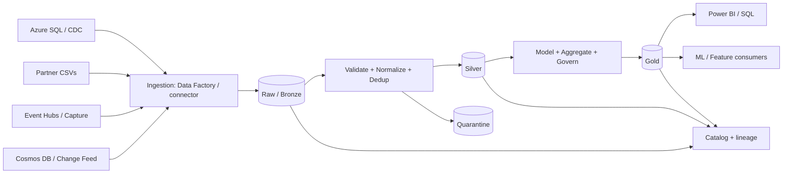
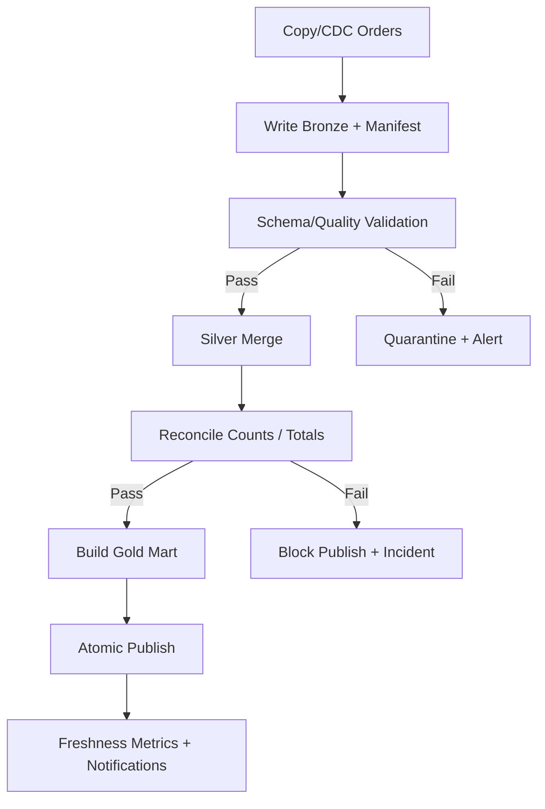

# Organizing Raw, Standardized, and Analytics Serving Data Zones

An enterprise has multiple data sources: a sales application writes orders to Azure SQL Database, an inventory system exports daily CSVs, a website emits clickstream events through Azure Event Hubs, and product catalog data resides in Azure Cosmos DB. The accounting team needs reconciled revenue reports, marketing needs conversion funnel analytics, and data engineers must be able to investigate why a number on a report differs from source records.

If all data is dumped into a single container named `data` and every tool reads and modifies those files directly, the architecture breaks easily: schema changes break reports, duplicate events get counted twice, personal data leaks, an incomplete pipeline write causes users to read partial tables, and prior period results cannot be reproduced.

The common solution is to **organize data into zones with clear responsibilities and contracts**:

- **Raw Zone — Raw/Bronze:** stores source data close to its original form, with metadata for traceability and reprocessing.
- **Standardized Zone — Refined/Silver:** validates schemas, cleanses, standardizes, deduplicates, integrates sources, and produces trustworthy records.
- **Analytics Serving Zone — Curated/Gold:** provides business tables, dimensional models, aggregations, KPIs, and data products for BI/SQL/ML consumers.

The **Bronze–Silver–Gold** naming is commonly referred to as the *medallion* architecture, not a distinct Azure product you must purchase. These zones can be implemented on **Azure Data Lake Storage Gen2 (ADLS Gen2)** combined with **Azure Data Factory**, **Azure Databricks**, **Azure Synapse Analytics**, or equivalent processing/orchestration tools as needed. In some solutions, Microsoft Fabric/OneLake can serve the lakehouse and processing layers, though you must distinguish permissions, SKUs, organization models, and connectivity with existing Azure environments.

This lesson belongs to the **Data Platforms and Analytics** chapter in the `CLOUD_PROVIDERS_AZURE` module on deploying, securing, monitoring, and controlling costs for Azure application architectures from subscriptions/resource groups and Microsoft Entra ID to networking, storage, and data. It focuses on **designing data boundaries, rules for moving data across zones, protecting correctness, and operating pipelines**, rather than just naming folders.

## Learning Objectives

After this lesson, you will be able to:

1. Explain **Raw/Bronze, Refined/Silver, and Curated/Gold** along with the responsibility boundaries of each layer.
2. Choose the **storage account, container/filesystem, folder path, partitioning, and file format** model suited to batch and streaming data.
3. Design **data contracts** covering schema, business key, timestamp, provenance, SLA, data owner, and version.
4. Build a **landing → Bronze → Silver → Gold** processing flow with checkpoints, retries, idempotency, and replayability.
5. Use **Parquet and Delta Lake** appropriately, distinguishing them from raw JSON/CSV/Avro and ADLS Gen2 storage features.
6. Implement validation, quarantine, deduplication, CDC, late-arriving data handling, and Slowly Changing Dimensions.
7. Organize **data products** for Power BI/SQL/ML, avoiding treating Gold as an arbitrary copy of data.
8. Design **managed identity, Microsoft Entra ID, RBAC, ACLs, Private Endpoints, Key Vault, lineage, and governance**.
9. Set freshness/completeness targets, monitor pipelines, choose retention, and control costs.
10. Apply an end-to-end testing process and runbook when analytics metrics are wrong or data fails to arrive.

## 1. Overall Architecture: Three Zones, Three Commitments



The diagram illustrates **logical responsibilities**. A CSV file might be ingested into a `landing` zone first before moving to Bronze; a stream might land directly in Bronze via Event Hubs Capture; a flow might pass through multiple standardization steps before Silver. The processing and orchestration services chosen **do not alter the semantics of the three zones**.

### 1.1. Comparing Zone Contracts

| Criterion | Raw/Bronze | Refined/Silver | Curated/Gold |
|---|---|---|---|
| Source of truth | Copy of data as received from the source, with ingest metadata. | Data interpreted and standardized according to contracts. | Well-defined business datasets for end consumers. |
| Common formats | CSV, JSON, Avro, Parquet, binary, CDC envelopes. | Parquet/Delta or table formats supporting update/upsert. | Delta/Parquet tables, serving SQL tables/views, semantic models. |
| Schema | Close to source; records versions and drift. | Stable target schema, validation, and type standardization. | Follows approved metrics/models, BI-compatible. |
| Duplicate handling | Typically preserves received records; never unconditionally deletes source evidence. | Deduplicated by business/event ID and rules. | Single metric definition, avoiding double counting after joins. |
| Access permissions | Highly restricted as it may contain PII/raw secrets. | Scoped by data domain/processing team. | Dataset/row-level/column-level per consumer. |
| Replay | Prioritizes data preservation and reproducibility. | Rebuildable from Bronze and versioned code. | Rebuildable from Silver and metric definitions. |
| SLA | Whether source data was received and persisted. | Valid, complete, low-duplication data within acceptable latency. | Accurate reports, published and ready on schedule. |
| Owner | Ingestion/platform and source owner. | Data engineering and data steward. | Business/domain owner, analytics engineering. |

**Partitioning data into zones does not automatically generate data quality.** If Silver merely copies every Bronze file with a new name, or Gold is just a folder without business definitions, the architecture fails its purpose.

### 1.2. Two Types of Boundaries: Logical and Physical

The three zones can be separated using:

- **One storage account, three containers/filesystems**: `bronze`, `silver`, `gold`; simple for labs, enabling per-container permissions and lifecycle management.
- **Multiple storage accounts**: e.g., sensitive raw data in an account with dedicated firewall/permissions/retention, and Silver/Gold in an analytics account; increases isolation at the cost of added networking, IAM, and management overhead.
- **One lakehouse/catalog with multiple schemas/databases**: tables have distinct namespaces and policies, with physical data managed by supporting engines.
- **Hybrid**: raw data in ADLS Gen2, Silver/Gold tables managed by Spark/SQL engines, and reporting via semantic models.

There is no rule mandating "one subscription per tier" or "one resource group per tier." Choose boundaries based on **data sensitivity, read/write permissions, lifecycle, billing, tenancy, operations, and service fit**.

### 1.3. Landing and Quarantine Are Not Necessarily a Fourth Tier

Many platforms add:

- **Landing/Ingestion**: where newly arrived files land, potentially requiring antivirus, checksum verification, and metadata scanning before writing to Bronze.
- **Quarantine/Rejected**: stores records/files failing schema or business rules, along with reasons and replay metadata.
- **Sandbox/Feature/Serving**: experimental areas, feature stores, or dedicated serving databases for specific purposes.

These are **additional responsibilities**, not "Gold version 2" or a redefinition of Bronze–Silver–Gold. Use different names if your organization has its own taxonomy, while documenting boundaries clearly.

## 2. Start from a Data Contract Before Creating Folders

A good pipeline needs to know **what data it expects, from where, and for whom**. Otherwise, folder naming merely moves chaos from a database into a data lake.

### 2.1. Example Contract for an Orders Source

| Attribute | Example | Meaning |
|---|---|---|
| Domain / Dataset | `commerce.orders` | Clarifies owner and business scope. |
| Source | Azure SQL Database `orders-db` | Identifies where data originates. |
| Ingestion | CDC incremental + daily reconciliation | How data is collected and verified. |
| Grain | One row per `orderId` or one event per `orderId,version` | Defines the unit of data, preventing double counting. |
| Primary business key | `(tenantId, orderId)` | Identifies the same order. |
| Operation/event key | `sourceEventId` or `(partition,LSN)` per source | Prevents reprocessing the same change. |
| Event time | `orderCreatedAtUtc` | When the business event occurred. |
| Source update time | `updatedAtUtc` | When source state was updated. |
| Ingest time | `ingestedAtUtc` | When the lake received the data. |
| Schema version | `v1`, `v2` | Standardizes breaking changes. |
| PII | Email, address, phone number | Protected/masked per policy. |
| Owner | Commerce Data Owner | Accountable for data semantics. |
| Freshness SLO | E.g., 15 minutes for Silver, 60 minutes for Gold | Internal objective, not an Azure SLA. |
| Retention | Per business policy and applicable laws | Avoid using a single default retention for every source. |

**Grain is the most critical element of a data model.** An `orders` table has one row per order, while a `payments` table has multiple rows per order. If you join them and compute `SUM(orders.totalVnd)`, the amount gets multiplied by the number of payments. Silver/Gold designs must specify grain and join paths before defining metrics.

### 2.2. Data Contracts Include Schema Changes

A contract should specify:

- Required columns, types, and timezones.
- Nullable columns and default rules.
- Business keys / technical keys.
- Valid enums and logical constraints.
- How deletes are propagated (`DELETE`, tombstones, or soft deletes).
- Version compatibility and change notifications.
- Owner, SLA, test cases, and breaking-change approval process.

For example, changing `amountVnd` from integer to a formatted string with thousand separators can corrupt total revenue while the pipeline still reports "Succeeded" if cast silently. Silver must **fail/quarantine and alert** instead of silently coercing bad values to 0.

## 3. Physical Organization on ADLS Gen2

**Azure Data Lake Storage Gen2** provides data lake workload capabilities on Azure Storage with **hierarchical namespace (HNS)** enabled. In practice people say "folder," "filesystem," and "container"; with Blob/ADLS, understand the exact account/container/path structure and API mechanisms in use.

### 3.1. Layout Pattern by Zone and Domain

```text
storage-account: stlakeprod

bronze/                                # container / filesystem
  commerce/
    orders/
      source=azure-sql/
        ingest_date=2026-11-20/
          batch_id=20261120T020000Z/
            part-00001.json
            _manifest.json
    payments/
      source=service-bus/
        ingest_date=2026-11-20/
          batch_id=.../
  telemetry/
    sensors/
      source=event-hubs/
        year=2026/month=11/day=20/hour=02/
          partition=0/
            ...avro

silver/
  commerce/
    orders_current/                   # table or path managed by engine
    payments_validated/
    customers_masked/
  telemetry/
    sensor_readings_clean/

gold/
  commerce/
    daily_revenue/
    customer_lifetime_value/
  telemetry/
    hourly_device_health/

quarantine/
  commerce/
    orders/
      reason=schema_mismatch/
      reason=invalid_currency/
```

This is an **example layout**, not an Azure requirement. Actual structure depends on the catalog/metastore, engine table-format support, data ownership, HNS, region, and security regulations.

### 3.2. Naming Principles

1. **Stable and meaningful**: `commerce/orders` is clearer than `data_new_final_v7`.
2. **Separate domains/datasets**: avoid mixing files from multiple sources without contracts in one folder.
3. **Distinguish ingest date from business event date**: `ingest_date` is when the file entered the lake, not the sale date.
4. **Preserve lineage metadata**: `source, pipeline_run_id, batch_id, file_checksum, schema_version`.
5. **Keep PII/secrets out of path names**: folder names can appear in logs, storage listings, or telemetry.
6. **Do not rely on file names for business uniqueness**: use event IDs/source keys.
7. **Standardize casing, diacritics, timezones, and escaping**: avoid three different spellings for the same dataset.
8. **Protect managed table paths**: never manually edit or delete files or transaction logs managed by a Delta engine.

### 3.3. Partitioning by Time and Query Patterns

If reports commonly filter by sale date, Silver/Gold tables can use `event_date` based on business semantics. If Bronze supports replay by ingestion run, `ingest_date` makes locating received source files easier.

| Strategy | Pros | Caveats |
|---|---|---|
| `ingest_date=YYYY-MM-DD` | Audit/replay by arrival time. | Late events sit in newer ingest dates rather than business dates. |
| `event_date=YYYY-MM-DD` | Business-time queries are typically efficient. | Late events require updating older partitions; prone to skew. |
| `tenant_id=...` | Isolation/pruning when tenant count is moderate. | High cardinality explodes partitions/files; exposes tenant IDs in paths. |
| `country=VN` | Useful when querying by region. | Uneven distribution; dimensions may change. |
| `event_hour=...` | Fits very high-volume streaming. | Low volume creates many tiny partitions/files. |

**Folder/table partitioning** is not the same as a **Cosmos DB** partition key or **Event Hubs** partition count. Those operate at different layers. Add deeper folder partitioning only after measuring query filtering, file counts, and data skew.

### 3.4. File Counts and the Small Files Problem

An Event Hubs Capture source can produce thousands of Avro files per day. An ingestion pipeline writing one file per record is even worse: Spark/serverless SQL must list and open vast numbers of objects, inflating latency and operations. In Silver/Gold, use **batch writes, engine-native compaction/OPTIMIZE**, file sizes matched to volume/workloads, and avoid over-partitioning. Do not modify raw files directly if they are retained for audit/replay.

## 4. Choosing the Right File Format per Tier

| Format | Commonly Used At | Strengths | Limitations |
|---|---|---|---|
| **CSV** | Landing/Bronze from partner systems. | Easy to exchange, readable by common tools. | Does not preserve types natively; schema evolution and escaping are error-prone. |
| **JSON/JSONL** | APIs/events/Bronze. | Flexible, stores nested structures. | Large footprint, expensive parsing, unstable schema. |
| **Avro** | Stream archive/Bronze. | Binary with schema, helpful for storing events. | Cannot query business fields directly like plain JSON if body is raw bytes. |
| **Parquet** | Silver/Gold and analytics exports. | Columnar, compressed, column pruning. | Individual files alone do not provide multi-file ACID transactions. |
| **Delta Lake** | Silver/Gold lakehouse. | Table format with transaction log and ACID/MERGE operations per supporting engine. | Requires compatible Delta readers/writers and log/schema management. |
| **ORC** | Certain data engineering ecosystems. | Columnar, effective for suitable workloads. | Choose based on engine support, not assumed across every Azure tool. |

**Delta Lake is not a new Blob Storage type.** A Delta table typically consists of **Parquet data files plus a transaction log (e.g., `_delta_log`)** managed by supporting engines. Directly copying/deleting Parquet files without going through Delta operations causes inconsistency. On ADLS Gen2, those files remain Azure Storage objects; **ACID semantics reside in the table format and transaction engine**.

### 4.1. When Is Delta Not Needed?

If a dataset consists purely of periodic append-only snapshots with no updates/deletes or concurrent writers, plain Parquet files may suffice. When you need **CDC UPSERTs, schema enforcement, transactionally published tables**, and concurrent reads/writes, Delta is worth considering where supported by tooling. Never claim Delta is mandatory for every Bronze/Silver/Gold tier, or that every Azure SQL query service supports all Delta features identically.

## 5. Raw/Bronze Zone: Trust the Provenance, Not Yet the Data

**Bronze** should do one job exceptionally well: **preserve received data and source metadata so it can be explained, reprocessed, or verified**. Avoid lossy transformations without an approved contract. Some organizations store unmodified raw bytes; others apply minimal standardization for ingestion. What is mandatory is documenting **what changed and what was preserved**.

### 5.1. What Metadata Does a Bronze File Need?

Example ingestion manifest (does not have to be a separate file per batch; can live in logs or a control table):

```json
{
  "dataset": "commerce.orders",
  "sourceSystem": "azure-sql-orders",
  "schemaVersion": "v2",
  "ingestBatchId": "orders-20261120T020000Z",
  "sourceWatermark": "2026-11-20T01:59:59Z",
  "ingestedAtUtc": "2026-11-20T02:00:08Z",
  "fileCount": 12,
  "expectedRecordCount": 120450,
  "checksumAlgorithm": "SHA-256",
  "status": "COMMITTED"
}
```

This manifest illustrates **evidence to track**. If 12 files are being copied and the task fails after 9, `status=COMMITTED` must never be written. For production ingestion, design **atomic publication** or a commit marker/control table written only after verifying all files and checksums. **Do not treat a `_SUCCESS` file as sufficient proof without knowing how the marker is generated and what commit criteria it enforces.**

### 5.2. Append-Only/Immutable Suits Auditing

Many systems prefer **never overwriting already ingested raw data**. If a partner resends an earlier day's `orders.csv`, save it as a **new batch/version with source ID/checksum** instead of overwriting the original. That way engineers can tell:

- Whether the 09:00 source file differs from the 10:00 retransmission.
- Why yesterday's Silver output differs from today's.
- Which raw copy to reprocess from if pipeline logic had a bug.

This **does not mean retaining data forever**: raw data is still subject to lifecycle/retention, legal deletion rights, and personal data protection rules. When raw is deleted under policy, understand the impact on replayability.

### 5.3. Limits of Schema-on-Read

Bronze can store a JSON file containing a new field without necessarily rejecting it at landing. However, if downstream pipelines silently misparse it, the bug simply shifts from Bronze to Silver. Maintain a **schema/contract registry, validation reports**, and quarantine before promotion. For CSVs, validate encoding, headers, delimiters, column counts, and quote escaping to prevent values shifting across columns.

### 5.4. Batch Ingestion vs. Streaming Ingestion

- **Batch:** Data Factory/Synapse pipeline/Databricks Job fetches files or queries sources periodically; records batch ID, watermark, and manifest.
- **Streaming:** Event Hubs Capture writes Avro by partition and window; Structured Streaming/processors handle events with checkpoints.
- **CDC:** connectors read inserts/updates/deletes from source databases, landing operation metadata and offsets in Bronze.
- **Change feed:** Cosmos DB for NoSQL provides a feed with mode-specific retention and delete behaviors.

**Avoid conflating Data Factory watermarks, Event Hubs offsets, and Cosmos DB continuation tokens.** They are checkpoints from distinct sources with different semantics, retention, and replay behaviors.

## 6. Standardized/Silver Zone: From Bytes to Trustworthy Records

A Silver table `commerce.orders_current` may guarantee **one latest valid state record per `(tenantId,orderId)`**, currency normalized by rule, timestamps in UTC, ISO country codes, and personal data restricted by permissions.

Typical steps include:

1. **Parse & validate:** parse JSON/CSV/Avro per schema version; quarantine records missing required keys.
2. **Normalize types:** decimal for money, ISO dates/times, standardized enums, Unicode/encoding.
3. **Resolve keys:** establish business IDs, map source IDs, define unique constraints/merge keys.
4. **Deduplicate:** drop retransmissions and define which record is "latest."
5. **Handle CDC/deletes:** upsert or tombstone per change operation without keeping stale rows.
6. **Conform dimensions:** map shared customer/product/country codes across multiple sources.
7. **Apply privacy policy:** tokenize/mask/remove unnecessary fields.
8. **Record lineage:** source ID, raw file, ingestion batch, transformation version, processedAt.
9. **Publish atomically:** downstream reads only fully committed table versions.
10. **Test & alert:** run quality gates before promoting data.

### 6.1. Example Silver Schema

```text
commerce.orders_current
-----------------------
tenant_id              STRING     NOT NULL
order_id               STRING     NOT NULL
customer_id_token      STRING     NULL
order_status           STRING     NOT NULL
order_created_utc      TIMESTAMP  NOT NULL
source_updated_utc     TIMESTAMP  NOT NULL
currency_code          STRING     NOT NULL
total_amount           DECIMAL(18,2) NOT NULL
source_version         LONG       NOT NULL
ingested_at_utc        TIMESTAMP  NOT NULL
transformed_at_utc     TIMESTAMP  NOT NULL
raw_source_path        STRING     NOT NULL
batch_id               STRING     NOT NULL

grain: one record per (tenant_id, order_id) at the latest version.
```

Monetary amounts **should not use `double/float`** when exact currency precision is needed; use decimal and specify currency/rounding rules. For Vietnamese Dong, storing `amount_vnd` as an integer unit may fit when appropriate, provided the decision is explicit and consistent across sources and reports.

### 6.2. Standardization Does Not Mean Guessing Values

A record with `totalAmount="N/A"` should not silently become 0 when amount is a financial metric. Better handling:

- Route the record to quarantine with `reason=invalid_amount`.
- Emit error count/rate metrics.
- Alert when the error rate exceeds the quality threshold.
- Only accept defaults when explicitly allowed by the contract and approved by the owner.

### 6.3. Data Quality Dimensions and Example Thresholds

| Dimension | Question to Answer | Example Test |
|---|---|---|
| **Completeness** | Are all expected sources/batches/records present? | Ingested order count matches manifest and source count. |
| **Validity** | Do values match types/enums/ranges? | `order_status IN ('PENDING','PAID','CANCELLED','SHIPPED')`. |
| **Uniqueness** | Is the grain duplicated? | No two active `(tenantId,orderId)` rows in current table. |
| **Consistency** | Do two datasets follow the same rules? | Total valid payments match reconciled figures for the period. |
| **Timeliness** | Is data updated within SLO? | Latest committed Silver version is not delayed past threshold. |
| **Referential integrity** | Are linked business keys valid? | `productId` in order lines has a valid product mapping. |
| **Accuracy** | Do numbers match reconciled reality? | Total revenue from orders/ledger follows unified definitions. |

A threshold like `invalid_rows / input_rows ≤ 0.1%` is only valid if **approved by the business owner**. For financial transactions, a single bad record may be critical; for telemetry logs, a small error rate might be quarantined without halting the pipeline. Never pick arbitrary quality thresholds and interpret a `Succeeded` pipeline run as absolute data accuracy.

### 6.4. Quarantine Must Explain Errors and Be Actionable

A quarantined record should include:

```json
{
  "dataset": "commerce.orders",
  "batchId": "orders-20261120T020000Z",
  "sourceFile": "bronze/commerce/orders/.../part-00001.json",
  "sourceRecordId": "ORD-1057",
  "schemaVersion": "v2",
  "reasonCode": "INVALID_AMOUNT",
  "validationRule": "totalAmount must be a non-negative decimal",
  "firstSeenUtc": "2026-11-20T02:01:12Z",
  "reviewStatus": "PENDING"
}
```

Avoid copying **raw PII** into error reason files or Application Insights unnecessarily. Quarantine entries and raw records can link via source path/ID, with data steward access appropriately scoped. A sudden spike in new schema errors should **block Silver/Gold publishing** until reviewed by the owner rather than publishing a dataset missing half its rows.

## 7. Idempotency, Deduplication, and CDC in Silver

A reliable pipeline must withstand **batch retries**, **consumer restarts**, **duplicate file arrivals**, and **out-of-order events** without doubling revenue or regressing versions.

### 7.1. Distinguishing Three Types of Duplicates

| Duplicate Type | Example | Handling |
|---|---|---|
| **Duplicate file/batch** | Data Factory Copy retry resends `orders-20261120.csv`. | Manifest/checksum/ingestion key, idempotent commit. |
| **Duplicate physical event** | Event Hubs consumer crashes before checkpointing and re-reads the same offset. | Key `(eventHub,partition,offset/sequence)` within proper scope. |
| **Duplicate business operation** | Two messages have different event IDs but the same `paymentId`. | Unique business key and transaction/ledger semantics. |

File names alone cannot identify the same **business operation**. One file contains many orders; one order can appear across multiple files as it gets updated. `sourceEventId`, `businessKey`, and `sourceVersion` serve different roles and must be preserved from Bronze into Silver.

### 7.2. Using Windowing to Pick the Latest Record Before MERGE

Suppose Bronze contains records keyed by `tenantId,orderId,version`. Before merging into a current-state table, select the latest record per **business key** with a deterministic tie-break rule.

```text
Bronze input:
tenant-a, ORD-1, version=1, PENDING
tenant-a, ORD-1, version=2, PAID
tenant-a, ORD-1, version=2, PAID     # duplicate delivery
tenant-a, ORD-2, version=1, PENDING

Silver current:
tenant-a, ORD-1, version=2, PAID
tenant-a, ORD-2, version=1, PENDING
```

If two records share the same `key + version` yet have **different payloads**, never pick one at random; that indicates a source conflict requiring quarantine or formal business rules. Ordering by ingest timestamp is only an approved tie-breaker and does not guarantee business order when clocks drift.

### 7.3. Conditional MERGE Mechanism

Illustrative SQL applicable to an engine supporting Delta MERGE:

```sql
MERGE INTO silver.orders_current AS t
USING silver.orders_batch_dedup AS s
ON t.tenant_id = s.tenant_id AND t.order_id = s.order_id
WHEN MATCHED AND s.source_version > t.source_version THEN UPDATE SET
  t.order_status = s.order_status,
  t.total_amount = s.total_amount,
  t.source_version = s.source_version,
  t.source_updated_utc = s.source_updated_utc,
  t.transformed_at_utc = s.transformed_at_utc
WHEN NOT MATCHED THEN INSERT (
  tenant_id, order_id, order_status, total_amount,
  source_version, source_updated_utc, transformed_at_utc
) VALUES (
  s.tenant_id, s.order_id, s.order_status, s.total_amount,
  s.source_version, s.source_updated_utc, s.transformed_at_utc
);
```

**This is design-level SQL**; adapt it to the exact dialect/engine, table schema, and `orders_batch_dedup` data. The MERGE source table must not contain multiple rows matching the same target key, or it can fail or produce non-deterministic results. When the target already holds a higher version, older replay records **must not overwrite it**.

MERGE cannot tell which monetary amount is right if the producer emits bad `sourceVersion` values. Version semantics must be safeguarded **at the source system**, backed by reconciliation on version/value conflicts.

### 7.4. Deletes and Tombstones

CDC may emit `operation=INSERT/UPDATE/DELETE`. Some source change feeds only emit the latest item version without natively emitting physical deletes. Handling must therefore follow **source semantics**:

- **Hard delete:** if the source emits delete operations with key and version, Silver should delete or mark a tombstone per contract.
- **Soft delete:** `isDeleted=true` and timestamp propagate into Silver; Gold includes or excludes records per policy.
- **TTL expiration:** verify whether the source emits delete events or requires periodic reconciliation; never assume all change feeds behave alike.
- **Retention/legal deletion:** may require erasing PII across Bronze, Silver, Gold, and backups per law/policy; raw is not unconditionally immutable in every legal scenario.

### 7.5. Late-Arriving Events and Watermarks

Suppose an `OrderPaid` event occurs at 10:00 UTC, but the producer goes offline and only sends it to Event Hubs at 11:30. If Gold computes revenue by `eventTime`, this order belongs in the 10:00 bucket even though the file sits under `ingest_hour=11`.

There are three clocks:

1. **Event time:** when the business event occurred.
2. **Processing/ingestion time:** when the pipeline received/processed it.
3. **Publication time:** when the Gold table/report was updated.

In streaming, **watermarks** help govern how long late data is retained/accepted/updated within a boundary; exact semantics depend on the engine. Never mistake a watermark for storage deletion dates. For financial reporting, late events may require **restating prior periods** with an audit trail rather than silently dropping them to meet freshness KPIs.

## 8. Slowly Changing Dimensions (SCD) and Historical Analytics

A Silver `customers_current` table serving fast operational lookups may store only the latest customer attributes. However, analyzing revenue by customer segment **at the time of transaction** requires knowing which segment the customer belonged to historically.

### 8.1. SCD Type 1 and Type 2

| Type | Meaning | Use Case |
|---|---|---|
| **Type 1** | Overwrites old values with new ones. | Fixing display-name typos, current-state lookup data. |
| **Type 2** | Creates a new record with effective-time bounds, preserving change history. | Customer upgrades from `BASIC` to `PREMIUM`; historical segment reporting is needed. |

Example Type 2 dimension:

```text
customer_sk | customer_id | segment  | valid_from_utc     | valid_to_utc       | is_current
1001        | C-7         | BASIC    | 2026-01-01 00:00   | 2026-10-01 00:00   | false
1432        | C-7         | PREMIUM  | 2026-10-01 00:00   | null               | true
```

Define effective intervals as half-open **`[valid_from, valid_to)`** (inclusive start, exclusive end) so boundary timestamps never match two records simultaneously. `customer_sk` is the surrogate key used in dimensional models; `customer_id` is the business key. When source events arrive out of order, Type 2 logic must handle versioning/effective intervals rather than blindly appending rows.

### 8.2. Care When Computing Metrics with SCD2

If fact `orders` joins dimension `customers_history` solely on `customer_id`, a single order can match **multiple historical rows**, multiplying revenue. Join using the surrogate key resolved at processing time, or join on business key plus **event time falling within the effective interval**. SCD2 is not the default goal for every column; use it only for attributes requiring historical point-in-time analysis.

## 9. PySpark Example: From Bronze JSON to Silver Delta

This is **illustrative learner code** targeting a Spark runtime supporting Delta Lake (such as Azure Databricks or a compatibly configured Spark environment). **Do not execute Python/Gradle during STEP 4 lesson authoring**. The example intentionally separates parsing, quality gating, deduplication, and writing for testability.

### 9.1. Reading and Standardizing

```python
from pyspark.sql import functions as F
from pyspark.sql.window import Window

# Illustrative example: storage identity/network assumed preconfigured separately.
bronze_path = "abfss://bronze@stlakeprod.dfs.core.windows.net/commerce/orders/"
silver_path = "abfss://silver@stlakeprod.dfs.core.windows.net/commerce/orders_current/"

raw = spark.read.json(bronze_path)

normalized = (
    raw.select(
        F.col("tenantId").cast("string").alias("tenant_id"),
        F.col("orderId").cast("string").alias("order_id"),
        F.upper(F.trim(F.col("status"))).alias("order_status"),
        F.expr("try_cast(totalAmount as decimal(18,2))").alias("total_amount"),
        F.col("version").cast("long").alias("source_version"),
        F.to_timestamp("updatedAtUtc").alias("source_updated_utc"),
        F.current_timestamp().alias("transformed_at_utc")
    )
)

valid_condition = (
    F.col("tenant_id").isNotNull()
    & F.col("order_id").isNotNull()
    & F.col("source_version").isNotNull()
    & F.col("total_amount").isNotNull()
    & (F.col("total_amount") >= F.lit(0))
    & F.col("order_status").isin("PENDING", "PAID", "CANCELLED", "SHIPPED")
)

valid = normalized.where(valid_condition)
invalid = normalized.where(~valid_condition)

# In production, persist/quarantine invalid rows and record durable quality metrics.
invalid_count = invalid.count()
print("Quarantined rows in candidate batch:", invalid_count)
```

**Production checks must be stricter**: handle `NaN`/out-of-range values, missing schema columns, empty strings, timezones, currencies, negative adjustments, and unparseable JSON records from the start. `try_cast` behavior can depend on the SQL runtime and Spark version; if unsupported by your engine, substitute an equivalent parsing/type-validation method.

### 9.2. Selecting the Latest Record in a Batch

```python
window = Window.partitionBy("tenant_id", "order_id").orderBy(
    F.col("source_version").desc(),
    F.col("source_updated_utc").desc()
)
latest_batch = (
    valid.withColumn("_rownum", F.row_number().over(window))
         .where(F.col("_rownum") == 1)
         .drop("_rownum")
)
```

**Important:** this snippet illustrates latest-state selection. Before running in production, add a step to **detect duplicate `key + version` pairs with differing payloads** and route them to quarantine; a naive `row_number` tie-breaker can silently pick one conflicting record. Require `eventId` or source change sequences when contracts demand strict determinism.

### 9.3. MERGE into an Existing Delta Table

```python
from delta.tables import DeltaTable

# Run this branch only if silver_path already contains a compatible Delta table.
target = DeltaTable.forPath(spark, silver_path)
(
    target.alias("t")
    .merge(
        latest_batch.alias("s"),
        "t.tenant_id = s.tenant_id AND t.order_id = s.order_id"
    )
    .whenMatchedUpdate(
        condition="s.source_version > t.source_version",
        set={
            "order_status": "s.order_status",
            "total_amount": "s.total_amount",
            "source_version": "s.source_version",
            "source_updated_utc": "s.source_updated_utc",
            "transformed_at_utc": "s.transformed_at_utc"
        }
    )
    .whenNotMatchedInsert(values={
        "tenant_id": "s.tenant_id",
        "order_id": "s.order_id",
        "order_status": "s.order_status",
        "total_amount": "s.total_amount",
        "source_version": "s.source_version",
        "source_updated_utc": "s.source_updated_utc",
        "transformed_at_utc": "s.transformed_at_utc"
    })
    .execute()
)
```

This example **assumes the target Delta table already exists** with a matching schema; it does not create tables, grant permissions, or configure Storage. Production code should add lineage fields, null handling, data quality outputs, concurrency handling, and stable batch identifiers. Use `DeltaTable.isDeltaTable` or an explicit table bootstrap flow instead of ad-hoc try/except blocks.

### 9.4. Verifying Batch Re-Runnability

Running the same batch a second time must not increase the row count of `orders_current` or regress `source_version`. If rerunning the same data updates `transformed_at_utc` across every row via a blind overwrite, auditing cannot distinguish real updates from replays. Conditional `whenMatchedUpdate` on version avoids unnecessary writes.

## 10. Gold: Building Data Products for Analytics Consumers

The Gold zone houses **agreed business definitions**, not simply a subset of Silver columns. Every Gold table requires a **clear grain, owner, metric definitions, refresh policy, permissions, tests, and SLA**.

### 10.1. Common Data Product Types

- **Fact tables:** `fact_order_payment`, `fact_sales_daily`, `fact_web_session`.
- **Dimension tables:** `dim_product`, `dim_customer_segment`, `dim_calendar`.
- **Aggregated marts:** `daily_revenue_by_channel`, `weekly_active_customers`.
- **Semantic models:** measures, relationships, time intelligence, and RLS definitions for Power BI.
- **Feature datasets:** when serving ML models, manage point-in-time feature correctness and prevent data leakage.

A data product **is not necessarily just a table**; it can include schemas, datasets, quality metrics, access policies, documentation, examples, and appropriate API/SQL endpoints.

### 10.2. Thinking Through Revenue Grain

Suppose:

```text
Order ORD-1: total = 500,000 VND
Payment PAY-1: 300,000 VND
Payment PAY-2: 200,000 VND

If you join Order with Payments and sum Order.total, result = 1,000,000 (WRONG)
If you need collected revenue, sum valid settled payment amounts = 500,000
```

A Gold `fact_payments` table should have **one valid payment transaction as its grain**, with `paymentId` key, settlement status, currency, timestamp, and refund rules. If business wants order-based `booked revenue`, define a separate fact grain or aggregation from orders—never mix booked and collected revenues.

### 10.3. Illustrative Gold Daily Revenue SQL

```sql
-- Example for a SQL engine supporting DATE() and a standardized silver model.
SELECT
  CAST(settled_at_utc AS DATE) AS revenue_date_utc,
  currency_code,
  COUNT(DISTINCT payment_id) AS settled_payment_count,
  SUM(amount) AS settled_amount
FROM silver.payments_validated
WHERE payment_status = 'SETTLED'
  AND is_duplicate = false
GROUP BY CAST(settled_at_utc AS DATE), currency_code;
```

**Additional business rules** may be needed depending on the system: refunds, chargebacks, partial settlements, accounting period timezones, exchange rates, charges vs. authorizations, reversals, and late events. Never blindly compute net revenue as `SUM(amount)` if source systems emit unnormalized reversals/refunds. The metric approver must be the business/data owner.

### 10.4. Star Schema and Semantic Layer

A star schema `fact_sales + dim_product + dim_date + dim_channel` makes Power BI or SQL queries intuitive and ensures accurate counts. Still, verify many-to-one relationships, surrogate keys, valid-time joins, and row-level security. The semantic model stores measures, formatting, hierarchies, descriptions, and policies; **it does not replace Silver data quality**.

### 10.5. Keep Unnecessary PII Out of Gold

Channel/daily reports generally require aggregates, not customer emails and home addresses. Never copy all of `customers_raw` into Gold "just in case." Use aggregation, de-identification/tokenization, and role-based access to expose only data needed for decision-making.

## 11. Publishing Gold Tables Consistently

A dashboard must never see half a table from the new day and half from the old day. With Delta or engines offering atomic table commits, write outputs into **a new transaction version** or use engine-supported **staging + publish/swap** patterns. With loose CSV/Parquet files, maintain a manifest/commit marker and ensure readers consume only completed batches rather than letting dashboards auto-discover half-uploaded files.

### 11.1. Data Publication Contract

A published Gold release might record:

```json
{
  "dataset": "commerce.daily_revenue",
  "businessDate": "2026-11-19",
  "revision": 3,
  "generatedAtUtc": "2026-11-20T02:05:00Z",
  "sourceSilverVersion": "delta-commit-004281",
  "qualityStatus": "PASSED",
  "approvedBy": "commerce-data-owner",
  "isCurrent": true
}
```

This is **illustrative metadata**, not automatically generated in this exact schema by Fabric or Databricks. If late payments arrive, revision 4 may **restate a prior day**, so dashboards should indicate restated figures and the metric owner must approve.

### 11.2. Reprocessing and Reproducibility

You need the ability to reproduce results:

```text
Bronze batch IDs + source data versions
       +
Transformation code version + configuration
       +
Schema/reference data versions
       =
Reproduced Silver / Gold outputs
```

In practice, exact equivalence requires deterministic processing, late-data policies, and dependency snapshots. If a `channel-code → channel-name` mapping changes today, rerunning last year's report against the current mapping may yield different numbers. Store **reference data versions or effective-dated mappings** whenever strict reproducibility is required.

## 12. Orchestration: Data Factory, Databricks Workflows, and Synapse

A data pipeline spans **data movement**, **transformation**, **validation**, **publishing**, **notification**, and **reruns**. Azure offers several orchestration choices:

| Option | Best Suited When | Limitations to Remember |
|---|---|---|
| **Azure Data Factory** | Orchestrating copy jobs, connectors, scheduling, dependencies, integration runtimes. | Copy activity does not automatically provide data contracts, versioned dedup, or ACID across all sinks. |
| **Azure Databricks** | Spark/Delta ETL, streaming, notebooks/jobs/workflows, lakehouse governance. | Requires managing clusters/serverless compute, catalogs, Delta tables, and cost. |
| **Azure Synapse Analytics** | SQL/Spark analytics and orchestration in the Synapse ecosystem. | Feature/SQL pool/Delta support differs across serverless, dedicated, and Spark pools. |
| **Microsoft Fabric** | OneLake/lakehouse, notebooks/data pipelines, warehouse/Power BI in unified solutions. | Capacity/licensing and governance differ from direct Azure resources; verify connectivity/security. |
| **Azure Functions/Container Apps** | Custom small steps, event-driven validation/notifications. | Not suited by default for Spark-scale joins or long-running backfills. |

Options **can be combined or substituted** rather than running every service. Choose based on data volume, latency, team skills, governance, regional availability, budget, and data locality.

### 12.1. Example Dependency DAG



A DAG depicts **dependencies**. In implementation, each step should record `pipelineRunId`, `inputBatchId`, status `STARTED/COMMITTED/FAILED`, and output identifiers. If the Gold step fails, you do not always need to re-ingest raw from scratch; you can rerun from a verified Silver version.

### 12.2. Scheduling and Retries

Configure retries only for **transient** failures like temporary network glitches or 429/throttling. Schema mismatches require human/code action; retrying 100 times still fails. Every step must be **idempotent**: copying the same file must not create two "committed" batches for one source ID, Silver MERGE must not duplicate grain, and Gold publish must not expose partial results.

### 12.3. Incremental Loading and Watermarks

Initial loads typically require a full load before switching to incremental. A watermark like `updatedAtUtc` can miss changes if the source writes non-monotonic timestamps or experiences clock skew. When sources support CDC/change tracking, prefer **managed source offsets/LSNs/continuation tokens**, paired with reconciliation or bounded overlap to prevent gaps. Watermark metadata must only be committed after outputs are durably persisted.

## 13. Security, Entra ID, RBAC, and ACLs on the Data Lake

Bronze may hold emails, addresses, phone numbers, logs, and unclassified columns. If all BI users can read raw because the data lake shares one storage account, aggregating into Gold does not protect the underlying data.

### 13.1. Role-Based Separation of Duties

With **ADLS Gen2 and hierarchical namespace**, data-plane access generally involves **Azure RBAC** and **POSIX-like ACLs** on filesystems, directories, and files per service semantics. Management-plane `Reader` on a resource group does not automatically grant read access to blobs.

| Identity | Responsibility | Permissions to Restrict |
|---|---|---|
| Ingestion pipeline | Writes Bronze, manifests, and ingest metadata. | No write/delete on Gold or subscription-wide Owner rights. |
| Silver transform | Reads Bronze, writes Silver and quarantine. | No modifying raw sources unless via an approved remediation procedure. |
| Gold publisher | Reads Silver, writes Gold/revision metadata. | No reading domains outside required scope. |
| BI/analyst | Reads Gold/semantic models. | No default read access to raw PII or direct Delta file writes. |
| Data steward | Inspects validation, lineage, scoped quarantine. | Does not automatically receive access to all sensitive payloads. |
| Platform operator | Manages infrastructure, quotas, monitoring, networking. | No default rights to query customer data contents. |

Roles like **Storage Blob Data Reader/Contributor** can be assigned at appropriate scopes. With ACLs, verify **traverse/execute** on parent directories, file permissions, and inheritance; default ACLs for new objects do not retroactively fix existing objects. Procedures must be tested with the **real runtime identity**.

### 13.2. Managed Identity and Granting Permissions to Jobs

Azure Data Factory can use a managed identity to access ADLS Gen2 when the linked service/connector supports it. Azure Databricks can use access connectors, storage credentials, external locations, and catalog/identity mechanisms depending on setup; never assume a Function's managed identity is automatically usable by Databricks.

Principles:

- Never hard-code storage account keys, unrestricted SAS tokens, or client secrets in notebooks or pipeline JSON.
- Grant minimum scope to ingestion, transforms, and BI, separating identities as needed.
- Any secrets that must be stored belong in **Azure Key Vault** with rotation policies.
- Monitor role assignments, owner changes, denied access, and sensitive data access.
- Never grant Storage Blob Data Contributor across the entire account just to fix a missing permission on a single Gold folder.

### 13.3. Private Endpoints, DNS, and Regions

When Storage blocks public networks, design connectivity paths for Data Factory Integration Runtimes, Spark compute, SQL readers, and analyst environments. ADLS Gen2 can involve both **Blob and DFS endpoints** across operations; verify Private Endpoints, Private DNS, VNet routing, firewalls, and outbound policies for every service.

A job with valid RBAC can still time out if DNS or routing is wrong. Never open the public firewall to the entire Internet unnecessarily. Across multiple regions/subscriptions, assess **data residency, network egress, and disaster recovery** before replicating datasets.

### 13.4. PII and Row/Column-Level Controls

Define classifications in the data contract: `public, internal, confidential, restricted` per policy. For tenant- or department-scoped BI, use row-level security/masking in a **supported SQL/semantic/catalog layer**. However, a Power BI RLS rule **does not block** a user who holds direct read permissions on the underlying storage files; protect the storage data plane as well.

"Immutable" raw is an auditing goal, not a mandate to keep PII indefinitely despite legal deletion requests. Design retention, deletion, and key management spanning Bronze/Silver/Gold, backups, and derived products per actual legal obligations.

## 14. Governance: Catalog, Lineage, and Data Accountability

A metric named `revenue` does not tell users whether it reflects order date, payment settlement date, or post-refund net revenue. **Gold is a business contract**, not just an aggregate table.

### 14.1. Metadata of a Gold Product

```yaml
dataset: commerce.daily_revenue
grain: one_row_per_date_and_currency
business_timezone: Asia/Ho_Chi_Minh
owner: finance-data-steward
technical_owner: data-platform
source_datasets:
  - silver.payments_validated
measure: net_settled_revenue
description: settled payments adjusted for approved reversals
freshness_slo_minutes: 60
classification: internal
schema_version: v3
```

This is a **custom-designed metadata template**, not a mandatory schema from Azure Purview or any specific catalog. The formula approver must be the business owner. Ecosystems may use **Microsoft Purview** for catalog/classification/lineage via supported integrations, or Databricks/Fabric/engine catalogs; never assume a tool automatically discovers every custom SQL transformation without configuration.

### 14.2. End-to-End Lineage

```text
Power BI measure "Net Settled Revenue"
  → Gold commerce.daily_revenue (revision 3)
      → Silver payments_validated (Delta commit 4281)
          → Bronze batch payments-20261120T010000Z
              → Source CDC LSN / Event ID / file checksum
```

A strong runbook can trace **which source, batch, code version, and validation checks** produced a dashboard figure. Storing table names alone cannot reproduce a metric if lookup mappings, FX rates, or rules changed. Store **versioned reference data or effective-dated dimensions** when exact reproducibility is needed.

### 14.3. Schema Evolution and Change Control

If a source adds a nullable field, pipelines may remain compatible; if `totalAmount` switches from decimal to a string with separators or `currencyCode` changes, metrics can break. Process:

1. Source owner announces version/breaking changes prior to rollout.
2. Test parsers, Silver transforms, Gold business metrics, and semantic consumers.
3. Choose staged rollout or dual-schema reading when necessary.
4. Update data contracts, catalogs, classifications, and validation rules.
5. Publish a new revision only after passing quality gates.
6. Prepare rollback/backfill procedures if outputs are wrong.

Never enable unrestricted schema auto-evolution simply so pipelines stay green; data that parses cleanly yet carries wrong business semantics is still an incident.

## 15. Monitoring: Measure the Data, Not Just the Jobs

### 15.1. Metrics by Zone

| Zone | What to Track | Example Alert |
|---|---|---|
| Bronze | Source availability, file counts/checksums, ingest lag, watermarks, job errors. | Source has data yet manifest is not COMMITTED. |
| Silver | Valid/invalid ratio, duplicate/conflict counts, source vs. output reconciliation, backlog. | Schema error rate spikes or current-state version stalls. |
| Gold | Last published revision, freshness, business totals, consumer query errors. | Report past due or metric reconciliation mismatch. |
| Platform | Storage latency/errors, Spark/ADF run status, SQL capacity, networking/RBAC. | 403/timeout errors or worker out-of-memory failures. |
| Cost | Storage growth, compute spend, BI capacity, egress, logs. | Unbudgeted cost spike on a dataset. |

### 15.2. End-to-End Freshness

```text
10:00:00 UTC   Payment source commit
10:01:20 UTC   Bronze batch written and verified
10:03:45 UTC   New Silver version committed
10:06:10 UTC   Gold revision published
10:08:00 UTC   Dashboard refreshed with data

Bronze arrival lag    ≈ 1 minute 20 seconds
Silver processing lag ≈ 2 minutes 25 seconds
Gold publish lag      ≈ 2 minutes 25 seconds
Display freshness     ≈ 8 minutes from source commit
```

These timings **are illustrative examples**, not Azure SLAs. Measure on your real system and publish **dataset/source SLOs**, distinguishing business event time, ingestion time, and publication time.

### 15.3. Azure Monitor and Custom Quality Metrics

Use Azure Data Factory pipeline/activity monitoring, Databricks job telemetry, Azure Monitor/Log Analytics, and Storage diagnostics according to available capabilities. **Do not invent a metric named `GoldLagSeconds`** assuming Azure Monitor emits it natively; to alert on end-to-end freshness, emit custom metrics or write to a control table.

Application Insights/Logs may use sampling, so business audit and quality evidence require **durable status tables, manifests, and dataset revisions**. Never log raw PII, connection strings, or SAS tokens purely for debugging.

### 15.4. Alerts Must Understand Source Schedules

A partner sending CSVs nightly will not deliver new files at noon. A "no file in 10 minutes" alert causes false positives unless it accounts for expected delivery windows, holidays, timezones, and upstream activity. For streaming, quiet periods can be normal; combine ingress volume, watermarks, and backlog to tell issues apart.

## 16. Cost and Data Lifecycle

The cost of a medallion platform comprises **storage capacity + operations, compute transformations, SQL/BI workloads, networking, governance, and monitoring**. Bronze–Silver–Gold does not have a fixed price; storage size depends on retention and compression.

### 16.1. Data Volume Forecasting

```text
Raw ingress: 100 GiB/day, retained 30 days
Bronze rough volume ≈ 3,000 GiB, before metadata/replication

Silver: depends on filtering, compression, SCD2 history, Delta logs
Gold:   depends on aggregation/materialization and number of data products
```

Do not assume Silver or Gold equals exactly 3,000 GiB; columnar Parquet can shrink storage, while SCD2 history and update logs can expand it. Estimate using **Azure Pricing Calculator, Cost Management, and real regions/SKUs**, rather than treating example figures as quotes.

### 16.2. Primary Cost Levers

- **Raw lifecycle** aligned with approved retention; access tiers carry distinct retrieval fees, minimum retention periods, and rehydration times.
- **Parquet/Delta compaction** to reduce small files and metadata scan time.
- **Incremental ETL** to avoid scanning full historical datasets every run.
- **Compute scheduling/auto-termination** for jobs that do not need to run continuously.
- **SQL/BI caching, partition pruning, and aggregate tables** tailored to workloads.
- **Data movement locality** to minimize cross-region egress and latency.
- **Intentional log retention**, avoiding dumping full raw payloads into telemetry.

**Be careful with Delta table `VACUUM` and Azure Storage lifecycle:** manually deleting files/`_delta_log` can corrupt tables or break time travel. Run maintenance via engine commands and policies, ensuring files still needed for streaming checkpoints or replay are preserved.

### 16.3. RTO and Compliance Before Cost Cutting

Moving all raw data to Archive tier to save money can stretch a multi-hour backfill into much longer delays due to rehydration. If a source retains events for only 7 days while the business needs to rebuild last year's Gold, raw/backup retention must be designed accordingly. Never shorten retention just to cut costs without data owner and compliance approval.

## 17. Layered Rebuild, Replay, and DR

### 17.1. When a Pipeline Fails

- **Bronze ingest failure:** read source offsets/file manifests, retry with the same source/batch identity, never commit watermarks when data is incomplete.
- **Silver transform failure:** fix code, rerun from matching Bronze batches/versions into a Silver candidate path, never overwrite production recklessly.
- **Gold metric error:** keep the verified Silver version and publish a **new Gold revision** with an audit trail.
- **Source/Storage outage:** use service-appropriate backups/replication/DR; remember to verify networking, identities, and keys.
- **Legal data deletion:** enforce policies across all applicable copies, layers, and backups under legal scope.

### 17.2. Silver Rebuild Procedure

1. Identify affected datasets, time ranges, batches, and consumers.
2. Isolate the faulty pipeline version, **preserving evidence**.
3. Select complete Bronze files and manifests, verifying checksums and counts.
4. Run approved code/config/reference data versions into a **candidate path/table**.
5. Execute quality gates, reconciliation totals, key uniqueness, and valid-time consistency checks.
6. Obtain data owner sign-off before publishing/cutting over, keeping old versions/rollback paths.
7. Rebuild dependent Gold products using the exact Silver revision.
8. Verify semantic refresh and end-to-end SLOs.

### 17.3. RPO/RTO Are Not Automatically Inherited

Storage replication does not automatically guarantee end-to-end pipeline RPO of 0. Evaluate whether producers emitted events, whether Event Hubs/CDC retention still holds them, whether Bronze ingest checkpoints advanced, Silver/Gold versions, and Key Vault access. RTO must include data rebuilds, consistency validation, permission updates, and dashboard refreshes.

## 18. Controlled Practice: Building a Pipeline from JSON Files to a Gold Report

This section is a **lab guide for learners**, not Azure resources deployed while authoring this document. Practice only on authorized accounts using synthetic data and approved budgets/quotas. Never use real customer data or production storage accounts.

### 18.1. Prerequisites

- A lab Azure subscription/resource group.
- An **ADLS Gen2/HNS**-enabled Storage account with containers/filesystems `bronze`, `silver`, `gold`, and `quarantine`, or an equivalent layout.
- A processing runtime supporting JSON reads and Parquet/Delta writes (e.g., Azure Databricks Spark or an approved alternative).
- Azure Data Factory or an orchestration tool if testing scheduling and dependency DAGs.
- A managed identity/service principal with **properly scoped read/write permissions** and configured networking/DNS.
- A store for run metadata: `pipelineRunId`, `batchId`, `sourceChecksum`, `status`, and quality metrics.
- Synthetic `Orders` and `Payments` records containing no real PII.

### 18.2. Azure CLI: Reading Storage and Container State

These commands **only read metadata/files**; they do not provision infrastructure or modify data:

```bash
az login
az account set --subscription "<subscription-id>"

RG="rg-datalake-lab"
ACCOUNT="stlakelab"

az storage account show \
  --resource-group "$RG" \
  --name "$ACCOUNT" \
  --query "{name:name,location:location,isHnsEnabled:isHnsEnabled,allowBlobPublicAccess:allowBlobPublicAccess}" \
  --output json

# List containers/filesystems using data-plane permissions.
az storage fs list \
  --account-name "$ACCOUNT" \
  --auth-mode login \
  --output table

# Inspect Bronze files created in the lab by prefix.
az storage blob list \
  --account-name "$ACCOUNT" \
  --container-name bronze \
  --auth-mode login \
  --prefix "commerce/orders/" \
  --query "[].{path:name,size:properties.contentLength}" \
  --output table
```

**Note:** `--auth-mode login` uses the CLI caller's identity and does not prove that Data Factory or Databricks identities have access. `Storage Blob Data Reader` or equivalent data-plane permission plus networking/ACLs are needed to list files; management-plane `Reader` is insufficient. With HNS, choose the appropriate Blob/DFS API for the connector and account. If `az storage fs list` output schema varies across CLI versions, check `--help`.

### 18.3. Creating Synthetic Input Data

Assume two files in `bronze` have been ingested with source metadata per the data contract; learners create these in the lab environment:

```json
{"tenantId":"tenant-demo","orderId":"ORD-101","status":"PENDING","totalAmount":"250000","currencyCode":"VND","version":1,"updatedAtUtc":"2026-11-20T01:00:00Z"}
{"tenantId":"tenant-demo","orderId":"ORD-101","status":"PAID","totalAmount":"250000","currencyCode":"VND","version":2,"updatedAtUtc":"2026-11-20T01:05:00Z"}
{"tenantId":"tenant-demo","orderId":"ORD-102","status":"PAID","totalAmount":"100000","currencyCode":"VND","version":1,"updatedAtUtc":"2026-11-20T01:07:00Z"}
{"tenantId":"tenant-demo","orderId":"ORD-102","status":"PAID","totalAmount":"100000","currencyCode":"VND","version":1,"updatedAtUtc":"2026-11-20T01:07:00Z"}
```

This is **JSON Lines** (one JSON object per line), not a JSON array. Use an appropriate lab path, such as `bronze/commerce/orders/ingest_date=2026-11-20/batch_id=lab-001/data.jsonl`.

### 18.4. Bronze → Silver Workflow

1. Read the **COMMITTED** batch and verify the source manifest if present.
2. Parse JSON using the matching schema version.
3. Convert `totalAmount` to numeric decimal per valid rules; never coerce invalid strings to 0.
4. Route records missing `tenantId/orderId/version` to quarantine.
5. Check duplicate `key+version` records against payload fingerprints before picking latest.
6. Select the latest version per `(tenantId,orderId)`.
7. MERGE into Silver current-state using version conditions and engine-supported transaction semantics.
8. Record `valid, invalid, duplicate, conflict counts` and `silverCommitVersion`.

**Expected result for the example** (with no conflicting payloads):

| Key | Silver status | Source version | Total amount VND |
|---|---|---:|---:|
| `tenant-demo/ORD-101` | PAID | 2 | 250,000 |
| `tenant-demo/ORD-102` | PAID | 1 | 100,000 |

There are **2 business keys**, not 4 orders. Both duplicate `ORD-102 v1` rows must resolve to the same logical row per contract. If the pipeline outputs 4 rows, the deduplication/current-state logic is incorrect.

### 18.5. Adding Payments to Build Gold at the Right Grain

Suppose a valid Payments batch contains:

```json
{"tenantId":"tenant-demo","paymentId":"PAY-1","orderId":"ORD-101","status":"SETTLED","amountVnd":250000,"settledAtUtc":"2026-11-20T01:06:00Z"}
{"tenantId":"tenant-demo","paymentId":"PAY-2","orderId":"ORD-102","status":"SETTLED","amountVnd":100000,"settledAtUtc":"2026-11-20T01:08:00Z"}
```

Silver `payments_validated` checks unique `(tenantId,paymentId)` and settlement status. Gold `daily_collected_revenue` by **UTC date** totals **350,000 VND** across **2 payment transactions**. If Vietnamese business date is needed, convert timezone per contract before grouping by date; never mix UTC and `Asia/Ho_Chi_Minh` across datasets.

**Never compute `SUM(orders.totalAmount)` after a one-to-many join with Payments** when an order has multiple payments; results will be inflated. If a payment is refunded or charged back, add corresponding business rules to compute collected/net revenue.

### 18.6. Inspecting Outputs and Proving Lineage

Evidence to record:

```text
Lab batch ID: lab-001
Bronze manifest status: COMMITTED
Bronze source files / checksum: <measured>
Silver valid rows: 4 raw order records parsed
Silver current rows: 2 order keys after dedup
Silver conflict rows: 0 in expected example
Gold date/currency: 2026-11-20 / VND
Gold collected payment count: 2
Gold amount: 350000
Source transformation code version: <version from environment>
Gold published revision: <observed>
```

`<...>` fields must be filled in **when executing the real lab**. Never report synthetic placeholder values as observed telemetry. After finishing, shut down/schedule down compute and handle lab data per retention policy to avoid ongoing costs.

## 19. Layered Fault and Quality Testing Matrix

Testing only when the pipeline succeeds under happy-path conditions does not prove fault tolerance. Include **replay, schema conflicts, data quality, and cutover**.

| Scenario | Fault Injection / Test Input | Expected Outcome |
|---|---|---|
| **Duplicate file** | Resend identical file/checksum/batch ID. | Bronze records valid audit; Silver/Gold do not double-count business metrics. |
| **Missing file** | Only 9/12 files reach landing. | Manifest does not reach `COMMITTED`; partial data is not promoted. |
| **Schema drift** | Change `totalAmount` to string `N/A`. | Quarantined/alerted, not cast to 0. |
| **Duplicate business key with differing payload** | Same `tenantId,orderId,version` with different amount. | Flagged as conflict; never picked randomly. |
| **Out-of-order update** | Version 3 processed before version 2. | Version 2 does not overwrite current-state v3. |
| **Late event** | EventTime on the 19th, ingested on the 20th. | Follows business-time policy; Gold restated as needed with revision logged. |
| **CDC delete** | Delete item and emit operation metadata. | Silver applies tombstone/delete per rule; Gold handles appropriately. |
| **Processor crash before Silver commit** | Kill job mid-batch. | Safe retry; watermark not committed early. |
| **Crash after Silver commit, before checkpoint** | Replay the same batch. | Does not inflate business key count or regress version. |
| **Mid-run Gold build failure** | Fail pipeline while writing output. | Consumers still see prior revision or unpublished state, never half a table. |
| **Double-count from join** | Two payments for one order. | KPI grain remains accurate; `orders.total` not multiplied. |
| **Access denied** | Identity lacks role on Gold. | Pipeline fails clearly with audit trail; never loosen permissions globally. |
| **Wrong Private DNS** | Disable lab route in a controlled test. | Network timeout alert fires; output not falsely marked successful. |
| **Small-file overload** | Many tiny input files. | Throughput/cost measured; compaction strategy applied. |
| **Retention too short** | Raw expires before replay is needed. | Policy/RTO conflict caught before production. |
| **Slow BI refresh** | Gold publishes on time but semantic model lags. | End-to-end freshness alert still catches the delay. |

### 19.1. Pass/Fail Criteria

A test suite passes (**PASS**) when:

- **Safety:** Silver/Gold records are neither duplicated nor wrong-grain; reprocessing never loses newer versions.
- **Completeness:** source counts/offsets/manifests reconcile within committed scope.
- **Quality:** invalid/conflicting records are quarantined/alerted rather than disguised as valid data.
- **Reproducibility:** compatible Silver/Gold outputs can be rebuilt from Bronze and versioned code.
- **Availability:** data products publish atomically within SLO, with runbooks for failures.
- **Security:** identity/network/PII adhere to scope and access controls are verified.
- **Cost:** throughput and storage stay within budget with cost drivers identified.

A test showing `COPY activity = Succeeded` without comparing checksums, row counts, and business totals **is insufficient**.

## 20. Troubleshooting When Gold Reports Wrong Numbers

| Symptom | Likely Cause | Investigation Path |
|---|---|---|
| Bronze has no new data. | Source emitted no files, connector error, network, auth, or bad watermark. | Reconcile source events/manifests, pipeline runs, and ADF logs. |
| Bronze batch missing files. | Job crashed mid-copy or commit marker missing. | Compare source manifest/count/checksum against pipeline run. |
| Silver missing orders. | Invalid schema skipped, bad filter, CDC gap. | Check quarantine, validation metrics, and source watermark. |
| Silver has duplicate orders. | Missing business key dedup/MERGE source deduplication. | Check `tenantId,orderId,version` and duplicate fingerprints. |
| Silver state older than source. | Late/replay overwrite, unchecked sourceVersion. | Conditional updates/ETags/version rules and concurrency tests. |
| Gold revenue doubled. | One-to-many join without resolving grain. | Inspect facts/dimensions, payment IDs; `DISTINCT` only masks symptoms. |
| Gold stale while Silver updated. | Gold transform/publish/semantic refresh failed. | Check lineage, DAG state, Gold revisions, and BI refresh. |
| Gold missing older dates. | Late events not restated, bad partition filter. | EventTime vs. IngestTime, watermarks, and update policy. |
| BI exposes sensitive data. | Semantic-layer RLS undermined by broad direct storage access. | RBAC/ACLs, SQL/catalog grants, export paths. |
| Queries slow and costs rising. | Small files, over-partitioning, no pruning, full-scan ETL. | Measure file counts/query plans, compaction, incremental patterns. |
| Delta table unreadable. | Files/logs manually deleted or bad lifecycle rule. | Halt deletions, inspect retention/transaction log, restore/rebuild per policy. |
| Pipeline gets 403. | Wrong identity, scope, ACL traversal, or key. | Test principal/data-plane permissions and logs. |
| Pipeline times out. | VNet/DNS/Private Endpoint or backend bottleneck. | Inspect network routes and service health; never open public access blindly. |
| Rebuilding yesterday's Gold differs. | Lookup/mapping/code version changed. | Inspect reproducibility metadata and effective-dated dimensions. |

### 20.1. Diagnostic Flow

```text
Gold metric wrong or missing
  |
  +-- Are Gold business rules/grain correct?
  |      +-- No: metric contract and SQL joins
  |
  +-- Is the Silver dataset/revision valid and complete?
  |      +-- No: validation, dedup, CDC, late events, watermarks
  |
  +-- Are Bronze batches complete and COMMITTED?
  |      +-- No: source, manifest, checksum, ingestion
  |
  +-- Does the source data match?
  |      +-- No: producer/source contract, data corrections
  |
  +-- Are pipeline publishing and semantic refresh working?
         +-- No: DAG/compute, identity, networking, BI
```

Never fix a Gold error by manually editing raw files or deleting Delta logs. First isolate the **faulty layer** and preserve reconciliation/replayability; if financial figures are affected, obtain data owner/finance sign-off before publishing a new revision.

## 21. Capstone Design Scenario: Multi-Source Revenue Dashboard

An e-commerce company uses Azure SQL Database for orders, Azure Cosmos DB for catalog, Azure Event Hubs for clickstream, and partner CSVs for refunds. Requirements:

- Daily revenue report ready before 09:00 Vietnam time.
- User conversion funnel analysis from click → order → payment.
- Ability to reproduce published figures when sources send late corrections.
- Raw PII accessible only to authorized data engineering; BI reads Gold only.
- Pipelines must not double-count when Service Bus/CDC/file ingestion retries.
- Ability to detect late or malformed partner files.
- Lake/compute costs managed by domain, dataset, and SLO.

### 21.1. Architecture Choices

**Bronze:**

- `bronze/commerce/orders/source=sql` stores CDC operations and source offsets.
- `bronze/commerce/catalog/source=cosmos` stores snapshots/changes matching mode without assuming deletes in every feed.
- `bronze/commerce/clickstream/source=event-hubs` stores Avro archives by partition and time window.
- `bronze/commerce/refunds/source=partner-csv` stores original files, checksums, and delivery manifests.

**Silver:**

- `orders_current`: one row per `tenantId,orderId`, latest source version.
- `payments_validated`: one row per payment, settlement/refund states.
- `refunds_validated`: verified file/source identity, currency, and refund reference.
- `click_events_dedup`: standardized event ID/session/time; replays removed.
- `products_conformed`: versioned effective product ID/category mappings.

**Gold:**

- `daily_net_revenue`: business date + currency + channel grain, with refunds/chargebacks policy.
- `funnel_daily`: visits, sessions, orders, paid orders using consistent attribution definitions.
- `customer_segments`: uses only approved fields for explicit purposes.
- Semantic models/SQL views for Power BI with lineage and appropriate RLS.

### 21.2. Why Not Use the Same Partition Key Across Every Layer?

Event Hubs partition keys govern stream distribution/relative ordering; Cosmos DB partition keys govern physical placement/transaction scope; ADLS `event_date` partitions optimize query pruning; Gold grain by date/channel/currency serves KPIs. They can differ and still align. What must stay consistent are **event IDs, business keys, timezones, and data contracts** across joins.

### 21.3. Operational Plan for 09:00 Vietnam Time

An illustrative workflow sequence:

1. Before cutoff, check expected source deliveries and ingestion watermarks.
2. Lock reporting period boundaries in `Asia/Ho_Chi_Minh`, never mixing UTC.
3. Run quality gates and reconcile against source ledgers/settlements.
4. Block Gold publish if mandatory refunds input is missing or conflicts exceed approved thresholds.
5. Once sources are complete, compute and publish an atomic **Gold revision**.
6. Refresh the semantic model/dashboard and verify figures and role permissions.
7. Late files arriving after cutoff trigger the **restatement policy**; log a new revision and notify owners rather than silently altering published numbers.

This is an **internal SLO that must be engineered and measured**, not a Microsoft Azure guarantee that reports are ready at 09:00 merely by scheduling Data Factory at 08:55.

### 21.4. Self-Check Questions

1. Why shouldn't Bronze immediately drop every suspected duplicate row?
2. How do `ingest_date` and `event_date` differ when a sensor sends data late?
3. When `ORD-101` has versions 1 and 2, how many rows should Silver current-state hold?
4. Why must a MERGE source be deduplicated to one row per business key before execution?
5. What capabilities does Delta Lake add beyond storing Parquet files?
6. Is `valid` data quality the same as business correctness?
7. When joining orders with two payments for the same order, what causes revenue to double?
8. When should SCD Type 2 be used, and how do you avoid double counting?
9. Why is Power BI RLS alone insufficient if users can read raw files directly?
10. How can deleting a raw file via lifecycle affect replayability?
11. If Gold is wrong while Silver is correct, do you need to re-ingest from the source?
12. Why does a successful job run not prove that a Gold metric is ready for users?

**Hints:** Bronze preserves evidence; ingest time differs from event time; one current row per business key; MERGE fails or writes wrongly with multiple matching source rows; Delta is a table format with a transaction log; parse-valid data is not guaranteed business-accurate; one-to-many grain multiplies sums; SCD2 requires valid-time joins; direct storage access bypasses semantic RLS; raw retention governs replay; Gold can be rebuilt from a Silver revision; quality checks, business reconciliation, publishing, and semantic refresh are still required.

## 22. Production Deployment Checklist

- [ ] Domains, data owners, source owners, and business consumers identified.
- [ ] Data contracts cover grain, keys, schemas, timezones, retention, SLAs, and schema versions.
- [ ] Bronze/Silver/Gold boundaries designed around permissions, lifecycle, and workloads.
- [ ] ADLS Gen2 account/container/path follow naming conventions, HNS, and networking standards.
- [ ] Bronze retains source files/offsets, ingest time, batch ID, checksums, and commit evidence.
- [ ] Presence of files in landing is never equated with a COMMITTED ingestion.
- [ ] Silver enforces schema validation, null/enum/range checks, and quarantine policies.
- [ ] Deduplication uses **business key + source version/event identity**, not just file names.
- [ ] Clear policies exist for CDC deletes, tombstones, late events, and out-of-order versions.
- [ ] Conditional MERGE/idempotent reprocessing and source conflict handling implemented.
- [ ] Silver conformed dimensions, mappings, and SCD history defined as needed.
- [ ] Gold products have documented grain, metric formulas, owners, semantic models, and sign-off.
- [ ] No double-counting across many-to-many or one-to-many joins.
- [ ] Gold publishes atomically via table commits or staging/manifests where appropriate.
- [ ] Data Factory/Databricks/Synapse/Fabric orchestration has retry budgets and dependency DAGs.
- [ ] Source watermarks/checkpoints commit only after outputs are durably written.
- [ ] Managed identity/RBAC/ACLs/Private Endpoints/DNS tested per service path.
- [ ] Raw PII cannot leak via Gold, logs, or direct Power BI file access.
- [ ] Catalog/lineage tracks source batches, code versions, and Silver/Gold revisions.
- [ ] Monitoring covers freshness, completeness, invalid ratios, conflicts, publish lag, and cost.
- [ ] Tested duplicate files, backfill races, schema drift, late events, rollbacks, and data repairs.
- [ ] Estimated storage tiers, small files, compaction, compute, networking, and BI capacity.
- [ ] Delta maintenance/lifecycle never deletes active transaction logs or needed data files.
- [ ] Runbooks exist for rebuilding from Bronze/Silver, backup/DR, and approving historical updates.
- [ ] Production numbers are measured rather than treating illustrative figures in this lesson as SLAs.

## Conclusion

**Organizing raw, standardized, and analytics serving data zones** goes well beyond naming three folders `bronze`, `silver`, and `gold`. The architecture's value lies in **verifiable layer responsibilities**: Bronze preserves source data and metadata for reprocessing; Silver standardizes schemas, enforces quality, deduplicates, handles CDC, and publishes trustworthy records; Gold defines **grain, business metrics, data products, and semantic models** for decision-making. On Azure, you can combine **ADLS Gen2, Azure Data Factory, Azure Databricks, Azure Synapse Analytics, and appropriate governance/analytics services** as needed without locking into a single rigid product suite. By jointly designing **identity, RBAC/ACLs, private networking, lineage, idempotency, late-data policies, SLO monitoring, retention, and cost**, organizations can reproduce figures, catch discrepancies early, and operate a scalable, resilient, and dependable analytics platform.
