# Azure Data Factory with Pipelines, Datasets, and Linked Services

A retail enterprise stores transactions in **Azure SQL Database**, receives files from an accounting system in its on-premises data center, and wants to bring data into **Azure Data Lake Storage Gen2 (ADLS Gen2)** to power Power BI, reporting, and analytical models. Every night, the workflow must connect to the right sources, extract data, write files by date, validate row counts, handle failures, and report outcomes. Writing a scheduled application can solve part of this, yet once sources grow to dozens, managing connections, parameters, schedules, retries, permissions, and observability becomes complex.

**Azure Data Factory (ADF)** is a managed data integration service on Azure that enables **orchestrating, moving, and transforming data** across diverse systems via workflows. The three components most easily confused are:

1. **Pipeline**: the workflow defining *what to do and in what order or under what conditions*.
2. **Dataset**: describes *where data lives and what format/structure it has*.
3. **Linked service**: describes *which system to connect to and how to authenticate*.

These three components work alongside **activities**, **triggers**, and **Integration Runtimes (IR)** to form a deployable, schedulable, and monitorable data flow.

This lesson belongs to the **Data Platforms and Analytics** chapter of the **CLOUD_PROVIDERS_AZURE** module. The module explores the Microsoft Azure ecosystem from subscriptions, resource groups, and Microsoft Entra ID to networking, compute, storage, and data, while teaching how to deploy, monitor, secure, and control costs of an Azure application architecture. This lesson focuses on **Azure Data Factory pipelines**; **Microsoft Fabric Data Factory** and **Synapse pipelines** share similar concepts but differ in resource models, features, deployment, and billing. Do not treat them as a single product where every JSON definition or API is interchangeable.

**After this lesson, you will be able to:**

- Clearly explain the roles and relationships among **factory, pipeline, activity, dataset, linked service, Integration Runtime, and trigger**.
- Build a **Copy Activity flow from Azure SQL Database to ADLS Gen2**, parameterized with date-based file naming.
- Distinguish **full load, incremental load, watermark, Change Data Capture (CDC)**, and duplicate/late-data failure modes.
- Choose Azure IR, Self-hosted IR, or Azure-SSIS IR based on location and workload type.
- Use **parameters, expressions, dynamic content, Lookup, ForEach, If Condition, and Execute Pipeline** to build reusable workflows.
- Design retries, timeouts, idempotency, validation, and quarantine so pipelines rerun safely.
- Secure connections using **managed identity, Key Vault, SQL GRANTs, data-plane RBAC, TLS, and Private Link**.
- Configure triggers, monitoring, alerts, CI/CD, and cost sizing based on actual activity.

## 1. ADF Is an Orchestrator, Not a Database

ADF is **not** a store for analytical tables like Azure SQL or a Data Lake. It orchestrates reading/writing/transforming data and can leverage managed compute or execute operations on external systems.

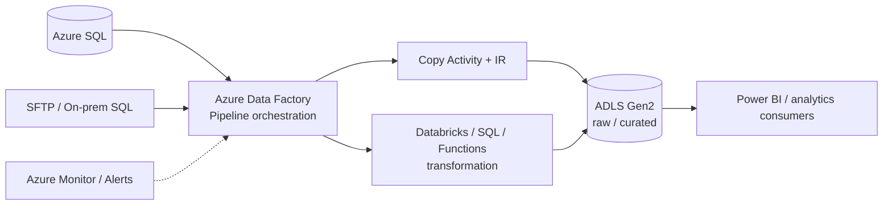

**ETL** (*Extract, Transform, Load*) typically processes data before writing to the destination. **ELT** (*Extract, Load, Transform*) typically lands raw data into a warehouse or lake first and then processes it with a specialized engine. ADF can orchestrate both; choosing between them depends on data, compliance, SLA, and cost.

### 1.1. When to Choose ADF?

ADF fits well when you need to:

- Move data across Azure SQL, Storage, SFTP, and supported SaaS or connector-backed sources.
- Schedule periodic data loads, run on time windows, or react to storage events.
- Execute a **Copy → Validate → Transform → Notify** chain with clear dependencies.
- Decouple source/sink configuration from pipeline logic and reuse definitions across datasets.
- Observe pipeline runs/activity runs, investigate failures, and perform controlled reruns.

Do not treat ADF as a replacement for every need:

- **Ultra-low-latency real-time streaming**: consider Event Hubs, Azure Functions, Stream Analytics, or streaming processors.
- **Business APIs** needing tens-of-milliseconds responses: use an application/API or appropriate service.
- **Data storage**: use SQL, Data Lake, a warehouse, or a dedicated database.
- **Highly complex transformations**: use Spark, Databricks, Synapse, or another engine invoked by the pipeline.

## 2. Seven Core Components in a Data Factory

| Concept | Question It Answers | Example |
|---|---|---|
| **Data factory** | Which Azure resource manages the integration objects? | `adf-sales-prod` |
| **Pipeline** | Which workflow steps run? | `pl_ingest_orders_daily` |
| **Activity** | What does one execution step do? | `CopyOrders`, `ValidateCount` |
| **Dataset** | Which file/table/data location is referenced? | `ds_orders_sql`, `ds_orders_csv` |
| **Linked service** | Which system to connect to and how to authenticate? | `ls_sql_orders`, `ls_adls_lake` |
| **Integration Runtime** | Which compute/connectivity environment moves or transforms data? | `AutoResolveIntegrationRuntime`, `ir-onprem` |
| **Trigger** | When or under what condition does the pipeline start? | Daily 01:00 schedule, tumbling window, storage event |

**Remember:**

> *Linked service = connection path; dataset = data location/structure; activity = action; pipeline = orchestration flow; Integration Runtime = execution/connectivity environment; trigger = activation condition.*

### 2.1. Relationship Diagram

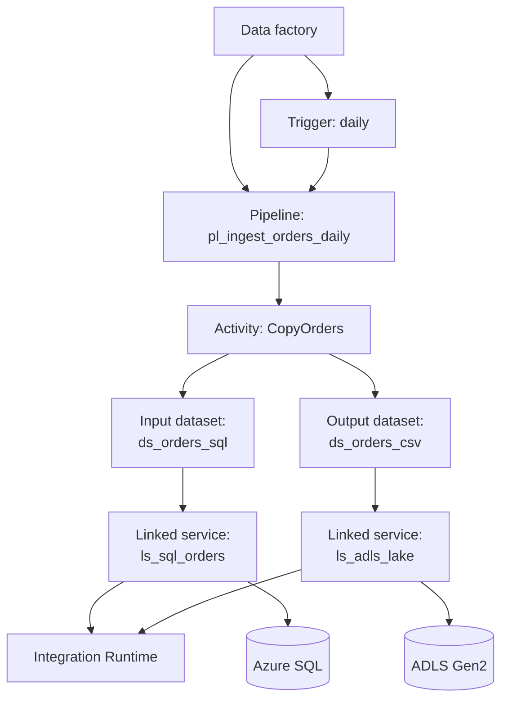

The diagram shows **logical relationships**, not a guarantee that every connector shares the same physical network path. With Self-hosted IR or multiple IRs, data paths, execution regions, and source/sink reachability must be evaluated separately.

### 2.2. A Memorable Analogy

Think of freight shipping:

- **Linked service** is the warehouse address, entry permit, and authentication credentials.
- **Dataset** is the specific shelf, bay, or shipment package.
- **Activity** is loading or transporting the cargo.
- **Pipeline** is the multi-leg shipping plan with conditions.
- **Integration Runtime** is the truck or transport crew.
- **Trigger** is the departure schedule.

In ADF, **one linked service** can back many datasets; **one dataset** can be referenced by many pipelines. Do not create a new linked service for every single table if they all connect to the same server under the same trust boundary.

## 3. Data Factory Resource and Environment Organization

A data factory is provisioned in a specific Azure subscription, resource group, and region. Pipelines, datasets, and linked services live within the factory scope, while source/sink systems may reside in other resource groups or subscriptions when networking and permissions allow.

One way to organize:

```text
Subscription: data-platform-prod
  Resource group: rg-data-integration-prod
    Data Factory: adf-retail-prod
      Linked services:
        ls_sql_orders
        ls_adls_raw
        ls_keyvault
      Datasets:
        ds_orders_sql
        ds_orders_csv
      Pipelines:
        pl_ingest_orders_daily
        pl_validate_orders
      Triggers:
        tr_orders_daily
```

These names are illustrative. Separate **dev, test, and production**, applying distinct RBAC and deployment policies. Avoid letting one Data Factory both debug against live production data and run uncontrolled development pipelines.

### 3.1. Factory Region Is Not the Only Data Location

ADF is an orchestration service; data movement can traverse an IR in a separate region. When choosing regions:

- Check where source and sink data reside and any *data residency* requirements.
- Align IR location and network path to minimize cross-region transfers.
- Verify connector and managed virtual network support in the chosen region/tier.
- Factor in latency, egress charges, compliance, and regional disaster recovery.

Never assume "because ADF is in region A, every data byte stays in A" if the IR or data movement actually executes elsewhere.

## 4. Linked Service: Connecting and Authenticating to Systems

A **Linked service** holds **endpoints, databases/accounts, connector type, authentication method, and Integration Runtime reference**. It acts like a connection configuration, without holding schemas for every individual table or file.

Examples:

| Linked Service | Target System | Connection Components |
|---|---|---|
| `ls_sql_orders` | Azure SQL Database | Host, database, authentication, IR |
| `ls_adls_raw` | ADLS Gen2 | `https://...dfs.core.windows.net`, identity, IR |
| `ls_keyvault` | Azure Key Vault | Vault URI, authentication |
| `ls_sftp_partner` | Partner SFTP | Host, port, credential/certificate, IR |
| `ls_onprem_sql` | On-premises SQL Server | Server, database, authentication, Self-hosted IR |

### 4.1. Linked Services vs. Datasets

If a SQL server holds 200 tables, you do not need 200 linked services. Usually one linked service connects to the database, and separate datasets point to different tables. For Storage, one linked service targets the account/service, while datasets describe the filesystem/container, folder, and file format.

### 4.2. Never Hard-Code Credentials in JSON

Prefer **system-assigned or user-assigned managed identities** wherever supported by the connector. When a password or client secret is unavoidable, store it in **Azure Key Vault** and have ADF reference the secret via the supported mechanism.

Never write:

```json
{
  "server": "database.example.internal",
  "username": "etl_admin",
  "password": "do-not-put-a-real-password-here"
}
```

This is an **illustrative anti-pattern**, not valid deployable linked service JSON. Putting real credentials into Git, unprotected pipeline variables, or output logs creates leakage risk and complicates rotation.

### 4.3. Azure SQL Linked Service: Illustrative JSON

```json
{
  "name": "ls_sql_orders",
  "properties": {
    "type": "AzureSqlDatabase",
    "typeProperties": {
      "server": "sql-retail-prod.database.windows.net",
      "database": "ordersdb",
      "authenticationType": "SystemAssignedManagedIdentity"
    },
    "connectVia": {
      "referenceName": "AutoResolveIntegrationRuntime",
      "type": "IntegrationRuntimeReference"
    }
  }
}
```

This is an **explanatory property sample** for an Azure SQL linked service, not a complete ARM deployment template. Connector versions, authentication modes, identities, and required properties can vary; verify the JSON supported by ADF Studio/management APIs at deployment time. **Data Factory's managed identity** still requires permissions **inside the SQL database**, not just Azure Contributor rights.

### 4.4. ADLS Gen2 Linked Service: Illustrative JSON

```json
{
  "name": "ls_adls_lake",
  "properties": {
    "type": "AzureBlobFS",
    "typeProperties": {
      "url": "https://stretaildatalake.dfs.core.windows.net"
    },
    "connectVia": {
      "referenceName": "AutoResolveIntegrationRuntime",
      "type": "IntegrationRuntimeReference"
    }
  }
}
```

This snippet illustrates the **endpoint** and IR reference, not a complete authentication configuration. In Studio, select the authentication method appropriate for the linked service (managed identity, service principal, or supported option), grant **Storage Blob Data Contributor**/Data Reader at the real scope, and verify **ADLS Gen2 ACLs** where applicable.

**Note:** an identity holding an Azure Storage RBAC role does not guarantee every ACL/path operation works automatically across all configurations. Verify the authorization model, networking, and path permissions in your environment.

## 5. Dataset: Describing Data, Not Copying Data

A **Dataset** is a declarative object specifying the **location and format** of data referenced by activities. A dataset does not pull data by itself or store copies of files/tables inside ADF.

Examples:

- SQL table dataset: `sales.Orders` in a database via `ls_sql_orders`.
- Delimited text dataset: `raw/orders/orders-2026-11-20.csv` in ADLS via `ls_adls_lake`.
- Parquet dataset: path to a folder or `.parquet` files sharing a structure.

### 5.1. Dataset for Azure SQL Database

```json
{
  "name": "ds_orders_sql",
  "properties": {
    "linkedServiceName": {
      "referenceName": "ls_sql_orders",
      "type": "LinkedServiceReference"
    },
    "type": "AzureSqlTable",
    "typeProperties": {
      "tableName": "[sales].[Orders]"
    }
  }
}
```

This dataset **references the table**; it does not store `SELECT` results. A Copy Activity can supply a specific source query to select a subset using connector-supported options.

### 5.2. Parameterized ADLS Gen2 Dataset for File Name

```json
{
  "name": "ds_orders_csv",
  "properties": {
    "linkedServiceName": {
      "referenceName": "ls_adls_lake",
      "type": "LinkedServiceReference"
    },
    "parameters": {
      "fileName": {
        "type": "String"
      }
    },
    "type": "DelimitedText",
    "typeProperties": {
      "location": {
        "type": "AzureBlobFSLocation",
        "fileSystem": "raw",
        "folderPath": "orders",
        "fileName": {
          "value": "@dataset().fileName",
          "type": "Expression"
        }
      },
      "columnDelimiter": ",",
      "firstRowAsHeader": true
    }
  }
}
```

**Explanation:**

- `fileSystem` is the ADLS Gen2 filesystem name (corresponding to a blob container).
- `folderPath` is the path inside the filesystem.
- `fileName` evaluates `@dataset().fileName`, allowing each pipeline run to specify a different file name.
- `DelimitedText` defines CSV-style formatting; production usage requires controlling encoding, quotes, escapes, null representations, column mapping, and schemas.

This example is **illustrative dataset JSON**. When importing, verify the connector schema and format properties supported by your version.

### 5.3. Must Datasets Declare a Schema?

Depending on connector and activity, ADF can import schemas, infer schemas, or use dynamic mapping. Not every dataset must declare an explicit column list upfront. However, for production:

- Define required fields, types, nullability, and encoding.
- Lock down contracts for adding/removing columns, renames, precision/scale, and datetime/timezone conventions.
- Verify Copy Activity column mappings.
- Never treat "Copy succeeded" as a guarantee that contents carry valid business semantics.

### 5.4. Dataset Parameters vs. Linked Service Parameters

If you need to access multiple database servers, parameterize the linked service endpoint where supported. If using the same ADLS account while folders change daily, parameterizing the **dataset folder/file** makes more sense. Avoid creating thousands of datasets just because a file name changes per run.

## 6. Pipeline: Workflows Made of Activities

A pipeline is an **execution flow definition**: which steps run, which dependencies must be met, which parameters are passed, and how failures behave.

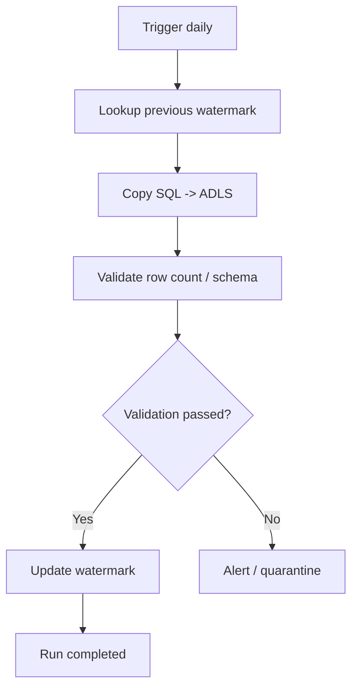

A **pipeline run** is a single execution instance of a pipeline definition. Two runs of the same pipeline can take different parameter values, run on different dates, and yield different outcomes.

### 6.1. Sample Copy Activity Inside a Pipeline Structure

Illustrative **full copy** from Azure SQL to CSV in ADLS:

```json
{
  "name": "pl_copy_orders",
  "properties": {
    "parameters": {
      "runDate": {
        "type": "String",
        "defaultValue": "2026-11-20"
      }
    },
    "activities": [
      {
        "name": "CopyOrders",
        "type": "Copy",
        "dependsOn": [],
        "policy": {
          "timeout": "0.12:00:00",
          "retry": 2,
          "retryIntervalInSeconds": 30
        },
        "typeProperties": {
          "source": {
            "type": "AzureSqlSource",
            "sqlReaderQuery": "SELECT OrderId, TenantId, Amount, CreatedAtUtc FROM sales.Orders"
          },
          "sink": {
            "type": "DelimitedTextSink",
            "storeSettings": {
              "type": "AzureBlobFSWriteSettings"
            },
            "formatSettings": {
              "type": "DelimitedTextWriteSettings"
            }
          }
        },
        "inputs": [
          {
            "referenceName": "ds_orders_sql",
            "type": "DatasetReference"
          }
        ],
        "outputs": [
          {
            "referenceName": "ds_orders_csv",
            "type": "DatasetReference",
            "parameters": {
              "fileName": {
                "value": "@concat('orders-', pipeline().parameters.runDate, '.csv')",
                "type": "Expression"
              }
            }
          }
        ]
      }
    ]
  }
}
```

**Limitations of this example:**

- This is **conceptual pipeline JSON**, not a complete deployment package (it still requires linked services, datasets, permissions, triggers, runtime, and validation connectors).
- `runDate` is only used to **name the output file**; the SQL `SELECT` query here **does not filter by date**. Do not mistake this example for an incremental load.
- If rerun for the same date, overwrite/append/multi-file behavior depends on actual sink settings, paths, and activity behavior. **There is no idempotency contract yet**, so it is not production-ready.
- `retry: 2` is an example setting, not advice to retry all errors or a guarantee against duplicate data after retries.

### 6.2. Activity Dependencies and States

ADF chains activities via dependency conditions:

| Dependency Condition | Meaning |
|---|---|
| **Succeeded** | Preceding activity completed successfully |
| **Failed** | Preceding activity failed |
| **Skipped** | Preceding activity was skipped due to dependency/branching |
| **Completed** | Preceding activity finished, regardless of success or failure |

Exact names/states are represented in JSON/Studio per the ADF contract. Never attach **UpdateWatermark** to a **Completed** branch if updates are only allowed after Copy **and validation** succeed.

## 7. Key Activity Categories

| Category | Representative Activities | When to Use |
|---|---|---|
| **Data movement** | Copy | Copying between source and sink connectors |
| **Metadata lookup** | Lookup, Get Metadata | Fetching watermarks, file lists, properties |
| **Control flow** | If Condition, Switch, ForEach, Until | Branching, config-driven looping, bounded polling |
| **Invoke another pipeline** | Execute Pipeline | Reusing common flows, modularizing complex pipelines |
| **External integration** | Web, Azure Function, Stored Procedure | Calling APIs/jobs, updating control state |
| **Transformation** | Mapping Data Flow | Transforming data using managed flow compute |
| **Wait/check** | Wait, Validation | Synchronizing progress and preconditions |
| **Variables/output** | Set Variable, Append Variable | Managing workflow-level run state |
| **Specialized compute** | Azure Databricks / Synapse / HDInsight activities | Orchestrating external engine notebooks/jobs |

Capabilities and activity names can vary by product, tier, and connector. Never cram all logic into a Web Activity or thousands of expression steps inside a pipeline; keep business transformations in testable, version-controlled engines or applications.

### 7.1. Lookup vs. Get Metadata

- **Lookup** reads a small dataset, such as a row holding a watermark or a table list from a control database.
- **Get Metadata** retrieves file/folder info, existence, last modified timestamps, or connector-specific properties.

Lookup has **size/row-count limits**; never use it to load millions of rows. For large lists, use paginated queries, a metadata store, or batched pipelines.

### 7.2. ForEach and Shared Variables

`ForEach` can run iterations in parallel per configuration. However, **pipeline variables should not be treated as thread-safe state across parallel iterations**. If concurrent iterations mutate a shared variable, results become non-deterministic. Pass parameters to child pipelines or persist results keyed cleanly in a durable control store instead of creating race conditions.

### 7.3. Execute Pipeline

A parent pipeline can invoke a child pipeline with parameters: `tableName`, `sourceSystem`, `dateWindow`, `destinationFolder`. Where appropriate, depend on the **child pipeline's completion result** rather than treating "triggering the call" as business completion. Check `waitOnCompletion` and failure propagation in the activity configuration.

## 8. Integration Runtime (IR): Where Data Movement Executes

The **Integration Runtime** provides the compute and networking layer for copying, transforming, or executing packages depending on IR type. Choosing an IR is a **networking, performance, regional, and operational decision**, not just a dropdown in a linked service.

| IR Type | When to Use | Notes |
|---|---|---|
| **Azure IR** | Copying between Azure services/public endpoints; managed data movement | Choose region, DIU/parallelism, networking, and managed virtual network if applicable |
| **Self-hosted IR** | Accessing sources/sinks in on-prem/private networks with outbound reachability; required by certain connectors | Requires installation, patching, security, and node scaling |
| **Azure-SSIS IR** | Running **SQL Server Integration Services (SSIS)** packages in supported Azure environments | Different from Spark data flows; carries dedicated compute cost |

### 8.1. Azure IR

Azure IR works when source and sink networking/access allow ADF-managed compute to connect. **Managed Virtual Network** and **Managed Private Endpoints** are available for supported sources/sinks, though connector support and data paths vary.

Choosing the IR region affects:

- Connection and data movement latency.
- Egress and inter-region transfer charges.
- Data residency and compliance.
- Data Integration Units (DIU), parallel copies, and concurrent activity limits.

### 8.2. Self-Hosted IR (SHIR)

SHIR runs on **organization-managed Windows machines** inside a network able to reach sources and sinks. Example:

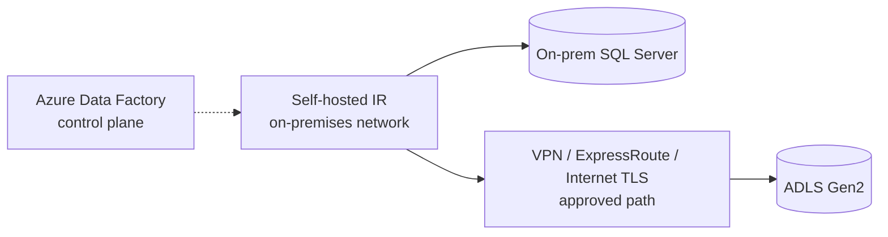

SHIR requires:

1. Hosts with sufficient CPU/RAM/disk and an up-to-date runtime version.
2. Outbound network connectivity to ADF control endpoints and target sources/sinks.
3. Proxy, TLS, firewall, and DNS controls.
4. Least-privilege SQL/SFTP/file-share read rights and secure credential storage.
5. Availability: multi-node setups where appropriate plus restart/upgrade plans.
6. Capacity: concurrent jobs, network throughput, source load, and telemetry.

**Even though ADF is a managed service, Azure does not automatically patch your entire Self-hosted IR server.** OS/runtime patching, credential rotation, and local monitoring remain the organization's responsibility.

### 8.3. Azure-SSIS IR Is Not the Default for CSV Copy

Azure-SSIS IR is built for SSIS package workloads. If you only need to copy Azure SQL → ADLS, you normally do not need Azure-SSIS IR; provisioning it adds unnecessary compute cost and operational overhead.

## 9. Hands-On Workflow: Azure SQL to ADLS Gen2

**Lab goal:** copy orders from `sales.Orders` in Azure SQL Database to a CSV file in ADLS Gen2 using ADF. The lab uses no production data, requires no broad admin privileges, and avoids default public networks.

### 9.1. Prerequisites

- An authorized Azure subscription/resource group and Data Factory.
- An Azure SQL Database containing a test table `sales.Orders`.
- An ADLS Gen2 storage account with hierarchical namespace and filesystem `raw`.
- ADF managed identity granted **SQL read** and **Storage write** permissions at the right scopes.
- Networking, DNS, TLS, firewalls, and private endpoints configured so the IR can connect.
- Learner permissions to create/edit ADF artifacts in the lab environment.
- Budgets, alerts, and a cleanup policy for test data.

### 9.2. Creating Linked Services

In ADF Studio:

1. Open **Manage → Linked services**.
2. Create `ls_sql_orders` for Azure SQL Database, selecting appropriate authentication and IR.
3. Create `ls_adls_lake` for ADLS Gen2, using managed identity where supported by the connector.
4. Run **Test connection** after confirming permissions and networking.
5. Create or verify the appropriate IR if sources/sinks are not publicly reachable.

**A passing "Test connection" does not prove every table or path can be read or written.** It checks basic connectivity and authentication. Test actual table/schema/path permissions with real activity runs.

### 9.3. Creating Datasets

1. `ds_orders_sql` selects the SQL linked service and table `sales.Orders`.
2. `ds_orders_csv` selects the ADLS Gen2 linked service, filesystem `raw`, folder `orders`, format DelimitedText, and parameter `fileName`.
3. Verify delimiters, headers, quotes, UTF-8, and null/date/numeric formats.
4. Ensure file names contain no unvalidated user input or path traversal.

### 9.4. Creating the Pipeline

1. Create `pl_copy_orders`.
2. Drag in a **Copy Data Activity**; select source and sink datasets.
3. Choose the source table or query, configuring column mappings if needed.
4. Add pipeline parameter `runDate`.
5. Pass `@concat('orders-', pipeline().parameters.runDate, '.csv')` to the output dataset parameter.
6. Set timeout, retry, and dependencies aligned with SLA.
7. Run **Debug** with lab data; inspect rows read/written, duration, and errors.
8. Once reviewed, **Publish** through the deployment workflow and attach a trigger.

**Do not confuse Debug with production schedules:** Debug can run unpublished drafts, whereas triggers execute published/deployed artifacts per deployment mode. Manage environment versions explicitly.

### 9.5. Verifying Real Outputs

Do not just check whether the activity shows `Succeeded`. Check:

- Does the file exist at the expected filesystem/path?
- Do rows read/written match, with no skipped or truncated rows?
- Are UTF-8, UTC timestamps, decimals, nulls, and data types preserved?
- Are headers and column ordering accurate?
- When rerunning for the same `runDate`, does it create duplicates or unintended overwrites?
- Did any sensitive objects land in `raw` or logs beyond authorized scopes?

## 10. Pipeline Parameters and Variables

**Parameters** are inputs supplied when starting a pipeline run. **Variables** hold mutable state read or modified during a run per ADF semantics.

| Object | Purpose | Example |
|---|---|---|
| **Pipeline parameter** | Input configuration per run, typically immutable during the run | `sourceTable`, `loadDate`, `targetFolder` |
| **Pipeline variable** | Accumulating/reading transient values inside a pipeline | Check flag or small list |
| **Dataset parameter** | Customizing a dataset's path or table | `fileName`, `folderPath` |
| **Linked service parameter** | Switching endpoint/database where supported | Server/database connection endpoint |
| **Global parameter** | Factory-wide constant per supported features | Environment code, shared config |

### 10.1. Passing Parameters Down to a Dataset

Inside a Copy Activity:

```text
Pipeline parameter: runDate = "2026-11-20"

Dataset parameter fileName:
  @concat('orders-', pipeline().parameters.runDate, '.csv')

Dataset location fileName:
  @dataset().fileName

Result:
  raw/orders/orders-2026-11-20.csv
```

This illustrates the parameterized flow. In practice, dataset and parameter names are **case-sensitive** in certain expression contexts; review carefully to avoid runtime-only failures.

### 10.2. Dynamic Content Expressions

| ADF Expression | Meaning |
|---|---|
| `@pipeline().parameters.runDate` | Reads pipeline parameter `runDate` |
| `@pipeline().RunId` | ID of the current pipeline run |
| `@utcNow()` | UTC timestamp when the expression evaluates |
| `@formatDateTime(utcNow(), 'yyyy-MM-dd')` | Generates an ISO date string for paths |
| `@concat('raw/orders/', pipeline().parameters.runDate)` | Builds a path using a parameter |
| `@dataset().fileName` | Reads a dataset parameter inside the dataset definition |
| `@activity('LookupWatermark').output.firstRow.WatermarkUtc` | Reads an output field from Lookup when structure matches |
| `@item().tableName` | Reads a property of the current item inside ForEach |

ADF dynamic expressions **differ from SQL syntax** and from Bicep/Terraform template expressions. Never concatenate untrusted user input directly into SQL queries or URIs via `concat`; use parameterization, validation, and allowlists for table/column names.

### 10.3. Use `utcNow()` Carefully

If different activities call `utcNow()` at different moments, a pipeline crossing midnight can write files into **two different date folders**. Better practice is passing **runDate/windowStart/windowEnd** from the trigger or capturing a fixed cutoff once at run start and reusing it.

### 10.4. Dynamic Table Names and SQL Injection

If a metadata-driven pipeline accepts `tableName`, never accept arbitrary partner-supplied table names. Restrict to an **approved source allowlist**, escape identifiers per SQL dialect, and use stored procedures or parameterized queries for **values** rather than arbitrary string concatenation.

## 11. Triggers: When Should Pipelines Run?

ADF supports several trigger types depending on features and sources:

| Type | How It Fires | Best Fit |
|---|---|---|
| **Manual / Trigger Now** | Operator triggers a single run | Testing, approved backfills |
| **Schedule** | Time-based recurring schedule | Daily, hourly reporting |
| **Tumbling Window** | Splits time into stateful sequential windows | Incremental loads, window-based backfills |
| **Storage event-based** | Supported events via Azure Storage/Event Grid integration | New file arrivals triggering ingestion |
| **Custom event** | Supported Event Grid scenarios | Business-event-driven workflows |

### 11.1. Schedule Trigger

For example, daily at 01:00 in the business timezone. When configuring:

- Select the timezone and account for daylight saving shifts if the region observes DST.
- Decide behavior if yesterday's pipeline run is still executing.
- Control concurrency and scenarios where the source has not finalized data yet.
- Prevent duplicate pipeline runs if triggers are redeployed or restarted without deduplication.

### 11.2. Tumbling Window

Tumbling Windows split time into theoretically **non-overlapping intervals**, such as hourly:

```text
Window 1: (00:00, 01:00]
Window 2: (01:00, 02:00]
Window 3: (02:00, 03:00]
```

Pipelines can take `windowStartUtc` and `windowEndUtc` as query parameters per contract. In ADF, when binding pipeline parameters from a tumbling trigger, expressions can read window boundaries from **trigger metadata** using the trigger's syntax, such as `@trigger().outputs.windowStartTime` and `@trigger().outputs.windowEndTime` where supported.

**Do not assume rerunning a window automatically deduplicates rows at the sink.** Tumbling windows manage scheduling and window state; idempotent writing remains the pipeline's responsibility.

### 11.3. Storage Event Trigger

When a Blob is created, a trigger can launch ingestion via supported event integration. Design considerations:

- Event delivery can be redelivered or arrive out of order per the delivery model.
- Has the file **finished uploading**? Verify the source's event type and completion conditions.
- Validate the event path to ignore unexpected prefixes, extensions, or tenants.
- Make pipelines idempotent by **file identity/ETag/version**, not just file name.
- Include a sweep/reconciliation mechanism for missed files if event delivery fails.

Never treat an event trigger as absolute proof that every file in storage was processed exactly once.

## 12. Incremental Load: Why Full Copy Is Not Enough

**Full load** copies the entire table every run. It is simple and works for small datasets or periodic snapshots, yet once tables hit billions of rows, full copies strain database I/O, networking, runtime, and cost.

**Incremental load** fetches only changes since the last successful run. Common strategies:

1. **Watermark timestamp**: `LastModifiedUtc` and processed time bounds.
2. **High-watermark key**: monotonically increasing ID when the source contract guarantees it.
3. **CDC/Change Tracking**: capturing inserts/updates/deletes per source capability.
4. **File manifest/arrival metadata**: tracking already ingested files.

### 12.1. Watermark Control Table

A control table managed by authorized pipelines/workers:

```sql
-- Illustrative SQL; not production-ready DDL.
CREATE TABLE etl.WatermarkState (
    PipelineName nvarchar(128) NOT NULL PRIMARY KEY,
    LastSuccessUtc datetime2(7) NOT NULL,
    UpdatedAtUtc datetime2(7) NOT NULL
);
```

This is a **schema-modifying statement**; run it in a lab only after creating the `etl` schema and verifying permissions. Production tables can add run ID, version, lease, status, and concurrency checks. Column types and precision must match the engine and the source's `LastModifiedUtc` precision.

### 12.2. Windowed Incremental Query

Suppose a pipeline reads from `lastSuccessUtc` to `cutoffUtc`:

```sql
SELECT
    OrderId,
    TenantId,
    Amount,
    LastModifiedUtc
FROM sales.Orders
WHERE LastModifiedUtc > @FromUtc
  AND LastModifiedUtc <= @ToUtc;
```

This is a **conceptual parameterized T-SQL query**; activities/connectors must bind or build the query via supported safe mechanisms. Never drop raw `@FromUtc` into an ADF dynamic string expecting SQL to pull pipeline parameters automatically. Use stored procedures or a controlled query layer for binding.

**Why use `(From, To]`?** The next window begins at the previous window's `To` mark; consistent half-open bounds reduce boundary duplicates or gaps when timestamps obey assumptions.

### 12.3. Safe Incremental Workflow

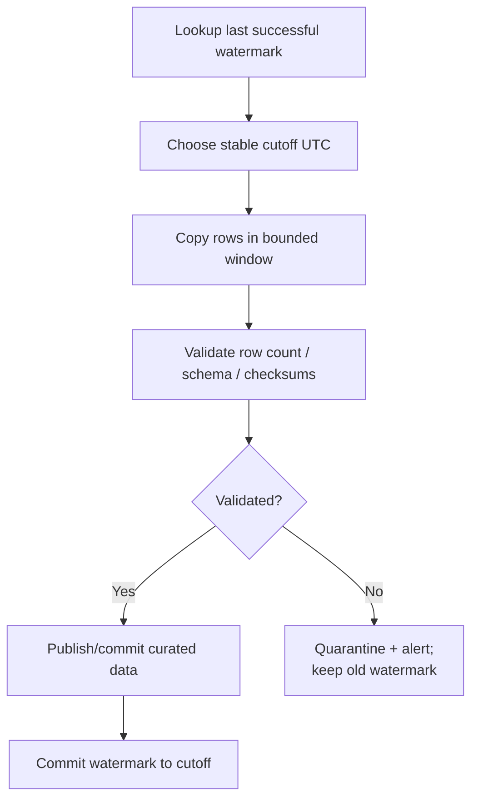

**Core principle:** advance the watermark only after data is durably written and passes required validation. Updating the watermark before Copy and having Copy fail can cause subsequent runs to **silently skip data**.

### 12.4. Equal Timestamps, Late Commits, and Deletes

Watermark timestamps are imperfect if:

- Multiple records share identical `LastModifiedUtc`.
- A transaction commits after the cutoff but carries an earlier assigned timestamp.
- Source clocks drift or timestamps are user-supplied.
- A record is **DELETED** without a tombstone or soft-delete marker.
- Concurrent pipeline runs write the watermark simultaneously.

Source-aligned solutions:

- **Composite cursor** such as (`LastModifiedUtc`, `OrderId`) when ordering/IDs are stable.
- Safety overlap window paired with sink upsert/deduplication.
- CDC/change tracking for inserts/updates/deletes where engine-supported.
- Snapshot isolation or source-guaranteed cutoffs.
- Concurrency control or optimistic locking on the watermark control record.

**Never treat `MAX(LastModifiedUtc)` from copied rows as proof that every database transaction up to that timestamp has committed.** Strict ingestion demands evaluating isolation levels and late-arriving commits.

### 12.5. CDC Differs from Copy Activity

Copy Activity copies data returned by a source query or dataset. It **does not automatically detect row deletes** if the source only returns currently existing rows. CDC/Change Tracking generally requires source-side configuration and dedicated pipelines to interpret **inserts, updates, and deletes**. Check source features and ADF/connector support rather than labeling every timestamp-filtered query "CDC."

## 13. Idempotency: Rerunning Pipelines Without Duplicating Data

A pipeline can rerun due to retries, duplicate triggers, operator resubmissions, network timeouts, or DR. A **new pipeline run ID** does not inherently mean a new business batch.

### 13.1. A Fragile Design

```text
Each run:
  SELECT orders WHERE ModifiedUtc > watermark
  APPEND all rows into curated/orders.csv

If Copy fails after writing 70%, retrying APPENDs the whole batch again:
  => duplicate rows can appear in the sink
```

### 13.2. Idempotent Patterns

| Pattern | Approach | Trade-Offs |
|---|---|---|
| **Overwrite partition/path per window** | Write `loadDate=...` outputs to staging then swap/publish under control | Needs atomic visibility or cutover mechanism |
| **Staging by runId** | `raw/orders/runId=...`; validate before publishing | Increases storage, requires cleanup |
| **MERGE/UPSERT by business key** | Curated table merges on `OrderId + version` | Compute/query cost, handling deletes and conflicts |
| **Batch ledger** | Track committed `source + window + version` | Control state needs transactions/concurrency |
| **Immutable event rows + downstream dedup** | Persist event IDs/sequences, deduplicate in curated | Increases raw volume, needs reconciliation logic |

### 13.3. Path Versioning

One option for raw:

```text
raw/orders/ingest_date=2026-11-20/run_id=<pipeline-run-id>/part-0001.parquet
```

Including the run ID avoids accidental overwrites and preserves recovery evidence, yet **by itself does not prevent duplicates** if consumers read every run blindly as new data. The curated layer must govern **which runs/windows are committed**.

### 13.4. Exactly-Once Does Not Come from "Succeeded" Status

ADF can report Copy succeeded even when a downstream transformation fails later, or an activity retry can emit duplicate intermediate outputs. Correctness requires business keys, versions/checkpoints, transactions, and validation at **source and sink**, not just green badges in Monitor.

## 14. Error Handling: Retries, Timeouts, Dependencies, and Failure Paths

An activity can fail due to networking, auth, throttling, schema mismatches, Storage permissions, source timeouts, missing files, or sink overload.

| Failure | Appropriate Response |
|---|---|
| Transient timeout/network reset | Bounded retries/backoff when operation is safe to repeat |
| SQL/Storage throttling | Throttle concurrency, inspect quotas/IR, and apply retry policy |
| 401/403 or permission denied | Fix identity, role/ACL/network policy; do not retry indefinitely |
| Schema change / column type mismatch | Halt/quarantine; update contract/mapping |
| Missing file | Distinguish late arrival from wrong path; branch to wait/alert |
| Sink full / quota / permanent failure | Escalate/capacity/quarantine; protect the watermark |
| Copy succeeded with wrong row count | Validation fails; do not advance watermark |
| Retry after partial output write | Requires idempotent staging/merge to avoid duplicates |

### 14.1. Activity-Level Retries

Policies can be configured like:

```json
{
  "policy": {
    "timeout": "0.01:00:00",
    "retry": 3,
    "retryIntervalInSeconds": 60,
    "secureInput": false,
    "secureOutput": true
  }
}
```

This is an **illustrative policy fragment**, not complete activity JSON. Parameters have activity- and runtime-specific bounds; not every retry implements custom exponential jitter. If a workflow processes single-shot side effects or appends data, retries can produce duplicate side effects.

### 14.2. Failure Dependencies and Notifications

Pipeline flow design:

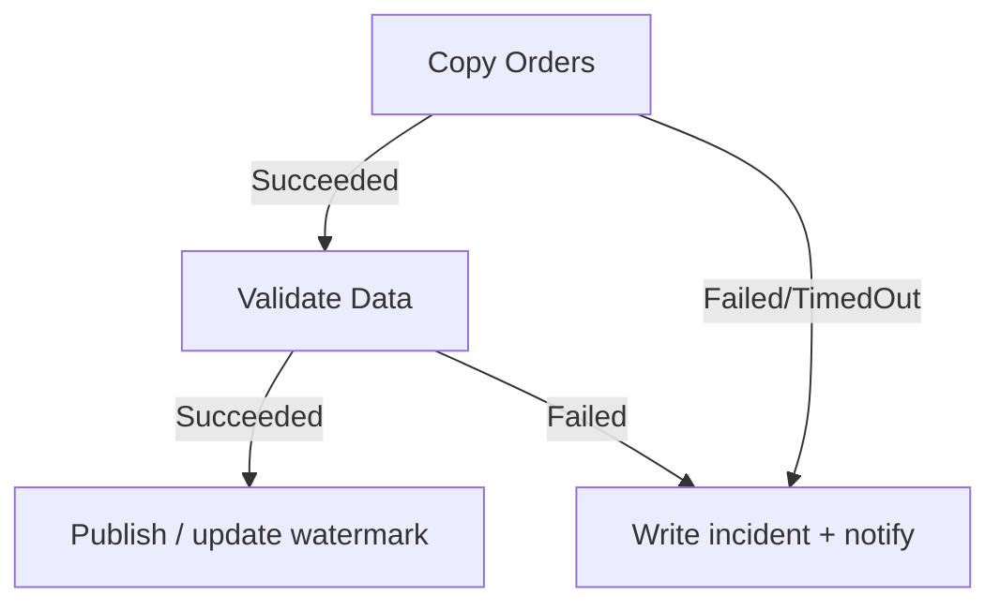

Notification branches should include **pipeline run ID, activity, source, target, window, and error category**, without emitting secrets or raw PII. If notifications/monitoring also fail, the runbook needs an alternate channel; never treat sending an email as the sole incident record.

### 14.3. Do Not Update Watermarks on "Completed"

An activity marked **Completed** may have finished with an error. If `UpdateWatermark` runs off a dependency that does not require success and validation, the pipeline can record "processed" when the sink is missing data.

### 14.4. Pipeline Concurrency

Two concurrent runs of the same pipeline reading the same old watermark can race to write to an output path and control table. When only one writer per source/window is allowed, use:

- Appropriate concurrency settings and trigger designs.
- Leases/locks or optimistic concurrency in the control database.
- Staging scoped by run ID.
- Versioned validation and commits.

Never infer from a sequential ForEach inside one pipeline that **two separate pipeline runs** cannot run simultaneously.

## 15. Copy Activity: Throughput and Partitioning

**Copy Activity** leverages IR data movement resources, parallel copies, and connector optimizations. Influencing factors include:

- Network bandwidth and latency.
- Source SQL/SFTP read capacity, indexes, and source CPU.
- File size/format, compression, and serialization.
- DIUs/concurrency, partitioned reads, and connector batch settings.
- Target Storage/database write capacity.
- Number of concurrent activities running in the factory.

### 15.1. Higher Parallelism Is Not Always Faster

Raising parallelism from 4 to 32 might push SQL CPU to 100%, slow down OLTP applications, and trigger more Copy retries. Tune by measuring **rows/s, bytes/s, source load, sink load, activity duration, and cost**.

### 15.2. Partitioning Data by Range/Window

For large tables, reads can be split by ID range, date, or connector-supported source partitioning. However:

- Ranges must cover all data without gaps or overlaps.
- Consistency across partitions must not break while the source is changing.
- Watch out for creating too many small files in the lake.
- Data skew can make one partition lag far behind all others.

### 15.3. Small Files Problem

If every Copy run produces thousands of tiny CSV/Parquet files, lake analytics must open massive file counts, inflating latency and cost. Consider:

- Target file sizes suited to downstream engines.
- Batch grouping/compaction in the curated stage.
- Folder partitioning only on dimensions actually filtered in queries.
- Avoiding one folder per record or user unnecessarily.

**ADF Copy succeeding does not mean the Data Lake file layout is optimal** for Spark, SQL, or BI.

## 16. Mapping Data Flow and Transformations

**Mapping Data Flow** provides a visual way to build data transformations using supported operations on Azure-managed Data Flow compute (typically Spark-based). It differs from **Copy Activity**, which focuses on data movement and schema mapping.

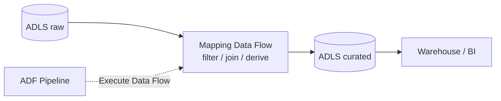

### 16.1. When to Use Data Flow?

Suited for multi-step transforms:

- Filter, Derived Column, Select, Aggregate.
- Join, Lookup, Conditional Split.
- Schema drift handling per supported capabilities.
- Sink transformations and certain upsert/update patterns depending on destination.

**Trade-offs:** compute startup time, cluster/vCore billing, memory/cost, and debug behavior differ from Copy. For simple column renames, Copy mapping can be cheaper and simpler to operate. For heavy Spark processing or specialized logic, consider Databricks/Synapse rather than forcing every algorithm into Data Flow.

### 16.2. Debug Sessions Can Incur Charges

In Data Flow environments, a **debug cluster/session** provisions compute and incurs charges, even when learners only test a few transformations. Set sensible TTLs, shut down idle sessions, and monitor workspace billing.

## 17. Data Validation: Right Data Matters More Than File Presence

A trustworthy pipeline verifies after Copy:

1. **Existence:** does the target file/table exist at the expected path?
2. **Row count:** do source and target counts align after accounting for filters/dedup?
3. **Schema:** are required columns, types, nullability, and precision accurate?
4. **Freshness:** does data match the expected window and cutoff?
5. **Uniqueness:** are business keys free of duplicates?
6. **Completeness:** are any partitions, dates, or tenants missing?
7. **Quality rules:** non-negative amounts per business rules, valid IDs.
8. **Security:** does output contain unauthorized PII or sit under overly permissive paths?

### 17.1. Row Count Alone Is Not Enough

If the source has 100 records and the sink also has 100, data might still be wrong: one record could be missing while another was duplicated. For critical pipelines, add **key-level reconciliation, range/hash/checksum checks, versions, or quality assertions** within acceptable cost.

### 17.2. Quarantine Instead of Dropping Bad Data

When a CSV contains schema-invalid records:

- Store the file/batch in a **quarantine path** with dedicated access control and retention.
- Record error reason, source, file ID, run ID, and timestamp.
- Never silently discard invalid records without an audit trail.
- Maintain a workflow to fix schemas, replay, and verify idempotency.

Never dump raw PII into notification emails or logs for "quick debugging."

## 18. Security: Microsoft Entra ID, Managed Identity, and Key Vault

A data architecture involves **at least three permission layers**:

1. **Azure control-plane RBAC:** who can create/edit data factories, pipelines, linked services, and triggers.
2. **Data-plane access:** what the ADF identity/IR client can read/write in SQL, SFTP, or Blob storage.
3. **Operations/log access:** who can view pipeline history, linked service configs, and data diagnostics.

### 18.1. ADF Managed Identity

Data Factory can use a **managed identity** configured on the factory where supported by connectors. When copying from SQL to ADLS:

- Azure SQL: the identity must be mapped in the database and granted `SELECT` on target tables/views.
- ADLS Gen2: the identity needs data-plane roles or ACLs to write to the specific folder.
- Key Vault: the identity needs secret read access if linked services reference secrets.

Never grant `Owner` on the subscription just to make Test connection pass. Most workloads need a narrow permission set, keeping deployment/admin separate from runtime.

### 18.2. Illustrative T-SQL Permission Grant

Assuming ADF's managed identity is uniquely resolved in the tenant and an Entra/database admin executes:

```sql
-- WRITE STATEMENT: run only in approved lab/staging ordersdb.
CREATE USER [adf-retail-prod] FROM EXTERNAL PROVIDER;

CREATE ROLE role_adf_orders_reader;
GRANT SELECT ON OBJECT::sales.Orders TO role_adf_orders_reader;

ALTER ROLE role_adf_orders_reader
    ADD MEMBER [adf-retail-prod];
```

In production, handle already-existing principals/roles, ambiguous object IDs, migration ordering, and directory lookups. Never grant `db_owner` or database-wide `db_datareader` when only one table is needed. SQL users **are not created automatically** just by holding an Azure Contributor role.

### 18.3. Key Vault and Secret Rotation

When a connector only supports password or API-key credentials:

- Store secrets in **Azure Key Vault**.
- Configure the linked service to reference the secret via supported mechanisms.
- Scope `get`/RBAC permissions strictly to the required identity.
- Rotate credentials on schedule; retest linked services and SHIR if applicable.
- Keep secrets out of debug outputs, default parameters, tickets, and Git.

### 18.4. Secure Input/Output

Some activities support **secureInput/secureOutput** to suppress sensitive data from monitoring logs. However, enabling secure output can make troubleshooting harder; design minimal necessary logging rather than logging raw payloads. This setting also does not protect data if a pipeline explicitly writes secrets to Storage or a public webhook.

## 19. Networking: Private Endpoints, DNS, and Self-Hosted IR

Even with valid permissions, Copy can fail due to DNS or firewalls:

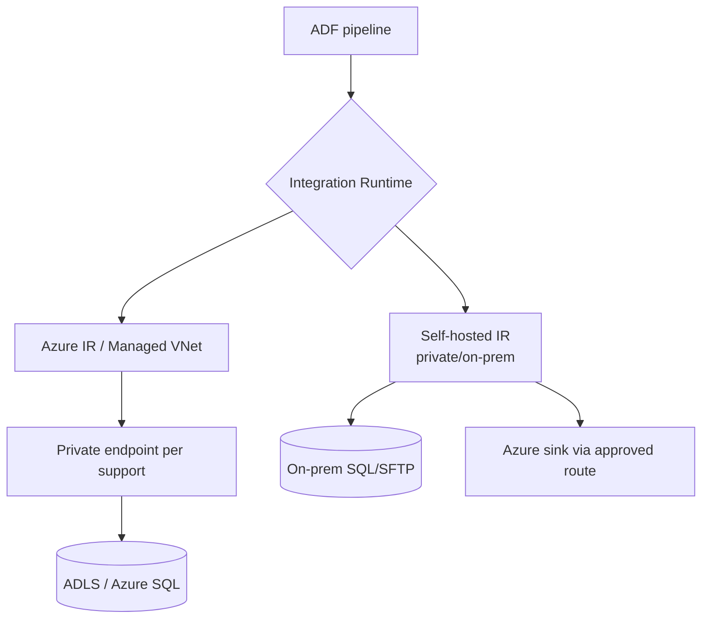

### 19.1. Three Layers to Diagnose

| Layer | Symptoms | What to Check |
|---|---|---|
| **Connectivity** | DNS failures, timeouts, connection refused | IR placement, VNet, private DNS, firewall, proxy, ports |
| **Authentication** | Token acquisition/login failures | Identity, tenant, token audience, credential expiry |
| **Authorization** | SQL permission denied, Storage 403/ACL errors | DB roles/GRANTs, Storage data-plane RBAC/ACLs |

**An Approved Private Endpoint does not prove every IR resolves the hostname to a private IP.** Verify from the actual environment executing data movement.

### 19.2. Self-Hosted IR and Network Segmentation

When the SQL source is private/on-premises:

1. Deploy SHIR on an approved host in a network reaching SQL.
2. Allow outbound TLS to Azure control endpoints per IR documentation.
3. Route traffic to ADLS/sinks along approved paths.
4. Restrict the local service account, filesystem permissions, and SQL read scope.
5. Monitor CPU/RAM, concurrent jobs, runtime version, and availability.
6. Test failover/restarts when deploying multi-node SHIR clusters.

Never expose SQL Server to the public Internet just so AutoResolve Azure IR can reach it easily, especially under private networking mandates and sensitive data rules.

### 19.3. Managed Virtual Network Does Not Replace Identity

When Azure IR runs inside a managed VNet, private connectivity still requires **managed private endpoint approval**, DNS/connector support, and data-plane permissions. "Network connected" only establishes transport, never granting table reads or Blob writes.

## 20. Monitoring: Pipeline Runs, Activity Runs, and Trigger Runs

ADF provides key observability views:

- **Pipeline runs:** overall run status, duration, parameters, and timestamps.
- **Activity runs:** per-step execution, source/sink metrics, and errors.
- **Trigger runs:** whether schedules/events fired as expected.
- **Azure Monitor/diagnostic logs:** telemetry and alerting when configured.
- **Data quality/curated freshness:** whether delivered data meets consumer SLAs.

### 20.1. KPIs Worth Tracking

| KPI | Question |
|---|---|
| Pipeline success/failure rate | How many runs finish cleanly? |
| Duration p50/p95/p99 | Are pipelines taking abnormally long? |
| Trigger latency / missed windows | Do load windows start on time? |
| Rows read/written, bytes copied | Is data movement matching expected volume? |
| Copy throughput | Is the bottleneck at source, IR, or sink? |
| Freshness lag | How delayed is new data in the Data Lake? |
| Validation failure count | Are schema/key/duplicate errors occurring? |
| Watermark age | How current is processed data? |
| SHIR health, CPU, and queue | Is the internal runtime overloaded? |
| Cost per successful batch | Is the flow optimal across compute, network, and storage? |

### 20.2. Correlation IDs

An application/control-store log entry might include:

```json
{
  "pipelineName": "pl_ingest_orders_daily",
  "runId": "example-run-id",
  "sourceSystem": "azure-sql-orders",
  "windowStartUtc": "2026-11-19T00:00:00Z",
  "windowEndUtc": "2026-11-20T00:00:00Z",
  "target": "raw/orders",
  "rowsRead": 10240,
  "rowsWritten": 10240,
  "validation": "passed"
}
```

This is an **illustrative log schema**, not ADF's default JSON output. Never log passwords, SAS URLs, connection strings, tokens, or raw rows containing PII.

### 20.3. "Succeeded" Can Still Produce Wrong Data

A pipeline copying into the **wrong date folder** still reports Succeeded at runtime. ADF cannot know on its own whether that date satisfies the business SLA. Alerts should therefore cover **data freshness, completeness, schema quality, and aggregate reconciliation** alongside activity status.

### 20.4. Alerts and Ownership

Configure accountable alerts for:

- Pipeline failures/timeouts or missed scheduled triggers.
- Stalled watermarks across multiple windows.
- Abnormal drops in copy throughput or rows written.
- Self-hosted IR node offline or rising queue backlogs.
- Spikes in SQL/Storage 429/403/timeouts.
- Sudden jumps in Data Flow or copy compute cost.

Never route critical alerts solely to an unmonitored personal inbox without on-call rotation. Critical data needs escalation paths and runbooks.

## 21. CI/CD and Publishing: Versioning Artifacts

ADF Studio supports authoring workflows with **Git integration** and structured publish/deployment pipelines. Pipelines, linked services, and datasets are **version-controlled artifacts**, not items to hand-edit directly in production.

### 21.1. Distinguishing Three States

1. **Authoring:** editing pipelines/datasets/linked services in a branch or Studio.
2. **Debug:** testing logic with lab data; not necessarily the artifact executed by production schedules.
3. **Publish/deploy:** promoting approved definitions to the target factory/runtime so triggers run that version.

With ADF Git integration, publishing can generate/publish ARM artifacts per configured mode; CI/CD pipelines can also validate/generate templates and deploy via supported workflows. Exact mechanics depend on repo, branch, and publishing strategy.

### 21.2. Never Share Credentials Across Environments

Separate environments:

```text
dev:
  adf-retail-dev -> sql-dev -> adls-dev

test:
  adf-retail-test -> sql-test -> adls-test

prod:
  adf-retail-prod -> sql-prod -> adls-prod
```

Pass endpoints, databases, storage accounts, and Key Vault references using **parameters, variable groups, and secure deployment configs**. Never commit production secrets to Git or copy a dev linked service containing a password into prod.

### 21.3. Triggers During Deployment

When modifying triggers or introducing incompatible pipeline changes:

- Determine whether tools and approved change windows require **stopping/starting triggers**.
- Avoid running triggers while sources/sinks are mid-migration.
- Reconcile missed or overlapping windows after deployment.
- Verify identities and IR connections in the target factory.
- Prepare a rollback/cutover plan with business owner sign-off.

## 22. Azure CLI: Inventorying Data Factory (Read-Only)

The commands below only read ADF configuration per supported **Azure CLI and extension/version**. Do not run resource creation, updates, or deletions against production.

### 22.1. Inspecting Subscription and Factory

```bash
RG="rg-data-integration-prod"
FACTORY="adf-retail-prod"

az account show \
  --query "{subscription:name,id:id,tenant:tenantId}" \
  -o table

az datafactory show \
  --resource-group "$RG" \
  --factory-name "$FACTORY" \
  --query "{name:name,location:location,identity:identity}" \
  -o json
```

### 22.2. Listing Pipelines, Datasets, and Linked Services

```bash
az datafactory pipeline list \
  --resource-group "$RG" \
  --factory-name "$FACTORY" \
  --query "[].name" \
  -o table

az datafactory dataset list \
  --resource-group "$RG" \
  --factory-name "$FACTORY" \
  --query "[].name" \
  -o table

az datafactory linked-service list \
  --resource-group "$RG" \
  --factory-name "$FACTORY" \
  --query "[].name" \
  -o table
```

**Caution:** linked service metadata output can expose endpoints and sensitive properties. List **names only** first; never paste full connection JSON into chats or tickets.

### 22.3. Inspecting a Pipeline Definition

```bash
az datafactory pipeline show \
  --resource-group "$RG" \
  --factory-name "$FACTORY" \
  --name "pl_ingest_orders_daily" \
  --query "{name:name,activities:activities,parameters:parameters}" \
  -o json
```

Depending on CLI version, returned JSON fields may sit under `properties` or at a different nesting level. If a query returns empty values, inspect the full output in a controlled environment and verify field names before assuming the pipeline is empty.

### 22.4. ADF CLI Differs from SQL/Storage CLI

Listing ADF pipelines only checks the **control plane**. It does not prove the ADF identity can read `sales.Orders` or write `raw/orders`. Verifying data-plane access requires inspecting SQL roles, Storage RBAC/ACLs, IR networking, and running real Copy tests.

## 23. Costing: Orchestration, Movement, Transforms, and Operations

ADF costs can span multiple **billing meters** depending on features and current pricing models:

| Category | Cost Components to Evaluate |
|---|---|
| **Orchestration** | Activity/pipeline executions, triggers, and orchestration meter counts |
| **Data movement** | Copy Activity, data movement compute/DIUs/runtime, duration |
| **Data Flow** | Compute/vCore-hours, cluster startup and debug sessions |
| **Azure-SSIS IR** | Nodes/hours/runtime compute |
| **Self-hosted IR** | Organization-operated Windows VM/server, CPU/RAM, network, maintenance |
| **Data destinations** | SQL compute, ADLS capacity/transactions, warehouse/Databricks compute |
| **Networking** | Cross-region egress, gateways, private endpoints per configuration |
| **Monitoring** | Log Analytics ingestion/retention, alerts, and metrics beyond free tiers |

**You cannot estimate bills solely from Copy row counts.** Duration, IR type, parallelism, transferred bytes, Data Flow startups, connectors, regions, and service tiers all contribute.

### 23.1. A Sizing Example

Suppose each night you copy:

```text
Rows:                   20,000,000
Average size:           400 bytes/row
Estimated raw payload:  8,000,000,000 bytes (~8 GB)
Source read window:     2 hours
```

This is a **raw payload estimate** for planning, excluding CSV escaping, compression, network overhead, indexes, data types, and transaction logs. To size properly:

1. Measure actual bytes and rows at the source.
2. Benchmark a representative data sample.
3. Observe source/sink and IR throughput.
4. Reserve headroom for retries and validation.
5. Compare full vs. incremental approaches.
6. Account for total cost including SQL impact and downstream analytics overhead.

### 23.2. Controlling Costs Properly

- Use **incremental loads** when sources support them and volumes warrant it.
- Avoid ForEach loops over thousands of items when operations can be batched.
- Match IR regions and networking to eliminate unnecessary cross-region transfers.
- Limit Data Flow debug compute and turn it off when idle.
- Size Data Lake files sensibly to avoid small-file explosions.
- Tune parallelism to the **actual bottleneck**, rather than maximizing numbers blindly.
- Retain logs/pipeline runs only per audit and retention requirements.

**Never cut costs by disabling validation and alerting on critical pipelines** when the risk of corrupt data outweighs the savings.

## 24. Case Study A: Daily Azure SQL → ADLS → Power BI

**Context:** a retail system needs revenue data ready before 07:00 each morning. The source SQL system is OLTP and cannot tolerate heavy full table scans during peak hours.

### 24.1. Proposed Design

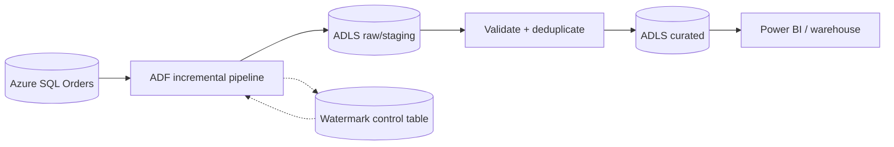

Components:

| ADF Object | Example Name | Responsibility |
|---|---|---|
| Linked service | `ls_sql_orders` | Entra MI to SQL database |
| Linked service | `ls_adls_lake` | Access ADLS Gen2 raw/curated |
| Dataset | `ds_orders_sql` | Source table/query |
| Dataset | `ds_orders_parquet` | Partition folder/output format |
| Pipeline | `pl_ingest_orders_incremental` | Watermark → Copy → validation → commit |
| Trigger | `tr_orders_daily_0200` | Scheduled run at stable time |
| IR | Network-aligned Azure IR | Data movement |

### 24.2. Operational Flow

1. Look up the latest committed watermark.
2. Determine a stable UTC source cutoff or source watermark.
3. Copy only rows modified within the window.
4. Write to staging keyed by **window and runId**.
5. Validate row counts/schemas and reconcile keys.
6. Merge/upsert into curated by `OrderId`, handling deletes/tombstones if supported by source.
7. Update the watermark only after validation and publishing succeed.
8. Log audit trail and verify freshness prior to 07:00.

### 24.3. Failure Conditions to Test

- Transient SQL 503/timeout: bounded retries, watermark does not advance wrongly.
- Copy writes partially then fails: subsequent run creates no duplicates in curated.
- Order updated right near cutoff: no missed changes from late commits.
- Storage ACL denied: fail fast, alert, and never mark complete.
- Trigger reruns the same window: final data remains consistent.

## 25. Case Study B: On-Premises SQL Server → Azure Data Lake

**Context:** the ERP system is reachable only inside the corporate network. Azure Data Factory has no public path to SQL Server, and the enterprise refuses to open inbound Internet ports.

### 25.1. Architecture

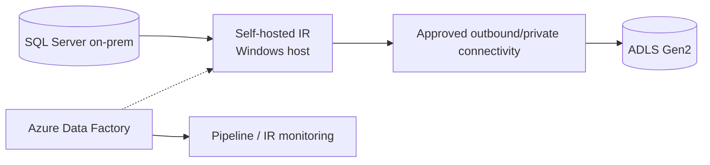

**Implementation:**

1. Install SHIR on an approved host with adequate CPU/RAM and network reachability to SQL.
2. Register SHIR with the target Data Factory per the supported workflow.
3. Create the SQL Server linked service pointing through SHIR with least-privilege credentials.
4. Create the ADLS linked service with appropriate authentication and IR.
5. Design incremental source queries or file exports.
6. Run Copy and verify throughput, source CPU, and network egress.
7. Monitor SHIR version, availability, failed activities, and configuration backups.

### 25.2. Key Risk

Never funnel all enterprise workloads onto a single SHIR node with zero headroom. If that node goes offline, dependent pipelines stall. Multiple nodes can form an HA/scalable SHIR cluster per product support, subject to limits, cluster topology, and security hardening.

## 26. Case Study C: Metadata-Driven Pipelines for Many Tables

**Context:** the data team needs to sync 120 tables from multiple SQL databases. Cloning 120 nearly identical pipelines makes maintenance hard, drifts retry/monitoring settings, and obscures which tables completed.

### 26.1. Control Metadata Table

Example row:

```json
{
  "sourceSystem": "orders-sql",
  "sourceSchema": "sales",
  "sourceTable": "Orders",
  "targetFolder": "raw/orders",
  "loadMode": "incremental",
  "watermarkColumn": "LastModifiedUtc",
  "enabled": true
}
```

This is an **illustrative metadata record**, not a mandatory ADF schema. Metadata must be access-controlled and validated against an allowlist; never let untrusted edits read arbitrary `sys.*` views or exfiltrate data.

### 26.2. Parent and Child Pipelines

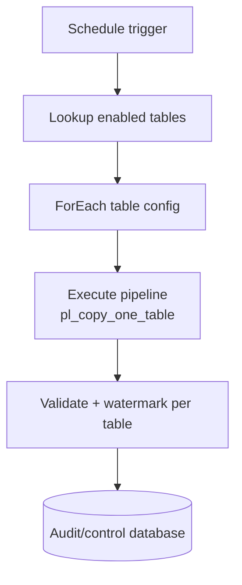

**Benefit:** Copy/retry/alert logic is shared while each table keeps its own config. **Pitfall:** a `ForEach` with concurrency 50 can launch 50 simultaneous SQL reads and overload the ERP source. Cap concurrent tables, prioritize business-critical tables, and watch source load.

### 26.3. Should One Table's Failure Fail the Whole Batch?

Depends on SLA:

- For financial reports requiring complete coverage, one missing table may **block publishing the entire batch**.
- For multi-system independent ingestion, per-table status can be logged while other tables finish, provided dashboards surface **partial success** and fire alerts.

Never let a parent pipeline show Succeeded simply because it caught child pipeline errors while ignoring actual data status.

## 27. Runbook: Pipeline Not Running, Running Slowly, or Producing Wrong Data

### Phase 1 — Triage

1. Identify **factory, pipeline, runId, trigger, time window, and environment**.
2. Check whether the trigger fired and whether the latest pipeline was published/deployed.
3. Open activity runs: identify Failed/TimedOut/Skipped steps and error categories.
4. Check linked service connections, tokens/secrets, and authorization.
5. Identify which IR executed the activity, its region, network path, and health.
6. Check source/sink capacity, SQL CPU, Storage throttling/ACLs, and data volumes.
7. Reconcile sink data, watermarks, and batch ledgers before resubmitting.

### Phase 2 — Stabilize

1. On auth failures: fix **managed identity, SQL GRANTs, or ACLs**—do not increase retries.
2. On DNS/private connectivity failures: inspect IR placement, private DNS, routing, and firewalls.
3. On throttling: lower concurrency, throttle Copy, and tune queries; never raise parallelism blindly.
4. On schema mismatches: quarantine the batch and update mappings/contracts via change control.
5. On duplicate data: halt downstream publishing, preserve staging/audits, and analyze retries/resubmits.
6. On bad watermarks: **never fast-forward to current time**; identify the data gap and plan a backfill.

### Phase 3 — Recover and Reconcile

1. Confirm dependencies are healthy.
2. Rerun the **specific window** using an idempotent pipeline and isolated staging.
3. Validate row counts, business keys, nulls, timestamps, and schemas.
4. Commit/publish outputs and update the watermark with concurrency control.
5. Monitor freshness, backlog windows, and BI refreshes.
6. Write an RCA detailing root cause, affected data, cost impact, and preventive actions.

### 27.1. Actions to Avoid

- Automatically `TRUNCATE`-ing production tables to recover from a failed Copy before reconciling.
- Escalating SQL rights to `db_owner` just because Copy threw permission denied.
- Opening Storage/SQL public endpoints for a "quick test" under private-networking policies.
- Resubmitting a full month of data into an append sink lacking deduplication.
- Overwriting the watermark with `utcNow()` to silence errors without closing data gaps.
- Logging full SQL connection strings or customer PII.
- Leaving Data Flow debug clusters running indefinitely.

## 28. Common Misconceptions

| Misconception | Reality |
|---|---|
| "Pipelines hold SQL connection strings" | Pipelines orchestrate; linked services describe connections |
| "Datasets hold all the data" | Datasets describe locations/formats/references, not item copies |
| "One linked service per table" | One linked service can serve many datasets |
| "Triggers perform the Copy" | Triggers initiate runs; activities and IR execute them |
| "All IR choices behave the same" | IR governs connectivity, compute, region, and operations |
| "Copy Succeeded guarantees data quality" | Validation, business reconciliation, and freshness are still required |
| "Retries guarantee exactly-once" | Retries can duplicate rows if the sink is not idempotent |
| "Update watermarks first so we don't forget" | Risks silent data loss if Copy fails |
| "Event triggers fire strictly once per file" | Event redelivery and ordering must be accounted for |
| "RBAC Contributor allows SQL SELECT" | Azure control plane differs from SQL database permissions |
| "Approved Private Endpoint means ADF connects" | IR routing, DNS, auth, and ACLs still apply |
| "Higher ForEach concurrency is always faster" | Can throttle SQL/connectors and overload sources |
| "Date-based output file names make a full load incremental" | Source still copies everything if the query lacks a filter |
| "If Debug passes, the scheduler runs it immediately" | Artifacts normally require publishing/deploying to the environment |
| "ADF executes all Spark jobs inside itself" | ADF orchestrates; Data Flow has dedicated compute or invokes external engines |
| "Logging all inputs/outputs aids debugging" | Risks leaking secrets/PII and inflating log costs |

## 29. Practice Exercises and Self-Check Questions

### 29.1. Practice A — Designing the Three Components

Design a flow extracting `customers` from Azure SQL and writing `raw/customers/customers-<date>.parquet`:

1. Name **two linked services**, specifying endpoint, auth, and IR.
2. Name **two datasets**, detailing table/format/path and parameters.
3. Design a **pipeline** with Copy, Validate, and Audit steps.
4. Select a trigger and explain how the date flows down to the dataset.
5. Describe how to grant SQL/ADLS permissions and verify Test connection.

**Criteria:** clearly separate **connection** from **data**, with no passwords in pipeline JSON.

### 29.2. Practice B — Incremental Load

Given a 5-million-row table with `LastModifiedUtc`:

1. Create a watermark table in a control database.
2. Define the `(fromUtc, toUtc]` query window and safe cutoff.
3. Stage by run ID and validate.
4. Design curated upsert/idempotency.
5. Advance the watermark only after a successful commit.
6. Simulate a failure in the final minute of Copy and rerun the same window.

**Criteria:** after retrying, zero lost rows and zero duplicated business records.

### 29.3. Practice C — On-Premises Source

Design a pipeline pulling files from on-premises SFTP/SQL via Self-hosted IR:

1. Specify the IR host, outbound requirements, and security controls.
2. Design resilience for node downtime.
3. Protect credentials via Key Vault or an appropriate mechanism.
4. Configure alerts for unhealthy IR and Copy failures.
5. Define a plan to reprocess missed files.

### 29.4. Self-Check Questions

1. Which three questions do pipeline, dataset, and linked service answer?
2. What role does Integration Runtime play in Copy Activity?
3. Do you need a new linked service for every SQL table on the same server? Why?
4. How does dataset parameter `fileName` differ from pipeline parameter `runDate`?
5. On which object are `@pipeline().parameters.runDate` and `@dataset().fileName` evaluated?
6. If a Copy JSON includes `runDate` yet the SQL source still `SELECT`s the full table, is it a full or incremental load?
7. Why doesn't a passing Debug run guarantee production triggers execute the latest changes?
8. How do Azure IR and Self-hosted IR differ in connectivity and operational ownership?
9. When would you use Azure-SSIS IR instead of Azure IR?
10. How does a Schedule trigger differ from Tumbling Window in managing time windows?
11. Why shouldn't a `BlobCreated` event trigger be treated as exactly-once ingestion?
12. When do you need Lookup, Get Metadata, ForEach, and Execute Pipeline?
13. Why can pipeline variables cause issues inside parallel ForEach loops?
14. Why must watermarks update after validation rather than right after Lookup?
15. How do you handle rows with equal timestamps or late commits?
16. If a source row is deleted, will a query filtering only `LastModifiedUtc` detect the deletion?
17. Why can retrying Copy after writing 70% of output cause duplicates?
18. How do `Succeeded` and `Completed` dependencies differ when updating watermarks?
19. What permissions does a managed identity need to read Azure SQL and write ADLS Gen2?
20. A Private Endpoint is Approved, yet Copy hits a DNS timeout: which layer do you inspect?
21. What does ADF run history prove, and what does it fail to prove about BI data?
22. Why can Mapping Data Flow incur different costs than Copy Activity?
23. When are metadata-driven pipelines helpful, and why must ForEach concurrency be bounded?
24. Name three metrics distinguishing source bottlenecks, IR bottlenecks, and sink bottlenecks.
25. If you must backfill 30 days, how do you ensure every window runs completely without duplicates?

## 30. Production Deployment Checklist

- [ ] Chose ADF intentionally rather than confusing it with a database, event streaming, or Fabric Data Factory.
- [ ] Factory, pipelines, datasets, linked services, IRs, and triggers have clear owners and naming.
- [ ] Linked services use managed identities/Key Vault where supported.
- [ ] SQL permissions and ADLS RBAC/ACLs scoped strictly to required sources/paths.
- [ ] Datasets have verified schemas, formats, encodings, paths, and parameters.
- [ ] Pipelines include source/sink mappings and validation for critical data.
- [ ] Each run receives a stable window/cutoff rather than computing dates independently across activities.
- [ ] Incremental loads handle watermarks/CDC, deletes, and late commits where needed.
- [ ] Outputs are idempotent on retries/resubmits, with staging/quarantine and reconciliation.
- [ ] Activity timeouts, retries, and failure dependencies verified.
- [ ] `UpdateWatermark` runs only after successful validation and publishing.
- [ ] Pipeline concurrency and ForEach parallelism do not overload sources/sinks.
- [ ] IR region/capacity fit workload; SHIR has health checks, patching, and backups if used.
- [ ] Private Endpoints, DNS, firewalls, and TLS verified from the actual IR.
- [ ] Triggers configured with proper schedules, timezones, event filters, and overlap handling.
- [ ] Debug, publish/deploy, and CI/CD cleanly separated across environments.
- [ ] Dashboards track trigger/pipeline/activity runs, freshness, and data quality.
- [ ] Logs never expose passwords, SAS tokens, bearer tokens, or sensitive data.
- [ ] Throughput, data volumes, network egress, and Data Flow/IR costs measured.
- [ ] Runbooks exist for reprocessing, backfills, rollbacks, watermark fixes, and on-call ownership.

## Conclusion

In **Azure Data Factory**, **pipelines, datasets, and linked services** carry distinct yet tightly coupled roles: **linked services** describe target systems and how to connect; **datasets** describe specific tables, files, locations, and formats; **pipelines** orchestrate **activities** using those objects. **Integration Runtimes** provide the compute and connectivity to copy or transform data, while **triggers** govern when runs start. A well-operated architecture goes further: beyond copying bytes, it selects **full/incremental/CDC modes properly**, protects **watermarks safely**, writes **idempotent outputs**, validates **data quality and freshness**, applies least-privilege Entra/Storage/SQL rights, enforces private networking, monitors runs, and budgets **total cost**. With this foundation, ADF becomes a reliable orchestration layer delivering data from Azure and on-premises applications into analytics platforms without sacrificing accuracy, security, or resilience.
