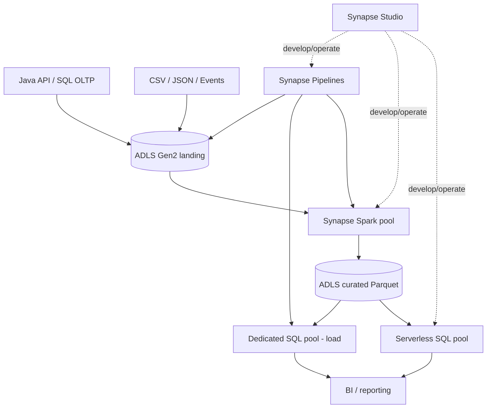
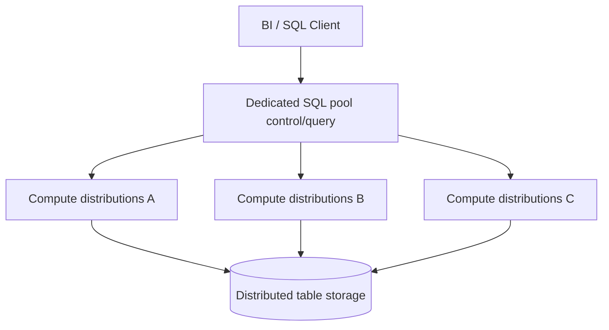
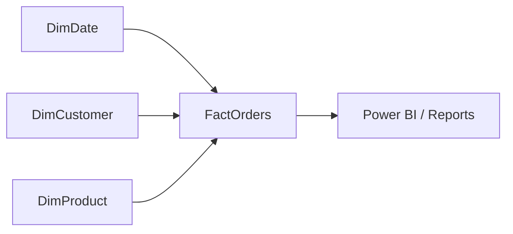
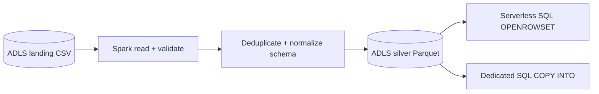
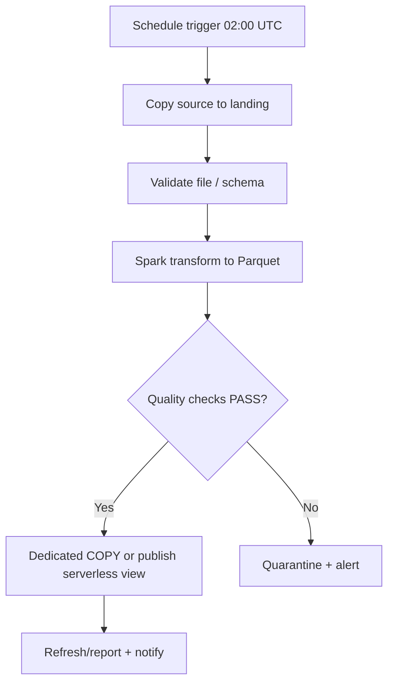
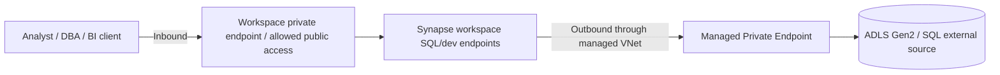

# Azure Synapse Analytics and Analytical Data Querying

A retail company has a Java Spring Boot application writing orders to Azure SQL, website traffic data stored as JSON logs, and a warehouse system exporting CSV files daily. The analytics team wants to answer: **what is the monthly revenue, which customers buy the most, and which ad campaigns drive profit?** Running large aggregation queries directly against the transactional database can degrade API performance, while data itself sits across multiple formats and locations.

**Azure Synapse Analytics** is an integrated analytics platform on Azure combining **SQL analytics, Apache Spark, data integration pipelines, and connectivity to data in Azure Data Lake Storage Gen2 (ADLS Gen2)**. Depending on the problem, you can query files directly on the data lake using a **serverless SQL pool**, organize a data warehouse with dedicated SQL compute using a **dedicated SQL pool**, or process big data with an **Apache Spark pool**. **Synapse workspace and Synapse Studio** serve as the collaborative environment coordinating these components.

This lesson belongs to the **Data Platforms and Analytics** chapter of the **CLOUD_PROVIDERS_AZURE** module. It connects Azure subscriptions, resource groups, Microsoft Entra ID, virtual networks, compute services, Blob/ADLS storage, databases, security, monitoring, and cost control of an application architecture. The direct topic is **"Azure Synapse Analytics and Analytical Data Querying."**

> **Scope:** This lesson focuses on a Synapse workspace with **serverless SQL pool, dedicated SQL pool, Spark, and pipelines**. Microsoft Fabric, Azure Databricks, Azure Data Factory, and Azure Data Explorer are related services but are not identical to Synapse. Capabilities, SKUs, regions, access rights, connectors, and pricing can change; verify in your target environment. Commands/scripts below are examples for an authorized lab, not operations already executed on Azure.

## Learning Objectives

After this lesson, you will be able to:

1. Explain the roles of Synapse workspace, Synapse Studio, ADLS Gen2, and the compute engines.
2. Distinguish **serverless SQL pool**, **dedicated SQL pool**, and **Apache Spark pool** across data, performance, and cost.
3. Query CSV/Parquet files on the data lake using `OPENROWSET`, declaring schemas and filtering paths appropriately.
4. Design external tables, views, and CETAS, and understand serverless SQL write limitations.
5. Create analytical tables in a dedicated SQL pool, choose distributions and columnstore indexes, and load data with `COPY INTO`.
6. Transform CSV into partitioned Parquet using PySpark and understand Spark–SQL interoperability.
7. Build a pipeline with landing, validation, transformation, serving, and monitoring.
8. Configure Microsoft Entra ID, managed identities, Azure RBAC, ACLs, and network isolation at the right scopes.
9. Optimize partition pruning, data scanning, query plans, resource management, and throughput.
10. Control costs separately across serverless SQL, dedicated SQL, Spark, pipelines, and the data lake.
11. Investigate common failures: 403s, schema mismatches, slow queries, data skew, pipeline failures, and mismatched data.
12. Establish a safe hands-on/verification workflow for a multi-source revenue report.

## 1. From OLTP to OLAP: Why Do We Need an Analytics Platform?

**OLTP (Online Transaction Processing)** optimizes low-latency reads/writes of small transactions: placing orders, processing payments, updating statuses. **OLAP (Online Analytical Processing)** optimizes scanning large volumes, aggregating, and comparing history: yearly revenue, cohort analysis, conversion rates.

| Aspect | OLTP | OLAP |
|---|---|---|
| Workload | Key-based inserts/updates, short transactions | Scans, joins, aggregations across many rows |
| Data | Current operational records | Multi-source history, transformed datasets |
| Key metrics | Transaction latency, concurrency, integrity | Scan throughput, query latency, freshness, cost |
| Modeling | Typically normalized for transactions | May use star schemas, Parquet/columnar, facts/dimensions |
| Azure examples | Azure SQL Database, Cosmos DB | Synapse SQL/Spark, data lake, other analytics products |

### Impact Example

A `GROUP BY` query scanning hundreds of millions of rows to compute revenue competes for CPU, I/O, and locks with the order-placement API if executed directly on the transactional database. Moving analytical workloads onto a data lake/warehouse using scheduled or near-real-time ingestion **decouples reporting needs from the transactional path**.

Separating systems does not mean reports are always instantaneously up to date. Explicitly publish a **data freshness SLA**, such as "maximum 15-minute data lag" or "aggregated daily at 02:00 UTC."

## 2. What Components Make Up a Synapse Workspace?

An **Azure Synapse workspace** is the organizational boundary for integrated artifacts and compute. Common components include:

- **Synapse Studio:** web UI for developing SQL scripts, notebooks, pipelines, linked services, monitoring, and workspace administration.
- **Serverless SQL pool:** on-demand SQL endpoint querying lake data directly without provisioning a dedicated DWU cluster.
- **Dedicated SQL pool:** MPP data warehouse with dedicated compute resources where tables are loaded into the pool.
- **Apache Spark pools:** managed Spark clusters for ETL/ELT, notebooks, big-data processing, and machine learning.
- **Pipelines/integration runtimes:** orchestrates copy/transform activities, dependencies, and triggers.
- **ADLS Gen2:** stores actual data as files/folders/objects; data does not live "inside" Synapse Studio.
- **Linked services/datasets/artifacts:** connection configs and metadata enabling activities to access data sources.
- **Security/monitoring:** Azure RBAC, Synapse RBAC, SQL permissions, storage permissions, network policies, and Azure Monitor.



Not every component must be used at once. A report reading a few Parquet files may only need **ADLS Gen2 + serverless SQL**, whereas an enterprise data warehouse with strict SLAs may require dedicated SQL and complex pipelines.

## 3. Choosing the Right Engine: Serverless SQL, Dedicated SQL, or Spark?

| Criterion | Serverless SQL Pool | Dedicated SQL Pool | Apache Spark Pool |
|---|---|---|---|
| Purpose | SQL directly over files in the data lake | MPP data warehouse with tables stored in the pool | Large-scale data transformations/exploration with Spark |
| Compute | Query-on-demand, no fixed dedicated cluster provisioned | Provisioned DWU/capacity configuration | Spark sessions/clusters per configuration |
| Familiar formats | CSV, Parquet, and limited support for formats like Delta | Relational tables inside warehouse, loaded from lake | CSV, Parquet, JSON, Delta, and many sources per runtime |
| Language | T-SQL subset for querying files | T-SQL for MPP warehousing | PySpark, Spark SQL, Scala/.NET for Spark per support |
| Primary storage | On ADLS/Blob; views/metadata in SQL DB | Table data inside dedicated SQL pool | Typically reads/writes lake; Spark pool is compute |
| Data writes | Not an `UPDATE`/`DELETE` engine over files; CETAS can export results per support | `INSERT`, CTAS, `COPY`, DML per pool capabilities | Spark DataFrame writes/transforms |
| Use cases | Lake exploration, ad-hoc queries, moderate-load reporting | High-concurrency BI and repeatable warehousing, star schemas | Cleansing, joins, ML, semi-structured data, heavy ETL |
| What to optimize | Bytes scanned, partition/file layout | Distribution, columnstore, statistics, DWUs | Shuffle, partitioning, memory, compute lifetime |
| Cost model | Data processed per rate card | Provisioned compute/capacity and storage | Compute runtime/pool and storage |

**There is no single shared "SQL pool" engine for both models.** Queries or DDL supported on dedicated do not necessarily run on serverless, and vice versa.

### Quick Selection Rules

- Need to inspect Parquet data today without a fixed warehouse model → **serverless SQL**.
- Need multi-user BI over standardized models with predictable query SLAs → evaluate **dedicated SQL pool**.
- Need to convert millions of CSV/JSON files into Parquet, cleanse, deduplicate, or run ML → **Spark**.
- Need scheduled execution, incremental loads, and multi-step failure handling → **Synapse Pipelines**.
- For greenfield architectures, also evaluate **Microsoft Fabric** or other services on total cost and technical fit rather than assuming every project must use Synapse.

## 4. Synapse Studio: Where You Author and Operate

Common sections in Synapse Studio:

| Section | Tasks |
|---|---|
| **Data** | Browse linked data, databases, tables, and lake files when authorized |
| **Develop** | Author SQL scripts, notebooks, data flows, and artifacts |
| **Integrate** | Build pipelines, triggers, and run orchestration |
| **Monitor** | Track pipeline runs, Spark applications, SQL requests, and supported activities |
| **Manage** | Administer linked services, Spark/SQL pools, integration runtimes, and access/networking per permissions |

Menu names vary by UI version and permissions. Synapse Studio is not a shortcut bypassing **ADLS permissions**: seeing a workspace in the Portal does not guarantee permission to open files inside the storage account.

### Key Relationships to Remember

- **Workspace** lives inside an Azure subscription and resource group.
- **Primary ADLS Gen2 storage account/container** is linked during workspace configuration; data remains in the storage resource.
- **SQL/Spark pools** are compute managed within the workspace.
- **Linked service** holds connection/auth details to external systems.
- **Dataset** describes data structure/location for pipeline activities; it is not new data storage.
- **Pipeline** defines the workflow; **trigger** decides when the workflow launches.

## 5. Data Lake and the Bronze–Silver–Gold Architecture

A common way to organize analytical data by layers:

```text
adls://lake/
  landing/orders/*.csv
  bronze/orders/ingest_date=2026-11-20/*.parquet
  silver/orders/year=2026/month=11/*.parquet
  gold/daily_sales/year=2026/month=11/*.parquet
```

This is an **illustrative logical layout**. In ADLS Gen2, paths from Spark/SQL typically look like `abfss://<container>@<storage-account>.dfs.core.windows.net/...` or corresponding HTTPS URLs, not `adls://` as an actual SDK URI.

### Layer Meanings

- **Landing/raw:** data as received from sources with minimal alteration, supporting debugging and reprocessing.
- **Bronze:** records with ingestion schema and source metadata, capturing arrival lineage.
- **Silver:** cleansed data, normalized timezones, deduplicated, with keys validated.
- **Gold:** aggregated/semantic datasets serving BI and business KPIs.

Not every architecture requires all three layers. What matters is defining the **data contract**, lineage, retention, and freshness for each dataset.

### Why Choose Parquet?

**Parquet** stores data in columnar format, supporting compression and column pruning, making it efficient for analytical queries. CSV is easy to exchange yet lacks typed, columnar layout. If a query only needs two columns from a wide file, Parquet reduces bytes read when engines use column pruning.

## 6. Preparing the Workspace and Sample Data

Assume these lab resources are available:

```text
Resource group:       rg-synapse-lab
Synapse workspace:    syn-analytics-lab
ADLS Gen2 account:    stanalyticslab
Container/filesystem: lake
Folder:               landing/orders/
Sample file:          orders_2026_11_20.csv
```

Names are illustrative and not guaranteed to exist or be available.

Sample CSV content:

```csv
order_id,customer_id,order_ts,amount,status
1001,201,2026-11-20T08:15:00,120.50,PAID
1002,202,2026-11-20T08:30:00,80.00,CANCELLED
1003,201,2026-11-20T09:00:00,45.25,PAID
1004,203,2026-11-20T10:00:00,19.99,PAID
```

Sample revenue total counting only `status='PAID'`:

- Order 1001: 120.50
- Order 1003: 45.25
- Order 1004: 19.99
- **Total: 185.74** (currency unit must be defined in real data)

Never assume an `amount` column shares a single currency, includes tax/refunds, or uses the same timezone. Production requires explicit currency, refunds, tax, and payment-status fields.

## 7. Accessing the Serverless SQL Endpoint Properly

The serverless SQL pool is exposed through a workspace SQL endpoint typically shaped like:

```text
<workspace-name>-ondemand.sql.azuresynapse.net
```

The workspace dedicated SQL endpoint typically looks like:

```text
<workspace-name>.sql.azuresynapse.net
```

**Never mix up the two endpoints.** Although both speak T-SQL, their compute engines and supported features differ.

### Accessing via Synapse Studio

1. Open the workspace in the right subscription and resource group.
2. Go to **Synapse Studio → Develop → SQL script**.
3. Select **Connect to: Built-in (serverless)** or the target pool.
4. Confirm database context and data permissions.
5. Run a small test query before scanning the entire lake.

### Accessing via SQL Clients

SSMS, Azure Data Studio, or TDS-compatible clients can connect per endpoint, auth, and network policies. Microsoft Entra authentication requires logging into the right tenant/principal. If the workspace uses a Private Endpoint or firewall, public clients may be unable to connect.

**Serverless does not mean free:** data scanned/processed per query can incur charges. Never run `SELECT *` over a multi-terabyte folder just to preview columns.

## 8. `OPENROWSET`: Querying Parquet Files Directly

A major benefit of serverless SQL is querying lake files **without loading them into warehouse tables first**.

Suppose Parquet files already reside on ADLS Gen2:

```text
https://stanalyticslab.dfs.core.windows.net/lake/silver/orders/year=2026/month=11/part-00000.parquet
```

Query:

```sql
SELECT TOP (20)
    orders.order_id,
    orders.customer_id,
    orders.order_ts,
    orders.amount,
    orders.status
FROM OPENROWSET(
    BULK 'https://stanalyticslab.dfs.core.windows.net/lake/silver/orders/year=2026/month=11/*.parquet',
    FORMAT = 'PARQUET'
) AS orders
WHERE orders.status = 'PAID'
ORDER BY orders.order_ts DESC;
```

**Assumptions:** files exist at the path, Parquet columns match those names and types, the SQL principal has lake read rights, networking allows access, and the serverless engine supports the schema.

### What to Understand

- `OPENROWSET` returns a transient rowset from files rather than copying files into a permanent table.
- `BULK` accepts explicit paths or wildcards per supported engine syntax.
- `FORMAT='PARQUET'` instructs the engine to read Parquet.
- `TOP(20)` does not guarantee scanning only 20 records: the engine may read metadata or multiple partitions.
- `ORDER BY` over large datasets adds sort cost; measure bytes scanned and latency.
- If Parquet schemas are inconsistent across files, queries may fail or return unexpected types.

### Read-Only Does Not Mean Cost-Free

Reading from the data lake **does not mutate files**, yet it incurs data-processed charges alongside Azure Storage transaction and network costs. Filter paths/files, select specific columns, and use small datasets in labs.

## 9. `OPENROWSET`: Reading CSVs and Declaring Schemas

CSVs lack rich type metadata. If schema inference guesses wrong, `amount` can turn into text or timestamps can parse under the wrong format.

Example:

```sql
SELECT
    src.order_id,
    src.customer_id,
    src.order_ts,
    src.amount,
    src.status
FROM OPENROWSET(
    BULK 'https://stanalyticslab.dfs.core.windows.net/lake/landing/orders/orders_2026_11_20.csv',
    FORMAT = 'CSV',
    PARSER_VERSION = '2.0',
    HEADER_ROW = TRUE
)
WITH (
    order_id BIGINT,
    customer_id BIGINT,
    order_ts VARCHAR(32),
    amount DECIMAL(18,2),
    status VARCHAR(20)
) AS src
WHERE src.status = 'PAID';
```

This example targets **serverless SQL pool** with supported parser version and CSV options. When real data includes quoted commas, varied encodings, custom field terminators, or different CRLF line endings, add/tune parser options and inspect rejected rows.

### Why Read `order_ts` as Text Initially?

CSV data can omit timezones, mix formats, or contain invalid values. Reading as text first lets you convert safely with `TRY_CONVERT`:

```sql
SELECT
    order_id,
    TRY_CONVERT(datetime2(0), order_ts, 126) AS order_time_utc,
    amount
FROM OPENROWSET(
    BULK 'https://stanalyticslab.dfs.core.windows.net/lake/landing/orders/orders_2026_11_20.csv',
    FORMAT = 'CSV',
    PARSER_VERSION = '2.0',
    HEADER_ROW = TRUE
)
WITH (
    order_id BIGINT,
    order_ts VARCHAR(32),
    amount DECIMAL(18,2)
) AS src;
```

Check for **`NULL`s produced by failed `TRY_CONVERT` calls** and route malformed rows to quarantine. Never silently drop unparseable rows and report artificially low revenue.

### Watch Out for CSV Encoding and Collation

Vietnamese diacritics, UTF-8, delimiters, and text collations must be configured properly. Never assume every CSV exported from Excel uses UTF-8 or comma delimiters. Before processing real files, verify encoding, quoting/escaping, headers, row terminators, and collations.

## 10. Revenue Analytics with Serverless SQL

Once files are standardized to Parquet, run an aggregation query:

```sql
SELECT
    CAST(orders.order_ts AS date) AS order_date,
    COUNT_BIG(*) AS paid_orders,
    SUM(orders.amount) AS gross_sales
FROM OPENROWSET(
    BULK 'https://stanalyticslab.dfs.core.windows.net/lake/silver/orders/year=2026/month=11/*.parquet',
    FORMAT = 'PARQUET'
) AS orders
WHERE orders.status = 'PAID'
GROUP BY CAST(orders.order_ts AS date)
ORDER BY order_date;
```

Simulated output from the four sample rows when transformed properly:

| UTC Date | PAID Orders | Total Amount |
|---|---:|---:|
| 2026-11-20 | 3 | 185.74 |

Note that **`gross_sales`** here is merely the sum of `amount` for `PAID` orders. In real systems, revenue definitions must account for currency, refunds, shipping, taxes, partial payments, recognition time, and post-payment cancellations.

### Data Freshness Indicators

Attach `data_loaded_at` or `batch_id` in pipelines so dashboards can display:

```text
As of: 2026-11-20 10:05:00 UTC
Pipeline batch: orders-20261120-10
Rows validated: 4
Rows quarantined: 0
```

Never label a report "real-time" if data is copied only once per day.

## 11. Why Create Views Over Lake Data?

Repeating `OPENROWSET` URLs across every dashboard makes maintenance, permissions, and schema management brittle. With serverless SQL, you can create **views** inside a user database to expose a stable SQL interface.

For example, inside a reporting database:

```sql
CREATE OR ALTER VIEW dbo.vwPaidOrders
AS
SELECT
    orders.order_id,
    orders.customer_id,
    orders.order_ts,
    orders.amount
FROM OPENROWSET(
    BULK 'https://stanalyticslab.dfs.core.windows.net/lake/silver/orders/year=2026/month=11/*.parquet',
    FORMAT = 'PARQUET'
) AS orders
WHERE orders.status = 'PAID';
```

**Note:** `CREATE OR ALTER VIEW` runs inside a **user database** with DDL permissions—do not assume metadata creation is permitted inside `master`. A hardcoded monthly path is for labs only; production requires a folder/path strategy spanning multiple months.

### Views Do Not Store Precomputed Data

A serverless view is SQL metadata and query logic, **not a materialized table**. Every query against the view still accesses source files per query plan and permissions, incurring scan costs. To speed up repetitive dashboards, evaluate **published Gold datasets, CETAS, or dedicated SQL pools** rather than assuming views automatically cache results.

## 12. External Data Sources and Database-Scoped Credentials

Instead of repeating long URLs in every SQL statement, create an **external data source** pointing to ADLS Gen2 with a credential aligned to your security model.

Conceptual example for a serverless SQL user database:

```sql
-- Create a master key only if the database lacks one and with approval.
-- Use a strong password from a secret manager; never commit to Git.
CREATE MASTER KEY ENCRYPTION BY PASSWORD =
    '<USE_A_LONG_RANDOM_SECRET_FROM_APPROVED_STORE>';

CREATE DATABASE SCOPED CREDENTIAL WorkspaceIdentity
WITH IDENTITY = 'Managed Identity';

CREATE EXTERNAL DATA SOURCE ReportingLake
WITH (
    LOCATION = 'https://stanalyticslab.dfs.core.windows.net/lake',
    CREDENTIAL = WorkspaceIdentity
);
```

### Prerequisites

- The database already exists and does not yet have a master key when running `CREATE MASTER KEY`; never rerun blindly on an existing database.
- The workspace managed identity (or identity used by the feature) holds **Storage Blob Data Reader/Contributor** at the right storage/container scope.
- With ADLS Gen2 hierarchical namespace, **POSIX-like ACLs** on folders/files must also grant access under the auth model.
- Storage firewalls/Private Endpoints must allow traffic from the Synapse engine.
- The SQL principal creating credentials/data sources holds the needed database permissions.
- Never use placeholder strings as real passwords.

### `OPENROWSET` Using `DATA_SOURCE`

```sql
SELECT TOP (10)
    src.order_id,
    src.amount
FROM OPENROWSET(
    BULK 'silver/orders/year=2026/month=11/*.parquet',
    DATA_SOURCE = 'ReportingLake',
    FORMAT = 'PARQUET'
) AS src;
```

The advantage is using a **relative path** beneath the external data source's location. Security still depends on proper ACLs, RBAC, and networking; having `ReportingLake` metadata **does not automatically grant Storage permissions**.

## 13. External Tables: A Metadata Layer Over Files

An **External table** declares a schema and location for data living outside the SQL database. In serverless SQL, it gives users and BI tools a familiar table-like object when reading lake data.

Example:

```sql
CREATE EXTERNAL FILE FORMAT ParquetFormat
WITH (FORMAT_TYPE = PARQUET);

CREATE EXTERNAL TABLE dbo.OrdersExternal
(
    order_id BIGINT,
    customer_id BIGINT,
    order_ts DATETIME2(0),
    amount DECIMAL(18,2),
    status VARCHAR(20)
)
WITH (
    LOCATION = 'silver/orders/',
    DATA_SOURCE = ReportingLake,
    FILE_FORMAT = ParquetFormat
);
```

This is a metadata example assuming files under the folder share a compatible schema and the external table/Parquet version is supported. With partitioned lake folders or mixed schemas, verify how external tables scan folders and prune partitions. When exact path filtering is needed, **`OPENROWSET` + views** are often more flexible.

### External Tables Are Not Warehouse Tables

`dbo.OrdersExternal` **does not copy Parquet files into Synapse SQL database storage**. Modifying source files changes query output immediately. Never issue `UPDATE dbo.OrdersExternal` expecting to edit lake files in serverless SQL.

### When to Use External Tables?

- When BI tools or SQL consumers expect a stable SQL catalog object.
- When schemas are relatively stable.
- When many queries reuse the same dataset.
- When data source credentials and data lake permissions are cleanly governed.

## 14. CETAS: Exporting SQL Results to Data Lake Files

**CETAS (`CREATE EXTERNAL TABLE AS SELECT`)** can create an external table while writing query results to external storage in supported scenarios. In serverless SQL, CETAS is handy for publishing filtered or aggregated datasets for downstream readers.

Illustrative example:

```sql
CREATE EXTERNAL TABLE dbo.DailySalesExport
WITH (
    LOCATION = 'gold/daily_sales/export_20261120/',
    DATA_SOURCE = ReportingLake,
    FILE_FORMAT = ParquetFormat
)
AS
SELECT
    CAST(order_ts AS date) AS order_date,
    COUNT_BIG(*) AS paid_orders,
    SUM(amount) AS gross_sales
FROM dbo.vwPaidOrders
GROUP BY CAST(order_ts AS date);
```

**Prerequisites:** external data source and file format already exist; target path is **empty and non-conflicting**; managed identity/credential holds write permissions; view/schema names are valid; engine and result types are supported by CETAS.

### Why Pick a New Path for Each Batch?

Do not treat CETAS as an arbitrary `INSERT OVERWRITE` into an existing directory. Instead:

1. Write outputs to a **versioned output folder**.
2. Validate row counts, checksums, and freshness.
3. Update a manifest, view, or current pointer via an approved process.
4. Purge old folders only after retention and reconciliation.

### Limitations to Remember

- Serverless SQL is not a relational store supporting routine `UPDATE`/`DELETE`.
- CETAS writes files/metadata per supported behavior; it does not provide multi-service pipeline transactions.
- Existing files in export paths must not be overwritten recklessly.
- **Storage Blob Data Contributor** (or equivalent) plus ADLS ACLs may be required alongside SQL DDL permissions.

## 15. Parquet, Partition Pruning, and File Layout

At scale, query speed depends not only on the engine, but also on how files are organized.

Example:

```text
silver/orders/
  year=2025/month=12/part-00001.parquet
  year=2026/month=01/part-00001.parquet
  year=2026/month=11/part-00001.parquet
  year=2026/month=11/part-00002.parquet
```

To query November 2026, **filter directly in the path**:

```sql
SELECT
    COUNT_BIG(*) AS paid_orders
FROM OPENROWSET(
    BULK 'https://stanalyticslab.dfs.core.windows.net/lake/silver/orders/year=2026/month=11/*.parquet',
    FORMAT = 'PARQUET'
) AS orders
WHERE orders.status = 'PAID';
```

Instead of scanning `silver/orders/**/*.parquet` and filtering afterward, narrowing the path reduces the files opened and leverages query pruning.

### Additional Techniques

- **Column pruning:** select only needed columns; avoid `SELECT *`.
- **Partition pruning:** partition by date/month/tenant aligned with queries.
- **File sizing:** avoid huge counts of tiny KB-sized files, and avoid cramming everything into one giant file.
- **Compression:** choose codecs/formats supported by the engine.
- **Statistics:** understand file metadata and data distribution.
- **Sorting/clustering:** per engine and file format when workloads benefit.
- **Schema consistency:** keep column types and casing uniform across files.
- **Data freshness:** coordinate a "batch ready" marker so readers never query half-written partitions.

**Partitioning by individual customer across millions of customers** explodes folder and file counts. Choose lake partition keys based on query patterns and file volume rather than copying Cosmos DB partition keys verbatim.

## 16. Must-Know Limitations When Using Serverless SQL

Serverless SQL is convenient, yet it is not a replacement for SQL Server, SQL Database, or a dedicated warehouse.

| Area | Limitation or Caveat |
|---|---|
| **Storage** | Does not store persistent relational tables inside the pool like dedicated SQL |
| **DML** | Cannot run `INSERT`/`UPDATE`/`DELETE` directly on lake files like regular SQL tables |
| **Performance** | Queries can scan substantial data; file layout heavily dictates speed |
| **Schema** | Mixed-schema files and certain types/encodings can fail queries |
| **Delta Lake** | Delta read support is bounded by protocol versions and features; not compatible with every Delta feature by default |
| **Security** | SQL permissions + Storage RBAC/ACLs + networking must all align |
| **Data mutation** | Requires Spark, pipelines, or other tools to modify/write datasets |
| **Workload pattern** | Heavy, frequent BI concurrency may warrant comparing against dedicated pools |
| **Transactions** | Views alone do not provide multi-step ACID transactions across lake files |
| **Costs** | Billed on data processed; queries returning tiny results can still be costly if scans are huge |

### Delta Lake Can Be Misunderstood

Some Synapse serverless SQL configurations support querying Delta within supported protocol/feature bounds, yet may not read newer Delta Lake features such as advanced column mapping or deletion vectors. **Never claim "Synapse SQL reads every Delta table"** without checking the Delta protocol version and support matrix. Modern lakehouse workloads should evaluate Spark, Fabric, or compatible engines accordingly.

## 17. Dedicated SQL Pool: When You Need an MPP Data Warehouse

**Dedicated SQL pool** provides a **Massively Parallel Processing (MPP)** model: table data is distributed across compute nodes/distributions so large datasets process in parallel.



### When Does It Fit?

- Many concurrent BI users running predictable queries over modeled tables.
- Frequent large fact-to-dimension joins.
- Need for performance governance, materialization, and indexing.
- Periodic ingestion paired with benchmarked dashboard SLAs.
- Budget suited to provisioned compute capacity.

### Dedicated Is Not "Faster Synapse Serverless"

They are fundamentally different architectures. Dedicated requires **loading data** into tables and tuning distributions, indexes, and statistics. Serverless reads files in place. Base decisions on workload benchmarks and total cost, not naming.

## 18. DWUs, Pause/Resume, and Dedicated SQL Cost

Dedicated SQL pool capacity is typically expressed in performance tiers such as **DWU (Data Warehouse Units)** or corresponding service configurations. Scaling capacity improves throughput and concurrency for fitting workloads, yet **cannot fix poor query plans or skewed data distributions**.

### Provisioned Compute Differs from Serverless

- While a dedicated SQL pool is **running**, compute charges accrue continuously even under light load.
- Compute can be **paused** per supported capabilities to avoid compute charges when idle, though storage still bills and queries fail while paused.
- **Resuming** takes time before the pool is ready; unsuitable for unscheduled 24/7 BI apps.
- Spark pools have their own lifecycle and auto-pause settings—do not confuse them with dedicated SQL.
- Never pause a production pool merely because a dashboard happens to be idle for a brief moment.

### Checking Status via Azure CLI

```bash
az synapse sql pool show \
  --resource-group "<RESOURCE_GROUP>" \
  --workspace-name "<WORKSPACE_NAME>" \
  --name "<DEDICATED_SQL_POOL_NAME>" \
  --output json
```

### Pause/Resume in an Authorized Lab

```bash
az synapse sql pool pause \
  --resource-group "<RESOURCE_GROUP>" \
  --workspace-name "<WORKSPACE_NAME>" \
  --name "<DEDICATED_SQL_POOL_NAME>"

az synapse sql pool resume \
  --resource-group "<RESOURCE_GROUP>" \
  --workspace-name "<WORKSPACE_NAME>" \
  --name "<DEDICATED_SQL_POOL_NAME>"
```

Both commands **change resource state**; run them only on lab pools with approval. Check syntax against your Azure CLI version and SKU. Never run "pause to test" while active pipelines or users rely on the pool.

## 19. Table Distributions in Dedicated SQL Pool

Dedicated SQL pool requires choosing a data distribution strategy:

- **HASH:** distributes rows by a chosen column value; strong when joins/facts align with well-distributed keys.
- **ROUND_ROBIN:** distributes rows evenly without a key; simple for staging, though joins may trigger data movement.
- **REPLICATE:** caches copies of small tables across compute distributions to minimize data movement during joins with large tables, subject to supported conditions.

| Table | Suggested Distribution | Rationale |
|---|---|---|
| `FactOrders` | `HASH` on a well-distributed customer/order key | Large joins benefit when sharing join keys, avoiding skew |
| `StageOrders` | `ROUND_ROBIN` | Fast staging loads without upfront key selection |
| `DimCurrency` | `REPLICATE` | Small, slowly changing dimension |
| `DimCustomer` | `HASH` or `REPLICATE` based on size/join patterns | Must benchmark |

### Data Skew

If 80% of orders belong to one customer and `FactOrders` is `HASH`-distributed on `CustomerId`, data piles onto a single distribution. MPP parallelism cannot help much when one worker processes most of the rows.

### Data Movement

Joining two tables distributed on different keys forces **shuffle/broadcast** movement across distributions. Align join keys, table sizes, and cardinality. Never optimize by blindly setting `HASH` on every table.

## 20. Creating a Fact Table in Dedicated SQL Pool

Example warehouse table creation on **dedicated SQL pool**:

```sql
CREATE TABLE dbo.FactOrders
(
    OrderId BIGINT NOT NULL,
    CustomerId BIGINT NOT NULL,
    OrderDateKey INT NOT NULL,
    Amount DECIMAL(18,2) NOT NULL,
    Status VARCHAR(20) NOT NULL
)
WITH
(
    DISTRIBUTION = HASH(CustomerId),
    CLUSTERED COLUMNSTORE INDEX
);
```

### Explanation

- **`HASH(CustomerId)`:** distributes by the chosen key, assuming `CustomerId` is well-balanced and aligns with matching dimension/fact joins.
- **`CLUSTERED COLUMNSTORE INDEX`:** columnar storage and compression, well suited to large fact tables undergoing scans and aggregations.
- **`DECIMAL(18,2)`:** avoids floating-point inaccuracy for money in the example.
- **`OrderDateKey`:** `YYYYMMDD` integer date key for star schemas.
- `Status` may be modeled into a dimension or business design in a real warehouse.

**Never run this DDL on serverless SQL pool** to create persistent warehouse tables. Constraints and primary keys in MPP warehouses behave differently from OLTP SQL Server and some are unenforced; uniqueness and referential integrity must be enforced by pipelines and validation.

### Do Not Use Columnstore for Every Table

Small staging tables or frequently updated lookup tables may suit other storage structures better. Columnstore shines once tables are sufficiently large and scan/aggregate patterns fit. Benchmark size and workload.

## 21. CTAS and ELT in Dedicated SQL

**CTAS (`CREATE TABLE AS SELECT`)** efficiently creates a new table from query results in an MPP warehouse, commonly used for transformations or partition replacement.

Conceptual example:

```sql
CREATE TABLE dbo.PaidOrders2026
WITH
(
    DISTRIBUTION = HASH(CustomerId),
    CLUSTERED COLUMNSTORE INDEX
)
AS
SELECT
    OrderId,
    CustomerId,
    OrderDateKey,
    Amount,
    Status
FROM dbo.FactOrders
WHERE OrderDateKey BETWEEN 20260101 AND 20261231
  AND Status = 'PAID';
```

### Operational Notes

- Target table must not already exist; CTAS is not an in-place `UPDATE`.
- Requires adequate capacity/storage, DDL rights, and a cleanup strategy.
- The resulting table holds a **point-in-time snapshot**; it does not auto-sync with source changes.
- Reruns require managing naming, idempotency, versioning, and releases.
- Create or rebuild statistics and tune post-load as needed.
- Never run CTAS swaps on production fact tables without understanding transactions and cutovers.

## 22. Loading Parquet into Dedicated SQL with `COPY INTO`

A common ingestion path is **`COPY INTO`** from Azure Storage/ADLS into a dedicated table.

Suppose **`curated/orders_flat/`** holds Parquet files matching `dbo.FactOrders`:

```sql
COPY INTO dbo.FactOrders
FROM 'https://stanalyticslab.dfs.core.windows.net/lake/curated/orders_flat/'
WITH
(
    FILE_TYPE = 'PARQUET',
    CREDENTIAL = (IDENTITY = 'Managed Identity')
);
```

### Prerequisites

- Runs on a **dedicated SQL pool**, not serverless.
- Table `dbo.FactOrders` already exists with columns compatible with source files.
- The workspace/SQL workload identity used by `COPY INTO` holds **data read permissions** on ADLS.
- Network path from the SQL engine to storage is allowed.
- Container path is exact and files are ready.
- Additional `COPY`/credential options may be required depending on data source, networking, and engine version.

### Preventing Duplicates on Reruns

`COPY INTO` will reload rows if a pipeline reruns over the same files without batch tracking. Safeguards:

1. Record `batch_id` and source file manifests in an ingestion log.
2. Load into a staging table/batch first and validate row counts.
3. Check for duplicate business keys.
4. Merge/upsert or swap partitions per supported MPP patterns.
5. Mark the batch **committed** only after validation passes.
6. Never mark a pipeline complete merely because `COPY` did not throw an exception.

**Never skip idempotency** simply because `COPY` runs faster than `INSERT`.

## 23. Querying the Warehouse: Facts, Dimensions, and Revenue

Warehouses commonly use a **star schema**:



Example once `FactOrders` and `DimCustomer` are loaded:

```sql
SELECT
    c.Region,
    f.OrderDateKey,
    COUNT_BIG(*) AS PaidOrders,
    SUM(f.Amount) AS Sales
FROM dbo.FactOrders AS f
JOIN dbo.DimCustomer AS c
  ON c.CustomerId = f.CustomerId
WHERE f.Status = 'PAID'
  AND f.OrderDateKey >= 20261101
  AND f.OrderDateKey < 20261201
GROUP BY c.Region, f.OrderDateKey
ORDER BY f.OrderDateKey, c.Region;
```

### Interpreting Metrics Correctly

- `Sales` reflects booked sales per model definition, not necessarily settled cash.
- `DimCustomer.Region` must specify whether it reflects the customer's region at purchase time or current region.
- With **slowly changing dimensions (SCD)**, join by surrogate keys and effective dates per model.
- If `FactOrders` is grained at one row per order line, `COUNT_BIG(*)` counts **lines**, not necessarily unique orders.
- Business metrics require explicit data contracts and tests.

### Report Discrepancies Are Not Always SQL Bugs

Mismatches can stem from incomplete ingestion, post-batch refunds, timezone differences, join fan-outs, missing dimension rows, or pipeline reruns. Reconcile step by step across **raw → silver → gold → BI**.

## 24. Synapse Spark: Processing Large Files Before SQL

Spark excels at cleansing, transforming, deduplicating, and writing analytics-optimized files.

### Example Pipeline



**A Spark pool is compute**, not permanent data storage. DataFrames live in cluster memory/temp storage during execution; outputs must be **durably written** to ADLS or a warehouse.

### Example PySpark Notebook

```python
from pyspark.sql import functions as F
from pyspark.sql import types as T

storage = "stanalyticslab"
lake = "lake"

input_path = (
    f"abfss://{lake}@{storage}.dfs.core.windows.net/"
    "landing/orders/orders_2026_11_20.csv"
)

output_path = (
    f"abfss://{lake}@{storage}.dfs.core.windows.net/"
    "silver/orders/"
)

schema = T.StructType([
    T.StructField("order_id", T.LongType(), False),
    T.StructField("customer_id", T.LongType(), False),
    T.StructField("order_ts", T.StringType(), True),
    T.StructField("amount", T.DecimalType(18, 2), True),
    T.StructField("status", T.StringType(), True),
])

raw = (
    spark.read
    .option("header", True)
    .schema(schema)
    .csv(input_path)
)

clean = (
    raw
    .withColumn(
        "order_ts",
        F.to_timestamp("order_ts", "yyyy-MM-dd'T'HH:mm:ss")
    )
    .filter(
        F.col("order_id").isNotNull()
        & F.col("customer_id").isNotNull()
        & F.col("order_ts").isNotNull()
        & F.col("amount").isNotNull()
    )
    .dropDuplicates(["order_id"])
    .withColumn("year", F.year("order_ts"))
    .withColumn("month", F.format_string("%02d", F.month("order_ts")))
)

(
    clean.write
    .mode("overwrite")    # LAB ONLY: do not overwrite shared data.
    .partitionBy("year", "month")
    .parquet(output_path)
)

print("Valid rows:", clean.count())
```

### Important Notes

- This notebook runs inside a Spark session authorized for ADLS; `spark` must exist.
- `overwrite` can delete or replace destination data; **run only on an isolated lab folder**. Production should write batch-specific outputs with a transaction/manifest plan.
- `dropDuplicates(["order_id"])` assumes each order ID is unique within the dataset; for multi-version data, pick the right version by timestamp/sequence rather than dropping arbitrarily.
- `to_timestamp` depends on session timezone semantics; production data needs explicit UTC, offsets, or zone policies.
- Rows failing schema/validation checks must go to **quarantine**, not simply be filtered out and forgotten.
- Spark writes create multiple `part-*.parquet` files; counts depend on executors and data volume.
- Production pipelines should add schema tests and emit a commit marker only after writes succeed.

## 25. Exploring Data with Spark SQL and Notebooks

After building the `clean` DataFrame, Spark SQL lets you run ad-hoc aggregations:

```python
clean.createOrReplaceTempView("orders_clean")
```

```sql
-- Runs in a Spark SQL notebook cell,
-- NOT the serverless T-SQL endpoint.
SELECT
    to_date(order_ts) AS order_date,
    count(*) AS paid_orders,
    sum(amount) AS gross_sales
FROM orders_clean
WHERE status = 'PAID'
GROUP BY to_date(order_ts)
ORDER BY order_date
```

### Spark SQL Differs from Synapse T-SQL

| Spark SQL | Synapse Serverless/Dedicated T-SQL |
|---|---|
| `to_date(order_ts)` | `CAST(order_ts AS date)` or `CONVERT` |
| `count(*)` | `COUNT(*)` / `COUNT_BIG(*)` |
| `CREATE OR REPLACE TEMP VIEW` | SQL views in SQL databases per supported DDL |
| Spark DataFrame API | No DataFrame API on SQL endpoints |
| Executes on Spark cluster | Executes on corresponding SQL engine |

**Do not paste Spark SQL syntax verbatim into a T-SQL endpoint** expecting identical behavior. SQL dialects, type semantics, collations, and timezone handling differ.

### When to Choose Notebooks?

- Exploring new schemas or nested JSON.
- Complex ETL transformations.
- Feature engineering and ML.
- Data quality checks.
- Producing curated Parquet/Delta outputs per runtime support.

Never treat a manual exploratory notebook as a production pipeline lacking scheduling, permissions, retries, and monitoring.

## 26. Do SQL and Spark Share Tables Like One Database?

Both engines can read data on **ADLS Gen2**, which is very different from concurrently writing to a single relational table under one unified ACID contract.

```text
Spark: writes curated Parquet / Delta according to its format/commit rules
Serverless SQL: reads supported files through OPENROWSET/views/external tables
Dedicated SQL: COPY/ETL into independent warehouse tables
```

### Boundaries to Design Explicitly

- **Storage path:** Spark writes to the exact path serverless SQL reads.
- **Schema evolution:** writers altering columns/types must coordinate with readers.
- **File commits:** SQL readers must not scan partially written Spark outputs.
- **Access control:** Spark identities and SQL identities may differ.
- **Metadata/catalog:** views and external tables do not automatically track every schema shift.
- **Freshness:** dedicated warehouses do not auto-refresh when Spark overwrites files.
- **Transactions:** a successful Spark write does not make a subsequent dedicated `COPY` atomic across the whole pipeline.

### Safe Publishing Pattern

1. Spark writes files into a **versioned folder**.
2. Validate row counts, quality, and checksums.
3. Publish a manifest/ready marker once data is complete.
4. Pipeline updates views/pointers or loads dedicated SQL.
5. Business dashboards read only published versions.
6. Clean up older versions after retention expires.

## 27. Synapse Pipelines: End-to-End Orchestration

**Synapse Pipelines** provide orchestration analogous to Azure Data Factory patterns: linked services, datasets, activities, control flows, triggers, and integration runtimes.

### Example Daily Pipeline



### Common Activities

- **Copy activity:** transfers data between supported sources and sinks.
- **Notebook/Spark activity:** launches notebooks or Spark jobs.
- **SQL script / stored procedure activity:** executes SQL tasks on compatible engines.
- **Lookup / Get Metadata:** reads config/file metadata for branching.
- **If / ForEach / Until:** control flow—manage concurrency carefully.
- **Web / Azure Function activities:** integrates external systems per connector support.
- **Triggers:** schedules, tumbling windows, or events per capabilities—avoid infinite loops.

### Pipelines Are Workflows, Not Cross-Service Transactions

If the Spark write succeeds yet the dedicated SQL load fails, the pipeline must know **where to resume from** without duplicating data. Use `batch_id`, staged outputs, checkpoints, and idempotent activities.

## 28. Linked Services, Datasets, and Integration Runtimes

Three concepts easily confused:

| Concept | Role | Example |
|---|---|---|
| **Linked service** | Connection config to a resource/external system | ADLS Gen2, Azure SQL Database, on-prem SQL Server |
| **Dataset** | Defines data location/structure used by an activity | Today's CSV folder, SQL staging table |
| **Integration runtime (IR)** | Compute/network layer executing copy/data movement per features | Azure IR, self-hosted IR |
| **Pipeline** | Orchestration flow, dependencies, retries, variables/parameters | Nightly copy → Spark → validate → publish |
| **Trigger** | Mechanism starting a pipeline | UTC schedule, supported storage events |

### When Self-Hosted IR?

If you need to read an internal datacenter SQL Server unreachable from Azure IR, deploy a **self-hosted integration runtime** inside the on-premises network with proper outbound access and auth.

### Managed VNet Integration Runtime

Some Synapse workspaces use a **managed virtual network** and **managed private endpoints** to secure outbound traffic to Storage/SQL. These features must be selected/configured during workspace creation per supported networking models; never assume every workspace can toggle them on/off freely post-provisioning.

### Separate Data from Credentials

Linked services can reference **managed identities** or Key Vault; never store hard-coded usernames/passwords inside JSON artifacts committed to Git.

## 29. CI/CD, Artifact Publishing, and Environment Management

Synapse Studio supports authoring and publishing artifacts via supported Git/deployment workflows. Production must avoid hand-editing live artifacts.

### Environments

- **Dev:** experimental notebooks, SQL scripts, and pipelines with synthetic data.
- **Test/Staging:** validates permissions, data quality, pipeline reruns, and performance.
- **Production:** governed by approvals, monitoring, SLOs, and data governance.

### What to Version Control?

- Notebooks and SQL scripts.
- Pipeline definitions, datasets, linked service references, and triggers.
- Schemas, data contracts, and quality checks.
- Dedicated SQL table DDL, distributions, indexes, and statistics.
- Spark packages and runtime configurations.
- Data lake folder conventions and retention rules.
- Managed identity, RBAC, ACL, and networking IaC.
- Runbooks, dashboards, and alert rules.

### What Never to Commit?

- Storage account keys, SAS tokens, SQL passwords.
- Key Vault secrets or full connection strings with credentials.
- Production personal data or real orders in repositories.
- Notebook outputs containing tokens or raw customer records.

**Artifact publishing** does not mean database schema migrations, dedicated table loads, and Spark package deployments are automatically done. Verify every change in the target runtime.

## 30. Identity and Permissions: Four Distinct Layers

A Synapse workspace can appear healthy in the Azure Portal while an `OPENROWSET` query still returns 403. The culprit is usually misaligned permissions across layers.

| Layer | Example Permissions | Purpose |
|---|---|---|
| **Azure RBAC** | Reader/Contributor on subscription/resource | Managing Azure resources by scope |
| **Synapse RBAC** | Workspace, SQL/Spark/pipeline artifact access per supported role | Artifact administration, publishing, execution/monitoring |
| **SQL permissions** | `CONNECT`, `SELECT`, `CREATE VIEW`, `ALTER`, schema grants | Permissions inside SQL engines/databases |
| **ADLS data RBAC + ACLs** | Storage Blob Data Reader/Contributor, ACL execute/read/write | Accessing files/folders in the lake |
| **Network** | Firewalls, managed private endpoints, public/private endpoints | Whether network connectivity reaches Storage/SQL |

### Example

An analyst holds permission to open Synapse Studio (Synapse RBAC) and query a view (`SQL SELECT`), yet the SQL engine's workspace managed identity lacks read permission on the `lake` container. The query still fails at Storage access.

Conversely, `Storage Blob Data Reader` does not allow a principal to create stored procedures in a dedicated SQL pool.

### Rule for Identifying the Executing Identity

For every step, ask:

1. **Who is executing?** Human Entra user, workspace managed identity, pipeline identity, Spark session principal, or service principal?
2. **Which token/credential is used?**
3. **Which storage path or SQL object is accessed?**
4. **Are control-plane and data-plane permissions granted at the right scope?**
5. **Do ADLS ACLs grant `x` traversal on every parent directory?**
6. **Is there network connectivity from that exact runtime?**

Never grant subscription-wide `Owner` just to fix a `403` on a Parquet file.

## 31. ADLS Gen2 and Secure Authorization Models

Azure Data Lake Storage Gen2 uses Azure Blob Storage with **hierarchical namespace (HNS)**. Access can combine Azure RBAC data-plane roles and **ACLs** on files/directories depending on auth mode.

### Access Groups

- **Data engineer:** reads landing, writes silver/gold, manages designated pipelines.
- **BI analyst:** read-only on gold and SQL views.
- **Synapse workspace managed identity:** reads/writes folders authorized for pipelines and SQL credentials.
- **Java API producer:** writes only to landing or event sources, never deletes gold.
- **Security/auditor:** accesses logs and metadata, not raw PII by default.

### Risks of Storage Account Keys

Account keys carry broad privileges and bypass intended identity-based controls. In production, prefer **Microsoft Entra ID/managed identities and least privilege**, using short-lived SAS or policy-based key rotation only when strictly necessary.

### Isolating Sensitive Data Zones

- `raw/customer_pii/` with strict ACLs and retention.
- `silver/anonymized/` holding de-identified datasets.
- `gold/aggregates/` powering dashboards without exposing individuals.
- SQL views restricting columns and enforcing query policies.
- Audit logs tracking who read or exported governed data.

**A PII-filtering view protects nothing if the same analyst can read the raw files directly.** Audit underlying data lake permissions too.

## 32. Private Networking: Workspace Private Endpoints and Managed VNets

Synapse involves several distinct network paths to keep straight:



### Inbound to Synapse

- Analysts, SSMS/Power BI/gateways, or pipeline clients need to reach workspace **SQL/dev endpoints**.
- Workspace Private Endpoints restrict inbound paths per configuration and features.
- Workspace public network access/firewall rules govern public paths.
- Synapse Studio web UX and service endpoints use distinct hostnames/paths; review network architecture carefully for private-only setups.

### Outbound from Synapse to Data

- SQL, Spark, and pipelines must reach ADLS, SQL sources, and Key Vault.
- Managed VNets and **managed private endpoints** provide private outbound paths from the managed network to PaaS services.
- Managed private endpoints normally require **approval at the target resource**, such as Storage.
- Private DNS, endpoint policies, and firewalls must match the specific compute runtime.

**A workspace inbound Private Endpoint does not automatically grant outbound access to Storage.** Conversely, a managed private endpoint does not allow an analyst's laptop to reach the SQL endpoint if firewalls block inbound traffic.

### An Important Gotcha

Serverless SQL, dedicated SQL, Spark, and pipeline activities can operate under **different network and auth execution contexts**. A Spark notebook reading ADLS does not prove serverless SQL `OPENROWSET` can read the exact same path. Test each engine under its real execution identity.

## 33. Protecting Data: Encryption, Private Access, and Masking

A multi-source analytics platform should enforce:

1. **TLS** between clients, SQL endpoints, and integration links.
2. **Encryption at rest** across ADLS, warehouses, and source systems per service capabilities.
3. Microsoft Entra ID auth and managed identities instead of shared secrets.
4. SQL permissions, schema-level grants, views, and export restrictions.
5. Data lake RBAC/ACLs scoped by folder, container, and identity.
6. Private networking for sensitive sources with matching firewalls/policies.
7. Key Vault for secrets and keys when needed.
8. Auditing/diagnostic logs, activity logs, and governed privileged access.
9. Data classification, retention, and masking/anonymization before publishing gold.
10. Data lineage/documentation and approvals for sharing/exporting.

### Permissions in Synapse Studio Do Not Replace Data-Layer Security

If an analyst can connect via Storage Explorer using their own credentials, hiding a table in Synapse Studio **does not stop** them from reading the raw files directly. Enforce security **at the data store and principal**, not only in the UI.

### Never Disable Certificate Validation

If SSL/TLS handshakes fail, inspect endpoints, CAs, DNS, and drivers. Never set `TrustServerCertificate=true` in production to "fix" connection errors.

## 34. Optimizing Serverless SQL: Reducing Data Processed

Serverless SQL cost and speed hinge largely on **bytes read**. Core practices:

- Prefer **Parquet** over CSV for analytical scans.
- Select only needed columns; avoid `SELECT *` on wide datasets.
- Target specific folders/partitions via `BULK` paths and filters.
- Never scan years of data when querying a single month.
- Avoid excessive small files; compact in Spark when needed.
- Declare accurate schema types to avoid costly, inaccurate casts.
- Avoid huge self-joins or cross-joins over unstandardized lake files.
- Pre-aggregate gold datasets for frequent KPIs.
- Constrain ad-hoc exploration inside cost-controlled environments.

### The `TOP 10` Trap

```sql
SELECT TOP (10) *
FROM OPENROWSET(
    BULK 'https://stanalyticslab.dfs.core.windows.net/lake/raw/huge/*.parquet',
    FORMAT='PARQUET'
) AS r;
```

Returning 10 rows **does not guarantee only 10 rows are processed or that cost is negligible**. For sampling, point at a few small files or a narrow path/partition.

### When Views Drive Up Costs

A dashboard refreshing every minute against a view scanning terabytes incurs substantial charges. Fix via gold aggregates, appropriate caching/semantic models, lower refresh frequencies, or benchmarking a dedicated warehouse.

## 35. Optimizing Dedicated SQL: Distributions, Stats, and Workloads

For dedicated SQL pools, focus on:

- Choosing distributions aligned with joins while avoiding **data skew**.
- Using **clustered columnstore** on large fact tables where appropriate.
- **Replicating** small dimensions, never large fact tables.
- **Statistics:** updating after data loads or major transformations.
- Inspecting query plans, data movement, and skew.
- Partitioning large tables aligned with retention and load patterns.
- Managing query concurrency and resource classes/workload management.
- Optimizing CTAS and `COPY` staging steps.
- Scaling DWUs only when workloads prove a compute bottleneck.
- Scheduling pool pauses **only when SLAs allow**.

### Illustrative DMV Query

In a dedicated SQL pool with appropriate permissions:

```sql
SELECT TOP (20)
    request_id,
    status,
    submit_time,
    start_time,
    end_time,
    total_elapsed_time
FROM sys.dm_pdw_exec_requests
ORDER BY submit_time DESC;
```

Verify exact column/DMV names and permissions for your dedicated SQL pool version; this query merely illustrates inspecting request history.

### Why a Bad `HASH` Choice Is Dangerous

When joins shuffle massive row counts across distributions or one distribution bloats, raising DWUs rarely scales latency proportionally. Fix **data movement and skew** before scaling capacity.

## 36. Optimizing Spark: Shuffle, Partitions, and Runtime

Spark operates on a different execution model than SQL.

| Symptom | Hypothesis |
|---|---|
| Reads fast yet writes slowly | Shuffle, excessive partitions/files, sink throttling |
| One task runs abnormally long | Skewed key, uneven partition sizes |
| Driver/executor OOM | Oversized `collect`, inappropriate caching |
| Tens of thousands of tiny files | Suboptimal repartition/coalesce, frequent streaming micro-batches |
| Cannot read ADLS | Managed identity/linked service/ACL/network error |
| Spark pool stays running while idle | Auto-pause/lifecycle misconfigured |
| Serverless query fails after Spark write | Mixed schemas, incomplete write, unsupported Delta features |
| Pipeline rerun creates duplicates | Missing batch manifest or idempotent writer |

### Techniques

- Push `select`/`filter` early.
- Avoid `collect()` to the driver on millions of records.
- Use controlled broadcast joins for small dimensions.
- Repartition on balanced keys to avoid skew.
- Inspect Spark UI stages, tasks, and executor metrics.
- Size pools, autoscale, and auto-pause around supported runtimes and schedules.
- Persist/cache DataFrames only when reused and within memory headroom.
- Write Parquet file sizes suited to downstream query engines.

**Never tune by endlessly adding Spark executors.** Broken data layouts, network bottlenecks, and data skew will persist.

## 37. Data Quality, Lineage, and Freshness

A fast report is still **wrong** if source data is flawed. Before publishing gold, check:

| Check | Example |
|---|---|
| Schema | `order_id` is `BIGINT`, `amount` is `DECIMAL` |
| Completeness | No missing dates, all batch files present |
| Uniqueness | No duplicate `order_id + source_version` per contract |
| Validity | Valid `amount`, `status` within allowed list |
| Timeliness | Batch delay within SLA |
| Consistency | Totals reconcile across raw → silver → gold |
| Referential integrity | Facts match valid dimension keys |
| Privacy | No PII exposed beyond authorized scopes |
| Lineage | Traceable source, notebook/pipeline version, batch ID |
| Recoverability | Reprocessable from raw if transform logic had bugs |

### Quarantine

Malformed data must not vanish silently:

```text
quarantine/orders/batch=20261120/
  invalid_schema/
  missing_customer_id/
  invalid_timestamp/
```

Store only permitted fields; never leak raw PII into error alerts or application logs.

### Data Contracts

Every gold dataset must document schema, currency, timezone, freshness, owner, lifecycle, and refund handling. Never reuse the exact name `revenue` for two reports with conflicting definitions.

## 38. Monitoring: Observing Pipelines, SQL, and Spark

Monitor each layer independently to pinpoint failures accurately.

| Layer | Signals |
|---|---|
| **Data source** | File arrivals, source DB change watermarks, late events |
| **Pipeline** | Trigger/run status, failed activities, retries, duration |
| **Spark** | Job stages, executor failures, memory, shuffle, output rows |
| **Serverless SQL** | Query failures, scanned/processed data, latency, access errors |
| **Dedicated SQL** | Queueing/concurrency, DWU usage, distribution skew, query duration |
| **ADLS** | Storage transactions, throttling, capacity, authorization failures |
| **Data quality** | Invalid row rates, missing partitions, schema drift, duplicates |
| **Business** | Report freshness, daily sales reconciliation, dashboard availability |
| **Cost** | Serverless scan charges, dedicated uptime, Spark vCore-hours, pipelines |

### Azure Monitor / Log Analytics

Configure diagnostic settings/monitoring for corresponding resources per supported categories. Inspect actual tables and schemas rather than guessing column names.

Example KQL exploring logs in a workspace using `AzureDiagnostics`:

```kusto
AzureDiagnostics
| where TimeGenerated > ago(1h)
| summarize Records = count() by ResourceProvider
| order by Records desc
```

`AzureDiagnostics` does not always exist when **resource-specific tables** are enabled. KQL queries logs in Log Analytics—**it is not SQL executed against Synapse SQL endpoints**.

### What an Incident Report Should Include

- Workspace, pool, pipeline, and resource IDs.
- Batch ID, source path, UTC start/end timestamps, execution ID.
- Masked principal/identity and target storage object.
- Error category, retry count, and observed symptom.
- Expected vs. actual row counts and output version.
- Business freshness/SLA impact.
- Recent changes near the incident window and rollback plan.

## 39. Azure CLI: Inspecting Workspaces and Pools

Read only from authorized subscriptions:

```bash
az account show --output table

az account set --subscription "<SUBSCRIPTION_ID>"

RG="<RESOURCE_GROUP>"
WORKSPACE="<SYNAPSE_WORKSPACE_NAME>"

az synapse workspace show \
  --resource-group "$RG" \
  --workspace-name "$WORKSPACE" \
  --output json
```

Inspect a dedicated SQL pool:

```bash
az synapse sql pool show \
  --resource-group "$RG" \
  --workspace-name "$WORKSPACE" \
  --name "<DEDICATED_SQL_POOL_NAME>" \
  --output json
```

Inspect a Spark pool:

```bash
az synapse spark pool show \
  --resource-group "$RG" \
  --workspace-name "$WORKSPACE" \
  --name "<SPARK_POOL_NAME>" \
  --output json
```

Across Azure CLI versions, run `az synapse ... --help` to verify flags and feature support. A workspace may legitimately have **no dedicated SQL pool** or Spark pool; that is not necessarily an error.

### Do Not Share Full Raw Configuration Outputs

If responses contain connection properties, network IDs, or sensitive metadata, extract only the fields needed for troubleshooting. Never post keys, SAS tokens, or credentials into tickets or chats.

### Metric Definitions

```bash
WORKSPACE_ID=$(az synapse workspace show \
  --resource-group "$RG" \
  --workspace-name "$WORKSPACE" \
  --query id --output tsv)

az monitor metrics list-definitions \
  --resource "$WORKSPACE_ID" \
  --output table
```

Dedicated/Spark pools may expose **separate resource IDs** for certain metrics. If a desired metric does not appear at workspace scope, check the exact pool resource and supported metric definitions before concluding monitoring is broken.

## 40. Runbook: Serverless SQL `OPENROWSET` Returns 403

Suppose this query:

```sql
SELECT TOP (10) *
FROM OPENROWSET(
    BULK 'https://stanalyticslab.dfs.core.windows.net/lake/silver/orders/*.parquet',
    FORMAT = 'PARQUET'
) AS r;
```

returns an access error.

### Ordered Investigation

1. **Correct endpoint:** workspace built-in serverless SQL, not dedicated SQL or Spark.
2. **Storage path:** are account, filesystem/container, folder, file, and protocol accurate?
3. **Identity:** Entra user passthrough, workspace managed identity, or database-scoped credential?
4. **Storage RBAC:** does the actual identity hold Blob Data Reader/Contributor at the right scope?
5. **ADLS ACLs:** does the identity have `x` traversal across parent folders and `r` read on the file?
6. **SQL permissions:** does the principal hold rights for the query, credential, or external data source?
7. **Networking:** does the Storage firewall block the engine? Is the managed private endpoint approved at the target?
8. **Private DNS:** is DFS/Blob DNS resolution configured per your network model?
9. **Tokens/credentials:** is the token valid, credential configured right, and no secrets exposed?
10. **Small retest:** test against one known-valid file without scanning the entire path.

### Do Not Do

- Never grant subscription-wide **Owner** just to read a file.
- Never open Storage public access to all IPs in production.
- Never embed account keys inside T-SQL committed to repos.
- Never change NSGs, DNS, and identities simultaneously, which destroys root-cause visibility.

**A 403 does not mean the SQL engine is broken:** it almost always stems from Storage, RBAC, ACLs, or firewalls.

## 41. Runbook: Slow SQL Queries or Rising Costs

### For Serverless SQL

- Check whether `OPENROWSET` paths use wildcards scanning many months.
- Check CSV vs. Parquet format and selected columns.
- Inspect file sizes and small-file counts.
- Verify predicate pushdown and partition pruning effectiveness.
- Check if a dashboard refreshes overly aggressively.
- Look for mixed schemas, conversion failures, or unnecessary rows.
- Pre-aggregate gold or adjust reporting architecture if workloads repeat heavily.

### For Dedicated SQL

- Is the pool queueing requests due to concurrency or resource limits?
- Are joined tables distributed on matching keys?
- Is data heavily skewed?
- Were statistics updated after `COPY`/CTAS?
- Do large tables use appropriate columnstore indexes?
- Does scaling DWUs actually reduce runtime for that bottleneck?
- Did a query regress after schema or index changes?
- Is the pool left running outside working hours?

### For Spark

- Which stage is shuffling, GC-thrashing, or OOMing?
- Are there skew, small files, or join blow-ups?
- Is the pipeline spawning too many concurrent Spark sessions?
- Is auto-pause functioning?
- Is the ADLS sink throttling or hitting network issues?

**Never migrate data to a dedicated pool merely because of a poorly written serverless query.** Fix file layouts and query design first, then benchmark total cost.

## 42. Runbook: Report Differs from Transactional Source

A dashboard displays total revenue of 185.74, while the source system reports 205.74.

### Questions to Ask

1. Did post-batch refunds or adjustments occur?
2. Up to which UTC cutoff was data completely ingested?
3. Did the pipeline skip files, truncate CSVs, or encounter schema drift?
4. Did Spark `dropDuplicates` discard a valid row?
5. Were orders canceled and re-paid, or partially paid?
6. Are there currency conversion or timezone errors?
7. Is `COUNT(*)` counting order lines instead of orders?
8. Did a dimension join duplicate or drop rows?
9. Did the dedicated `COPY` into staging/fact commit completely?
10. Is the dashboard serving cached data or an older partition?

### How to Reconcile

```text
Source records by batch
  → Landing file manifest count
  → Bronze accepted/quarantined count
  → Silver distinct valid records
  → Gold aggregated totals
  → Dedicated fact load count
  → BI visual/report filters
```

Log row counts and checksums by `batch_id`. When numbers diverge, isolate the **first step introducing the discrepancy** instead of patching report numbers with unverified formulas.

## 43. Controlling Synapse and ADLS Gen2 Costs

Synapse costs span multiple layers:

| Component | Common Cost Drivers |
|---|---|
| **Serverless SQL** | Data processed/queried under current billing model |
| **Dedicated SQL pool** | Compute capacity/DWUs and running hours, storage |
| **Spark pool** | Compute resources and session/job duration per SKU |
| **Pipelines / IR** | Activities, data movement, orchestration/runtime per rate card |
| **ADLS Gen2** | Storage capacity, transaction counts, redundancy, and data transfer |
| **Network** | Private Endpoints, firewalls/NAT/DNS Resolver/egress if used |
| **Monitoring** | Log Analytics ingestion/retention, alerts, Application Insights |
| **Governance** | Catalog/lineage/classification and add-on services if used |

### Common Estimation Mistakes

- Assuming serverless SQL is free because no pool is provisioned.
- Leaving a dedicated SQL pool running overnight when used only one hour.
- Failing to enable auto-pause/runtime limits on Spark pools.
- Writing millions of tiny files that spike Storage operations and query overhead.
- Rescanning massive historical data on every dashboard refresh.
- Leaving verbose debug logs enabled on long-running Spark jobs.
- Provisioning Private Endpoints/firewalls/networking without budgeting for them.
- Buying larger compute before diagnosing file-layout or query bottlenecks.

### Optimizing to Requirements

1. Define a **data freshness SLA** to drive processing schedules.
2. Measure query cost and bytes processed—**never call Synapse data processed "Cosmos RUs."**
3. Materialize gold aggregates where appropriate.
4. Use serverless for sparse/ad-hoc queries; benchmark dedicated for high-frequency repeatable queries.
5. Schedule dedicated pause/resume when downtime windows are acceptable.
6. Run Spark via jobs with auto-pause, closing idle sessions.
7. Set retention/lifecycle rules for raw, staging, temp, and old versions.
8. Configure Azure Cost Management budgets, alerts, and tags.
9. Check current pricing and real peak utilization before scaling up capacity.

**Budget alerts do not automatically stop resources**; automated pause/delete actions must be evaluated against SLAs and data safety.

## 44. Comprehensive Practice: From CSV to Report with Synapse

### Goal

Build a daily revenue report from `orders_2026_11_20.csv`, query it with serverless SQL, and optionally load it into a dedicated SQL pool if a lab pool exists. Practice steps split into **read-only** and **create/write** steps requiring authorization/approval.

### Lab Prerequisites

- An authorized test Azure subscription/resource group.
- An existing Synapse workspace with built-in serverless SQL.
- ADLS Gen2 `lake` container and authorized lab paths.
- A Synapse Spark pool **if** running the transformation step; otherwise prepare Parquet beforehand using an approved tool to practice serverless-only.
- Dedicated SQL pool is **optional**—use only if a lab pool and budget already exist.
- Data engineer holds write rights to lab folders; analyst holds SQL/Storage read rights to curated folders.
- Azure Monitor and usage/cost tracking available.
- Never use order files containing production PII.

### Step 1 — Document Topology and Expected Costs

Record workspace, storage account, filesystem, SQL endpoints, Spark/dedicated pools (if any), managed identity, network mode, permissions, and lab owner.

### Step 2 — Prepare Sample CSV

Use the four CSV rows from Section 6 and store them at `landing/orders/orders_2026_11_20.csv` inside the test container only.

Verify UTF-8, delimiters, headers, and row counts. Record input checksum and row count before transformation.

### Step 3 — Query CSV with Serverless SQL

Use the SQL in Section 9 under a user database context with valid authentication. Expect 4 total rows and 3 rows with `status=PAID`.

Never bypass `403` errors by opening the entire Storage account to the Internet.

### Step 4 — Transform with Spark

Run the PySpark notebook from Section 24 targeting **your isolated lab folder**. Afterward:

- Parquet files appear under `silver/orders/year=2026/month=11/`.
- Files can be listed/inspected using authorized tools.
- Re-query via `OPENROWSET` as in Sections 8/10.
- Reconcile row counts and sample revenue total = 185.74.

### Step 5 — Create View and Report

In the serverless user database, create `dbo.vwPaidOrders` pointing to the published path. Aggregate daily totals in SQL. When connecting a BI tool, never grant read access to raw data beyond need.

### Step 6 — Optional: Test Dedicated SQL

If a lab dedicated pool is available:

1. Create staging/fact tables using verified DDL.
2. Create a **flat Parquet export path** matching the table schema.
3. Run `COPY INTO` under an identity holding Storage read permissions.
4. Validate row counts, sums, and duplicate keys.
5. Run the `GROUP BY` query on dedicated SQL.
6. Record query durations and compute charges—never draw cost conclusions between engines from a 4-row sample.

Never provision a large dedicated pool or pause a shared pool just for an exercise.

### Step 7 — Create a Pipeline (Optional)

Build a triggered lab pipeline orchestrating Copy/Notebook/Validation/Publish steps. Use `batch_id` and fresh output folders so reruns never overwrite unrelated data.

### Step 8 — Observe and Safely Test Failures

- Place a CSV with one malformed row in the lab folder and verify quarantine.
- Test a user lacking gold read access and verify denial.
- Query a wrong path and distinguish file-not-found from permission errors.
- Compare bytes scanned when querying a specific month vs. a wide wildcard path.
- Never edit shared Storage firewalls/NSGs to manufacture errors.

### Step 9 — Report Findings

| Item | What to Record |
|---|---|
| Source | File, schema, encoding, checksum/row count |
| Serverless SQL | Queries, outputs, bytes/data processed if displayed |
| Spark | Notebook version, job duration, partitions/files |
| Dedicated | Pool tier/capacity, schema/distribution, `COPY` count if tested |
| Governance | User/managed identity, Storage ACL/RBAC, SQL permissions |
| Network | Workspace/private endpoints/Storage reachability |
| Data quality | Accepted, quarantined, duplicates, and totals |
| Freshness | UTC pipeline completion and report as-of time |
| Costs | Serverless scans, Spark run, dedicated uptime, Storage/monitoring |
| Validation | PASS/FAIL and unresolved blockers |

### Step 10 — Scoped Cleanup

Delete only files, tables, views, and pipelines **created by the lab**, after verifying ownership and retention policies. Never delete shared workspaces, dedicated pools, private endpoints, or shared containers. Leave production data untouched and record QA findings for next steps.

## 45. Production Architecture Checklist

- [ ] Clearly defined OLAP requirements, data sources, consumers, and freshness SLAs.
- [ ] Selected serverless SQL, dedicated SQL, Spark, and pipelines based on real workloads.
- [ ] Diagrammed Synapse workspace ↔ ADLS ↔ data sources ↔ BI.
- [ ] Raw, bronze/silver/gold zones have clear naming, schemas, and retention.
- [ ] Data contracts cover amount, currency, status, timezone, and business KPIs.
- [ ] Serverless SQL queries constrain file paths, columns, and partition scans.
- [ ] Verified CSV encodings, Parquet schemas, and Delta compatibility.
- [ ] Views, external tables, and CETAS have clear ownership, versioning, and permissions.
- [ ] If using dedicated pools, distributions, indexes, and stats are benchmarked to avoid skew.
- [ ] Pipelines implement batch IDs, idempotency, retries, and quarantine.
- [ ] Spark notebooks never overwrite shared folders on reruns.
- [ ] Integration runtimes and linked services have proper auth and connectivity.
- [ ] Microsoft Entra identities, Azure RBAC, Synapse RBAC, and SQL grants cleanly separated.
- [ ] ADLS data RBAC and ACLs scoped to exact identities and paths.
- [ ] Private Endpoints, managed VNets, and DNS tested from every execution engine.
- [ ] Key Vault manages secrets/keys with zero secrets hard-coded in notebooks.
- [ ] Monitoring covers pipelines, Spark, serverless, dedicated, ADLS, and SLA alerts.
- [ ] Data lineage, row counts/checksums, and source-to-report reconciliation active.
- [ ] CI/CD/IaC separates dev/staging/prod with approvals and rollbacks.
- [ ] Capacity/price baselines tracked across serverless scans, dedicated, Spark, and Storage.
- [ ] Pause/resume/auto-pause aligned with schedules and SLAs without disrupting production.
- [ ] BI analysts hold least-privilege rights; raw PII never exposed via direct Storage access.
- [ ] Query performance benchmarked on realistic scale, not just 4 lab rows.
- [ ] Practiced recovery for mid-run pipeline failures and schema mismatches.
- [ ] Runbooks, owners, and incident response procedures documented.

## 46. Self-Check Questions

1. Why shouldn't heavy OLAP queries run directly on an OLTP database?
2. How do Synapse workspace and Synapse Studio differ from SQL/Spark compute?
3. How do serverless SQL pool and dedicated SQL pool differ in storage and billing?
4. Why is Spark well suited to processing large-scale JSON/CSV files?
5. What role does ADLS Gen2 play in a Synapse architecture?
6. How do bronze/silver/gold layers help govern data and quality?
7. How do the names of the two Synapse SQL endpoints typically differ?
8. What does `OPENROWSET` do, and does it load data into a dedicated pool?
9. When reading CSVs, why declare schemas explicitly and check encoding?
10. Why doesn't `SELECT TOP 10` guarantee a serverless query will be very cheap?
11. How does Parquet reduce data scanned?
12. Why filter by paths like `year=2026/month=11`?
13. How does a serverless view differ from a materialized warehouse table?
14. What roles do external data sources and database-scoped credentials play?
15. Why can having SQL `SELECT` still fail to read files if Storage permissions are missing?
16. What is CETAS used for, and should it overwrite existing data paths arbitrarily?
17. Why verify Delta protocol support before querying Delta tables?
18. How does a dedicated MPP warehouse process distributed data?
19. How do `HASH`, `ROUND_ROBIN`, and `REPLICATE` distributions differ?
20. How do data skew and data movement slow down joins?
21. When should you use a clustered columnstore index?
22. How do `COPY INTO` and CTAS differ in loading vs. transformation roles?
23. Why can rerunning `COPY`/Spark jobs create duplicate data?
24. How do Spark DataFrames and Spark SQL differ from serverless T-SQL?
25. How do pipelines, datasets, linked services, and integration runtimes differ?
26. Does a managed private endpoint replace a workspace inbound private endpoint?
27. Why doesn't a Spark notebook reading ADLS prove SQL `OPENROWSET` can read it?
28. Does Azure RBAC Contributor automatically grant `SELECT` inside SQL?
29. How does the `x` ACL on ADLS directories relate to reading a file?
30. Which signals are needed to monitor freshness and data quality?
31. Why can a dashboard displaying wrong numbers still return HTTP 200?
32. What distinct cost drivers apply to serverless SQL, dedicated SQL, and Spark?
33. When a query is slow, why shouldn't you immediately scale up compute?
34. How do you pinpoint the root cause of a 403 error accessing Parquet?
35. If gold numbers mismatch OLTP, where do you begin reconciling?
36. What must you verify before deleting lab data or pools after practice?

## Conclusion

**Azure Synapse Analytics** provides an integrated environment to ingest business data into **ADLS Gen2**, process it with **Apache Spark and pipelines**, query files directly via **serverless SQL**, or build a **dedicated SQL pool** warehouse. Choose engines around concrete goals: serverless for exploration and on-demand lake reads, Spark for large-scale transformations, dedicated for modeled/provisioned warehouse workloads, and pipelines for governed orchestration.

A truly useful analytics platform goes beyond running `SELECT` statements. It requires **data contracts, layered security (Entra ID, RBAC, SQL permissions, ADLS ACLs), sound networking, idempotent pipelines, data quality gates, freshness monitoring, optimized file layouts, and cost controls**. With these principles, teams can deliver trustworthy reports on Azure without impacting transactional systems while maintaining auditability, recoverability, and scalability as data grows.
