# Microsoft Purview, Data Catalog, and Data Lineage

A retail company stores order data in Azure SQL Database, transaction events in Azure Data Lake Storage, and product catalogs in an ERP system, then uses Azure Data Factory to transform the data and Power BI to build revenue dashboards. When the CFO asks: **“Where does the revenue on this report come from? Are cancelled orders excluded? Who is accountable for the revenue column? Does the customer data contain sensitive information?”**, the data team needs to answer using **metadata, business definitions, owners, and data lineage**, rather than looking at a single chart.

**Microsoft Purview** provides governance, discovery, and understanding capabilities for data assets across the Microsoft ecosystem and many other sources. For data governance, the key concepts include **Data Map**, **data catalog/Unified Catalog**, **metadata**, **data classification**, **business glossary**, **data products**, **data ownership**, **data lineage**, and data access governance workflows. When applied properly, an organization can locate trustworthy datasets, identify accountable owners, understand the meaning of metrics, and trace transformations from source to report.

This lesson belongs to the **Data Platforms and Analytics** chapter in the `CLOUD_PROVIDERS_AZURE` module. The module explores the Azure ecosystem from subscriptions, resource groups, and Microsoft Entra ID through virtual networking, compute, and storage services to data platforms, along with deployment, monitoring, security, and cost decisions. This lesson guides you through designing and operating **the metadata governance and data lineage layer for an Azure data architecture**, without confusing data governance with the database itself or the ETL tool.

> **Note on naming and interfaces:** Microsoft Purview is a product family encompassing data governance as well as data security and compliance capabilities. Experiences such as **Purview Data Map**, **classic Data Catalog**, and **Unified Catalog** differ in naming, resource models, roles, features, and billing models depending on timing, region, tenant, and service tier. The examples below explain stable concepts and explicitly note what must be verified in the current portal; they do not claim that every Purview account has identical features. Never use real customer data in labs.

## Learning Objectives

After completing this lesson, you will be able to:

1. Explain why an organization needs **metadata management, data discovery, business glossary, classification, and lineage**.
2. Distinguish between Microsoft Purview **Data Map**, **data catalog/Unified Catalog**, **data governance**, and other **data security/compliance** capabilities in Purview.
3. Describe how to **register a data source, configure a scan, select a scan rule set and integration runtime**, and publish metadata so users can search for it.
4. Distinguish between **technical metadata, business metadata, and operational metadata**, and determine owners/stewards.
5. Use **glossary terms, business domains, data products, descriptions, and classifications** to add business context to data assets.
6. Read a **data lineage** graph: upstream/downstream assets, transformation/process edges, pipeline dependencies, and blast radius.
7. Understand the limits of **automatic lineage** from Azure Data Factory, Synapse, Fabric/Power BI, custom SQL, notebooks, and non-Azure systems.
8. Design **impact analysis and root-cause analysis** workflows when schemas or data quality change.
9. Identify security boundaries: **Microsoft Entra ID, Purview governance roles/collections, data-source permissions, managed identity, and private networking**.
10. Carry out labs to discover data assets, classify them, curate business metadata, inspect lineage, and monitor scan costs and execution.

## 1. Why Does an Enterprise Need Data Governance?

When data is distributed across multiple systems, users frequently face questions such as:

- “How is the finance team’s `orders` table different from the e-commerce `orders` table?”
- “Does the `customer_id` column contain personally identifiable information?”
- “Does the `net_revenue` KPI already deduct refunds and cancelled orders?”
- “Which pipelines will break if we rename `order_status`?”
- “At what time was the data shown on this dashboard last updated?”
- “Is this dataset permitted to be used for a marketing campaign?”
- “Who has the authority to approve sharing this data?”

Without governance, each team may create its own conflicting dictionary, duplicate data, and interpret KPIs inconsistently.

### What Does Data Governance Solve?

| Need | Required capability | Expected outcome |
|---|---|---|
| Find data | **Catalog/search** | Know which datasets exist and where they live |
| Understand meaning | **Glossary/business metadata** | Distinguish between “gross revenue” and “net revenue” |
| Establish accountability | **Owner/steward/contact** | Know who governs and resolves data issues |
| Identify sensitive data | **Classification/sensitivity context** | Locate emails, phone numbers, financial data |
| Trace origin | **Data lineage** | Trace backward from a report to source systems and pipelines |
| Assess changes | **Impact analysis** | Know which downstream jobs/dashboards could be affected |
| Find root causes of discrepancies | **Root-cause investigation** | Isolate the source, transformation logic, or refresh step |
| Track trustworthiness | **Data quality, freshness, and evidence** | Give users a basis to decide whether a dataset is fit for purpose |
| Control usage | **Policies and approvals** | Permissions and allowed purposes aligned with regulations |

**Purview does not replace data owner accountability.** A scan can detect an `email` column, but it **cannot know on its own** how the organization defines net revenue or which information qualifies for a specific legal purpose.

## 2. A Data Catalog Is Not a Warehouse Storing All Data

A **data catalog** is an inventory of **data assets** and descriptive metadata enabling users to discover, understand, and evaluate how data can be used.

A catalog entry for the `commerce.orders` table might contain:

```text
Asset: commerce.orders
Platform: Azure SQL Database
Schema: commerce
Columns: order_id, customer_id, order_status, gross_amount, created_at
Description: Retail orders created by the Orders API
Business owner: Sales Operations
Technical owner: Data Platform Team
Steward: Finance Data Steward
Classification: customer_id = internal identifier
Glossary term: Order / Gross Revenue
Last scan: 2026-11-20 08:00 UTC
Lineage: Azure SQL → Data Factory → Curated Lake → BI Report
```

This is an **illustrative metadata model**, not a Purview API JSON schema. Which fields appear and how they are displayed in the UI depend on the asset type and governance experience.

### What Does a Catalog Store and Not Store?

| What a Catalog/Data Map can manage | What you should not expect the catalog to do by default |
|---|---|
| Source names, schemas, tables, files, columns | Replicate all rows/documents from the source |
| Descriptions, classifications, glossary terms | Automatically fix bad data in the database |
| Owners, contacts, business context | Automatically grant data-plane permissions to query the source |
| Upstream/downstream lineage links | Understand every custom transform without metadata |
| Scan status and metadata freshness | Instantly sync every source change without a scan/integration |
| Data product/dataset discovery | Prove the quality and legal compliance of every individual record |

**Catalog access ≠ data access.** A user may see metadata confirming “the table exists” while still needing separate authorization on Azure SQL, Storage, Fabric, or the source system before reading the data.

### Data Discovery vs. Data Governance

**Discovery** answers “what data exists and where is it?”. **Governance** adds “when can that data be trusted and used, who is accountable, who is allowed to use it, and why?”.

An automatically scanned catalog that lacks descriptions, owners, and a glossary easily degrades into a hard-to-use technical listing. Conversely, a polished business glossary that is not linked to real assets does not help trace lineage.

## 3. Components of Microsoft Purview

Microsoft Purview is a family of capabilities. Within the scope of **data governance**, consider this conceptual model:

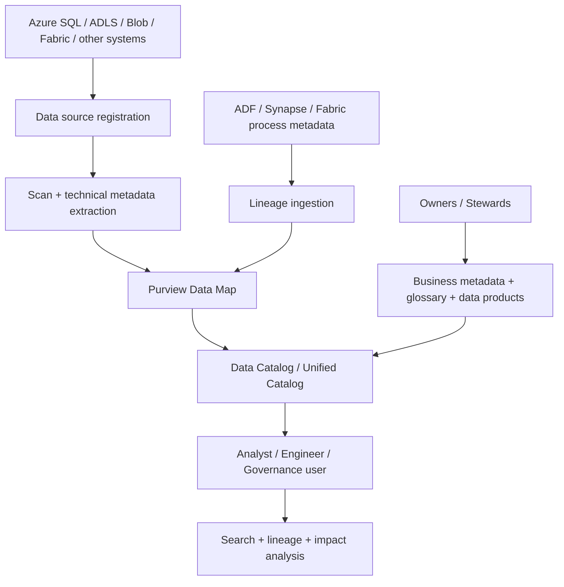

### Data Map

The **Data Map** is the layer managing technical metadata of discovered/registered data, asset relationships, scan/classification results, and lineage across supported features. Data sources are scanned or integrated to enrich the map.

### Data Catalog and Unified Catalog

A **catalog** is the experience for discovering and managing information about data assets. Purview interfaces may use the name **Data Catalog** in the classic experience and **Unified Catalog** in the newer data governance model. Unified Catalog also organizes several governance capabilities around **governance domains, data products, business concepts**, and supported data experiences.

Do not assume these two names always refer to the exact same UI with identical menu buttons and permission models. When doing labs, identify **which experience, resource type, and feature set your tenant uses**, then map the corresponding steps.

### Data Governance and Data Security/Compliance

Microsoft Purview also includes security/compliance capabilities such as information protection, DLP, audit, or records management in licensed offerings. They **can work together** with governance, but they are not the same thing:

- Scanning a table and attaching a classification in Data Map **does not automatically** configure DLP to block emails containing that data.
- Attaching the business term “PII” **does not automatically** change RBAC on Azure SQL/Storage.
- Configuring sensitivity labeling in one supported system **is not** proof that every copy of that data in another system is protected.

Your design must clearly specify which tool **discovers/records**, which tool **enforces policy**, and which system **stores audit logs**.

## 4. Metadata Is the Foundation of the Catalog

**Metadata** is “data about data.” It helps users understand an asset without necessarily reading sensitive content.

### Three Categories of Metadata

| Category | Examples | Source |
|---|---|---|
| **Technical metadata** | Table/column/schema, data type, path, format, partition info | Scan connector, data platform |
| **Business metadata** | Description of “completed order,” business glossary, owner, data product, usage rules | Steward, domain owner, governance workflow |
| **Operational metadata** | Last scan, pipeline run, refresh time, errors, quality/freshness signal | Scan logs, orchestration, observability systems |

### Assets and Business Terms Are Different

An **asset** is a concrete resource: `adls://lake/curated/orders`, the table `dw.fact_orders`, or a Power BI semantic model.

A **business term** is a defined concept: “Order,” “Active Customer,” “Net Revenue.”

One term can link to **multiple assets**. One asset can relate to **multiple terms** and multiple owners in different roles. This is not merely renaming a column.

### Business Definitions Must Be Detailed Enough

Example:

```text
Term name: Net Revenue
Definition: Revenue after discounts and refunds for validly recognized
  orders, excluding separately itemized taxes.
Unit: VND
Exclusions: Orders cancelled before delivery; 100% refunded orders.
Recognition timing: Based on paid_at UTC converted to the accounting period.
Owner: Finance Analytics
Steward: Finance Data Steward
Version: 2.1
Effective date: Per finance policy approval
Mapping: fact_orders.net_revenue_amount
```

This is an **illustrative definition**, not a universal accounting rule for every enterprise. If Finance and Sales use different formulas, there must be clear versions, approvals, and intended purposes rather than naming both formulas `revenue`.

## 5. Roles: Owner, Steward, and Data Consumer

Governance is unsustainable if no one is accountable.

| Role | Responsibility |
|---|---|
| **Business/domain owner** | Defines meaning, purpose, and usage permissions according to business policy |
| **Data steward** | Curates metadata, glossary, classifications/definitions, checks quality, and coordinates changes |
| **Data engineer** | Manages sources, pipelines, schemas, lineage, and technical metadata |
| **Data platform administrator** | Configures Purview, networking, scans, credentials, logs, and capacity |
| **Security/compliance team** | Defines security policies, retention, and compliance obligations |
| **Data analyst/consumer** | Discovers datasets, evaluates fitness for purpose, and reports quality issues |
| **Pipeline/application owner** | Accountable for code and operations of specific transformations |

**An owner is not necessarily someone holding the Azure RBAC Owner role.** Business owner denotes governance accountability; Azure RBAC Owner is permission to manage Azure resources. The two concepts are distinct.

### Illustrative RACI

| Activity | Business owner | Steward | Engineer | Security |
|---|---|---|---|---|
| Approve Net Revenue definition | A | R | C | I |
| Register/scan source | I | C | R | C |
| Modify pipeline/SQL transform | C | C | R/A | I |
| Classify sensitive columns | C | R | C | A/C per policy |
| Grant read access to source data | A per policy | C | R technical | C/A security |
| Investigate incorrect numbers | A | R | R | I |

`R` = Responsible, `A` = Accountable, `C` = Consulted, `I` = Informed. This is a **reference model** and should be adapted to your organizational structure.

## 6. Data Map Collections and Governance Domains Are Different

In Purview models that support **collections**, a collection is a hierarchical structure for managing metadata and access/management permissions; it can be used to separate scan and curation responsibilities by business unit or system.

In **Unified Catalog**, **governance domains** and **data products** represent how data is organized by business area, accountable people, and assets delivered for consumption.

### Example

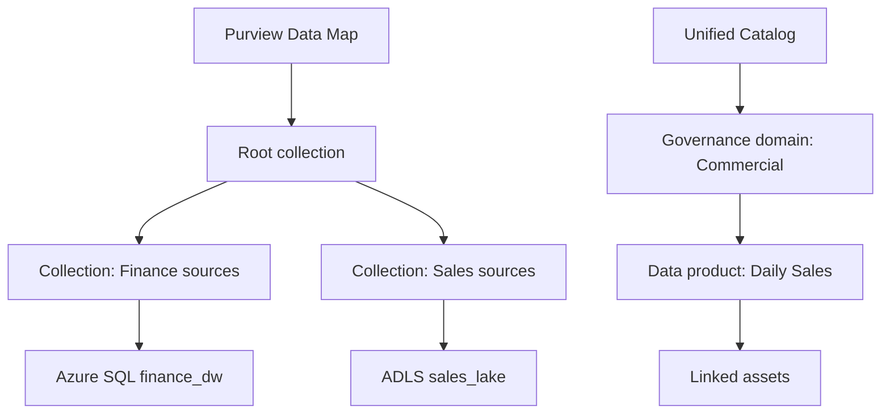

**The collection tree does not have to match the business domain tree.** An ADLS source containing both Sales and Finance data may need access and scan scopes organized differently from the data products consumers search for.

### Avoid Three Design Mistakes

1. **Using a single collection for every source** and granting overly broad curator permissions.
2. **Creating collections per small table** to the point that operations become unmanageable.
3. **Confusing a data product with a dataset:** a data product may group multiple datasets/assets and carry usage commitments, ownership, refresh cadence, quality signals, and access request workflows.

### What Is a Data Product?

A **data product** is a packaged set of data with a clear purpose and usage commitment: who owns it, what problem it serves, which assets are included, access requirements, trustworthiness level, and how consumers are supported. A “Daily Sales” product might include an aggregated sales table, a semantic model, the Net Revenue rule, and data freshness documentation.

Simply putting a “data product” tag on a table does not make it a quality data product.

## 7. Registering a Source vs. Scanning

To bring metadata from a source system into Data Map, a typical flow includes:

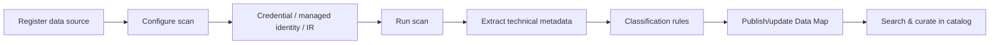

**Registering** declares a source and its connection/path metadata. **Scanning** actually connects (using an authorized mechanism) to discover data assets, schemas, and classifications. If you only register without scanning, the catalog may not show the expected tables, files, or columns yet.

### What a Data Source Registration Can Contain

- Source type: Azure SQL Database, Azure Blob/ADLS, Synapse, Power BI/Fabric, or other supported systems.
- Resource identifier/endpoint and target scope to scan.
- Assigned collection/management context.
- Credential configuration or identity.
- Scan rule set and scheduling.
- Appropriate integration runtime or network route.

**Do not scan an entire subscription** just because you have Contributor permissions. Scan scope must follow data ownership, sensitivity, and connector capabilities.

### What Scans Do Not Do Automatically

- They do not guarantee discovery of all data across networks where the identity lacks permission.
- They do not infer business formulas from field names.
- They do not automatically detect every transform written in custom applications.
- They do not alter permissions on the data source.
- They do not guarantee immediate scanning when a source schema changes.
- They do not guarantee that every file or table type is content-sampled under the same classification rule.

## 8. Scan Rule Sets and Scan Scope

A **scan rule set** can specify data types/formats, classification rules, or how metadata is discovered depending on the source and supported version.

### Example of a Safe Scope

```text
Data source: Azure Data Lake Storage Gen2
Container/filesystem: analytics
Included paths:
  /raw/orders/
  /curated/orders/
Excluded paths:
  /sandbox/tmp/
  /backups/private/
Scan schedule: daily / post-pipeline release per policy
Identity: Purview scan identity with appropriate read permissions
Classification rules: built-in + custom per governance standard
```

The fields above are a **scan plan**, not an official Purview configuration YAML. Supported include/exclude patterns and schedules vary by connector.

### Why Not Scan Everything?

- Some data falls outside agreements with data owners.
- Scanning may need to read schemas and sometimes sample data depending on configuration, involving sensitive data access.
- Private/gateway connections consume capacity and incur cost.
- Large scans can consume ingestion/metadata processing capacity and generate charges under the service model.
- Some files are temporary/artifacts that clutter the catalog.
- Source systems may experience scan/query overhead and audit log noise.

**Grant only the permissions strictly necessary for scanning**, verify data source-specific permissions, and satisfy privacy policies.

## 9. Azure SQL and ADLS: Different Metadata Is Collected

### Azure SQL Database

A SQL scan can discover connector-supported objects, for example:

```text
server / database
  └── schema commerce
       ├── table orders
       │    ├── order_id       varchar
       │    ├── customer_id    varchar
       │    ├── order_status   varchar
       │    └── gross_amount   decimal
       └── view completed_orders
```

Support for scanning views, stored procedures, column-level metadata, data profiling, and lineage depends on the connector and configuration; **do not assume every stored procedure is automatically parsed into lineage**.

### Azure Data Lake Storage Gen2

A Data Lake contains filesystems, directories, and files:

```text
adls://commerce-lake/
  raw/
    orders/
      load_date=2026-11-20/
        part-0001.parquet
  curated/
    orders/
      order_date=2026-11-20/
        part-0001.parquet
  quality/
    quarantine/
```

Scanning can discover asset/file-level metadata, formats, and schemas for supported file types. Do not equate a **directory/file** with a logical “table”: partitioned Parquet folders may be represented differently depending on the scanner, data source, and catalog model.

### Confirm the Dedicated Scan Identity

For Azure SQL, appropriate principals/database reader permissions and network rules may be required. For ADLS, the scan identity needs Azure Storage data-plane roles or ACL/path permissions as configured. **Having Microsoft Purview admin permissions does not automatically grant permission to read SQL rows or ADLS files.**

## 10. Data Classification and Sensitive Data

**Classification** helps identify data categories such as email addresses, phone numbers, national identifiers, financial data, or custom policy-defined data.

### Example

| Column | Potential detection | Human verification needed |
|---|---|---|
| `customer_email` | Email address | Is this real customer email or test data? |
| `contact_phone` | Phone number | Is the data permitted for marketing use? |
| `credit_card_last4` | Payment-card-related field | Does it contain enough sensitive elements? |
| `order_total` | Financial/transactional | Which sensitivity level does internal policy assign? |
| `customer_code` | Internal identifier | Can it be joined to identify a person? |
| `shipping_address` | Personal address | Organization’s retention/usage policy |

**Automated classifiers are signals, not legal verdicts.** There can be:

- **False positives:** strings resembling phone numbers that are actually warehouse codes.
- **False negatives:** sensitive data that is encrypted or abbreviated so the scanner does not recognize it.
- **Context-dependent sensitivity:** a standalone customer code is less sensitive than when combined with a name and address.

### Classification Handling Process

1. Scan within the approved source scope.
2. Review detected classifications.
3. Have stewards inspect samples/metadata according to permissions and policy.
4. Add or correct business classifications/tags where supported.
5. Link to appropriate access governance and retention policies.
6. Verify actual enforcement **where the data is stored and processed**.
7. Track classification changes as schemas and data evolve.

A “Confidential” classification in the catalog **does not automatically encrypt** a public Blob. Storage/SQL security must be configured separately.

## 11. What Is Data Lineage and Which Questions Does It Answer?

**Data lineage** describes the **origin, movement, and transformations of data** across systems, datasets, pipelines, jobs, and reports.

A simple lineage graph:

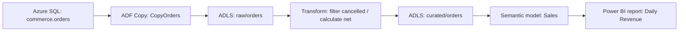

A user clicks on `Daily Revenue` and wants to trace backward to **the source column/asset**, transformation rules, and accountable owner.

### Upstream and Downstream

- **Upstream lineage:** the sources and transformations that produce a given asset.
- **Downstream lineage:** the assets, jobs, dashboards, or consumers that may depend on that asset.

For the `curated/orders` table:

```text
Upstream:
  commerce.orders → ADF CopyOrders → raw/orders → TransformNetRevenue

Downstream:
  Sales semantic model → Daily Revenue dashboard
  Finance reporting export → Monthly Close
```

### Lineage Serves Three Groups of Questions

| Purpose | Specific question |
|---|---|
| **Trust / transparency** | Which source do the numbers on the report come from? |
| **Impact analysis** | Which places will be affected if the `order_status` column is modified or deleted? |
| **Root cause analysis** | Did revenue drop suddenly because of the source, pipeline, or transformation? |

### Lineage Is Not an Audit Log

Lineage describes **data relationships** and system-recorded flows/transformations. An audit log describes **who did what and when**—for example, a user changing Storage permissions or deploying a pipeline. Both are needed for incident investigation.

**A lineage graph also does not prove the correctness of individual record values by default.** An edge `orders → sales_report` is not sufficient to prove all SQL filters/aggregations, row-level accuracy, or that data was recently refreshed.

## 12. Components of a Lineage Graph

A lineage graph can be viewed as a directed graph:

\[
G=(V,E)
\]

where:

- \(V\) is the set of **nodes**: tables, files, datasets, processes, notebooks, semantic models, or reports.
- \(E\) is the set of **edges**: data flows/dependencies or transformations according to connector semantics.

### Common Node Types

| Node | Example | Meaning |
|---|---|---|
| **Source asset** | SQL table `commerce.orders` | Input asset |
| **Processing activity** | ADF Copy Activity | Moves data from source to sink |
| **Transformation job** | Synapse SQL transform, Data Flow, notebook | Applies processing logic |
| **Intermediate asset** | ADLS raw Parquet | Intermediate data |
| **Curated asset** | `dw.fact_orders` | Cleansed and standardized data |
| **Semantic model** | Power BI Sales Model | Metrics/relationships definition layer |
| **Report/dashboard** | Sales Executive Report | How end users consume the data |

### Meaning of an Edge

An edge from `A` to `B` typically indicates that `B` is produced from or depends on `A` in the system’s lineage model. It **does not always mean** one row in A maps 1-to-1 to one row in B: operations like GROUP BY, JOIN, or FILTER can change row counts, granularity, or semantic meaning.

### Asset-Level, Dataset-Level, and Column-Level Lineage

| Granularity | Example | When needed |
|---|---|---|
| **System-level** | Azure SQL → Data Lake → Power BI | Architectural overview |
| **Asset/table-level** | `orders` → `fact_orders` | Managing dependencies during table changes |
| **Column-level** | `orders.total_amount` → `fact_orders.net_revenue` | Impact analysis when changing columns/definitions |
| **Transformation expression-level** | `SUM(paid_amount - refund)` | Auditing metric logic |

**Do not assume Purview automatically provides column-level lineage for every source, ETL tool, or SQL pattern.** Detail depends on the connector, supported activities, metadata integration, and how pipelines are written. When column lineage is absent, use code reviews, mapping specs, and supported manual/ingested lineage workflows.

### “System-Observed” vs. “Inferred” Lineage Edges

An organization should document the **source of evidence** for an edge:

```text
Edge:
  source: commerce.orders
  target: curated.fact_orders
Provenance:
  observed-from: ADF CopyActivity metadata
  pipeline-version: release-2026-11-20
  verified-by: data engineering
  last-verified: date/time
Confidence:
  automatic / manually curated / inferred
```

This is a **self-defined metadata structure for explanation**, not a Microsoft Purview REST API schema. How confidence/provenance is stored in the catalog depends on the governance feature or supplementary governance tooling.

## 13. Data Map Asset Identity and Edge Origins

When the same table is discovered across multiple integration jobs, **duplicate entities** in the catalog must be avoided.

### Assets Have Technical Identifiers

Example strings:

```text
Azure SQL:
  server: sales-sql.database.windows.net
  database: commerce
  schema: sales
  table: orders

ADLS:
  account: adlssalesprod
  filesystem: analytics
  path: /curated/orders/
```

The metadata management system can construct a qualified name/resource identity to distinguish assets. Never use only the display name `orders` as a key, since many databases and regions have tables with the same name.

### What Happens When Lineage Is Ingested?

1. Purview or the connector receives metadata for the source, process, and sink.
2. It looks up matching assets in Data Map by identity/qualified name.
3. It links nodes/edges for supported activities.
4. It renders the graph in the catalog/lineage viewer when permissions allow.

If the sink has not been scanned yet or identities do not match, some experiences may show a **placeholder/unknown asset** or missing edges. Even when a pipeline succeeds, the catalog may be incomplete due to registration, scanning, connector permissions, or identity matching.

**Do not arbitrarily rename qualified names just to “stitch” assets together** if doing so corrupts the source identity. Understand how connectors generate asset identities and establish proper reconciliation workflows.

## 14. Automated Lineage Collection from Azure Data Factory

**Azure Data Factory (ADF)** is a data integration and orchestration service. A pipeline can copy data between sources and sinks, run Data Flows, or invoke other activities. When connected to Microsoft Purview according to supported features and permissions, ADF can emit **lineage metadata** for qualifying activities, sources, and sinks.

### Example Pipeline

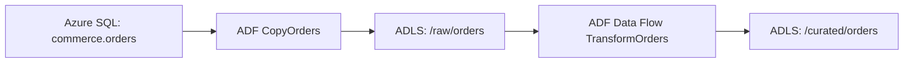

In the portal or appropriate configuration:

1. Create or identify the Microsoft Purview data governance account/experience in use.
2. Register and scan source/target data in Data Map when needed so asset metadata is visible.
3. Connect ADF to the Purview account/experience via the supported integration.
4. Grant the required roles/permissions for publishing lineage and reading metadata.
5. Run an actual pipeline with **supported activities and connectors**.
6. Wait for lineage metadata ingestion; inspect the lineage graph in the portal.
7. Cross-check qualified names and nodes/edges against actual pipelines, datasets, and tables.

**Not every ADF activity generates automatic lineage.** A `Web Activity` calling an arbitrary API, a Script Activity running dynamic SQL, or a Custom Activity with unsupported logic can create **lineage gaps**. Simply invoking ADF is not enough to prove all row transformations were recorded.

### Copy Activity Is Easier to Capture Than Custom Transformations

For example, `CopyOrders` reads Azure SQL `commerce.orders` and writes ADLS `/raw/orders`. The table → file/path edge can be captured when source, sink, integration, and connector support align. However, when a custom Azure Function reads Parquet and outputs new JSON, Purview may not know what that function does unless additional integration or metadata is provided.

### Lineage Can Take Time to Update

A workflow finishing at 08:00 does not mean the Purview viewer updates at exactly 08:00:00. Metadata systems have their own processing schedules, ingestion/scans, and eventual propagation delays. When viewing lineage, **always check last updated / pipeline run / scan time** rather than assuming the graph reflects the latest release.

## 15. Azure Synapse, Fabric, and Power BI in Lineage

The enterprise goal is typically tracing from the data warehouse/lake through the semantic model to the report.

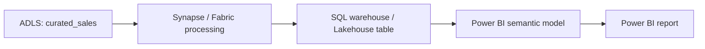

### Synapse Pipelines and SQL Processing

Synapse governance/lineage integrations may reflect certain pipelines and data assets, but you should not assume every SQL/Spark notebook is automatically parsed into a column-by-column graph.

### Power BI/Fabric Lineage

Power BI/Fabric has its own lineage and dependency views. Depending on governance configuration, access permissions, and supported integrations, Purview can ingest certain assets and relationships from semantic models, dataflows, reports, lakehouses, or warehouses.

To do this properly:

1. Verify the appropriate **workspace, tenant, and scanner/API permissions**.
2. Check which asset sources are supported by the connector/integration.
3. Verify that semantic models and reports appear with the right names.
4. Check dataset tables/columns and their relationships to upstream assets.
5. If sources involve custom DAX, dynamic queries, or external scripts, verify whether column/asset lineage detail actually appears.

### Do Not Confuse Two Lineage UIs

- **Lineage view in Power BI/Fabric** describes relationships among items in that environment according to its native features.
- **Lineage view in Microsoft Purview** connects metadata assets across supported integrations and Data Map.

They complement each other, but **there is no guarantee the graphs look identical**. When investigating, cross-check both UIs alongside pipeline source code.

### Discrepancy Example in Reporting

The `Daily Net Revenue` report uses a measure:

```dax
Net Revenue =
    SUM ( Sales[PaidAmount] )
    - SUM ( Sales[RefundAmount] )
```

This DAX snippet is a simple example and does not yet handle currency, tax, or edge-case refund rules. A lineage graph merely linking `Sales` to `Daily Net Revenue` does not mean it understands this DAX expression or every source column. Store the **metric definition/version** and review it with Finance.

## 16. Manual Lineage and Custom Pipeline Integration

Not every transformation runs through a product with native Purview integration. For example:

```text
SQL Server on-prem
→ custom Python ETL
→ SFTP CSV
→ Spark notebook
→ curated Parquet
→ dashboard
```

When auto-lineage is missing, several approaches exist:

1. Use supported built-in connectors where available.
2. Collect metadata via pipeline orchestration hooks/logs.
3. Publish **lineage metadata using supported interfaces/REST integrations** for your Purview account.
4. Record manual lineage + evidence in the catalog/governance process if the UI supports it.
5. Include source/sink identifiers and transformation versions in pipeline contracts.

**Never call an unsupported API to overwrite production metadata systems.** Purview exposes different API/SDK models across experiences; before building a custom connector, verify version-accurate API documentation, models, auth, quotas, and schemas.

### OpenLineage and Metadata Interchange

Some orchestration/ETL tools use standards or ecosystems like **OpenLineage** to describe jobs, runs, and datasets. This helps standardize metadata from custom pipelines, but **do not assume Microsoft Purview directly ingests all OpenLineage events** without a supported bridge or connector.

An illustrative metadata record:

```json
{
  "job": "daily-sales-transform",
  "runId": "run-20261120-0800",
  "inputs": [
    "adls://sales/raw/orders/"
  ],
  "outputs": [
    "adls://sales/curated/orders/"
  ],
  "transformationVersion": "git-sha-example",
  "status": "SUCCEEDED"
}
```

This is **not** an official OpenLineage or Microsoft Purview API payload. It merely lists the minimum information a custom lineage collector might use.

### Lineage Quality Depends on Logging Discipline

If custom ETL fails to log input/output identities, a governance system cannot infer exact data sources from a log line like `“Completed 25,000 records”`. Maintaining a **lineage contract** in pipeline code and releases is a Data Engineering responsibility.

## 17. Column-Level Lineage: What Is Needed to Audit a KPI?

Suppose a pipeline builds `net_revenue`:

```sql
SELECT
    order_id,
    order_date,
    paid_amount - refunded_amount AS net_revenue
FROM staging.orders
WHERE order_status = 'Paid';
```

To explain `fact_orders.net_revenue`, at a minimum you need:

```text
Source columns:
  staging.orders.paid_amount
  staging.orders.refunded_amount
Filter dependency:
  staging.orders.order_status
Output:
  fact_orders.net_revenue
Transform:
  paid_amount - refunded_amount
Business term:
  Net Revenue (definition version 2.1)
Pipeline/source revision:
  commit ... / run ...
```

### Two Often-Overlooked Dependencies

- **Value dependency:** the output column is computed from input columns (`paid_amount` and `refunded_amount`).
- **Control/filter dependency:** `order_status` does not appear in the value expression, yet changing it alters **which rows enter the result**.

A system that only draws lineage for fields directly in `SELECT` may miss the impact of `WHERE`, `JOIN`, `GROUP BY`, or UDFs. Therefore, **automatic column-level lineage must be tested** before relying on it for critical impact analysis.

### Dynamic SQL Makes Lineage Harder

```sql
-- Illustrative risk example: table name chosen at runtime.
EXEC(@dynamic_sql);
```

Pipelines using dynamic SQL, stored procedures, UDFs, or bespoke notebooks may lack static lineage extraction. Tracing them may require instrumenting runtime inputs/outputs, parsing SQL reliably, and storing corresponding artifact versions.

### Never “Fabricate” Lineage Just to Make the Graph Pretty

If the transformation expression is unknown, mark it **unknown/manual verification required**, instead of drawing a column edge from `customer_name` to `net_revenue` just because they share a table. False lineage can be more dangerous than missing lineage because it gives users confidence in an inaccurate impact analysis.

## 18. Impact Analysis: Changing Schemas Without Breaking Dashboards

When renaming `order_status` to `fulfillment_state` in Azure SQL, the question is not merely “Will `ALTER TABLE` succeed?”.

### Lineage-Driven Workflow

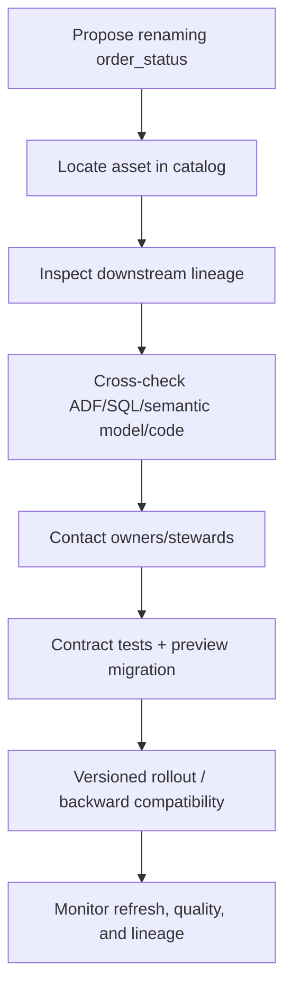

### Concrete Steps

1. Locate asset `commerce.orders` and column `order_status`.
2. Open lineage to identify downstream jobs, datasets, and reports.
3. Check **lineage freshness/coverage**: have connectors and scans kept up with recent releases?
4. Search code: ADF datasets, SQL views/procedures, Spark notebooks, Power BI measures.
5. Compile a list of owners and communicate the change plan.
6. Propose a dual-column period or compatibility view if needed.
7. Run tests: schema contracts, data counts, financial metric checks.
8. Deploy with rollback capability.
9. Monitor pipelines, reports, and metadata ingestion.
10. Update glossary entries, catalog descriptions, and deprecation notices.

### Estimating Impact Across the Graph

If asset A has 3 dependency paths and each fans out to many nodes, the number of affected assets **is not just direct children**. Traverse downstream (when the graph is trustworthy and complete), avoiding double-counting nodes where paths converge.

**A graph lacking a custom ETL edge does not prove that system has no dependency on A.** Impact analysis must combine lineage, code search (within engineering workflows), data contracts, and owner review.

## 19. Root-Cause Analysis: Revenue Report Discrepancy

Scenario: after a release, the Daily Revenue dashboard drops 18%, even though order volume did not fall accordingly.

### Upstream Investigation

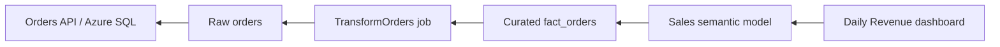

### Step by Step

1. **Dashboard:** confirm filters, reporting period, and semantic model refresh time.
2. **Metric definition:** check whether “Net Revenue” changed definition or version.
3. **Curated dataset:** inspect row counts, null rates, amount distributions, and duplicate keys.
4. **Transform job:** inspect whether SQL/Data Flow recently changed `WHERE`, currency conversion, or joins.
5. **Raw dataset:** compare daily order counts against the source system.
6. **Source:** verify event ingestion, transactional records, and late-arriving orders.
7. **Lineage completeness:** check when the asset/edge was last updated.
8. **Owner escalation:** Finance approves adjustments or documents an exception.

### Data Reconciliation Example

```sql
-- Illustrative query in a SQL warehouse with a compatible schema.
SELECT
    CAST(order_date AS date) AS business_date,
    COUNT(*) AS order_count,
    SUM(net_revenue_amount) AS net_revenue
FROM dw.fact_orders
WHERE order_date >= '2026-11-19'
GROUP BY CAST(order_date AS date)
ORDER BY business_date;
```

This is a **data verification query run in the target warehouse**, not a query executed inside Microsoft Purview Catalog. The data catalog simply helps identify which asset to inspect, who owns it, and which transformations are involved.

### Do Not Jump to Conclusions

If a report is wrong and Purview lineage shows complete edges, that still does not prove **every row and aggregation is right**. Lineage and data quality must be paired with real numbers, data reconciliation, and business rule testing.

## 20. Data Quality and Lineage Complement Each Other

An asset with clean lineage that contains bad data is still untrustworthy. Conversely, a dataset with good current quality that lacks provenance, an owner, and a business definition is hard to reuse responsibly.

### Six Common Quality Dimensions

| Quality dimension | Question | Check example |
|---|---|---|
| **Completeness** | Are records/fields missing? | 99.9% of orders have `customer_id` |
| **Validity** | Does data follow schemas/rules? | `order_status` belongs to allowed enum |
| **Uniqueness** | Are there duplicate business keys? | One unique `order_id` in the fact table |
| **Consistency** | Do systems agree? | Daily order totals match between raw/curated |
| **Timeliness/freshness** | Is data recent enough? | Last update within 30 minutes |
| **Accuracy** | Does it reflect business reality? | Order amounts match approved records |

Percentage and time targets are **example SLOs**; they must be approved by domain owners.

### Attaching Data Quality to a Data Product

A `Daily Sales` product might publish:

```text
Owner: Finance Analytics
Refresh frequency: every 60 minutes
Freshness SLO: 95% of refreshes complete within 75 minutes
Completeness: paid orders >= 99.9% vs. transaction source
Uniqueness: zero duplicate order IDs
Known limitations: delayed refunds may adjust prior figures within 2 days
Certified/endorsed status: only after actual review
Last quality check: <timestamp>
Incident contact: Finance Data Steward
```

Do not apply a “certified” badge intuitively. Require an approval workflow, evidence-backed checks, and a re-verification schedule.

### Purview Data Quality Capabilities

Some **Purview data governance/Unified Catalog** experiences provide data quality assessment or governance features subject to licensing and support conditions. However, do not assume every tenant, region, or asset type shares identical quality scan, rule execution, alerting, and billing capabilities. Where granular measurements are needed, integrate **SQL tests, Spark validations, pipeline data quality checks**, or organization-approved tools and publish results back to the data product/catalog as supported.

**Purview Catalog does not automatically execute all business rule tests simply because a user opens an asset page.**

## 21. Security Boundary: Catalog Metadata vs. Actual Data

A secure architecture must distinguish among **Purview administration permissions**, **metadata read/curation permissions**, **source scan permissions**, **source data read permissions**, and **policy enforcement permissions**.

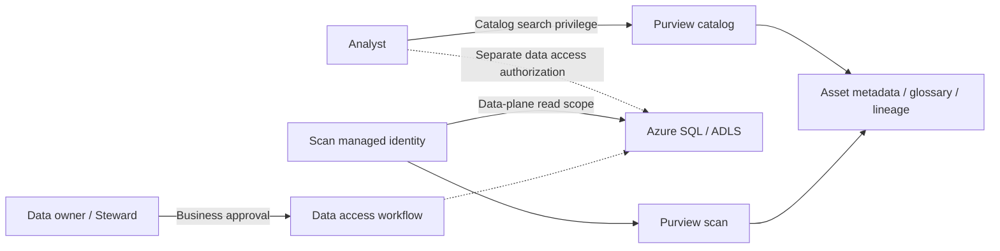

### Permission Scopes to Review

| Scope | Action | Principle |
|---|---|---|
| **Azure ARM/RBAC** | Create/manage Purview resource, networking, diagnostics | Least privilege at resource group/resource level |
| **Purview Data Map/collection roles** | Manage collections, data sources, scans, read/curate metadata | Assign by role and scope supported by experience |
| **Unified Catalog governance roles** | Organize domains/products/terms/approvals | Check Unified Catalog’s specific permission model |
| **Source data plane** | Scan SQL schemas, ADLS files/metadata | Principal/managed identity holds specific data permissions |
| **Consumer data plane** | Query SQL/Storage/Fabric datasets | Users need direct permissions on the data platform |
| **Security policy enforcement** | DLP, sensitivity labeling, retention, access control | Use the service that actually enforces policy |

### Roles You May Encounter

In the **classic Data Map/collections experience**, role names such as **Collection Administrator, Data Source Administrator, Data Curator, and Data Reader** appear as supported. Assigning these roles differs from **Azure RBAC Contributor** and may differ from Unified Catalog governance roles.

**Do not apply classic catalog role names or click paths to Unified Catalog without checking your tenant’s current UI and documentation.** Furthermore, even Data Source Administrator in Purview is not “SQL sysadmin.”

### Metadata Is Also Sensitive

Even without storing full rows, a catalog can reveal:

- which systems exist and their endpoints;
- payroll, customer, or revenue table names;
- descriptions of confidential projects;
- data flows across restricted systems;
- system owners and contacts;
- classifications highlighting where sensitive data lives.

Therefore, **metadata search permissions** must also be governed; do not assume every employee should view all assets by default.

## 22. Identity and Credentials for Scanning

### Use Managed Identity When Appropriate

A Purview scan can use **managed identity or other credential methods** depending on the connector and network environment. Workflow:

1. Identify the actual scan identity of Purview or the integration runtime.
2. Grant **minimal read permissions** on the data source.
3. Scope tightly to the right tables, paths, or databases.
4. Configure the connection/scan using a connector-supported authentication mode.
5. Test on one small source.
6. Inspect logs to separate 401/403 auth issues from network failures.
7. Revoke temporary permissions after testing ends.

### ADLS Gen2 Has Multiple Permission Layers

When ADLS has hierarchical namespace enabled, access can involve:

- Azure RBAC data-plane roles such as `Storage Blob Data Reader` at the target scope.
- Filesystem/directory ACLs and traverse permissions by design.
- Firewall/private network rules.
- The token/identity from the runtime actually making the request.

An Azure `Reader` role on the storage account **does not mean** Blob contents can be read. Having read RBAC without a working network path or DNS resolution also prevents scanning.

### Azure SQL Database

SQL scanning requires credentials/database principals and metadata permissions supported by the connector. You may need to configure Microsoft Entra authentication, SQL permissions, firewall rules, and database access separately. Avoid placing a SQL admin password into demo configurations if managed identity or a scoped principal is supported.

### Key Vault

When a secret must be used:

- store it in Azure Key Vault or an approved secret store;
- grant secret read permission to the appropriate principal;
- maintain an owner, expiry, and rotation schedule;
- never paste secrets or connection strings into scan documentation;
- verify scan infrastructure has network reachability to Key Vault when restricted.

**Rotating a password without updating where the connector reads it causes scans to fail repeatedly**, leaving catalog metadata stale unnoticed.

## 23. Connecting Sources in Private Networks

Sources may sit behind firewalls or private endpoints:

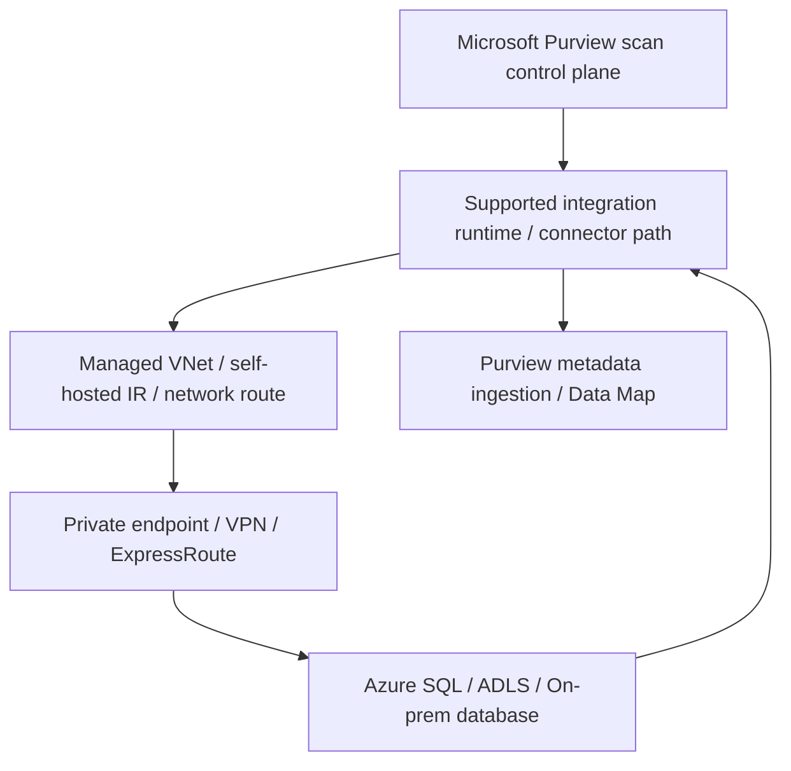

This diagram is **conceptual**: not all sources use the same integration runtime type or private endpoint pattern, and networking implementation varies by connector and experience.

### Patterns to Evaluate

- **Public service endpoint with firewall/identity** for policy-approved sources.
- **Private endpoint** for Azure sources such as Storage/SQL, paired with valid DNS and routing.
- **Managed virtual network integration runtime** for supported Purview scanning scenarios.
- **Self-hosted integration runtime** or equivalent gateway when connecting to on-premises systems or closed networks.
- **VPN/ExpressRoute** when sources reside in an enterprise datacenter with existing private connectivity.

### Network Checklist

1. Where does the scanner execute?
2. Which IP does the source hostname resolve to from that exact runtime?
3. Do ports, NSGs, firewalls, and outbound proxies allow traffic?
4. Have private endpoints / managed private endpoints been approved?
5. Does the identity have appropriate data-plane permissions?
6. Is private DNS zone resolution configured properly for the resource type?
7. Is connectivity from source/runtime to metadata ingestion endpoints working per supported topology?
8. Did the scan time out due to networking or fail authorization?

**Never enable public access on SQL/Storage just to test Purview** if policy mandates private-only access. Distinguish `403 Forbidden` (auth) from `timeout` (DNS/routing) to troubleshoot the right layer.

## 24. Data Access Requests: The Catalog Does Not Grant Permissions Automatically

In supported governance products/experiences, users can discover a data product and submit an **access request** or go through a configured approval workflow. However, be explicit about which system actually enforces permissions.

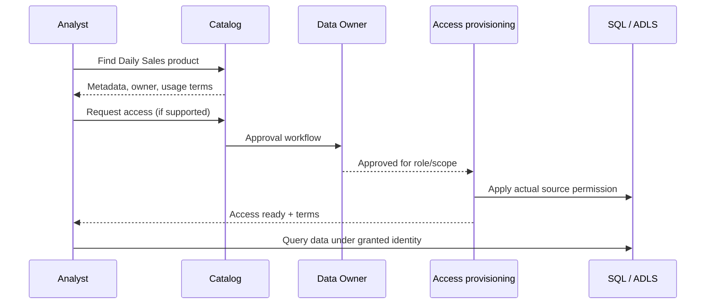

Provisioning steps may be manual, IaC/ITSM-driven, identity governance workflows, or supported policy connectors/integrations. **Approval in the catalog does not automatically mean an Azure SQL GRANT or Storage RBAC assignment was created**, unless a specific enforcement mechanism has been configured.

### Standard Workflow

- Request states the data product, business purpose, scope, and duration.
- Data owner/security evaluates appropriateness.
- Select least-privilege role, expiration, and target source enforcement system.
- Record approval audit and who provisioned access.
- Periodically review and revoke access.
- Monitor whether classification changes on the data product affect access rules.

For sensitive customer data, the catalog can advertise metadata while data access still requires separate approval plus masking/row-level security inside the data platform.

## 25. From Glossary to Semantic Layer and KPIs

An enterprise may have three different names:

```text
Azure SQL: dbo.order_amount
Data Lake: facts.gross_sale_value
Power BI: Total Sales
```

They may describe the same concept—or they may not. **A data catalog should never treat them as identical merely because their names sound similar.**

### Managing Business Terms

Example:

| Term | Definition | Mapping |
|---|---|---|
| **Gross Sales** | Order sales value before discounts/refunds | `fact_orders.gross_amount` |
| **Net Revenue** | Per Finance-approved calculation rule | `fact_orders.net_revenue_amount` |
| **Active Customer** | Customer meeting activity threshold for the period | `customer_activity.is_active` |
| **Refund Rate** | Refunds over eligible orders | `finance.refund_rate` |

### KPI Governance

1. Define the business question and unit.
2. Specify recognition timing, timezone, and late data handling.
3. Lock in inclusion/exclusion logic with the domain owner.
4. Link the term to data assets and semantic model measures.
5. Store versions/approvals and set a review cadence.
6. Verify lineage from source to KPI.
7. Establish data quality checks and freshness expectations.

A metric with complete technical lineage can still have the **wrong definition** if Finance and Sales have not aligned on the calculation.

## 26. Data Products and Data Contracts

### Data Product

A `Customer Orders Analytics` data package might specify:

```text
Business domain: Commerce
Product name: Customer Orders Analytics
Purpose: Analyze on-time delivery and order return rates
Assets: fact_orders, order_status_history, Sales semantic model
Product owner: Sales Analytics
Steward: Commerce Data Steward
Access: Request/Approval, read-only analytics scope
Refresh: every 30 minutes
Freshness target: < 45 minutes
Quality expectations: order_id unique, status enum valid
Sensitive fields: customer IDs; email not exposed by default
Lineage: Orders API → ingestion → curated → semantic model
Support channel: Data Platform service desk
```

### Data Contract

A **data contract** documents schema, semantics, quality, freshness, ownership, and compatibility expectations between producer and consumer. Example schema snippet:

```json
{
  "contractName": "orders-curated",
  "version": "2.0",
  "owner": "Commerce Data Platform",
  "fields": [
    {"name": "order_id", "type": "string", "required": true},
    {"name": "order_status", "type": "string", "required": true},
    {"name": "net_revenue_amount", "type": "decimal", "required": true}
  ],
  "freshnessTargetMinutes": 45,
  "backwardCompatibility": "review-required"
}
```

This is an **internal contract example**, not a Purview API schema, and it has no automatic enforcement power by itself. Contract tests can run in CI/CD, while the catalog holds descriptive metadata and links.

### Data Products and Data Contracts Do Not Replace Lineage

A contract defines **what the output must look like**; lineage explains **where the output came from and which transformations it underwent**; data quality checks verify **whether the output currently meets requirements**. All three are needed together.

## 27. Monitoring a Data Catalog Program

Do not measure only “how many data sources were registered.” A catalog with 10,000 assets that lacks owners, descriptions, and working lineage delivers limited value.

### Technical Telemetry

| Metric | How to use it |
|---|---|
| **Scan success/failure rate** | Detect credential, network, or schema scan issues |
| **Scan duration** | Track large sources, schedules, and capacity |
| **Asset count / scan coverage** | Estimate discovery coverage compared to inventory |
| **Last successful scan age** | Detect stale metadata |
| **Classification rule hits** | Track sensitivity trends and false positives |
| **Lineage ingestion success** | Confirm integrations push edges into the map |
| **Unmatched/placeholder assets** | Identify identity mismatches or missing scans |
| **Role/access failures** | Missing Data Map, source, or Key Vault permissions |
| **Integration runtime health** | Confirm on-prem/private scan connectivity is healthy |

### Governance Adoption Telemetry

| Metric | Meaning |
|---|---|
| **% of critical assets with a business owner** | How clear accountability is |
| **% of curated assets with a business description** | Whether users can understand datasets |
| **% of important KPIs with a glossary term** | Whether definitions are standardized |
| **% of critical data products with verified lineage** | Whether lineage is trustworthy enough for impact analysis |
| **% of sensitive assets with reviewed classification** | Privacy governance and false-positive management |
| **Median time to find a dataset** | Whether the catalog genuinely helps users |
| **Access request lead time** | How efficient provisioning workflows are |
| **Data quality SLO compliance** | Whether data products are reliable enough |

### Illustrative SLO Set

```text
Tier-1 assets with owner:                 >= 98%
Tier-1 assets with description:           >= 95%
Tier-1 data sources scanned within 24h:   >= 99%
Critical pipeline lineage verified:       >= 95%
Classification review for PII assets:     per approved cadence
Data product incidents acknowledged:      < 1 hour
```

These targets are **not default Microsoft Purview SLAs**, but examples an organization may choose after assessing resources and risk.

### Distinguish Scan Freshness from Data Freshness

- **Scan freshness:** When was metadata/catalog last updated?
- **Data freshness:** How recent are the records in the actual table/dataset?
- **Lineage freshness:** Do source-target graph relationships reflect the current pipeline/release?
- **Dashboard freshness:** When did the semantic model/report last refresh successfully?

These four timestamps can diverge by many hours. “Scan PASSED at 09:00” **does not prove** the warehouse ingested today’s data.

## 28. Costs of Purview and Related Systems

A governance program can incur costs across multiple layers; pricing depends on service model, tier, region, and usage capabilities.

| Component | Factors to verify |
|---|---|
| **Purview Data Map/metadata capability** | Metadata/scan/data map capacity consumption per pricing model at deployment time |
| **Unified Catalog/data governance features** | Licensing/entitlement tier, data product/quality capabilities, and current metering |
| **Scans** | Number of sources, scope, frequency, scan/connector type, and source behavior |
| **Integration runtime** | Self-hosted VM/compute/network or conditional managed runtime |
| **Azure Storage/SQL** | Data-source requests/transactions during scans, logs, and source compute |
| **Networking** | Private endpoints, cross-region data transfer, VPN/ExpressRoute |
| **Key Vault** | Secret/certificate operations and related hosting |
| **Azure Monitor** | Diagnostic log ingestion, storage, and retention |
| **Data quality/analytics** | Compute/queries if running rules or pipeline tests |

**Fixed pricing cannot be quoted solely from the name “Microsoft Purview.”** Several governance experiences changed billing units compared to documentation for classic Purview accounts. Always verify official pricing sheets, subscription/region rates, and Cost Management before enabling features.

### Scan Operations Cost Exercise

Suppose you have:

```text
20 data sources
12 Tier-1 sources scanned 4 times/day
8 Tier-2 sources scanned 1 time/day
Expected total scan executions/day:
  12 × 4 + 8 × 1 = 56
```

The number 56 is only the **execution count**. Actual cost depends on **source type, capacity, duration, data volume, billing model, and associated resources**. Scanning a small SQL schema and scanning an ADLS account containing millions of files do not necessarily cost the same.

### Value-Based Cost Optimization

1. Prioritize high-risk/high-value Tier-1 sources.
2. Set scan schedules according to schema change frequency rather than guesswork.
3. Exclude temporary, test, and private scratch paths.
4. Use incremental/change-detection scans when supported and validated by the connector.
5. Right-size self-hosted IR or gateway compute capacity.
6. Trim excessive diagnostic logging payloads while keeping required audit trails.
7. Track catalog adoption and lineage coverage alongside cost.
8. Use Azure Cost Management budgets/alerts and inventory created resources.

### Measuring ROI

Governance goals go beyond minimizing scan spend. Quantify:

- how much time spent searching for the right dataset dropped;
- how much time spent running pre-change impact analysis dropped;
- reduction in broken reports caused by upstream changes;
- reduction in incident/metric mismatch investigation time;
- reduction in unowned or unclassified assets;
- increase in access requests fulfilled within SLA.

Never treat raw scan count as the sole success metric.

## 29. Lab: Discovering Azure Data Lake Assets with Microsoft Purview

### Purpose

Build an end-to-end demonstration of **metadata discovery**:

1. A Storage/ADLS source holds synthetic data.
2. Microsoft Purview registers and scans the source.
3. The catalog lets users search the asset by name and classification.
4. A steward adds description, owner, and glossary term.
5. The test team verifies metadata visibility is separate from Blob read permissions.
6. Monitor scan status and clean up the lab.

This lab **does not require creating or accessing real customer data**. If your organization does not grant permission to provision resources, use the checklists and tables in this lesson to perform a design review using sample data.

### Lab Architecture

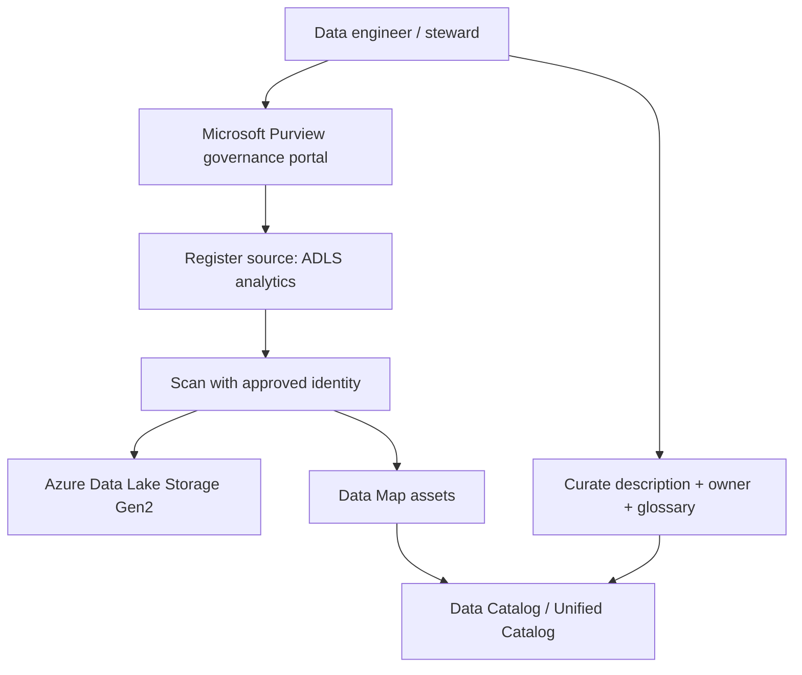

### Prerequisites

- Authorized sandbox subscription, Azure resource group, and budget.
- A Microsoft Purview / Data Governance resource approved for use by your organization.
- A lab-only Storage account/ADLS Gen2 containing zero production data.
- An identity permitted to configure Purview scans under your active governance model.
- A scan identity holding Storage data-plane read permission in the approved scope.
- Network/DNS allowing the integration runtime to reach the source.
- A test owner/steward account allowed to curate metadata.

**Do not provision extra billable resources** if your sandbox already shares a Purview account; avoid overly broad admin grants or modifying source configs owned by other teams.

### Step 1 — Design a Synthetic Dataset

Choose a lab Storage path:

```text
Account: stpurviewlab<unique>
Filesystem: analytics
Path: /raw/orders/order_date=2026-11-20/
File: orders-sample.csv
```

CSV content:

```csv
order_id,customer_code,customer_email,order_status,gross_amount,paid_at
ord-001,cust-1001,user1@example.test,Paid,1200000,2026-11-20T08:00:00Z
ord-002,cust-1002,user2@example.test,Cancelled,500000,2026-11-20T08:10:00Z
ord-003,cust-1001,user1@example.test,Paid,350000,2026-11-20T09:05:00Z
```

`example.test` addresses and all values are **synthetic**. Never put real emails or personal identifiers into Storage just to test classification rules.

### Step 2 — Create/Verify the Storage Source

In the Azure Portal:

1. Select the sandbox subscription/resource group.
2. Confirm the Storage account has hierarchical namespace enabled if the lab uses ADLS Gen2.
3. Create the `analytics` filesystem/container and test path via Storage Explorer or the portal.
4. Upload the synthetic CSV.
5. Verify network policy, encryption, and access controls.
6. Record resource ID, account/filesystem/path names, and lab owner.

**Never enable anonymous public Blob access.** Learners can use an approved account or managed identity / Storage RBAC.

### Step 3 — Register the Source in Purview

Under **Data Map / Sources / Register** or the equivalent in your experience:

1. Choose the supported ADLS Gen2 / Storage connector.
2. Enter the endpoint/resource identity of the lab Storage account.
3. Select the appropriate collection/management scope.
4. Verify the source appears in the sources inventory.
5. Record the source name, environment, and owner.

After this step, **files/columns may not appear in the catalog yet** because you have only registered the source without scanning it.

### Step 4 — Grant Scan Permissions

1. Identify the exact identity Purview uses for the scan.
2. Assign the required Storage data-plane role/ACL at the minimal scope.
3. If Storage has a firewall or private endpoint, verify the integration runtime has an approved network route.
4. Never store account keys in lab notes.
5. Run connection/scan tests using the built-in test option.

If you get a 403 error, inspect **data-plane RBAC/ACL**; if you hit a timeout, inspect private DNS/firewall/IR. Do not disable network controls indiscriminately.

### Step 5 — Create and Run the Scan

Select:

```text
Source: ADLS lab
Scope: /analytics/raw/orders/
Scan rule set: Supported CSV/structured files
Classification: Appropriate built-in classifiers
Run mode: one-time lab
Owner: Data Platform training
```

Run a one-time scan and wait for completion. Avoid setting a per-minute schedule in a sandbox unnecessarily.

### Step 6 — Inspect Discovery Results

In Data Map/Catalog:

- Search for `orders-sample.csv` or the corresponding path/asset name.
- Inspect the source resource and schema/columns if detected by the connector.
- Check whether `customer_email` is classified as Email Address.
- Record last scan time, classification confidence, and owner status.
- If columns do not appear in the catalog, check whether the scanner supports schema extraction for your file type.

**Do not fail the lab solely if a classifier misses an email inside a tiny file:** classification depends on sampling, rule sets, connectors, formats, and policies. Inspect logs/config and verify manually if needed.

### Step 7 — Curate Metadata

Someone with steward/curator permissions in the active model adds:

```text
Description:
  Synthetic order data used for metadata governance training.
Business term:
  Order
Owner:
  Commerce Training Owner
Steward:
  Data Governance Lab Steward
Sensitivity context:
  Demo synthetic customer contact data
Approved use:
  Internal training only
Retention:
  Delete after lab per policy
```

Fields may be entered under asset details, glossary/business concepts, or the relevant data product depending on experience. **Never modify production classifications** just because you hold Data Curator rights for lab work.

### Step 8 — Test Metadata vs. Data Permissions

With a test user:

1. Verify the user can search metadata per catalog roles/settings.
2. Verify the user **cannot automatically read the file** without Storage data-plane permissions.
3. If approved, grant scoped access temporarily and re-verify file access.
4. Revoke access and confirm data access is blocked again.

The goal is to prove **catalog discovery is separate from source data read permissions**. Never attempt to read someone else’s production Blob to prove access denial.

### Step 9 — Record Results

```text
Purview experience: Data Map / classic Data Catalog / Unified Catalog
Storage resource: <resource ID>
Registered source: <name>
Scan identity: <principal identifier, redacted>
Scan connection: PASS/FAIL
Scan execution: PASS/FAIL
Discovered asset: <qualified name/path>
Columns discovered: <list>
Classification detection: <result + verification>
Business term linked: <name/version>
Owner/steward assigned: PASS/FAIL
Metadata search: PASS/FAIL
Unauthorized data read blocked: PASS/FAIL
Scan duration/metric: <value>
Estimated cost: <value>
Cleanup owner: <person>
```

### Step 10 — Cleanup

1. Delete only CSVs, containers, and resources **owned by the lab**.
2. Revoke temporary Storage role assignments.
3. Disable or delete lab scan schedules when no longer needed.
4. Check whether source registrations or metadata artifacts remain in Purview and follow the appropriate cleanup process.
5. Verify Storage, Key Vault, integration runtime, private endpoints, and logs leave no lingering cost.
6. **Never delete a shared organizational Purview account** just to clean up a lab.

## 30. Lineage Lab: Azure SQL → Data Factory → ADLS

### Objective

Building on the discovery lab, create an illustrative pipeline to see **where data lineage is collected and where automatic lineage reaches its limits**.

### Diagram

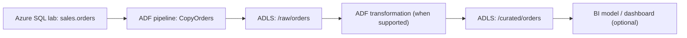

### Option A — With Real Sandbox Resources

1. Create a lab Azure SQL database or use an approved SQL sandbox; create table `sales.orders` with synthetic rows.
2. Use the lab ADLS account above as the sink.
3. Provision Azure Data Factory and linked services using approved managed identity/credentials.
4. Create a `CopyOrders` pipeline using connector-supported source and sink types.
5. Register/scan Azure SQL and ADLS in Purview where appropriate.
6. Connect ADF to Purview according to version-specific features and permissions.
7. Run the pipeline with synthetic data.
8. Open the lineage viewer and locate source, activity, and sink edges.
9. Verify run ID, timestamp, and path qualified names.
10. If edges are missing, inspect connector support, integration/scans, permissions, and ingestion latency.

### Option B — Without Resource Creation Permissions

Use the following diagram and mock metadata table to practice impact analysis without running Azure resources:

| Node | Type | Illustrative qualified name |
|---|---|---|
| A | Azure SQL table | `sql://sales-db/sales.orders` |
| B | ADF Copy Activity | `adf://sales-adf/CopyOrders` |
| C | ADLS raw dataset | `adls://sales-lake/raw/orders` |
| D | Transform job | `adf://sales-adf/TransformOrders` |
| E | ADLS curated dataset | `adls://sales-lake/curated/orders` |
| F | Power BI semantic model | `pbi://sales-workspace/SalesModel` |

These **qualified names are illustrative placeholders**, not official Purview identifiers. Sketch:

```text
A → B → C → D → E → F
```

Then assume:

- `sales.orders.order_status` is renamed.
- Copy Activity B succeeds, but Transform D still references the old column name.
- Report F continues reading prior-period data from E.

Task: list affected nodes, root-cause candidates, owners to notify, and a backward-compatible migration plan.

### Missing-Edge Lineage Exercise

Replace D with a custom Python script:

```text
C → [Custom Python ETL] → E
```

If Purview only sees ADF Copy and captures no metadata from the script, the graph may look like:

```text
A → B → C
             E → F
```

This is a **data lineage gap**, not proof that E is independent of C. Propose a plan to close the lineage gap:

1. Identify the script’s inputs, outputs, and schema.
2. Capture job ID/run ID and code commit.
3. Use supported metadata ingestion or connectors.
4. Reconcile nodes with scanned assets.
5. Route results through steward review.
6. Alert when metadata diverges from the pipeline version.

## 31. Glossary and Impact Analysis Lab for Net Revenue

### Context

Finance wants to change the Net Revenue calculation:

```text
v1: gross_amount - discounts
v2: gross_amount - discounts - refunds
```

Without version control, two reports may keep using the same label `Net Revenue` while showing different numbers.

### Workflow

1. Create/update the business term `Net Revenue` with definition and owner.
2. Record version, effective date, and currency unit.
3. Link the term to column asset `fact_orders.net_revenue_amount`.
4. Open lineage from the column/table to dependent reports.
5. For reports not auto-discovered, document manual dependencies with evidence per process.
6. Compile downstream owners who must review the change.
7. Generate test data with positive `refunded_amount`.
8. Compare v1 and v2 outputs and confirm the expected delta.
9. Publish a change notice alongside the migration plan.
10. Verify lineage and business definitions after deployment.

### Example Dataset

| Order | Gross | Discount | Refund | Net v1 | Net v2 |
|---|---:|---:|---:|---:|---:|
| O-01 | 1,000,000 | 100,000 | 0 | 900,000 | 900,000 |
| O-02 | 500,000 | 0 | 200,000 | 500,000 | 300,000 |
| O-03 | 800,000 | 50,000 | 50,000 | 750,000 | 700,000 |
| **Total** | 2,300,000 | 150,000 | 250,000 | **2,150,000** | **1,900,000** |

The **250,000** difference comes from changing the refund deduction rule, not from lost orders. Lineage and business metadata explain the source of variance, while SQL/data tests prove the figures.

### Acceptance Criteria

- v1 and v2 definitions have owners and approvals.
- All affected reports have been notified.
- KPI definition changes are not mistaken for ingestion bugs.
- Tests pass for monetary amounts and units.
- Data products explicitly show version and effective date.
- End users understand pre- and post-change figures may not be directly comparable.

## 32. Inspecting Microsoft Purview Resources with Azure CLI

For an existing classic Purview resource where you hold ARM permissions, you can inspect **control-plane infrastructure metadata**:

```bash
az login --tenant "<tenant-id>"
az account set --subscription "<subscription-id>"

az account show \
  --query "{name:name,id:id,tenantId:tenantId}" \
  --output json

az resource show \
  --resource-group "rg-purview-lab" \
  --resource-type "Microsoft.Purview/accounts" \
  --name "<purview-account-name>" \
  --query "{id:id,name:name,location:location,properties:properties}" \
  --output json
```

**Limitations:** the ARM command above applies only to certain Microsoft Purview account resources following that resource model. In newer governance experiences or tenants, the UI/resource structure may differ. Output from `az resource show` **does not prove** Data Map scans succeeded, data assets were discovered, data products are approved, or lineage is accurate.

### Do Not Misuse REST Metadata Queries

To work with assets/lineage over REST, select the **API/model matching your active experience** (Data Map metadata / Atlas-derived APIs or newer supported governance APIs). A REST endpoint from older documentation may not apply to Unified Catalog. Version and test API clients in a sandbox, and never hardcode tenant-specific endpoints or tokens in public samples.

### How Much Should Use IaC?

You can manage via Bicep/ARM/Terraform or organization-approved pipelines:

- resource groups and Purview infrastructure where supported by providers;
- networking/private endpoints, Key Vault, and identities;
- scan scheduling/configuration via supported APIs/automation;
- governance metadata definitions via appropriate tools/APIs and review workflows;
- Azure Monitor alerts, budgets, and tags.

**Do not assume every business term, data product, or scan is an ARM resource deployed the exact same way.** Data-plane/governance APIs and the control plane have different lifecycles.

## 33. Troubleshooting: Scan Succeeded but Asset Is Missing

A common issue is seeing “Scan status = Succeeded” while users cannot locate the expected data.

### Possibilities to Check

1. **Search scope/permissions:** the user lacks permission to view the asset or is filtering the wrong collection/domain.
2. **Path/source scope:** the scan only covers `/raw`, whereas the data lives in `/curated`.
3. **Connector support:** the file/table format is unsupported at the granularity the user expects.
4. **Metadata propagation:** the scan just finished and the catalog/search index has not updated yet.
5. **Asset identity:** a table with the same name exists in another source; searching the wrong qualified name.
6. **Object permissions:** the scan account can see the filesystem but cannot read a specific directory/table.
7. **Scan rules:** exclude patterns or rule sets omit the format.
8. **Tenant/experience mismatch:** the user is browsing a different catalog/governance experience than the scanned account.

### Troubleshooting Flow

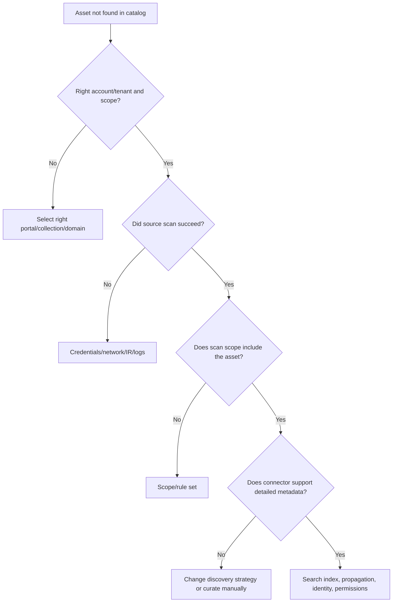

Do not fix this by scanning the whole subscription with broader credentials before isolating the cause. Uncontrolled scope or privilege expansion can pull out-of-scope data into the catalog.

## 34. Troubleshooting: Missing or Incorrect Lineage

### Layered Checklist

| Symptom | Possible cause | What to inspect |
|---|---|---|
| ADF pipeline missing from lineage | ADF–Purview integration not configured or no qualifying run | Integration settings, connector support, metadata ingestion |
| Source present but sink missing | Sink not scanned/registered or identity mismatch | Qualified names, paths, source coverage |
| Sink present but upstream missing | Custom job lacks auto-lineage support | Runtime metadata and manual/connector ingestion |
| Duplicate node names | Assets share display names across multiple systems | Qualified name/resource identity |
| Graph shows stale pipeline | Metadata ingestion/scan not updated yet | Last successful scan/run, pipeline version |
| Report not linked to data model | Limited workspace metadata integration/permissions | Power BI/Fabric permissions and feature support |
| Column-level lineage empty | Connector only supports asset-level or complex transform unparsed | Compatibility matrix, SQL/ADF source code |
| Column lineage looks wrong | Dynamic SQL, aliases, joins, or filters not fully represented | Manual verification, lineage contract |
| One table has unclear multiple upstreams | Multiple jobs write to the same sink or qualified names collide | Run history and ownership/data contracts |
| Table rename breaks edges | New qualified name does not match old asset | Migration lineage mapping, deprecation |
| Partial Power BI lineage | Semantic model/DAX/refresh integration differences | Compare Power BI lineage and Purview |
| Catalog shows “unknown” process | Connector missing intermediate activity or unresolved source/sink | Metadata source, scan coverage |

### Do Not Conflate Three Distinct Claims

- **Pipeline succeeded:** the job completed per the orchestration engine.
- **Data is correct:** outputs satisfy business and quality rules.
- **Lineage is complete:** the graph captures all relevant sources and transformations.

These three are **relatively independent**. A passing ADF pipeline can still produce bad data from faulty filter logic; a complete lineage graph can reflect an old pipeline version; a report showing accurate numbers today may still lack lineage for a custom transform.

## 35. Combined Troubleshooting: Security, Scanning, and Governance

| Symptom | Possibility | Next step |
|---|---|---|
| Source registers fine, but scan returns 403 | Identity lacks SQL/Storage data-plane access | Inspect principal, RBAC/SQL permissions/ACL |
| Scan times out reaching private source | DNS/routing/firewall/IR misconfigured | Test from exact runtime, verify private endpoint approval |
| Key Vault secret cannot be read | Missing role or rotated secret | Role, secret version, network policy |
| Some ADLS paths lack metadata | Traverse ACL, excluded scope, supported file types | ACLs, rule set, path inventory |
| Expected classification missing on table | Rule/sampling/connector limitations | Check rules, false negatives, manual review |
| Wrong classification detected | False positive | Steward review and policy-aligned annotation |
| User sees asset but cannot query it | Catalog permission differs from source permission | Data access approval/SQL grant/Storage RBAC |
| User cannot see asset despite having data access | Missing metadata/catalog role or search scope | Purview permissions and catalog experience |
| Cannot edit description | Missing curator/steward permission in active model | Role, collection/domain scope |
| Data product does not appear | Unpublished/unapproved or wrong scope | Unified Catalog governance workflow |
| Duplicate business terms | Missing owner and glossary versioning rules | Steward review, naming conventions |
| Scan lags behind schema change | No scheduled scan or connector delay | Scan schedule, source changes, logs |
| Metadata is fresh, but dashboard is stale | BI refresh failed or did not run | Semantic model refresh, lineage, source state |
| Governance cost spikes unexpectedly | Scan scope/frequency, paid features, IR/networking | Cost Management and resource inventory |
| Source deleted, but asset remains in catalog | Different lifecycle/soft-delete/metadata retention | Asset retirement process, permissions |
| Sensitive data leaked inside description | Curator pasted real data into metadata | Governance review, audit, redact properly |

### Prioritized Investigation Workflow

1. Identify the **scope** (account, source, collection, catalog experience).
2. Identify the **principal** (user, managed identity, service principal, self-hosted IR).
3. Identify the **failure layer** (network, auth, connector, scan rule, metadata indexing, lineage ingestion, business curation).
4. Collect **logs/scan run IDs** and timestamps while redacting sensitive data.
5. Retry at the **smallest scope** to isolate the root cause.
6. Fix configuration using least privilege.
7. Re-run scan/lineage ingestion and verify the asset.
8. Document a runbook/incident record to prevent recurrence.

## 36. Reference Architecture: Multi-Source Enterprise Governance

### Context

An enterprise operates:

- Azure SQL for sales transactions.
- ADLS Gen2 for raw and curated data.
- Azure Data Factory and Synapse/Fabric for ETL/analytics.
- Power BI for business reporting.
- On-premises SQL Server holding ERP information.
- Sales, Finance, and Supply Chain domains.
- Customer and employee data requiring strict access controls.

### Proposed Architecture

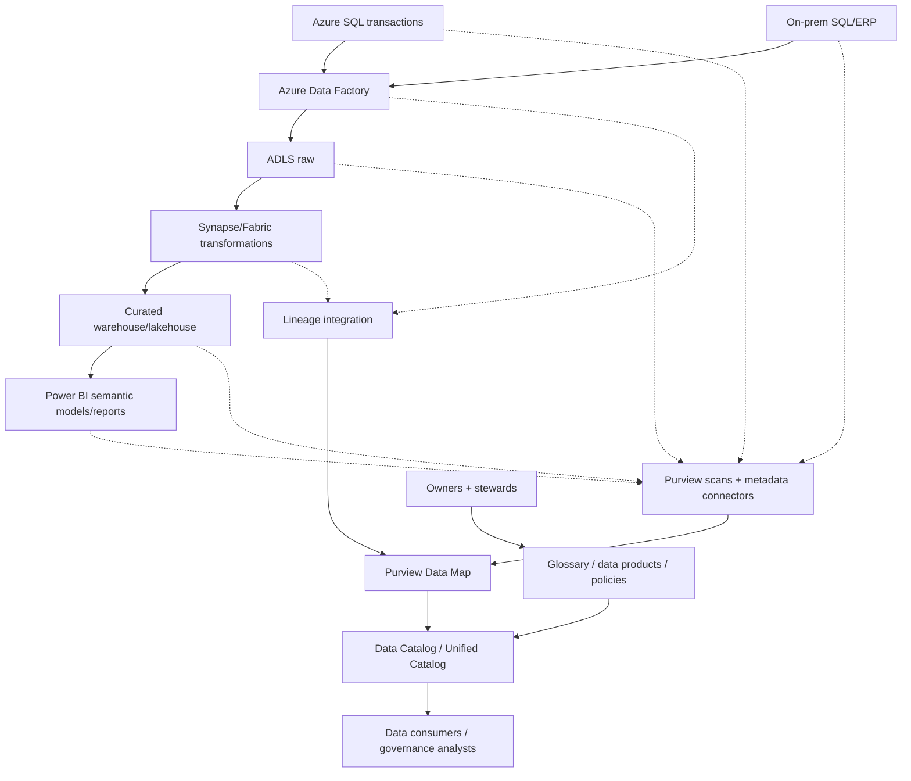

Dashed lines represent **metadata collection**, not operational data flows. Metadata and lineage ingestion capabilities for each source must be verified; the diagram does not claim every source has identical automated support.

### Responsibility Split

| Component | Owner | What must be maintained |
|---|---|---|
| SQL/Storage sources | Source platform owner | Data-plane permissions, schemas, classification policies |
| ADF/ETL pipelines | Data engineering | Code, run status, lineage integration |
| Warehouse/lakehouse | Analytics platform | Schema contracts, freshness, data quality |
| Power BI reports | BI team | Semantic models, refreshes, KPI definitions |
| Purview Data Map | Governance platform | Data sources, scans, collection model, metadata freshness |
| Unified Catalog/products | Domain stewards | Business glossary, owners, product status/usage |
| Security/compliance | Security team | Access, sensitivity, retention, audits |
| Cost monitoring | FinOps/platform | Purview/governance costs, scan schedules, capacity |

### Sensible Rollout Sequence

1. **Inventory:** identify the 10–20 most critical data sources rather than scanning the entire company at once.
2. **Foundation:** establish Purview experience, tenant, IAM, private networking, logging, and budget.
3. **Source onboarding:** register and scan Tier-1 sources.
4. **Curation:** assign owners, glossary terms, classifications, and data product descriptions.
5. **Lineage integration:** connect ADF/BI per connector support and test graphs.
6. **Business validation:** compare metrics/lineage against source code and business definitions.
7. **Access governance:** connect data product discovery to approval and provisioning.
8. **Operating model:** scan schedules, freshness/error alerts, and incident ownership.
9. **Scale by domain:** expand Sales → Finance → Supply Chain with controls.
10. **Quarterly review:** measure adoption, coverage, quality, cost, and metadata permissions.

### Why Not Scan 100% of Sources Immediately?

Without owners, classifications, and authorized sources, a sweeping scan floods the catalog with unowned assets. This easily creates **metadata catalog debt**: table names exist, but definitions and lineage go stale and nobody trusts them.

## 37. Practice: Designing a Pipeline Lineage Contract

A data engineering team can require each production pipeline to emit:

```text
Pipeline identity:
  name: commerce-orders-curation
  owner: commerce-data-platform
  code version: commit hash
Inputs:
  - source qualified name
  - schema version / partition
Outputs:
  - target qualified name
  - schema version / partition
Transformation:
  - business rule version
  - SQL/notebook/script artifact reference
Runtime:
  - run ID
  - start/end timestamps
  - status
  - records read/written
  - quality checks
Governance:
  - sensitive fields
  - linked business terms
  - downstream owner contacts
```

This document is an **engineering team contract template**, not a mandatory Purview format. Ingestion tooling must translate the contract into supported metadata/lineage payloads where APIs allow.

### Integration with CI/CD

For every pull request changing a pipeline:

- Check whether sources or sinks changed.
- Check whether columns were added/removed or business logic changed.
- Compute affected assets/reports using current lineage.
- Verify owner/steward approval.
- Update schema contracts and test fixtures.
- Update metadata/lineage registrations as needed.
- Deploy to staging and compare output against baseline.
- Monitor scans/ingestion and KPIs post-release.

**Never rely on a stale lineage graph to auto-approve breaking schema changes.** The graph is an input to review, not the sole decision-maker.

## 38. Asset Lifecycle Governance: Create, Change, Retire

A catalog gets noisy if assets are never retired.

### Illustrative Internal States

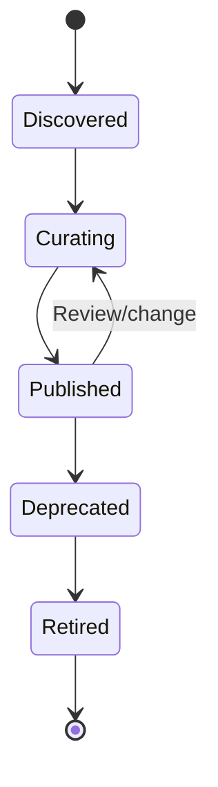

This is a **proposed internal workflow**, not a built-in state machine present in every Purview UI.

### Deprecation Process

1. Data owner proposes retiring dataset `old_sales_summary`.
2. Use downstream lineage to identify affected consumers and BI assets.
3. Issue a deprecation notice with the replacement dataset.
4. Provide a transition period with usage telemetry.
5. Confirm clients and BI tools have migrated to the replacement source.
6. Delete or manage underlying data per retention and security policies.
7. Update metadata status, glossary links, and lineage references.
8. Log an audit trail of the retirement decision.

Never delete a raw dataset used for reconciliation simply because it no longer appears in a Power BI report. Custom consumers uncaptured by auto-lineage may still depend on it.

## 39. Data Governance Is Not Data Masking or Retention by Default

### Distinguish Four Actions

| Action | Example | Final enforcement tool |
|---|---|---|
| **Discover** | Detect table containing `email` | Data Map scan/catalog |
| **Describe** | Attach term “Customer Email” | Steward/governance |
| **Restrict access** | Only Support reads emails | Source-level RBAC/SQL GRANT/RLS/ACL/masking |
| **Retain/delete** | Purge data after 3-year policy | Storage lifecycle/SQL/retention workflows and compliance |

Purview can participate in discovery, policy coordination, or specific enforcement features, yet you must verify **which system actually enforces the policy**. **Adding a `PII` tag does not automatically encrypt, purge, or mask a column in Storage.**

### Defense-in-Depth Model

- Entra ID for workforce and workload identities.
- Data-source RBAC/SQL permissions plus row/column controls.
- Private networking, encryption, and monitoring.
- Purview governance for catalog, ownership, lineage, and classification.
- Purview security/compliance tools when licensed and properly configured.
- Audit/incident response and periodic access reviews.

### When Privacy Laws Apply

Data protection obligations vary by jurisdiction, purpose, and corporate policy. This lesson does not provide legal advice; for sensitive data, **Data Protection Officers, Legal, and Security** must review classifications, retention, access controls, and deletion workflows.

## 40. Pre-Production Checklist for Purview Deployment

### Scope and Architecture

- [ ] Define business goals: discovery, glossary, lineage, classification, impact analysis, data products.
- [ ] Distinguish between Purview governance and required security/compliance features.
- [ ] Confirm Data Map / classic catalog / Unified Catalog experience and active licensing.
- [ ] Build a Tier-1 source inventory and prioritize onboarding with owners.
- [ ] Choose a collection/domain model that avoids conflating permission boundaries with business ownership.
- [ ] Select appropriate scan scopes, schedules, rule sets, and credentials.
- [ ] Verify connector support and metadata granularity per source.

### Lineage and Data Quality

- [ ] Inventory pipelines: ADF, Synapse, Fabric/Power BI, custom code.
- [ ] Classify edges as auto-discovered, manually curated, or unverified.
- [ ] Test end-to-end lineage from source through transform to report using sample data.
- [ ] Check actual column-level lineage support.
- [ ] Plan lineage capture for custom ETL and dynamic SQL.
- [ ] Maintain glossary terms for critical KPIs with versions and approvals.
- [ ] Establish owners/stewards and SLOs for metadata freshness and quality.
- [ ] Enforce a downstream impact check before schema changes.

### Security and Compliance

- [ ] Enforce least-privilege IAM across both Purview metadata and data sources.
- [ ] Clearly define managed identities/credentials with rotation and audit trails.
- [ ] Ensure Purview scans avoid overly broad admin credentials.
- [ ] Test private networks, IRs, Key Vault, and DNS from the actual runtime.
- [ ] Apply metadata sensitivity controls; avoid exposing restricted source inventories broadly.
- [ ] Review classifications manually; never treat tags as enforcement.
- [ ] Tie data access approvals to source enforcement and expiration.
- [ ] Apply retention/deletion policies across sources, backups, and replicas.

### Operations and FinOps

- [ ] Monitor scan errors, scan duration, and metadata freshness.
- [ ] Monitor lineage ingestion/coverage and missing edges.
- [ ] Maintain runbooks for 403s, network timeouts, source mismatches, and stale catalogs.
- [ ] Set budgets, tags, chargebacks, and scan optimization schedules.
- [ ] Establish lifecycle/deprecation policies for assets and data products.
- [ ] Integrate CI/CD and change reviews for glossaries, pipelines, and data contracts.
- [ ] Plan DR/restore tests for data sources without relying on the catalog as a backup.
- [ ] Track adoption metrics with clear accountability for catalog improvement.

## 41. Common Misconceptions

**“Microsoft Purview is just a PII scanning tool.”** No. Within data governance, it also covers discovery, metadata cataloging, business glossaries, ownership, and data lineage as supported.

**“Purview Data Map and Unified Catalog are just two names for the same database table.”** Avoid thinking that way. They serve distinct roles and governance experiences; features and permissions vary by tenant and over time.

**“Registering a data source scans all its tables and columns.”** False. Registration declares the source; scanning or integration extracts detailed metadata where supported.

**“Scans only read metadata, so no source permissions are needed.”** Incorrect. Scanners need valid credentials/data-plane permissions, and some classifiers sample content depending on connector and policy.

**“A Purview Reader can query Azure SQL.”** Not automatically. Metadata roles and source data-plane permissions are separate boundaries.

**“Data Catalog can replace the entire data warehouse.”** No. The catalog manages metadata; the warehouse, lake, or database stores and processes actual data.

**“Same table name means the same asset.”** False. Source system qualified names and resource identities are required.

**“Scanning a CSV file automatically infers every column data type reliably.”** No. Format, scan rules, sampling, and connector support determine inference quality.

**“All automated classifications are 100% accurate.”** No. Both false positives and false negatives occur; stewards must review them.

**“Attaching a Sensitive classification automatically encrypts Storage.”** No. Classification metadata does not replace Storage or SQL enforcement.

**“Data lineage is a list of everyone who viewed the data.”** No. Lineage tracks source-target and transformation relationships; user access logs belong to a separate audit trail.

**“Lineage always reveals every column’s calculation formula.”** No. Support varies by connector and transform; custom SQL/notebooks may only yield asset-level lineage or no edges.

**“If an ADF pipeline succeeded, Purview definitely has complete lineage.”** No. Integration setup, permissions, activity/source support, and ingestion latency all matter.

**“Power BI lineage UI matches Purview lineage UI in every case.”** No. Each system tracks assets and dependencies through its own integration tier and features.

**“Seeing no downstream edges in the graph proves nobody uses the table.”** Not guaranteed. Unrecorded custom scripts or exports may exist.

**“A clean graph proves the data is accurate.”** False. Data quality checks and business logic validation are still required.

**“Owner in the catalog means Azure RBAC Owner.”** Not necessarily. Business ownership differs from Azure resource administration.

**“A governance domain always mirrors a Data Map collection.”** No. One organizes governance by business structure, while the other scopes technical metadata and permissions.

**“A data product is just another word for a table.”** No. A data product can bundle multiple assets, ownership, descriptions, usage/access terms, and quality commitments.

**“Having glossary terms keeps all KPI numbers synchronized automatically.”** No. Terms document definitions; pipelines, semantic models, and tests must execute accurate logic.

**“A data contract JSON in Git automatically becomes lineage in Purview.”** No. Supported integrations/ingestion and matching source identities are required.

**“Purview automatically parses all dynamic SQL and custom Python.”** Not by default. Verify connector support and add instrumentation or manual lineage where needed.

**“A successful 09:00 scan means BI data is also current as of 09:00.”** False. Scan freshness, data freshness, lineage freshness, and BI refresh timing are distinct.

**“Increasing scan frequency improves data quality.”** No. Metadata scanning does not fix missing records, duplicates, or flawed business definitions.

**“Enabling Purview automatically secures all source data access.”** No. Source ACLs, RBAC, and policies must be configured and audited independently.

**“Having a private endpoint means scans need no identity.”** False. Private routing and authentication are independent requirements.

**“Deleting a source dataset is safe whenever no downstream lineage appears.”** No. Metadata may omit custom consumers.

**“Having 50,000 catalog assets means governance succeeded.”** No. Success requires coverage, descriptions, owners, verified lineage, and user adoption.

**“Scanning multiple times a day is definitely cheap.”** You cannot assume that without measuring resources and pricing by connector and governance plan.

**“Geo-replication on sources means Purview acts as a backup.”** No. Source backup and restore must still be managed independently.

## 42. Self-Check Questions

**Q1.** Which data governance challenges does Microsoft Purview address?

**Answer:** Discovery/cataloging, metadata, classifications, glossary, ownership, lineage, and data product/governance workflows to support trustworthy data usage per supported features.

**Q2.** How do Data Map and Data Catalog differ in role?

**Answer:** Data Map manages asset metadata/relationships along with scans, classifications, and lineage; Catalog/Unified Catalog provides search, interpretation, and curation tailored to users under the active experience model.

**Q3.** Why is registering a data source insufficient on its own to view all tables and columns?

**Answer:** Registration only declares the source; a scan or integration must connect, extract technical metadata, and populate assets into Data Map/catalog.

**Q4.** What are the three main types of metadata?

**Answer:** Technical, business, and operational metadata.

**Q5.** How does a data asset differ from a business glossary term?

**Answer:** An asset is a concrete resource (table/file/model), whereas a term is a defined business concept that can link to many assets.

**Q6.** Is a data owner the same as an Azure RBAC Owner?

**Answer:** No. A business owner is accountable for meaning and usage permissions; Azure RBAC Owner is resource management privilege.

**Q7.** Must a Data Map collection match a Unified Catalog governance domain?

**Answer:** No. They serve different organizational goals: technical metadata/access scoping vs. business governance organization.

**Q8.** If an analyst finds a SQL table in the catalog, can they query it immediately?

**Answer:** No. They still need appropriate SQL/database permissions and network access.

**Q9.** If a Purview scan flags `customer_email` as an email, is that column automatically protected?

**Answer:** No. Classification is metadata/a signal; protections such as access controls, masking, encryption, and retention must be configured at the source.

**Q10.** Which three groups of questions does data lineage answer?

**Answer:** Origin/trust, impact analysis, and root-cause analysis.

**Q11.** How do upstream lineage and downstream lineage differ?

**Answer:** Upstream shows the sources and processes creating an asset; downstream shows the assets, processes, and reports depending on it.

**Q12.** An ADF pipeline succeeded, yet lineage does not appear. Name three possible causes.

**Answer:** Integration not configured, unsupported activity/connector, unscanned/unmatched source or sink assets, or ingestion lag; also check permissions.

**Q13.** What distinguishes table-level lineage from column-level lineage?

**Answer:** Table-level shows asset-to-asset dependencies; column-level maps output fields to specific input fields, which helps during schema changes.

**Q14.** Why does `WHERE order_status='Paid'` matter to `net_revenue` lineage even though it is not in the subtraction formula?

**Answer:** It is a filter dependency controlling which rows contribute to the metric; changing the filter changes the result.

**Q15.** Does custom Python ETL automatically generate Purview lineage?

**Answer:** Not by default. It requires supported connectors, instrumentation/metadata ingestion, or manually curated lineage.

**Q16.** Why is seeing no downstream edges insufficient grounds to delete a dataset?

**Answer:** The graph may miss custom consumers or have stale metadata; combine with code inventory, owners, and access logs where appropriate.

**Q17.** How do scan freshness and data freshness differ?

**Answer:** Scan freshness measures the age of discovered metadata; data freshness measures how current the underlying records/datasets are.

**Q18.** When a revenue report is inaccurate, how does lineage help?

**Answer:** It lets you trace back through the semantic model, curated dataset, transform, raw input, and source system to isolate the issue, though you still need to reconcile actual data and business formulas.

**Q19.** Can data quality and data lineage replace each other?

**Answer:** No. Lineage explains origin and transformations; quality assesses completeness, accuracy, and timeliness.

**Q20.** If a scan against private-only ADLS times out, what should you inspect?

**Answer:** Appropriate integration runtime (managed VNet or self-hosted IR), private DNS, private endpoint approval, and firewall/routing—plus separate checks on identity/permissions.

**Q21.** If a scan identity holds Azure Reader on a Storage account, is that enough to read Blobs?

**Answer:** Not by default. A Storage data-plane role/ACL and valid network path are required.

**Q22.** Why version the Net Revenue business glossary term?

**Answer:** Definitions and formulas can evolve; versions, owners, and effective dates clarify why numbers differ across periods.

**Q23.** How does a data product differ from a single data asset?

**Answer:** A data product is a consumable package that can combine multiple assets, business context, ownership, and access/quality/freshness expectations.

**Q24.** Can you assume automated scanning generates column-level lineage for every Power BI report and SQL procedure?

**Answer:** No. Connector support, features, and expression-parsing capabilities govern granularity.

**Q25.** Which steps belong in impact analysis when renaming a column at a data source?

**Answer:** Find the asset, inspect downstream lineage, verify coverage, cross-check code/owners, run contract tests, release with compatibility/rollback, and monitor afterward.

**Q26.** Why is a Data Catalog not a backup solution?

**Answer:** A catalog manages metadata and relationships; it does not store full source payloads or restore complete business records by default.

**Q27.** Does a 403 error while scanning Azure SQL necessarily stem from a Purview collection role?

**Answer:** No. It may come from source database principal/data-plane permissions, firewall policies, or source authentication.

**Q28.** Which metrics beyond asset counts measure catalog program success?

**Answer:** Ownership/description coverage, lineage completeness/verification, glossary adoption, time to locate datasets, access request SLAs, and data quality SLOs.

**Q29.** Why is knowing “56 scans/day” insufficient to calculate a Purview bill?

**Answer:** Cost also depends on scan scope/volume, connector, active governance/Data Map pricing model, IR/compute/networking, source transactions, and logging.

**Q30.** How do you distinguish Purview data governance from Purview DLP/information protection?

**Answer:** Governance focuses on metadata, cataloging, lineage, and ownership; data security/compliance features manage separate policies, labels, audits, and enforcement and must be properly licensed and configured.

## 43. Capstone Case Exercise

**Prompt:** A retail group runs a “Top Customers by Net Revenue” Power BI report reading `dw.customer_revenue`, which is built by Azure Data Factory running SQL transformations over ADLS Parquet. Raw data arrives from Azure SQL `commerce.orders` and an on-premises returns ERP system. After a schema update, the report shows a 12% drop in revenue and several customers are missing rows.

Assumptions:

```text
Source A: Azure SQL commerce.orders
Source B: On-prem ERP returns
ADF step 1: Copy orders → ADLS raw_orders
ADF step 2: Copy returns → ADLS raw_returns
Custom transform: SQL/Spark with business mapping
Curated: dw.customer_revenue
Power BI semantic model: Customer Sales
Report: Top Customers by Net Revenue
```

Tasks:

1. Sketch the upstream/downstream lineage graph and mark where auto-lineage gaps may occur.
2. Identify which data sources must be registered and scanned.
3. Specify what details must be included in the Net Revenue glossary term.
4. Flag columns that may hold PII/sensitivity and identify who confirms classifications.
5. List the owners, stewards, and pipeline contacts who must coordinate.
6. Distinguish scan freshness, data freshness, and report refresh.
7. Propose 5 data quality checks to isolate the 12% discrepancy.
8. State the permissions and networking needed to scan the on-premises source.
9. Propose CI/CD and versioning practices for transforms using dynamic SQL.
10. Draft a post-fix acceptance checklist.

### Answer Key Outline

| Topic | Key points |
|---|---|
| **Lineage** | Azure SQL + ERP returns → raw ADLS → transform → warehouse → semantic model → report |
| **Lineage gap** | Custom SQL/Spark may require dedicated metadata ingestion or instrumentation |
| **Glossary** | Gross, refunds, discounts, recognition date, currency, effective version |
| **Sensitivity** | Customer IDs/contact info may be sensitive; steward/security review needed |
| **Owners** | Commerce, ERP, Data Engineering, Finance, BI, Governance |
| **Freshness** | Metadata scan ≠ pipeline data arrival ≠ report refresh |
| **Quality** | Uniqueness, null checks, row-count reconciliation, refund matching, revenue totals |
| **On-prem** | Scan runtime/network route, SQL auth/data-plane rights, firewall/DNS |
| **CI/CD** | Data contract, tests, change impact, code versioning, lineage updates |
| **Acceptance** | Metrics match baseline, report refreshed, lineage verified, permissions and owner sign-off |

### Simple Data Verification Query Set

```sql
-- Illustrative query on a warehouse with compatible SQL syntax.
SELECT
    COUNT(*) AS total_rows,
    COUNT(DISTINCT order_id) AS unique_orders,
    SUM(CASE WHEN customer_id IS NULL THEN 1 ELSE 0 END) AS null_customers,
    SUM(net_revenue_amount) AS net_revenue
FROM dw.customer_revenue
WHERE business_date = '2026-11-20';
```

If `dw.customer_revenue` stores **one row per customer** rather than per order, `COUNT(DISTINCT order_id)` is inappropriate and checks must instead run against a table at the right granularity. This illustrates why business and technical metadata must specify a dataset’s **grain** before designing quality checks.

## Summary

**Microsoft Purview** helps enterprises **discover, describe, and govern data assets** through metadata, Data Map, data catalog/Unified Catalog, classifications, glossaries, data products, and **data lineage**. With **data lineage**, teams can trace data from sources through pipelines and transformations to warehouses, semantic models, and reports—supporting impact analysis and root-cause investigation.

To keep governance reliable, always **distinguish registration from scanning; metadata access from source data permissions; classification from policy enforcement; and lineage graphs from data quality and audit logs**. Automated lineage from Azure Data Factory, Synapse, Fabric/Power BI, or other connectors must be verified against active versions and features, while custom code, dynamic SQL, and on-premises systems may require supplementary lineage metadata and manual review.

Start with critical sources and KPIs, assign **business owners and stewards**, establish glossary and data product contracts, design least-privilege scans and networking, pair lineage with quality checks, and monitor metadata freshness and costs. Done right, Purview becomes the **trust and knowledge-coordination layer** for your Azure analytics architecture rather than an unused list of table names.
