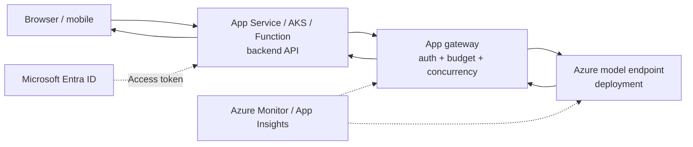
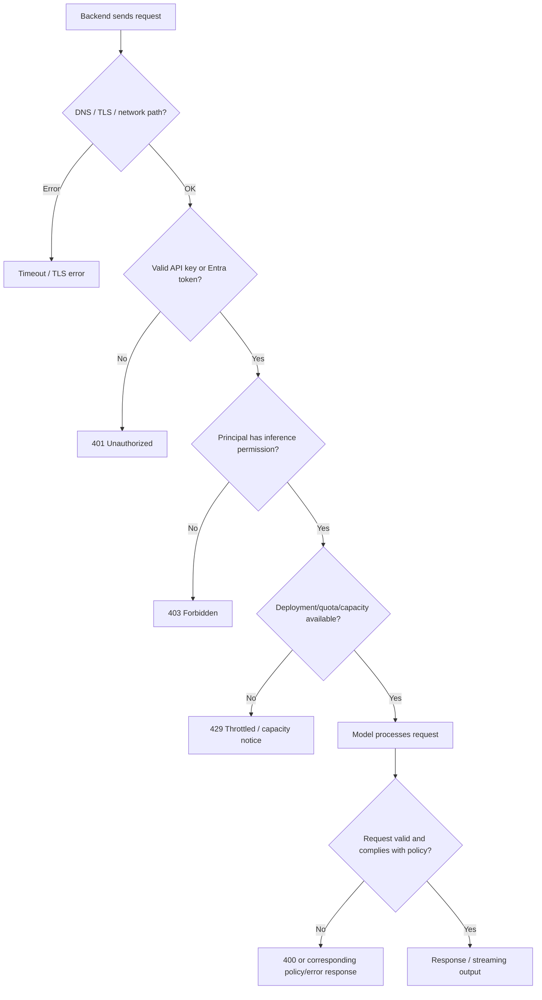
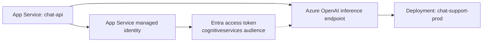
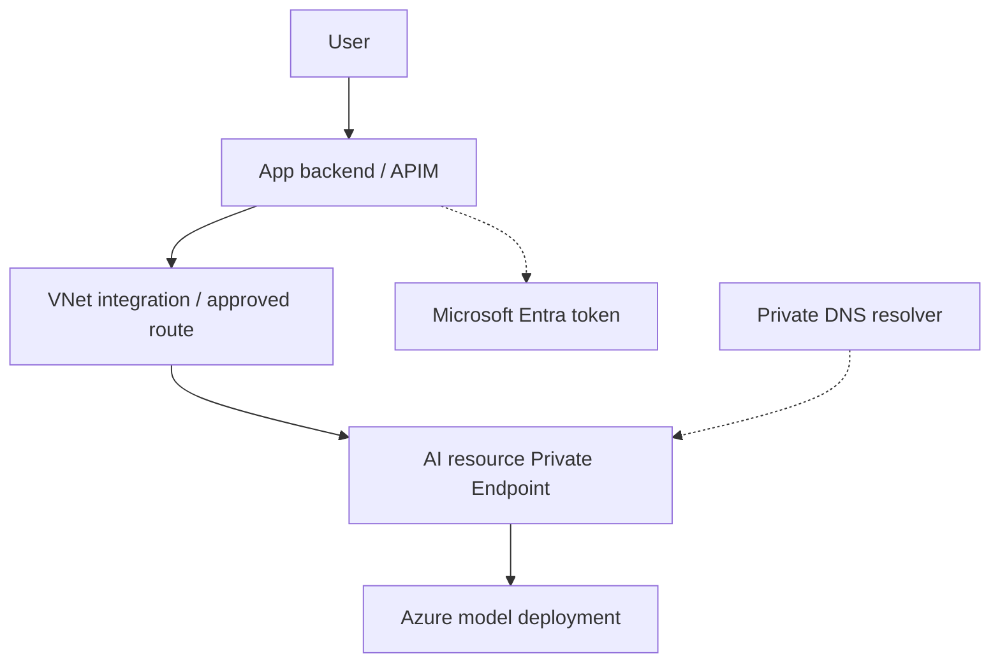
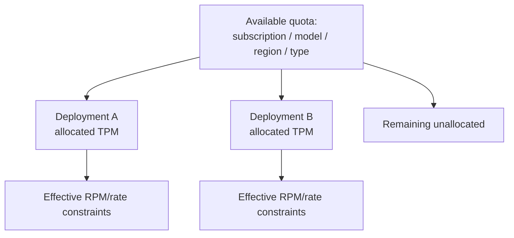
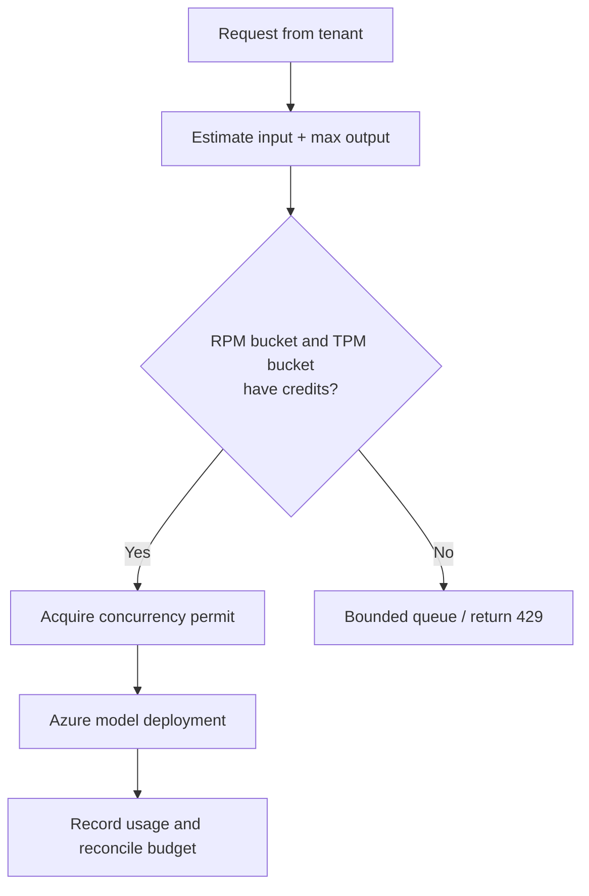
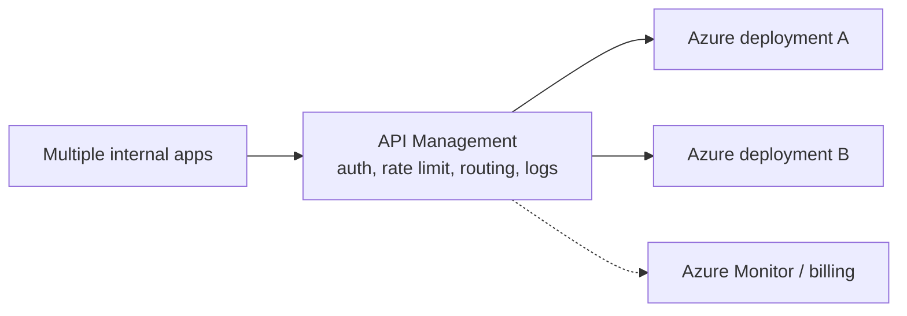
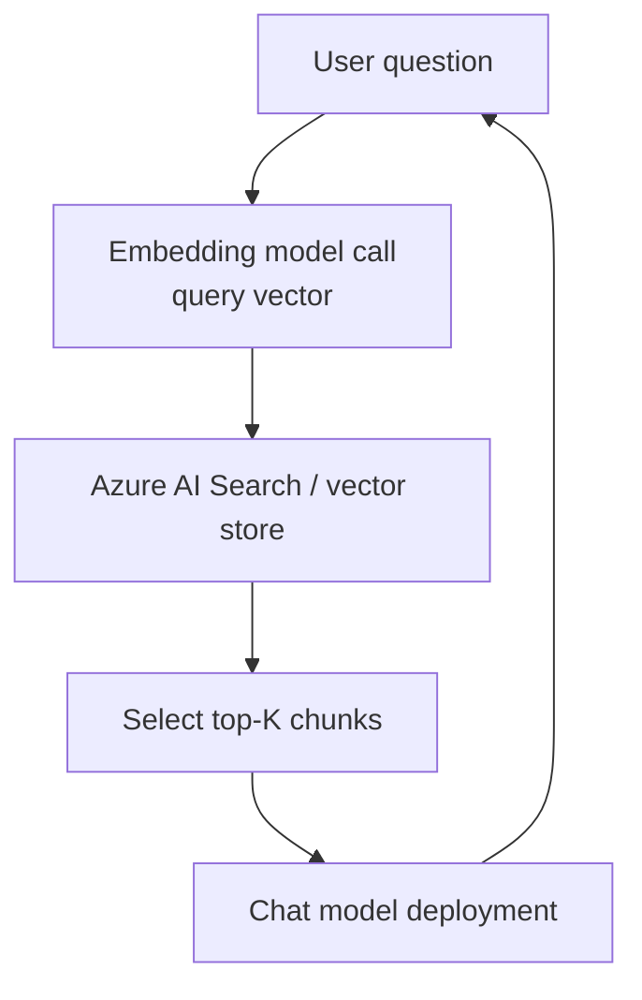
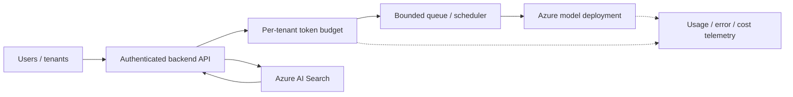

# Authentication, Quotas, and Model Rate Limit Management

A customer support application on Azure App Service calls a language model to answer questions from enterprise documents. With few users, the API works smoothly. During peak hours, many concurrent requests start receiving **HTTP 429**, latency rises due to retries, while other requests return **401/403** after the operations team switches from API keys to Microsoft Entra ID. The development team increases `max_tokens` to "prevent truncated answers," inadvertently raising the estimated tokens per request and exhausting quota even faster. Without **per-user/tenant limits** and **cost budgets**, one busy tenant can cause other tenants to be rejected.

Operating AI applications on Azure requires solving **three independent yet tightly coupled problems**:

1. **Authentication and authorization:** which applications are permitted to call a model endpoint/deployment, using which identity or secret, and from which network?
2. **Quotas and rate limits:** how much capacity is allocated to the subscription, region, deployment, and model/deployment type? Are requests or tokens exceeding the allowed rate?
3. **Application-layer capacity and cost management:** how are budgets allocated per feature/tenant, and how do queuing, safe retries, concurrency control, and usage observability work?

This lesson belongs to the **AI and Machine Learning on Azure** chapter of the **CLOUD_PROVIDERS_AZURE** module. The module explores Azure from subscriptions, resource groups, and Microsoft Entra ID to networking, compute, storage, and data, while deploying, monitoring, securing, and controlling costs for an application architecture. In this lesson, **Azure OpenAI / supported model deployments in the Azure AI Foundry (Microsoft Foundry) ecosystem** serve as the central example. Portal/SDK/endpoint names and quota mechanics for third-party models may differ; do not apply Azure OpenAI-specific mechanics to every model in the catalog.

**After this lesson, you will be able to:**

- Distinguish between **API keys, Microsoft Entra access tokens, Azure RBAC, data-plane authorization, and network access**.
- Call Azure OpenAI using **managed identity** via the Azure Identity SDK or securely managed API keys.
- Distinguish between **model, deployment, endpoint, API version, context window, TPM, RPM, and quota allocation**.
- Analyze **HTTP 429**, retry/throttling responses, and when to slow down instead of increasing retries.
- Design **token budgets, request queues, per-tenant rate limiters, concurrency caps, timeouts**, and fallbacks.
- Measure usage/cost/latency by deployment, user, and workload; avoid confusing **rate-limit accounting** with actually billed tokens.
- Implement production controls using **API Management, Azure Monitor, Application Insights, Key Vault, and Private Link** where appropriate.

## 1. Components of a Model Call on Azure

An application does not merely "call a model name." For an Azure OpenAI deployment, the components typically include:

| Component | Role | Illustrative Example |
|---|---|---|
| **Azure resource** | Resource providing endpoints, identity/network settings, permissions, and deployment management | `aoai-support-prod` |
| **Endpoint** | HTTPS address the client connects to | `https://aoai-support-prod.openai.azure.com/` |
| **Model** | Model family/version with distinct capabilities and limits | A chat or embeddings model offered on Azure |
| **Deployment** | Named model deployment configuration bound to a resource/SKU/capacity | `chat-support-prod` |
| **API version / route** | API/SDK contract for the invoked operation | Chat Completions or another supported API |
| **Credential** | How the client proves its identity | Entra token or API key |
| **Quota / rate limit** | Allocated capacity and accepted request/token rate | TPM/RPM or equivalent capacity model |
| **Usage** | Actual tokens/requests and meter-based cost | Input/output tokens, request count |

High-level path:



**Core principle:** browser/mobile clients must never hold Azure OpenAI resource keys. The backend authenticates the user, checks permissions/tenant, and only then uses a **workload identity** to call the model endpoint. Never trust a client-supplied `tenantId` or `deployment` to pick resources or quotas.

### 1.1. Model Does Not Mean Deployment

In Azure OpenAI, the `model` field in some SDK requests may actually be the Azure resource's **deployment name**, even though the parameter is named `model`. If the actual deployment is named `chat-support-prod`, passing the catalog model name instead of the deployment name can trigger a "deployment not found" error.

A single resource can have multiple deployments; the same model family may be deployed across multiple regions/resources/SKUs for capacity or data goals. Never assume a deployment name exists on every endpoint.

### 1.2. Azure OpenAI and Other Models in Foundry

Azure AI Foundry/Microsoft Foundry can offer multiple deployment/inference endpoint types. Some support OpenAI-compatible APIs, while others have different SDKs, URLs, auth, or quotas. Before applying any example:

1. Confirm the **provider, model, and deployment type**.
2. Read the exact endpoint/SDK/auth contract for that deployment.
3. Check support for **Entra ID**, API keys, and Private Endpoints.
4. Identify the applicable quota/rate-limit units, billing meters, and supported regions.
5. Never assume all models return the same `usage` fields or support the same `max_tokens` parameter.

Technical examples below **explicitly note when they apply only to Azure OpenAI Chat Completions**.

## 2. Four Layers Protecting a Request

A model call can fail at multiple layers:



This diagram helps **classify errors**; it does not promise a single HTTP status across every endpoint or model. For instance, content-filter blocks may surface via an input error or status/finish-reason fields depending on the API.

| Layer | Controls | Common Mistakes |
|---|---|---|
| Network | Private Endpoint, DNS, firewall, TLS | Opening the public endpoint to "fix" missing permissions |
| Authentication | Entra OAuth token or API key | Using an Azure ARM token to call the model |
| Authorization | Azure RBAC/data-plane roles and service policies | Granting subscription-wide Owner/Contributor to the API |
| Capacity | TPM/RPM, model deployment, resource capacity | Retrying continuously on 429 without reducing demand |
| Application governance | Tenant quotas, token budgets, content policies | Letting clients pick unlimited max output and deployments |

## 3. Two Fundamental Authentication Methods: API Key and Microsoft Entra ID

### 3.1. API Key

For many Azure OpenAI deployments, API keys are issued at the resource/service level and can be passed via the `api-key` header or SDK configuration.

**Pros:** simple setup for experiments or compatible integrations. **Trade-off:** a key is a **bearer secret**; anyone holding the key can call the resource within its scope, and the key does not represent any individual end user's identity.

**Rules:**

- Never place keys in JavaScript/SPAs/mobile apps or Git source code.
- Store them in **Azure Key Vault** or an approved secret manager.
- Use application settings/secret injection with least privilege; never log key values.
- Maintain a **rotation** process and verify legacy clients.
- Use local development secrets only per policy; never paste them into tickets or chats.
- Never treat an API key as a **per-tenant rate limit**; your gateway must enforce that policy.

### 3.2. Microsoft Entra ID

For Azure OpenAI resources supporting Entra authentication, the backend can use a **managed identity** or service principal/workload identity issued an appropriate token, calling the endpoint via a bearer token.

**Pros:**

- No long-lived secrets stored in Azure workload code.
- Clear principal ID, Azure RBAC assignment, and identity lifecycle.
- Easy to revoke/govern access by permission group and environment.
- Integrates cleanly with network restrictions, monitoring, and governance.

**Note:** an Entra token only proves identity. The principal **still needs an appropriate role** to invoke model inference on the resource and a valid network path.

### 3.3. Comparison

| Criterion | API Key | Microsoft Entra ID |
|---|---|---|
| Identity tied to request | Usually resource key; does not indicate tenant/end user | User/service/managed identity principal |
| Credential lifecycle | Static secret requiring storage, rotation, revocation | Short-lived token; managed identity/roles |
| Authorization | Per key/service semantics | Service roles/scopes, subject to support |
| Fit for Azure backends | Usable, but increases secret management burden | **Prefer managed identity** when supported |
| Direct from browser/mobile | Never, due to credential exposure | Not automatically safe; must inspect token audience and permission scope |
| Per-tenant tracking | Requires business gateway/correlation | Still requires app-level tenant mapping and quotas |

**Do not treat Entra auth as permission to forward an end user's raw token directly to the model.** Backends typically use their own workload identity; end-user mapping and auditing must happen at the application layer.

## 4. Azure RBAC for Models: Which Role Can Call Inference?

For **Azure OpenAI** using Entra ID, a common role for inference calls is **Cognitive Services OpenAI User** scoped to the relevant resource. Administrative roles such as **Cognitive Services OpenAI Contributor** grant broader capabilities and should not be assigned to workloads that only need inference.

Separation of duties:

| Principal | Required Permissions | Should Not Have by Default |
|---|---|---|
| `mi-chat-api-prod` | Call approved inference deployments | Permission to create/delete deployments or read keys |
| `sp-model-deployment-ci` | Deploy/update models via IaC and approval | Reading unnecessary customer data |
| `grp-ai-platform-admins` | Govern resources, capacity, and policies per assignment | Direct access to user data unless required |
| `grp-ai-auditors` | Read metrics/audits within allowed scope | Model admin rights and secrets |

**Owner/Contributor on a resource group does not automatically mean all data-plane requests are permitted.** For every resource/model endpoint, verify the actual role definition and inference authorization.

### 4.1. Assign Roles at Minimal Scope

Diagram:

```text
Subscription
  Resource group: rg-ai-prod
    Azure OpenAI resource: aoai-support-prod
      Role assignment:
        principal = mi-chat-api-prod
        role = Cognitive Services OpenAI User
        scope = resource
```

Assigning at the subscription level when only one resource is needed is **too broad**. Also inspect inherited roles from management groups, subscriptions, or resource groups, as a principal may inherit extra permissions elsewhere.

### 4.2. Role Propagation and Tokens

After assigning a role, permissions can take time to take effect. Active tokens or caches may not reflect the new policy immediately. If the app receives 403 right after a role assignment, check:

1. Are the Entra tenant and managed identity object ID correct?
2. Is the role scoped to the exact resource/endpoint?
3. Is the token audience correct?
4. Has the role assignment propagated?
5. Are networking or resource policies blocking access?

Never escalate permissions to `Owner` to "quick-fix" an undiagnosed 403 error.

## 5. Token Audience and OAuth Scope for Azure OpenAI

For Azure OpenAI via Entra ID, a common scope when acquiring a token with the Azure Identity SDK is:

```text
https://cognitiveservices.azure.com/.default
```

By contrast:

```text
https://management.azure.com/.default
```

is the scope for the **Azure Resource Manager control plane**, not the token audience for an Azure OpenAI inference request.

If a client uses the wrong scope, Entra may still issue a token, yet the model endpoint will reject it due to an **audience** mismatch.

### 5.1. Which Resource Owns the Managed Identity?

Example of an App Service with a system-assigned managed identity:



The App Service's managed identity is **not** the Azure OpenAI resource's managed identity; assign the role to the actual client-side principal acquiring the token. For user-assigned managed identities, distinguish **client ID**, **object/principal ID**, and **Azure resource ID**.

## 6. Python Example: Azure OpenAI with Managed Identity

The following example illustrates **Azure OpenAI Chat Completions** using the `openai` and `azure-identity` libraries. The SDK version must support `AzureOpenAI` and `azure_ad_token_provider`.

```python
import os

from azure.identity import DefaultAzureCredential, get_bearer_token_provider
from openai import AzureOpenAI

# Environment examples:
# AZURE_OPENAI_ENDPOINT=https://aoai-support-prod.openai.azure.com/
# AZURE_OPENAI_DEPLOYMENT=chat-support-prod
# AZURE_OPENAI_API_VERSION=<version-supported-by-deployment>

credential = DefaultAzureCredential()
token_provider = get_bearer_token_provider(
    credential,
    "https://cognitiveservices.azure.com/.default",
)

client = AzureOpenAI(
    azure_endpoint=os.environ["AZURE_OPENAI_ENDPOINT"],
    api_version=os.environ["AZURE_OPENAI_API_VERSION"],
    azure_ad_token_provider=token_provider,
    timeout=20.0,
    max_retries=0,  # Demo: retries are managed externally.
)

result = client.chat.completions.create(
    model=os.environ["AZURE_OPENAI_DEPLOYMENT"],
    messages=[
        {"role": "system", "content": "Answer concisely in English."},
        {"role": "user", "content": "Explain the concept of TPM quota."},
    ],
    max_tokens=120,
)

print(result.choices[0].message.content)
if result.usage:
    print("Input tokens:", result.usage.prompt_tokens)
    print("Output tokens:", result.usage.completion_tokens)
    print("Total tokens:", result.usage.total_tokens)
```

**Conditions for this code to run:**

1. The Azure OpenAI resource and deployment exist; the endpoint and API version are compatible **with the operation and model**.
2. The principal selected by `DefaultAzureCredential` holds an appropriate inference role.
3. The `openai`/`azure-identity` SDKs and Python version are compatible.
4. Network TLS/DNS/private endpoints allow the request.
5. The deployment supports the `max_tokens` parameter. **Some newer models/APIs use `max_completion_tokens` or another parameter**; adjust to match the contract.
6. Sufficient quota/capacity is available; the call **consumes quota and may incur cost**.

In local development, `DefaultAzureCredential` may use your Azure CLI/IDE identity, whereas production uses managed identity. **Working locally does not prove production has the same permissions.**

### 6.1. Why Set `max_retries=0` in the Example?

Client libraries may include **built-in retries**. If the application also retries externally, total attempts can multiply unexpectedly. This example intentionally disables default retries to illustrate a centralized retry strategy in later sections; in production you may use SDK retries, but you must **set a clear total attempt budget**.

### 6.2. Avoid Overusing Account Keys When Managed Identity Is Available

If the workload runs on Azure and the SDK supports a token provider, prefer Entra managed identity to reduce secret distribution. However, migrating from API keys to Entra requires testing roles, token refresh, SDKs, and networking—do not simply delete the API key variable from configuration.

## 7. API Keys via SDK and Safe Rotation

In environments that only support API keys or in approved labs, keys can be supplied via a **secret-injected environment variable**:

```python
import os
from openai import AzureOpenAI

client = AzureOpenAI(
    azure_endpoint=os.environ["AZURE_OPENAI_ENDPOINT"],
    api_version=os.environ["AZURE_OPENAI_API_VERSION"],
    api_key=os.environ["AZURE_OPENAI_API_KEY"],
    timeout=20.0,
)

# Note: never print api_key, endpoints with embedded secrets, or HTTP headers.
```

This only **initializes the client** without sending a request. How safe an environment variable is depends on how it is injected, logged, and read in the process; use **Key Vault** and appropriate access restrictions.

### 7.1. Dual-Key Rotation Plan (When Supported by the Resource)

1. Inventory clients using the current key and their owners.
2. Generate/rotate the secondary key per service mechanics.
3. Update Key Vault and application references.
4. Perform a controlled restart/refresh of clients to pick up the new credential.
5. Monitor inference successes and 401/403s per client.
6. Only once nothing depends on the old key, revoke/regenerate it.
7. Audit the change and verify no secrets remain in images, pipelines, or logs.

Never regenerate **both keys** at the same time if doing so disconnects all clients. For service/model endpoints without dual-key rotation, prepare a dedicated cutover plan.

### 7.2. Never Send API Keys to the Frontend

Browsers and mobile apps can be reverse-engineered; client-side keys leak quickly, leading to uncontrolled requests, unexpected bills, and poor attribution. Better:

```text
Client -> Backend (user auth/rate limit) -> Azure AI endpoint
```

The backend must authenticate end users, rate-limit requests/tokens, and shield Azure credentials.

## 8. Private Networking, TLS, and Authentication Are Separate Layers

An Azure OpenAI endpoint can be configured with restricted public access or a Private Endpoint depending on supported services/tiers.



When designing:

- Verify the **private endpoint/subresource** and DNS zone for the **actual resource/endpoint type**.
- The FQDN used in the SDK must resolve to the private IP when called from the client network.
- Configure VNet integration, NSGs/firewalls/UDRs, and DNS forwarding per architecture.
- Confirm **public network access** is disabled if policy requires it; having a Private Endpoint does not automatically close all public paths.
- Ensure the client still has a path to acquire Entra tokens and reach required dependencies.
- TLS certificate hostnames must match the FQDN; never substitute raw IPs or `verify=False`.

**Never escalate RBAC roles to fix a DNS timeout; never open the firewall because a token failed with 401.** If an AI Foundry service uses a different hostname or private DNS than classic Azure OpenAI, follow the documentation for that exact endpoint.

## 9. Quotas vs. Rate Limits, Budgets, and Context Windows

The terms "limit," "quota," and "token" are frequently mixed up.

| Concept | What Does It Govern? | Example |
|---|---|---|
| **Quota allocation** | Capacity allocated within subscription/region/model/deployment type per service | Total TPM distributable across deployments |
| **TPM** (*Tokens per minute*) | Token processing rate accepted/estimated within the limit window | 60,000 TPM illustrative |
| **RPM** (*Requests per minute*) | Number of requests accepted within the limit window | 120 RPM illustrative |
| **Context window** | Total input tokens + output/model overhead a single request can handle | Fixed by model/version |
| **Max output tokens** | Ceiling on output length for a request/deployment | `max_tokens` or equivalent |
| **Billing usage** | Consumption billed under the pricing meter | Input/output tokens or capacity |
| **App-level budget** | Organization-defined policy per tenant/team/user | 10,000 requests/day, spending cap |
| **Concurrency cap** | Maximum simultaneous in-flight requests allowed by the app | Max 8 in-flight calls |

**Numbers in this table are educational assumptions**, not default quotas for any model/resource/region. Azure may change quotas, eligibility, deployment types, and enforcement mechanics; check the actual values allocated in the Azure portal/management API for your specific resource.

### 9.1. What Is a Token?

A token is the unit used by a model's tokenizer to represent text or content according to that model/API. One token is **not fixed** to one word, one character, or one byte. For images, audio, video, tool calls, or structured output, conversion/counting rules can differ.

**Do not divide character count by a constant and treat it as an exact token count.** Use the proper tokenizer/usage estimator where available, and reconcile against actual `usage` after the request.

### 9.2. Context Overflow Is Not a Rate Limit

A request exceeding context length typically triggers a validation error (often 4xx/400) or contract-specific limit—**not an HTTP 429 for exceeding RPM**. Raising TPM quota will not allow a model with a 128k context window to process an oversized prompt just because the subscription has more tokens/min allocated.

### 9.3. Quota Does Not Equal a Spending Cap

TPM quota governs capacity/throughput rate, not a "monthly cost cap." If a resource runs 24 hours a day with steady traffic, total processed tokens can become huge without ever exceeding per-minute TPM. Configure **cost budgets, alerts, and application caps** separately.

## 10. Quota Scope: Subscription, Region, Model, and Deployment

In Azure OpenAI's quota allocation model, capacity is typically managed within **subscription + region + model/deployment type** rules, then **assigned to deployments**. Deployment types such as regional, Global Standard, Data Zone, provisioned, or batch do **not necessarily share the same quota mechanics or pools**.

Illustrative diagram:



**Hypothetical** example sharing one pool:

```text
Total approved quota:                    120,000 TPM
Deployment chat-support-prod:             80,000 TPM
Deployment chat-batch-service:            30,000 TPM
Unallocated:                              10,000 TPM
```

This **does not mean** one deployment automatically borrows quota from another when the other is idle. Allocation adjustments must go through the management plane/portal and depend on deployment type.

### 10.1. Allocated Quota Is Not Availability

Having a quota allocation on a resource does not guarantee:

- That the model/deployment is available in every region.
- That more deployments can be created at any moment.
- Instant capacity for a given deployment type.
- Zero 429/503 responses during traffic spikes.
- That separate quotas for APIs like embeddings, image, or audio can be ignored.

When planning, verify **regional availability, quota pools, deployment SKUs, supported versions, capacity reservations, and current limits**.

### 10.2. Quota Increases Do Not Fix Unoptimized Code

If requests are bloated, retries cause storms, or one tenant hogs traffic, raising quota may simply drive up bills while leaving latency unstable. Before requesting a quota increase, measure real demand, token estimates, request mix, per-deployment throughput, and throttling causes.

## 11. TPM and RPM Jointly Constrain a Workload

Hypothetical deployment example:

```text
TPM: 60,000
RPM:    120
Average budget per request: 1,200 tokens
```

TPM allows up to roughly:

\[
\frac{60000\ \mathrm{tokens/min}}{1200\ \mathrm{tokens/request}}
=50\ \mathrm{requests/min}
\]

RPM allows up to 120 requests/min. Under these assumptions, **TPM is the tighter constraint**. Conversely, if each request uses only 200 tokens, TPM would allow 300 requests/min, making 120 RPM the binding constraint.

**Important:** this is an **approximate capacity planning calculation**, not Azure's internal algorithm. The service may enforce limits over sub-minute windows, estimate per-request tokens upfront, and apply additional capacity/throughput constraints.

### 11.1. A Single Request Can "Reserve" Many Tokens

In some Azure OpenAI deployments, the rate limiter estimates token demand **when the request arrives**, potentially factoring in prompt size, `max_tokens`/`max_completion_tokens`, number of completions, and related parameters. It **does not simply wait for the model to finish and deduct only generated tokens**.

Example:

```text
Actual prompt:                    400 tokens
Max output set in request:      4,000 tokens
Actual output generated:          180 tokens
```

A request may count toward **projected rate-limit load** at a much higher number than the final response usage. Setting maximum output unnecessarily high increases throttling probability even when billed token usage ends up lower.

Exact estimation mechanics vary by model, API, and deployment; do not use this example to infer billing formulas.

### 11.2. Streaming Is Not Exempt from TPM/RPM

`stream=True` delivers output incrementally, typically improving *time to first token*, yet the request still consumes quota and capacity. Do not treat each chunk as a separate RPM request, and do not assume streaming waives token costs.

## 12. Setting a Token Budget Before Calling the Model

Every request should have an **input budget** and an **output cap**.

### 12.1. Budget Breakdown

```text
System/developer instructions:       600 tokens
Recent chat history:               1,000 tokens
RAG context/doc snippets:          2,500 tokens
User request:                        250 tokens
Tool/function schema overhead:       350 tokens
-----------------------------------------------
Estimated input:                   4,700 tokens
Projected max output:              1,000 tokens
Total request budget:              5,700 tokens
```

Numbers are illustrative. For newer models, tool schemas, image tokens, audio tokens, or reasoning tokens may be accounted for differently. Never trust a text-only estimate when a request includes multimodal content.

### 12.2. Context Budget vs. Capacity Budget

Two conditions must be satisfied simultaneously:

1. **Model input/output context constraint:** does the request fit inside the context window?
2. **Deployment TPM/RPM constraint:** is the aggregate rate of requests/tokens across concurrent callers within limits?

A 10,000-token prompt may be **valid for the context window** yet exceed TPM when 20 users send it at once.

### 12.3. Prioritized Ways to Trim Tokens

1. Include only **necessary data** in prompts; never stuff entire databases or documents.
2. Limit and rank **RAG chunks**; deduplicate and strip unneeded metadata.
3. Summarize long conversation histories while preserving key constraints.
4. Use response schemas/structured output where supported to curb verbosity.
5. Set `max_tokens` realistically for the task.
6. Use smaller models for classification/routing and larger models for hard queries where appropriate.
7. Use caching when feature/model semantics are clear and data policies allow.

Never blindly truncate prompts in ways that drop security policies, the user's question, citations, or user access controls.

## 13. HTTP 429: Understand Throttling Before Retrying

**HTTP 429 Too Many Requests** generally indicates the request exceeded a rate limit or allocated capacity under a service mechanism. In Azure model inference, 429 can relate to RPM, TPM, or available deployment/model capacity.

### 13.1. What a 429 Tells You

- It does **not** necessarily mean the account is out of funds.
- It does **not** necessarily mean the prompt is invalid.
- It does **not** necessarily mean creating another API key increases quota.
- It does **not** prove only one tenant caused the error.
- It does **not** guarantee an immediate retry will succeed.

To find the root cause:

1. Record deployment, model family/version, region, and deployment type.
2. Check request rate, token estimates, `max output`, and concurrent calls.
3. Inspect response status, service error codes, and retry headers if present.
4. Compare against actual quota allocations and metrics in the Azure portal.
5. Check for request spikes or retry loops in the client/gateway.

### 13.2. Rate-Limit Windows Are Not Always Exact Minute Boundaries

While TPM/RPM implies "per minute," systems may enforce via sliding windows, short-interval bursts, or other internal buckets. **Sending 120 requests in one second** to a 120-RPM deployment can still trigger 429s, even with zero prior traffic that minute.

Therefore, implement client-side **pacing/smoothing** rather than simply resetting a counter at the top of each minute.

### 13.3. Distinguishing 429, 503, and 400

| Error Type | Typical Meaning | Default Handling |
|---|---|---|
| `429` | Rate/capacity throttling | Backoff with jitter, slow down, queue/fallback |
| `503` | Service or deployment temporarily unavailable | Bounded retry if safe; check health/capacity |
| `500/502/504` | Server/gateway/timeout fault | Conditional bounded retry, never infinite |
| `401` | Invalid/expired token/key or wrong audience | Fix credentials; do not hot-retry |
| `403` | Role/network/policy denied | Check authorization/network; don't "buy more TPM" |
| `404` | Endpoint/deployment/API route missing or wrong | Verify URL/deployment/API version |
| `400` | Invalid request/context/policy/parameter | Fix request/contract; do not retry identically |

Each API has its own error schema. Always inspect the **redacted error code/body** and the model/deployment docs before automating error classification.

## 14. Proper Retries: Bounded Exponential Backoff and Jitter

A well-behaved client knows **when to retry, how many times, how long to wait, and when to fail fast**.

### 14.1. Backoff

A common strategy:

\[
d_n = \min(d_{\max}, d_0 2^n)
\]

Adding **jitter**:

\[
d_n^{\mathrm{jitter}} \sim U(0,\min(d_{\max},d_0 2^n))
\]

Illustrative example:

```text
Attempt 1: call immediately
429 -> wait ~0..1 second
Attempt 2: if within deadline
429 -> wait ~0..2 seconds
Attempt 3: if within deadline
429 -> wait ~0..4 seconds
Attempts/deadline exhausted -> return controlled error
```

If the service returns **Retry-After** or another hint header, honor it per endpoint contract. Never assume the header is always present, always in seconds, or always safe to wait on indefinitely.

### 14.2. Retries and Timeouts Are Not the Same

A request can time out on the client while the model/server continues or finishes processing. **Retrying can spend extra tokens and cause duplicate processing** if the earlier result wasn't received. For business actions with side effects (e.g., the model proposes an action and the service calls a payment API), enforce business idempotency at the side-effect layer.

### 14.3. Do Not Retry Simultaneously at Four Layers

```text
SDK retries × API gateway retries × application retries × queue redelivery
```

If each layer retries 3 times, total attempts explode quickly. Design **one primary retry owner** or explicitly budget total attempts with a correlation ID across layers.

## 15. Python: Calling a Model with Bounded Retries

The example below builds on the `AzureOpenAI` client from Section 6 (`max_retries=0`) for requests **with no side effects beyond generating content**. Adjust parameters to match your model's contract.

```python
import random
import time

from openai import APIConnectionError, APIStatusError, APITimeoutError
from openai import RateLimitError


def retry_after_seconds(exc):
    response = getattr(exc, "response", None)
    headers = getattr(response, "headers", None)
    if not headers:
        return None

    value = headers.get("retry-after")
    if not value:
        return None

    # Demo only handles numeric seconds for Retry-After.
    # HTTP-date and vendor-specific headers need dedicated parsers.
    try:
        seconds = float(value)
    except ValueError:
        return None
    return max(0.0, seconds)


def chat_with_bounded_retry(client, deployment, messages):
    attempts = 3
    deadline = time.monotonic() + 25.0

    for index in range(attempts):
        try:
            return client.chat.completions.create(
                model=deployment,
                messages=messages,
                max_tokens=160,
            )
        except (RateLimitError, APIConnectionError, APITimeoutError,
                APIStatusError) as exc:
            status = getattr(exc, "status_code", None)

            # Do not retry 400/401/403/404 or other 4xx errors
            # aside from classified 429s.
            transient = isinstance(
                exc, (RateLimitError, APIConnectionError, APITimeoutError)
            ) or (status is not None and status >= 500)
            if not transient:
                raise

            if index == attempts - 1:
                raise

            service_hint = retry_after_seconds(exc)
            backoff = random.uniform(0.0, min(8.0, 1.5 * 2 ** index))
            delay = max(backoff, service_hint or 0.0)

            if time.monotonic() + delay >= deadline:
                raise

            time.sleep(delay)

    raise RuntimeError("retry budget exhausted")
```

**Limitations of this example:**

- Runs **synchronously**; never call `time.sleep` inside an async event loop.
- **HTTP-date** `Retry-After` values are not parsed; production must support them per contract if used by the service.
- Client request timeout and total deadline must stay aligned: a single attempt could exhaust the deadline before returning to the loop.
- Does not enforce **distributed rate limiting**: multiple replicas can still collide with 429s. A shared scheduler/limiter layer is required.
- Never log raw prompts, tokens, keys, or PII-containing responses while debugging retries.
- If a request triggered external side effects, evaluate idempotency before retrying.
- Never retry indefinitely when quota is exhausted or allocation is undersized.

### 15.1. Who Handles Exhausted Retries?

An interactive application can return `429/503` on **its own API** with a "service busy, please try again" message, or enqueue the work and return `202 Accepted` when a durable async workflow exists. Never return `200 OK` with empty content and treat it as a successful answer.

## 16. Proactive Rate Limiting: Don't Make Azure the Only Gatekeeper

**Client-side limiting** keeps demand below allocated capacity, cuts 429s, stabilizes latency, and ensures fair distribution.

### 16.1. Two Parallel Budgets

Per deployment:

- **Request budget**: requests per unit time.
- **Estimated token budget**: projected tokens per unit time.

Controlling RPM alone is insufficient when request sizes swing wildly. Controlling TPM alone is insufficient when thousands of tiny requests arrive.

### 16.2. Token Bucket and Leaky Bucket

A **token bucket** holds credits and refills at the allowed rate; incoming requests must draw enough credits. Here, "credits" are **internal rate-limit units** (request credits or estimated model token credits), not Entra access tokens.



When a request succeeds, record **actual usage** for billing/showback. **Refunding unused credits** requires care because Azure's rate limiter may use estimated demand and service windows that differ from your local formula; do not refund the entire difference and end up breaching service limits.

### 16.3. Multiple Replicas Need a Distributed Limiter

If each of 10 App Service instances enforces 120 RPM locally, total traffic can reach **1,200 RPM**, blowing past a 120 RPM deployment limit. Use a shared coordination layer, such as:

- A shared Redis token bucket with atomic operations (Lua/functions per engine).
- API Management policies where appropriate, paired with token-aware limits.
- Queue/worker pools with a centralized scheduler.
- A dedicated inference gateway per deployment/tenant.

**Distributed limiters can lose connectivity**; define fail-open vs. fail-closed behavior based on data and budget sensitivity. If Redis fails and all replicas drop limits, a 429 storm can trigger an outage. Conversely, failing completely closed halts traffic immediately. Choose a policy with an owner, monitoring, and degraded-mode handling.

## 17. Concurrency Caps and Bounded Queues

TPM/RPM measure **rate**, whereas concurrency is the number of requests actively in flight at once.

### 17.1. Estimating Concurrency

Under steady load, Little's Law gives an approximation:

\[
L \approx \lambda W
\]

Where `L` is in-flight requests, `λ` is requests/second, and `W` is average processing time (seconds).

For example, if a system allows **40 requests/minute** and each request takes **6 seconds** on average:

\[
\lambda=40/60\approx0.667\;\mathrm{request/s}
\]

\[
L \approx 0.667 \times 6 \approx 4\;\mathrm{requests}
\]

Roughly **4 concurrent requests** is the average concurrency to serve 40 RPM under those assumptions. Tail latency, streaming, response sizes, and bursts require extra headroom/buffering; **do not treat 4 as an Azure quota**.

### 17.2. How Do Queues Help?

With a bounded queue:

1. The API authenticates the request and checks user/tenant budgets.
2. Assigns a job ID/correlation ID and persists the job durably if needed.
3. Workers pull jobs when TPM/RPM and concurrency permits are available.
4. Workers invoke the model and store outcomes and usage.
5. Clients poll or receive callbacks for results.

`202 Accepted` only means **the job was accepted after durable handoff**, not that the model has finished generating the answer. Queues need **TTL, retry caps, DLQs, and idempotency**. Do not accumulate unbounded jobs that cannot be drained within quota; enforce queue-length/age SLOs and backpressure.

### 17.3. Real-Time and Batch Workloads Should Not Compete Unboundedly

A batch job summarizing 100,000 documents can consume all capacity while a real-time chatbot needs sub-two-second answers. Options:

- Separate deployments/queues and allocate quotas by workload.
- Reserve priority capacity for interactive requests.
- Move non-urgent tasks to a **Batch API/processing mode** if supported by the model/endpoint, noting different quotas and pricing.
- Enforce clear batch schedules, concurrency limits, and request deadlines.

## 18. Managing Fairness by User, Tenant, and Feature

Azure resource quotas typically **do not know** which SaaS tenant needs how many tokens. The application layer must enforce fairness:

| Tier | Sample Policy | Goal |
|---|---|---|
| End user | Requests/minute, daily token budget | Prevent spam/abusive accounts |
| Tenant | Total tokens/day/month, burst allowance | Fairness, prevent noisy neighbors |
| Feature | Chat vs. document summary quota | Protect critical features |
| Deployment | TPM/RPM/concurrency limits | Avoid Azure 429s |
| Organization | Monthly budget, spend alerts, model allowlist | Cost and governance |

**Hypothetical example:**

```text
Resource deployment:            60,000 TPM
App operating target:           48,000 estimated TPM (80% headroom)
Priority live chat:             30,000 TPM reservation
Document jobs:                  12,000 TPM reservation
Shared burst pool:               6,000 TPM
```

This is an **application policy**, not a default Azure allocation feature. When live chat traffic is quiet, spare capacity can be lent to batch jobs by policy, but must be reclaimed when chat demand rises.

### 18.1. Why Should Tenant Limits Track Tokens?

Tenant A sends 100 requests of 100 tokens each; Tenant B sends 100 requests of 20,000 tokens each. Equal request-count limits do not yield fair cost or capacity sharing. Combine request counts, estimated tokens, actual usage, and model pricing.

### 18.2. Burst Limits and Cost Ceilings

A tenant granted 2,000,000 tokens/day still needs **burst TPM/RPM** caps so it cannot monopolize the deployment within minutes. Conversely, TPM caps do not replace a **monthly spend budget**, since continuous usage all month long can still blow past budgets.

### 18.3. Enforce Authorization Before Rate Limiting

Never trust `tenantId` or `featureTier` from client JSON. The backend authenticates the JWT/session, resolves tenant and tier from trusted systems, and applies the right budget. Otherwise, a client could swap `tenantId` to bypass limits or drain another tenant's quota.

## 19. API Management as an Inference Governance Gateway

**Azure API Management (APIM)** can sit in front of model endpoints to centralize policies:



When designing an APIM model gateway:

- Authenticate callers and map applications/users/tenants and roles.
- Throttle requests or tokens using policies supported by your **APIM tier/policy version**.
- Select backend deployments via allowlists and routing rules.
- Forward Azure credentials securely using managed identity/Key Vault where supported.
- Scrub headers/prompts/PII from unnecessary access logs.
- Standardize retries/timeouts and correlation IDs.
- Build dashboards distinguishing gateway-generated statuses from model-service statuses.

### 19.1. APIM Rate Limiting Does Not Equal Azure Quota

APIM policies govern traffic **arriving at the gateway**. The Azure deployment still enforces its own TPM/RPM/capacity limits. If APIM runs across 10 instances or multiple gateways share deployments, verify **counter scope and distributed consistency** for the policy. Do not assume per-region/per-instance counters form a single exact global ledger.

### 19.2. Token-Aware Policies Require Verification

Some APIM versions offer specialized policies for Azure OpenAI token limiting and token metrics. However, **policy names, supported tiers, request/response token counting behavior, streaming support, and model compatibility** can vary. Check the exact policy reference for your runtime and test before enabling in production.

A gateway cannot automatically measure token usage for an arbitrary model if the endpoint omits usage fields or streams chunks in an unhandled format.

## 20. Standard, Global/Data Zone, and Provisioned Throughput

Model deployment options can carry **different capacity and billing models**. Exact portal names may vary by product and region.

| Deployment Group | Capacity Mental Model | What to Verify |
|---|---|---|
| **Standard / shared consumption** | Quota/rate limits per deployment/model/region; billed on usage | TPM/RPM, availability, latency, per-token cost |
| **Global Standard** (when supported) | Global routing/capacity per service contract | Data processing region/residency, quota type, networking |
| **Data Zone** (when supported) | Capacity within a designated data zone | Exact data zone scope and compliance rules |
| **Provisioned throughput** | Committed/reserved capacity via **PTUs** or supported units | Model-specific throughput, utilization, reservation/billing, overload |
| **Batch / offline** (when supported) | Asynchronous jobs with separate quotas/pricing/latency | File/job limits, SLA, queuing, data residency |

### 20.1. PTUs Are Not Infinite TPM

With Provisioned Throughput, you purchase/allocate dedicated deployment capacity using the service's PTU model—you do **not** get unlimited requests or tokens. Under high utilization, throttling or latency spikes can still happen. Effective throughput depends on **input/output ratio, model, concurrency, prompt size, and latency targets**.

### 20.2. When to Consider Provisioned?

- Steady, high-volume traffic with strict SLOs.
- Need for predictable capacity and cost.
- Measured input/output token and concurrency distributions are available.
- Team actively monitors utilization and optimizes reservations.

Do not jump to Provisioned just because Standard returned 429 once; analyze traffic patterns, quota increase options, routing, and total cost first.

### 20.3. Global/Data Zone and Data Handling

A deployment named "Global" does not automatically satisfy every data residency policy. If prompts contain customer data with location requirements, verify the **data processing/residency** terms for the deployment type and resource/region. Any fallback to another region must also satisfy those policies.

## 21. Cost Governance: Quota Is Not a Financial Budget

Inference costs may depend on:

- Input tokens and output tokens at **different unit prices** by model/deployment.
- Cached input tokens or special pricing tiers where supported.
- Provisioned capacity/PTUs and reservations.
- Batch inference or API-specific billing meters.
- Supporting services: Azure AI Search, Storage, Functions, APIM, Redis, Application Insights, egress.

### 21.1. Token-Based Estimation Formula

Under input/output token pricing:

\[
\mathrm{Cost} \approx
\frac{T_{\mathrm{in}}}{10^6}P_{\mathrm{in}}
+ \frac{T_{\mathrm{out}}}{10^6}P_{\mathrm{out}}
\]

Where `P_in` and `P_out` are prices per **one million tokens** from the actual deployment/model/region pricing sheet; this simplified formula omits caching, batch discounts, reservations, taxes, and supporting services.

**Hypothetical pricing example** (not Azure's actual price sheet):

```text
Input tokens/month:     80,000,000
Output tokens/month:    20,000,000
Assumed input price:         2 USD / 1M
Assumed output price:        8 USD / 1M

Estimated inference cost:
  80 × 2 + 20 × 8 = 320 USD
```

Actual unit prices must come from **current Azure pricing/billing** for the exact model, deployment type, region, and contract.

### 21.2. A Prompt Need Not Be Long to Be Valuable

Cutting common prompt tokens by 30% while keeping answer quality steady improves **both cost and throughput**. However, over-trimming prompts can cause hallucinations due to missing context; evaluate quality rather than optimizing token counts blindly.

### 21.3. Budget Actions Need Real Enforcement

Azure Cost Management budgets/alerts provide **visibility and notifications**; do not treat an alert as an automatic kill-switch for inference across all services. If you need a **hard spending cap per tenant**, the backend/gateway must maintain a ledger/budget check and queue or reject requests at the threshold, reconciling against billing afterward.

## 22. RAG, Embeddings, and AI Pipeline Quotas

A **Retrieval-Augmented Generation (RAG)** application typically involves multiple calls:



In RAG:

- The **embedding model** has its own deployment quotas/limits and billing.
- **Search** has Azure AI Search or vector database throughput/cost.
- The **chat deployment** has its own TPM/RPM.
- Packing many chunks inflates input tokens and reduces TPM headroom.
- Running extra model calls to rewrite/rerank/summarize multiplies latency and cost.

### 22.1. Don't Measure Only Chat Tokens

A single user question can trigger:

1. Query embedding.
2. Vector search.
3. LLM query rewrite/re-rank.
4. LLM final answer.
5. Tool calls and follow-up LLM turns.

**Per-user request budgets** must sum the entire chain of operations, not just the final call. One user question can generate multiple inference turns.

### 22.2. Retrieval Quality Drives Token Efficiency

If top-K returns near-duplicate passages, the model consumes more tokens without better answers. Consider chunk deduplication, metadata filters, semantic ranking, and excerpt length limits. Never drop **document-level authorization** during retrieval just to shave latency.

## 23. Streaming, Tool Calls, and Output Budgets

### 23.1. Streaming

Streaming shows partial responses to users progressively. However:

- Clients/users may disconnect before generation finishes; full usage may not always be observed.
- Servers may need to continue or abort requests per protocol, affecting billing and capacity.
- Gateways must handle timeouts, backpressure, and client disconnects.
- A mid-stream failure should never be stitched straight onto a retried stream as if it were one verified answer.

### 23.2. Tool Calling Multiplies Turns

A single chat turn can become:

```text
LLM decides tool call
  -> Backend calls CRM/SQL
  -> LLM receives tool result
  -> LLM generates final answer
```

This involves **two or more model requests**. Quota schedulers and tenant budgets must account for the entire chain. If tools call APIs with side effects, enforce permissions, parameter validation, and **idempotency**; never let the model autonomously trigger money transfers or data deletion based solely on generated text.

### 23.3. Output Caps and Finish Reasons

If max output is too low, responses can stop due to `length` (or the API's equivalent status). If set too high, some services may reserve larger rate-limit estimates than needed. Measure:

- Output token distributions by task.
- Truncated-response rates.
- How often users have to ask follow-ups.
- Token cost and 429 correlation.

## 24. Fallbacks, Model Routing, and Capacity Incident Management

An application can define:

```text
Preferred deployment: chat-support-prod
Fallback: chat-support-secondary
Constraints:
  - Same data/region policy
  - Model meets quality threshold
  - Compatible output schema and tools
  - Available quota and cost budget
```

### 24.1. Fallback Is Not "Call Any Cheap Model"

Before failing over:

1. Verify data residency and access permissions.
2. Compare model capabilities, tokenizer/context, structured outputs, and tools.
3. Validate quality on your evaluation dataset.
4. Check pricing/capacity on the target deployment.
5. Ensure prompt/version and safety policies align.
6. Log routing decisions and correlation IDs.

Never turn a 403 permission failure into an implicit fallback to a less-secure resource.

### 24.2. Circuit Breakers

When a deployment repeatedly returns 429/503, a circuit breaker can temporarily pause requests to prevent retry storms. After a cooldown, probe with a small sample to verify recovery.

**A circuit breaker differs from a rate limiter:**

- A rate limiter proactively caps demand.
- A circuit breaker reacts when a dependency is failing or overloaded.

Combine with queue TTLs and user-facing graceful degradation; never leave requests hanging indefinitely in the gateway.

## 25. Monitoring and Observability Across Three Layers

### 25.1. Model/Resource Layer

Track service-provided metrics, typically request counts, error counts/statuses, token/usage throughput, latency/capacity utilization, and 429s by deployment type. **Metric names and dimensions differ across Azure OpenAI/Foundry services, deployment types, and versions**, so verify in Azure Monitor for your actual resource.

### 25.2. API Gateway Layer

Observe:

- Requests accepted/rejected per tenant/feature.
- Rate limiter decisions and queue wait times.
- Gateway timeouts, retry attempts, and backend response codes.
- In-flight concurrency, fallback rates, and circuit breaker state.
- Estimated reserved tokens vs. actual usage.

### 25.3. Business Layer

Observe:

- End-to-end time from user request to final answer (p50/p95/p99).
- Success rate measured by **useful answers**, not just HTTP 200.
- Number of model calls per user task.
- Cost/task, tokens/task, and quality/groundedness from evaluations.
- Content filter/refusal rates and policy violations.
- Experience differences across tenants/features.

### 25.4. Structured Logs Without Leaking Sensitive Data

```json
{
  "correlationId": "req-chat-742",
  "tenantClass": "business-standard",
  "feature": "support-chat",
  "deployment": "chat-support-prod",
  "authMethod": "managed-identity",
  "statusCode": 200,
  "estimatedTokensReserved": 1600,
  "actualInputTokens": 850,
  "actualOutputTokens": 210,
  "latencyMs": 1920,
  "retryAttempts": 0,
  "fallbackUsed": false
}
```

This is a **custom telemetry schema**, not Azure OpenAI's default JSON. Avoid logging full prompts, responses, access tokens, API keys, PII, confidential business data, or authorization headers. When content debugging is necessary, enforce data minimization, redaction, encryption, retention limits, access reviews, and approvals.

### 25.5. Usage Fields and Actual Accounting

Some response APIs return:

```text
usage.prompt_tokens
usage.completion_tokens
usage.total_tokens
```

Other APIs/models may use different field names or include breakdowns (cached tokens, reasoning tokens) where supported. With streaming or errors, usage may be omitted. Run **reconciliation** between app logs/metrics and billing/resource usage; never assume every request always returns complete token counts.

## 26. Azure CLI: Inventorying Resources and Deployments (Read-Only)

The commands below suit **Azure OpenAI resources via the Azure Cognitive Services management plane** and may require supporting CLI versions/extensions. These are **read-only** operations that neither invoke inference nor change quotas.

### 26.1. Check Azure Resource and Endpoint

```bash
RG="rg-ai-prod"
ACCOUNT="aoai-support-prod"

az account show \
  --query "{subscription:name,id:id,tenant:tenantId}" \
  -o table

az cognitiveservices account show \
  --resource-group "$RG" \
  --name "$ACCOUNT" \
  --query "{id:id,name:name,kind:kind,location:location,endpoint:properties.endpoint,identity:identity,publicNetworkAccess:properties.publicNetworkAccess}" \
  -o json
```

### 26.2. List Deployments

```bash
az cognitiveservices account deployment list \
  --resource-group "$RG" \
  --name "$ACCOUNT" \
  --query "[].{name:name,model:properties.model.name,version:properties.model.version,sku:sku.name,capacity:sku.capacity}" \
  -o table
```

**Do not treat `sku.capacity` as TPM across every deployment type.** Capacity fields, model metadata, and quota accounting must be interpreted per actual SKU and service API version. For Azure AI Foundry model endpoints outside this resource kind, the command above is **not** a universal discovery method.

### 26.3. Check Role Assignments at Scope

```bash
# Replace with the resource ID retrieved from account show.
RESOURCE_ID="<AZURE_AI_RESOURCE_ID>"

az role assignment list \
  --scope "$RESOURCE_ID" \
  --query "[].{principal:principalId,role:roleDefinitionName,scope:scope}" \
  -o table
```

Results depend on the caller's read permissions and may omit **inherited assignments** depending on how the query is scoped. Verify scopes, identity types, data-plane roles, and effective permission paths before concluding who can run inference.

### 26.4. Where to View Current Quotas?

Use the **Quota/Deployments/Usage** pages in the Azure portal/Foundry UI or the official management API **for your exact resource, model, region, and deployment type**. Never treat illustrative numbers in articles or CLI deployment listings as complete proof of remaining quota. Quota/usage management commands can change and are not necessarily identical across services.

## 27. Case Study A: Multi-Tenant Customer Support Chatbot

**Context:** a SaaS platform serves 200 enterprises using a RAG chatbot. One tenant launches a marketing campaign that spikes traffic 20x, consuming nearly all deployment quota; other tenants receive 429s.

### 27.1. Design



**Controls:**

1. Backend authenticates end users and resolves tenant from trusted claims and server-side data.
2. Enforces per-tenant RPM/TPM limits based on subscription tier.
3. Reserves quota for interactive requests with a shared burst pool.
4. Measures total tokens across embedding + RAG + chat, not just final answers.
5. Uses bounded queues, capped retries, and approved fallbacks.
6. Never lets clients pick `max_tokens=100000` or arbitrary deployments.
7. Monitors 429s, queue wait times, p95 latency, and cost/tenant.

**Verification test:** Tenant A sends 1,000 concurrent requests; Tenant B still meets minimum SLOs and never receives Tenant A's responses or quota accounting.

## 28. Case Study B: Batch Contract Summarization

**Context:** 50,000 contracts must be summarized within a few hours while the live chat app keeps running smoothly.

### 28.1. Mistake

A script spawns 50,000 threads hitting the same deployment, each setting a huge max output. Thousands of 429s occur, every thread retries immediately, overwhelming both the endpoint and the tracking database.

### 28.2. Sound Design

1. Verify suitable model, data residency, document privacy, and quota.
2. Split files into jobs with stable IDs; persist state in a durable queue/database.
3. Use a scheduler capping TPM, RPM, concurrency, and overall deadline.
4. Where supported, evaluate **batch deployments/APIs** with separate quotas/billing, accepting asynchronous latency.
5. Reserve capacity for live chat or isolate on a separate deployment.
6. For retries, track job attempts and idempotent result paths; never duplicate rows in result tables.
7. Measure jobs completed/hour, tokens/job, 429s, and cost.
8. Maintain a DLQ/quarantine for malformed files or model refusals.

**Key takeaway:** batch jobs must never compete unboundedly with real-time capacity; adding threads does not create more quota.

## 29. Case Study C: Migrating from API Keys to Managed Identity

**Context:** a Functions app uses an API key in app settings to call Azure OpenAI; the organization wants to migrate to Entra and a Private Endpoint.

### 29.1. Migration Workflow

1. Inventory code/SDK/endpoints, deployment names, key owners, and secret locations.
2. Enable or assign a managed identity to the Function App; record the exact **principal ID/client ID**.
3. Assign **Cognitive Services OpenAI User** (or the proper role for the actual endpoint) at minimal scope.
4. Switch the client to the Azure Identity token provider with the correct scope.
5. Design the Private Endpoint, DNS resolution, and Function outbound VNet path per supported plan.
6. Test in staging with that identity, verifying 401/403/timeout/429 cases separately.
7. Canary a slice of traffic; measure latency, usage, and policy errors.
8. Once all instances run stably on Entra, retire/rotate the old key per change plan.
9. Audit role assignments, access logs, and confirm no keys remain in code, images, or CI logs.

### 29.2. Test Matrix

| Scenario | Expected Result |
|---|---|
| Identity has proper role, network open | Inference succeeds |
| Identity lacks role | Authorization denied; no fallback to key |
| Token acquired with wrong scope | Auth rejected; clearly classified |
| DNS returns public IP while public access disabled | Network error; never relax roles |
| Wrong deployment name | NotFound/route error; no infinite retries |
| Quota reached | 429/backpressure; never misclassified as auth failure |

## 30. Layered Troubleshooting

| Symptom | Causes to Check | Action |
|---|---|---|
| `401 Unauthorized` | Wrong/expired key, invalid token audience/expiry | Check auth method, scope, credential injection |
| `403 Forbidden` | Missing role, policy, or endpoint network restriction | Check principal/scope/authorization/network |
| `404 DeploymentNotFound` or equivalent | Wrong resource endpoint, deployment name, API route/version | Verify deployments, API version, regional availability |
| Steady `429` under high traffic | RPM/TPM/capacity limit | Measure quota, request size, pacing, and concurrency |
| `429` despite low RPM | High token estimate, bursty requests, deployment capacity | Check `max output`, TPM, short-window bursts |
| Sudden spike in `503` | Service capacity/unavailability or upstream fault | Bounded retries, circuit breaker, check health status |
| Timeout, no HTTP response | DNS/TLS/network or slow backend processing | Distinguish connect vs. read timeout and private route |
| Content filtering error | Content/policy blocked | Fix valid policy/input; do not retry identically |
| Context length error | Prompt/output exceeds model limit | Trim/chunk/summarize or change strategy |
| Truncated response | Low max output, context/finish reason | Measure output distribution and set proper cap |
| Error occurs only in production | Local identity differs from managed identity, different region/quota | Compare tenant, role, endpoint, deployment, quota |
| 429s jump after SDK upgrade | Retry policy, request parameters, or output cap changed | Inspect SDK defaults and client logs |
| Cost rises while requests stay flat | Larger tokens/request, tool loops, different model pricing | Observe usage per feature and model |
| One tenant breaks everyone | Missing fairness scheduler | Distributed rate limiter and reserved budgets |
| API gateway reports success when model fails | Bad error catching, vague response contract | Propagate true status and correlation |
| Streaming receives half a sentence | Client disconnect/model error mid-stream | Mark partial; implement clear retry/recovery |
| Approved managed private endpoint fails | Broken DNS resolver, outbound VNet, or auth | Test layer by layer from the actual workload |
| Token metrics differ from bill | Estimate vs. actual, caching/pricing/streaming | Reconcile against usage and billing meters |

### 30.1. Time-Ordered Incident Triage

1. **Impact metrics:** error rate, p95 latency, affected tenants, deployment, and start time.
2. **Network:** DNS/TLS/Private Endpoint—no HTTP response?
3. **Authentication:** principal/key and token audience—401?
4. **Authorization:** role assignments/data-plane permissions—403?
5. **Routing:** endpoint/deployment/API version—404?
6. **Capacity:** estimated TPM/RPM, concurrency, Retry-After—429?
7. **Policy/content:** blocked/invalid request—400?
8. **Billing/governance:** budget/tenant caps—app-level rejection?
9. **Mitigation:** lower concurrency, queue, approved fallback, or degrade.
10. **Recovery:** verify quality, usage, cost, and close incident with an RCA.

**Never fix 429 by switching to a residency-unapproved resource; never fix 403 by granting Owner; never fix timeouts by disabling TLS.**

## 31. Production Runbook: When Rate Limits Spike

### Phase 1 — Gather Evidence

1. Capture timeframe, resource/deployment/region, model, and deployment type.
2. Measure requests/s, estimated tokens/request, actual usage, 429/503s, and p95 latency.
3. Check SDK built-in retries and gateway retry counts.
4. Review recent changes: prompt templates, RAG top-K, `max_tokens`, marketing traffic, batch jobs.
5. Check quota allocations, Azure Monitor metrics, and app-level budgets.
6. Compare across tenants/features to spot any noisy neighbor.

### Phase 2 — Relieve Pressure

1. Pause or throttle non-urgent batch jobs.
2. Lower concurrency; tighten token/request buckets and backpressure.
3. Trim `max output` sensibly, eliminate duplicate context and tool loops.
4. Honor `Retry-After`; stop multi-layer retry storms.
5. Enable bounded queues or degraded responses to avoid unbounded hangs.
6. Fail over only to deployments approved for security, capacity, and quality.

### Phase 3 — Recover and Prevent

1. Verify 429 rate drops, queue age recovers, and latency returns within SLO.
2. Reconcile failed/rejected jobs and plan idempotent resubmission.
3. Update quota dashboards, token budgeting, and tenant policies.
4. Evaluate a quota increase or Provisioned capacity using measured workload data.
5. Document the RCA: request mix, deployment allocation, retries, data residency.
6. Run load tests and canary drills to prevent recurrence.

## 32. Pre-Deployment Testing

### 32.1. Security Tests

- Principals without an inference role must be rejected.
- Clients cannot extract API keys from frontend code, repos, logs, or error responses.
- Managed identity acquires tokens with the right audience/tenant; token refresh works.
- Private-network resources reject calls from unauthorized paths.
- Backend verifies user/tenant and blocks arbitrary client-selected endpoints/deployments outside the allowlist.
- Request logs exclude prompts/PII/authorization headers outside policy.

### 32.2. Capacity Tests

- Test below, near, and above allocated RPM/TPM using valid test payloads.
- Send bursty traffic to observe short-window throttling.
- Raise `max output` while keeping content short to observe token-estimation impact.
- Compare streaming vs. non-streaming latency and usage.
- Load-test 2–10 app replicas sharing one distributed limiter.
- Simulate 429/503s, network timeouts, long `Retry-After` headers, and client disconnects.
- Run real-time chat and batch ingestion concurrently.

### 32.3. Business Quality and Cost Tests

- Measure average/p95 input/output tokens per feature.
- Verify quality after prompt truncation, RAG deduplication, and model fallback.
- Verify hard tenant budgets and monthly spend alerts.
- Track cost/task and response SLOs, not just total tokens.
- Simulate role changes and key rotation without causing outages.
- Verify usage reconciliation on failed responses and interrupted streams.

### 32.4. Sample Acceptance Criteria

```text
Security:
  - No Azure model credentials exposed in clients/logs
  - Unauthorized inference requests rejected
  - Public/private network and RBAC match policy

Reliability:
  - 429s handled via bounded backoff/backpressure
  - Queue age and p95 end-to-end latency meet internal SLOs
  - No retry storms or infinite waits

Governance:
  - Per-tenant request/token budgets enforced
  - Usage, 429s, fallbacks, and cost/task are observable
  - Deployment routing complies with data residency
```

Targets must be populated with concrete organizational metrics; they are not fixed Azure SLA guarantees.

## 33. Production Design Checklist

- [ ] Exact model/provider/deployment type and API contract are confirmed.
- [ ] Backend never exposes resource API keys to browsers or mobile apps.
- [ ] Managed identity/Entra ID is preferred where supported by endpoint and SDK.
- [ ] Inference role is granted at minimal resource scope; Owner is never used by default.
- [ ] Token audience is valid, refresh works, and dev/prod identities are separated.
- [ ] API keys (if used) live in Key Vault with rotation/revocation and are never logged.
- [ ] Private Endpoint/DNS/TLS/public access are verified independently of IAM.
- [ ] Deployment name, model, region, API version, and route match the environment.
- [ ] Quota allocations are verified per subscription/region/model/deployment type.
- [ ] RPM/TPM/concurrency and context-window limits are managed separately.
- [ ] Token estimation accounts for both input context and max output.
- [ ] TPM quota is never assumed to be a hard monthly spending cap.
- [ ] A distributed client/gateway rate limiter coordinates multiple app replicas.
- [ ] Per-user/per-tenant budgets, burst controls, and feature priorities exist.
- [ ] Clients cannot supply unverified `tenantId` or quota tiers.
- [ ] Retries have bounded attempts/deadlines, jitter, `Retry-After` handling, and no multi-layer amplification.
- [ ] Async flows use bounded queues, dead-letter/expiry, and idempotent job tracking.
- [ ] Streaming disconnects and tool-call loops have explicit budgets.
- [ ] Fallbacks/circuit breakers are pre-approved for data residency, quality, and cost.
- [ ] Metrics cover requests/429/503/latency, token usage, queue wait, and deployment utilization.
- [ ] Usage/cost is tracked per tenant and reconciled with Azure billing.
- [ ] Test plans cover quota spikes, batch contention, key rotation, and regional failures.
- [ ] Runbooks, on-call owners, change approvals, and cost anomaly alerts are in place.

## 34. Self-Check Questions

1. Distinguish **model**, **deployment**, **endpoint**, and **API version** when calling Azure OpenAI.
2. How do API keys and Microsoft Entra managed identities differ in security and lifecycle?
3. Why does Azure Contributor on a resource group not automatically guarantee data-plane inference permissions?
4. What token scope is commonly used to call Azure OpenAI with Entra ID, and how does it differ from the Azure Resource Manager scope?
5. Why does a working local `DefaultAzureCredential` not prove the production managed identity has permissions?
6. What risks arise when an API key appears in frontend code?
7. How does quota allocation differ from TPM/RPM and from a billing budget?
8. Why can a request that fits inside the context window still receive 429?
9. If a deployment has 60,000 TPM and requests average 1,200 tokens, roughly how many requests/minute does TPM allow?
10. Why can setting `max_tokens` very high trigger rate limits even when actual outputs are short?
11. When can 429 occur even if average RPM over a full minute has not exceeded the threshold?
12. How should HTTP 429, 401, 403, 404, and 503 be handled differently?
13. How do exponential backoff and jitter help during a retry storm?
14. Why should SDK, APIM, backend, and queue never retry independently without a shared total budget?
15. If a request times out after the model processes it, what cost impact can retrying cause?
16. A system has 10 replicas, each self-limiting to 100 RPM. Why can total traffic exceed a 100 RPM quota?
17. How does a token bucket for estimated tokens differ from actual billing budget tracking?
18. How does Little's Law help estimate concurrency?
19. If one tenant sends 100 huge requests and another sends 100 tiny requests, are equal RPM limits fair on cost?
20. Why does an APIM rate-limit policy not automatically replace Azure deployment quotas?
21. How does Provisioned Throughput (PTU) differ from Standard TPM quota?
22. Why must failing over from a regional deployment to a global or alternate region account for data residency?
23. Why must RAG token/cost budgets include embedding calls, retrieval, and chat together?
24. Why can interrupted streaming responses cause discrepancies in observed usage?
25. Which signals distinguish "429 due to throughput" from "400 due to prompt exceeding context"?
26. Does an Azure Cost Management budget alert automatically block all model requests once a budget is exceeded?
27. Outline the steps to migrate from API keys to Entra managed identity without an outage.
28. When a chatbot hits mass 429s during peak hours, which actions should you prioritize and which must you strictly avoid?

## Conclusion

Calling AI models on Azure safely and reliably involves more than configuring an endpoint. **Authentication** identifies the principal via an API key or Microsoft Entra token; **authorization** determines whether that principal has inference permissions; **networking** controls the path to the endpoint; **quotas** set capacity limits by resource, deployment, model, and region; and the **backend/gateway** must proactively manage TPM, RPM, concurrency, tenant budgets, and costs. HTTP 429 is a signal to **slow down, queue, retry boundedly, and optimize token demand**—not a reason to retry infinitely or escalate permissions. By combining **managed identity, least-privilege Azure RBAC, Key Vault, Private Link, API Management, Azure Monitor, token-aware rate limiting, and cost telemetry**, organizations can run chat, RAG, and batch AI applications on Azure with production-grade security, observability, and cost control.
