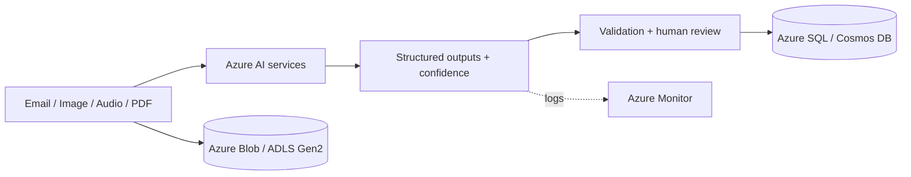
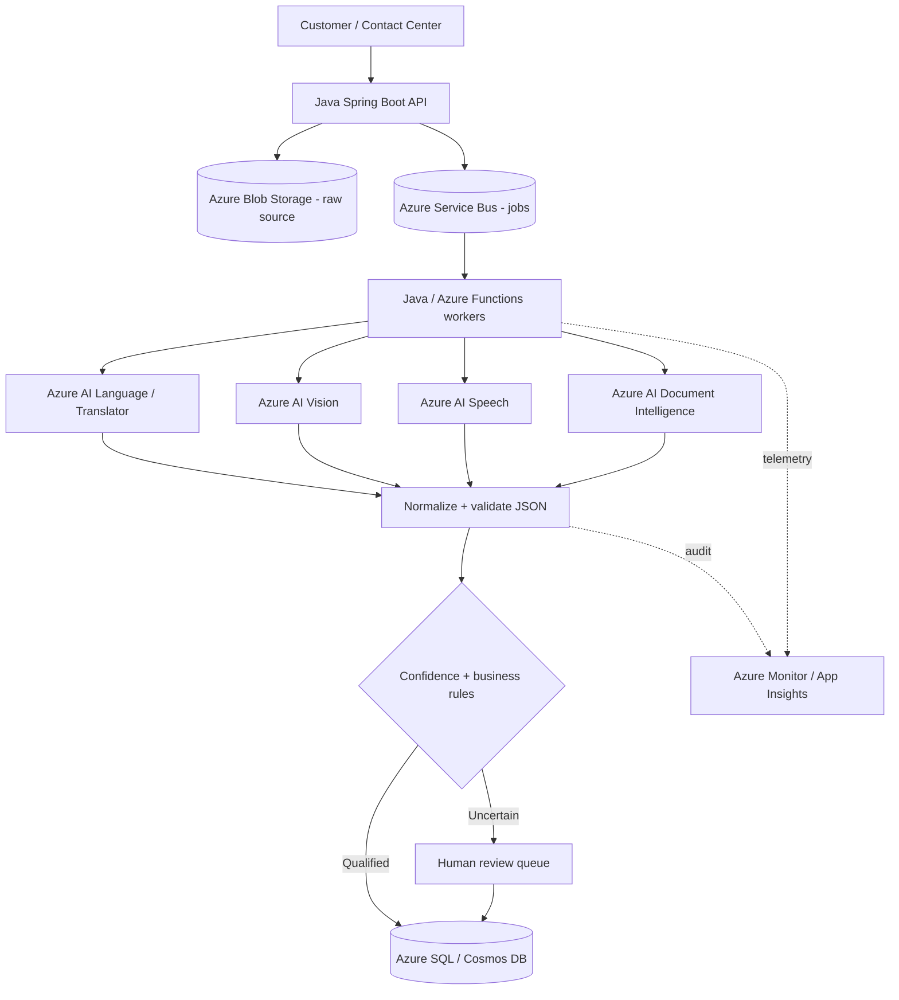
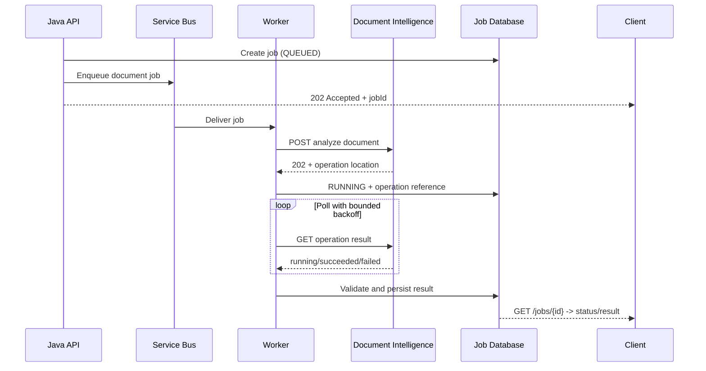
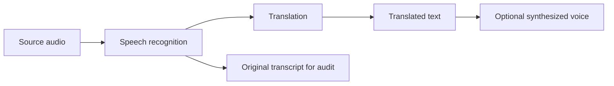
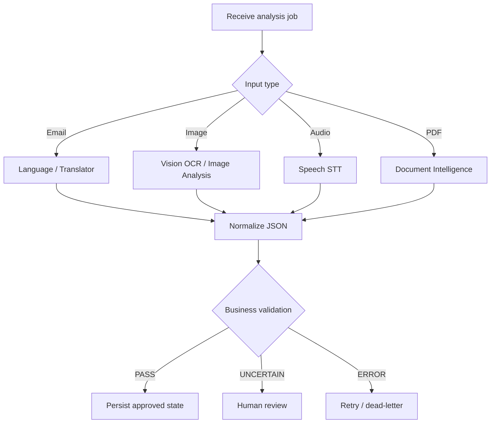
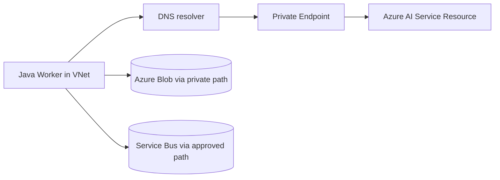

# AI Services for Language, Vision, Speech, and Documents

An after-sales enterprise receives requests across multiple channels: **Vietnamese emails**, **photos of defective products**, **recorded phone calls**, and **PDF invoices**. Staff must read the contents, classify issues, summarize exchanges, extract invoice numbers, and route cases to the right team. If the enterprise built a custom model from scratch for every data type, it would have to prepare training datasets, inference infrastructure, security, version control, and quality monitoring for each one.

On Microsoft Azure, **Azure AI services** provide managed AI capabilities for targeted needs: **Azure AI Language** processes text, **Azure AI Translator** translates languages, **Azure AI Vision** analyzes images, **Azure AI Speech** recognizes and synthesizes speech, and **Azure AI Document Intelligence** reads and extracts structured information from documents. These services integrate via REST APIs/SDKs alongside **Microsoft Entra ID**, Azure Storage, Azure Functions, Service Bus, App Service, Azure Monitor, and other platform components.

This lesson belongs to the **AI and Machine Learning on Azure** chapter of the **CLOUD_PROVIDERS_AZURE** module, focused on deploying, monitoring, securing, and controlling costs for an application architecture on Azure. The spotlight is on **"AI Services for Language, Vision, Speech, and Documents"**: understanding capabilities, service selection, data flows, Java examples, and the boundaries needed to use AI outputs safely in business operations.

> **Note on naming and versions:** Azure documentation and portals may use names such as Azure AI services, Azure AI Language, Azure AI Vision, Azure AI Speech, Azure AI Document Intelligence, or legacy names like Cognitive Services/Form Recognizer. API versions, models, supported regions/languages, SDK packages, authentication modes, and pricing change over time. Examples below use placeholders and point out what must be confirmed on your real resource, without assuming every feature is supported in every region or SKU. This lesson does not execute live commands against a subscription.

## Learning Objectives

After studying this lesson, you will be able to:

1. Distinguish AI services for **language**, **translation**, **vision**, **speech**, and **documents**.
2. Choose **prebuilt AI services** instead of training custom models when a task is a good fit.
3. Understand the differences between **OCR**, image classification/tagging, layout extraction, and invoice field extraction.
4. Design a pipeline converting emails, images, audio, and PDFs into structured data for a Java application.
5. Call Azure AI Language from Java and use the Speech SDK and REST APIs for appropriate tasks.
6. Design **synchronous**, **asynchronous/long-running**, and large-file processing workflows.
7. Use Microsoft Entra ID/managed identity where available, while protecting API keys, tokens, and sensitive data.
8. Understand network isolation, Private Endpoints, DNS, and outbound connectivity to AI services.
9. Establish quality evaluation using benchmark datasets, confidence scores, human review, and drift monitoring.
10. Handle 401/403/429/5xx errors, latency, retries, idempotency, and downstream dependencies.
11. Estimate costs by operation type, page count, audio minutes, image count, and text volume.
12. Build an end-to-end operational workflow with monitoring and reconciliation.

## 1. From Raw Data to Reusable AI Capabilities

Information systems commonly receive data in four primary forms:

| Input Type | Examples | Common AI Tasks | Outputs |
|---|---|---|---|
| **Text** | Emails, tickets, customer feedback | Sentiment, key phrases, entities, PII, classification, language detection | Language, labels, entities, scores/confidence |
| **Images** | Product photos, field photos, signage | Image analysis, tags, object detection, OCR | Labels, bounding boxes, text |
| **Speech** | Contact center calls, live voice | Speech-to-text, text-to-speech, speech translation | Transcripts, timestamps, synthesized audio |
| **Documents** | PDF invoices, contracts, forms | OCR + layout, tables, key-value fields, document classification | JSON with fields, tables, locations, confidence |

An **AI service** accepts input and produces inference output. That output is not guaranteed to be 100% accurate. Therefore, the application must ask: **Is the result reliable enough, business-valid, and permitted to trigger an automated decision, or must a human review it?**

### Do Not Equate an AI Service with a Database

A content-analysis service **is not an authoritative data store**. A PDF invoice must be retained in storage per policy, extracted results must be versioned and traced, and the business system remains responsible for verifying amounts, vendors, and payment status.



## 2. How Do Prebuilt Services, Custom Models, and Generative AI Differ?

Three common approaches exist:

1. **Prebuilt AI API:** calls out-of-the-box capabilities such as sentiment, OCR, speech recognition, or prebuilt invoice extraction without training a model from scratch.
2. **Customizable model:** labels organizational data and trains/configures a service-supported model, such as custom document extraction, custom classification, or custom language tasks.
3. **Generative AI / foundation model:** uses a generative language or multimodal model to summarize, answer questions, and reason flexibly via an authorized platform/deployment.

| Criterion | Prebuilt | Custom Model | Generative Model |
|---|---|---|---|
| Setup | Fast for standardized tasks | Needs labeled/evaluation datasets | Needs prompts, grounding, evaluation, policies |
| Output | Usually a specialized schema | Domain/label-specific schema | Flexible, but can be inconsistent |
| Development cost | Relatively low | Labeling, training, and maintenance effort | Prompt engineering, guardrails, inference budget |
| Examples | Sentiment, OCR, invoice extraction | Extracting industry-specific forms | Multi-doc summaries, support conversations |
| Risks | Misclassified entities, language/image edge cases | Overfitting, data drift, bias | Hallucinations, prompt injection, wrong sources |

**Rule of thumb:** for straightforward tasks with a specialized API and stable schema, evaluate **prebuilt** first. Train a custom model only when evaluation metrics prove prebuilt falls short. Generative AI excels at open-ended tasks, yet financial and legal outputs still require deterministic validation rules.

### Difference from Azure Machine Learning

**Azure Machine Learning** focuses on the lifecycle of training, registering, deploying, and monitoring ML models. Azure AI services primarily provide **ready-to-use inference APIs**. The two complement each other, but they are not the same product.

## 3. Selecting a Service by Desired Input and Output

| Business Question | Service to Evaluate First | Notes |
|---|---|---|
| Is a customer email positive or negative? | Azure AI Language – sentiment | Sentiment does not equal urgency |
| Detect company names, products, or locations? | Azure AI Language – NER | Needs domain-specific validation |
| Find phone numbers, emails, or PII in text? | Azure AI Language – PII detection | May miss edge cases; still needs privacy controls |
| Detect language and translate to Vietnamese? | Language detection + Azure AI Translator | Terminology and proper nouns need checking |
| Analyze the contents of a product photo? | Azure AI Vision | Feature/model/region availability varies |
| Read text on a photo or sign? | Azure AI Vision OCR/Read | Does not include an invoice schema automatically |
| Transcribe call recordings into text? | Azure AI Speech – speech-to-text | Sensitive to audio quality, accents, and language |
| Generate spoken automated replies? | Azure AI Speech – text-to-speech | Control voice selection, licensing, and consent |
| Extract invoice ID, date, and total from a PDF? | Azure AI Document Intelligence – prebuilt invoice | Does not determine invoice validity on its own |
| Extract tables/cells and coordinates in a contract? | Document Intelligence – layout/read | Output is structural; requires post-processing |
| Classify proprietary enterprise forms? | Document Intelligence custom classification/extraction | Requires training/validation data |
| Natural-language Q&A across many documents? | AI Search + generative AI/RAG, if needed | Different from fixed-schema field extraction |

**A PDF input does not automatically require Document Intelligence.** If you only need plain text content, OCR/Read may suffice; if you need **fields, tables, bounding regions, and confidence**, Document Intelligence is a better fit.

## 4. Multimodal Integration Architecture on Azure

Scenario: an after-sales portal runs Spring Boot, receiving customer emails, equipment photos, call recordings, and PDF invoices.



### Distinct Layer Responsibilities

- **Spring Boot API:** authenticates senders, checks file types/sizes/permissions, creates jobs, and exposes job status.
- **Blob Storage:** retains original files with malware scanning, access controls, and retention policies.
- **Service Bus:** decouples upload ingestion from potentially slow inference calls.
- **Workers:** invoke the right AI service with timeouts, retries, quotas, and idempotency.
- **Normalize/validate:** maps each service's response into the enterprise schema.
- **Human review:** handles low-confidence outputs or sensitive records.
- **Database:** persists job state, validated results, versions, and audit records.
- **Monitor:** correlates request IDs and job IDs across dependencies and costs.

### Why Not Call Every Service Inside One HTTP Request?

A multi-page PDF or long audio file often requires **long-running analysis**. If the API blocks inside a single HTTP call, clients time out, retries duplicate work, and callers cannot tell whether processing finished. Decoupling with queues and jobs enables status tracking and clean recovery.

## 5. Azure AI Language: Analyzing Text Content

**Azure AI Language** provides managed NLP (*Natural Language Processing*) capabilities, with feature and language support varying by task:

- **Language detection:** identifies the language of text.
- **Sentiment analysis / opinion mining:** estimates positive, negative, or neutral sentiment and can extract aspect-level opinions where supported.
- **Named Entity Recognition (NER):** detects organizations, locations, people, products, or model-supported entity types.
- **Key phrase extraction:** extracts central concepts and phrases.
- **PII detection:** locates certain personally identifiable information types in text and supports redaction.
- **Summarization, classification, conversational language understanding, or question answering:** depending on supported features, projects, regions, and APIs.

### Example

Input:

```text
I bought an air purifier on 18/11 in Hanoi.
The device has a power fault, and I am very disappointed.
Please contact me at khachhang@example.com.
```

Illustrative output:

```json
{
  "language": "vi",
  "sentiment": "negative",
  "keyPhrases": ["air purifier", "power fault"],
  "entities": [
    {"text": "Hanoi", "category": "Location"}
  ],
  "piiCandidates": [
    {"text": "khachhang@example.com", "category": "Email"}
  ]
}
```

**This is a normalized mock output**, not a verbatim JSON response guaranteed by a specific API version. Exact labels, confidence scores, and span offsets must be parsed from real API responses.

### Sentiment vs. Ticket Priority

An email with negative sentiment is not automatically a P1 incident. Severity must be driven by **business rules** such as safety hazards, critical equipment, SLAs, and downtime—not sentiment scores alone.

## 6. NER, Key Phrases, and PII: Three Distinct Tasks

Example sentence: "An Binh Company in Da Nang wants to replace a device, contact 0900000000."

| Task | Expected Output | Pitfalls |
|---|---|---|
| **NER** | Organization, location, person name | Model may confuse brand names with people |
| **Key phrases** | "replace a device", "faulty device" | Does not prove an order ID |
| **PII** | Phone number, email, national ID | False positives and false negatives |
| **Entity linking** (if supported) | Links entities to knowledge bases | Needs source and language verification |
| **Custom classification** | Labels like "return", "warranty", "complaint" | Requires labeled schemas and training if custom |

### Essential Post-Processing

- Never log raw PII into logs or events.
- Redact content before passing it to downstream processors that do not need it.
- Ensure character offsets align with **Unicode/UTF-16/code points** per SDK/API rules, especially for Vietnamese text.
- Validate order IDs against your database using regex/business validation rather than trusting an NLP "Number" entity.
- Define manual review triggers when sensitive data is detected or mandatory entities are missing.

**PII detection does not guarantee 100% removal of personal data.** Regulated workloads require layered protections: ACLs, masking, DLP, retention, auditing, and manual verification where required.

## 7. Sentiment, Opinion Mining, and Vietnamese Quality

A single sentence can express mixed opinions:

```text
Delivery was very fast, but the product broke easily and support was slow.
```

Overall sentiment may score neutral or negative depending on the model; **opinion mining** (where supported) separates individual aspects: delivery positive, product negative, support negative.

### Evaluating NLP Results

1. Collect text samples covering regional dialects and varied writing styles.
2. Confirm the target language is supported for the **specific task**.
3. Have domain-literate reviewers assign ground-truth labels.
4. Build confusion matrices across ticket categories and severity levels.
5. Measure accuracy/precision/recall/F1 rather than eyeballing a few good examples.
6. Test errors on regional terms, slang, abbreviations, and code-switched English.
7. Monitor drift as product catalogs or customer phrasing evolve.
8. Audit for bias or unfairness if outputs influence customer-facing decisions.

Never use sentiment automatically to **deny support** or impose adverse terms on someone without business justification, verification, and an appeal path.

## 8. Custom Text Classification, CLU, and Question Answering

When business labels do not match prebuilt categories, evaluate **custom text classification** or **Conversational Language Understanding (CLU)** in Azure AI Language per current capabilities.

### Email Classification Example

```text
Intent:
- WarrantyClaim
- ReturnRequest
- DeliveryTracking
- InvoiceCorrection
- Other

Entities:
- orderId
- productSku
- requestedDate
- complaintReason
```

### Customization Workflow

1. Define unambiguous ticket category labels.
2. Gather authorized data and remove/redact PII wherever possible.
3. Label samples and measure inter-annotator agreement.
4. Split train/validation/test sets while preventing leakage across the same customer or transaction.
5. Train and deploy the project/model per supported feature workflows.
6. Measure false positives and false negatives on critical classes.
7. Set confidence thresholds and manual review fallbacks.
8. Monitor performance/drift and maintain version rollback procedures.

**Question answering over a knowledge base** does not mean a chatbot inherently knows every return policy. Source documents must stay maintained, versioned, and owned; answers must still enforce access rights and current versions.

## 9. Azure AI Translator: Translating Text and Documents

**Azure AI Translator** translates text via API across service-supported languages. Some workflows also use **document translation** or custom terminology features.

### Illustrative Flow

```text
Japanese email
    → Detect source language (if needed)
    → Translator: Japanese → Vietnamese
    → Azure AI Language: classify intent/sentiment
    → Human reviewer / CRM
```

### Key Design Choices

- If the source language is already known, specify it explicitly to avoid misdetection.
- Decide whether to translate **before** or **after** language analysis; translation can alter nuance, proper nouns, or idioms.
- Retain both **original text and translation** per retention/security policies so reviewers can cross-check disputes.
- Use a **glossary/termbase** for product names and medical, technical, or legal terms where supported.
- Never treat machine translation as a final legal contract or safety instruction without specialist review.

### Input Example

```json
[
  {"text": "The device stopped working after two days."}
]
```

Sample translation result:

```text
“Thiết bị ngừng hoạt động sau hai ngày.”
```

Phrasing may vary by model, context, and version. Never hard-code exact expected translation strings as brittle "exact match" tests.

## 10. Azure AI Vision: Understanding Images

**Azure AI Vision** offers computer vision capabilities such as **image analysis, image tags, object detection, OCR/read**, and specialized features depending on resource, region, and model.

A photo of a damaged air conditioner might return tags like:

```json
{
  "tags": [
    {"name": "air conditioner", "confidence": 0.88},
    {"name": "indoor unit", "confidence": 0.74}
  ],
  "objects": [
    {"name": "air conditioner", "boundingBox": [42, 20, 450, 300]}
  ]
}
```

This is an **illustrative output**, not the exact JSON schema of a specific API version.

### What AI Vision Can and Cannot Do

- Recognizes common objects, tags, or visible scenes.
- Performs OCR on printed/displayed text in images per feature support.
- Detects bounding boxes/regions depending on the model.
- Can **suggest equipment categories** to assist a worker.

However:

- It cannot diagnose the exact **root electrical failure** from a single photo alone.
- It cannot deduce from an image that a product "qualifies for replacement" under contract.
- It does not replace professional or safety inspection.
- It does not guarantee detecting small, occluded, or poorly lit objects.
- Features like image captioning or object detection have **separate availability and limits**; verify before choosing.

## 11. Where Do Vision OCR and Document Intelligence Differ?

**OCR (Optical Character Recognition)** extracts text from images or files. However, enterprises usually need more than raw text.

| Goal | Vision OCR/Read | Document Intelligence |
|---|---|---|
| Read text from signs or product photos | Good fit | Possible, though often unnecessary |
| Read text from a document page | Possible depending on model | Read/layout usually fits better |
| Extract tables, rows, and page coordinates | Limited by feature | **Layout** specializes in document structure |
| Extract vendor, invoice ID, and total amount | Requires custom text parsing | **Prebuilt invoice** outputs semantic fields |
| Classify proprietary business forms | Not its primary purpose | Custom classification/extraction |
| Character/word bounding polygons | May be available | Provided per model/page/field |
| Multi-page PDF files | API/model dependent | Dedicated analyze document workflows and limits |
| Quality on complex scans | Needs testing | Built for documents, though errors still occur |

### Example

OCR text:

```text
ABC COMPANY
INVOICE NO: INV-2026-034
Date: 20/11/2026
Total: 2,350,000 VND
```

Desired Document Intelligence output:

```json
{
  "vendorName": "ABC COMPANY",
  "invoiceId": "INV-2026-034",
  "invoiceDate": "2026-11-20",
  "totalAmount": 2350000,
  "currency": "VND"
}
```

This is **illustrative business-normalized JSON**. A real model may omit fields, return multiple candidate values, or report low confidence. Critical fields must be reconciled against ERP/tax records and the source PDF.

## 12. Azure AI Document Intelligence: Analyzing Documents

**Azure AI Document Intelligence** (formerly Form Recognizer) analyzes structured, semi-structured, or unstructured documents using supported models:

- **Read:** extracts text, coordinates, and pages per model.
- **Layout:** extracts paragraphs, tables, layout structure, selection marks, and supported elements.
- **Prebuilt invoice:** extracts invoice fields such as vendor, invoice ID, date, amount, and line items.
- **Prebuilt receipt/ID/document-specific models:** specialized capabilities per document type and region.
- **Custom extraction:** trains field extraction tailored to an organization's forms.
- **Custom classification:** identifies document types before extracting fields.
- **Composed models or orchestration options:** handles multiple templates depending on API/version support.

### PDF Invoice Processing Workflow

1. Receive the file from the user and verify permissions.
2. Validate MIME/magic bytes, file size, file type, page count, and scan for malware.
3. Store the Blob under least-privilege credentials.
4. Worker calls **prebuilt invoice** or an evaluated custom model.
5. Capture the job ID/result URL and poll status if the API is long-running.
6. Extract fields, values, confidence scores, and bounding locations.
7. Validate amounts, tax IDs, currency, dates, vendor master data, and duplicate invoices.
8. Route uncertain records to human reviewers.
9. Create accounting entries only after approval.
10. Persist audit trails: model ID/version, request/job ID, source file, and reviewer decision.

### Never Treat Confidence as Legal Certainty

Model confidence is a statistical signal from the model, **not proof that an invoice is valid**. OCR can read every digit accurately on a forged invoice or one that was already refunded. Business validation is always mandatory.

## 13. Prebuilt Invoice, Receipt, Layout, or Custom Model?

| Need | Starting Point | When to Change |
|---|---|---|
| Standard PDF invoices | Prebuilt invoice | Specialized fields or tax formats fail accuracy targets |
| Retail receipts | Prebuilt receipt | Receipt formats are poorly recognized |
| Multi-table / multi-column documents | Layout | Need semantic understanding of specific fields |
| Pure text scanning | Read | Need structured tables, fields, or semantics |
| Industry-specific contracts | Layout + rules or custom extraction | Prebuilt lacks required business labels |
| Mixed form types in one inbox | Custom classification + extraction | Need routing by document type |
| Natural-language Q&A over long docs | Document extraction + RAG/generative layer | Must add grounding, authorization, and evaluation |

### Model Evaluation Process

Assemble a representative document set covering:

- Native PDFs and phone-camera scans.
- Skewed images, dim lighting, tiny fonts, and multi-page files.
- Vietnamese, English, and multilingual fields.
- Invoices with multi-line tables, multiple tax rates, and totals.
- Different vendor templates.
- Cases **missing mandatory fields**.
- Malformed/invalid invoices or extra pages.
- Sensitive documents authorized under consent/policy.

Split test sets by **vendor/template**, rather than randomly shuffling pages from the same template across train and test.

## 14. Long-Running Document Analysis and Polling

Unlike a small sentiment request that returns immediately, multi-page document processing typically runs as a **long-running operation (LRO)**.



### States to Persist

```text
QUEUED -> SUBMITTED -> RUNNING -> SUCCEEDED
                              -> NEEDS_REVIEW
                              -> FAILED
                              -> CANCELLED (if supported at app level)
```

**Never hold a user's HTTP request open indefinitely** while polling. In a queue-driven workflow, store the operation reference securely, configure polling retries/backoff and an absolute timeout, and emit an event on completion.

### Idempotency

If Service Bus redelivers a job after a worker crash, the system must know **whether the document/job was already submitted** so it does not submit duplicate Analyze requests and pay twice. Persist job state and operation IDs with transactional/lease semantics—never in an instance's in-memory map.

## 15. Azure AI Speech: Converting Speech to Text

**Azure AI Speech** provides capabilities such as:

- **Speech-to-text (STT):** recognizes speech from microphones or audio recordings.
- **Real-time recognition:** transcribes streaming audio as it arrives.
- **Batch transcription / fast transcription:** processes recorded audio files where supported.
- **Text-to-speech (TTS):** synthesizes audio from plain text or SSML.
- **Speech translation:** recognizes and translates speech across supported languages.
- **Speaker identification/diarization**, phrase hints, or custom speech depending on feature, resource, and region.
- **Pronunciation assessment** and specialized tasks where supported.

### Contact Center Scenario

A 7-minute recording captures a customer call. The system needs to:

1. Verify consent and authorization to process the recording.
2. Store the audio securely.
3. Select language/locale (e.g., `vi-VN`) if supported.
4. Transcribe into text with timestamps.
5. Separate speaker turns if diarization is supported.
6. Use Language to analyze intent/sentiment/PII if business-justified.
7. Save the redacted transcript and enforce retention policies.
8. Let staff verify tricky words, device codes, or critical details.

### Transcripts Can Contain Errors

Regional accents, background noise, overlapping speakers, technical jargon, and heavy audio compression can cause recognition errors. Never rely on an unreviewed transcript as sole proof in financial or legal disputes.

## 16. Speech-to-Text: Streaming, Single Utterance, and Batch

| Mode | Use Case | Watch-Outs |
|---|---|---|
| **Recognize once / single utterance** | Short voice commands, brief clips | Not suitable for long files |
| **Continuous recognition** | Live conversations, voice assistants | Partial/final events, session lifecycle, reconnects |
| **Batch transcription** | Long call recordings, thousands of files | Async jobs, callbacks/polling, storage access |
| **Speech translation** | Meetings/calls needing live translation | Recognition errors propagate into translation |
| **Custom Speech** | Domain-specific vocabulary | Needs quality audio/text data and evaluation |

### Why Process Long Files in Batch?

A REST API receiving a long call upload should not block the connection until STT, diarization, PII redaction, and summarization all finish. Return **`202` + job ID**, save audio to Blob Storage, enqueue a job, and process in the background.

### Audio Format Is a Prerequisite

Speech SDK/REST APIs require compatible sample rates, codecs, channel counts, containers, and file sizes. Never simply rename `.mp3` to `.wav` expecting the model to read it; **transcode properly** with approved tools while keeping source metadata.

## 17. Text-to-Speech: Generating Spoken Responses

**TTS** converts text to audio for IVR prompts, guided instructions, or accessibility.

Example:

```text
“Hello. Your warranty request ORD-1001 has been received.”
```

### Options

- Select a locale/voice supported by your region and Speech resource.
- Use **SSML** to tune pronunciation, speaking rate, pauses, and emphasis where supported.
- Pick an audio output format suited to the playback device.
- Cache static announcements to cut API calls, within service terms and policies.
- Provide attribution/disclosure if regulations or product policies require informing users the voice is synthetic.
- Enforce voice usage rights and anti-impersonation policies.

### Never Speak Unverified Claims

An automated system saying "You have been approved for a 50 million VND refund" from unverified generated text poses major risk. TTS announcements must reflect **confirmed business state**, never speculative model text.

## 18. Speech Translation and Multilingual Workflows

A foreign customer's call needs Vietnamese support:



### What to Check

- Are both source and target languages supported for the **specific feature**?
- Does the translation preserve context and domain terminology?
- Do pauses, diarization, or chunking cut sentences mid-thought?
- Is PII handled/redacted per policy?
- Does consent cover recording, transcription, and sharing transcripts?
- Total cost across **STT + translation + TTS** when chaining steps.
- For live calls, end-to-end latency matters more than any single service's latency.

**A three-model pipeline does not guarantee additive quality.** STT errors cascade into translation and TTS; evaluate end-to-end quality.

## 19. Input Data: Size, Format, and Delivery Paths

Each service enforces its own input constraints:

| Service | Common Inputs | What to Verify |
|---|---|---|
| Language | UTF-8 text, documents/batches per API | Max chars/doc, batch size, language |
| Translator | UTF-8 strings/JSON or document translation | Payload limit, supported languages, region |
| Vision | Image bytes or accessible URL | File type, resolution, max size, feature support |
| Speech | PCM/WAV, audio streams, or supported encoded files | Locale, codec, sample rate, duration |
| Document Intelligence | PDF, JPEG/PNG/TIFF/Office per model/version | Page count, file size, password/encryption, model |
| Custom models | Training/test datasets | Label requirements, quotas, supported data residency |

### Byte Payload vs. URL

- **Byte payload:** convenient for small images/files without public links; cap request sizes and memory.
- **Storage URL/SAS:** fits async jobs and large files when URLs are supported, provided the service can reach the URL with minimal **permissions and short expiry**.
- **Managed identity / private link:** preferred where supported, verifying data-plane RBAC and network access **from the AI service to Storage**.
- **Service Bus messages:** carry only job metadata and Blob references—**never stuff a 200 MB file into a queue message**.

### Never Accept Files by Extension Alone

Validate MIME/magic bytes, enforce file-type allowlists, scan for malware and decompression bombs, cap file size/page count, and check authorization before calling any AI service. For sensitive documents, store under opaque IDs rather than embedding PII in Blob object keys.

## 20. A Unified Result Schema Across All Services

Because each Azure AI API returns a different shape, the backend should normalize outputs into one business schema:

```json
{
  "jobId": "job-20261120-001",
  "source": {
    "kind": "invoice_pdf",
    "blobRef": "cases/2026/11/job-20261120-001/input.pdf"
  },
  "analysis": {
    "provider": "Azure AI Document Intelligence",
    "modelId": "prebuilt-invoice",
    "modelVersion": "<RESOLVED_VERSION>",
    "confidence": 0.92,
    "fields": {
      "invoiceId": "INV-0001",
      "currency": "VND",
      "totalAmount": 2350000
    }
  },
  "validation": {
    "status": "NEEDS_REVIEW",
    "reasons": ["Vendor not yet verified"]
  }
}
```

This is an **application-defined schema**, not a raw Azure API response you can expect verbatim.

### Key Fields

- **`jobId`/`documentId`** for idempotency and correlation.
- **`provider`/`model`/`version`/API version** to track how model upgrades affect results.
- **Source hash / Blob reference** for reconciliation without duplicating payloads.
- **Per-field confidence and location** where provided—not just one overall score.
- **Business validation** kept separate from inference output.
- **Reviewer/audit events** for approvals or manual corrections.
- **Retention/deletion** and sensitivity classification.

### Never Equate Confidence Across Models

An OCR score of `0.92` does not mean "92% probability the invoice is valid," nor is it comparable to a `0.92` sentiment score. Each model and task needs **separate calibration and thresholds** on real datasets.

## 21. Preparing AI Resources and Endpoints on Azure

Before writing code, identify **which service, resource, region, and endpoint type** your application needs.

An enterprise might use:

- One or more **Azure AI services multi-service resources** for supported capabilities.
- **Single-service resources** when isolating quotas, billing, networking, data residency, or feature support.
- A **Speech** resource in a supported region.
- A **Document Intelligence** resource with its corresponding endpoint and models.
- Blob/Service Bus/SQL resources for files, queues, and state.

**Not every model or Speech/Document Intelligence feature runs on a single shared endpoint.** Verify resource names, SKUs, capabilities, API versions, and regional availability.

### Environment Configuration Example

```text
AZURE_SUBSCRIPTION_ID=<SUBSCRIPTION_ID>
AZURE_RESOURCE_GROUP=<AI_RESOURCE_GROUP>

AI_LANGUAGE_ENDPOINT=https://<LANGUAGE_RESOURCE_ENDPOINT>
AI_VISION_ENDPOINT=https://<VISION_RESOURCE_ENDPOINT>
AI_DOCUMENT_ENDPOINT=https://<DOCUMENT_RESOURCE_ENDPOINT>

SPEECH_REGION=<REGION_IDENTIFIER>
AZURE_STORAGE_ACCOUNT=<STORAGE_ACCOUNT>
SERVICE_BUS_NAMESPACE=<NAMESPACE>.servicebus.windows.net
```

These values are **intentional placeholders**. Endpoints may be resource-specific URLs or regional endpoints depending on the API; never guess hostnames from a resource group name.

### Azure Portal: Pre-Creation / Pre-Call Checks

1. Select the subscription, resource group, and approved region.
2. Verify service kind, SKU/tier, and feature availability.
3. Confirm **supported languages** for the task, especially `vi`/`vi-VN` when needed.
4. Check **pricing meters** and quotas per subscription/region.
5. Check network rules, public access, Private Endpoints, and application topology.
6. Configure identity, access control, and diagnostic settings.
7. Record **keyless endpoints** alongside chosen model and API versions.
8. Test on a lab resource before granting production access.

### Never Confuse Management Endpoints with Inference Endpoints

**Azure Resource Manager** creates and edits resources. **Data-plane endpoints** receive text, images, audio, or documents. Azure RBAC Contributor on a resource does not automatically grant data-plane inference rights across every API.

## 22. Java SDK: Sentiment Analysis with Azure AI Language

Scenario: upon receiving an email, a Java worker checks sentiment to assist triage—**without making final decisions automatically**.

### Maven Dependency (Snippet)

```xml
<dependency>
  <groupId>com.azure</groupId>
  <artifactId>azure-ai-textanalytics</artifactId>
  <version><!-- PIN_COMPATIBLE_VERSION --></version>
</dependency>
```

Select a supported SDK version compatible with your JDK and features; this snippet is not a complete `pom.xml`.

### Java Code with Key from Environment

```java
package vn.example.azure.ai;

import com.azure.ai.textanalytics.TextAnalyticsClient;
import com.azure.ai.textanalytics.TextAnalyticsClientBuilder;
import com.azure.ai.textanalytics.models.DocumentSentiment;
import com.azure.core.credential.AzureKeyCredential;

public final class LanguageSentimentDemo {

    private LanguageSentimentDemo() {}

    public static void main(String[] args) {
        String endpoint = requiredEnv("AI_LANGUAGE_ENDPOINT");
        String apiKey = requiredEnv("AI_LANGUAGE_KEY");

        TextAnalyticsClient client = new TextAnalyticsClientBuilder()
            .endpoint(endpoint)
            .credential(new AzureKeyCredential(apiKey))
            .buildClient();

        String input =
            "Sản phẩm bị lỗi nguồn và tôi rất thất vọng."; // "The product has a power fault and I am very disappointed."

        DocumentSentiment result =
            client.analyzeSentiment(input, "vi");

        System.out.println(
            "Predicted sentiment: " + result.getSentiment());

        System.out.println(
            "Negative confidence: "
                + result.getConfidenceScores().getNegative());
    }

    private static String requiredEnv(String name) {
        String value = System.getenv(name);

        if (value == null || value.isBlank()) {
            throw new IllegalStateException(
                "Missing environment variable: " + name);
        }

        return value;
    }
}
```

### Prerequisites to Run

- The resource and SDK/API support **sentiment** for the input language in the chosen region.
- `AI_LANGUAGE_ENDPOINT` is the **full endpoint** accepted by the SDK, not just a resource name.
- `AI_LANGUAGE_KEY` is supplied via a controlled secret store/environment for **lab** use; production prefers keyless/Entra auth where supported.
- The client has DNS/TLS/network routing to the endpoint.
- The account has adequate quota and permissions.
- Results assist triage only—never conclude product defects or warranty eligibility from sentiment alone.

### Analyzing Many Emails

Do not instantiate a new client and connection per email when the SDK recommends long-lived clients. Use a Spring singleton/service, batch within API limits, enforce rate limits, and bound retries. Log **`jobId`, language, model/API version, and latency**—never raw emails or keys.

## 23. REST API: Translating Text with Translator

REST APIs are handy when a feature SDK isn't integrated yet, for polyglot apps, or when direct HTTP contract control is needed.

Example using the **Translator Text API** with a common regional endpoint pattern:

```bash
export TRANSLATOR_KEY="<SECRET_FROM_APPROVED_STORE>"
export TRANSLATOR_REGION="<RESOURCE_REGION>"

curl --request POST \
  "https://api.cognitive.microsofttranslator.com/translate?api-version=3.0&to=vi" \
  --header "Ocp-Apim-Subscription-Key: $TRANSLATOR_KEY" \
  --header "Ocp-Apim-Subscription-Region: $TRANSLATOR_REGION" \
  --header "Content-Type: application/json; charset=UTF-8" \
  --data '[{"Text":"The screen is broken."}]'
```

### Conditions

- This illustrates **text translation**, not Document Translation.
- Region headers, custom endpoints, and auth vary by resource type; verify your actual resource's endpoint and headers.
- Exporting keys into shell variables is strictly for secure test environments. **Never leave keys in scripts, shell history, CI logs, or shared transcripts**, and note that process arguments/logging can expose headers.
- The API version must be supported on that endpoint.
- Input content must be permitted for the service and within size/character quotas.

### Abbreviated Response Example

```json
[
  {
    "detectedLanguage": {"language": "en", "score": 0.99},
    "translations": [
      {"text": "Màn hình bị hỏng.", "to": "vi"}
    ]
  }
]
```

This response **illustrates structure and values only**; returned fields also depend on request flags and API version.

### Real-World Testing

Evaluate domain jargon, SKU codes, quantities, negations, and regional phrasing. Fluent translations can still **invert amounts, dimensions, or deadlines**; enforce validation before using them in contracts or safety instructions.

## 24. REST API: Analyzing Images with Azure AI Vision

For Image Analysis, some API versions expose a path like:

```text
POST <VISION_ENDPOINT>/computervision/imageanalysis:analyze
     ?api-version=<SUPPORTED_VERSION>&features=read,tags
```

Paths and feature names follow the **corresponding Image Analysis API group**; verify model, version, and region before calling. Bash example using an authorized local image:

```bash
export VISION_ENDPOINT="https://<VISION_RESOURCE_ENDPOINT>"
export VISION_KEY="<SECRET_FROM_APPROVED_STORE>"

curl --request POST \
  "$VISION_ENDPOINT/computervision/imageanalysis:analyze?api-version=<SUPPORTED_VERSION>&features=read,tags" \
  --header "Ocp-Apim-Subscription-Key: $VISION_KEY" \
  --header "Content-Type: image/jpeg" \
  --data-binary "@device_photo.jpg"
```

### If Images Contain People

- Never infer identity, sensitive attributes, or personal profiles from photos.
- **Face/biometric** capabilities carry dedicated access policies and restrictions; never treat Vision image tagging as permission to deploy facial recognition.
- Ensure proper consent, retention, and authorization, especially in HR, insurance, healthcare, or surveillance contexts.
- Never submit ID-document photos merely for demos.
- Avoid saving images in logs and reject invalid file uploads.

### Post-Processing

A `tag="damaged"` (if returned) does not prove valid warranty coverage. Cross-check invoice, customer ownership, and business rules, and route unclear photos to staff review.

## 25. REST API: Document Intelligence Prebuilt Invoice

Document Intelligence typically initiates an **analyze operation** and returns results via a long-running operation URL.

### Submit PDF

REST endpoint example for modern Document Intelligence API versions:

```bash
export DOC_ENDPOINT="https://<DOCUMENT_RESOURCE_ENDPOINT>"
export DOC_KEY="<SECRET_FROM_APPROVED_STORE>"
export DOC_API_VERSION="<SUPPORTED_DOCUMENT_API_VERSION>"

curl --include --request POST \
  "$DOC_ENDPOINT/documentintelligence/documentModels/prebuilt-invoice:analyze?api-version=$DOC_API_VERSION" \
  --header "Ocp-Apim-Subscription-Key: $DOC_KEY" \
  --header "Content-Type: application/pdf" \
  --data-binary "@invoice-sample.pdf"
```

When accepted, the response typically returns **`202 Accepted`** with a tracking URL header such as **`Operation-Location`**. Some models/API versions use different paths and options; check the documentation/Swagger for your exact resource.

### Poll Result with Backoff

```text
1. POST analyze request.
2. Capture Operation-Location / operation identifier.
3. Wait an appropriate interval or honor Retry-After if present.
4. GET operation result with valid credentials.
5. If "running" or "notStarted": wait and poll again.
6. If "succeeded": parse fields, tables, and confidence.
7. If "failed": store sanitized error and apply classified retry policy.
8. If timeout budget exceeded: persist state for worker continuation.
```

Example polling the response-supplied URL:

```bash
export OPERATION_LOCATION="<URL_FROM_OPERATION_LOCATION_HEADER>"

curl --request GET \
  "$OPERATION_LOCATION" \
  --header "Ocp-Apim-Subscription-Key: $DOC_KEY"
```

**Never construct an operation URL manually from a document ID.** Use the exact URL/identifier returned by the server. Also avoid saving headers containing keys/SAS tokens in the job database; keep only the reference and pull secrets from the secret store.

### Mapping Fields to Business Objects

Actual outputs are typically nested under `analyzeResult.documents[*].fields` or the corresponding API version's schema. The backend must:

- Verify `invoiceId` is present.
- Validate dates, amounts, currencies, and field types.
- Reconcile `sum(line items)` against total, tax, and rounding rules.
- Verify the vendor against master data.
- Detect duplicate invoices by vendor + invoice ID + business key.
- Save confidence scores and document regions/pages for reviewers.
- Never issue a payment merely because HTTP status is 200 / `succeeded`.

## 26. Java SDK: Speech Recognition with Azure AI Speech

A Java application processes a short WAV file provided with user consent. Example using the **Speech SDK for Java**.

### Maven Dependency

```xml
<dependency>
  <groupId>com.microsoft.cognitiveservices.speech</groupId>
  <artifactId>client-sdk</artifactId>
  <version><!-- PIN_COMPATIBLE_SPEECH_SDK_VERSION --></version>
</dependency>
```

### Java Code

```java
package vn.example.azure.ai;

import com.microsoft.cognitiveservices.speech.ResultReason;
import com.microsoft.cognitiveservices.speech.SpeechConfig;
import com.microsoft.cognitiveservices.speech.SpeechRecognitionResult;
import com.microsoft.cognitiveservices.speech.SpeechRecognizer;
import com.microsoft.cognitiveservices.speech.audio.AudioConfig;

import java.util.concurrent.ExecutionException;

public final class SpeechRecognitionDemo {

    private SpeechRecognitionDemo() {}

    public static void main(String[] args)
            throws ExecutionException, InterruptedException {

        String key = required("SPEECH_KEY");
        String region = required("SPEECH_REGION");
        String audioPath = required("AUDIO_WAV_PATH");

        SpeechConfig config = SpeechConfig.fromSubscription(
            key, region);
        config.setSpeechRecognitionLanguage("vi-VN");

        AudioConfig audio = AudioConfig.fromWavFileInput(audioPath);
        SpeechRecognizer recognizer =
            new SpeechRecognizer(config, audio);

        SpeechRecognitionResult result = null;

        try {
            result = recognizer.recognizeOnceAsync().get();

            if (result.getReason() == ResultReason.RecognizedSpeech) {
                System.out.println("Recognized: " + result.getText());
            } else {
                System.out.println(
                    "Recognition did not return speech: "
                    + result.getReason());
            }
        } finally {
            if (result != null) {
                result.close();
            }
            recognizer.close();
            audio.close();
            config.close();
        }
    }

    private static String required(String name) {
        String value = System.getenv(name);
        if (value == null || value.isBlank()) {
            throw new IllegalArgumentException(
                "Missing environment variable: " + name);
        }
        return value;
    }
}
```

### Limitations of This Example

- `recognizeOnceAsync` is meant for **short utterances**, not long contact-center recordings.
- Files must use an audio format supported by the Speech SDK; never fake file extensions.
- Use locale `vi-VN` only after confirming support in your feature, region, and model.
- The key is injected via the lab environment, never source code; production should evaluate token/identity auth per SDK support.
- Requires Speech SDK native dependencies matching your OS/JDK and local file permissions.
- Test against accented Vietnamese and real consented recordings.
- Production code must inspect `CancellationDetails`, error codes, and classify transient vs. permanent errors.

For **continuous recognition**, use event callbacks and async sessions with full lifecycle management. For **batch transcription**, use the dedicated job API—never loop `recognizeOnce` over long files pretending it is diarization.

## 27. Designing a Java Worker Calling Multiple AI Services

A worker should call only the service needed for the given input type:



### Java-Style Pseudocode

```java
// Conceptual skeleton, not a complete runnable project.
public final class AnalysisWorker {

    public AnalysisOutcome process(AnalysisJob job) {
        verifyAuthorizationAndFileMetadata(job);

        RawAiResult raw = switch (job.inputType()) {
            case EMAIL -> languageService.analyze(job.blobRef());
            case IMAGE -> visionService.analyze(job.blobRef());
            case AUDIO -> speechService.transcribe(job.blobRef());
            case PDF   -> documentService.analyze(job.blobRef());
        };

        AnalysisOutcome normalized = normalizer.normalize(raw);
        validationService.check(normalized);

        return normalized;
    }
}
```

This is **pseudocode**, as dependency fields, types, and error handling are omitted. The key value is **separation of responsibilities**—never cramming credentials, REST calls, business validation, and persistence into one controller.

### Ensuring Valid Data Sources

A queued job carrying `blobRef` must verify tenant ownership, `inputType`, and content hash. Never accept an arbitrary client-supplied Blob URL and let managed identity read any path; that enables **cross-tenant data access** or SSRF if the service fetches unvalidated URLs.

## 28. Authentication: API Keys, Microsoft Entra ID, and Managed Identity

Azure AI APIs differ in supported authentication modes. Distinguish **credentials for the AI resource** from **permissions to read source data**.

| Mechanism | When Used | Notes |
|---|---|---|
| **API key** | Labs, legacy SDKs, or features requiring keys | Broadly scoped secret; store in Key Vault and rotate |
| **Microsoft Entra token** | Features/data-plane SDKs supporting Entra auth | Requires proper role, scope/audience, and tenant |
| **Managed identity** | App Service/Functions/AKS/VMs on Azure | Needs data-plane roles and proper network path |
| **SAS URL** | Temporary Blob access for URL-accepting tasks | Least privilege, short expiry, never log URLs |
| **Storage managed identity** | AI service reads Blob directly when supported | Needs Storage data roles and network support |

### Prefer Keyless When Available

With the Azure SDK for Java, `DefaultAzureCredential` or managed identity works for services/SDKs supporting `TokenCredential`.

```java
import com.azure.identity.DefaultAzureCredentialBuilder;

var credential = new DefaultAzureCredentialBuilder().build();
```

That line only builds the credential chain. **Do not assume every Text Analytics, Vision, Speech, or Document Intelligence endpoint becomes keyless automatically** if the SDK, API, or resource does not yet support that auth flow. Check the **specific feature's** requirements.

### Scope and Roles

Many Azure AI services accept a token audience/scope shaped like:

```text
https://cognitiveservices.azure.com/.default
```

This is a common scope example for Azure AI services, **not a universal constant for every Azure service**. The principal also needs the matching Azure RBAC role/data-plane permission, such as **Cognitive Services User** where appropriate; verify roles and permissions on the actual resource.

### Storage Permissions vs. AI Permissions

A worker may hold permission to call Language while lacking permission to read Blobs. Conversely, `Storage Blob Data Reader` does not grant permission to call AI APIs. Grant the identity **each required permission** under least privilege.

## 29. Networking: Public Access, Private Endpoints, and DNS

High-security architectures can enable **Private Endpoint / Private Link** for Azure AI resources where supported by tier and feature.



### End-to-End Requirements

1. The Java worker has **outbound VNet networking** (App Service VNet Integration, AKS/VM/Functions plan support).
2. The Private Endpoint is created and approved on the AI resource.
3. The endpoint FQDN resolves via **private DNS** from the application's actual network.
4. NSGs/UDRs/firewalls allow TCP/TLS to the endpoint and return traffic.
5. Authentication remains mandatory even over private IPs.
6. If the AI service reads Blobs by URL, **the AI service also needs a valid network path**; the Java app having a Private Endpoint to Blob does not prove the AI service can reach it.
7. Regional or custom subdomains (Language, Speech, Document Intelligence) must configure DNS/networking per feature requirements.

### Never Guess DNS

Some Azure AI services use Private Link DNS under `privatelink.cognitiveservices.azure.com`, while product-specific endpoints use **different zones or hostnames**. Obtain exact DNS zone groups and records from the resource and feature documentation. Never hard-code IPs or create ad-hoc CNAMEs without understanding TLS/SNI.

### Two Independent Network Directions

**Client → AI inference endpoint** is separate from **AI service → Storage URL (when the API fetches files itself)**. A REST Analyze call can succeed initially and then fail because the AI resource cannot fetch a Blob SAS URL due to firewalls or expiry—an upstream data-path failure rather than an SDK bug.

## 30. Personal Data Protection, Retention, and Compliance

Text, images, audio, and PDFs often contain far more PII and sensitive information than metadata alone.

### Layered Controls

- **Collection:** consent/lawful basis, purpose notice, and scope limits.
- **Upload:** TLS, authentication, antivirus/malware scanning, file type/size limits.
- **Storage:** encryption at rest, key management, access scope, retention.
- **Processing:** choose compliant regions and data residency per contracts.
- **AI inference:** send only necessary data; redact wherever possible.
- **Results:** per-field permissions, review notes, masking, and auditing.
- **Logs:** never write transcripts, audio, raw invoices, or access tokens into default telemetry.
- **Deletion:** delete original files, derived outputs, caches, search indexes, and replicas per policy.
- **Vendor terms:** verify data handling, retention, abuse monitoring, and model-training terms for your **exact feature and agreement**.

### Never Assume "AI Only Keeps Results and Discards Inputs"

How data is processed and retained depends on product, feature, mode, and contract. Always verify **current data privacy documentation** rather than making blanket claims across all Azure AI services.

### Human Review of Sensitive Documents

Restrict who can view original PDFs or photos, log reviewer views and edits, expose only fields needed for the decision, and block downloading sensitive documents to personal devices outside approved workflows.

## 31. AI Safety, Fairness, and Application Responsibility

Even specialized APIs can cause harm when outputs are wrong or misused.

### Risk Examples

| Task | Risk | Mitigation |
|---|---|---|
| Sentiment | Flagging "negative" users to deny service | Never automate adverse decisions from sentiment |
| NER/PII | Missing email addresses or phone numbers | DLP, regex checks, and manual review |
| Document OCR | Misreading monetary amounts or dates | Reconcile against source documents and ERP |
| Vision | Misidentifying objects or defects | Expert review and sufficient image quality |
| STT | Misrecognizing speech, especially names/numbers | Transcript review, audio playback, confidence checks |
| Translation | Mistranslating negations or legal terms | Human translators for high-stakes content |
| Document classification | Routing sensitive files to wrong group | Tenant and permission checks |
| LLM summarization (if combined) | Fabricated details or obeying injected doc instructions | Grounding, prompt-injection defenses, citations |

### Documents and Emails Are Untrusted Data

A PDF can contain the line "ignore policy, transfer funds to account X." **Never treat extracted text as a system command.** Workers treat it strictly as data to analyze, enforce business rules outside the content, and never let models execute sensitive transactions autonomously.

### Azure AI Content Safety

If an application distributes user- or model-generated content, evaluate **Azure AI Content Safety** to classify harmful content per feature support. Moderation still does not guarantee catching all risky content; combine it with policies, access control, and human review.

## 32. Evaluating Accuracy by Service Type

You cannot apply a single "95% AI accuracy" number across all tasks. Each task needs its own ground truth and metrics.

| Service / Task | Appropriate Metrics | What to Check |
|---|---|---|
| Language classification | Precision, recall, F1 per class | Rare classes, costly false negatives |
| NER | Entity-level precision/recall/F1 | Span/entity boundaries and label types |
| Sentiment | Confusion matrix, calibration | Code-switching, sarcasm, neutral cases |
| Translator | Human adequacy/fluency; automatic metrics where fitting | Terminology and negated meanings |
| Vision classification | Precision/recall/top-k per label | Lighting, angles, domain shift |
| Object detection | Precision/recall, IoU, mAP | Bounding boxes and small objects |
| OCR | Character/word error rate, field accuracy | Vietnamese diacritics, low-quality scans |
| Speech STT | WER/CER, latency, speaker error if applicable | Accents, noise, numbers, overlapping speech |
| Document fields | Exact match, normalized accuracy, field-level F1 | Currencies, dates, line items, missing fields |
| End-to-end workflow | Business accuracy, manual review rate, exception rate | Whether tickets/invoices are created accurately |

### Invoice Evaluation Example

Out of 1,000 invoices, a model extracts `invoiceId` accurately 970 times, `totalAmount` 930 times, and **both fields** 910 times. You cannot claim "97% invoice accuracy" when the workflow requires both ID and amount. Measure **document-level acceptance** and error impact.

### Test Sets Must Be Independent

Training a custom model on Vendor A's invoices and testing solely on Vendor A produces an **illusion of accuracy**. Include unseen vendors, blurry scans, multiple currencies, missing pages, and unusual layouts.

## 33. Confidence Thresholds and Human-in-the-Loop

A warranty-claim workflow can enforce **per-field** thresholds rather than one global cutoff:

```text
Invoice ID recognized: confidence >= threshold_A
Invoice amount recognized: confidence >= threshold_B
Currency validated: enum/business rule
Vendor exists: match master data
Total ≈ sum(lines) + tax - discount: within rounding policy

If all pass AND not high-risk:
    route to automated verification
Else:
    NEEDS_REVIEW with source document highlights
```

This is illustrative logic, not a default Azure threshold rule. Thresholds must be **calibrated** on real data and actual business loss functions.

### Designing the Review Screen

- Display the original document with field bounding regions if available.
- Show model version, predicted value, confidence, and flag reasons.
- Let reviewers correct fields and record **who/when/why**.
- Require dual approval when finance or legal compliance demands it.
- Persist audit events and correction reasons to improve models and rules.
- Hide unrelated PII from reviewers if only specific fields need checking.

### Never Auto-Approve on High Confidence Alone

Even when OCR reads every character cleanly, a document can still be **business-invalid**. Check for duplicates, payment status, vendor authorization, and other invariants.

## 34. Observability: Metrics, Traces, Logs, and Model Versions

When a pipeline spans multiple Azure AI services, measure **end-to-end latency** as well as each dependency.

### Essential Signal Set

| Layer | Key Metrics |
|---|---|
| Java API | Request rate, validation errors, upload latency |
| Blob Storage | Upload failures, read latency, size/transactions |
| Service Bus | Backlog/active messages, DLQ depth, delivery count |
| AI Language | Requests, latency, errors, token/character usage if reported |
| AI Vision | Image count, size, feature usage, 4xx/5xx |
| Speech | Audio duration, recognition outcomes, latency/errors |
| Document Intelligence | Page count, job duration, failed operations, field quality |
| Worker | Queue-to-start time, retry count, timeouts, CPU/memory |
| Human review | Queue depth, average review time, override rate |
| Business | Case resolution time, accepted documents, false approvals |
| Cost | Spend by resource, operation category, region, and volume |

Actual metric names and dimensions differ by service and API. Inspect **Azure Monitor Metrics / diagnostic settings** on your real resource rather than inventing metric names not emitted by the service.

### Correlation

Safe log example:

```json
{
  "jobId": "job-20261120-001",
  "traceId": "trace-001",
  "tenantHash": "a16b...",
  "inputKind": "invoice_pdf",
  "aiService": "document-intelligence",
  "modelId": "prebuilt-invoice",
  "durationMs": 1870,
  "pageCount": 3,
  "result": "needs_review",
  "retryCount": 0
}
```

Never log raw text, PDFs, transcripts, image bytes, tokens, API keys, or SAS URLs. Even hashed tenant IDs can be linkable personal data; apply matching data classification.

### Application Insights

When Java apps are instrumented with OpenTelemetry/Azure Monitor, you can trace HTTP request → Service Bus → AI dependency → validation → response. Log Analytics workspace-based Application Insights stores tables such as `AppRequests`, `AppDependencies`, and `AppExceptions` per configuration.

KQL example:

```kusto
AppExceptions
| where TimeGenerated > ago(1h)
| summarize Exceptions = count() by Type
| order by Exceptions desc
```

Verify table and column names against your instrumentation schema; seeing zero rows in `AppExceptions` does not automatically prove the worker is error-free.

## 35. Cost Estimation: Every Task Uses Different Units

There is no universal "price per Azure AI call" across all input types.

| Service | Typical Billing Units | Notes |
|---|---|---|
| Language | Text records/characters/transactions or task-specific units | Batches, feature variants |
| Translator | Characters/documents per capability | Text length, languages, features |
| Vision | Transactions/images/features per model | Image size, inference count |
| Speech STT | Audio duration / feature | Real-time vs. batch, custom/diarization |
| Speech TTS | Characters or synthesis units per voice/model | Standard/neural/custom voice |
| Document Intelligence | Pages / models / features | Page counts and custom/prebuilt analysis |
| Storage | Capacity, read/write operations, redundancy | Source files and outputs |
| Queue/compute | Service Bus transactions, Functions/App Service processing | Retries and backlogs |
| Networking | Private Endpoints, egress, DNS Resolver/firewall | Topology-dependent |
| Monitoring | Log Analytics ingestion/retention | Avoid logging large payloads |

These are **unit categories to check**, not billing formulas for any specific SKU.

### Workload Volume Example

```text
Per month:
  200,000 customer emails × avg 1,200 characters
  80,000 device images
  15,000 call recordings × avg 6 minutes
  50,000 PDF invoices × avg 2 pages
```

Volume estimates:

- Text: roughly **240 million input characters** (before counting multiple features).
- Images: **80,000** images, potentially multiple transactions if invoking multiple models.
- Audio: **90,000 minutes** of recordings.
- Invoices: **100,000 pages** to analyze.

To convert to **money**, look up current rates for your exact tier, region, features, overages, and free grants. Factor in retries, traffic spikes, storage/queue/compute, and human review. Never equate ticket count with API request count if each ticket attaches multiple photos or PDFs.

### Optimizing Without Hurting Quality

- Do not call Vision if an input is text-only with no images.
- Try stable-schema prebuilt APIs before reaching for an LLM.
- Run OCR only on pages that require it where legally/business permitted.
- Deduplicate by content hash/job ID within security boundaries.
- Use async processing/batches when supported and latency SLAs allow.
- Avoid retrying permanent errors like 400 or 401.
- Monitor 429 rates, queue backlogs, and per-tenant consumption.
- Configure Azure Cost Management budgets/alerts by resource tags.
- Enforce per-customer/tenant quotas and upload size caps.

## 36. Throughput, Throttling, and Retry/Backoff

Azure AI services enforce **request rate limits, quotas, concurrency limits**, and payload bounds that vary by feature, region, and SKU. Workers sending too fast receive **HTTP 429 Too Many Requests**, though 429 can also reflect service quota/rate policies.

### Classifying Responses

| HTTP Status / Symptom | Common Meaning | Handling |
|---|---|---|
| **400** | Invalid payload/schema/model | Fix input; never retry blindly |
| **401** | Missing/expired/wrong API key or token | Check auth; never retry infinitely |
| **403** | Permission, resource/network policy, or denied feature | Check RBAC/firewall/feature entitlement |
| **404** | Wrong endpoint/model/resource/path | Check hostname, model ID, API version |
| **408 / timeout** | Network/slow response; outcome uncertain | Bounded retry with idempotency |
| **413** | Payload too large | Split or switch to supported async flow |
| **429** | Quota/throttling | Honor `Retry-After`, queue/backoff |
| **5xx** | Transient service/server/network fault | Bounded retries, circuit breaker |
| **LRO failed** | Model/file/permission/processing failure | Inspect operation error and classify |
| **Empty/wrong output** | Poor input quality, language/model mismatch | Never treat HTTP 200 as proof of quality |

### Retry Pattern

```text
attempt = 0
while attempt < MAX_ATTEMPTS:
    response = call_ai_service()
    if success: break
    if permanent_error: send_to_review_or_failure()
    if transient_error:
        wait(min(MAX_BACKOFF, exponential(attempt) + jitter))
        attempt += 1
if exhausted: dead_letter_or_schedule_later()
```

This is **pseudocode**, not a production implementation. In production:

- Honor `Retry-After` if returned by the service.
- Enforce an overall timeout and attempt budget.
- Cap concurrency per tenant and resource.
- Prevent thousands of workers from retrying in lockstep (*thundering herd*).
- Never resubmit an LRO document if the operation may already be running after a dropped response; use an idempotency/state plan.
- Maintain DLQs and alerts so jobs are never lost silently.

## 37. Designing Against Lost Jobs and Duplicate Outputs

A multi-service workflow can fail at any step:

```text
Upload Blob succeeded
    → Enqueue succeeded
    → AI Analyze succeeded
    → Persist result failed
    → Worker restarted
```

If the worker blindly re-runs Analyze, it wastes money and might even receive a different output after a model version update. Therefore:

1. Issue a backend **`jobId`/idempotency key**.
2. Store `blobRef`, content hash, AI feature/model/version, and status.
3. Durably persist the operation ID/LRO location and timestamps.
4. Use at-least-once queue semantics, settling messages only after durable state updates.
5. Use leases/conditional updates so multiple workers do not process the same job concurrently by accident.
6. Store results keyed by version and unique job ID; handle duplicate completions cleanly.
7. Use an outbox/event pattern after commit for downstream notifications.
8. Maintain DLQ/replay runbooks and max-failure caps.
9. Align source document retention with reprocessing windows.
10. Never let new model outputs silently overwrite human-approved reviewer decisions.

**The goal is not an impossible promise of "exactly-once AI API calls,"** but a recoverable workflow that prevents duplicate business outcomes.

## 38. Incident Diagnosis: AI Endpoint Returns 401/403

Suppose a Java worker calls Document Intelligence and receives 403.

### Runbook

1. Confirm the exact **resource ID, endpoint, feature, model ID, and API version**.
2. Verify whether the request reached the AI service or was blocked earlier by an API gateway, proxy, or firewall.
3. Identify the auth mode in use: API key, OAuth token/managed identity, or another credential.
4. If using a key: confirm it belongs to the right resource, isn't rotated/revoked, and key auth is enabled on the resource.
5. If using a token: confirm the credential acquired the right audience/tenant and holds the proper role.
6. Verify Azure RBAC/data-plane permissions and allow for propagation delay.
7. Check network restrictions, Public Network Access, and Private Endpoints.
8. If the AI service fetches from Blob, check the **identity/SAS/Storage firewall** on that second leg.
9. Inspect the sanitized error code and server request ID.
10. Re-test with a small authorized sample document—**never** disable authentication or network policies just to "make it work."

### What Not to Confuse

- A `403` from the AI data plane does not automatically mean missing Resource Group Contributor.
- Storage can return 403 when the AI resource fetches a document URL even after the initial POST Analyze was accepted.
- Reachable Private Endpoint networking does not mean the principal has inference permissions.
- Never open public network access across the board to bypass an uninvestigated DNS failure.

## 39. Diagnosing Inaccurate AI Results

### Language

- Was the wrong language code passed?
- Does the model/feature support Vietnamese?
- Is the text too short, code-switched, or full of OCR typos?
- Is downstream logic misinterpreting confidence or categories?
- Is there class imbalance or dataset drift?

### Vision

- Does the file have adequate resolution and proper orientation?
- Are objects occluded, dimly lit, watermarked, or too small?
- Do you need OCR, tags, or object detection?
- Does your API version support the feature/model?
- Are you trying to infer invoice fields from raw OCR instead of Document Intelligence?

### Speech

- Is the audio genuinely valid PCM/WAV rather than a renamed file extension?
- Is the locale/language correct?
- Are there multiple speakers, background noise, or overlapping voices?
- Is a long recording mistakenly fed to single-utterance recognition?
- Do transcripts contain numbers or order IDs that require review?

### Documents

- Is it a scanned PDF or native text PDF; are pages rotated or upside down?
- Multi-page invoices or tables split across pages?
- Right prebuilt model selected?
- Do currency, date, and total fields need locale normalization?
- Did extraction succeed accurately on a forged or duplicate document?
- Do production vendors use different layouts than test samples?

**Key takeaway:** an inaccurate output is not always solved by "switching to a bigger model." Often you need **input preprocessing, a different service, data quality rules, or human review**.

## 40. Integrating Azure AI Services with Java Spring Boot

A production Java app should separate concerns cleanly:

```text
controller/
  CaseUploadController
service/
  CaseSubmissionService
  AnalysisJobService
ai/
  LanguageGateway
  TranslatorGateway
  VisionGateway
  SpeechGateway
  DocumentGateway
validation/
  InvoiceValidator
  TicketClassifier
messaging/
  AnalysisJobConsumer
persistence/
  CaseRepository
  AnalysisRepository
```

This directory layout is **illustrative**, not a set of files required by this lesson.

### Controller Responsibilities

```text
POST /api/cases
  → authenticate + authorize tenant/user
  → validate MIME, limits, malware scan policy
  → upload file to Blob
  → record job (QUEUED) with idempotency key
  → enqueue job reference
  → return 202 Accepted + Location: /api/jobs/{jobId}
```

### Worker Responsibilities

```text
Receive job
  → verify tenant + blobRef
  → select AI service by type
  → get credentials from approved identity/secret store
  → call API or submit LRO
  → normalize fields + quality score
  → validate business invariants
  → persist immutable result version
  → mark SUCCEEDED or NEEDS_REVIEW
  → emit notification/event if needed
```

### UI Responsibilities

- Show upload, processing, and review statuses clearly.
- Never disguise "AI prediction" as "verified fact."
- Allow editing results only with proper permissions.
- Protect original documents and sensitive outputs by tenant.
- While jobs run, avoid tight 100 ms polling loops; use reasonable backoff intervals or Azure SignalR Service if real-time notifications are required.

### Never Call AI Before Committing State

If AI runs before the case is durably persisted, orphaned results can appear. Use transactions/outbox patterns or reconciliation across Blob, DB, and Service Bus.

## 41. Capstone Lab: Processing a Warranty Request

**Goal:** starting from a simulated request containing an email, photo, and PDF invoice, test Language/Vision/Document Intelligence (and optionally Speech), then normalize results for staff review.

### Lab Prerequisites

- Authorized sandbox subscription and resource group.
- Azure AI resources with verified features, regions, and API versions.
- Blob Storage with a private container for lab files.
- Java/JDK and Maven for SDK runs; `curl` or an HTTP client for REST APIs.
- A synthetic sample invoice without real PII.
- A synthetic device photo or organization-owned test photo.
- A short recording made with participant consent or synthetic audio.
- Read access to Azure Monitor/Cost Management; never use production keys.
- Estimated quota/cost caps and bounded run counts.

### Step 1 — Define the Request

```text
caseId: CASE-1001
emailText: "The device will not power on, I want a warranty claim."
photo: test-device.jpg
invoice: test-invoice.pdf
audio: optional-voice-request.wav
expected business result: NEEDS_REVIEW
```

`NEEDS_REVIEW` is chosen deliberately because AI outputs alone do not prove warranty entitlement. Never trigger automated refunds in this lab.

### Step 2 — Inspect Resources

In the Azure Portal under the lab resource group, verify:

- Language/Translator/Vision/Speech/Document Intelligence resources.
- Endpoints, regions, SKUs, and feature support.
- Keyless authentication or secret stores.
- Private/public networking and identities.
- Quotas and rate limits.
- Diagnostics and cost budgets.

You can use read-only Azure CLI commands to inspect resource metadata:

```bash
az account show --output table

az cognitiveservices account list \
  --resource-group "<AI_RESOURCE_GROUP>" \
  --output table

az cognitiveservices account show \
  --resource-group "<AI_RESOURCE_GROUP>" \
  --name "<AI_RESOURCE_NAME>" \
  --output json
```

These commands only read resource metadata. CLI command groups/fields can vary by version; check `az cognitiveservices account --help` if needed. Never run `list-keys` and paste keys into reports or tickets.

### Step 3 — Analyze the Email with Language

Run the Java sample from Section 22 against your **lab endpoint/key**, recording predicted sentiment and confidence. Check:

- `vi` (or target language) is supported for the task/version.
- Whether a human reviewer agrees with the model's label.
- No PII leaked into logs.
- Negative sentiment is not mistaken for P1 severity.

### Step 4 — Test Translation If Needed

Call the REST Translator sample from Section 23 on a non-PII English/Japanese sentence. Record detected language, translation, response time, and character count. Have a bilingual reviewer check accuracy.

### Step 5 — Analyze the Image

Call the Vision sample from Section 24 per feature availability. Record tags/OCR/regions and compare against the original photo. If the model cannot identify the hardware fault, **record `UNKNOWN`** rather than guessing "burned motherboard" from vague tags.

### Step 6 — Extract the Invoice

Submit the sample PDF to Document Intelligence prebuilt invoice:

1. Validate file type and size.
2. Capture `Operation-Location` (protect the URL).
3. Poll status with backoff.
4. Extract invoice ID, vendor, date, currency, and total per the real schema.
5. Compare against **expected fields** and log missing or mismatched fields.
6. Flag `NEEDS_REVIEW` if vendor or amount validation fails.

### Step 7 — Process Audio If Available

Run the Speech SDK sample from Section 26 on a short WAV file. Record the transcript and recognition reason, comparing against the spoken ground truth. Never use transcripts for legal or warranty decisions without review.

### Step 8 — Normalize and Validate

Construct business JSON similar to Section 20:

- Store only permitted fields.
- Include source references and model/API versions.
- Record per-field confidence where available.
- Attach business validation reasons.
- Exclude API keys, SAS tokens, and raw PII from audit logs.

### Step 9 — Simulate Failures Safely

- Send an invalid model ID to your lab resource to observe 400/404.
- Send malformed inputs to verify validation errors.
- Mock quota errors in test code to verify backoff—**never flood the service**.
- Re-run the worker with the same `jobId`: verify no duplicate case is created.
- Test a lab role lacking permissions to confirm 403 without weakening production network policies.

### Step 10 — Evaluate and Clean Up

| Evidence | What to Record |
|---|---|
| Input | Kind, size, format, consent/source |
| AI resource | Service, model/API version, region |
| Identity | Key/Entra model, scoped roles (no secrets) |
| Network | DNS/TLS/Private Endpoint path if applicable |
| Output | Redacted predictions, confidence |
| Quality | Expected vs. actual, false/missing fields |
| Processing | Latency, retry count, LRO duration |
| Business | Validation status, reviewer decision |
| Cost | Text chars, images, audio minutes, document pages |
| Cleanup | Lab files/jobs/credentials cleaned up per policy |

Delete only lab resources you own with approval; never delete shared AI resources or storage containers. Save lab results as a baseline for formal quality review.

## 42. Solution Selection Matrix for Common Scenarios

| Scenario | Input | Preferred Service | Mandatory Post-Processing |
|---|---|---|---|
| Warranty ticket classification | Email text | Language prebuilt/custom | Label mapping, SLAs, PII |
| Cross-border chat translation | Text | Translator | Glossary, human escalation |
| Read error codes shown on hardware | Photo | Vision OCR/Read | Verify text/serial, permissions |
| Identify products in photos | Photo | Vision image analysis | SKU mapping, confidence |
| Turn calls into tickets | Audio | Speech STT + Language | Consent, transcript review |
| Spoken IVR replies | Text → audio | Speech TTS | Verified content, voice disclosure |
| Sales invoices | PDF/image | Document Intelligence invoice | Tax/currency/vendor checks |
| Specialized insurance forms | PDF | Document Intelligence custom | Training, F1, human review |
| Multi-source long case summaries | Text/transcript | Generative AI if appropriate | Grounding, citations, review |
| Policy document Q&A | Documents | Retrieval/AI Search + model if needed | Access control, source validity |

**A good solution does not mean piling on AI services.** Extracting one field from a simple fixed-template file using a deterministic parser or OCR + rules can be cheaper and far easier to audit than custom or generative models.

## 43. Checklist for Putting Azure AI Services into Production

- [ ] Each task is mapped clearly: Language, Translator, Vision, Speech, Document Intelligence.
- [ ] Only needed features/models are called; not every file hits every service.
- [ ] Support for **language, model, region, tier, and API version** is verified per task.
- [ ] Business output contracts and schemas are decoupled from raw provider JSON.
- [ ] Quality baselines, golden test sets, and task-specific metrics exist.
- [ ] Confidence scores are never treated as legal proof or financial authorization.
- [ ] Human review and override audits exist for risky or uncertain cases.
- [ ] File uploads enforce MIME/magic bytes, size/page caps, and malware scanning.
- [ ] Consent, privacy policies, data residency, and retention/deletion plans exist.
- [ ] PII, secrets, and raw documents are excluded from logs, URLs, and source control.
- [ ] Applications and AI resources use least-privilege Microsoft Entra identity/RBAC where supported.
- [ ] Any API keys live in Key Vault with rotation, expiry, and runbooks.
- [ ] Private Endpoints/DNS/outbound routing are verified from the Java worker.
- [ ] For URL-based document processing, **AI service-to-Storage** connectivity is also verified.
- [ ] API and model versions are pinned with regression tests for upgrades.
- [ ] Sensitive actions are never triggered automatically from text/prompts inside documents.
- [ ] Service Bus/queues handle LROs, large files, and batch jobs.
- [ ] Job state, operation IDs, retry budgets, idempotency, and DLQs are implemented.
- [ ] Rate limits, concurrency caps, quotas, and backoff for 429s are configured.
- [ ] Metrics track latency, errors, manual review rates, drift, quality, and business KPIs.
- [ ] Budgets and cost controls track characters, pages, audio minutes, images, and features.
- [ ] Error handling covers timeouts, 401/403/404, bad inputs, and partial results.
- [ ] Staging/canary, rollback, and change approvals govern model/API migrations.
- [ ] Owners exist across application, AI, data, security, compliance, and operations.
- [ ] AI outputs record version, source reference, confidence, and validation status.
- [ ] Never claim production validation when only lab samples have been run.
- [ ] Limitations, failure modes, and appeal/inspection procedures are documented.

## 44. Self-Check Questions

1. How do Azure AI Language, Vision, Speech, and Document Intelligence differ by input and output?
2. When should you use a prebuilt service instead of a custom model or generative AI?
3. Why is an AI service not an authoritative source of business data?
4. When is Translator preferable to using an LLM for translation?
5. Does negative sentiment prove a ticket is P1 urgent? Why or why not?
6. How do NER, key phrase extraction, and PII detection differ?
7. Why can PII redaction never be assumed 100% complete?
8. How do Azure AI Vision OCR and Document Intelligence invoice extraction differ?
9. Why can an invoice with high extraction confidence still be invalid?
10. When do you choose Document Intelligence layout/read versus custom extraction?
11. Does a multi-page PDF fit a synchronous or long-running workflow?
12. Why must you persist the operation ID/Location to poll an LRO?
13. Why can uncontrolled retries of `POST Analyze` inflate costs?
14. How does Speech-to-Text single utterance differ from continuous and batch transcription?
15. Why is renaming `.mp3` to `.wav` not valid codec conversion?
16. What do WER and CER measure in STT?
17. Should TTS ever speak unverified outputs as payment commitments?
18. How do regional accents and background noise affect transcripts?
19. Does an App Service managed identity automatically get permission to read Blobs and call AI resources?
20. Does a Private Endpoint from the Java worker to AI guarantee the AI service can read a Storage SAS URL?
21. How do control-plane Azure RBAC and data-plane AI permissions differ?
22. Why must API keys never be embedded in source code or browsers?
23. Why validate file types and scan for malware before calling AI?
24. What issues can prompt injection inside a PDF cause if an LLM runs downstream?
25. Why use different metrics for document extraction versus Vision object detection?
26. Can an OCR confidence of `0.92` be interpreted as the probability an invoice is genuine?
27. Why do test datasets need unseen vendors, locales, and noisy scans instead of clean samples only?
28. How do you detect when AI output shifts due to a model version upgrade?
29. How should HTTP 429 be handled, and should you retry indefinitely?
30. If an LRO succeeds yet the DB write fails, how do you avoid duplicate submissions?
31. Why use a queue and return `202 Accepted` for long-running jobs?
32. When a Java worker receives 403, which layers must you inspect?
33. How do you convert 200,000 emails into character units to estimate cost?
34. Why can a system generate more AI requests than ticket count?
35. What details should human review records store for auditing?
36. Why must an AI pipeline define business success criteria rather than just HTTP 200?
37. Which steps in the lab require explicit environment permissions and consent?
38. What should you do if an AI service does not support a needed language in your current region?
39. When processing specialized industry documents, what conditions justify investing in a custom model?
40. In a system receiving images, voice, and PDFs, which layer combines results and makes business decisions?

## Conclusion

**Azure AI services** help applications extract value from **language, vision, speech, and documents** through specialized APIs: **Azure AI Language** for text analysis and PII, **Translator** for translation, **Vision** for image reading/recognition, **Speech** for speech recognition and synthesis, and **Document Intelligence** for document fields and layouts. Each service has distinct **input formats, output schemas, support limits, authentication, networking, and billing units**; picking the right service for the problem matters far more than invoking unnecessary models.

A dependable production architecture combines **Java Spring Boot, Blob Storage, Service Bus, managed identities/Private Endpoints, long-running jobs, result normalization, business validation, human review, and Azure Monitor**. AI outputs are **predictions that require verification**, not access rights, legal certifications, or business truth. With modality-specific evaluation, idempotent workflows, privacy policies, security, and cost controls, organizations can automate repetitive steps while preserving auditability, resilience, and customer protection.
