# Azure IoT Hub and Device Identity

An enterprise operates 20,000 temperature sensors in warehouses. Devices send temperature every minute, receive alert thresholds updated by the operations center, occasionally lose connectivity, and need replacement when broken. If every device shares a single password, just one stolen device puts the entire system at risk of spoofing. If accounts are provisioned manually per device, onboarding thousands of new devices does not scale. The engineering team must answer: **which device is connecting, who is authorized to send data on its behalf, who can change thresholds, and how is a lost device revoked?**

**Azure IoT Hub** is a managed IoT communication service on Microsoft Azure, providing the connection point between devices and cloud systems, a **device identity registry**, per-device authentication, **device-to-cloud (D2C)** and **cloud-to-device (C2D)** messaging, **device twins**, **direct methods**, **message routing**, and large-scale operational controls. **Device identity** is the foundation for isolating devices, controlling credentials, and preventing one device from impersonating another.

This lesson belongs to the **IoT and Edge Computing** chapter of the `CLOUD_PROVIDERS_AZURE` module. Along the Azure learning path—from subscriptions, resource groups, Microsoft Entra ID, virtual networks, compute, and storage to data and cost monitoring—this lesson focuses on **IoT Hub architecture and device identity lifecycle**: creating identities, issuing credentials, connecting securely, collecting telemetry, managing state, handling errors, and revoking access when a device is no longer trusted.

> **Scope:** Examples in this lesson use fictional hub names, device IDs, telemetry, and credentials. SDKs, CLI extensions, service tiers, quotas, protocols, TLS, and pricing policies may vary by region/version. Only run labs in an authorized sandbox subscription; never put real connection strings, symmetric keys, private keys, or SAS tokens into Git, logs, chat, or public documentation. Hardware security choices and production key rotation processes must be approved by the security team.

## Learning Objectives

After this lesson, you can:

1. Explain IoT Hub's place in a **device → cloud → data processing** architecture and distinguish it from Event Hubs and standard MQTT brokers.
2. Describe **IoT Hub, device identity registry, device ID, module identity, device twin**, and their respective permission boundaries.
3. Compare device authentication with **symmetric keys/SAS tokens** and **X.509 certificates**, including private key ownership, expiration, rotation, and revocation.
4. Distinguish **per-device identity**, **DPS enrollment**, and **runtime device connection**; design zero-touch provisioning at scale.
5. Understand **MQTT, AMQP, and HTTPS** protocols, and the differences between telemetry, commands/direct methods, C2D messages, and desired/reported properties.
6. Build a connection flow using the Python SDK or Azure CLI for a simulated device without exposing secrets in source code.
7. Design **message routing** flows to Event Hubs/Storage/Service Bus and downstream analytics with appropriate permissions, retries, and dead-letter handling.
8. Apply least privilege, TPM/secure elements, managed identity for cloud workloads, private connectivity, and device revocation policies.
9. Monitor connection state, authentication failures, telemetry ingress, routing metrics, quotas, and costs.
10. Build onboarding/offboarding checklists, run fault tests, and evaluate safety when deploying IoT at scale.

## 1. Where Does IoT Hub Sit in Azure Architecture?

A typical IoT solution has multiple layers:

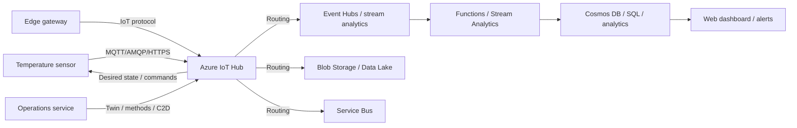

**IoT Hub is not an infinite historical data store.** It ingests and routes messages and manages cloud–device relationships; long-term storage, analytics, and business models typically live in Storage, Cosmos DB, Azure SQL, Data Explorer, or appropriate downstream services.

### What Components Does IoT Hub Have?

| Component | Role |
|---|---|
| **IoT Hub resource** | Managed resource with hostname, tier, units, policies, routing, quotas, and diagnostics |
| **Device identity registry** | Stores device identity records and enable/disable/credential state |
| **Device endpoint** | Where devices send telemetry/receive messages over supported protocols |
| **Service endpoint** | Where the backend manages devices, reads twins, invokes methods/messages, and administers the hub |
| **Device twin** | JSON document holding desired/reported properties and metadata for config synchronization |
| **Module identity/twin** | Dedicated identity/twin for a logical module on a device/IoT Edge when applicable |
| **Message routing** | Selects messages to deliver to endpoints/downstream services |
| **Built-in Event Hubs-compatible endpoint** | Exposes an event stream for consumers to read per endpoint semantics/retention |
| **Device Provisioning Service (DPS)** | A **separate** service supporting device registration/assignment to hubs per enrollment rules |

### Do Not Confuse the Three "Hubs"

- **IoT Hub:** connects devices, provides device identities/twins/D2C/C2D.
- **Event Hubs:** ingests high-throughput event streams, manages partitions/consumer groups; lacks IoT Hub-style device twins/per-device credential lifecycles.
- **Azure Web PubSub:** delivers WebSockets to online apps/browsers, not a registry for thousands of IoT devices.

A device can send through IoT Hub and have data routed from there to Event Hubs for stream processing. This **does not turn IoT Hub into a standalone Event Hubs namespace with identical limits and features**.

## 2. An IoT Device Must Be Treated as a Separate Principal

In a security model, a device is not just a `deviceId` string sent inside a payload.

### Identity Concepts

| Concept | What It Means | What It Is Not |
|---|---|---|
| **Device ID** | Unique device identifier within an IoT Hub registry | Authentication secret |
| **Device identity record** | Registry record linking ID, credentials, enabled state, and auth metadata | Telemetry data itself |
| **Credential** | Symmetric key or certificate/private key per authentication model | Device name |
| **SAS token** | Signed token with permitted resource scope and expiration | Permanent root key |
| **X.509 certificate** | Public-key certificate used in TLS/configured authentication | Uncloneable physical hardware proof by itself |
| **Module ID** | Child identity for a module scoped under a device, when supported | Device ID of another physical device |
| **DPS registration ID** | Identity used during provisioning via DPS | Always identical to IoT Hub deviceId in every design |
| **Twin desired/reported** | Synchronized configuration/capability state | Identity authentication system |

### One Device – One Identity Principle

Suppose there are 10,000 meters:

```text
hub: iothub-warehouse-prod
device IDs:
  wh-000001
  wh-000002
  ...
  wh-010000
```

Each device has its own identity record and independent credentials. If `wh-004257` is stolen, the security team can **disable/revoke that specific device** without forcing key changes across the remaining 9,999 devices.

### A Registry Record Is Not "Device Currently Online"

The registry holds identities allowed to connect. A device with an `enabled` record can still be:

- powered off;
- missing Wi-Fi;
- not yet finished provisioning;
- having an invalid certificate/clock;
- blocked outbound by a firewall;
- using an SDK calling the wrong API.

**Registry existence ≠ online presence.** Connection diagnostics and telemetry freshness are required to evaluate actual state.

## 3. Device Identity Registry and Device Lifecycle

A production device typically goes through these stages:

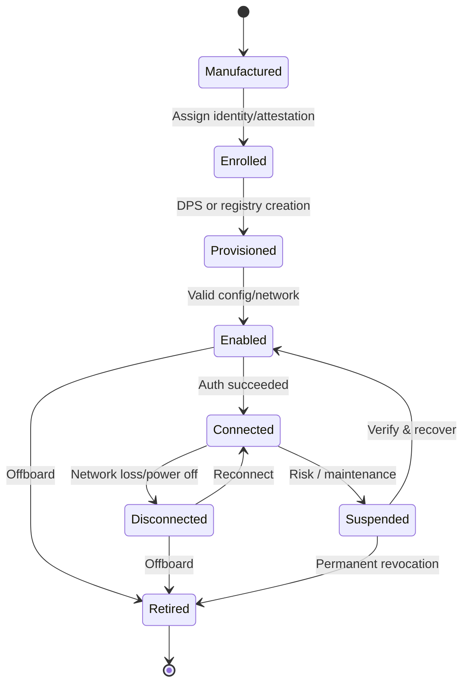

This is an **organization-built business state machine**. The IoT Hub identity registry primarily has enable/disable states and supporting metadata; it does not natively maintain every `Manufactured`, `Suspended`, and `Retired` state shown in the diagram.

### Each Stage Needs a Control Action

| Stage | Required Action | Evidence Stored |
|---|---|---|
| Manufacture | Assign serial/secure element, generate credentials | Inventory/attestation record |
| Enrollment | Create controlled enrollment/DPS policy or identity | Owner, batch/serial, approved config |
| Provision | Assign device to the right IoT Hub/tenant | Registration result, hub assignment |
| Connect | TLS/SAS/X.509 auth succeeds | Connection diagnostics, time |
| Operate | Report status/telemetry, receive config | Twin versions, metrics |
| Rotate | Issue new key/certificate safely | Key version, validity, success rate |
| Suspend | Block risky device | Disabled identity, incident record |
| Retire | Revoke, delete data per retention | Deprovision audit, certificate revocation |

Do not delete an identity immediately when a device temporarily loses network if **audit/correlation** must be preserved. Offboarding should be an approval-gated workflow separating **disable to block** from **delete when eligible**.

## 4. Which Protocols Do Devices Connect With?

Azure IoT Hub supports common device protocols, including **MQTT, AMQP, and HTTPS** depending on the use case/SDK.

| Protocol | Model | Common Use Case | Key Considerations |
|---|---|---|---|
| **MQTT** | Lightweight publish/subscribe over TCP/TLS | Small devices, continuous telemetry, unstable networks | IoT Hub MQTT topic conventions are not an arbitrary broker |
| **AMQP** | Messaging protocol with links/flow control | Gateways/services needing multiplexing/transport control | Ports may be firewall-blocked; choose supporting SDKs |
| **HTTPS** | Request/response over HTTP/TLS | Devices not holding long-lived sockets, port 443-only networks | Push/C2D/direct method support differs from MQTT/AMQP |
| **MQTT over WebSockets/AMQP over WebSockets** | Protocol wrapped over WebSocket/TLS when supported | Networks allowing only TCP 443 | Still uses IoT Hub device protocol/identity, not browser Web PubSub |

### MQTT and IoT Hub Topics

IoT Hub supports MQTT, but **is not equivalent to an arbitrary MQTT broker** for arbitrary custom topics. Topics/device operations must follow **IoT Hub MQTT topic filters and service semantics** per protocol version. If existing devices rely on custom MQTT topic trees and shared subscriptions, migrating to IoT Hub may require a gateway or updating client topic mappings.

### TLS Is Mandatory for Trust

Devices must verify the endpoint certificate/TLS chain and hostname. If certificate checks are skipped "just to make it work," a network attacker can spoof the server or intercept sensitive data. For embedded devices, manage the trust root, clock, and root CA lifecycle compatible with the service.

### Choosing a Protocol Does Not Grant Permissions

Whether a device uses MQTT or AMQP, it still must **authenticate with IoT Hub-supported credentials**, have a corresponding registry identity, and act strictly within device scope. A different protocol does not allow devices to spoof user/service operations.

## 5. Two Device Authentication Groups: Symmetric Key/SAS and X.509

### Overview Comparison

| Criterion | Symmetric key + SAS | X.509 certificate |
|---|---|---|
| Trust basis | Shared secret on device and service | Private key on device, public certificate/CA trusted by service |
| At connection time | Typically sends a signed, time-limited SAS token | Authenticates client certificate in TLS per configuration |
| Stored on device | Primary/secondary key to protect | Private key to protect, ideally generated in TPM/secure element |
| Exposure risk | Key leak allows minting valid tokens until revoked/rotated | Private key leak allows impersonation until expiry/revocation |
| Rotation | Switch primary/secondary cleanly per procedure | Issue new cert, roll over trust/cert, and retire old |
| Scale | Simple for labs and small/medium fleets | Suitable when PKI/manufacturing identity exists |
| Provisioning | DPS symmetric enrollment/group derived key | DPS X.509 enrollment/CA attestation |
| Challenges | Protecting secrets on device and key distribution | PKI, chain validation, expiry, hardware protection |

**Neither option is inherently secure if the private key or symmetric key sits in plaintext firmware easy to extract.** Hardware, supply chain, physical access protection, and rotation processes matter just as much as cryptography.

### Device Authentication and Service Authentication Are Separate Paths

A device typically authenticates to IoT Hub using **per-device SAS/X.509** per SDK/hub features. A backend managing the hub can use **Microsoft Entra ID/managed identity** and data-plane roles where supported by APIs. **Do not assume managed identities can be issued to thousands of embedded boards without an Azure identity runtime**, and never hand out a hub-level shared access policy to every sensor.

## 6. Symmetric Keys, Primary/Secondary Keys, and SAS Tokens

In the symmetric-key model:

```text
Device identity registry:
  deviceId = wh-000001
  authType = symmetric key
  primaryKey = (secret)
  secondaryKey = (secret)

Device:
  holds its own key securely
  creates short-lived SAS token
  connects as wh-000001
```

A SAS token includes the permitted resource scope, expiration time, and signature per protocol:

```text
SharedAccessSignature sr=<resourceUri>&sig=<signature>&se=<expiry>
```

This is **illustrative syntax**; additional fields may exist depending on policy and token minting method. **A token is also a credential**, even when short-lived; never print tokens in logs.

### Do Not Equate Hub Policy with Device Key

| Credential | Scope | Allowed in Device Firmware? |
|---|---|---|
| **Per-device symmetric key** | Single device identity | Only when stored securely via manufacturing process |
| **Per-device SAS token** | Specific device resource, finite lifetime | Can be used during auth; do not store long-term or log |
| **Hub shared access policy key** | Hub-level permissions per policy, can manage many devices/messages | **No**; overly broad scope creating fleet-wide risk |
| **Service connection string** | Backend operations per policy | **No** in untrusted firmware/clients |

### Why Are Primary/Secondary Keys Useful?

They support **zero-downtime rotation procedures**:

1. Device currently uses the primary key.
2. Rotate the secondary key per allowed policy.
3. Update the device to use the new secondary key and verify connectivity.
4. Rotate/revoke the old primary key.
5. Switch back to the new primary key if needed.

This is a conceptual plan; sync latency, offline devices, SDK token refresh, and operational policies must be tested before rotating a live fleet. Rotating the primary key while thousands of devices have not yet received the secondary key will cause mass disconnections.

### Replay Protection

SAS tokens have an expiry; device clocks must be reasonably accurate so they do not mint "already expired" or overly long-lived tokens. **SAS does not inherently prevent duplicate telemetry payloads**; data needs event IDs/sequences and downstream idempotency when required by business logic.

## 7. X.509: Client Certificates and Private Key Ownership

X.509 enables a device to present a **certificate** and prove possession of the **private key** during authentication per TLS/IoT Hub configuration.

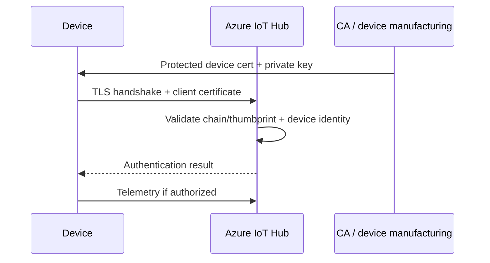

### Two Common Certificate Authentication Approaches

- **Thumbprint-based X.509:** The registry identity binds one or more supported certificate thumbprints; suitable for certain individual certificate management workflows.
- **CA-signed X.509:** Certificates signed by a CA registered/verified via IoT Hub's supported mechanism; enables chain-based authentication and appropriate device identity binding.

Requirements for subject/CN, thumbprint, certificate verification, and trust chain **depend on the mode**; do not copy device A's certificate onto device B and merely change `deviceId` in JSON.

### Where Should the Private Key Live?

In production, prefer:

- generating the key pair on a **TPM/secure element** if hardware supports it;
- avoiding exporting the private key as a plaintext file;
- never sending private keys over email/tickets;
- enforcing firmware secure boot/update policies as appropriate;
- verifying certificate validity and chain to a trusted CA;
- having a CA/root certificate rollover plan and handling expired devices.

X.509 **does not automatically prove hardware cannot be cloned** if the private key can be exported and copied. Manufacturing design + hardware protection are decisive.

### When to Choose X.509?

X.509 is worth considering if:

- the enterprise has PKI and mass manufacturing processes;
- devices live for many years requiring rotation/attestation;
- hardware key protection is required;
- you want to separate private keys from public certificates;
- integration with CA-based DPS provisioning is needed.

In return, operating PKI/chains/certificate expiry/renewal is more complex than symmetric-key labs.

## 8. Device ID, Serial Number, and Asset Identity

An enterprise may have three kinds of identifiers:

```text
Manufacturer serial:  SN-87391
IoT Hub deviceId:     wh-000001
Business assetId:     freezer-warehouse-12
```

They **do not have to match**:

- **Serial:** assigned by the manufacturer, used for warranty/supply chain.
- **DeviceId:** identifier key in a hub registry, tied to credentials and message paths.
- **AssetId:** business asset; a single freezer may have its sensor replaced multiple times.

### Why Is Mapping Needed?

When replacing a physical sensor, you should not just swap credentials and keep pretending it is the old device if security policy requires fresh hardware attestation. One business asset can map to a **history of multiple device IDs**; store time-bounded mappings:

```json
{
  "assetId": "freezer-warehouse-12",
  "currentDeviceId": "wh-000237",
  "previousDevices": ["wh-000001"],
  "deploymentRegion": "warehouse-12",
  "ownerTeam": "ColdChainOps",
  "firmwarePolicy": "stable-channel",
  "installedAtUtc": "2026-11-20T04:00:00Z"
}
```

The JSON above is an **illustrative business inventory record**, not an IoT Hub registry entry. Device identity does not automatically include asset warranty or business ownership.

## 9. Device Identity and Module Identity

A **device identity** represents an identified device/connection in IoT Hub. A **module identity** represents a logical module belonging to that device when supported by the model, commonly useful with **Azure IoT Edge** or gateway systems running multiple independent workloads.

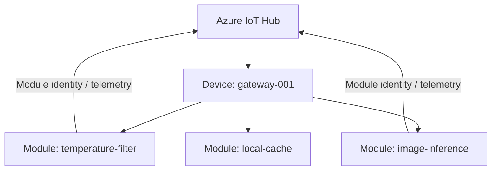

### When to Use Module Identity?

An edge gateway has three modules:

- collecting sensor telemetry;
- running AI/image processing at the edge;
- syncing aggregated data.

Separating module identities provides appropriate **credentials and metadata/twin scopes** to manage each module. However, **module identity is not itself an OS sandbox or a mechanism preventing file access between containers**; container isolation and runtime security must be enforced at the edge.

### Module Twin

Similar to a device twin, a module twin can hold desired/reported properties for module configuration and feedback. Do not use the device twin as a credential store for all modules.

## 10. Device Provisioning Service (DPS): Onboarding Devices to Hubs Safely

**Azure IoT Hub Device Provisioning Service (DPS)** supports **zero-touch, just-in-time provisioning**: devices can authenticate to DPS, receive IoT Hub assignment details, and register according to enrollment rules without hardcoding production hub names in firmware.

### Provisioning and Runtime Connection Are Different

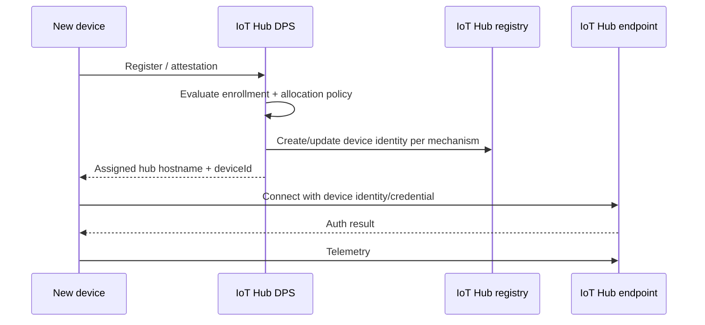

**DPS is not the normal telemetry ingestion endpoint** after provisioning. Devices send operational data to the **assigned IoT Hub**. DPS handles assignment and identity setup, not replacing message routing in the hub.

### What Does a Device Know Before First Connection?

Depending on attestation:

- **ID Scope** of the DPS instance.
- **Registration ID** and corresponding authentication data.
- Appropriate DPS global endpoint/SDK protocol.
- Trust root/TLS certificate to verify the server.

A device should never contain a **hub service connection string** or privileged policy key just for onboarding.

### Role of ID Scope

**ID Scope** identifies the DPS instance/registration context for a device; it is **not a secret** and does not grant access by itself. A device must still prove attestation (TPM, X.509, or symmetric key) and be permitted by enrollment rules.

## 11. DPS Individual Enrollment and Enrollment Group

### Individual Enrollment

One enrollment entry applies to a specific device/registration identity. Useful when:

- piloting with a small number of devices;
- devices have individual certificates/TPMs;
- per-device policy blocking/adjustments are needed;
- manufacturing inventory tracking is sufficiently granular.

### Enrollment Group

An enrollment group serves **multiple devices sharing a trust rule**, such as:

- leaf certificates signed by a valid CA/group trust policy;
- symmetric-key group enrollment with **derived device keys** per supported mechanism.

**Never embed the same unprotected group master key across all firmware** and call it per-device identity. With symmetric group enrollment, use the supported algorithm/provisioning process to **derive a distinct credential per registration ID**, storing secrets securely.

### Individual vs. Group

| Attribute | Individual enrollment | Enrollment group |
|---|---|---|
| Scope | One registration/device | Multiple devices under common attestation |
| Management scale | Easy per-device auditing | Suited for mass-manufactured fleets |
| Revocation | Handle individual enrollment/identity | Requires per-device blocking plus group trust management |
| When to use | Pilots/specialized devices | Manufacturing batches or certificate hierarchies |
| Risk | Large manual registration table | Group master/CA compromise impacts many devices |

### Enrollment Group Does Not Mean Devices Share One deviceId

Each device still needs an appropriate registration ID/identity. The group only defines the provisioning rule; the resulting IoT Hub registry holds distinct device identities. Do not use the group name as `deviceId` for all sensors.

## 12. Three Common DPS Attestation Types

| Attestation | What Does It Prove? | Design Consideration |
|---|---|---|
| **Symmetric key** | Device holds the secret matching the enrollment | Protect group/derived keys, rotate/revoke |
| **X.509 certificate** | Device holds private key and valid certificate per enrollment/certificate chain | CA hierarchy, verification, expiry, rollover |
| **TPM** | Device holds key/endorsement per TPM hardware and supported attestation flow | Endorsement/registration setup, hardware support |

### What Is TPM in the Provisioning Context?

**Trusted Platform Module (TPM)** is hardware/functionality for protecting keys. A DPS-supported attestation model can bind registration to TPM keys/endorsements. Do not equate "has TPM" with "guaranteed malware-free": secure boot, firmware integrity, supply chain, and runtime permissions still require separate design.

### X.509 CA Enrollment

Sample flow:

1. Manufacturer/PKI admin prepares the certificate hierarchy and secures the CA private key.
2. Register/verify the public CA or certificate chain per DPS functionality.
3. Each device gets its own leaf certificate and private key.
4. On boot, the device presents its certificate/satisfies attestation.
5. DPS evaluates enrollment and assigns an IoT Hub.

**Verification of ownership** at the CA level and **runtime client certificate validation** are distinct steps with different meanings; follow provider procedures rather than merely uploading a PEM file in the Portal and assuming all devices are trusted.

## 13. DPS Allocation: Which Hub Should a Device Join?

With hundreds of thousands of devices, an enterprise may need multiple hubs by region/customer group. DPS supports allocation strategies per configuration and service capabilities.

### Allocation Pattern

```text
Fleet sensors
    |
    v
  DPS
    |
    +--> IoT Hub: southeast-asia fleet
    +--> IoT Hub: europe fleet
    +--> IoT Hub: staging fleet
```

Hub selection is not based solely on latency. Consider:

- **data residency** and customer policies;
- quota/capacity/tier of the target hub;
- which tenant/business domain the device is allowed to belong to;
- whether the hub is in production or test;
- supportability of the allocation policy/custom allocation if supported;
- **re-provision** behavior when devices change regions or hub assignments.

### Is Moving Hubs Just a DNS Change?

No. Devices have identities, credentials, twins, routes, and downstream consumers tied to a specific hub. To move a device from hub A to hub B:

1. Verify re-provisioning policies and DPS allocation.
2. Create/restore the identity in hub B via the proper mechanism.
3. Sync desired configuration/business mapping if needed.
4. Verify message routes/consumers on the new hub.
5. Disable/remove the identity on the old hub with proper workflow and audit.

**Do not assume DPS automatically migrates all device twins, historical telemetry, and routing to the new hub.** Business data must be managed in appropriate systems.

## 14. IoT Hub Identity and Microsoft Entra ID: Who Uses What Permissions?

An IoT system has **three types of principals**:

1. **Device principal:** per-device SAS/X.509/attestation, used by IoT Hub to authenticate devices.
2. **Service/backend principal:** App Service, Function, AKS worker, or automation using Microsoft Entra ID/managed identity or supported service credentials.
3. **Human operator:** engineer/coordinator acting via Portal/CLI/API with an Entra user identity and scoped roles.

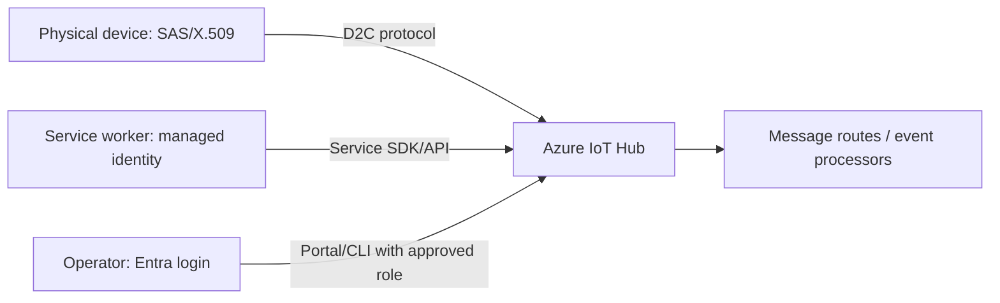

### Control Plane and Data Plane Differ

| Layer | Example Operations | Permission Mechanism to Check |
|---|---|---|
| **Azure control plane** | Create hub, change tier, configure routing, network | Azure RBAC for ARM resources |
| **IoT Hub service data plane** | Manage identities/twins, invoke direct methods/C2D, or read messages per API | Supported IoT Hub data-plane roles/credentials |
| **Device data plane** | Device sends telemetry, receives desired properties | Device SAS/X.509 identity |
| **Application authorization** | Can employee A change threshold on device B? | Business roles/tenant/asset ownership in the app |

The **Azure Reader role** can view ARM metadata but does not automatically grant permission to send C2D messages or edit twins. Conversely, a device with a device key **cannot** administer all device identities in the hub.

### Backend Should Use Managed Identity When Possible

An Azure Function processing alerts and updating desired properties can use a managed identity and appropriate data-plane role with supported APIs. If using connection strings/IoT Hub shared access policies, credentials must be protected in Key Vault with scoping and rotation plans.

**Never send a service connection string over C2D to "grant permissions" to a device.** That exposes permissions beyond the device and widens the blast radius if leaked.

## 15. Device-to-Cloud Telemetry (D2C)

**Telemetry** is data sent by a device to the cloud: temperature, vibration, battery level, GPS, sensor status.

```json
{
  "eventId": "wh-000001-000127",
  "deviceId": "wh-000001",
  "sequence": 127,
  "temperatureC": 4.8,
  "humidityPct": 66.1,
  "measuredAtUtc": "2026-11-20T09:00:00Z",
  "firmwareVersion": "1.4.2"
}
```

### Device ID in Payload Is Not Authentication

If device `wh-000001` authenticated with its own device credentials yet sends `"deviceId":"wh-000002"` in the payload, the backend must not blindly believe the data came from device 2. Use **device identity metadata** provided by IoT Hub/service routes as the trusted source, then validate payload/business mapping. Payloads can be spoofed by compromised device firmware.

### D2C Flow

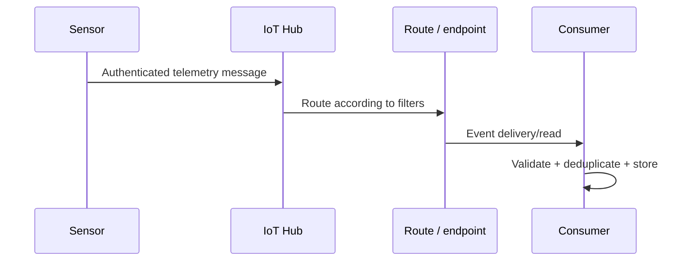

### When Networks Are Intermittent

Devices should have:

- local buffers with appropriate storage/retention;
- retries with backoff, avoiding retry storms;
- monotonic sequences or eventIds for downstream deduplication;
- separate measurement timestamps and send timestamps;
- caps on offline queued message counts;
- overflow handling based on business priority.

**A D2C send acknowledgment does not prove the downstream database wrote the record or the dashboard displayed it.** Design consumer idempotency and end-to-end monitoring when data is critical.

## 16. Cloud-to-Device (C2D) Messages

A **cloud-to-device message** lets a service send a message to a device via IoT Hub's supported mechanism. Example:

```json
{
  "commandId": "cmd-2026-0102",
  "type": "RefreshCalibration",
  "requestedAtUtc": "2026-11-20T10:00:00Z",
  "validUntilUtc": "2026-11-20T10:05:00Z"
}
```

A C2D message is **a channel for delivering command payloads**, not automatically an exactly-once command execution system. Devices should:

1. verify hub identity via TLS;
2. parse and validate schema/command version;
3. check expiration and backend-issued authorization policy;
4. deduplicate using `commandId`;
5. execute safely based on device state;
6. report business result via telemetry or reported properties per design.

### C2D Does Not Mean Direct Method

| Channel | Goal | Key Capabilities |
|---|---|---|
| **C2D message** | Send a message to a device with message lifecycle/queue semantics per service limits | Suitable for requests that do not require synchronous response |
| **Direct method** | Invoke a method and get status/response within a timeout while device is online | Relatively synchronous request/response |
| **Desired property** | Express target config/conditions to converge toward | Suitable for long-lived state or offline-capable devices |

For configuration like "desired temperature threshold = 6°C," a desired property generally has better semantics than repeatedly sending instantaneous commands. For "capture image right now" while online, a direct method may fit. For long-running queued commands, use a separate durable job/command store if IoT Hub semantics are insufficient.

## 17. Direct Methods: Invoking Commands While Online

A **direct method** is a model where a service invokes a method on a device/module and can receive a status/payload response while the device is connected and responds within timeout.

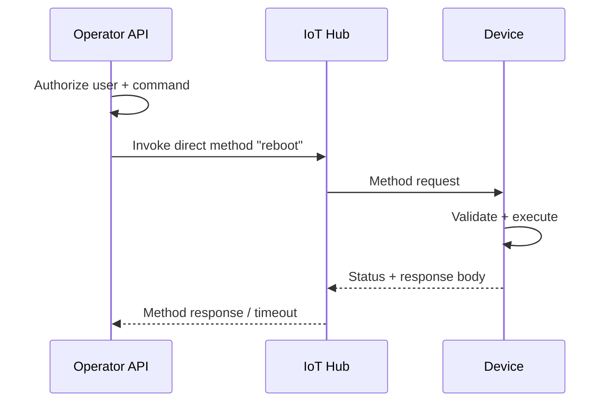

### Pitfalls to Avoid

- **Do not invoke a direct method on an offline device expecting IoT Hub to always queue it until online.**
- **Do not treat a direct method status 200 as proof a firmware reboot actually completed** if the device only returned "accepted"; run health checks afterward.
- Do not grant device clients permission to invoke service methods on other devices.
- Do not use direct methods for tasks taking hours if operation timeouts do not fit.

### Dangerous Commands Require Business Authorization

Commands like reboot, firmware rollback, closing industrial valves, or changing chiller power have physical impact. The backend must enforce **operator roles, asset scoping, auditing, request approvals, and safety interlocks**; never let anyone with a hub connection execute them arbitrarily.

## 18. Device Twin: Desired and Reported Properties

A **device twin** is a JSON document representing configuration state and metadata synchronized between cloud and device:

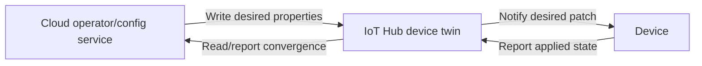

### What Is in a Twin?

| Component | Who Can Update in the Model | Purpose |
|---|---|---|
| **Tags** | Authorized cloud/service-side principal | Business/device-grouping metadata for queries/management |
| **Desired properties** | Cloud/service | Target configuration the device should apply |
| **Reported properties** | Device via device connection | Actual state and application outcome |
| **ETag/version/metadata** | Managed by service/concurrency controls | Versioning and optimistic concurrency |

### Simplified Twin Example

```json
{
  "deviceId": "wh-000001",
  "tags": {
    "site": "warehouse-12",
    "owner": "ColdChainOps"
  },
  "properties": {
    "desired": {
      "telemetryIntervalSeconds": 60,
      "temperatureAlarmThresholdC": 6.0,
      "$version": 12
    },
    "reported": {
      "telemetryIntervalSeconds": 60,
      "temperatureAlarmThresholdC": 6.0,
      "firmwareVersion": "1.4.2",
      "appliedDesiredVersion": 12,
      "$version": 34
    }
  }
}
```

This is **JSON illustrating the main property groups**, not the full response of every IoT Hub SDK. System fields like `$version`, `$metadata`, and ETag have dedicated semantics and must not be modified manually as business properties.

### Desired Is Not Actual

If a service writes:

```json
{"telemetryIntervalSeconds": 30}
```

into desired, that only expresses the **target**, not proof the device changed its interval. The device must:

1. receive the desired patch or read the twin upon reconnect;
2. validate config (e.g., valid range 10 to 600 seconds);
3. apply the configuration successfully;
4. patch **reported properties** and record the processed desired version;
5. send telemetry at the new interval.

Operations should measure **desired–reported drift**: how many devices have not converged within an SLA window.

## 19. Twin Queries and Device Inventory

In APIs supporting registry/twin queries, the backend can search:

```sql
SELECT * FROM devices
WHERE tags.site = 'warehouse-12'
```

This is an **illustrative query in IoT Hub twin query syntax**, not SQL for Azure SQL Database. Supported fields, operators/indexes, and query capabilities vary by operation/API/tier; check SDK/CLI docs before using.

### Who Should Set Device Tags?

Cloud-side tags should be set by **business inventory** or trusted provisioning metadata. If a device could set `tags.owner = "finance-admin"` and the backend used it for access control, a compromised device could escalate privileges. **Cloud-controlled tags must never be updated from unauthenticated client data.**

### Do Not Use Twins as a Data Warehouse

Twins fit **configuration/state metadata**, not sending hundreds of telemetry samples per second to update a twin document endlessly. High-frequency telemetry belongs in D2C messages/streams, while reported properties can reflect summary state such as firmware version, last calibration, or applied config version.

## 20. Device Twin and Offline-First Configuration

An advantage of the desired/reported model is that **devices do not need to be online at the exact moment an operator changes configuration**. The cloud retains the desired state, and the device retrieves it upon reconnecting.

```text
09:00 Device offline
09:10 Operator sets desired.telemetryIntervalSeconds = 30
09:40 Device reconnects
09:41 Device reads latest desired version and validates
09:42 Device applies setting
09:43 Device reports appliedDesiredVersion and actual interval
```

### Avoiding "Blind" Updates

If two operators or automations update a twin concurrently, enforce concurrency control via the ETag/version/update mechanism supported by the SDK. Also distinguish:

- **patch properties:** updates specific fields without replacing the whole configuration;
- **replace full twin:** can unintentionally overwrite fields if misused.

When configs change frequently, devices should process versioned patches and reconcile state; do not assume every patch arrives in exact order across disconnections.

### Staged Config Rollouts

Do not push threshold or firmware policy changes to 100,000 devices simultaneously if an issue could cause overload or physical harm. Stage by:

```text
Lab devices → 1% canary → 10% region pilot → 50% → full fleet
```

Monitor reported versions, telemetry health, offline ratios, and rollback readiness before advancing waves.

## 21. D2C Message Routing and Downstream Endpoints

IoT Hub can **route matching messages** to endpoints based on message properties, body/system metadata, and supported conditions.

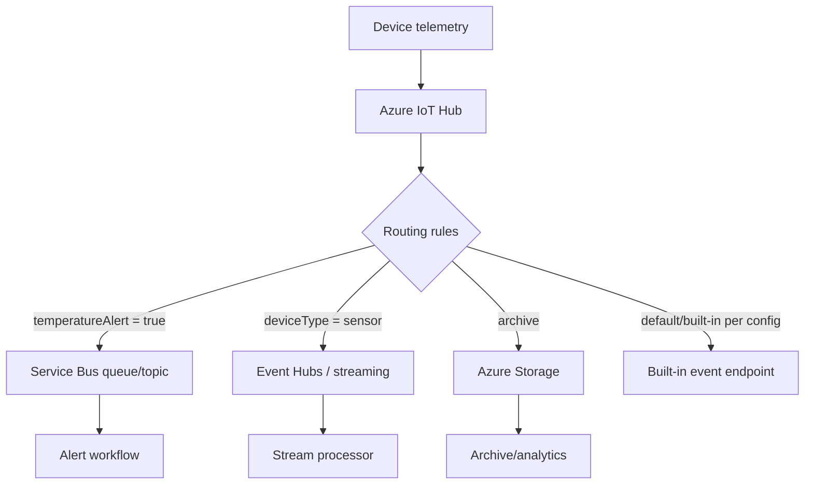

### What Does Routing Evaluate?

A D2C message can carry:

- **System properties** managed by the protocol/IoT Hub, including authenticated device identity info.
- **Application properties** set by firmware, e.g., `messageType=temperature`.
- **Message body** containing JSON/binary/other payload per content type.

Example application properties:

```text
messageType = telemetry
siteCode = warehouse-12
schemaVersion = 2
contentType = application/json
contentEncoding = utf-8
```

When routing must filter on a JSON body field, ensure **content-type/content-encoding and body query support are configured**; if metadata is missing or JSON is invalid, conditions may fail to match as expected. Do not assume every protocol/SDK sets these headers automatically.

### Example Routing Condition

```text
Route name: coldchain-alerts
Condition: application property messageType = "alert"
Endpoint: Service Bus queue alerts
```

This is a logical description; actual query filter syntax and allowed properties depend on IoT Hub configuration. Never copy a conceptual description as a production filter without testing via Portal/CLI.

### Routing Failure Does Not Equal Business Success

If IoT Hub accepts D2C while the destination endpoint is failing:

- routes expose health/diagnostics status to monitor;
- retries, fallback, and endpoint behavior depend on service configuration;
- a message must not be treated as persisted in a database merely upon ingress ACK;
- the backend needs idempotency and gap detection via eventId/sequence.

### Built-in Endpoint and Custom Routes

IoT Hub provides a default Event Hubs-compatible endpoint for consumers. **When enabling message routing, verify how data routes to the built-in endpoint or fallback route** under your current configuration. Do not assume messages still appear on the built-in consumer if you modify routes and remove default/fallback behavior.

## 22. IoT Hub Built-in Event Hubs-Compatible Endpoint

A consumer such as Azure Functions, Stream Analytics, or an application using supported protocols/SDKs can read D2C messages from the built-in endpoint.

### Key Characteristics

| Concept | Meaning |
|---|---|
| **Partitions** | Splits the event stream for parallel reading per endpoint model |
| **Consumer group** | Allows independent applications to read with separate offsets/positions |
| **Offset/checkpoint** | Consumer saves processed position to resume after restart |
| **Retention** | Messages stored temporarily within endpoint time/limits, not a permanent archive |
| **At-least-once processing** | Design consumers to tolerate reprocessing; do not assume exactly-once |

### Example Workflow

```text
IoT Hub D2C
→ Built-in Event Hubs-compatible endpoint
→ Azure Function / Stream Analytics
→ Validate payload + deduplicate
→ Cosmos DB / Data Explorer / Blob Storage
→ Web/API dashboard
```

Do not share one consumer group/checkpoint store between two independent applications if each must read the full stream. Design consumer groups and checkpoints per supported streaming architecture/SDK.

### Why Not Store 10 Years Inside IoT Hub?

The endpoint has finite retention and quotas. For long-term retention/audit, route to Blob/Data Lake/other targets with dedicated lifecycle/retention policies, backups, access controls, and budgets.

## 23. Device Twins Are Not for Continuous Telemetry

Comparison:

| Data | Appropriate Channel | Why |
|---|---|---|
| Temperature every 5 seconds | **D2C telemetry** | Event stream supporting routing/analytics |
| Hardware model/firmware version | **Reported twin property** | Infrequently changing state metadata |
| Target alert threshold | **Desired twin property** | Syncs config when back online |
| Run self-test immediately | **Direct method** | Invoke command and receive response while online |
| Command not needing immediate reply | **C2D message** or separate command workflow | Delivery/expiry governed by policy |
| List of faulty devices | **Cloud inventory + telemetry-derived state** | Combines registry, last-seen, and alerts |
| 24-month history | **Data Lake/analytics database** | Long-term querying and retention |

### A Common Design Mistake

If each sensor sends 10 messages/second and the backend updates twin reported properties after **every** message:

- request load/quota on twin operations spikes;
- version conflicts/unnecessary writes proliferate;
- the cloud only needs latest reported state yet processes high-frequency writes;
- extra cost/latency accumulates and config drift becomes harder to track.

Use D2C for telemetry, reported properties for infrequently changing state, and throttle twin patch frequency.

## 24. IoT Edge and Gateway Identity

Some sensors cannot connect directly to the Internet or lack sufficient hardware/SDK support. They can communicate with a **gateway/edge device** over a local protocol, and the gateway forwards data to IoT Hub.

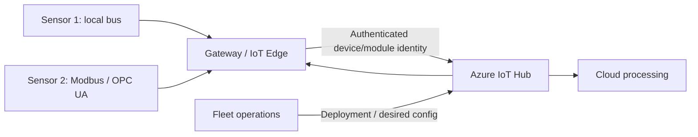

### Two Identity Models

1. **Single gateway identity:** multiple sensors send through the gateway with `sensorId` in the payload. The cloud authenticates the **gateway**, while individual `sensorId`s need additional identity/attestation/validation if the application must trust each sensor separately.
2. **Individual identities for downstream devices:** in supported transparent gateway/protocol scenarios, each downstream device has its own identity/credentials and the gateway relays connections.

**Do not assume a gateway automatically authenticates every sensor behind it** just because the gateway has an IoT Hub device identity. Per-sensor provenance requires an identity model across the field network/gateway.

### IoT Edge Modules

An IoT Edge runtime can run containerized modules at the edge, using module identities/twins for configuration/connectivity. Modules do not automatically have access to one another or host secrets; image signing, runtime isolation, update strategy, and device hardware security must still be managed.

### Offline Processing

A gateway can buffer/execute logic at the edge when disconnected; however, buffering, routing, replay, and idempotency must be explicitly configured. Do not assume "Edge" automatically guarantees zero record loss across prolonged power outages.

## 25. Distinguishing IoT Hub, DPS, IoT Central, and Event Grid

| Service | Strength | When to Use |
|---|---|---|
| **Azure IoT Hub** | Per-device identity, D2C/C2D, twins, methods, routing | Need deep control over device connections and streams |
| **Azure IoT Hub DPS** | Provisioning/assignment by attestation/enrollment | Onboard fleets to hubs without manually configuring each unit |
| **Azure IoT Central** | High-level managed IoT application/platform solution | Want faster app/device templates/dashboards within product scope |
| **Azure Event Hubs** | High-throughput event stream ingestion | Many producers, stream analytics; no per-device twins needed |
| **Azure Event Grid** | Event notification routing and event-driven integrations | React to system events; does not replace IoT Hub device sessions |
| **Azure Service Bus** | Enterprise queues/topics, DLQ/sessions | Durable commands/jobs across backend services |
| **Azure Stream Analytics** | Query-based stream/time-window processing | Near-real-time telemetry calculations post-ingestion |

When IoT Central uses underlying Azure components, users must still understand the corresponding **permission and responsibility model**; do not attempt to directly manage an IoT Hub resource owned by another product if workflows disallow it.

## 26. Device Authorization Is Not User Authorization

A device authorized to send telemetry cannot decide:

- which users can view the data;
- which technicians can invoke direct methods;
- which warehouse can have thresholds updated;
- who can rotate or delete identities;
- which asset belongs to which customer.

Those decisions belong to **backend application/domain authorization**.

### Multi-Tenant Model

Suppose an IoT Hub serves two companies:

```text
Tenant-A:
  Device: A-wh-001
  Device: A-wh-002
Tenant-B:
  Device: B-wh-001
```

An ID prefix is an administrative naming convention, **not a security boundary**. The backend must map device IDs to trusted tenants, verify user claims/roles, and query only tenant-authorized data. Never let users call `GET /devices/B-wh-001` without resource authorization.

### Device Metadata Can Be Spoofed

Firmware payloads can self-declare `"tenantId":"Tenant-B"`. Rely on the **authenticated device identity** from IoT Hub and the asset inventory to determine tenant ownership, never arbitrary payload fields as an authorization source.

### Avoid Shared Client Devices

A single hub-level connection string shared across all customer gateways creates a massive blast radius. Production fleets should use **per-device or per-module identities** and independent credentials with an auditable identity lifecycle.

## 27. Multi-Layered Security Architecture

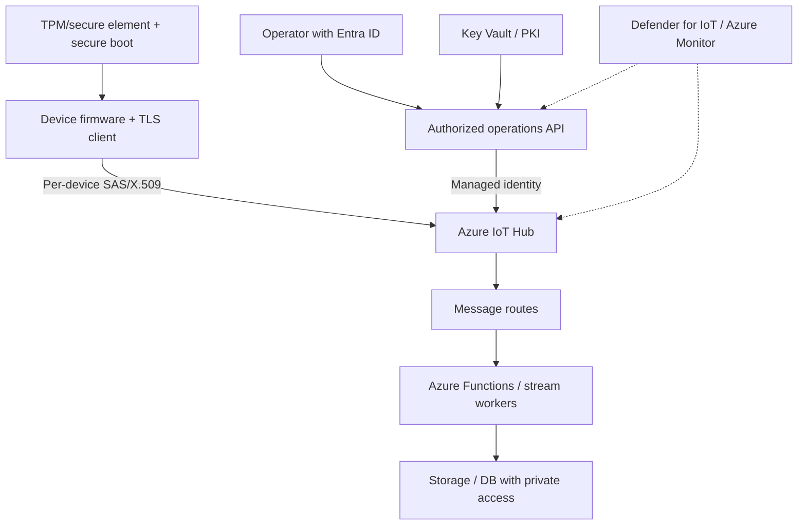

### Device Layer

- Secure boot and firmware update verification if hardware supports it.
- Never hardcode hub master keys in firmware.
- Protect per-device keys/private keys in secure hardware when possible.
- Disable unauthorized debug interfaces in production.
- Control serial/registration mapping and supply chain.
- Have policies for lost or physically tampered devices.

### Transport Layer

- TLS server validation, CA trust store, and correct hostname verification.
- Reasonable SAS token expiry or X.509 certificate rotation.
- Restrict outbound network/ports to only what is necessary.
- Accurate device clocks for token/cert validity; strategy for RTC battery loss.
- Retry/backoff instead of aggressive reconnect loops.

### Azure Layer

- Least-privilege roles/identities for service/API operators.
- Restrict shared access policies; store secrets in Key Vault.
- Network firewall/private endpoint/Private Link per supported tier/features.
- Enable diagnostics for connections/disconnections/auth failures.
- Protect target endpoints (Storage/Event Hubs/Service Bus) with identity and network controls.
- Apply Azure Policy/Defender for IoT or organizational security tooling where appropriate.

### Application Layer

- Validate message schema, size, timestamps, ranges, and device business mappings.
- Per-device rate limiting/quarantine on abuse.
- Idempotency for telemetry and commands.
- Operator authorization and auditing when controlling devices.
- Separate sensitive location/GPS/personal data from public operational data.

**No single control provides end-to-end security.** Private Link does not replace TLS identity, SAS does not replace firmware security, and Azure RBAC roles do not automatically isolate per-customer data inside the application.

## 28. Private Endpoints and Network Topology

In supporting IoT Hub tiers/features, **IP filtering, private endpoints/Private Link, and public network access controls** may be available. When designing:

```text
Device in plant LAN
→ Firewall/Proxy/VPN
→ Azure IoT Hub endpoint
→ Message route destination
```

### Key Questions

1. Where are devices actually located: public Internet, plant LAN, site-to-site VPN?
2. Which ports/proxies does the device transport use?
3. Is Private Endpoint supported on the hub tier/feature with proper private DNS?
4. Do devices have routing from the site to the private IP?
5. Do the DPS provisioning endpoint and IoT Hub runtime endpoint take **different network paths**?
6. Which identity and route does the backend service control/data plane use to reach IoT Hub?
7. Does message routing to Storage/Event Hubs/Service Bus traverse firewall/network restrictions?

### Separate DPS Networking Must Also Be Considered

A device may complete provisioning via DPS yet fail to connect to the target hub due to DNS/firewalls. Conversely, it may reach the old hub while re-provisioning is blocked. **Always test both the provisioning path and runtime path** when evaluating private/hybrid models.

### Do Not Bypass Policy to Open Public Endpoints for a "Quick Test"

If enterprise policy requires private networking, fix DNS/routes/gateways in the proper place. Do not delete IP filters or disable TLS verification just to bypass timeouts, as that strips protection from the entire fleet.

## 29. Standard/Basic Tiers, Quotas, and Designing Before Creating a Hub

IoT Hub offers different service tiers. **Tier/units determine features, throughput limits, message quotas, and pricing**, not just storage capacity. Device management capabilities like twins/direct methods/cloud-to-device require an appropriate tier per configuration, which is why the labs below use the **Standard tier when testing twins/methods**.

### Distinguishing Use Cases

| Need | Tier Question |
|---|---|
| D2C telemetry ingestion only | Which tier supports the required ingress and throughput? |
| Need device twins/configuration | Does that tier include full twin capabilities? |
| Need direct methods/jobs/C2D | Do the tier and quota support them? |
| Hundreds of thousands of devices | How many identities, connections, messages/day, and units? |
| Private endpoint/networking | Are they supported in the tier/region and with what limits? |
| DPS auto enrollment | Does DPS have separate config/cost and which hub tier does it allocate into? |
| Message routing | What endpoint types, routing operations, throughput, and retries exist per tier? |

### Capacity Planning Starts from Actual Messages

Suppose 20,000 devices send one telemetry message per minute:

\[
\frac{20\,000}{60}\approx333{,}3\ \text{messages/second}.
\]

In one day:

\[
20\,000\times 1\,440=28\,800\,000\ \text{messages/day}.
\]

This is the **application message count** if every device sends at steady cadence, excluding reconnects, retries, batching, payload size, and **IoT Hub metered message unit** rules by tier size. Never multiply 28.8 million by an arbitrary price without checking current tier pricing.

### Build in Headroom

The following events push real load above steady cadence:

- 20% of devices go offline for 30 minutes and flush backlogs together.
- A firmware update causes 10,000 devices to reconnect within seconds.
- An operator updates desired properties across the entire fleet.
- A faulty sensor sends 100 messages/second instead of 1 message/minute.
- Message size grows after adding identity fields.
- Routing one message to multiple endpoints.

Size quotas/throughput for **peak**, and use jitter, appropriate batching, and firmware rate limits rather than sizing purely for average traffic.

## 30. IoT Hub Cost Is the Entire Pipeline Cost

| Component | Cost Drivers |
|---|---|
| **IoT Hub tier/units** | Service tier, capacity units, metered messages, and quotas |
| **DPS** | Registrations/operations and current pricing model |
| **Event Hubs/Service Bus routes** | Endpoint operations, throughput/retention |
| **Blob/Data Lake** | Raw telemetry storage, transactions, redundancy, and retention |
| **Functions/Stream Analytics** | Compute/processing/Streaming Units, executions |
| **Cosmos DB/SQL/Data Explorer** | RU/compute/storage and query patterns |
| **Key Vault/PKI** | Secret/certificate operations and management |
| **Private networking** | Private endpoints, VPN/ExpressRoute, data transfer |
| **Azure Monitor/Log Analytics** | Diagnostic log ingestion, retention, and alerts |
| **Fleet operations** | Disconnections, firmware updates, hardware support, and incidents |

### Optimize by the Rule "Send Only What Has Value"

- Do not send temperature every 100 ms if you only need threshold alerts over 1 minute.
- Aggregate/count at the gateway when data is dense and the edge is trusted.
- Separate **real-time alerts** and **bulk archive** under different policies.
- Send eventId/sequence instead of redundant duplicate payloads.
- Avoid patching the twin on every telemetry sample.
- Choose target retention appropriately rather than keeping every raw event forever.
- Set budgets/alerts across hub, DPS, processing, data storage, and diagnostics.

**Saving bandwidth must never drop critical safety alerts.** Health/electrical/industrial threshold events need dedicated SLAs and fail-safe handling rather than being aggregated/dropped like dashboard telemetry.

## 31. Monitoring: "Online" Is Different from "Healthy"

A device may hold an open MQTT connection while its sensor is broken and sending no valid data. Conversely, a device using periodic HTTPS may not keep a persistent connection yet be operating properly.

### Signals to Monitor

| Group | Metrics | Question |
|---|---|---|
| **Identity/auth** | Authentication success/failure, SAS/cert errors | Is a device spoofed or using expired credentials? |
| **Connections** | Connects, disconnects, retries, active connections | Is firmware/network unstable? |
| **Telemetry ingress** | Messages received, rate, bytes, size failures | Is the fleet sending at expected cadence and within quota? |
| **Message routing** | Route match/drop/delivery failures, endpoint health | Is data reaching downstream? |
| **Device twins** | Desired/reported drift, update errors | Has actual configuration converged? |
| **Direct methods** | Success/timeout/device response codes | Is the device online and responsive? |
| **DPS** | Registration success/fail, assigned hubs | Is onboarding failing attestation/allocation? |
| **Security** | Unusual device ID failures, attempts from unfamiliar IPs | Leaked key or misconfiguration? |
| **Cost/quota** | Message usage, hub units, ingress throttling | Is there headroom for peaks? |

Metric names and log categories vary by tier, version, and configuration. Use **Azure Monitor Metrics/Diagnostic settings on the actual resource** to verify names and support, rather than assuming every metric in the table appears automatically.

### Business Telemetry

Maintain fleet operational status in the data platform:

```json
{
  "deviceId": "wh-000001",
  "assetId": "freezer-warehouse-12",
  "lastTelemetryAtUtc": "2026-11-20T09:00:00Z",
  "lastSequence": 127,
  "lastTemperatureC": 4.8,
  "lastAuthFailureAtUtc": null,
  "desiredConfigVersion": 12,
  "reportedAppliedVersion": 12,
  "health": "Healthy"
}
```

This is an **application-built summary status record**, not an IoT Hub device registry schema. `health` should be computed from telemetry freshness, errors, and business thresholds, not merely current connection state.

### Distinguishing Four Timestamps

- **MeasuredAt:** when did the sensor actually measure?
- **SentAt:** when did firmware send it?
- **Enqueued/receivedAt:** when did IoT Hub/destination receive it?
- **ProcessedAt:** when did the consumer write to DB/alert?

A device offline for 3 hours flushing old samples can create an ingress peak "now" for data measured "3 hours ago." If stream analytics uses ingestion time instead of event time, hourly reports will be skewed.

### Practical Alerts

1. Sharp spike in authentication failures by device batch or CA.
2. Many devices disconnecting simultaneously after a firmware release.
3. Per-device last telemetry age exceeding SLA.
4. Message ingress hitting quota/throttling.
5. Route destination health failing/receiving no messages.
6. Rising DPS registration failures during manufacturing shifts.
7. Certificate/key expiry or rotation window nearly exhausted.
8. Prolonged desired–reported drift.
9. Abnormal telemetry rate for a device or tenant.
10. Metered message/processing costs exceeding budget.

## 32. Incident Response Process: Lost or Compromised Device Key

Device `wh-004257` went missing during transit. An unauthorized party may have extracted its symmetric key.

### Recommended Runbook

```text
1. Receive lost asset/device alert and verify deviceId.
2. Record incident ID, owner, serial, site, last authenticated activity.
3. Disable identity in IoT Hub or execute revocation per procedure.
4. Block corresponding enrollment/re-provisioning in DPS if needed.
5. Inspect telemetry/methods from deviceId within the risk window.
6. Do not trust self-declared payload deviceId; use IoT Hub authenticated metadata.
7. If deploying a replacement device, issue a new individual identity/key/certificate.
8. Update business mapping assetId → newDeviceId.
9. Verify hub routing/alerts/tenant scope for the new device.
10. Close incident after verifying old credentials no longer work.
```

### Disable vs. Delete

**Disabling an identity** blocks the device from reconnecting while preserving the record for investigation. **Deleting an identity** removes the registry record per service semantics, potentially losing traceability metadata or affecting provisioning if the device can re-register itself. Do not delete hastily before updating DPS enrollment policies and collecting audit evidence.

### If a Group Enrollment Key/CA Private Key Is Compromised

The risk extends beyond one device:

- investigate the group/CA trust scope and number of potentially affected devices;
- revoke/rotate group trust where supported;
- set up enrollment restrictions, quarantine, and monitoring;
- coordinate with manufacturing/PKI before reopening provisioning;
- plan migrating devices to new credentials with rollback.

This is a **fleet-level incident**. Do not simply reset one device ID in the hub and assume the threat is gone.

## 33. Cert Expiration and Trust Chain Rotation

Industrial devices can run for 5–10 years, outlasting many TLS root/CA certificate lifetimes. If firmware cannot update its trust store, a root CA change at the endpoint can disconnect an entire fleet.

### Managing Before Expiration

| Subject | Monitor | Action |
|---|---|---|
| Device leaf certificate | NotBefore/NotAfter, serial, device owner | Rotate/renew before deadline |
| Intermediate CA | Chain and validity | Roll over chain with compatibility tests |
| Root trust anchor in firmware | Firmware version, root list | Push verified trust bundle update |
| DPS CA enrollment | Verification/trust policy | Roll over with batch tests |
| IoT Hub TLS root | Client trust store | Watch service announcements and test early |
| Symmetric keys | Key version/rotation progress | Controlled primary/secondary switch |

### Do Not Use Expired Certificates Just to "Keep Running"

Disabling certificate validity or hostname checks only weakens TLS. When a device clock drifts, fix the time source/RTC securely rather than configuring firmware to accept any certificate.

### Safe Canary Rollout

Test across:

```text
10 devices in lab
→ 100 devices across multiple hardware revisions
→ 1% fleet / 1 site
→ 10% by region
→ remainder
```

Monitor authentication failures, reconnect ratios, and telemetry heartbeats. Offline devices need a path to receive updated config/firmware trust stores when returning online.

## 34. Backup and Disaster Recovery for IoT Architecture

An IoT system may need recovery after losing a region/hub. However, **IoT Hub is not a backup of all telemetry and registry configurations**.

### Components to Protect

| Component | DR Requirement |
|---|---|
| IoT Hub IaC/configuration | Recreate resource/tier/routes/policies in a controlled manner |
| Device registry/inventory | Maintain inventory and plan to export/reconcile identities |
| DPS enrollments/allocation | Manage enrollment config, keys/cert trust securely |
| Device twins/desired state | Keep a business configuration source-of-truth to reapply |
| Telemetry archive | Separate Blob/Data Lake/DB backup, retention, and replication |
| Consumer checkpoints | Support replay/idempotency when restoring streaming |
| Firmware/trust store | Versioned releases/rollback and certificate rollover |
| Cloud application | Region failover, networking, DNS, identities, and secrets |

### Devices May Need to Reconnect/Re-Provision

An IoT Hub running in another region does not automatically transfer all **device sessions** without disruption. When switching hubs/regions or standing up a standby hub:

1. Devices must learn the new assignment (DPS/re-provisioning policy or securely distributed config).
2. Identities/credentials must be valid on the target hub.
3. Downstream consumers/routing/configs must match.
4. Devices may resend buffered data, requiring sequence/idempotency.
5. Test last-known desired/reported config and business asset mappings.

### RTO and RPO

- **RTO:** how fast must the fleet regain connectivity/alerting?
- **RPO:** how much measurement data loss is tolerable?
- **Offline buffer:** how long can devices buffer when Internet/hub is unavailable?
- **Physical safety:** if the cloud disconnects, does the device maintain local protection?

Safety-critical control systems (valves, motors, cold chains) need **local fail-safe behavior**, never relying on cloud commands to prevent hazardous states during network loss.

## 35. Layered Troubleshooting

| Symptom | Possible Cause | Investigation Path |
|---|---|---|
| Device lacks identity | Registry missing/DPS hasn't allocated | Registry, enrollment, DPS result |
| MQTT connection rejected | Wrong device ID, SAS expiry/key, certificate, TLS | Device SDK logs, registry auth mode, token clock |
| HTTPS works but MQTT blocked | Firewall/proxy/port and protocol | Network path/port, WebSocket transport if supported |
| Device online but no telemetry | Firmware sensor loop broken or wrong topic | Device logs, D2C metrics, payload validation |
| `deviceId` in payload mismatches | Firmware self-declares wrongly/maliciously | Rely on authenticated system identity |
| Twin desired not applied | Device offline, missed patch, validation failed | Twin version, device handler, reported properties |
| Reported property wrong | Device reports before applying config | Compare desired/reported, device audit |
| Direct method times out | Offline, slow handler, or runtime error | Device connection, method callback, timeout |
| C2D gets no response | Message unreceived or device lacks business ack | Message TTL/feedback, device application telemetry |
| DPS registration failed | ID Scope/registration ID/attestation mismatch | Enrollment status, TPM/X.509/symmetric keys |
| DPS assigned hub but won't connect | Hub network firewall or device identity auth | Hub hostname, DNS/TLS/registry |
| Many 401s after key rotation | Offline devices missed new key | Rollout progress, key version, rollback |
| X.509 certificate invalid | Expiry, CN/chain/thumbprint, CA verification | Validity/chain/trust store/clock |
| Message route doesn't match | Message properties/content type/condition | Route test, metadata, logs |
| Built-in consumer loses data | Routing/fallback configuration or checkpoint | Endpoint routes, offsets, retention |
| Consumer receives duplicates | Retry/checkpoint/replay | eventId+deviceId+sequence idempotency |
| Monitor says online but sensor dead | Connection alive yet telemetry stale | Per-device freshness/health metrics |
| Single device throttles hub | Firmware bug/spam | Per-device rate, quarantine, quota |
| Storage endpoint route fails | Auth/network/endpoint health | Managed identity/key, firewall, route diagnostics |
| Costs rising | Message frequency/payload, routes/processing/logs | Cost Management and usage metrics |
| Disconnects after firmware update | TLS trust/store, SDK transport, or clock | Canary logs, firmware rollback |

### Connection Investigation Flowchart

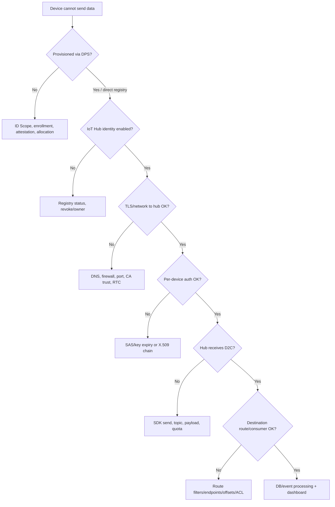

Never fix a 401 error by disabling TLS verification or putting a hub service key on the device. Find the **failing layer** and fix the exact identity, network, registry, route, or consumer issue.

## 36. Lab 1 — Create IoT Hub and a Device Identity in Sandbox

### Expected Outcome

Learners create a **Standard** IoT Hub and a `lab-sensor-001` device identity, then use a **per-device symmetric key** to connect a simulated device, send telemetry, and view the device twin. Never use a hub-level service policy key on the device.

### Prerequisites

| Item | Requirement |
|---|---|
| Subscription | Sandbox authorized to create Azure resources |
| Resource group | `rg-iot-identity-lab`, containing lab resources only |
| IoT Hub | `iothub-id-lab-<unique>`, tier supporting device twins |
| Device identity | `lab-sensor-001`, symmetric key, Enabled |
| Python | Lab environment with `azure-iot-device` |
| Azure CLI | Requires `azure-iot` extension if using advanced IoT Hub commands |
| Security | Never commit/log/export credentials in documents |
| Budget | Check pricing, assign cleanup owner |

**Standard IoT Hub can incur charges even with just one device.** If the sandbox does not allow creating resources, substitute the live lab with design modeling and inspecting simulated SDK logs.

### Step 1 — Create Resources in Portal

1. Select the sandbox subscription and dedicated resource group `rg-iot-identity-lab`.
2. Create an **Azure IoT Hub**, choosing a unique name, approved tier/units, and region.
3. Verify network access and price estimate; do not open public endpoints if organization policy requires private-only.
4. Complete provisioning; record the **hub hostname** and owner.
5. In IoT Hub, open **Device management → Devices** or the equivalent menu.
6. Create device identity `lab-sensor-001` with **symmetric key** authentication and status **Enabled**.
7. Save; verify device ID, auth type, and status.

### Step 2 — Read Registry via Azure CLI

Reference commands for a CLI environment supporting the Azure IoT extension:

```bash
az login --tenant "<tenant-id>"
az account set --subscription "<subscription-id>"
az extension add --name azure-iot

az iot hub device-identity show \
  --hub-name "<iot-hub-name>" \
  --device-id "lab-sensor-001" \
  --query "{deviceId:deviceId,status:status,authenticationType:authentication.type}" \
  --output json
```

This is a **read command**. Full output of identity management APIs can include authentication details, so restrict projections and never post raw logs to public channels. If flags/commands differ in your extension version, check `az iot hub device-identity show --help` in the lab environment rather than running arbitrary mutation commands.

### Step 3 — Prepare Credential

Retrieve the **dedicated device connection string for `lab-sensor-001`** via supported device management functionality, and store it in a secret manager or an environment variable solely for the local simulator:

```text
IOTHUB_DEVICE_CONNECTION_STRING=<secret for lab-sensor-001 only>
```

Do not use the **IoT Hub service connection string** under Shared access policies as a device credential; that credential has a different scope/privileges and could impact the entire fleet if leaked. Avoid putting secrets into Git, command history, or tracked config files.

## 37. Lab 2 — Python Device SDK Sending D2C Telemetry

### Setup

In a dedicated lab project:

```bash
python -m pip install azure-iot-device
```

Script `simulator.py`:

```python
import json
import os
import time
from datetime import datetime, timezone

from azure.iot.device import IoTHubDeviceClient, Message


connection_string = os.environ["IOTHUB_DEVICE_CONNECTION_STRING"]
client = IoTHubDeviceClient.create_from_connection_string(connection_string)

try:
    client.connect()

    for sequence in range(1, 6):
        payload = {
            "eventId": f"lab-sensor-001-{sequence:04d}",
            "sequence": sequence,
            "temperatureC": round(3.5 + sequence * 0.2, 2),
            "measuredAtUtc": datetime.now(timezone.utc)
                .isoformat().replace("+00:00", "Z"),
            "schemaVersion": 1
        }
        message = Message(json.dumps(payload))
        message.content_type = "application/json"
        message.content_encoding = "utf-8"
        message.custom_properties["messageType"] = "telemetry"
        client.send_message(message)
        print("Sent telemetry sequence", sequence)
        time.sleep(2)
finally:
    client.shutdown()
```

### Explanation

- `create_from_connection_string` uses a **single device** identity.
- `client.connect()` performs connection/auth per SDK transport and credential.
- `Message` includes JSON payload and application properties for routing.
- `eventId` and `sequence` help consumers deduplicate/detect gaps.
- `measuredAtUtc` should be separated from `sentAtUtc` when firmware uses an offline buffer.
- `send_message` succeeding does **not** prove the downstream database committed.
- `shutdown` closes the connection when the lab finishes.

### Observe Messages

Open IoT Hub Metrics/diagnostics or use an authorized SDK/CLI consumer. In a suitable Azure IoT extension, you can run:

```bash
az iot hub monitor-events \
  --hub-name "<iot-hub-name>" \
  --device-id "lab-sensor-001"
```

The command may run continuously until stopped and requires appropriate permissions. **Do not copy messages containing real info/credentials into public logs.** If the CLI does not support it, check help/extension version rather than guessing commands.

### Verification Results

```text
Device identity enabled: PASS
Device connect/auth: PASS
Telemetry sequences 1..5 sent: PASS
IoT Hub ingress metric changed: check
Message routing/consumer: check if configured
Service connection string not present in firmware: PASS
```

## 38. Lab 3 — Desired/Reported Twin Properties

### Objective

Test a configuration control loop: cloud requests `telemetryIntervalSeconds=30`, the device receives the request, validates, and sends back reported state. **Desired is not actual** until the device confirms application.

### Simulated Python Script

```python
import os
import time

from azure.iot.device import IoTHubDeviceClient


client = IoTHubDeviceClient.create_from_connection_string(
    os.environ["IOTHUB_DEVICE_CONNECTION_STRING"]
)
current_interval = 60


def on_desired_patch(patch):
    global current_interval
    candidate = patch.get("telemetryIntervalSeconds")
    if candidate is None:
        return
    if not isinstance(candidate, int) or not 10 <= candidate <= 600:
        print("Rejected interval out of range")
        return
    current_interval = candidate
    client.patch_twin_reported_properties({
        "telemetryIntervalSeconds": current_interval,
        "configApplyStatus": "Applied",
        "appliedDesiredVersion": patch.get("$version")
    })


client.on_twin_desired_properties_patch_received = on_desired_patch

try:
    client.connect()
    client.patch_twin_reported_properties({
        "firmwareVersion": "1.4.2",
        "telemetryIntervalSeconds": current_interval
    })
    while True:
        time.sleep(1)
except KeyboardInterrupt:
    pass
finally:
    client.shutdown()
```

This sample is for lab use only; it lacks persistent settings, robust reconnect/error handling, or safety interlocks. Do not use directly as production firmware.

### Updating Desired from Cloud

Via the Portal twin editor or an authorized service API, **patch only the desired section**:

```json
{
  "properties": {
    "desired": {
      "telemetryIntervalSeconds": 30
    }
  }
}
```

Do not overwrite the entire twin or system fields `$version`, `$metadata`. When the device receives the patch, it updates its configuration and sends reported state:

```json
{
  "telemetryIntervalSeconds": 30,
  "configApplyStatus": "Applied",
  "appliedDesiredVersion": 13
}
```

Version number 13 is illustrative; use the actual version provided by the service.

### Offline/Reconnect Test

1. Stop the simulator.
2. Change desired interval to 45.
3. Restart the simulator.
4. **Read the full twin desired state after reconnect** in production designs, rather than relying solely on patch callbacks, because changes made while offline may not arrive automatically as a real-time patch.
5. Validate desired and reported converge.

If `telemetryIntervalSeconds=-1` is received, the device rejects it and keeps a safe configuration. Never mark an invalid value as `Applied`.

## 39. Lab 4 — Designing DPS Zero-Touch Provisioning

### Context

A manufacturer prepares 1,000 vibration sensors shipped to three factories across three regions. Firmware knows only the **DPS ID Scope**, appropriate certificate/trust, and registration identity—never a hardcoded production IoT Hub hostname.

### Reference Model

```text
Manufacturing:
  registration ID: unique per device
  device private key: protected by secure element
  certificate: signed by approved manufacturing CA
DPS:
  group enrollment: trusted, verified CA
  allocation policy: approved IoT hubs / regions
IoT Hub:
  separate resources per site/region policy
Application:
  mapping registrationId ↔ deviceId ↔ assetId
  device twin desired configuration
  telemetry routing + observability
```

### Test Scenarios

| Input/scenario | Expected Outcome |
|---|---|
| Valid X.509 device certificate and registration ID | DPS attestation and hub assignment succeed |
| Certificate not from an allowed CA | Unauthorized provisioning blocked |
| Duplicate Device ID/registration ID per policy | No mis-mapping of devices in inventory |
| Wrong DPS ID Scope | Does not register to the target instance |
| Target hub out of quota | Allocation error/alert per configuration |
| Revoked device | Does not re-provision against policy |
| Device moves factory | Approval + re-provision and asset mapping update |
| CA expired or compromised | Block enrollment, initiate trust rollover plan |
| Provisioning succeeds but hub runtime network blocked | Identify as runtime path issue, not attestation |

### Acceptance Criteria

1. Devices hold no hub-level policy keys.
2. Each device has a unique identity/credential.
3. Certificates/keys protected per manufacturing process.
4. DPS assignment results match prescribed tenant/site.
5. Hub identity is created and connects properly.
6. Mechanisms exist to revoke a single device and handle group CA compromise.
7. Traceability from serial to registrationId/deviceId/assetId.
8. Dashboard tracks provisioning success rate and error counts by batch.

**Running live DPS provisioning in the first lab is optional** if the sandbox lacks hardware or a compatible PKI environment. A thorough design review and test plan still builds clarity on the identity lifecycle.

## 40. Lab 5 — Fault Testing and Safe Revocation

Use only **lab device identities** and privately owned resources; never touch production hubs/certificates.

| Test Case | Controlled Action | Outcome to Verify |
|---|---|---|
| Valid per-device key | Simulator connects | Authentication succeeds |
| Wrong device ID | Use credential mismatching identity | Connection rejected |
| Registry disabled | Disable lab device | Further authentication fails per semantics |
| Old key after rotation | Revoke/rotate lab key, retry old key | Cannot mint/auth valid new tokens |
| Expired SAS | Use expired token in simulation | Authentication rejected |
| Invalid/expired X.509 cert | Use invalid test CA/leaf | Certificate authentication fails |
| Outbound MQTT blocked | Block port in authorized test network | Clear timeout; TLS stays enabled |
| Wrong JSON content metadata | Send payload lacking routing requirements | Body route/query differs from expectations |
| Direct method to offline device | Stop simulator, invoke from cloud test | Appropriate timeout/error, no false success |
| Invalid desired config | Send interval -1 | Device does not apply; reported keeps safe value |
| Offline during desired change | Stop simulator then change desired | Reconnect reads full twin, applies latest |
| Routing destination failure | Induce fault with approved test endpoint/perms | Route failure metrics; ingress vs. delivery distinguished |
| Telemetry replay | Resend same eventId/sequence | Consumer does not duplicate business event |

### What Information Must Be Recorded?

```text
Test case ID:
IoT Hub resource / SKU:
Device ID (no secret):
Authentication mode:
Firmware/SDK version:
Expected:
Actual:
IoT Hub operation status:
Device/client logs (redacted):
Cloud diagnostics/correlation:
Root cause:
Approved remediation:
Owner:
```

**Never record keys, SAS tokens, certificate private keys, or service connection strings** in test reports. When troubleshooting errors, share timestamps, device IDs, operation IDs, and redacted logs.

## 41. Production Checklist for IoT Hub and Device Identity

### Hardware and Provisioning

- [ ] Each device has its own ID, credential, and inventory mapping.
- [ ] Choice of SAS/symmetric vs. X.509/TPM justified by threat model and hardware capabilities.
- [ ] No hub-level policy keys used in firmware.
- [ ] Keys generated/stored securely with anti-cloning procedures.
- [ ] DPS ID Scope/enrollment/group attestation and allocation policy reviewed.
- [ ] Procedures exist for revoking, disabling, re-provisioning, and physically replacing devices.
- [ ] CA/leaf certificate expiry, trust store, and root rollover monitored.

### IoT Hub/Cloud and Applications

- [ ] Hub tier/units/quotas suffice for D2C, twins, direct methods, and required routing.
- [ ] IoT Hub device/registry identity kept distinct from user/backend identities.
- [ ] Backend uses Entra/managed identity/least privilege where supported.
- [ ] Application authenticates users before modifying twins/sending commands.
- [ ] Device-to-tenant mapping comes from trusted inventory, not self-declared payload fields.
- [ ] MQTT/AMQP/HTTPS/TLS, network, and DNS tested on real hardware.
- [ ] Message routing + built-in endpoint/fallback tested end-to-end.
- [ ] Consumers are idempotent with sequence/checkpoints and retention.
- [ ] Desired/reported drift monitored, with config rollout and rollback.
- [ ] Commands/direct methods have validation, timeouts, and safety controls.

### Reliability, Privacy, and Cost

- [ ] Devices have offline buffers, backoff, and anti-retry-storm mechanisms.
- [ ] Edge has local safety behavior when cloud disconnects.
- [ ] D2C payloads include appropriate schemaVersion/eventId/sequence/timestamp.
- [ ] Telemetry has classification/retention and avoids excessive PII.
- [ ] Alerts configured for auth failures, route issues, telemetry freshness, and quotas.
- [ ] Peak/reconnect surge load-tested and billing checked by message size.
- [ ] Budget covers hub, DPS, storage, downstream compute, network, and logs.
- [ ] Runbooks exist for key compromise, certificate expiry, and region outage.
- [ ] Lab/shared resource ownership/cleanup clear; never delete others' devices.

## 42. Common Misconceptions

**"Device ID is a password."** No. Device ID is an identifier; authentication uses secrets/certificates per mechanism.

**"Share one device key across all sensors for speed."** Do not. Compromising one device creates a blast radius across every device sharing that key.

**"Device connection string and IoT Hub service connection string are the same."** False. Credentials and permission scopes differ; service keys must never be placed in firmware.

**"Having a device in the identity registry means the device is online."** No. The registry is an allow record; connection/telemetry freshness provides operational signal.

**"Microsoft Entra ID directly replaces all device credentials on embedded boards."** Not by default. IoT Hub device authentication and backend/user authentication follow different paths.

**"DPS is where IoT Hub stores telemetry."** No. DPS handles provisioning/assignment; runtime telemetry flows through the assigned hub.

**"DPS ID Scope is a secret proving a device is valid."** No. Attestation/enrollment determines registration eligibility.

**"Enrollment group means all devices share one deviceId."** No. A group defines enrollment policy; devices receive distinct identities.

**"Having a TPM guarantees a device has no malware."** No. TPM protects keys/attestation per capabilities; secure boot, updates, and runtime security are still required.

**"X.509 certificates guarantee keys cannot be copied."** Not if the private key is exportable; key protection and manufacturing controls are necessary.

**"Disabling TLS hostname validation makes connections more reliable."** False. It opens the door to server spoofing/MITM attacks.

**"When a SAS token expires, the underlying symmetric key also expires."** No. A SAS is a token signed with the key; keys require separate rotation/revocation.

**"Changing the primary key never disrupts devices."** Not guaranteed. Devices that haven't switched to the secondary key or are offline may fail auth.

**"IoT Hub MQTT is equivalent to an MQTT broker with arbitrary custom topics."** No. IoT Hub's topic/protocol semantics have specific conventions and limits.

**"Since IoT Hub supports MQTT, any legacy MQTT client works unmodified."** Not guaranteed. Topic/auth/SDK changes and feature testing are usually required.

**"Sending a payload with a deviceId proves identity to IoT Hub."** No. Registry identity + SAS/X.509 are required; never trust self-declared firmware fields.

**"Direct methods are queued until an offline device comes back online."** Not by default. They have request/response/timeout semantics, not a durable job queue.

**"C2D success means the safety command was executed."** No. Business acknowledgment and device state verification are required.

**"Desired properties are the actual state on the device."** No. Reported properties reflect state sent back by the device after applying config.

**"Device twins are suitable for writing 100 samples/second."** No. Telemetry belongs on D2C/event streams; twins are for state/config.

**"Putting a tenantId tag in the payload assigns the device to that tenant."** No. Tenant mapping must come from trusted inventory/authorization.

**"If a gateway has an IoT Hub identity, every sensor behind it is independently authenticated."** No. Gateway identity may only prove the gateway; sensors need their own identity model.

**"Adding a new region hub automatically migrates device twins/historical telemetry."** No. Re-provisioning and separate data/configuration sync workflows are required.

**"IoT Hub built-in endpoint stores all telemetry forever."** No. Retention/quotas are finite; long-term storage needs Storage/DBs.

**"D2C send success means the database committed."** No. Ingress, routing, consumer, and business commit are separate stages.

**"An active connection means the sensor is healthy."** No. Telemetry freshness and validation are required.

**"Upgrading tiers fixes all 401 device errors."** No. Auth failures relate to identity/credentials/TLS/clock rather than quotas.

**"Private endpoint lets any Internet device connect normally."** No. Devices need routing/DNS reaching the private endpoint.

**"Backing up firmware is sufficient for Disaster Recovery."** No. Hub/DPS configs, identity mappings, cloud state, routes, consumers, and telemetry archives are all needed.

**"All device control commands are safe if the user has Azure Reader."** No. The backend needs business authorization, auditing, and safety interlocks.

## 43. Self-Check Questions

**Q1.** What problem does Azure IoT Hub solve compared to a plain HTTP endpoint?

**Answer:** Provides per-device connections/identities, D2C/C2D, twins, direct methods, routing, and tier-based IoT management.

**Q2.** How do a Device ID and a device credential differ?

**Answer:** Device ID is the identifier name in the registry; the credential (symmetric key/SAS or X.509 private key) authenticates ownership of that identity.

**Q3.** Why shouldn't a hub service connection string be placed in every device's firmware?

**Answer:** Broad permissions; if extracted from one device, an attacker can affect many devices or service operations per policy.

**Q4.** What main pieces of information does a SAS token contain?

**Answer:** Resource scope/URI, signature, and expiry; additional fields may exist per policy.

**Q5.** What do primary and secondary symmetric keys enable?

**Answer:** Coordinated phased credential rotation while keeping one valid auth path during transition, once rollout is tested.

**Q6.** Does X.509 necessarily protect private keys from copying?

**Answer:** No; it depends on generating/storing keys with secure hardware/PKI controls and preventing private key export.

**Q7.** How does DPS differ from IoT Hub?

**Answer:** DPS attests/provisions/assigns devices; IoT Hub handles runtime device connectivity, messaging, and identity operations.

**Q8.** Is DPS ID Scope a secret replacing an attestation key?

**Answer:** No. It identifies the DPS instance; devices must still prove valid enrollment/attestation.

**Q9.** Name three DPS attestation types.

**Answer:** Symmetric key, X.509 certificate, and TPM per service capabilities.

**Q10.** How do individual enrollment and enrollment group differ?

**Answer:** Individual is for a single registration; group covers multiple devices under a shared trust policy; each device still gets its own identity.

**Q11.** Why maintain three identifiers: serial, deviceId, assetId?

**Answer:** Serial identifies hardware, deviceId identifies the hub principal, and assetId identifies the business asset that may span multiple devices over time.

**Q12.** Is a module identity the same as the device identity of another physical sensor?

**Answer:** No. A module is a logical component belonging to a device/gateway with its own identity/twin scope per supported model.

**Q13.** Does IoT Hub support MQTT like an unrestricted custom-topic broker?

**Answer:** No. Topics/operations must follow MQTT conventions and features supported by IoT Hub.

**Q14.** Does a device successfully sending a D2C message prove downstream Cosmos DB wrote it?

**Answer:** No; hub ingress, routing, and consumer commit are separate steps.

**Q15.** Why does telemetry need eventId/sequence?

**Answer:** Supports deduplication, gap detection, and handling retries/backlogs downstream.

**Q16.** When a device is offline and desired threshold changes, which channel fits?

**Answer:** Desired property in the device twin; the device reads/applies on reconnect and sends a reported property to confirm.

**Q17.** Is a direct method suitable for an offline device receiving a command two days later?

**Answer:** Not by default; direct methods expect device responses within a timeout, whereas long-waiting tasks need desired state or a dedicated command workflow.

**Q18.** Are reported properties set by cloud operators to mark "applied"?

**Answer:** No. They reflect state reported back by the device after actually validating and applying configuration.

**Q19.** Is device twin suitable for storing 10 Hz telemetry?

**Answer:** Not recommended. Use D2C streams; twins are for configuration and infrequently changing reported state.

**Q20.** What should decide whether device `wh-001` belongs to Tenant A or B?

**Answer:** Business inventory/authorized provisioning service, never a self-declared field inside the telemetry payload.

**Q21.** Does an Azure Function's hub data-plane role replace per-device SAS/X.509?

**Answer:** No. Backend service identity and device identity have different roles and permissions.

**Q22.** If a router filter on JSON body doesn't match, what should be checked?

**Answer:** Content-type/content-encoding, valid payload, routing query condition, metadata, and endpoint health.

**Q23.** What is IoT Hub's built-in Event Hubs-compatible endpoint used for?

**Answer:** Letting consumers read the D2C event stream with supported partitions/retention/checkpoints, not permanent archiving.

**Q24.** Why check both the DPS network and IoT Hub network when using Private Link?

**Answer:** Provisioning and runtime connect via different endpoints/network paths; succeeding at DPS does not guarantee reaching the hub.

**Q25.** When a per-device key is leaked, what is the initial response?

**Answer:** Verify device/incident, disable/revoke credential, inspect telemetry, block re-provisioning if needed, issue a new identity safely, and audit.

**Q26.** Why is a leaked CA private key/group enrollment broader than one device?

**Answer:** It can affect many devices within the trust scope, requiring group trust rotation/revocation and fleet-wide checks.

**Q27.** A device remains connected but hasn't reported temperature for 2 hours. Should it be marked Healthy?

**Answer:** Not based on connection alone; telemetry freshness, sensor health, and SLAs must be checked.

**Q28.** How many application messages/day do 20,000 devices sending every minute generate?

**Answer:** 20,000 × 1,440 = 28,800,000 messages/day, before retries, batching, and tier metered message units.

**Q29.** Why can't cost be estimated from device count alone?

**Answer:** Messages, payload size, IoT Hub tier/units, DPS registrations, routes, downstream storage/compute, network, and logs are all needed.

**Q30.** When an IoT Hub region becomes unavailable, what is needed besides creating another hub?

**Answer:** Re-provisioning/identity validity, hub assignment, twins/config, routing/downstream, firmware reconnect, offline buffers, and business DR/runbooks.

## 44. Comprehensive Design Exercise

**Prompt:** A food cold-chain fleet has 2,500 refrigerated trucks. Each truck has 4 sensors, an IoT Edge gateway, GPS, and a temperature controller. Trucks can lose network for 2 hours. Operations wants near-real-time temperature visibility, per-shipment alert thresholds, and the ability to revoke a stolen gateway. GPS data is sensitive and requires restricted access.

Design:

1. Device identities, module identities, and mapping serial → assetId → gateway.
2. Symmetric key, X.509, or TPM for the gateway and why.
3. DPS individual/group enrollment, ID Scope, and regional allocation.
4. Connection path from gateway to IoT Hub over cellular networks.
5. Offline buffer: retention duration, max size, eventId/sequence, and replay.
6. D2C telemetry JSON with schemaVersion/timestamps and content properties.
7. Desired properties for thresholds, reported properties to confirm application.
8. Which direct methods must be restricted due to physical impact.
9. Alert routing to Service Bus and archiving to Data Lake.
10. Business authorization so Depot A staff cannot modify Depot B trucks.
11. Runbooks for lost device, leaked key, expired certificate, and region outage.
12. Dashboard metrics, SLOs, tier/capacity, and cost estimate.

### A Reference Solution

| Component | Suggested Design |
|---|---|
| Device registry | Each cloud-authenticated gateway/device has its own ID |
| Attestation | X.509/TPM if manufacturing and hardware support it; symmetric with secure storage in smaller fleets |
| Provisioning | DPS group enrollment with verified CA, explicit site/hub mapping |
| Gateway | Collects telemetry via local buses, buffers offline with retention |
| Runtime transport | MQTT/AMQP over TLS, retries with exponential backoff |
| Payload | Authenticated gateway identity + sensorId mapping, timestamp, eventId, sequence |
| Config | Desired thresholds per shipment/asset; reported applied version |
| Safety | Local alarms operate when cloud/network is lost |
| Ingress | IoT Hub Standard tier sized for peak quota/units |
| Downstream | Alerts → Service Bus; telemetry archive → Storage/Data Lake; separate analytics |
| IAM | Backend managed identity + per-device credentials + operator business roles |
| Privacy | GPS restricted to authorized teams, clear retention, redacted logs |
| Operations | Certificate expiry, DPS failures, telemetry freshness, drift, route errors |

**Never control hazardous valves/chiller power solely via a cloud message without local safety interlocks.** This is a system with physical impact requiring domain-specific safety standards and certification.

## Summary

**Azure IoT Hub** provides the communication and device management layer on Azure with a **device identity registry, per-device authentication, D2C/C2D messages, device twins, direct methods, and message routing**. The security foundation is **one distinct identity and appropriate credential per device**, never sharing hub service keys in firmware. **SAS/symmetric keys**, **X.509 certificates**, and **TPM/secure elements** have different operational profiles; **DPS** handles provisioning and fleet allocation, while IoT Hub handles connectivity/telemetry once assigned.

In real-world applications, separate **device identity from business asset/tenant identity**, **desired config from reported actual state**, **IoT Hub ingress from downstream commit**, **direct methods from durable command workflows**, and **registry enabled from actual device health**. Cloud–edge designs need **TLS, credential lifecycles, revocation/rotation, managed identities for backends, device-specific authorization, private networking as required, offline buffers, idempotency, and local fail-safes**.

Before production, measure **messages/day, peak connections, quota/tier, routing health, authentication failures, telemetry freshness, desired/reported drift, and full-pipeline costs**. Test across multiple firmware/hardware batches and rehearse network outages, key leaks, certificate rollovers, and failover before scaling the fleet. Done right, Azure IoT Hub does more than "receive readings"—it establishes a **governable, defensible, and auditable device identity and operations platform**.
