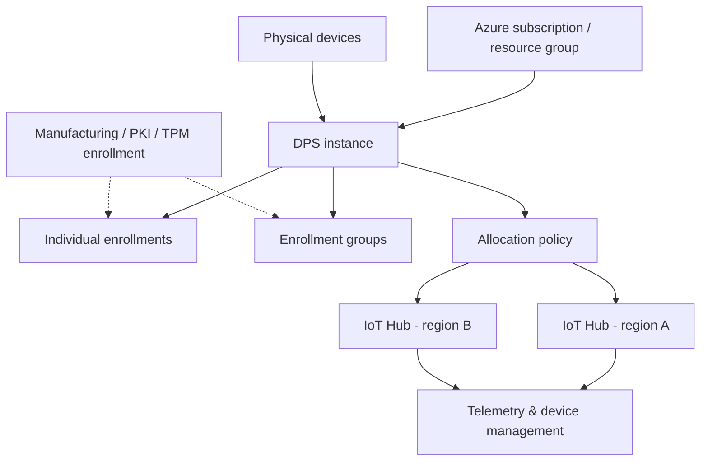
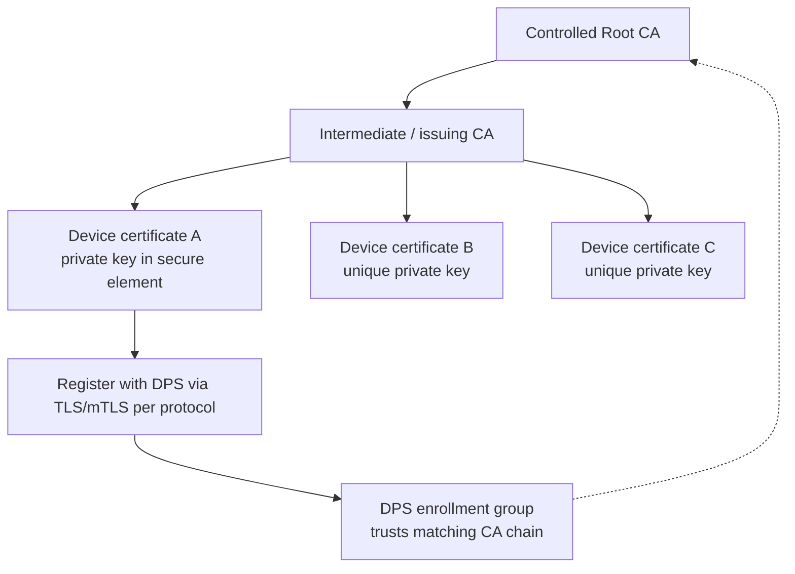
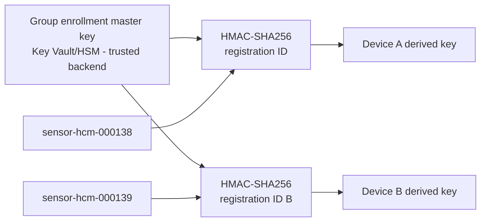
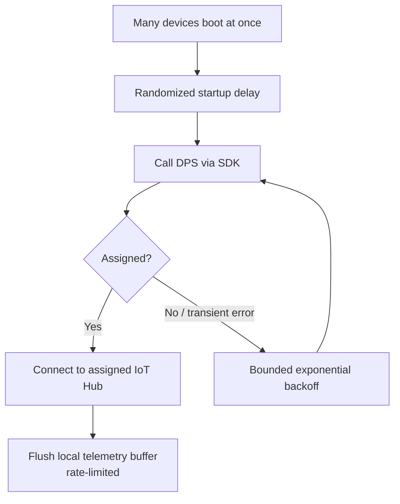
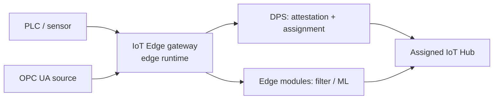
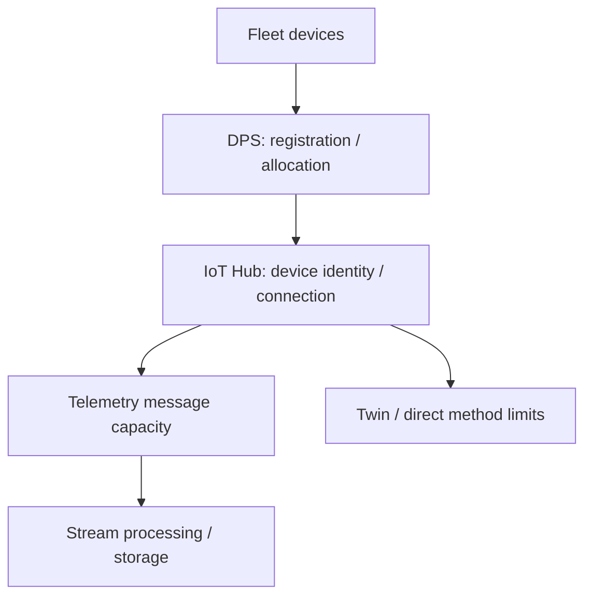
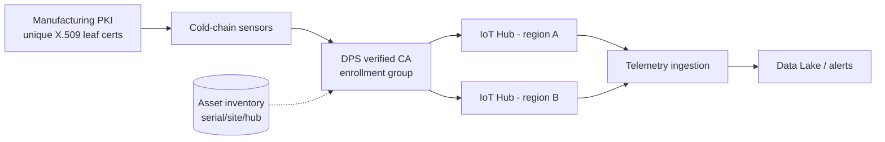

# Device Provisioning Service and Device Provisioning

A manufacturer deploys **80,000 temperature sensors** across multiple factories. Each device is assembled on the factory floor, boxed, shipped to customers, and powered on later. The enterprise uses **Azure IoT Hub** to receive telemetry, manage device identities, and send control commands. If technicians had to pre-configure the **IoT Hub hostname, device ID, and authentication credentials** on every unit, changing deployment regions or replacing an IoT Hub would trigger unmanageable manual work. A stolen device or leaked key could also spoof identities if the manufacturing process distributes secrets insecurely.

**Azure IoT Hub Device Provisioning Service (DPS)** solves the **initial registration and provisioning (*zero-touch provisioning*)** piece: a new device can present proof of identity to DPS, receive its assigned IoT Hub details, and then connect to the right IoT Hub using an appropriate authentication mechanism. DPS supports identity verification methods such as **X.509, TPM, and symmetric keys**, along with **individual enrollments**, **enrollment groups**, and allocation policies across one or more linked IoT Hubs.

However, DPS is **not** where continuous telemetry is ingested, does **not replace** IoT Hub, and does **not automatically guarantee** that physical hardware cannot be cloned in the field. A secure design must combine hardware identity, manufacturing trust chains, enrollment lifecycle policies, networking, monitoring, quotas, and revocation plans when devices are compromised.

This lesson belongs to the **IoT and Edge Computing** chapter of the **CLOUD_PROVIDERS_AZURE** module. The module introduces Azure from subscriptions, resource groups, and Microsoft Entra ID through virtual networks, compute, storage, and data, while focusing on deployment, monitoring, security, and cost control. This lesson treats **DPS as the onboarding control plane of an IoT fleet**, connecting onward to **IoT Hub**, edge devices, and data analytics systems.

**After this lesson, you can:**

- Distinguish **DPS instance, ID scope, registration ID, enrollment, device identity, and IoT Hub assignment**.
- Explain the flow **bootstrapping → attestation → allocation → registration → IoT Hub connect**.
- Choose the right **X.509 certificate, TPM attestation, or symmetric-key attestation** for your hardware and manufacturing model.
- Explain **individual enrollments**, **enrollment groups**, linked IoT Hubs, and allocation policies.
- Analyze **initial device twin**, reprovisioning, replacement devices, region moves, and revocation.
- Design onboarding for **IoT Edge** and offline/poor-connectivity device environments.
- Write a lab test workflow using the SDK/CLI without hardcoding a group master key in firmware.
- Monitor registration failures, throughput/quotas, supply chain security, and fleet-level costs.

## 1. Why Does IoT Need a Dedicated Provisioning Service?

Provisioning differs from normal connectivity. When a sensor that has never connected to Azure boots up, it needs to know **who it is**, **who is trustworthy**, and **which IoT Hub it is allowed to connect to**.

| Question | Primary Responsibility |
|---|---|
| Is this hardware/device authorized by the organization? | **DPS attestation** combined with a trusted manufacturing process |
| Which IoT Hub will the device belong to? | **DPS enrollment + allocation policy** |
| Does IoT Hub already have this device's identity? | DPS registration/provisioning coordinating with the **IoT Hub identity registry** |
| What receives telemetry and handles device twins/direct methods? | **IoT Hub** after the device connects |
| What aggregates sensor data or runs ML? | Event Hubs-compatible endpoint, Stream Analytics, Functions, Storage, and analytics services per architecture |
| What manages app/firmware updates or edge configurations? | Dedicated device update services/processes, IoT Edge, and supported management mechanisms |

### 1.1. No Need to Hardcode One IoT Hub Across the Entire Fleet

A manufacturer can embed the **DPS global endpoint + ID scope** into firmware along with each device's individual identity/credential. At installation time, DPS determines the appropriate hub. When adding IoT Hubs or changing topology, the system can adjust allocation/reprovisioning per policy without recompiling every hub hostname into firmware.

**However:** changing a DPS policy does not mean all online devices immediately switch hubs on their own. Devices must re-register/re-provision per a supported workflow, and device identities and twins/state must be managed across old and new hubs.

### 1.2. General Flow

```mermaid
sequenceDiagram
    participant D as New device
    participant P as Azure IoT Hub DPS
    participant H as Assigned IoT Hub
    D->>P: TLS connect; send ID scope, registration ID, and attestation
    P->>P: Verify enrollment + identity proof
    P->>P: Apply allocation policy / select IoT Hub
    P->>H: Create/update device identity per workflow
    H-->>P: Provisioning result
    P-->>D: Assigned hub + device ID / status
    D->>H: Separate connection, authenticate with IoT Hub
    H-->>D: Accept connection and device-to-cloud/cloud-to-device services
```

This is a logical flow, not a packet-level breakdown of MQTT/AMQP/HTTPS. **DPS connection** and **IoT Hub connection** are two separate stages with distinct endpoints, purposes, and states.

## 2. Terms You Must Distinguish

| Term | Meaning | Do Not Confuse With |
|---|---|---|
| **DPS instance** | Azure resource managing enrollments, linked hubs, and registrations | IoT Hub receiving telemetry |
| **DPS global endpoint** | Shared endpoint where clients begin provisioning per SDK/protocol | Assigned IoT Hub hostname |
| **ID scope** | Identifier scoping a DPS instance, used by firmware/clients to select DPS | Entra tenant ID, subscription ID, or a secret |
| **Registration ID** | Device identifier used when registering with DPS | Not always identical to IoT Hub device ID |
| **Enrollment** | Record authorizing and defining how a device attests | IoT Hub device twin or telemetry record |
| **Individual enrollment** | Grants access to a specific device | Enrollment group |
| **Enrollment group** | Policy admitting a group of devices based on accepted shared proof | Pre-created list of device IDs |
| **Attestation** | Cryptographic proof that a device holds valid credentials/hardware | Microsoft Entra user sign-in |
| **Allocation policy** | Rule selecting an IoT Hub from linked hubs | Rule routing messages to Storage |
| **Registration state** | Hub/device assignment result and status of a registration | Online/offline state of IoT Hub |
| **Initial twin** | Initial desired properties/tags metadata applied per supported capabilities | Telemetry, secret store, or continuously pushed policy |
| **Reprovisioning** | Device re-registering to be processed under updated policies | Automatic migration of all historical data |

### 2.1. Registration ID, Device ID, and Serial Number

Suppose a device has:

```text
Manufacturing serial number:  SN-FR-2026-000138
DPS registration ID:         sensor-fr-000138
IoT Hub device ID:           sensor-fr-000138
Assigned IoT Hub hostname:   iothub-europe-example.azure-devices.net
```

These values are illustrative. Registration ID and IoT Hub device ID **can be identical in typical workflows**, yet they should be treated as distinct concepts because enrollment/registration mappings and custom allocation can intervene per service capabilities. Serial numbers may also differ from registration IDs; a reliable **inventory mapping** is essential.

A registration ID must satisfy **DPS SDK/protocol character and length rules**, remain stable, and avoid collisions within its scope. Never embed API keys, customer emails, or confidential data in it.

### 2.2. Is ID Scope a Password?

**No.** The ID scope identifies which DPS instance to register against; devices can be configured with the ID scope during manufacturing. **ID scope does not prove authorization to register.** DPS must still evaluate attestation evidence and enrollment rules.

## 3. Management Components of a DPS System

A typical fleet architecture:



**DPS and IoT Hubs can reside in different resource groups** if service, identity, and role permissions allow. You must configure **linked IoT Hubs**, hub-linking/device-registration permissions, and appropriate allocation. Simply creating an IoT Hub in a subscription **does not automatically link** it to every DPS instance.

### 3.1. Control Plane vs. Data Plane Differences

- Azure administrators use **Azure RBAC/management plane** to create DPS, link hubs, configure policies, or manage enrollments per granted roles.
- Devices use **X.509/TPM/symmetric attestation** with DPS. Small IoT devices do not need the Azure subscription **Owner** role to register.
- After provisioning, **IoT Hub device credentials** authenticate and authorize device-to-cloud operations and receiving direct methods/twins per protocol and identity.
- Users/backends administering IoT Hub have separate **service-side** permissions; never use service-side credentials as firmware secrets.

**Never distribute an IoT Hub service connection string to devices.** It can hold broad service permissions and create a massive blast radius if leaked.

## 4. End-to-End Flow from Factory to IoT Hub

The lifecycle can be broken into seven stages:

1. **Manufacture:** assign serial number, physical identity, certificates, or keys on chip/secure element.
2. **Enroll:** administrators create individual/group enrollments in DPS and verify certificate trust or TPM data.
3. **Ship:** devices leave the factory with the DPS ID scope and their own individual credentials—**never** an embedded group master secret.
4. **First boot:** firmware connects to the network and calls the DPS registration protocol via a trusted SDK.
5. **Attestation + allocation:** DPS verifies proof, selects an IoT Hub, and creates/records the identity.
6. **Connect:** device uses the assignment and matching credentials to connect to IoT Hub.
7. **Operate/recover:** telemetry, twins, firmware updates, re-provisioning, rotation/revocation when needed.

### 4.1. Device State vs. Provisioning State

A device that is **already provisioned** yet still offline can show `assigned` registration state in DPS. A device **currently sending telemetry** does not guarantee its DPS enrollment is still enabled if policy changed after it connected. Operational dashboards must distinguish:

```text
DPS: enrollment / registration state
IoT Hub: device identity + connection state
Fleet service: health, firmware version, last telemetry time
Business: factory/site/owner/decommission state
```

## 5. Individual Enrollment: Registering a Single Device

**Individual enrollment** applies attestation/registration rules for **one explicitly identified device**.

Conceptual administrative record example:

```json
{
  "registrationId": "sensor-hcm-000138",
  "attestation": "x509-or-tpm-or-symmetric",
  "enrollmentStatus": "enabled",
  "desiredHubPolicy": "organization-policy",
  "deviceClass": "cold-chain-sensor",
  "inventoryReference": "factory-batch-2026-11"
}
```

This is an **illustrative inventory JSON**, **not a REST/ARM enrollment body you can submit directly**. Actual DPS attestation and allocation fields have specific schemas per enrollment type.

### 5.1. When to Use?

- Devices with individual hardware attestation such as a **TPM endorsement key**.
- Critical devices needing per-device control, revocation, or auditing.
- Small device counts or provisioning processes requiring per-asset governance.
- Cases needing custom device IDs, hub assignments, or initial metadata distinct from the rest of the fleet.

### 5.2. Trade-offs

An enterprise with millions of devices will not want to manually manage a million records without automation. Individual enrollments should be created by a **manufacturing backend/automation** with identity, auditing, batch controls, and rate limits. For devices carrying certificates signed by the same trusted CA, enrollment groups usually cut operational overhead significantly.

## 6. Enrollment Group: Fleet Scale

An **enrollment group** lets a cohort of devices provision via a shared attestation mechanism, typically:

- **X.509 CA-signed certificates:** devices hold leaf certificates issued from a CA chain trusted by the group per DPS rules.
- **Symmetric key group enrollment:** a group key is used inside a trusted system to **derive an individual key for each registration ID**.

An enrollment group **does not mean every device shares the same device password**. For symmetric group enrollment, keep the group master key off devices; for X.509, each device must hold its own unique private key.

### 6.1. Group Model Example

```text
Enrollment group: eg-coldchain-prod
  Trust: manufacturing CA certificate / valid key policy
  Allocation: production hubs by approved policy
  Initial twin: device class + desired config

Devices:
  sensor-hcm-000138 -> unique key/certificate
  sensor-hcm-000139 -> unique key/certificate
  sensor-dn-000140  -> unique key/certificate
```

### 6.2. A Group Does Not Replace Inventory

A group allows large fleets to register via CA/derived keys. Still, fleet operations must know:

- Which devices were actually issued by the factory.
- Which serial number/registration ID was assigned to which customer or site.
- Which certificates have been replaced/revoked.
- Final device identity and hub assignment.
- Firmware version and decommission status.

If the business wants to admit **only an exact list of sold devices**, enforce inventory/PKI controls, enrollment policies, provisioning checks, and the ability to **disable individual registrations** appropriately. Never assume "holding a CA-signed certificate" proves a valid purchase order or ownership by a specific customer.

## 7. X.509 Attestation: Each Device Holds Its Own Private Key

X.509 uses certificates and cryptographic proof to authenticate devices. A trust hierarchy:



**Core value:** every device has its own private key; there is no need to embed a shared fleet key in firmware. When the private key is protected in a TPM/secure element, cloning credentials becomes much harder than with keys stored in standard flash.

### 7.1. Certificate Types

- **CA certificate:** represents a certificate authority issuing/authorizing device certificates.
- **Device leaf certificate:** belongs to a specific device and carries an identity suitable for registration.
- **Private key:** never upload it to DPS or send it to an IoT Hub service/backend "for convenient registration."
- **Certificate chain:** lets DPS verify that the leaf cert was issued along an accepted trust chain.

The device must prove possession of the matching **private key**. Simply copying a `.crt` file from another device is **insufficient** without the private key.

### 7.2. CA Verification / Proof of Possession

When using a CA-based enrollment group, perform **verification/proof of possession** for the certificate via the DPS-supported workflow. Merely uploading a CA file does not make it permanently trusted by default. Typical control steps:

1. Create/import the CA certificate into DPS via supported portal/API workflows.
2. Complete verification/challenge signing using the CA private key in a managed PKI environment.
3. Create the enrollment group pointing to the appropriate certificate trust.
4. Test the device certificate chain and registration ID mapping.
5. Confirm admin permissions and certificate/secret storage are locked down.

**Never sign verification challenges with a root CA private key on a personal workstation.** Production PKI processes require HSM/CA services, multi-party approvals, and auditing.

### 7.3. Rotation and Revocation

A lost/compromised device may require revoking its **enrollment** or **IoT Hub device identity**, alongside managing certificate trust in PKI. Re-issuing a leaf certificate only works when:

- Devices have a secure credential update mechanism.
- The new chain is accepted by DPS/IoT Hub at the right time.
- Old certificates are rejected per policy.
- There is a plan for long-offline devices.

Never claim "revoking a CA" affects only one sensor—if thousands of devices chain to that CA, the blast radius can span the whole fleet.

## 8. TPM Attestation: Binding Identity to Hardware

A **Trusted Platform Module (TPM)** is hardware capable of protecting keys and performing cryptographic attestation without exporting private keys into normal memory.

In DPS, TPM attestation can use the **endorsement key** and registration ID alongside a challenge/response/derived-key flow per the DPS SDK to verify the device.

```text
Manufacturer:
  Device includes TPM, stable registration ID
  Trusted enrollment backend records required TPM identity data

First boot:
  Device -> DPS: registration + TPM attestation
  DPS -> Device: challenge/provisioning protocol
  Device TPM proves possession
  DPS -> Device: IoT Hub assignment
  Device -> IoT Hub: authenticate using provisioned mechanism
```

### 8.1. When to Choose TPM?

- Devices have capable TPM/secure hardware and SDK support.
- You want to prevent copying private device credentials between devices.
- You need registration bound to the physical chip.
- Industrial fleets with secure manufacturing and a clear key lifecycle.

**A TPM does not automatically prove a device is completely secure.** Compromised firmware can still instruct the TPM to perform authorized operations; the design still needs secure boot, signed firmware, OS hardening, update pipelines, and secure telemetry.

### 8.2. Do Not Treat a TPM Like a Symmetric Secret

Never extract private keys from the chip just to put them into app settings. Nor should you substitute a cloned serial code for TPM attestation. If a mainboard/TPM is replaced, the identity may need **re-enrollment** under a device-replacement procedure.

## 9. Symmetric-Key Attestation: Use Appropriately and Protect the Master Key

Symmetric keys are simple and common on resource-constrained devices. However, they carry **key-cloning risk**: if an attacker extracts a device's key, they can impersonate that device while the credential remains valid.

### 9.1. Individual Symmetric Key

Each device has its own secret bound to an individual enrollment. This allows revoking one device without changing keys across the entire fleet, though the manufacturing backend must generate, distribute, and store keys securely.

### 9.2. Group Symmetric Key and Derived Device Key

In group enrollment, a **group master key** stays inside a trusted system; the key placed on each device is **derived from the group key and registration ID** using the DPS-supported algorithm, rather than copying the raw group master key.



**Never embed the group master key in firmware.** If the master key leaks, an attacker can derive credentials for many registration IDs. A device should hold only **its own derived key** in appropriate secure storage.

### 9.3. Illustrative Key Derivation Code in a Manufacturing Backend

```python
import base64
import hashlib
import hmac
import os


def derive_device_key(group_key_base64: str, registration_id: str) -> str:
    """
    Demonstrate the symmetric key derivation algorithm for DPS group enrollment.
    Run only inside a trusted manufacturing backend.
    """
    group_key = base64.b64decode(group_key_base64, validate=True)
    digest = hmac.new(
        key=group_key,
        msg=registration_id.encode("utf-8"),
        digestmod=hashlib.sha256,
    ).digest()
    return base64.b64encode(digest).decode("ascii")


# Environment variable must use secret injection; never commit or print its value.
master = os.environ["DPS_GROUP_PRIMARY_KEY"]
registration_id = "sensor-hcm-000138"
device_key = derive_device_key(master, registration_id)

# Provision device_key via a secure manufacturing channel to the target device.
# DO NOT print/log device_key; DO NOT export master key to untrusted factories.
```

**Example boundaries:**

- HMAC-SHA256 over the UTF-8 registration ID illustrates the standard DPS symmetric-group derivation pattern; verify SDK/protocol/version and registration ID normalization before production.
- Never display any real keys.
- Never send the group key to devices or store it in plaintext files.
- Do not use this derivation code as a homegrown token auth mechanism replacing the DPS SDK.
- If the master key is rotated, issued derived keys need a coordinated re-provisioning/rotation strategy so devices do not lose connectivity.

### 9.4. Individual Key vs. Group Key

| Criterion | Individual key | Group + derived keys |
|---|---|---|
| Per-device provisioning | Needs individual enrollment/credential | One enrollment group can serve a fleet |
| Operations at scale | Many records and automation | Fewer administrative records |
| Blast radius if *device key* leaks | Primarily that device | Primarily that device if master is safe |
| Blast radius if *group master key* leaks | Not applicable | Potentially massive |
| Device revocation | Disable/delete individual enrollment and matching hub identity | Requires denylist/disable/identity revocation design per supported capabilities |
| Fits hardware without PKI/TPM | Yes | Yes, if key protection practices are rigorous |

## 10. Choosing an Attestation Method by Risk

| Criterion | X.509 | TPM | Symmetric key |
|---|---|---|---|
| Hardware dependency | Secure element/TPM recommended to hold keys | Compatible TPM | Secure storage recommended |
| Attestation | Certificate chain and proof of private-key possession | Hardware-backed attestation | Proof of shared/derived key |
| Enrollment group | Fits CA-signed groups | Typically individual enrollment for TPM identities | Fits group-derived keys |
| PKI operations | Requires CA, rotation, chain verification | Requires TPM identity lifecycle | Requires secret generation/distribution/rotation |
| Identity cloning risk | Reduced when private key is non-exportable | Reduced via TPM, still depends on firmware trust | Increases if key is extracted |
| Revocation capability | Per enrollment/IoT Hub/PKI policy | Per identity/enrollment | Per enrollment/key/IoT Hub |

**Directional recommendation:** Well-provisioned X.509 with a secure element is a strong choice for large fleets with PKI; TPM helps when hardware already supports it; symmetric keys can fit low-cost devices if group secrets are strictly guarded. Final selection also depends on hardware certification, manufacturing cost, SDK features, industry regulations, and 5–10 year maintainability.

## 11. Registration Request and Provisioning Result

A device provisions via a DPS-supported SDK/protocol. The typical sequence includes:

1. Load **DPS ID scope**, global endpoint, and registration ID.
2. Prepare attestation: leaf cert/private key, TPM, or derived symmetric key.
3. Open a TLS connection and present identity proof.
4. Submit registration request and handle in-progress status (may require polling/retries per SDK).
5. Receive **assigned hub**, **device ID**, and status.
6. Create an IoT Hub client with the hostname/device ID using the corresponding authentication.
7. Start telemetry/heartbeats or device control.

### 11.1. Conceptual Registration Output

```json
{
  "registrationId": "sensor-hcm-000138",
  "status": "assigned",
  "registrationState": {
    "assignedHub": "iothub-asia-example.azure-devices.net",
    "deviceId": "sensor-hcm-000138"
  }
}
```

**This is an illustrative simplified JSON**, not a guarantee of the exact schema of every SDK REST response. Real responses can contain status, timestamps, substatus, error details, or different field structures. SDKs typically return parsed registration result objects.

### 11.2. When `status` Is Not Yet `assigned`

Provisioning may still be processing or may have been rejected. Devices should not:

- Guess a hub from a region name and connect before DPS assigns one.
- Hammer with 10,000 retries/second while unassigned.
- Assume every DPS error means "wrong key."
- Log private keys, SAS tokens, or sensitive full certificate chains.

Use SDK/supported retry policies, **bounded backoff + jitter**, and time limits. During extended outages, devices can keep a previously verified assignment per a **designed cache/persistence policy**, while defining when re-provisioning is required.

## 12. Hands-On SDK: Registering with a Derived Symmetric Key

Python example illustrating the **Azure IoT Device SDK** when the SDK/version supports `ProvisioningDeviceClient`. Confirm packages, APIs, and versions against your lab environment.

```python
import asyncio
import os

from azure.iot.device.aio import ProvisioningDeviceClient


async def main():
    registration_id = os.environ["DPS_REGISTRATION_ID"]

    # Derived device key specific to a single registration ID:
    # the group master key MUST NOT exist on the device.
    device_key = os.environ["DPS_DERIVED_DEVICE_KEY"]

    client = ProvisioningDeviceClient.create_from_symmetric_key(
        provisioning_host="global.azure-devices-provisioning.net",
        registration_id=registration_id,
        id_scope=os.environ["DPS_ID_SCOPE"],
        symmetric_key=device_key,
    )

    try:
        result = await client.register()
        print("Provisioning status:", result.status)

        if result.status != "assigned":
            raise RuntimeError("Device is not assigned to an IoT Hub")

        state = result.registration_state
        print("Assigned IoT Hub:", state.assigned_hub)
        print("Device ID:", state.device_id)

        # Next step is creating an IoT Hub client with the appropriate
        # identity/credential; do not treat registration output as a telemetry connection.
    finally:
        await client.shutdown()


if __name__ == "__main__":
    asyncio.run(main())
```

**Prerequisites before running:**

- A DPS resource, linked IoT Hub, valid group enrollment, and sufficient permissions are configured in the **lab**.
- `DPS_ID_SCOPE` matches the instance's ID scope.
- `DPS_REGISTRATION_ID` matches the identifier used when deriving the key.
- `DPS_DERIVED_DEVICE_KEY` is the device's derived key, **not** the group master key.
- Package `azure-iot-device`/Python version and `ProvisioningDeviceClient` API are compatible.
- The device can reach DPS over the configured protocol/TLS.
- Calling `register()` is a **provisioning operation that can mutate registration/IoT Hub identity state** and incur service usage; never run against production with dummy identities.

**Important scope limits:** this example only demonstrates **provisioning assignment**; it does not implement creating the IoT Hub client, TPM/X.509 handling, long-term network retries, assignment caching, certificate rotation, or telemetry. Do not mix symmetric-enrollment credentials into TPM/X.509 setups.

### 12.1. Device SDK Is Better Than Hand-Rolling MQTT Protocol

DPS has specific protocol flows, token/attestation handling, polling, and retries. Hand-crafting SAS tokens, MQTT topics, and TLS challenges is error-prone. Use **Microsoft/ecosystem-supported SDKs** for your device's language/OS/MCU, and pin versions in firmware releases.

## 13. Linked IoT Hubs: Where Does DPS Allocate?

A DPS instance must know which IoT Hubs it is permitted to allocate to. When configuring **linked IoT Hubs**, check:

- Hubs belong to the right environment (dev/test/prod), with no accidental cross-environment mixing.
- Region, SKU, capacity, and service quotas of each IoT Hub.
- DPS permissions to provision identities in the IoT Hub via the supported linking mechanism.
- Global DPS allocation policy and per-enrollment overrides where present.
- Data security, residency, and business ownership.
- Which hubs must not receive certain device classes or tenants.

### 13.1. Why Multiple IoT Hubs?

- Scale out a fleet across device/connection/telemetry quotas.
- Reduce single-hub blast radius when a valid failover design exists.
- Partition by geographic/data residency or customer groups.
- Separate critical equipment from lower-priority telemetry devices.
- Limit blast radius and separate operational permissions.

**Multiple IoT Hubs do not automatically provide complete disaster recovery.** Firmware, identity mapping, device twins, telemetry routes, and business consumers all require a hub-migration plan.

## 14. Allocation Policies

The **allocation** policy decides the target IoT Hub when DPS provisions a device.

| Policy/Type | General Meaning | Suitable When |
|---|---|---|
| **Evenly weighted distribution** | Distributes devices across linked hubs per weights/supported mechanism | Splitting a fleet across multiple hubs |
| **Lowest latency** | Picks a suitable hub based on latency/geographic info per service algorithm | Fleets spanning multiple regions prioritizing connectivity path |
| **Static configuration** | Assigns to a specified hub per configuration | A subset must live on one exact hub |
| **Custom allocation** | Invokes custom logic (such as an Azure Function in supported scenarios) to decide | Complex tenant/site/contract mappings |

Policy names and portal/API parameters may vary by service version; the table describes **design intent**. Do not assume "lowest latency" performs live pings from sensors to every hub, or that balanced distribution guarantees every hub always holds the exact same device count.

### 14.1. Evenly Weighted Does Not Replace Capacity Planning

If hub A has three times the capacity of hub B, configure appropriate weights per supported features and monitor usage. **Distributing device count** does not mean **splitting telemetry messages evenly**, since one gateway can emit more data than thousands of standalone sensors.

### 14.2. Lowest Latency and Data Residency

The closest hub by network latency may not lie in a legally permitted data-processing region. For factory or customer data subject to geographic constraints, **security/residency policies must be enforced first** or as hard filters—never use lowest latency blindly across all linked hubs.

### 14.3. Static Allocation

Appropriate when a group of devices must always land on a dedicated hub, for example:

```text
Enrollment group: eg-factory-hcm
Allowed hub:       iothub-vietnam-approved
Reason:            site ownership, compliance, routing
```

This makes assignments predictable but introduces dependency on that specific hub. Maintain runbooks for hub capacity limits, outages, or policy changes.

### 14.4. Custom Allocation

Custom allocation helps when logic like this is needed:

```text
Registration arrives
  -> verify trusted device inventory/site/tenant
  -> select allowed IoT Hub list
  -> consider capacity/compliance/rollout segment
  -> return assignment decision
```

When configuring custom allocation with an Azure Function per DPS mechanisms:

- The Function must have proper authentication/authorization and network paths.
- Never trust device-claimed fields like `tenantId` without verification.
- Handle **timeouts, Function cold starts, retries, duplicate requests, and errors**.
- Avoid uncached/unbounded external database queries that stall every new device.
- Audit allocation decisions with correlation IDs without logging secrets.

**Never expose the allocation Function over an unprotected public endpoint just to simplify onboarding.** Custom allocation is a critical component that can become a fleet-wide single point of failure.

## 15. Initial Device Twin: Starting Metadata

When DPS creates/provisions an IoT Hub device identity, it can apply an **initial twin** per enrollment configuration/supported service capabilities. An IoT Hub device twin is a configuration state document with sections such as:

- **Tags:** service-side metadata, typically not directly exposed to device clients.
- **Desired properties:** cloud-side configuration expressing what the device is expected to apply.
- **Reported properties:** information updated by the device after connecting and running.

Conceptual initial twin content example:

```json
{
  "tags": {
    "deviceClass": "cold-chain",
    "site": "factory-hcm-02",
    "environment": "production"
  },
  "properties": {
    "desired": {
      "telemetryIntervalSeconds": 60,
      "samplingProfile": "temperature-basic"
    }
  }
}
```

This is a **logical initial twin example**, not the complete JSON of an enrollment API or device twin response. Actual formats include dedicated wrappers/versions/metadata.

### 15.1. Be Careful with Twin Secrets

Never store symmetric keys, certificate private keys, API tokens, connection strings, or passwords in **tags/desired properties**. Tags/desired properties are for metadata/configuration, not a secret vault. Twin read permissions across services/backends may be broader than expected.

### 15.2. Changing Enrollment Does Not Automatically Update Existing Twins

If you change `telemetryIntervalSeconds` in a group enrollment after 30,000 devices have already provisioned, **do not assume** twins on active IoT Hubs update automatically. To update the fleet, use IoT Hub device twin updates/jobs or appropriate configuration/IoT Edge deployment mechanisms and review reprovisioning behavior.

### 15.3. Devices Must Report Actual State

A desired property is **cloud intent**, not proof the device applied it. Devices should update **reported properties** after validating actual configuration; the backend compares desired vs. reported to detect drift.

## 16. Reprovisioning: Re-Registering and Moving IoT Hubs

An already-provisioned device may need to re-register when moving factories, replacing TPM/certificates, resetting firmware, changing regions, or retiring an old hub. **Reprovisioning** does not automatically migrate all historical device data.

Policies supported by DPS can carry meanings such as:

| Policy | Meaning | What Must Be Protected |
|---|---|---|
| **Never reprovision** | Preserve existing hub assignment instead of re-allocating | Can make hub moves/recovery harder |
| **Reprovision and reset** | Device is re-allocated and gets fresh initial config | Previous config state may require separate preservation/restore |
| **Reprovision and migrate state** | Migrates supported IoT Hub state when hub changes | Does not migrate telemetry history or app DBs |

Exact policy names and semantics must be verified against the service version and enrollment type in use.

### 16.1. Caching Assignment on the Device

Firmware can persist **assignedHub + deviceId** in secure storage to reduce DPS calls across reboots. However, when an old hub is deleted, regions change, or revocation occurs, the cached assignment becomes invalid.

```text
If trusted cached assignment exists:
  -> try assigned IoT Hub, bounded timeout/retry
  -> if policy requests reprovision or assignment is no longer valid:
       call DPS with device attestation
       persist new assignment after success
Else:
  -> call DPS for first assignment
```

This is illustrative pseudocode. How long to cache depends on security needs, networks, and SDKs. Never hold onto an old hub indefinitely just to avoid calling DPS.

### 16.2. Hub Migration Checklist

1. Verify device identity and credentials on the target hub.
2. Reconcile **desired/reported twins**, tags, and IoT Edge capabilities.
3. Update `registrationId → assignedHub` mappings in fleet inventory and backends.
4. Check message routes, Event Hubs consumers, alert rules, and service-to-device commands.
5. Handle buffered/in-flight telemetry and duplicate events.
6. Verify data residency, logging, backups, and retention.
7. Retire the old hub only after confirming devices and consumers have switched over.

**DPS does not automatically copy ADLS history, consumer offsets, queue checkpoints, database rows, or application secrets** between hubs.

## 17. Offline Devices and Registration Storms

If a factory loses power for 8 hours and 50,000 devices boot simultaneously, they can trigger tens of thousands of registration attempts at once. Devices must implement **bounded retries and jitter**:



Principles:

- Respect SDK/service retry hints when provided; never loop hundreds of times per second.
- **Invalid certificate/credential errors** require identity investigation, not infinite retries.
- DNS/TLS drops or cellular outages can retry with backoff/jitter.
- Never schedule the entire fleet to update firmware or re-provision simultaneously at 00:00.
- If a valid assignment exists, consider connecting to the existing hub per policy before calling DPS.

### 17.1. Local Buffering Is the Device's Job

DPS does not store telemetry measured while offline. If the product cannot lose events:

1. Write to a **bounded local queue** or durable device storage.
2. Include `deviceId`, `eventId/sequence`, and timestamp on every event.
3. On reconnect, flush at a controlled rate so IoT Hub is not overwhelmed.
4. Backend deduplicates/reorders per the business contract.
5. Enforce retention/eviction policies when edge storage fills.

### 17.2. Secure Time and TLS

A newly booted device without a synchronized clock may fail TLS certificate validation or mint expired tokens. Implement secure clock/RTC/time sync per hardware capability; never disable `certificate verification` because of a skewed clock.

## 18. IoT Edge and DPS

**Azure IoT Edge** runs modules and processing logic on gateways. Gateways can be provisioned via DPS using supported runtime/provisioning mechanisms.



### 18.1. One Gateway Does Not Equal Every Sensor

- An IoT Edge gateway has a **device identity** in IoT Hub.
- PLC/BLE/OPC UA sensors behind the gateway may speak local protocols without each sensor calling DPS.
- If using nested/transparent gateways or individual downstream identities, design authentication/registration architecture per supported runtime capabilities.

### 18.2. IoT Edge Workflow via DPS

1. Choose X.509/TPM/symmetric attestation supported by the runtime.
2. Configure the enrollment and set **IoT Edge capability** appropriately on the IoT Hub identity.
3. Place ID scope, registration ID, and individual device credential into provisioning config.
4. Start the edge runtime, receive hub assignment, and connect.
5. Apply module deployments via IoT Hub using IoT Edge mechanisms.
6. Monitor edgeAgent/edgeHub, desired/reported twins, and module health.

**DPS provisions the device; it does not automatically run container images or ML modules** merely because registration finished. Fully air-gapped machines also cannot use online provisioning without a supported communication path.

## 19. Networking: DPS Endpoint Differs from IoT Hub Endpoint

```text
DPS global registration endpoint:
  global.azure-devices-provisioning.net

Assigned IoT Hub endpoint:
  <assigned-hub>.azure-devices.net
```

Devices/SDKs must reach **both endpoints** in their respective phases. Protocols may be MQTT, AMQP, HTTPS, or WebSocket variants per SDK/service support. For example, MQTT over TLS typically uses port **8883**, while WebSockets can use **443**; do not assume one port fits every firmware.

### 19.1. Private Networking and DNS

If applying Private Endpoint/Private Link per supported tiers:

- Verify DPS/IoT Hub network features and matching private DNS zones.
- Ensure sites/gateways have approved routes to the VNet/endpoint.
- Test DNS **from inside the device network**, not only from an Azure admin workstation.
- Preserve TLS hostname verification; avoid replacing FQDNs with raw private IPs.
- Check firewalls/NSGs/proxies/UDRs, ports, and outbound paths to identity dependencies.
- Verify public network access settings separately if locking down public paths.

**Private connectivity does not replace device attestation; valid device credentials do not overcome DNS timeouts.** Authentication and networking layers must be diagnosed independently.

### 19.2. Must Test on Customer Networks

Devices that pass factory bench tests may encounter captive portals, cellular NAT, DNS filtering, proxies, or clock drift at installation sites. Real-world network conditions belong in test plans and field technician guides.

## 20. Supply Chain Security: From Factory to Decommission

Secure provisioning is only as strong as **key/certificate and firmware security**.

| Stage | Risk | Control |
|---|---|---|
| Manufacturing | Group master key or CA private key leaked | HSM/Key Vault, least privilege, auditing |
| Firmware flashing | Cloned shared identities, malicious firmware | Secure boot, signed images, per-device keys |
| Shipping | Chip swap/cloned serials | Inventory chain-of-custody, tamper evidence |
| First boot | Attestation spoofing, replay | DPS SDK, TLS, TPM/X.509/symmetric proof |
| Operations | Key extraction, insecure OTA | Secure element, signed updates, rotation |
| Administration | Unauthorized admin enrollment creation | Azure RBAC, approvals, activity monitoring |
| Revocation | Lost device stays connected | Revoke in DPS **and** IoT Hub per workflow |

### 20.1. Microsoft Entra and Device Attestation Differ

Operators/backends use **Microsoft Entra ID/Azure RBAC** to manage resources, linked hubs, and enrollments. Small devices use **device attestation** with DPS and appropriate credentials with IoT Hub. Never grant Azure subscription Owner roles to firmware.

### 20.2. Manufacturing API

Backends issuing registrations/enrollments should:

- Authenticate workstations/processes and scope permissions tightly.
- Validate serial, registration ID, product batch, site, and attestation type.
- Block duplicate/unauthorized enrollments.
- Retain immutable audit metadata while **never logging private keys/group master keys**.
- Rate-limit operations to prevent bulk mis-registrations.
- Require approvals and support batch revocation.

### 20.3. Firmware Is Part of the Trust Chain

A TPM can store keys safely, yet compromised firmware can still call TPM APIs to perform unwanted actions. Combine signed firmware, secure boot, rollback protection, OS hardening, and incident response.

## 21. Revoking Enrollments and Device Identities

When a device expires, is lost, or is compromised, check at least two places:

1. **DPS enrollment/registration:** should new registrations or re-provisioning still be allowed?
2. **IoT Hub device identity:** should existing credentials still allow connecting to the current hub?

**Disabling a DPS enrollment does not necessarily sever active IoT Hub sessions immediately.** Depending on severity, you may also need to disable/remove the device identity in IoT Hub, rotate keys/certificates, and enforce network controls.

### 21.1. Decommission Workflow

1. Confirm asset/owner, contract status, and revocation reason.
2. Mark `DecommissionPending` in inventory.
3. Disable the enrollment or apply device-level denylist/override per supported service features.
4. Disable the IoT Hub device identity in the **actual assigned hub**.
5. Revoke/rotate credentials, block backend commands, and verify no further connections succeed.
6. Preserve audit records; delete or retain data per retention policy.
7. Update inventory with completion evidence.

### 21.2. A Group Enrollment Is Not a Single-Device Kill Switch

If 50,000 devices belong to one CA group, disabling the group impacts the whole fleet. Design mechanisms to block **a single device** via DPS/IoT Hub-supported methods and test actual re-registration blocking—do not just look at one `status` field.

### 21.3. Replacing Broken Devices

When swapping a sensor keeping the same asset label, never copy the old private key onto the new board. Issue a distinct identity or perform a controlled rebind, revoke the old identity, update serial/registration ID/hub mappings, and prevent two physical devices from sharing identical credentials simultaneously.

## 22. Quotas and Capacity: Provisioning Load Differs from Telemetry Load

A fleet presents **two sizing problems**:

- **DPS:** registrations/attestation attempts per time window, enrollments, linked hubs, API throttling.
- **IoT Hub:** device identities, concurrent connections, messages, twin/method operations, and throughput.



**Do not hardcode fixed quotas:** service limits vary by tier, region, service model, and time. Check current Azure quotas and include IoT Hub and downstream storage/streaming.

### 22.1. Estimating Average and Peak Load

Suppose (all numbers illustrative):

```text
Devices to activate:      120,000
Target rollout window:    6 hours
Retries due to errors:    10% extra attempts
```

Average:

\[
\frac{120000}{6\times3600} \approx 5.56 \ \text{devices/second}
\]

Adding 10% retry attempts:

\[
5.56\times 1.10 \approx 6.11 \ \text{attempts/second}
\]

If 80% of devices boot in the first 15 minutes, **actual peak is far higher** than 6 attempts/second. Test randomized startup jitter, staged activation batches, and rate limits on backends/custom allocation.

### 22.2. Phased Rollout

Pilot a small group, measure registration success/latency, IoT Hub connect, and first telemetry; scale device counts in batches. If attestation failures or throttling rise, halt rollout to diagnose instead of increasing fleet-wide retries.

## 23. Full Architecture Cost

TCO should include:

| Component | Potential Costs |
|---|---|
| DPS | Device provisioning operations per current pricing |
| IoT Hub | SKU/units, messages, features, and quotas |
| Private networking | Private endpoints, VPN/ExpressRoute, cellular data |
| PKI/TPM | Secure elements, certificate issuance, HSMs |
| Custom allocation | Azure Functions, backend dependencies, monitoring |
| Analytics/storage | Data Lake, streaming, retention, and AI |
| Fleet operations | Firmware OTA, credential rotation, on-site support |

Never quote a fixed USD/device price without checking pricing for the **exact resource/region/tier**. Unnecessary repeated re-provisioning raises load and may raise costs, yet avoiding DPS calls at all costs risks stale assignments.

## 24. Monitoring: From Registration to First Telemetry

| Source | Signals to Monitor | Question |
|---|---|---|
| DPS | Registration success/fail, attestation errors, allocation/throttling, duration | Are devices getting provisioned? |
| IoT Hub | Auth failures, connections, messages, twin sync | Once provisioned, are they online? |
| Fleet app | Firmware version, site, last-seen, first telemetry, battery | Do users see devices working? |

Metric/dimension names in Azure Monitor depend on resource/tier and diagnostic settings. Some metrics require custom telemetry rather than built-in dashboards.

### 24.1. Correlation Without Leaking Secrets

```json
{
  "correlationId": "bootstrap-000138",
  "registrationId": "sensor-hcm-000138",
  "factoryBatch": "batch-2026-11",
  "attestationType": "x509",
  "provisioningOutcome": "assigned",
  "assignedHubAlias": "hub-asia-01",
  "firstConnectionSucceeded": true,
  "durationMs": 2750
}
```

This is an **illustrative telemetry schema**, not a default DPS response. Never log certificate private keys, TPM private material, symmetric/group keys, SAS tokens, or IoT Hub service connection strings.

### 24.2. Achievable SLOs

- First-boot registration success rate once the device has network connectivity.
- p95 provisioning duration by network type (Wi-Fi/cellular/industrial).
- Percentage of devices achieving first IoT Hub connection and first telemetry.
- Attestation failures by manufacturing batch and firmware version.
- Percentage of devices with assignment drift or prolonged silence.

Thresholds must be grounded in real measurements—**do not** treat them as default DPS SLAs.

## 25. Azure CLI: Inventorying DPS and IoT Hub (Read-Only)

The commands below only read **Azure resources** without creating enrollments or device identities. IoT commands may require matching Azure CLI extensions/versions; check `az iot dps -h` in your lab environment.

```bash
# Read-only: verify subscription/tenant first.
az account show \
  --query "{subscription:name,id:id,tenant:tenantId}" \
  -o table

RG_DPS="rg-iot-prod"
RG_HUB="rg-iot-prod"
DPS_NAME="dps-fleet-prod"
HUB_NAME="iothub-fleet-asia"

az iot dps show \
  --resource-group "$RG_DPS" \
  --name "$DPS_NAME" \
  --query "{name:name,location:location,properties:properties}" \
  -o json

az iot hub show \
  --resource-group "$RG_HUB" \
  --name "$HUB_NAME" \
  --query "{name:name,location:location,sku:sku,hostName:properties.hostName}" \
  -o json
```

If the CLI/API returns different fields or JSON queries yield `null`, check the CLI version and actual resource response schema—**do not guess** service state from an empty field. Output metadata can contain endpoint configurations or internal network settings; share only redacted portions.

### 25.1. Reading Enrollment Config with Authorized Admin Access

In the portal or supported management API/SDK, inspect:

1. DPS **ID scope**, region, and environment (dev/test/prod).
2. List of **linked IoT Hubs** and allocation policy.
3. Individual/group enrollments, enabled state, and attestation type.
4. X.509 CA verification when using enrollment groups.
5. Registration status/history and diagnostics per capability.

Never list or regenerate symmetric group master keys just to "test connectivity"; those operations are sensitive and can rotate fleet credentials. Read-only `show` commands **do not execute registration** or prove a real device can connect to IoT Hub.

## 26. Runbook: Device Fails to Provision

### Phase 1 — Identity Checks

- Does the device have the right DPS **ID scope** and registration ID?
- Does the registration ID satisfy SDK naming/length/character rules?
- Does the individual/group enrollment exist, is it enabled, and is it in the right environment?
- Do device serial, cert/TPM/derived key match manufacturing inventory?
- Has the device been revoked or decommissioned?

### Phase 2 — DNS, Networking, and TLS

- Can the device resolve the DPS endpoint?
- Are SDK ports/protocols permitted by egress firewalls?
- Is the device clock accurate enough to validate server certificates?
- Are private DNS/endpoint routes valid from the device network?
- Are proxies, captive portals, or cellular networks causing timeouts?

### Phase 3 — Attestation

| Type | Checks |
|---|---|
| **X.509** | CA verification, certificate chain, validity, registration ID mapping, and private key possession |
| **TPM** | Endorsement/public identity data, TPM SDK/hardware flow, and enrollment |
| **Symmetric** | Derived key matches master + registration ID, rotation, and key leakage |

Never switch all production devices onto a single shared symmetric group key just for a "quick test."

### Phase 4 — Allocation and IoT Hub

- Are linked IoT Hubs available with adequate SKU/capacity?
- Does DPS have permission to provision under the link configuration?
- Is a custom allocation Function timing out or throwing exceptions?
- Are region/data residency rules blocking assignment?
- Are there duplicate device IDs or conflict/reprovisioning states?
- Are DPS or IoT Hub throttling/quota limits being hit?

### Phase 5 — Device `assigned` but Still Offline

- Did firmware receive the right `assignedHub` and `deviceId`?
- Are IoT Hub credentials valid for the attestation method?
- Is the device identity enabled in the hub?
- Is networking open to the IoT Hub hostname/port?
- Is the device sending heartbeats or test telemetry?
- If IoT Edge, are the runtime/module deployments healthy?

### Phase 6 — Recovery

1. Fix the root cause under change control.
2. Test a **lab device** with the same hardware/firmware version.
3. Canary a small batch and rate-limit re-provisioning.
4. Reconcile DPS registrations, IoT Hub identities, twins, and inventory.
5. Monitor successful/failed registrations, IoT Hub connects, and first telemetry.
6. Document RCA, affected serials, credential exposure level, and preventive actions.

## 27. Common Misconceptions

| Misconception | Reality |
|---|---|
| "DPS is where telemetry is received" | DPS bootstraps; IoT Hub is the operational endpoint |
| "ID scope is a registration password" | ID scope locates a DPS instance; it is **not** proof of identity |
| "The whole fleet can share one group key in firmware" | Compromising one device leaks the key for the whole fleet; use per-device derived keys |
| "Uploading a CA certificate finishes trust" | Verification/proof-of-possession per DPS workflow is required |
| "Having X.509 means firmware cannot be hacked" | Secure boot, signed OTA, hardening, and other controls are still needed |
| "`assigned` means online" | The device still must connect/authenticate to IoT Hub |
| "Updating initial twin in enrollment updates every device" | Distinguish initial state from updating fleets via IoT Hub |
| "Reprovisioning moves all old telemetry" | DPS does not migrate analytics/storage or consumer offsets |
| "Disabling DPS enrollment disconnects the device immediately" | You may also need to disable the device identity in IoT Hub |
| "Even distribution balances messages/sec" | Device count differs from traffic/throughput |
| "IoT Edge via DPS automatically gets modules" | Module deployment is a separate stage |
| "On network loss, just retry every 100 ms" | Fleet-wide storms trigger 429s, drain batteries, and overload services |
| "Private DNS success means authentication succeeded" | Networking and attestation/authorization are separate layers |
| "Group enrollment automatically tracks every sold serial" | Manufacturing inventory/asset ownership is required |
| "Watching DPS success alone meets SLA" | First IoT Hub connect and first telemetry are also needed |

## 28. Case Study A: Cold-Chain Sensors Across 300 Warehouses

**Context:** a company operates 40,000 temperature sensors across 300 warehouses coming off one assembly line. Warehouses span two approved data regions. Devices must support **zero-touch** installation, offline storage, and single-sensor revocation.



### 28.1. Design

1. Factory provisions **unique device certificate/private key** (in a secure element when possible).
2. Verify CA and create an enrollment group per product class.
3. Link IoT Hubs in approved regions with site/residency allocation policies.
4. Firmware stores only DPS endpoint, ID scope, registration ID, and device identity.
5. On boot, the device attests to DPS, receives its assigned hub, and logs into IoT Hub.
6. Backend binds serial ↔ registration ID ↔ device ID ↔ site ↔ hub in inventory.
7. Device twin supplies desired sampling interval; device reported state confirms application.
8. During WAN outages, devices buffer bounded telemetry and flush within rate limits.
9. Test disabling one lost device and confirm thousands of other sensors remain unaffected.

**Success criteria:** no hardcoded IoT Hub hostnames at the factory, invalid attestation rejected, data lands in the right region, full first telemetry, and single-device revocation takes effect.

## 29. Case Study B: IoT Edge Gateway Processing in a Factory

**Context:** PLC/OPC UA sensors can only connect to an industrial gateway. The gateway runs an edge module computing local anomaly alerts, then forwards filtered readings to IoT Hub.

```text
PLC / OPC UA source
     |
     v
IoT Edge gateway (TPM identity)
     |
     +-- Local processing / anomaly inference module
     |
     +-- edgeHub -> assigned IoT Hub
                       ^
                       |
                  DPS provisioning
```

### 29.1. Workflow

1. Record TPM identity and registration ID in manufacturing inventory.
2. Create an **individual enrollment** for the gateway.
3. Enable IoT Edge capability as supported by DPS/IoT Hub/runtime.
4. Configure runtime to use DPS and TPM identity.
5. Once online, the gateway provisions, connects to IoT Hub, and receives module deployments.
6. Monitor edgeAgent/edgeHub, modules, desired/reported twins, and message backlogs.
7. When disconnected, local processing continues within safe design boundaries.

### 29.2. Testing

- Mismatched TPM is rejected.
- Mainboard replacement triggers controlled re-enrollment/asset replacement.
- Reboots do not cause a DPS registration storm.
- Module deployment continues to be managed independently of DPS.
- IoT Hub reconnection handles buffered data and duplicates.

**DPS is not an on-site machine safety control system.** Physical safety controls must be engineered separately without relying on always-online cloud connectivity.

## 30. Case Study C: Migrating 25,000 Devices to a New IoT Hub

**Context:** the old IoT Hub is nearing headroom limits; the organization stands up an additional hub to split telemetry and bound blast radius.

### 30.1. Plan

1. Build inventory: registration IDs, credentials, assigned hub, firmware, and site.
2. Verify the new hub has the right region, SKU/quotas, backend message routes, and security.
3. Link the new hub to DPS and prepare approved allocation/reprovisioning policies.
4. Canary 100 devices, reprovision with jitter, and monitor assignments.
5. Reconcile device twins, identities, first telemetry, and backend routing.
6. Migrate gradually in batches; never let 25,000 devices hit DPS at once.
7. Handle buffered/in-flight events, duplicate messages, and consumer checkpoints.
8. Retire the old hub only after inventory and data reconciliation complete.

### 30.2. State Does Not Auto-Migrate

**Do not assume** the following move with the device to the new hub: historical telemetry in Data Lake, consumer offsets, alert rules, cloud service caches, OTA package references, or application database records. Plan separate migrations.

### 30.3. Rollback

Rollback is not as simple as pointing the allocation policy back to the old hub: some devices and consumers have already shifted to the new hub. Maintain a **source of truth for assignments** per batch, a plan to restore identities, and defenses against duplicate telemetry/commands.

## 31. Lab: Provisioning a Simulated Device

### 31.1. Prerequisites

- An authorized **lab DPS instance and IoT Hub**.
- A lab individual symmetric-key enrollment or group enrollment with a dedicated device-derived key.
- Provisioning-capable client/SDK.
- Admin access scoped only to lab config, quotas/budgets, and cleanup.

**Never use a production group master key or service connection string in the lab.**

### 31.2. Steps

1. Inspect Azure subscription, DPS instance, and **ID scope**.
2. Link the environment-matched IoT Hub to DPS.
3. Create the enrollment and a stable registration ID for the simulated device.
4. Configure the SDK with the DPS global endpoint and **individual device credential**.
5. Invoke registration; verify `assigned` status, assigned hub, and device ID.
6. Connect to IoT Hub using the appropriate identity/credential.
7. Send one telemetry event with event ID, timestamp, and measurement.
8. Verify IoT Hub receives the event and backend ingestion shows the right device ID.
9. Test an invalid credential: must be rejected, never falling back to admin keys.
10. Test network timeout and bounded retries; confirm logs contain no secrets.
11. Test disabling the enrollment and IoT Hub identity per runbook.
12. Delete lab resources per cost/retention policy.

### 31.3. Illustrative Telemetry

```json
{
  "eventId": "evt-000138-000001",
  "deviceId": "sensor-hcm-000138",
  "sequence": 1,
  "recordedAtUtc": "2026-11-20T08:30:00Z",
  "temperatureC": 3.9,
  "firmwareVersion": "3.2.1"
}
```

This is an **illustrative application payload**, not a mandatory DPS/IoT Hub format. Never put private keys, group keys, or SAS tokens into events.

### 31.4. Criteria

- Valid enrollment is assigned; invalid credentials are rejected.
- IoT Hub connection **occurs only after** receiving assignment.
- Twin and fleet inventory map to the right device.
- Device-level revocation takes effect without breaking the group.
- Logs distinguish network, attestation, allocation, and IoT Hub auth failures.

## 32. Production Checklist

- [ ] DPS used for provisioning; IoT Hub used for telemetry/twins/commands.
- [ ] ID scope, registration ID, device ID, serial number, and inventory mappings clearly defined.
- [ ] No shared IoT Hub service connection string embedded in firmware.
- [ ] Each device has its own credential: TPM/X.509/derived symmetric key per policy.
- [ ] CAs verified per DPS workflow; leaf private keys never cloned.
- [ ] Symmetric **group master key** kept solely in trusted backend/HSM/Key Vault, never on devices.
- [ ] Individual/group enrollments have owners, approvals, enabled states, and audits.
- [ ] Mechanism exists to revoke a single device without disabling the whole group.
- [ ] Linked IoT Hubs match environment, region, capacity, and compliance boundaries.
- [ ] Allocation policy fits geography/tenant/site and hub load.
- [ ] Custom allocation (if used) has auth, timeouts, monitoring, and failure handling.
- [ ] Initial twins contain no secrets and include reported-state reconciliation.
- [ ] Firmware enforces secure boot, signed updates, and private key protection.
- [ ] Device assignment caching/reprovisioning defined and tested.
- [ ] IoT Edge capability and module deployments handled separately when needed.
- [ ] Site network/DNS/TLS, proxies/firewalls, and secure time tested on real hardware.
- [ ] DPS registration uses bounded retries/jitter to prevent fleet-wide storms.
- [ ] Offline telemetry buffers have size/retention limits and backend dedup policies.
- [ ] Decommissioning handles both **DPS enrollment and IoT Hub device identity**.
- [ ] DPS quotas, IoT Hub identities/messages, and downstream analytics sized.
- [ ] Metrics cover provisioning, auth/attestation failures, IoT Hub first-connect, and first telemetry.
- [ ] Never log private keys, symmetric keys, access tokens, or service credentials.
- [ ] Multi-hub migration/rollback plans and assignment history maintained.
- [ ] Pilots, batch activations, credential rotation, and disaster recovery tested.
- [ ] Cost budget, monitoring owner, runbooks, and cleanup policies in place.

## 33. Self-Check Questions

1. How does DPS differ functionally from IoT Hub?
2. Why shouldn't ID scope be treated as a secret authenticating a device?
3. Do registration ID, IoT Hub device ID, and manufacturing serial number always match?
4. What are the pros and cons of individual enrollments vs. enrollment groups?
5. Why should X.509 use a **unique private key per device**?
6. What risk does CA verification/proof-of-possession prevent?
7. How does TPM attestation bind identity to hardware?
8. Should a symmetric enrollment's group master key ever be placed in firmware?
9. When deriving keys from registration IDs, why must the ID be normalized and stable?
10. Does receiving `assignedHub` from DPS prove IoT Hub is receiving telemetry?
11. When can a cached hub assignment be used at startup?
12. How do lowest latency and evenly weighted allocation differ?
13. Why doesn't evenly distributing device counts guarantee balanced messages/sec?
14. Does reprovisioning automatically move all historical data?
15. How do initial twin tags, desired properties, and reported properties differ?
16. Why isn't changing the initial twin in an enrollment enough to update an active fleet?
17. Does DPS deploy IoT Edge modules automatically?
18. Does a gateway with multiple PLCs necessarily need a DPS enrollment for every sensor?
19. Why can a large power outage trigger a DPS registration storm?
20. What information does an offline device need to send telemetry after reconnecting?
21. Valid certificate yet DNS times out: which layer should be checked?
22. Does disabling a DPS enrollment require additional action in IoT Hub?
23. Why must single-device revocation be tested when using enrollment groups?
24. How do DPS quotas differ from IoT Hub message capacity?
25. Why must a fleet of 120,000 devices over 6 hours plan for peak rather than average alone?
26. When switching hubs, which mappings and consumers must the backend update?
27. Outline the steps for zero-touch onboarding of a cold-storage device using X.509.
28. Design a TPM replacement and re-enrollment workflow for an IoT Edge gateway.

## Conclusion

**Azure IoT Hub Device Provisioning Service** automates **identity attestation and device allocation** to an appropriate IoT Hub, enabling zero-touch fleet deployments at scale without hardcoding hub hostnames on every unit. Sound design begins by distinguishing **DPS ID scope, registration ID, enrollment, and attestation**, then managing **allocation, assignment, and IoT Hub connection** as distinct stages. X.509, TPM, and symmetric keys each fit specific scenarios, provided **per-device credentials, CA trusts, and group master keys** are protected across the supply chain. For production, combine **initial twins, IoT Edge, reprovisioning, Private Link/DNS/TLS, offline buffering, bounded retries with jitter, quota/cost monitoring, asset inventory, and synchronized DPS–IoT Hub revocation**. DPS is a vital link in the IoT trust chain—not a substitute for firmware security, backend authorization, or full-system operability.
