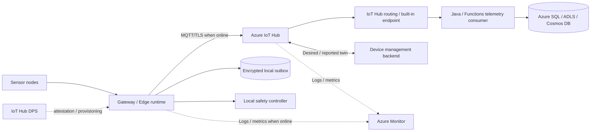
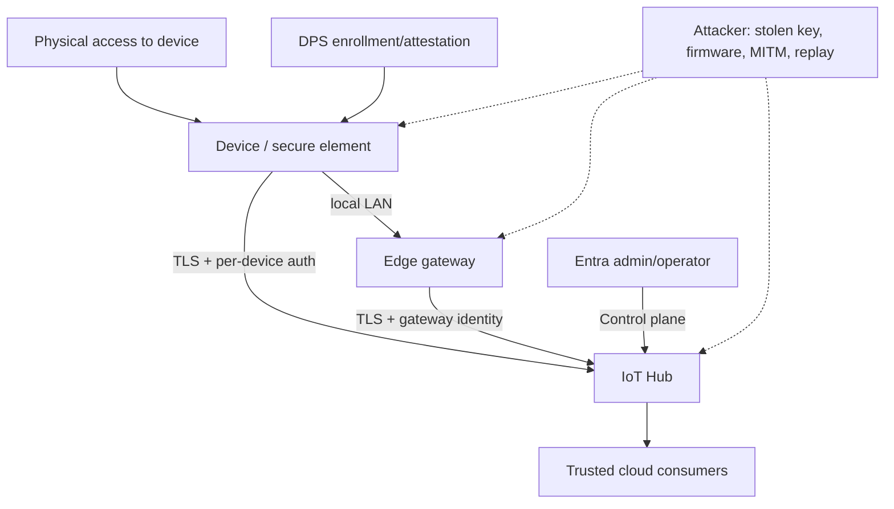
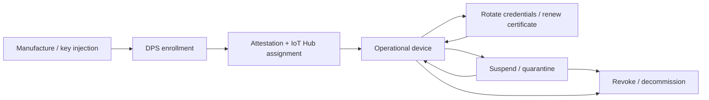
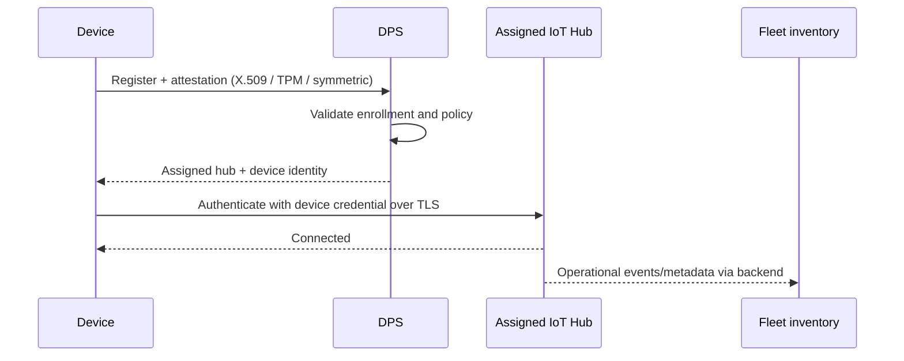
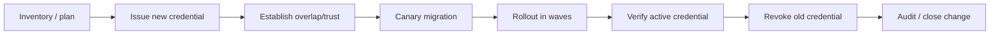
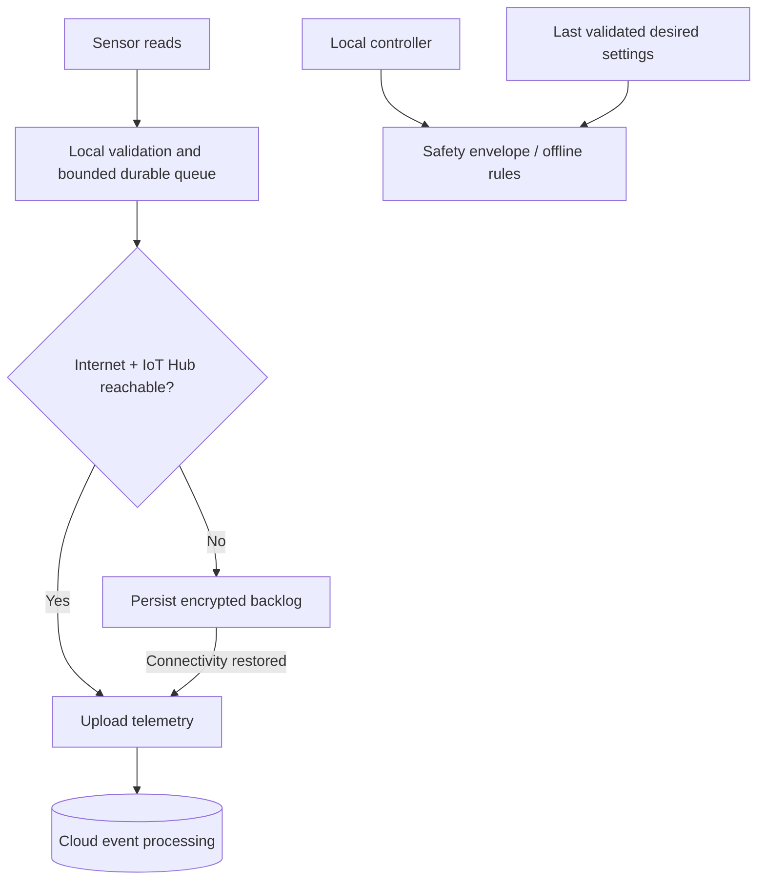
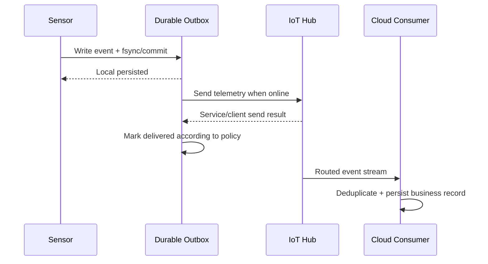
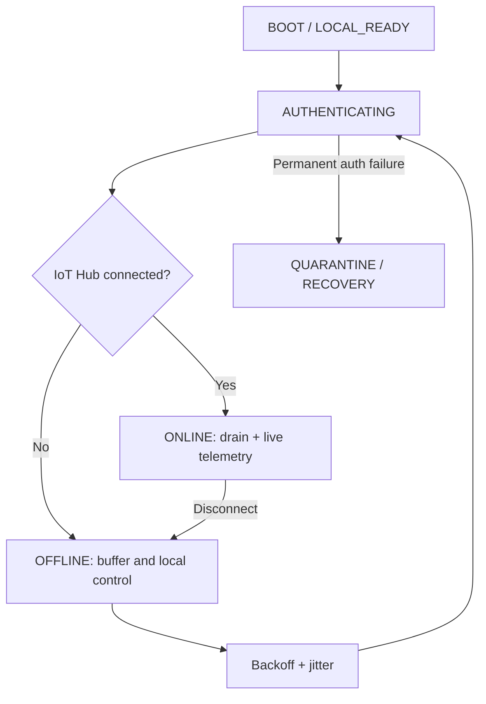
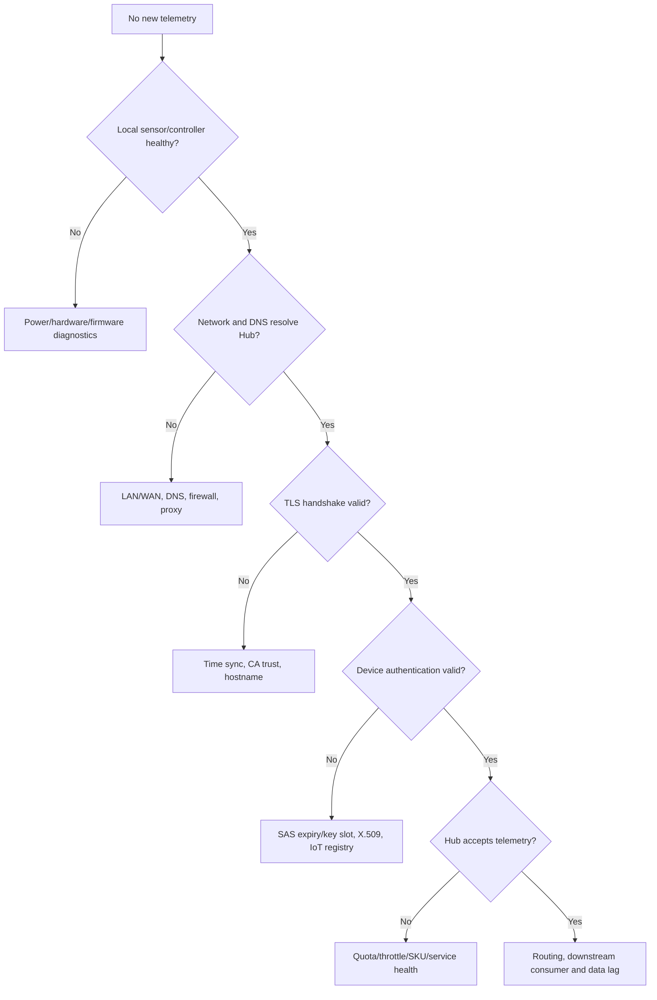

# Device Security, Credential Rotation, and Offline Operations

A manufacturing enterprise deploys thousands of temperature sensors and controllers across its factories. Devices send telemetry to **Azure IoT Hub** for analytics and alerting, while **edge gateways** process data right inside the industrial network. Some factories lose Internet connectivity for two days; certain devices suffer clock drift, several access keys face exposure risk, and a batch of X.509 certificates is nearing expiration. The enterprise wants to ensure that:

- Only legitimately registered devices can send data or receive commands.
- Every device has an individual identity rather than sharing a single key that could compromise the entire fleet.
- Credentials are provisioned, rotated, and revoked throughout the lifecycle.
- Devices continue to **measure, store, and make safe local decisions at the edge** while disconnected.
- Data is flushed back once online without creating duplicate or out-of-order business records.
- Firmware updates, configuration changes, and permission revocations never leave the factory out of control.
- The cloud can monitor, audit, alert, and track infrastructure costs.

The topic **"Device Security, Credential Rotation, and Offline Operations"** belongs to the **IoT and Edge Computing** chapter of the **CLOUD_PROVIDERS_AZURE** module. This lesson connects Microsoft Azure knowledge—from **subscriptions, resource groups, and Microsoft Entra ID** to **IoT Hub, Device Provisioning Service (DPS), IoT Edge, VNet, Storage, Service Bus, and Azure Monitor**—to device identity protection and operational cost management for a cloud-to-edge solution.

> **Scope and variability:** Content focuses on Azure IoT Hub device identities, X.509/SAS, DPS, and offline handling patterns across devices/gateways/IoT Edge. Azure IoT Operations, Azure Arc, Device Update for IoT Hub, and different IoT Edge versions have distinct models, capabilities, and support lifecycles—do not treat them as the same runtime. Verify the latest support matrix, API/SDK versions, region/tier limits, service lifecycles, connection specs, and update policies before deploying. Commands and payloads below are for **authorized labs**, not actions executed against Azure.

## Learning Objectives

After this lesson, you can:

1. Describe trust boundaries across **devices, gateways, IoT Hub, DPS, backends, and operators**.
2. Distinguish **SAS tokens with symmetric keys**, **X.509 certificates**, **TPMs/secure elements**, and credential bootstrapping.
3. Explain why a device identity differs from an App Service's Azure RBAC/managed identity.
4. Design workflows for identity issuance, activation, rotation, suspension/revocation, and decommissioning.
5. Plan **primary/secondary symmetric key** rotation without disconnecting the entire fleet simultaneously.
6. Design **X.509 certificate/CA trust** replacement with overlap windows and validity/revocation checks.
7. Understand how **IoT Hub Device Provisioning Service** provisions fleets at scale without distributing service connection strings to devices.
8. Separate **telemetry store-and-forward**, **device twin desired/reported state**, and **direct methods/C2D messages** while offline.
9. Size local queue capacity from data generation rate, outage duration, and disk-full risk.
10. Design retries, backoff, idempotency, sequencing, and clock quality after reconnect.
11. Tie firmware security/secure boot/OTA to credential operations.
12. Write a Java IoT device SDK example, design a durable outbox, and run safe fault tests.
13. Monitor auth failures, offline duration, queue pressure, missed heartbeats, cost, and data freshness.
14. Build runbooks for expiring credentials, disconnected devices, and mis-synced gateways.

## 1. Scenario: Factory with Unstable Internet Connectivity

Suppose a cold-chain monitoring system has:

- 500 temperature and humidity sensors on an internal network.
- 20 gateways aggregating data across sites; some gateways run Azure IoT Edge on a compatible runtime.
- A Java application processing telemetry and sending it to IoT Hub.
- Azure Functions/Stream Analytics backends or compatible consumers ingesting events into Azure Data Lake/Storage or databases.
- An operations application using **device twins** to push target configurations such as sampling intervals.
- An administration center using DPS to register devices and govern identities.
- Network links that can drop for **6–48 hours**, while cold-storage safety must still hold locally.

### Target Architecture



**Key point:** a network outage must never halt sensor readings or stop controllers from maintaining safety. Cloud ingestion of delayed data must distinguish **measurement time** from **receipt time**, never treating backlogged records as events that just happened.

## 2. Azure Components in the Trust Chain

| Component | Role | Security/Operational Concern |
|---|---|---|
| **IoT device** | Measures/controls, produces telemetry, holds device identity | Protect private keys, firmware, local data |
| **Edge gateway** | Bridges local devices to cloud; can process offline | Separate module/device identities, store-and-forward |
| **Azure IoT Hub** | Device-to-cloud telemetry, cloud-to-device capabilities, identity registry, twins | Device auth, quotas, routing, service policies |
| **IoT Hub DPS** | Zero-touch provisioning/assignment to IoT Hub | Attestation/enrollment, ID scope, bootstrap secrets |
| **Microsoft Entra ID** | Operator and cloud application identities | Azure RBAC/data-plane roles, auditing |
| **Azure Key Vault** | Protects cloud-side secrets/keys where architecture/capabilities fit | Rotation/expiry, RBAC, networking |
| **Azure IoT Edge runtime** | Runs modules and supports offline on gateways per version | Runtime lifecycle, local storage, `edgeHub` connectivity |
| **Azure Storage/SQL/Stream processing** | Persists and consumes events | Privacy, dedup, ordering, retention |
| **Azure Monitor/Log Analytics** | Metrics, logs, alerts | Never log credentials/raw PII; design alerting |

### Do Not Confuse Roles

**DPS** tells a device **which IoT Hub it is assigned to** and authenticates it during provisioning. **IoT Hub** manages device-cloud communication and device identities. **IoT Edge runtime** runs local modules and supports offline store-and-forward. None of these products automatically replaces private key protection or guarantees exactly-once application telemetry processing.

## 3. Threat Model: What Needs Protection?

A realistic device deployment spans these trust boundaries:



### What Can Adversaries Do?

- Steal a device and extract keys from flash/config files.
- Clone a device identity if symmetric keys are stored in plaintext.
- Inject malicious firmware, alter gateway settings, or corrupt the outbox.
- Intercept traffic, spoof DNS/proxies, or MITM TLS if clients skip certificate checks.
- Replay old telemetry or inject fake readings using a leaked identity.
- Abuse a fleet-wide shared key to authenticate in bulk.
- Steal connection strings from Git, logs, firmware images, or dashboards.
- Cut Internet access, fill queues, cause data loss, or trick controllers into bad decisions.
- Abuse cloud operator privileges to disable or hijack devices.
- Dispatch update/delete commands through backends lacking authorization checks.

### Assets to Protect

1. **Device private keys/secrets** and bootstrap credentials.
2. **Firmware/boot chain** and security configurations.
3. **Identity registry**, DPS enrollments, and admin privileges.
4. **Telemetry integrity:** origin, freshness, ordering, deduplication.
5. **Control commands:** who can issue them and under what conditions devices accept them.
6. **Local safety logic** that must operate even when cloud connectivity is absent.
7. **Sensitive measurements** and identifiers linkable to individuals or assets.
8. **Recovery paths** when locked out or when credentials are lost.

## 4. Device Identity Is Not a Shared Username

Every device should have a **unique device ID** tied to an ownership and lifecycle record. Example:

```text
Tenant:          factory-vn
Site:            cold-room-03
Device ID:       temp-sensor-00042
Serial:          CR3-2026-0042
Hardware identity: TPM/secure element certificate when available
Provisioning scope: Approved DPS enrollment
Status:          ACTIVE
Firmware:        signed release v2.4.1
Credential expiry: 2027-01-15T00:00:00Z
```

This is illustrative data, not an automatic IoT Hub schema.

### Avoid Using Device ID Alone for Authentication

A `deviceId` can be guessed or printed on a chassis label. Knowing an ID does not prove key possession. IoT Hub must verify **SAS signatures or certificates** bound to the registered identity.

### Device Identity Differs from Cloud Service Identity

- **IoT Hub device identity:** devices authenticate using IoT Hub-supported SAS/X.509.
- **DPS enrollment/attestation:** proves the device is entitled to register and receive an assignment.
- **Entra managed identity:** fits Azure workloads such as App Service, Functions, or VMs with platform support; **external IoT devices do not natively have a managed identity endpoint**.
- **Azure RBAC:** lets admins/backends manage resources and data planes within scope; never use RBAC Contributor as a sensor credential.
- **Module identity** in IoT Edge has its own configuration/lifecycle and must not be conflated arbitrarily with device identity.

### Internal Inventory

Beyond the IoT Hub identity registry, maintain a dedicated inventory tracking serial, site, model, owner, firmware, warranty, credential rotation state, and last successful contact. Never store raw private keys in inventory tables.

## 5. Security Lifecycle of a Device



### Decisions per Phase

| Phase | Required Actions |
|---|---|
| **Manufacture** | Generate private keys safely on device/TPM, prevent cloning, bind serial |
| **Enrollment** | Record trust anchors or device identities in DPS, isolate environments |
| **First boot** | Verify chain, endpoint, and attestation; receive hub assignment |
| **Run** | Enforce TLS, heartbeats, telemetry integrity, local policies |
| **Rotate** | Transition credentials via overlap/batches/canaries and verify |
| **Incident** | Disable device, revoke trust, quarantine network, investigate |
| **Decommission** | Disable/delete cloud identity per policy, wipe keys safely, update inventory |

**Never delete an IoT Hub identity the moment a device goes offline.** It may simply have a legitimate network outage. Distinguish maintenance, network outages, compromise, and permanent retirement.

## 6. Three Common Device Authentication Approaches

| Approach | What the Device Holds | What the Cloud Verifies | Trade-Off |
|---|---|---|---|
| **Symmetric key + SAS token** | Device-specific symmetric key | HMAC signature of SAS token | Simple, yet key can be cloned if exposed |
| **X.509 certificate** | Private key + certificate | TLS client cert/trust in IoT Hub/DPS | CA/expiry/chain/revocation management is more complex |
| **TPM-based attestation (DPS)** | Hardware-bound identity/endorsement material | DPS verifies proof via TPM attestation | Strong bootstrap protection; depends on hardware and support |

### What Is a SAS Token?

A **SAS token (Shared Access Signature)** is a **time-limited** signed token generated from a symmetric key. Never confuse the token with the **root key**:

- **Symmetric key:** long-lived secret issued to an identity to mint tokens.
- **SAS token:** short-lived credential used to authenticate to an endpoint/resource within scope.
- **Token expiry:** after expiration, a new token is needed.
- **Key rotation:** replacing the root key, requiring devices to sign tokens with the new key.

**Changing token expiry does not rotate the symmetric key.** If the root key leaks, an attacker can mint fresh tokens until the key is rotated/revoked.

## 7. Symmetric Key: Per-Device Only, Never Share Service Keys

An IoT Hub device identity can hold a **primary key** and **secondary key** per device under symmetric-key authentication. This enables two-phase key rotation.

### Never Put an IoT Hub Service Policy Key on Sensors

An IoT Hub service/shared access policy grants broader permissions than a single device identity. Embedding an **IoT Hub owner/service connection string** in firmware means stealing one device risks exposing hub-wide control.

### Secure Approach

- **Unique** device credentials per device/module identity.
- Never commit keys to source, shared firmware images, or diagnostics.
- Store secrets in a **secure element/TPM/OS key store** when hardware supports it; symmetric keys still carry risk if devices can be rooted.
- Restrict who can read or rotate device keys in the cloud.
- Track **key versions** in inventory without storing raw secrets.
- Enforce TLS and server certificate verification on clients.
- Maintain key-replacement/revocation procedures for lost devices.
- Prefer X.509/hardware-backed auth for large fleets or physically accessible environments where supported.

### DPS Symmetric Key Enrollment Group

With an enrollment group, devices must not all embed the **group master key**. Instead, derive an **individual derived key** from the group key and registration ID using the DPS-supported algorithm, then provision that **per-device derived key** during controlled manufacturing.

**If the group master key leaks**, many devices are exposed. Treat the master key as a highly privileged secret, rotate it, and segment batches/factories in fleet design.

## 8. SAS Token: TTL, System Clock, and Renewal

A SAS token includes scope/resource URI, signature, and expiry, with optional protocol-specific fields. Devices derive tokens from their **scoped key** and connect over TLS.

```text
Device key (secret)
    └── HMAC signing
           └── SAS token for IoT Hub device scope
                    └── Expires at configured UTC time
```

### Common Pitfalls

- Device clocks drifting behind/ahead cause tokens to look expired or invalid.
- Firmware fails to renew tokens prior to expiration.
- Devices sleep for days and try reusing stale tokens on wake-up.
- Rotating the primary key in the cloud while firmware still signs with the old key.
- Logging URLs/Authorization headers containing SAS tokens.
- Multiple devices sharing one key, complicating compromise attribution.

### Operational Rules

1. Maintain a **trusted time source** or secure time mechanism.
2. Never rely on user-editable manual clocks as the sole source for expiry.
3. Pick a TTL matching risk tolerance and outage cycles; overly long TTLs widen exposure if leaked.
4. Renew tokens before expiry with jitter so the entire fleet doesn't renew at once.
5. If connections fail on expired tokens, mint a new token from a **valid key** and reconnect.
6. Never hardcode static SAS tokens indefinitely inside config files.
7. Key rotation requires its own **rollout protocol**, not just raising token TTL.

Do not force one fixed minute-count TTL across every IoT SDK: token renewal and connection lifecycle behavior depend on protocol, SDK, and version.

## 9. X.509 Certificates: Authentication Bound to a Private Key

In X.509 authentication, the device holds a **private key**, presents a certificate, and proves key possession during TLS client authentication per IoT Hub/DPS support.

### Components

- **Private key:** never send to the cloud and never bake one shared key into mass-flashed firmware.
- **Public certificate:** contains public key, subject/issuer, validity, and extensions.
- **Certificate chain:** device certificate → intermediate CA → trusted root CA per configuration.
- **Certificate serial/subject/identifier:** used for inventory and policy.
- **NotBefore/NotAfter:** validity window; expiration breaks reconnections.
- **Trust anchor/CA verification:** cloud/IoT Hub/DPS trusts only chains/identities matching the chosen enrollment mode.
- **X.509 thumbprint registration:** IoT Hub supports registering device certificate fingerprints (primary/secondary) with behavior distinct from the CA-signed model.

### Two Registration Modes to Distinguish

1. **Thumbprint authentication:** the registry stores primary/secondary thumbprints. Replacing a certificate requires updating the matching thumbprint on that identity.
2. **CA-signed authentication:** trust relies on an established and verified CA/chain plus subject/identity rules per service. Changing CAs or chains requires a trust transition plan.

**A new certificate is not automatically accepted by IoT Hub just because the device name matches.** It must satisfy the configured auth mode and trust/registry rules.

## 10. TPM and Secure Elements: Reducing Key Cloning Risk

A device exposed to physical tampering or OS rooting risks leaking secrets stored in flash. A **TPM** or **secure element** protects keys in hardware, typically keeping private keys non-exportable from the chip.

### Benefits

- Reduces risk of mass private-key cloning.
- Performs signing/attestation without exposing plaintext private keys.
- Supports boot attestation or secure boot depending on platform.
- With DPS TPM attestation, leverages platform-supported identity/endorsement material.

### What a TPM Does Not Do

- Does not fix firmware containing an RCE vulnerability.
- Does not guarantee sensors read accurately or prevent spoofed application telemetry.
- Does not manage credential expiry or CA certificate rotation automatically.
- Does not stop a compromised device from sending valid commands under its active security context.
- Does not guarantee sufficient power, connectivity, or offline buffer space.

### Choosing by Environment

| Environment | Protection Level to Evaluate |
|---|---|
| Controlled lab | Per-device keys, OS credential store, TLS |
| Home consumer device | Secure element/TPM where available, signed firmware, anti-tamper |
| Factory/outdoor equipment | Hardware-backed keys, secure boot, physical tamper response |
| Safety-critical equipment | Root of trust, signed updates, independent safety controller, audit/quarantine |

**The threat model drives requirements**—having a TPM on the board does not make a system secure by default.

## 11. Azure DPS: Bootstrapping Devices Without Distributing Service Credentials

**Azure IoT Hub Device Provisioning Service** handles device registration/attestation and assigns an IoT Hub per enrollment policy.



### What DPS Solves

- No need to hardcode the final IoT Hub hostname into every device.
- Groups devices via enrollment groups or individual enrollments.
- Supports allocation policies across linked IoT Hubs per service capabilities.
- Supports onboarding and policy-driven reprovisioning as fleets evolve.

### What DPS Does Not Solve

- Cannot create secure on-chip private keys if manufacturing did it wrong.
- Does not store offline telemetry.
- Does not grant devices permission to control machinery after provisioning.
- Does not replace firmware signature verification.
- Does not grant Azure Resource Manager permissions to operators.
- Cannot force offline devices to pick up cloud policy changes immediately.

### Device Startup Flow

1. Device boots and checks firmware/clock/certificates.
2. If lacking a valid assignment, uses DPS ID Scope/endpoint and attestation credential to register.
3. Receives assigned hub hostname/device ID.
4. Caches assignment info per policy—**never treat the cache as an immortal credential**.
5. Connects to the assigned IoT Hub with its valid device identity.
6. Starts telemetry/twin sync while online.
7. If provisioning/reassignment changes, follows a supported workflow to reprovision safely.

**Do not call DPS for a fresh assignment on every single MQTT reconnect** unnecessarily. Avoid triggering provisioning storms when an entire factory comes back online at once.

## 12. Permissions: Device-to-Cloud vs. Cloud-to-Device

Good design separates resource administrators, command-issuing backends, and data-sending devices.

| Principal | Appropriate Permissions | Should Never Hold |
|---|---|---|
| Sensor device | Authenticate exact device identity; send telemetry/receive messages per protocol | IoT Hub owner/service key, hub admin rights |
| Edge gateway | Gateway/module identities and downstream trust per architecture | An "admin all devices" key shared with sensors |
| DPS enrollment operator | Manage enrollments via approved workflow | Passwords/keys in unprotected spreadsheets |
| Backend processing | Read event routing endpoints/consumer groups per role | Permission to delete all device identities if unneeded |
| Device management service | Send desired changes/direct methods via authorized service auth | Shared unaudited admin accounts |
| Cloud operator | Minimal Azure RBAC to manage resources | Unneeded data-plane permissions |
| Auditor | View logs, inventory, and security events | Keys/raw private data by default |

### Azure Control Plane and IoT Hub Data Plane

`Contributor` on a resource group does not automatically allow a sensor to publish telemetry. Devices authenticate via **IoT Hub device identities**. A cloud app using Entra/managed identity may require **IoT Hub data-plane roles** per current APIs and capabilities.

### Device Twin Access Permissions

**Device twin desired properties** are managed by services/backends for configuration; **reported properties** reflect state published by the device. Device clients must never be permitted to alter desired properties merely because they hold device credentials.

## 13. TLS, MQTT, AMQP, and Transport Protection

IoT Hub supports transports selected by IoT SDKs per product/version: **MQTT**, **AMQP**, and **over WebSockets** via HTTPS/TLS, plus HTTP in supported scenarios.

| Transport | Common Port | Notes |
|---|---|---|
| MQTT over TLS | TCP **8883** | Direct devices, stateful connection |
| MQTT over WebSockets/TLS | TCP **443** | Useful in HTTPS/WebSocket-only networks |
| AMQP over TLS | TCP **5671** | Stateful, SDK/runtime-dependent |
| AMQP over WebSockets/TLS | TCP **443** | Proxy-friendly per network support |
| HTTPS | TCP **443** | Request/response model differs from MQTT |

Ports and hostnames must be verified against **IoT Hub/Edge gateway/SDK** guidance. Never open broad port/IP ranges on the Internet just for a quick test.

### Security Checks

- Devices verify **server certificate chains and hostnames**; never disable TLS validation.
- Check clocks/certificate validity and keep CA trust stores updated.
- Give each device independent client credentials.
- Never log SAS tokens, certificate private keys, or connection strings.
- Verify DNS resolution and proxy configs.
- WebSocket fallback may help on corporate networks, yet never assume "443 means every proxy lets it through."
- Secure local edge LANs with segmentation and mutual TLS where gateways support it; never assume local network devices are inherently trustworthy.

## 14. Firmware, Secure Boot, and OTA Updates

Credentials can be airtight while vulnerable firmware still lets an attacker control the device.

### Multi-Layer Defenses

1. **Secure boot/verified boot:** run only firmware signed by a valid trust anchor.
2. **Signed OTA packages:** verify signatures/hashes, versions, and target models before flashing.
3. **Anti-rollback:** block downgrading to revoked vulnerable firmware where hardware supports it.
4. **A/B partitions or recovery images:** fallback path when updates fail.
5. **Phased deployments:** canary 1%, 5%, 20%, expanding through health gates.
6. **Power-loss safety:** avoid bricking boot images if power drops mid-update.
7. **Credential compatibility:** updates must not wipe or corrupt private keys in TPMs/secret stores.
8. **Local fallback:** avoid fleet-wide reboots when gateways lose cloud connectivity.
9. **Inventory/attestation:** report firmware versions and update outcomes.
10. **Incident response:** isolate compromised devices and revert to signed/known-good images.

### Device Update for IoT Hub

Evaluate **Device Update for IoT Hub** to orchestrate OTA rollouts and update status where supported by product/tier/runtime. It does not replace your responsibility for **signing firmware, hardware testing, rollbacks, and approvals**. Verify feature lifecycle/availability before building dependencies on it.

**Never push firmware updates while a device is controlling a critical safety process** outside an approved local maintenance/safety window.

## 15. Credential Rotation: Goals and Prerequisites

**Credential rotation** replaces an active credential with a new one, confirms the client switched successfully, and then revokes the old credential.

### Why Rotate?

- Limits how long a leaked key remains usable.
- Satisfies security policies and certificate expirations.
- Rotates trust when employees/vendors depart.
- Recovers after compromised firmware/secrets.
- Upgrades CAs or cryptographic algorithms per policy.

### General Phases



### You Cannot Just "Swap the Key in the Portal"

If the cloud swaps a key while an **offline** device doesn't know the new key, that device fails to connect upon return. Ensure one of these conditions holds:

- The device securely receives the new key before the old key is revoked.
- **Two concurrent credential slots** are supported by IoT Hub for overlap.
- The device has an independent bootstrap/root of trust to fetch a new credential.
- A **re-enrollment/field recovery** process exists when all current credentials are invalidated.

This determines real fleet operability—not just calling an API flag.

## 16. Rotating Symmetric Keys with Primary/Secondary: Two-Phase Procedure

Suppose device `temp-sensor-00042` has:

```text
Primary device key   = Key A (currently active on device)
Secondary device key = Key B (standby)
```

IoT Hub supports primary/secondary symmetric keys in its identity registry. To rotate with minimal disruption, know **which slot the device uses** and ensure both cloud and device support dual-key rollover.

### Typical Rotation Cycle

1. **Preflight:** inventory, connectivity, firmware version, check whether device uses primary or secondary; obtain approved maintenance window.
2. **Ensure standby key:** Secondary key B is valid in the hub and already delivered to the device **over a trusted secure channel** or pre-provisioned.
3. **Switch to B:** firmware signs new SAS tokens using B and reconnects; verify auth success and fresh telemetry.
4. **Observation window:** don't just see "connected"; verify app metadata confirms slot B is active **without exposing raw keys**.
5. **Replace A:** securely generate key A' and update the identity's **primary key** in IoT Hub; old key A is no longer valid for new authentications. Do not assume tokens signed by old A stay valid until expiry once the key changes.
6. **Distribute A':** deliver to device via secure channel or valid bootstrap mechanism once online; confirm durable persistence.
7. **Switch to A':** canary then phased rollout, verifying connectivity/telemetry.
8. **Replace B** with B' in a later phase if policy requires, only after the target fleet has moved off B.
9. **Close change:** audit key versions, failures, offline devices, and rollback/remediation plans.

### Safety Conditions

- Never send **raw keys** in telemetry, standard device twins, emails, or dashboard logs.
- If devices lack a **secure secret delivery channel**, never send keys via arbitrary C2D text. Use protected OTA, hardware bootstrapping, or reprovisioning.
- Verify **which slot signs SAS tokens**. Firmware picking slots randomly can break connectivity mid-rotation.
- For offline devices, keep the old slot active through the planned grace window unless an active compromise demands immediate revocation.
- Never rotate both primary and secondary simultaneously on a production fleet.
- Keep an **emergency override** for compromised keys: prioritize isolation/revocation, accepting downtime over leaving a backdoor open.

### A Physical Network Impossibility

If a device is disconnected and lacks a **pre-provisioned backup credential** or live bootstrap trust, the cloud cannot "push a new key while it's offline." That is a physical/architectural boundary, not fixable by raising retry counts.

## 17. Rotating X.509 Certificates and CA Trust

Certificates carry `NotAfter` expirations, so renewal must start **well before** expiry with enough window for infrequently online devices.

### With Thumbprint-Based Identity

1. Inspect the active certificate and matching **primary/secondary thumbprints**.
2. Generate a **new private key on the device/secure element** if supported.
3. Create a CSR, verify identity, and issue the new certificate from an authorized CA.
4. Deliver the new certificate/chain to the device securely, keeping the private key non-exportable.
5. Update the standby thumbprint in the IoT Hub registry when using thumbprints.
6. Test connecting with the new certificate, checking TLS and device identity.
7. Roll out in waves, verifying credential version, firmware, and clock.
8. Revoke/remove the old thumbprint after the fleet moves—or immediately per incident policy.
9. Audit serial/issuer/expiry without logging private keys.

### With CA-Signed Authentication

- Ensure the **new CA chain is trusted** in the right IoT Hub/DPS enrollment before devices present new certs.
- When changing root/intermediate CAs, design a **dual-trust overlap** per service capabilities.
- Don't issue new certs and forget to update trust chains on devices/registries.
- Check DPS/IoT Hub subject/common-name/identity-binding rules for your attestation mode.
- Apply revocation/identity-disable policies if a cert leaks; **never assume every PKI CRL/OCSP automatically causes IoT Hub to reject immediately** without checking auth mode behavior.

### Devices Offline Past Certificate Expiry

A device can wake up with an **expired** X.509 client certificate. If the entire cloud auth path depends on that cert, remote renewal via the same IoT Hub is blocked. Prepare **secure bootstrap/reprovision**, pre-provisioned standby certs, or field maintenance. **Never disable expiry checks** as a backdoor.

## 18. DPS Enrollment Groups: Rotate Without Fleet-Wide Outages

DPS supports **individual enrollments** or **enrollment groups** depending on attestation method.

| Type | Governance Granularity | Risk |
|---|---|---|
| Individual enrollment | Per device/attestation | Many enrollment records; easy to isolate one device |
| Symmetric-key enrollment group | Fleet registered via derived keys | Leaked group key affects many devices |
| X.509 CA enrollment group | CA chain registers many devices | CA compromise/trust rollover requires tight control |
| TPM individual attestation | Hardware-backed per-device identity | Tied to TPM hardware/attestation lifecycle |

### Pitfalls to Avoid

- Embedding the **group enrollment master key** in every device.
- Rotating the group master key expecting existing derived keys to keep working.
- Deleting an old enrollment group while devices still haven't received new bootstrap material.
- Reprovisioning the entire fleet at once, triggering a DPS storm.
- Using registration IDs that lack unique/verified hardware mapping.
- Forgetting the difference between a disabled DPS enrollment and a disabled IoT Hub device identity.
- Sharing enrollments/CA trusts across dev and production when compliance mandates separation.

### Rollout Plan

Build small canary cohorts stratified by **hardware model, firmware release, region, factory, and typical offline duration**. Maintain a tracking table:

```text
deviceId | lastSeen | currentAttestation | targetVersion
rotationState | assignedHub | deadline | retryCount
```

Always store **metadata/status**, never raw keys.

## 19. Fleet-Wide Rotation Orchestration

At 50,000 devices, rotation needs a workflow with persistence, retries, and gated approvals per phase.

### Example State Machine

```text
PLANNED
  → PRECHECKED
  → NEW_CREDENTIAL_ISSUED
  → DELIVERED_OR_PRESTAGED
  → CLIENT_SWITCHED
  → VERIFIED
  → OLD_REVOKED
  → COMPLETE

On problems:
  → PAUSED / RETRY_PENDING / MANUAL_RECOVERY / QUARANTINED
```

### Health Gates

- Device seen recently within a valid activity window.
- Firmware supports two-slot rotation.
- Enough storage for the new credential and rollback.
- NTP/secure clock is healthy.
- Update signature/PKI chain is valid.
- Azure IoT Hub provisioning/auth quotas have headroom.
- No abnormal telemetry or offline-rate alerts.
- Canaries transmit cleanly after switching.
- High-safety devices running critical cycles are not disrupted.

### Protecting the Orchestration Channel

A rotation controller is a **high-value attack target**. Give it a dedicated identity, minimal roles, Key Vault/HSM or dedicated certificate-issuing services, immutable audits where possible, approvals, and an emergency stop switch.

## 20. Offline Operations: Distinguishing Three State Types

When a device loses cloud connectivity, three distinct things happen:

1. **Telemetry:** sensor readings keep arriving; buffer locally and flush when online.
2. **Desired configuration:** new cloud config cannot arrive immediately; keep using the last validated config or local fallback.
3. **Commands:** new control commands cannot execute while offline; enforce policies on expiry, safety, and post-reconnect sync.



### Distinguish "Offline" Across Layers

- Sensor loses Wi-Fi to gateway.
- Gateway has LAN yet lacks Internet.
- DNS fails to resolve the IoT Hub hostname.
- TLS/connectivity works yet device credentials are rejected.
- IoT Hub experiences an outage/quota throttling.
- Cloud consumer stops reading telemetry even though D2C sends succeed.
- Device has Internet yet DPS/IoT Hub network policies block it.

**A single connected/disconnected metric never pinpoints root cause.** Structure runbooks by layer: local LAN, network/DNS/TLS, auth, IoT Hub, routing, and downstream consumers.

## 21. Store-and-Forward: Where Should Offline Data Buffer?

**Store-and-forward** retains unsent events in durable local storage and forwards them once connectivity recovers.

### Very Different Cases

| Device Type | Buffering Mechanism | Responsibility |
|---|---|---|
| Java device connecting straight to IoT Hub | **App must build a durable outbox** or verify SDK features meet needs | SDK in-memory retry queues do not survive reboots by default |
| Gateway running **Azure IoT Edge** with `edgeHub` | Supports **store-and-forward** per runtime/deployment config | Configure TTL, disk space, host storage, and monitor disk health |
| Sensors sending to custom local gateway | Gateway receives data, ACKs per local protocol, persists durably, then forwards | Needs an explicit local delivery/ACK contract |
| PLC/controller with RAM only | Buffers vanish on power loss | Design durable storage or accept RPO |
| Cloud consumer behind IoT Hub | Event streaming/consumer checkpoints and separate storage | IoT Hub does not replace long-term event archives |

### Warning About "SDK Auto-Retry"

An IoT SDK may retry network calls and buffer some messages in memory. On process crash, power loss, or host reboot, **RAM is gone**. For telemetry that must survive offline windows, commit events to a **durable local store** *before* treating collection as finished.

### Guarantees at Each ACK Point



**IoT Hub accepting an event** does not mean the **cloud consumer committed it to a database**. If business logic requires end-to-end confirmation, implement downstream receipts/acknowledgements or persisted-event reconciliation.

## 22. Durable Local Outbox: Schema and Transactions

On a Linux gateway, a straightforward choice is **SQLite (WAL)** or a platform-supported embedded transactional database. Filesystem event journals also work if they provide transactions, recovery, and space caps.

### Sample Schema

```sql
CREATE TABLE IF NOT EXISTS telemetry_outbox (
    event_id TEXT PRIMARY KEY,
    device_id TEXT NOT NULL,
    boot_id TEXT NOT NULL,
    sequence_no INTEGER NOT NULL,
    event_time_utc TEXT,
    gateway_received_utc TEXT NOT NULL,
    payload_ciphertext BLOB NOT NULL,
    priority INTEGER NOT NULL DEFAULT 1,
    expires_utc TEXT,
    state TEXT NOT NULL DEFAULT 'PENDING',
    retry_count INTEGER NOT NULL DEFAULT 0,
    created_utc TEXT NOT NULL
);

CREATE INDEX IF NOT EXISTS idx_outbox_pending
    ON telemetry_outbox(state, priority, sequence_no);
```

This is illustrative SQL targeting SQLite, not a built-in Azure IoT Hub schema. **Payloads should be encrypted/tamper-protected** per storage/TPM/key-management threat models. Never store device credentials in the same table.

### Event Lifecycle

1. Sensor/gateway generates a **unique `eventId`**.
2. Begin local transaction; write payload, sequence, time quality, and priority.
3. Commit and ensure durability per fsync/WAL policy.
4. Sender fetches a bounded `PENDING` batch.
5. Send when IoT Hub connects; await result per **SDK/transport ACK semantics**.
6. On success, mark `DELIVERED` or prune per retention policy.
7. On transient failure, increment `retry_count`, back off, and keep the event.
8. On permanent invalid payloads, move to **local quarantine** and alert instead of retrying forever.
9. When local storage fills, apply the approved drop/prioritization policy.
10. On reboot, scan unacknowledged records to resend.

### Warning: "Send + Delete" Is Not Atomic with the Cloud

You cannot atomically commit deleting a SQLite row together with an IoT Hub ACK over a remote network. If sending succeeds and power drops before marking delivered, the event will resend. That is why **cloud-side idempotency** is mandatory—never promise exactly-once delivery from an outbox alone.

## 23. Sizing Real-World Offline Storage

Minimum storage depends on event rate, payload size, outage length, indexing, and burst variance.

Approximate formula:

\[
S_{\text{raw}} = N \times f \times b \times T
\]

Where:

- \(N\): number of sensors served by one gateway.
- \(f\): events/second/sensor.
- \(b\): encoded bytes/event before overhead.
- \(T\): offline duration in seconds.

### Example

A gateway collects from **25 sensors**, each sending **1 event every 10 seconds**, ~**600 bytes** per encoded event, needing **48 hours** of retention:

```text
N = 25 sensors
f = 0.1 events/sensor/second
b = 600 bytes/event
T = 48 × 3600 = 172,800 seconds

Raw = 25 × 0.1 × 600 × 172,800
    = 259,200,000 bytes
    ≈ 247.2 MiB
```

With a **2× safety factor** for metadata, SQLite pages, WAL, logs, peak/retry/backlog spikes, and disk reserve, allocate roughly **495 MiB** or more for this example workload. The 2× multiplier is illustrative; real designs measure file sizes, write amplification, compression, encryption, and flash wear margins.

### Beyond Disk Space Alone

- CPU/flash wear from heavy writes.
- Backlog drain time after coming back online.
- LTE/satellite bandwidth and data plan caps.
- IoT Hub quotas/rate limits when thousands of devices flush backlogs.
- Remaining headroom if an outage exceeds projections.
- Separating high-priority alarms from verbose debug events.
- Post-recovery RTO and data-freshness deadlines.

### Drain Time Example

If each gateway buffers 259.2 MB and effective telemetry upload throughput is **100 KB/s**, transferring payload alone takes at least **43 minutes** (before retries/protocol overhead). Never let 20 gateways flush full backlogs simultaneously if doing so saturates plant uplinks or triggers IoT Hub throttling.

## 24. Offline Retention: TTL, Priorities, and Disk-Full Policies

Not all data holds equal value.

| Data Type | Priority | Offline Policy |
|---|---|---|
| Safety threshold alarms | Very high | Persist durably; local actuation and escalation |
| Quality-traceable measurements | High | Retain per policy; flush in order |
| Device status / heartbeats | Medium | Can coalesce/summarize if policy permits |
| Verbose diagnostics/debug | Low | Can sample/drop when exceeding quota |
| Large images/video | Business-dependent | Store separately; scheduled/bandwidth-capped upload |
| Data past business TTL | Low or archive-required | Archive/quarantine/drop per audited policy |

### Key Principles

- Enforce **storage high-watermarks** and low-watermarks.
- Reserve disk space for logs/OS; never let the outbox consume 100% of disk.
- Track `oldestPendingAge`, `pendingCount`, bytes used, and estimated drain time.
- Decide **drop oldest, drop low priority, aggregate, or fail safe** on disk full before an incident happens.
- Never silently drop safety alarms while reporting the telemetry pipeline "healthy."
- If telemetry carries legal retention rules, delete only per policy.
- Protect local data with encryption at rest/ACLs and tamper resistance.
- Guard against untrusted clocks falsely marking valid events as "expired."

### Timeouts and TTLs Differ

**SAS token TTL**, **IoT Edge store-and-forward TTL**, **cloud-to-device message TTL**, and **local retention** are four separate settings. Never set one number to 24h assuming every layer retains data for 24 hours.

## 25. IoT Edge edgeHub Store-and-Forward

For gateways using **Azure IoT Edge**, `edgeHub` provides routing and **store-and-forward** for configured messages per runtime mechanisms, buffering during upstream outages and forwarding when connectivity returns.

### Example desired properties snippet

In `$edgeHub` deployment configuration:

```json
{
  "properties.desired": {
    "schemaVersion": "1.2",
    "routes": {
      "telemetryToCloud": "FROM /messages/* INTO $upstream"
    },
    "storeAndForwardConfiguration": {
      "timeToLiveSecs": 172800
    }
  }
}
```

This is a **conceptual excerpt**, not a complete deployment manifest to apply directly. Verify property paths, schema versions, and runtime parsing against your **current Azure IoT Edge version**. `timeToLiveSecs=172800` illustrates 48 hours; TTL does not guarantee disk capacity suffices for all messages.

### Other Components

- `edgeAgent` manages module deployment/running state per runtime version.
- `edgeHub` handles routing/protocols and store-and-forward per configuration.
- Modules receive desired properties and report reported properties within supported scopes.
- Hosts need **durable storage**, permissions, and volume mounts so data survives container/runtime restarts.
- Test actual storage limits, quotas, and offline faults against your runtime/OS/container storage driver.
- Never rely on an ephemeral container filesystem as the sole store for critical backlogs.

### Capabilities and Limits

Store-and-forward **does not automatically make downstream apps exactly-once**. Expired TTLs, full disks, gateway power loss, or storage corruption can still drop messages. Monitor disk pressure/`edgeHub` queues and implement cloud deduplication.

**Never apply IoT Edge settings to a Java device connecting directly to IoT Hub** if it is not running `edgeHub`.

## 26. Telemetry Format to Prevent Duplicates and Out-of-Order Errors

Suggested protocol-independent event schema:

```json
{
  "schemaVersion": 1,
  "eventId": "temp-sensor-00042-boot-8fa2-00000731",
  "deviceId": "temp-sensor-00042",
  "siteId": "cold-room-03",
  "bootId": "boot-8fa2",
  "sequenceNo": 731,
  "measuredAtUtc": "2026-11-20T09:00:00Z",
  "gatewayReceivedAtUtc": "2026-11-20T09:00:01Z",
  "timeQuality": "synchronized",
  "temperatureC": -14.7,
  "unit": "C"
}
```

### Meaningful Fields

- **`eventId`:** stays identical across retries/reboots; cloud uses it as idempotency key.
- **`deviceId + bootId + sequenceNo`:** detects missing, duplicate, or out-of-order messages.
- **`measuredAtUtc`:** sensor capture time; may be untrustworthy if clocks drift.
- **`gatewayReceivedAtUtc`:** when the gateway observed the reading; separate provenance.
- **cloud `enqueuedAtUtc`:** server timestamp stamped at hub/consumer receipt, taken from service/backend metadata.
- **`timeQuality`:** `synchronized`, `estimated`, or `unknown` per device logic—never assume clocks are always right.
- **`schemaVersion`:** governs payload evolution across mixed-firmware fleets.

### Never Rely on Timestamps Alone

Devices can reboot and reset sequence numbers to 0. Therefore include a sufficiently unique **`bootId`** or monotonic persistent counter. During offline periods with clock drift, comparing timestamps across sensors can mislead. Analytics must retain source/gateway/cloud timestamps with explicit trust rules.

## 27. Cloud Consumer: Idempotency and Ordering

IoT Hub forwards telemetry to event endpoints/routing targets per capability; message delivery and consumer recovery can produce **at-least-once semantics** or duplicates in pipelines. Never assume IoT Hub → consumer → database is **exactly once**.

### Deduplication Pattern

In a downstream database, enforce a matching unique constraint:

```sql
CREATE TABLE TelemetryReadings (
    EventId VARCHAR(160) NOT NULL PRIMARY KEY,
    DeviceId VARCHAR(128) NOT NULL,
    BootId VARCHAR(80) NOT NULL,
    SequenceNo BIGINT NOT NULL,
    MeasuredAtUtc DATETIME2 NULL,
    CloudReceivedUtc DATETIME2 NOT NULL,
    TemperatureC DECIMAL(10,3) NOT NULL
);
```

This is an **illustrative SQL Server/Azure SQL schema**. In real systems, choose types/lengths, partitioning, indexing, and retention for data volume; event keys must match source semantics.

### Ingestion

```text
On telemetry event:
  1. Validate device identity from trusted message metadata.
  2. Parse schemaVersion, eventId and sequence.
  3. Reject or quarantine invalid payload.
  4. Insert event using EventId unique key.
  5. If already exists, treat as duplicate; do not count twice.
  6. Track gaps/out-of-order per device/boot.
  7. Commit database before checkpointing stream offset.
```

### Ensuring Order

Send/receive order shifts due to network retries, buffer draining, partitions, and consumer counts. **Never treat IoT Hub arrival order as the sole event clock.** When analytics depends on measurement time, use event-time windows, watermarks, and late-data policies.

A telemetry record from yesterday arriving after recovery must be flagged as a **late arrival**, never letting dashboards show yesterday's value as current temperature.

## 28. Retries, Reconnects, and Avoiding Data Storms

When Internet recovers, every device may reconnect almost simultaneously, spiking:

- DNS/TLS handshakes.
- DPS registrations if firmware re-provisions needlessly.
- IoT Hub connection/throttling requests.
- SAS token renewals.
- Factory WAN uplink utilization.
- Backlog drains and queue depth on cloud consumers.
- Battery/CPU load on devices also handling local safety.

### State Machine



### Reconnect Policy

1. **Exponential backoff with jitter**—never hammer connect every 50 ms.
2. **Retry budgets** separating network failures from authentication errors.
3. Renew SAS tokens when needed without leaking device secrets to logs.
4. Call **DPS** only when reprovisioning is genuinely needed, not on every reconnect.
5. Rate-limit **events/second and bytes/second** when draining outboxes.
6. Balance priority between live telemetry and backlogged history.
7. Never let backlog traffic starve critical safety control commands.
8. Watch cloud throttling signals and pace send rates dynamically.
9. On permanent invalid token/cert errors, transition to **RECOVERY_REQUIRED** instead of infinite retries.
10. Avoid tight firmware auto-reboot loops that prevent devices from accepting local updates.

### QoS Is Not End-to-End Exactly-Once

Even when MQTT QoS 1 provides transport-level delivery confirmation, **it does not guarantee the downstream consumer persists to a database once**. Application `eventId`/deduplication and commit-before-checkpoint strategies remain mandatory.

## 29. Device Twin While Offline: Desired, Reported, and Versions

**IoT Hub device twins** store desired/reported properties per service model, suited to managing configurations devices apply once connected.

```json
{
  "properties": {
    "desired": {
      "samplingIntervalSec": 30,
      "alarmThresholdC": -10,
      "configRevision": 12
    },
    "reported": {
      "samplingIntervalSec": 60,
      "alarmThresholdC": -9,
      "appliedRevision": 11,
      "lastApplyResult": "OFFLINE_PENDING"
    }
  }
}
```

This is a **simplified conceptual sample**, not a full device twin document or mandatory schema. Revision structures are application-defined; IoT Hub twins also carry their own metadata/versions/ETags.

### Device Procedure When Back Online

1. Connect to IoT Hub with a valid identity.
2. Fetch latest desired properties and version/ETag per SDK.
3. Compare against durably stored **last applied revision**.
4. Validate safety bounds and compatibility (firmware/hardware model).
5. Apply configuration transactionally or with designed rollback.
6. Write reported properties showing **`appliedRevision` and success/failure reason**.
7. Sync local state and watch for subsequent updates.

### What Must Devices Do While Offline?

Keep using the verified **last-known-good configuration** within business TTL/safety bounds. If changing physical conditions render the old config unsafe, the controller enters **safe operating mode** rather than guessing unread desired updates.

**Desired written in the cloud does not mean applied on the device.** Only reported state/application acknowledgements prove the device observed and processed the change.

## 30. Direct Methods, C2D Messages, and Twins: When to Use Each?

| Mechanism | Purpose | When Offline |
|---|---|---|
| **Direct method** | Request-response action over an active session | Cannot assume offline devices can be reached; requires timeout/fallback |
| **Cloud-to-device message** | Send message to device with supported delivery/TTL semantics | May queue/buffer within feature limits, expiry, and quotas; no instant execution guarantee |
| **Device twin desired property** | Sync target configuration/state | Suits eventual configuration once device reconnects |
| **D2C telemetry** | Send measurements from device to cloud | Device/gateway requires a local buffer |
| **OTA deployment** | Roll out versions/updates per supported workflow | Executes when connected/eligible; needs fallback |

### Distinguishing Examples

- "Change sampling interval from 60s to 30s" → **desired property**.
- "Run self-test right now" → **direct method** if online; if offline, mark pending or operator action rather than pretending it ran.
- "Upgrade firmware to v2.5" → **signed OTA deployment**, gated by runtime and maintenance windows.
- "Start compressor despite overheating sensor" → **never let cloud override a safety interlock** lacking local safety preconditions.

### Expiring Commands

Dangerous commands need signed/verified **`commandId`, issuer, `issuedAt`, `expiresAt`, scope, and expected preconditions**. If a device receives "open valve" after 24 hours offline, it must never blindly execute merely because the message arrived. Check command age, state, and local safety policies.

## 31. Safe Offline Operations: Autonomy at the Edge

Not every IoT software action may continue unchanged when the cloud stops responding.

### Decision Categories

| Category | When Cloud Connection Drops |
|---|---|
| Reading sensors | Continue measuring and logging locally |
| Over-threshold alarms | Trigger local sirens/relays per safety specification |
| Temperature control | Continue local PID/rules within safe limits |
| Changing safety thresholds | Reject unauthenticated remote overrides |
| Dashboard sync | Display stale-data indicator and measurement timestamp |
| Cloud orchestration | Queue/reject per command expiry and business policy |
| OTA firmware | Defer or proceed per safe/update transaction design |
| Credential recovery | Only via valid bootstrap channels; never auto-open auth |
| Emergency stop | Independent fail-safe hardware path if hazard analysis requires |

### Fail-Safe vs. Fail-Operational Design

- **Fail-safe:** transition to a safe state when control data is insufficient.
- **Fail-operational:** maintain bounded operation using local sensors and controllers.
- No single choice fits all factories. Base decisions on **hazard analysis and safety engineering**, verified by specialists.

**Cloud commands never replace certified safety control systems.** Azure IoT Hub is a connectivity/orchestration channel, not a real-time physical safety protector for hazardous machinery.

## 32. Java IoT Device SDK: Sending Telemetry with Confirmation

In this learning example, a Java gateway connects directly to Azure IoT Hub using a **device-specific connection string** stored in a protected lab environment.

### Maven Dependency

```xml
<dependency>
  <groupId>com.microsoft.azure.sdk.iot</groupId>
  <artifactId>iot-device-client</artifactId>
  <version><!-- PIN_A_SUPPORTED_COMPATIBLE_VERSION --></version>
</dependency>
```

Verify package version, APIs, and support lifecycle; this snippet does not guarantee compilation across every SDK/JDK combination.

### Illustrative Java Code

```java
package vn.example.azure.iot;

import com.microsoft.azure.sdk.iot.device.DeviceClient;
import com.microsoft.azure.sdk.iot.device.IotHubClientProtocol;
import com.microsoft.azure.sdk.iot.device.Message;

import java.nio.charset.StandardCharsets;
import java.util.UUID;
import java.util.concurrent.CountDownLatch;
import java.util.concurrent.TimeUnit;

public final class TelemetrySenderDemo {

    private TelemetrySenderDemo() {}

    public static void main(String[] args) throws Exception {
        String connectionString =
            System.getenv("IOTHUB_DEVICE_CONNECTION_STRING");

        if (connectionString == null || connectionString.isBlank()) {
            throw new IllegalStateException(
                "Missing device-specific connection string");
        }

        String eventId = UUID.randomUUID().toString();
        String payload = "{"
            + "\"eventId\":\"" + eventId + "\","
            + "\"schemaVersion\":1,"
            + "\"temperatureC\":-14.7"
            + "}";

        CountDownLatch acknowledged = new CountDownLatch(1);

        DeviceClient client = new DeviceClient(
            connectionString, IotHubClientProtocol.MQTT);

        try {
            client.open();

            Message message = new Message(
                payload.getBytes(StandardCharsets.UTF_8));

            message.setMessageId(eventId);
            message.setContentType("application/json");
            message.setContentEncoding("utf-8");

            client.sendEventAsync(
                message,
                (status, context) -> {
                    System.out.println(
                        "SDK send completion status: " + status);
                    acknowledged.countDown();
                },
                null
            );

            if (!acknowledged.await(30, TimeUnit.SECONDS)) {
                System.out.println("Send not confirmed by timeout");
            }
        } finally {
            client.closeNow();
        }
    }
}
```

### Reading the Source Code Accurately

- The sample uses an **SDK callback**, not a hand-rolled HTTP call to an IoT Hub endpoint.
- The device connection string is strictly for **one lab device**, never an IoT Hub owner policy key.
- `UUID` is illustrative; production must **generate and durably persist `eventId` before sending**, never minting a fresh ID on retries of the same event.
- `sendEventAsync` can report statuses other than success; printing status alone is **insufficient to mark a local outbox delivered**.
- Callback success is an SDK/transport signal—it does not prove an Azure SQL consumer committed.
- `CountDownLatch` suits a single-shot test, not a production multi-event architecture.
- Real code must handle SDK exceptions, auth renewal, reconnects, max message size, quotas, and telemetry backpressure.
- `closeNow()` and callback APIs can vary across SDK versions; check your exact version.
- **There is no durable local outbox in this Java snippet**, so never use it as a 48-hour offline solution.

## 33. Java Durable Outbox: Decoupling Collection and Sending

A production gateway should run two main paths:

1. **Collector** writes sensor readings into a local transactional store.
2. **Sender** reads pending records, sends within network limits, and updates status after valid ACKs.

### Java-Style Pseudocode

```java
// Conceptual architecture, not a drop-in implementation.
public final class OfflineTelemetryAgent {

    private final LocalOutbox outbox;
    private final IoTHubTransport transport;

    public void onSensorReading(SensorReading reading) {
        TelemetryEvent event =
            TelemetryEvent.withDurableIdAndClockMetadata(reading);

        outbox.insertInTransaction(event); // Commit before returning.
        runLocalSafetyRules(reading);       // Never wait for cloud.
    }

    public void flushWhenConnected() {
        if (!transport.isAuthenticated()) {
            return;
        }

        for (TelemetryEvent event : outbox.pendingBatch(100)) {
            if (event.isExpiredByApprovedRetentionPolicy()) {
                outbox.recordExpiryAndApplyPolicy(event);
                continue;
            }

            SendResult result = transport.sendAndAwaitAck(event);
            if (result.isAcceptedByHub()) {
                outbox.markDelivered(event.eventId());
            } else if (result.isPermanentFailure()) {
                outbox.quarantine(event.eventId(), result.reason());
            } else {
                outbox.incrementRetry(event.eventId());
                break; // Backoff, avoid busy spin.
            }
        }
    }
}
```

The interfaces/records here **have no implementation**—they illustrate the contract to build. Key points:

- Collector never waits for Internet.
- Local outbox must be **transactional and durable**.
- Sender reuses the original `eventId` on retries with bounded concurrency/backoff.
- Never assume Hub ACK = backend DB committed.
- Persist in-flight state/recovery rules across process restarts.
- Quotas/TTLs/priorities are business policies; never drop safety alarms uncontrolled.
- Protect against local SQLite corruption, storage wear, and secret exposure.

### Minimum Verification Test

Disconnect Internet → record 100 events → reboot gateway → reopen → verify 100 events remain pending; restore Internet → compare unique events in DB; kill process right after send succeeds → retry → DB still holds only one record per `eventId`.

## 34. Observability: Online Status, Credential Expiry, and Backlog Health

A fleet dashboard should combine **cloud metrics** and **reported/device-side telemetry**.

| Signal | Question |
|---|---|
| Last successful telemetry time | When did the cloud last process valid data? |
| Device reported heartbeat | Are firmware/controllers still alive? |
| Current auth method/version (no secrets) | Did the device switch to the new key slot/cert? |
| Certificate `NotAfter` | How many days until expiration? |
| SAS renewal failures | Are tokens/keys/clocks broken? |
| DPS registration failures | Are enrollments/attestations failing? |
| Offline duration | How long has connectivity been down? |
| Local pending count/bytes | Is the outbox nearing capacity? |
| Oldest pending age | How old is the oldest unsent event? |
| Predicted drain time | Can the uplink clear the backlog within SLA? |
| IoT Hub connect/route errors | Are hub/network/data-plane errors occurring? |
| Cloud consumer lag | Are Hub-accepted events waiting unpersisted? |
| Device twin desired vs. reported revision | Did the new config apply? |
| Firmware version/boot errors | Is a deployment failing or reboot-looping? |
| Disk health, storage encryption status | Is the outbox durable and protected? |
| Cost and throttling | Are telemetry volume or quotas abnormal? |

### Connection State Is Not Absolute Truth

IoT Hub device connection state can **lag or be inaccurate momentarily** across protocols/lifecycles. Never declare an actuator safe solely from the Portal "connected" field. Use **application heartbeats with timestamps/counters, telemetry freshness, and local safety state**.

### Deadline-Driven Alerts

Examples:

- Certificates expiring within **30/14/7 days** by risk tier.
- Device missing heartbeats for **10 minutes** even while site has Internet.
- Offline > **6 hours** with `oldestPendingAge` steadily rising.
- Outbox using > **70%** of allocated storage.
- Device twin desired revision > applied revision for **1 hour**.
- Auth failures exceeding baseline following a rotation wave.
- Cloud consumer checkpoint lag growing despite normal hub throughput.

These thresholds are **illustrative**; tune them to sampling cadence, factory networking, and SLAs.

## 35. Azure Monitor, IoT Hub CLI, and Safe Logs

### Read-Only Resource Inspection

```bash
az account show --output table
az account set --subscription "<SUBSCRIPTION_ID>"

RG="<IOT_RESOURCE_GROUP>"
HUB="<IOT_HUB_NAME>"

az iot hub show \
  --resource-group "$RG" \
  --name "$HUB" \
  --query "{name:name,location:location,sku:sku,hostName:properties.hostName}" \
  --output json
```

Flags and response fields vary by Azure CLI/extension version; if a query returns null, check supported schemas instead of guessing the hub is broken.

### Inspecting Device Metadata

```bash
az iot hub device-identity show \
  --hub-name "$HUB" \
  --device-id "temp-sensor-00042" \
  --output json
```

**Never post raw responses if they contain credentials/keys.** Extract only safe fields needed for tickets, and never put `show-connection-string`/`list-keys` outputs in reports. Azure IoT CLI groups may require an extension; check `az extension list`/`az iot hub --help` within your permissions.

### Device Twin Metadata

```bash
az iot hub device-twin show \
  --hub-name "$HUB" \
  --device-id "temp-sensor-00042" \
  --output json
```

Twins may contain sensitive metadata or customer identifiers. Log only redacted/masked excerpts. Never write plaintext keys into twin properties.

### Metric Definitions

```bash
HUB_ID=$(az iot hub show \
  --resource-group "$RG" \
  --name "$HUB" \
  --query id --output tsv)

az monitor metrics list-definitions \
  --resource "$HUB_ID" \
  --output table
```

Use **actual metric names and dimensions** for your IoT Hub SKU/region. Never hardcode guessed metric names. Configure diagnostic settings to Log Analytics/Storage/Event Hubs per supported categories.

### Exploratory KQL

If the Log Analytics workspace has `AzureDiagnostics`:

```kusto
AzureDiagnostics
| where TimeGenerated > ago(24h)
| summarize Records = count() by ResourceProvider
| order by Records desc
```

With resource-specific tables, table/column names differ. Missing `AzureDiagnostics` does not prove IoT Hub emits no logs; inspect configured diagnostic categories and actual workspace schemas.

## 36. Runbook: Device Cannot Connect to IoT Hub

Symptom: a gateway has produced no telemetry for 20 minutes and logs repeated retries.



### Investigation Sequence

1. Record `deviceId`, serial, site, firmware version, credential method, and UTC time.
2. Verify power, free disk, and local control/collection.
3. Verify local DNS and TCP/TLS reachability to the exact IoT Hub endpoint and protocol port.
4. Check device clock, CA chain, and hostname validation.
5. Check device identity enabled state, auth type, and key/cert version.
6. If SAS auth fails: expiry, signed scope, slot, token renewal.
7. If X.509 fails: subject/chain, validity, registry thumbprint or CA trust.
8. If new device: DPS ID Scope/enrollment/assignment.
9. Check IoT Hub throttling/quotas, Azure Service Health, and diagnostics.
10. If Hub accepted events: inspect routes/consumers/storage and checkpoint lag.
11. Modify keys, network rules, or firmware only after identifying root cause.
12. Once connectivity recovers, reconcile pending events and device twin revisions.

### What Not to Do

Never open unrestricted public access, disable TLS verification, paste connection strings into tickets, or mass-reset devices. Never wipe local outboxes on reboot just to "get online faster."

## 37. Runbook: Key Rotation Failure or Expired Certificate

### Scenario A: Device Fails to Authenticate After Key Rotation

1. Halt rollout to remaining devices.
2. List failed canaries and `lastSeen`.
3. Verify IoT Hub identity holds the expected **primary/secondary** key versions.
4. Confirm **which slot the device actually uses** plus SAS token scope/expiry.
5. If a valid standby slot remains permitted, switch the device to that slot over a secure channel.
6. Never send raw keys via device twins/logs.
7. If no valid credential remains, fall back to designed **secure bootstrap/field reprovisioning**.
8. Investigate why the new key wasn't durably saved (firmware bug vs. skewed clock).
9. Reconcile telemetry backlog before restarting/updating.
10. Write a postmortem and strengthen rollout gates.

### Scenario B: X.509 Expires While Device Is Offline

- Confirm `NotAfter` via secure diagnostics, chain, and hub registry/trust.
- If a **pre-provisioned valid spare cert/key** exists on the device, transition via policy.
- Otherwise execute **secure recovery** via remaining valid TPM/DPS/bootstrap or field service.
- Never turn clocks backward to bypass expiry or disable certificate checks.
- If a CA was compromised, **revoke/quarantine immediately** per incident policy; security overrides availability.

### Scenario C: DPS Enrollment Group Rollover Fails

- Distinguish whether devices already provisioned to a Hub or not.
- Check group keys/derived keys or CA trust versions and registration ID mappings.
- Never swap group master keys abruptly without overlap.
- Watch registration failures and prevent fleet storms.
- Roll back only when the old trust path is **uncompromised**.
- On compromised trust, prioritize disable/revoke and secure re-enrollment.

## 38. Runbook: Offline Buffer Full, Duplicates, or Late Data

### When Buffer Nears Capacity

1. Check disk capacity/health, queue depth, and `oldestPendingAge`.
2. Confirm the gateway is still collecting local sensor data.
3. Inspect priority/TTL/retention policies and storage high-watermarks.
4. Throttle debug events, sampling, or aggregation **per approved policy**.
5. If uplink exists, cap drain rate so Hub/consumers aren't overwhelmed.
6. Never drop alarm/safety records arbitrarily.
7. Log drop/quarantine events with counts and timestamps.
8. Plan storage expansion or verified payload/frequency reduction.

### When Cloud Sees Duplicates

- Check `eventId`, `deviceId`, `bootId`, and `seq`.
- Check whether the worker crashed after sending yet before marking delivered.
- Verify cloud consumers enforce upsert/unique `eventId` and commit-before-checkpoint.
- Never disable retries completely to eliminate duplicates—that risks data loss.
- Enforce idempotent inserts and alert on abnormal duplicate-rate spikes.

### When "Current" Data Carries Stale Timestamps

- Separate `measuredAtUtc` from `cloudReceivedUtc`.
- Check `clockQuality` and NTP skew.
- Flag late arrivals and keep stale events from overwriting live dashboard readings.
- Use event-time windows/watermarks in analytics pipelines.
- Verify whether desired config updated the sampling rate or the device fell back to last-known-good.

## 39. HA Architecture and Fault Domains

Not every "IoT offline" incident starts in an Azure region.

### Failure Domains

| Domain | Example | Mitigation |
|---|---|---|
| Sensor | Dead battery, faulty chip | Redundant sensors / maintenance |
| Gateway | Power outage, failed SSD | UPS, disk monitoring, local backups |
| Factory LAN | Wi-Fi/AP/switch down | Wired redundant paths, network segmentation |
| WAN | ISP outage | Dual ISP/LTE, store-and-forward |
| DNS/CA/clock | TLS handshake fails | Trusted time, CA lifecycle, DNS tests |
| IoT Hub | Service/quota/region incident | Azure monitoring, DR design, backoff |
| DPS | Unable to provision new devices | Assignment caching and reprovision policies |
| Cloud consumer | Backend stops reading | Checkpoints/replay/retention and autoscaling |
| Remote command plane | Twin updates don't arrive | Applied revision/ACKs, safe local defaults |

### Does DR Require a Second Hub?

Some systems require **multiple IoT Hubs or regional reprovisioning/failover strategies**. Do not assume IoT Hub has a one-click automatic cross-region failover toggle like Cosmos DB; engineer **DPS reassignment, per-device credentials, endpoint updates, backend routing, and data/consumer state** around actual service capabilities.

**Offline devices must remain safe** even when cloud HA works well. Separate **local control RTO** from **cloud telemetry/reporting RTO**.

## 40. Security and Offline Operational Costs

This design carries costs across multiple layers:

| Layer | Cost Drivers |
|---|---|
| **IoT Hub** | Tier/units, messages/day, quotas, routing features |
| **DPS** | Provisioning/operations per current pricing and quotas |
| **IoT Edge gateway** | Hardware, storage/SSD wear, CPU, updates, support |
| **Credential PKI** | CA issuance, HSMs/secure elements, renewals, operations |
| **Connectivity** | Internet/LTE/satellite, data volume, redundancy |
| **Storage** | Local disk + cloud routing/storage retention |
| **Backends** | Functions/Stream Analytics/Java consumers, SQL/ADLS |
| **Monitoring** | Azure Monitor logs, alerts, Log Analytics ingestion |
| **Security operations** | Inventory, incident response, field re-provisioning |
| **DR** | Standby infrastructure, secondary regions/resources if required |

### Optimization Decisions

- Cut unnecessary telemetry via edge filtering/aggregation without **dropping mandatory records**.
- Use batching/bounded compression where protocol and data permit.
- Size outboxes for **real 48-hour outages**, not 1-hour averages.
- Never share a group master key across devices just to save provisioning work.
- Rotate credentials in waves via inventory to avoid mass truck rolls.
- Choose IoT Hub tiers for needed features/quotas, not lowest sticker price alone.
- Monitor data ingress, retry storms, and cloud consumer backlogs.
- Set Azure Cost Management budgets/alerts by resource group/tags.
- Estimate flash/SSD lifespan when writing thousands of events/minute.

**Budget alerts do not cap spending automatically;** throttling or dropping mandatory telemetry solely to cut bills risks safety incidents and SLA breaches.

## 41. Hands-On Lab: 30-Minute Outage and Safe Credential Rotation

### Objective

Design and observe an **IoT Hub device identity, local outbox, reconnect/replay, and twin reconciliation** workflow on a lab device/gateway. Within permitted scope, rehearse key rotation **only on the test device**—never alter live factory equipment.

### Prerequisites

- Authorized lab Azure subscription/resource group.
- Test IoT Hub, optionally test DPS if needed.
- Identity `temp-sensor-00042-lab` with its own credential.
- Java SDK/IoT simulator or test gateway with durable storage.
- Test consumer with idempotent persistence keyed by `eventId`.
- Simulated telemetry only; never attach real actuators.
- Access to IoT Hub metrics/logs **without exporting keys**.
- Approval for test-identity key changes/disables if rehearsing rotation.
- Recovery plan for the test device identity if rotation fails.

### Step 1 — Read-Only Resource Inspection

```bash
az account show --output table
az iot hub show \
  --resource-group "<LAB_RESOURCE_GROUP>" \
  --name "<LAB_IOT_HUB>" \
  --output json
```

Extract only safe metadata; never share credentials in outputs.

### Step 2 — Identify Authentication Mode

From read-only Portal/CLI views, note:

- Device ID, authentication type.
- Primary/secondary key **slot metadata (not raw values)** or X.509 method/expiry.
- Last known firmware.
- DPS enrollment (if used).
- Hub assignment and connection history.
- Cloud operator, backend, and device permissions.

### Step 3 — Generate 100 Telemetry Events

Run a Java simulator writing 100 distinct events into the durable local outbox; generate `eventId`s and sequences **once prior to sending**. Verify the local database holds all 100 events.

### Step 4 — Simulate Offline in Lab

Use a lab network emulator/test router to block outbound traffic to IoT Hub for 30 minutes; **never alter shared NSGs/firewalls** to force an outage. Meanwhile:

- Simulator keeps generating synthetic readings.
- Local outbox pending count climbs.
- Local safety rules keep running.
- Cloud dashboard displays a stale-data indicator.
- Unreached desired config updates are not falsely marked "applied."

### Step 5 — Restore Connectivity

- IoT client reconnects with backoff, avoiding Hub floods.
- Sender drains backlog with rate limiting.
- Cloud consumer persists unique `eventId`s.
- When retries produce duplicates, the unique constraint prevents double counting.
- Reconcile collected vs. accepted vs. persisted event counts.
- Monitor drain time and `oldestPendingAge`.

### Step 6 — Test Desired/Reported Twin

Update **`samplingIntervalSec`** on the test device via an authorized backend using a new revision. While offline, the device keeps last-known-good settings. Once online, it reads desired, validates, and updates reported `appliedRevision`.

Never test dangerous modifications like disabling temperature alarms on real physical hardware.

### Step 7 — Rehearse Key Rotation on the Lab Identity

For a symmetric-key test device:

1. Identify the active key slot.
2. Confirm the standby slot is valid and the test device can switch cleanly.
3. Switch token signing to the standby slot and verify telemetry.
4. Only after success, rotate the old slot key in the cloud per product docs.
5. Deliver the updated old-slot key to the device via an approved secure channel.
6. Test reconnect/rollback as appropriate.
7. Record results without placing raw keys in reports.

If using X.509, rehearse **CSR + new certificate + trust overlap** per thumbprint/CA model. Never use production private keys for lab practice.

### Step 8 — Test Reboot/Duplicates

In the lab, kill the process right after the SDK reports send success yet before a test hook marks the local outbox delivered; restart and confirm the cloud holds **only one unique business event** even if transport resent.

### Step 9 — Collect Evidence

| Item | Evidence |
|---|---|
| Device/Hub | Resource ID, deviceId, masked firmware version |
| Authentication | SAS/X.509/TPM method, credential version/expiry |
| Offline | Start/end UTC, local pending count/bytes |
| Outbox | Durable local writes, reboot recovery, queue high-watermark |
| Cloud | IoT Hub ingestion, consumer unique event count |
| Duplicates | Retried event count, deduplicated count |
| Twin | Desired vs. reported revision |
| Rotation | Old/new credential slot, canary PASS/FAIL |
| Security | Zero secrets in logs, TLS certificate validation |
| Cost | Estimated messages, storage, worker/runtime/network |
| Runbook | Observed RTO/RPO and blockers |

### Step 10 — Reset the Lab

Restore the network emulator, rotate/disable test credentials per policy, and purge synthetic telemetry per retention. **Never delete shared IoT Hubs, DPS enrollment groups, or shared device identities.** Modify/delete only lab-owned, approved resources.

## 42. Production Checklist

- [ ] Maintain inventory by `deviceId`, serial, site, owner, firmware, and auth method.
- [ ] Each device has its own credential; no IoT Hub service keys embedded in firmware.
- [ ] SAS/X.509/TPM chosen based on threat model and hardware capabilities.
- [ ] Private keys/derived keys stored securely, never dumped to logs or arbitrary backends.
- [ ] TLS hostname/certificate validation and secure time verified.
- [ ] DPS enrollment/provisioning policies defined per device cohort.
- [ ] Group enrollment master keys never placed on devices.
- [ ] Device identities separated from cloud workload managed identities and Azure RBAC.
- [ ] Two-slot key rotation or CA trust overlap plans in place.
- [ ] Never rotate both slots simultaneously while devices remain un-migrated.
- [ ] Recovery plans exist for devices offline longer than rotation windows.
- [ ] Break-glass/field reprovisioning defined without bypassing auth.
- [ ] Procedures exist to disable/quarantine compromised identities.
- [ ] Signed firmware, secure boot/anti-rollback implemented per hardware.
- [ ] OTA deployed via canaries/waves within safety windows.
- [ ] Local safety logic operates independently of the cloud.
- [ ] Durable local outbox or runtime-matched IoT Edge store-and-forward in place.
- [ ] Local buffer enforces encryption/ACLs, disk health/quotas/TTLs/priorities.
- [ ] Storage sized for worst-case outages and drain times.
- [ ] Telemetry carries `eventId`, sequence, `bootId`, `measuredAtUtc`, and `timeQuality`.
- [ ] Cloud consumers are idempotent on `eventId` and handle late arrivals.
- [ ] Retries use backoff/jitter and separate auth failures from transient network faults.
- [ ] Reconnects avoid endless DPS calls or Hub floods.
- [ ] Device twin desired and reported reconciled by revision.
- [ ] Direct methods never treated as guaranteed offline commands.
- [ ] Every control command enforces auth, expiry, preconditions, and safety policies.
- [ ] Stale offline data never replaces live current status on dashboards.
- [ ] IoT Hub routing/consumers/storage have matching checkpoints/replay/retention.
- [ ] Metrics track credential expiry, offline age, buffer bytes, errors, and gaps.
- [ ] Azure Monitor/Log Analytics never store raw keys/SAS tokens.
- [ ] Runbooks exist for 401/403s, cert expiry, full buffers, duplicates, DPS failures, and DR.
- [ ] Owners assigned across OT/safety, IT/network, security, cloud, and incident response.
- [ ] Quotas/cost budgets set across Hub, DPS, storage, edge compute, and uplinks.
- [ ] Every credential or firmware change includes rollback/approvals and auditing.
- [ ] Rehearsed network disconnects, mid-send reboots, key rotations, and safe modes.
- [ ] Lab exercises never treated as production safety proof without formal QA/certification.

## 43. Self-Check Questions

1. Why is `deviceId` not proof of authentication?
2. How do IoT Hub and DPS differ functionally?
3. How does a device identity differ from an App Service managed identity?
4. Why avoid embedding an IoT Hub service policy key in firmware?
5. How does a SAS token differ from a symmetric key in lifetime and role?
6. What should a device do as its SAS token nears expiration?
7. What problems can a skewed RTC clock cause for TLS/SAS?
8. How do primary and secondary keys enable zero-downtime rotation design?
9. Why must you never rotate both keys simultaneously on an offline fleet?
10. When an offline device lacks a backup credential, how can the cloud push a new key?
11. How does thumbprint-based X.509 differ from CA-signed authentication?
12. Why must CA trust be updated before devices present new certificates?
13. If a certificate expires while offline, what is the safe recovery path?
14. Which security risks do TPMs/secure elements mitigate?
15. Can a TPM guarantee firmware has zero vulnerabilities?
16. What is the risk if a DPS symmetric enrollment group's master key leaks?
17. Why avoid calling DPS again on every MQTT reconnect?
18. How does `edgeHub` store-and-forward differ from SDK in-memory retries?
19. Why must a local outbox commit before acknowledging the sensor?
20. Does "Hub accepted message" prove cloud SQL committed?
21. Why can a successful send followed by a reboot still produce duplicates?
22. What roles do `eventId`, `bootId`, and `sequenceNo` play?
23. Why keep `measuredAtUtc` and `cloudReceivedUtc` separate?
24. If a device clock is wrong, which timestamp should evaluate data freshness?
25. How do you size offline buffer capacity from sensor count, size, and duration?
26. Which event types take priority when local disk nears capacity?
27. Is `edgeHub` TTL equivalent to SAS token TTL?
28. When connectivity returns, why avoid flushing at max speed across the whole fleet?
29. Do device twin desired properties prove the device applied a configuration?
30. When should you use a direct method vs. a desired property?
31. What checks must an old control command undergo after 24 hours offline?
32. Why shouldn't safety controllers depend on always-online Azure connectivity?
33. Why isn't `connectionState` in the Portal an absolute real-time online signal?
34. When a device fails to connect, which layers should the runbook inspect?
35. How do auth failures differ from 429 throttling or transient 5xx errors?
36. If IoT Hub receives telemetry yet dashboards stay frozen, where do you investigate next?
37. Why do cloud consumers need unique `eventId`s and commit-before-checkpoint?
38. Which failures can still lose data in IoT Edge despite store-and-forward being enabled?
39. Is cross-region Hub DR automatic? What must be engineered?
40. Why does rotation need canaries and credential-version tracking rather than connected counts alone?
41. What data must never be written into IoT telemetry logs?
42. What offline operational costs exist beyond IoT Hub pricing?
43. Which drill proves an outbox survives reboots without duplicating business records?
44. If a device's root key is compromised, may you keep the old slot open long for uptime?

## Conclusion

**IoT device security** goes far beyond turning on TLS or saving a connection string. Every device needs an **individual identity, an appropriate root of trust, DPS provisioning where needed, least privilege, verified firmware, and overlapping credential rotation**. For **symmetric keys**, coordinate primary/secondary slots without swapping both at once; for **X.509**, manage certificate expiry, chains/CA trust, and offline recovery paths. Whenever an identity is compromised, **revocation/isolation** takes priority over availability.

**Offline operations** demand more than SDK retries: devices/gateways must measure and maintain **local safety logic**, persist telemetry into a **bounded durable outbox** or version-matched **IoT Edge store-and-forward**, sync via `eventId`/sequence after reconnect, and verify desired/reported twin convergence. Cloud consumers need idempotent ingestion, late-arrival detection, and visibility into **offline duration, buffer pressure, auth failures, firmware/certificate health, and costs**. When every layer is tested against outages, reboots, and controlled rotations, an Azure IoT system recovers cleanly while protecting data, hardware, and field safety.
