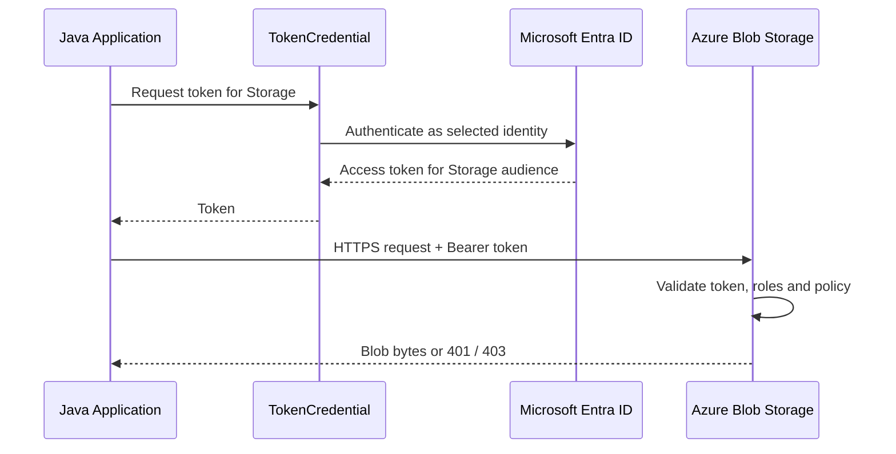
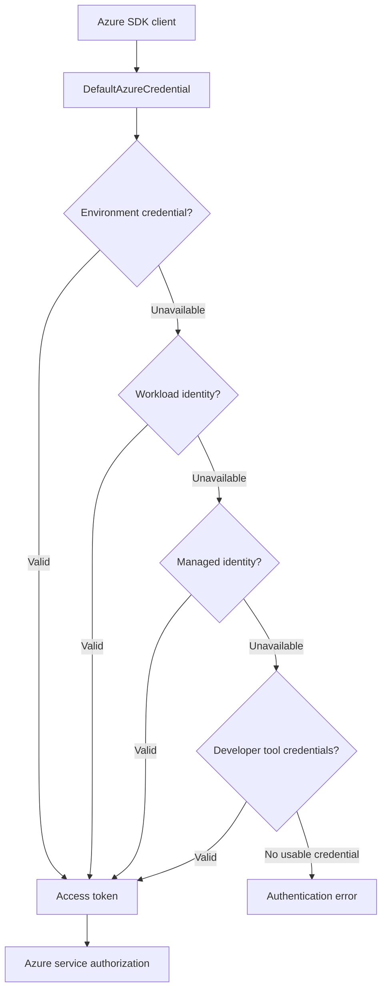
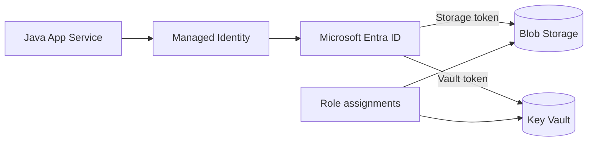
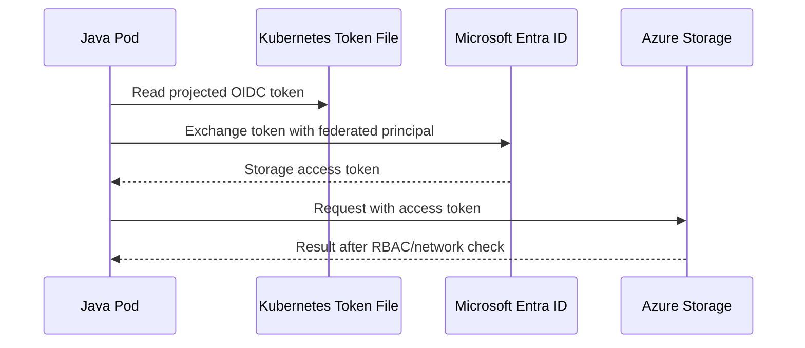
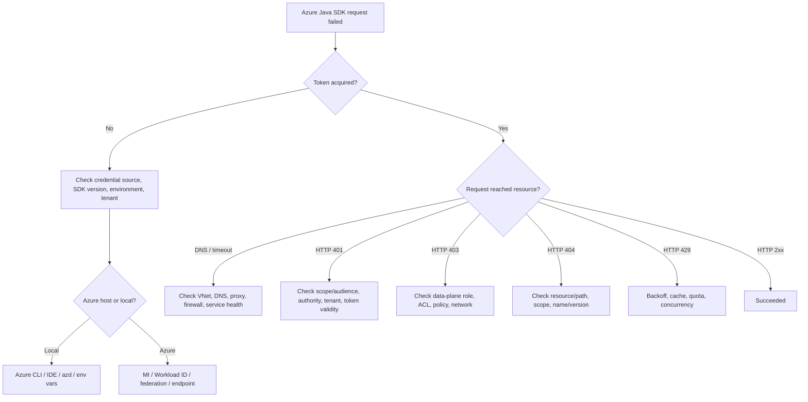
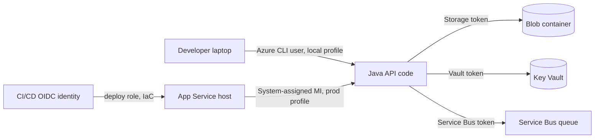

# DefaultAzureCredential and Authentication Chains

A Java application on Azure must prove its identity before reading Azure Blob Storage, retrieving secrets from Azure Key Vault, sending messages to Azure Service Bus, or calling resource management APIs. On a laptop, developers are usually already signed in via the Azure CLI or an IDE. On Azure App Service, Azure Functions, Azure Kubernetes Service (AKS), or Azure Container Apps, the application should run **without manual sign-in**, without hard-coded passwords, and with only the minimum required permissions.

The **Azure Identity for Java** library provides the `TokenCredential` interface and several authentication mechanisms. **`DefaultAzureCredential`** is a **credential chain**: it attempts supported identity sources in the order defined by the **running SDK version**, allowing developer credentials locally and managed identity/workload identity in Azure. If one source is unavailable, the chain can try the next source; if a source is configured yet fails authentication, whether the chain stops or continues depends on the credential type and SDK version.

While convenient, this introduces risks: an application might **accidentally use a service principal from environment variables** instead of the intended Azure CLI user or managed identity. Code that runs locally may still lack data-plane roles in production; holding a valid token does not automatically grant permission to read a Blob.

This lesson belongs to the **Azure SDK for Java** chapter of the `CLOUD_PROVIDERS_AZURE` module: exploring subscriptions, resource groups, Microsoft Entra ID, networking, compute, storage, data, security, monitoring, and cost control on Azure. The focus is on **Azure SDK Java + Microsoft Entra ID**, rather than implementing OAuth 2.0 token protocols manually.

> **Version Note:** The members, ordering of `DefaultAzureCredential`, and continuation rules after a failure can change across versions of `com.azure:azure-identity`. The chain shown in this lesson is a **conceptual model**. In real deployments, pin the SDK version and verify behavior on the exact runtime; do not treat the diagram below as an immutable order across all Java SDK versions.

## Learning Objectives

After this lesson, you will be able to:

1. Distinguish between **authentication** (who are you?) and **authorization** (what are you allowed to do?).
2. Understand `TokenCredential`, access tokens, OAuth scopes/audiences, and Microsoft Entra ID.
3. Analyze the source groups in `DefaultAzureCredential`: **environment, workload identity, managed identity, and developer tool credentials**.
4. Know when the chain continues, when an error should fail fast, and why **401 differs from 403**.
5. Use `DefaultAzureCredentialBuilder` in the Java SDK to read Blob Storage or call Azure Key Vault.
6. Verify local identity using **Azure CLI/IDE/azd** and select the right tenant/subscription.
7. Design production workloads with **system-assigned/user-assigned managed identities**, and CI/CD with **OIDC/workload identity federation**.
8. Choose explicit credentials when you need to lock down a single identity and prevent unintended fallback.
9. Apply Azure RBAC/data-plane roles, secret protection, network controls, and least privilege.
10. Diagnose `CredentialUnavailableException`, authentication failures, HTTP 401/403, wrong tenant/scope, and timeouts.
11. Write tests with fake credentials and verify real behavior via safe integration tests.

## 1. Authentication and Authorization Are Two Separate Layers

Suppose a Java application needs to download a contract from Blob Storage:



- **Authentication:** Microsoft Entra ID verifies the principal and issues a token with the appropriate scope/audience.
- **Authorization:** Azure Blob Storage decides whether that principal may read the blob, governed by data-plane RBAC, ACLs where applicable, account settings, and network rules.
- **Application authentication is not end-user authorization:** A web API whose managed identity reads backend data must still enforce authorization for the end user calling the API.

**`DefaultAzureCredential` only helps acquire tokens.** It does not create Azure role assignments or bypass firewalls, Private Endpoints, or Azure Policy.

### 1.1. Concepts That Must Not Be Conflated

| Concept | Role | Example |
|---|---|---|
| **Tenant** | Microsoft Entra ID identity boundary. | Corporate tenant containing users and applications. |
| **Principal** | Identifier of the user/app/managed identity performing an action. | CLI-signed-in user or a Function's service principal. |
| **Subscription** | Management, billing, and resource scope boundary. | Production or lab subscription. |
| **Resource/scope** | Target audience for which the token is issued. | `https://storage.azure.com/.default`. |
| **Role assignment** | Permissions granted on a resource/scope. | `Storage Blob Data Reader` on the target container. |
| **Network policy** | Whether the endpoint can be reached over the network. | Storage firewall and Private Endpoint. |

A principal holding the resource-group `Reader` management role usually **cannot read Blob contents**. Likewise, a token issued for `https://vault.azure.net/.default` cannot be used to read Storage.

### 1.2. From an Azure Java Client to a Token

In Java:

- `TokenCredential` is an Azure Core interface.
- `DefaultAzureCredential` implements `TokenCredential` using a chain of sources.
- `ManagedIdentityCredential`, `WorkloadIdentityCredential`, `ClientSecretCredential`, and `AzureCliCredential` are specific authentication mechanisms.
- Azure clients such as `BlobServiceClient` or `SecretClient` accept a `TokenCredential` via their builder and let the SDK manage request/access token lifecycles.
- Tokens have a finite lifetime; the SDK and credential typically handle caching and refresh per implementation.

**Never write access tokens into logs, configuration, or files for reuse.** With the Azure SDK, passing the credential object to the client builder rather than manually handling raw Bearer tokens is the safer default.

## 2. Which Sources Does DefaultAzureCredential Try?

`DefaultAzureCredential` provides a sequential chain of options:



This is a **source-group diagram**, not a guarantee of exact ordering across every Java SDK version. A credential that is configured yet returns an authentication error may **halt the chain** under current rules instead of always advancing to the next node.

### 2.1. Common Credential Groups

| Source | Condition | Usage Example |
|---|---|---|
| **EnvironmentCredential** | Environment variables identifying an app and service principal secret/certificate per contract. | Legacy CI/hosting with configured credentials. |
| **WorkloadIdentityCredential** | Entra federated workload identity, OIDC token file, and client/tenant identity. | AKS or CI with OIDC federation. |
| **ManagedIdentityCredential** | Azure host provides a supported identity endpoint. | App Service, Functions, VMs, Container Apps. |
| **IDE/identity broker credentials** | User signed into an IDE/broker supported by the Azure Identity version. | Local developer. |
| **AzureCliCredential** | Active Azure CLI login session. | Laptop after `az login`. |
| **AzurePowerShellCredential** | Supported Azure PowerShell session. | Controlled local/automation use. |
| **AzureDeveloperCliCredential** | Supported Azure Developer CLI session. | Local after `azd auth login`. |

Whether sources like **IntelliJ, Shared Token Cache, Visual Studio Code, or brokers** are present or enabled depends on the Java Identity SDK version and dependencies. Do not assume Java matches the exact `DefaultAzureCredential` ordering of .NET, Python, or JavaScript.

### 2.2. Same Code, Different Runtime Identities

```java
import com.azure.core.credential.TokenCredential;
import com.azure.identity.DefaultAzureCredentialBuilder;

TokenCredential credential = new DefaultAzureCredentialBuilder().build();
```

- **Local:** may use Azure CLI or an IDE login.
- **App Service/Functions:** if configured, typically selects managed identity when no higher-priority source succeeds.
- **AKS with Azure Workload Identity:** can select the appropriate workload federated credential.
- **CI:** can use workload federation or another explicit credential.

**There is no guarantee that your local principal matches the production principal**, and that is usually desirable: production should use a dedicated workload identity with least privilege.

### 2.3. "Unavailable" Is Different from "Authentication Failed"

A credential source may be **unavailable** because:

- Azure CLI is not installed or signed in.
- A laptop has no managed identity endpoint.
- Environment variables for a source are incomplete.

In these cases, the chain can proceed to the next source.

A credential source may be **configured yet fail** because:

- Client secret is wrong or expired.
- Certificate is no longer valid.
- Federated identity issuer/subject/audience is mismatched.
- Tenant ID or client ID mismatches.
- Workload token is invalid.

Continuation policies differ between **deployed credentials** and **developer credentials** depending on the SDK version. Never "hide errors" by allowing fallback to another identity when a production source is misconfigured.

### 2.4. Holding a Token Yet Receiving 403 Does Not Trigger Fallback

```text
1. EnvironmentCredential successfully acquires a token for service principal A.
2. Java client uses A's token to call Blob Storage.
3. Blob returns HTTP 403 because A lacks Storage Blob Data Reader.
4. Client fails with 403; it does NOT fall back to user B's AzureCliCredential.
```

**The credential chain exists to obtain a token**, not to cycle through accounts until one happens to have sufficient RBAC.

## 3. Precedence Order and the Risk of Selecting the Wrong Identity

A machine with both `az login` and valid `AZURE_CLIENT_ID`, `AZURE_TENANT_ID`, `AZURE_CLIENT_SECRET` variables may use **EnvironmentCredential before Azure CLI**, even if the operator assumes the app is running as their user account. In production, a leftover client secret in environment variables can cause the app to bypass the intended managed identity.

**Always verify:**

1. Which credential source is selected?
2. Which principal/object ID and tenant receive the token?
3. Which resource/audience is the token issued for?
4. Which principal is granted roles on the target resource?
5. Is there an unintended secondary source from an IDE, CLI, or environment variables?
6. If the production credential is misconfigured, does the app fail fast or silently fall back?

### 3.1. Two Environment-Specific Strategies

**Development:**

```java
TokenCredential credential = new DefaultAzureCredentialBuilder().build();
```

Useful because Azure CLI/IDE logins are convenient.

**Production requiring a fixed identity:**

```java
import com.azure.identity.ManagedIdentityCredentialBuilder;

TokenCredential credential =
    new ManagedIdentityCredentialBuilder().build();
```

When production policy mandates using only a system-assigned managed identity, an explicit **`ManagedIdentityCredential`** prevents a service principal from environment variables or developer tooling from being picked up. On AKS/OIDC, choose an explicit `WorkloadIdentityCredential` where architecture requires it.

**`DefaultAzureCredential` is not inherently "insecure"**, but production environments must be tightly controlled, especially when multiple sources exist in the chain. If using the default chain in production, audit environment variables, use exclusion/selection options if supported by the SDK, and verify the exact runtime identity post-deployment.

### 3.2. Never Catch 403 to Try Another Credential

An anti-pattern:

```text
try ManagedIdentity
on 403: try AzureCLI
on 403: try EnvironmentSecret
```

This turns authorization failures into privilege escalation by falling back to a broader identity. In production, when the selected principal lacks access, fix the **role assignment** or request proper permissions; never swap principals dynamically.

## 4. Configuring the Azure SDK for Java with Maven

The Azure SDK is split into modules:

- `com.azure:azure-identity`: `DefaultAzureCredential` and credential types.
- `com.azure:azure-core`: `TokenCredential` and shared abstractions.
- `com.azure:azure-storage-blob`: Blob Storage clients.
- `com.azure:azure-security-keyvault-secrets`: Azure Key Vault Secret client.
- `com.azure:azure-messaging-servicebus`: Service Bus client if used.

Use the Azure SDK **BOM** to align versions consistently whenever possible:

```xml
<dependencyManagement>
  <dependencies>
    <dependency>
      <groupId>com.azure</groupId>
      <artifactId>azure-sdk-bom</artifactId>
      <version>YOUR_TESTED_AZURE_SDK_BOM_VERSION</version>
      <type>pom</type>
      <scope>import</scope>
    </dependency>
  </dependencies>
</dependencyManagement>

<dependencies>
  <dependency>
    <groupId>com.azure</groupId>
    <artifactId>azure-identity</artifactId>
  </dependency>
  <dependency>
    <groupId>com.azure</groupId>
    <artifactId>azure-storage-blob</artifactId>
  </dependency>
  <dependency>
    <groupId>com.azure</groupId>
    <artifactId>azure-security-keyvault-secrets</artifactId>
  </dependency>
</dependencies>
```

`YOUR_TESTED_AZURE_SDK_BOM_VERSION` must be replaced with an **existing, JDK-compatible, tested** version. This XML snippet is not a standalone runnable `pom.xml`, as it omits project metadata, plugins, and application dependencies. Never use `latest` or floating version ranges in production; test upgrades carefully because identity chain behavior can change.

### 4.1. Endpoint Configuration Is Not a Secret

```text
AZURE_STORAGE_BLOB_ENDPOINT=https://<storage-account>.blob.core.windows.net
AZURE_KEYVAULT_URI=https://<key-vault-name>.vault.azure.net/
```

These are **application-defined configuration variable names**, not variables read automatically by `DefaultAzureCredential` for identity. They hold target endpoints; the credential acquires tokens and the service enforces RBAC. Never put account keys, connection strings, or client secrets into source code or Docker images.

### 4.2. Create the Credential Once and Reuse It

```java
import com.azure.core.credential.TokenCredential;
import com.azure.identity.DefaultAzureCredentialBuilder;

public final class AzureIdentity {
    private static final TokenCredential CREDENTIAL =
        new DefaultAzureCredentialBuilder().build();

    private AzureIdentity() {}

    public static TokenCredential credential() {
        return CREDENTIAL;
    }
}
```

In Spring Boot, Quarkus, or Micronaut, manage `TokenCredential` and service clients via dependency injection or application-scoped singletons. Avoid creating a new credential **on every HTTP request**, as it adds initialization overhead and reduces caching/diagnostics efficiency. The Azure SDK handles token refresh; never store raw access tokens in static variables yourself.
## 5. Java Example: Reading Azure Blob Storage

Suppose the application is configured with:

```text
AZURE_STORAGE_BLOB_ENDPOINT=https://stworkspacelab.blob.core.windows.net
Container: project-documents
Runtime identity: granted Storage Blob Data Reader at the proper scope
```

Names are illustrative; resources and roles must exist beforehand.

```java
import com.azure.core.credential.TokenCredential;
import com.azure.identity.DefaultAzureCredentialBuilder;
import com.azure.storage.blob.BlobContainerClient;
import com.azure.storage.blob.BlobServiceClient;
import com.azure.storage.blob.BlobServiceClientBuilder;
import com.azure.storage.blob.models.BlobItem;

public final class ListDocuments {
    public static void main(String[] args) {
        String endpoint = System.getenv("AZURE_STORAGE_BLOB_ENDPOINT");
        if (endpoint == null || endpoint.isBlank()) {
            throw new IllegalArgumentException("Missing Storage endpoint");
        }

        TokenCredential credential =
            new DefaultAzureCredentialBuilder().build();

        BlobServiceClient service = new BlobServiceClientBuilder()
            .endpoint(endpoint)
            .credential(credential)
            .buildClient();

        BlobContainerClient container =
            service.getBlobContainerClient("project-documents");

        for (BlobItem item : container.listBlobs()) {
            // Do not print Blob contents or secrets.
            System.out.println("Name: " + item.getName());
        }
    }
}
```

**Key points to understand:**

- Building `DefaultAzureCredential` **does not necessarily acquire a token immediately**; most errors surface when the SDK sends its first request.
- `BlobServiceClientBuilder` requests a token for the appropriate scope automatically; do not manually construct HTTP Bearer headers.
- `Storage Blob Data Reader` is a **data-plane role**, distinct from the management-plane `Reader` role.
- If Storage uses a firewall, Private Endpoint, or ADLS Gen2 ACLs, even a valid token can be blocked.
- Even printing Blob names can leak sensitive metadata; run only against authorized lab/test data.
- For large files, use streaming or download-to-file APIs rather than loading the entire payload into RAM.
- The code does not create storage accounts/containers, assign RBAC, configure networking, or enable managed identity.

### 5.1. Accessing a Specific Blob

```java
// Additional snippet, assuming container client is already created.
byte[] bytes = container.getBlobClient("manuals/start-here.txt")
                        .downloadContent()
                        .toBytes();
// Only suitable for small authorized files; do not write contents to logs.
```

Blob paths and names must come from trusted sources or be checked by application authorization. In a multi-user web API, **the API's managed identity reading a Blob does not mean the end user is authorized to view that file**. Always authenticate and authorize the end user before returning bytes to the client.

### 5.2. Storage Token Scope

A common scope used when requesting tokens for Storage is:

```text
https://storage.azure.com/.default
```

This scope is **not** the account endpoint `https://stworkspacelab.blob.core.windows.net`. The Storage SDK requests the proper scope; the target account/Blob service then enforces its own authorization.

## 6. Java Example: Reading a Secret from Azure Key Vault

When an application genuinely needs a secret to connect to a service **that does not yet support Microsoft Entra auth**, Azure Key Vault keeps that secret outside source code and container images.

```java
import com.azure.core.credential.TokenCredential;
import com.azure.identity.DefaultAzureCredentialBuilder;
import com.azure.security.keyvault.secrets.SecretClient;
import com.azure.security.keyvault.secrets.SecretClientBuilder;
import com.azure.security.keyvault.secrets.models.KeyVaultSecret;

public final class LoadSecret {
    public static void main(String[] args) {
        String vaultUrl = System.getenv("AZURE_KEYVAULT_URI");
        if (vaultUrl == null || vaultUrl.isBlank()) {
            throw new IllegalArgumentException("Missing vault URI");
        }

        TokenCredential credential =
            new DefaultAzureCredentialBuilder().build();

        SecretClient client = new SecretClientBuilder()
            .vaultUrl(vaultUrl)
            .credential(credential)
            .buildClient();

        KeyVaultSecret secret = client.getSecret("external-api-token");
        if (secret.getValue() == null || secret.getValue().isBlank()) {
            throw new IllegalStateException("Secret not configured");
        }

        // Only pass the value in memory to the API client that needs it.
        // Never print secrets or write them to telemetry or disk.
    }
}
```

A vault can use the **Azure RBAC permission model** (e.g., the `Key Vault Secrets User` role to read secrets at scope) or **legacy access policies**. Grant permissions matching the vault's configured model; holding `Reader` on the resource group still does not grant secret read access. Proper networking/DNS is required if the Vault uses a Private Endpoint.

**Do not turn Key Vault into an unnecessary store of account keys**: if Blob, Service Bus, or the target service accepts Microsoft Entra ID tokens directly, using identity removes the need to manage long-lived secrets.

## 7. Local Development with Azure CLI and IDEs

### 7.1. Azure CLI

Steps on a laptop:

```bash
az login
az account list --output table
az account show --query "{tenant:tenantId,subscription:id,user:user.name}" -o json

# When multiple tenants/subscriptions exist:
az login --tenant "<tenant-id>"
az account set --subscription "<subscription-id>"
az account show -o json
```

CLI login is **one source** in the chain if the SDK version supports `AzureCliCredential`. `az account set` sets the default subscription for CLI commands; it **does not guarantee** `DefaultAzureCredential` picked the CLI (for example, `EnvironmentCredential` may take precedence).

### 7.2. Using Explicit AzureCliCredential When Debugging

```java
import com.azure.core.credential.TokenCredential;
import com.azure.identity.AzureCliCredentialBuilder;

TokenCredential localCredential =
    new AzureCliCredentialBuilder().build();
```

Use this in a local/dev profile when you want to guarantee the app uses your Azure CLI identity. It requires `az` to be installed and signed in; it is not a production App Service authentication mechanism.

### 7.3. IDEs, Azure Developer CLI, Brokers

Depending on SDK version and dependencies:

- Some IDEs provide supported cached accounts or authentication brokers.
- `azd auth login` (Azure Developer CLI) is a **separate session** from `az login`.
- Signing into the Azure Portal in a browser does not give the Java SDK an Azure CLI token.
- If multiple tools are signed in with different users or tenants, verify which source the chain selected.

Use safe diagnostics without logging token values. When suspecting an identity mismatch, temporarily use an explicit dev credential and verify the active principal and tenant.

### 7.4. Broad Developer Permissions Do Not Prove Production Will Succeed

A user with `Owner` on a subscription can read resources or configurations that a production managed identity cannot. Catch those gaps via integration tests running under the **actual runtime identity**, rather than granting the MI `Owner`.

## 8. Production with Managed Identity

**Managed Identity** is managed by Azure for supported workloads. The runtime app fetches tokens through the host/identity endpoint without embedding client secrets in the application. You must still enable the identity, assign roles, and configure networking separately.

### 8.1. System-Assigned vs. User-Assigned

| Type | Lifecycle | Scenario |
|---|---|---|
| **System-assigned** | Tied to one Azure resource; typically deleted when the resource is deleted. | App Service/Function/VM needing its own dedicated identity. |
| **User-assigned** | Standalone Azure identity resource, attachable to multiple supported workloads. | Replacing compute while keeping the same principal, or intentional shared identity. |

Reusing one user-assigned MI across too many apps widens the blast radius if one app is compromised. Separate identities by security domain and data sensitivity.

### 8.2. Authentication Flow



A typical deployment workflow:

1. Enable a system-assigned MI or attach a user-assigned MI to the Azure resource.
2. Obtain the **principal/object ID** for Azure RBAC assignments, and the **client ID** when selecting a specific user-assigned MI.
3. Grant `Storage Blob Data Reader` at the narrowest scope for read-only operations.
4. Grant Key Vault secret read permissions per the vault's permission model.
5. Put **endpoint URIs**, not account keys, into app settings.
6. Configure networking and DNS for Storage and Key Vault.
7. Test from the **real Azure runtime** (not only from local CLI).
8. Monitor auth errors and role assignment changes.

### 8.3. Explicit ManagedIdentityCredential

When production must only use MI:

```java
import com.azure.core.credential.TokenCredential;
import com.azure.identity.ManagedIdentityCredentialBuilder;

TokenCredential credential =
    new ManagedIdentityCredentialBuilder().build();
```

If the MI does not exist, is not attached, or the host endpoint fails, **this credential will not fall back to an Azure CLI user**. That is a major advantage when locking down production identity. On a typical laptop, no MI endpoint exists so this code will fail to authenticate; use a separate local dev profile.

### 8.4. Selecting a User-Assigned Identity

```java
String miClientId = System.getenv("AZURE_MI_CLIENT_ID");
if (miClientId == null || miClientId.isBlank()) {
    throw new IllegalArgumentException("Missing MI client ID");
}

TokenCredential credential =
    new ManagedIdentityCredentialBuilder()
        .clientId(miClientId)
        .build();
```

`AZURE_MI_CLIENT_ID` is an **example application configuration variable**, not a client secret. Distinguish **client ID** from **principal/object ID**. Setting this variable alone does not create or attach an MI to an Azure host. Some SDK versions support `DefaultAzureCredentialBuilder.managedIdentityClientId`, but that setting **does not lock the entire chain** to MI if higher-priority credentials are present.

## 9. Workload Identity Federation for AKS and CI/CD

**Workload identity federation** allows an OIDC token from a workload or CI issuer to be exchanged with Microsoft Entra ID for an access token, eliminating long-lived client secrets.

### 9.1. Azure Kubernetes Service Workload Identity

A typical setup includes:

- AKS configured with an OIDC issuer and Azure Workload Identity integration.
- A Kubernetes `ServiceAccount` and a federated identity credential linking the target Entra application/managed identity.
- A workload Pod using that service account with the annotations/labels required by the integration.
- Projected token file and variables such as `AZURE_CLIENT_ID`, `AZURE_TENANT_ID`, `AZURE_FEDERATED_TOKEN_FILE` injected per contract.
- The Java Azure Identity SDK exchanges the federated token for an Azure access token.
- The Entra principal holds least-privilege RBAC on Storage, Key Vault, or the target service.



Federation succeeds only when **issuer, subject (namespace/service-account), and audience** match the trust configuration. Having only `AZURE_CLIENT_ID` or a service account name **is not enough**.

### 9.2. Java WorkloadIdentityCredential

```java
import com.azure.core.credential.TokenCredential;
import com.azure.identity.WorkloadIdentityCredentialBuilder;

// Runs only when environment/token file/federation are configured.
TokenCredential credential =
    new WorkloadIdentityCredentialBuilder().build();
```

This demonstrates using the builder available in supported SDK versions. In production, pin the SDK version, verify the environment contract, and detect federated token errors early. Never copy projected token files off a Pod or log token contents.

### 9.3. CI/CD OIDC Federation

CI platforms like GitHub Actions or Azure DevOps can issue OIDC tokens per provider configuration. General workflow:

1. Establish federated credential trust between the CI issuer and an Entra principal.
2. Restrict repository, branch, environment, or service-connection subject claims tightly.
3. Grant least-privilege roles to the **deployment identity**—never reuse the runtime identity as a default admin.
4. CI obtains a short-lived OIDC token and uses supported SDK/login flows.
5. Guard workflow permissions so unauthorized edits to CI definitions cannot hijack cloud access.
6. Avoid storing long-lived client secrets whenever federation is available.

A CI runner hosted on an Azure VM with an MI differs from a hosted runner on the public Internet. Do not confuse the **managed identity endpoint** with **federated OIDC token exchange**; pick the mechanism matching your actual topology.
## 10. EnvironmentCredential and Service Principals: When to Use Them?

Some legacy systems or runtimes lacking managed identity or workload federation support still require a **service principal** with a client secret or certificate. Azure Identity supports these via `EnvironmentCredential` when properly configured.

### 10.1. Common Environment Variables for a Client Secret

```text
AZURE_TENANT_ID=<tenant-id>
AZURE_CLIENT_ID=<application-client-id>
AZURE_CLIENT_SECRET=<client-secret-value>
```

These are **well-known configuration variable names recognized by Azure Identity** in supported versions. They are **not** meant for a `.env` file committed to Git, pasted into build logs, or attached to issue trackers. `AZURE_CLIENT_SECRET` is sensitive secret material, not an object ID. Certificate options with certificate path/password variables may also exist depending on the SDK version.

**Prefer whenever possible:** managed identity on Azure hosts or OIDC/workload identity federation to eliminate long-lived secrets. Where secrets are unavoidable, store them in a secret manager, rotate them regularly, apply least privilege, and restrict read access to app settings.

### 10.2. EnvironmentCredential Can Cause Wrong-Identity Selection

If both valid service principal environment variables and an Azure CLI login exist, `DefaultAzureCredential` may select the environment source first. When that happens:

```text
Developer believes app uses: user@company.example via Azure CLI
Runtime actually uses:       service principal from AZURE_CLIENT_*
Result:                      unexpected 403 errors, or overly broad unintended access
```

**Do not "fix" this by granting permissions to both principals.** Inspect which source was chosen; clear variables that do not belong in the current environment or use an explicit credential for the profile being verified.

### 10.3. AZURE_CLIENT_ID Serves Different Roles Depending on the Credential

`AZURE_CLIENT_ID` is an identifier, not proof of a secret or federated identity. Depending on the environment, it participates in:

- Client secret/certificate service principal configuration.
- Federated workload identity principal selection.
- Managed identity selection per host/SDK configuration.

Setting one variable does not activate a mechanism on its own. Verify the **complete variable set, token file or host endpoint, and role assignments** for your chosen mechanism.

### 10.4. When an Explicit Credential Is Needed

```java
import com.azure.core.credential.TokenCredential;
import com.azure.identity.ClientSecretCredentialBuilder;

String tenant = System.getenv("AZURE_TENANT_ID");
String client = System.getenv("AZURE_CLIENT_ID");
String secret = System.getenv("AZURE_CLIENT_SECRET");

// Use only with secrets retrieved from a secret manager or secure runtime environment.
TokenCredential credential = new ClientSecretCredentialBuilder()
    .tenantId(tenant)
    .clientId(client)
    .clientSecret(secret)
    .build();
```

This illustrates **API usage**, not a recommendation to keep secrets in code. In real applications, validate non-null/non-blank values, never log or print secrets or exceptions carrying sensitive parameters, and prefer secretless identities whenever supported by the Azure host or CI.

## 11. Token Scopes, Tenants, Authorities, and Caching

### 11.1. Tokens Carry a Service-Specific Audience

Each SDK client knows its service's scope:

| Service | Common Illustrative Scope | Limitation |
|---|---|---|
| Azure Blob Storage | `https://storage.azure.com/.default` | A Storage token does not grant Blob data access without RBAC/ACLs. |
| Azure Key Vault | `https://vault.azure.net/.default` | Vault permission model and firewall still apply. |
| Azure Service Bus | `https://servicebus.azure.net/.default` | Requires send/receive roles on the target namespace/entity. |
| Azure Resource Manager | `https://management.azure.com/.default` | Management plane only; does not automatically grant data-plane access. |

These examples apply to **Azure public cloud**, not sovereign clouds. Azure Government, Azure China, or other clouds use distinct authorities and endpoints. With Azure SDK client builders, let the SDK request the standard audience/scope rather than hard-coding strings.

### 11.2. A Valid Token Does Not Guarantee the Right Tenant

An identity may be a B2B guest or belong to multiple tenants. A token might be issued from an unexpected tenant; the target resource may reject an invalid tenant/principal, or the role assignment may have been created on a different service principal object.

A verification checklist:

1. Confirm the tenant of the resource/app registration and the expected tenant of the principal.
2. Check the active tenant in CLI/IDE/environment/managed identity configuration.
3. Verify the **application client ID** vs. the **service principal object ID**.
4. Compare the role assignment and principal ID at the resource scope.
5. Verify the matching cloud authority and endpoints.
6. If cross-tenant access is genuinely required, design controlled, tested trust/tenant selection rather than allowing arbitrary tenants.

### 11.3. Token Caching and Lifetimes

Access tokens have expiration times. The Azure Identity SDK typically supports caching and refresh across the credential and SDK client. Sound practices:

- Create **credentials and Azure clients once for an appropriate lifecycle**.
- Avoid calling `getToken()` manually on every request when the service client builder already handles it.
- Do not hard-code assumptions like "tokens always live exactly 60 minutes" for every token type.
- Never write raw tokens to logs to "debug a JWT."
- Ensure the host clock is accurate and network access exists to refresh tokens.
- After revoking permissions, previously issued tokens may remain valid briefly; enforcement also depends on target service and system caching.

### 11.4. Testing Token Acquisition Safely (Diagnostics Only)

If you need to verify Azure Identity can acquire a token **without calling the target service**, you can request the scope and print only the expiration timestamp:

```java
import com.azure.core.credential.TokenCredential;
import com.azure.core.credential.TokenRequestContext;
import com.azure.identity.DefaultAzureCredentialBuilder;

// For lab diagnostics only; never print AccessToken.getToken().
TokenCredential credential =
    new DefaultAzureCredentialBuilder().build();

TokenRequestContext context = new TokenRequestContext()
    .addScopes("https://storage.azure.com/.default");

var token = credential.getToken(context).block();
if (token == null) {
    throw new IllegalStateException("Token not obtained");
}
System.out.println("Token expiry: " + token.getExpiresAt());
```

**This only tests token acquisition**; it does not prove the principal holds `Storage Blob Data Reader`. To test authorization, **execute a data-plane request** against the target container using that identity. Never print `token.getToken()` or paste `az account get-access-token` output into chat, issues, or logs.

## 12. Azure RBAC: Least Privilege at the Right Layer

An application can authenticate cleanly yet receive 403 if RBAC is missing. Conversely, overly broad permissions amplify damage if a workload is compromised.

### 12.1. Example Role-to-Operation Mapping

| Application Operation | Typically Required Permission |
|---|---|
| Read-only Blob access in a container | `Storage Blob Data Reader` at the appropriate scope. |
| Write/update Blobs in a container | `Storage Blob Data Contributor` or suitable data-plane role. |
| Read secret values from an RBAC Key Vault | `Key Vault Secrets User` or matching role/permission. |
| Send messages to Service Bus | `Azure Service Bus Data Sender` at namespace/entity scope. |
| Receive messages from Service Bus | `Azure Service Bus Data Receiver` at the appropriate scope. |
| Manage resource groups and deployments | Management-plane roles for the CI/deployment identity. |
| Read/write Azure Cosmos DB for NoSQL data | **Native Cosmos DB data-plane RBAC** (distinct from management-plane roles). |

Do not assign `Storage Blob Data Contributor` to a service that only lists files; do not assign `Key Vault Administrator` just to read a single secret. Key Vault can also use **access policies** instead of Azure RBAC: verify permissions according to the vault's active model.

### 12.2. RBAC Scopes Are Hierarchical, Data Planes Have Extra Rules

Azure role assignments apply at scopes like subscription, resource group, resource, and certain service-supported child scopes. Assigning `Storage Blob Data Reader` at the subscription level may expose far more containers and accounts than intended. Assigning at the exact container narrows exposure where supported.

Beyond RBAC, ADLS Gen2 enforces **ACLs** and directory traverse/execute permissions; Blob Storage enforces firewalls and private networking. Never assume having the right role alone suffices for every resource or data path.

### 12.3. Reading Role Assignments via CLI

**Read-only** example command (assuming permission to read role metadata):

```bash
az login
az account set --subscription "<subscription-id>"

# Object/principal ID to inspect; never replace with a client secret.
PRINCIPAL_ID="<principal-object-id>"
STORAGE_SCOPE="/subscriptions/<sub-id>/resourceGroups/<rg>/providers/Microsoft.Storage/storageAccounts/<account>"

az role assignment list \
  --assignee "$PRINCIPAL_ID" \
  --scope "$STORAGE_SCOPE" \
  --include-inherited \
  --output table
```

Output shows assignments within the queried scope according to the CLI user's visibility. It is not the sole check for group-based inheritance, deny assignments, propagation delays, or service-level policies. If a newly granted role is not yet visible, check propagation delay and exact principal/scope rather than immediately granting `Owner`.

### 12.4. Granting Roles Is a Security-Sensitive Change

Creating role assignments in the Portal, IaC, or CLI requires approval and appropriate role-assigning permissions. A logical record for reviewers:

```text
Principal:  system-assigned MI of api-orders-prod
Role:       Storage Blob Data Reader
Scope:      /subscriptions/<...>/storageAccounts/<...>/blobServices/default/containers/project-documents
Reason:     read-only access to documents for API
Owner:      Order Platform Team
Review:     periodically and upon application retirement
```

This is a **configuration record**, not an automated grant command. Keep an audit trail of **who granted it, when, why, and whether it expires or can be revoked**.

## 13. DefaultAzureCredential and Service Bus: Another Example

If an API needs to send messages to Azure Service Bus, it can reuse the same `TokenCredential` instead of a connection string containing a shared access policy key:

```java
import com.azure.core.credential.TokenCredential;
import com.azure.identity.DefaultAzureCredentialBuilder;
import com.azure.messaging.servicebus.ServiceBusClientBuilder;
import com.azure.messaging.servicebus.ServiceBusSenderClient;
import com.azure.messaging.servicebus.ServiceBusMessage;

TokenCredential credential =
    new DefaultAzureCredentialBuilder().build();

ServiceBusSenderClient sender = new ServiceBusClientBuilder()
    .credential(credential)
    .fullyQualifiedNamespace("sb-workspace-lab.servicebus.windows.net")
    .sender()
    .queueName("events-demo")
    .buildClient();

try {
    sender.sendMessage(new ServiceBusMessage("hello-from-java"));
} finally {
    sender.close();
}
```

**Prerequisites:** the namespace and queue must already exist, the SDK version must support the builder, the principal must hold `Azure Service Bus Data Sender` at the proper scope, and network/AMQP connectivity must work. This is a **real send operation** if executed—run only against an authorized lab. Never put secrets or PII into messages or logs.

### 13.1. One Credential Shared Across Multiple Azure SDK Clients

```text
TokenCredential
  +--> Blob SDK: Storage audience, Storage RBAC
  +--> Key Vault SDK: Vault audience, Key Vault policy/RBAC
  +--> Service Bus SDK: Service Bus audience, Data Sender/Receiver RBAC
```

This makes reusing `TokenCredential` very convenient. Still, **one credential is not a universal pass**: each service independently validates the token's audience and its own authorization rules.

## 14. Common Authentication Errors and Their Meaning

### 14.1. Classification Table

| Signal | Typical Failure Class | What to Check |
|---|---|---|
| `CredentialUnavailableException` | A credential source lacks the prerequisites to run. | CLI/IDE login, managed identity endpoint, env vars, token file. |
| `ClientAuthenticationException` or authentication failed message | Authentication was attempted, but Entra/token endpoint rejected it. | Tenant/client IDs, secret/certificate, federation, authority, SDK version. |
| HTTP **401 Unauthorized** | Request reached the service without a valid/matching-audience token or had a token error. | SDK-generated Authorization header, scope/audience, tenant, clock, proxy. |
| HTTP **403 Forbidden** | Service denied permissions, access policy, or network access. | Data-plane RBAC, Key Vault policy, firewall/private endpoint, role propagation. |
| HTTP **404 Not Found** | Resource/path/version does not exist; sometimes security policies hide resources intentionally. | Resource name, scope, API, data path, and read visibility. |
| **Timeout/connection refused/DNS failure** | Cannot reach Entra/IMDS/resource endpoint. | DNS, outbound rules, proxy, Private Endpoint, service health. |
| **429 Too Many Requests** | Service or token endpoint is rate-limited. | Throttle source, retries/backoff, caching, concurrency. |

A `"DefaultAzureCredential failed to retrieve a token"` message often aggregates diagnostics from each source. **Do not read only the last line** and blame Azure CLI; an earlier deployment credential in the chain may have failed meaningfully.

### 14.2. How Do 401 and 403 Differ?

```text
Token acquisition succeeds
           |
           v
Request sent to Azure service
           |
     +-----+------+
     |            |
    401          403
     |            |
Check token   Check RBAC/ACL,
scope/aud,    data-plane policy,
tenant,       network, resource
clock/API     scope/propagation
```

On some services, a Storage firewall block can also surface as **403**. Thus 403 does not always mean "missing role"; inspect the error code, response details, and network path. Conversely, having the right role does not help if the token carries the wrong audience.

### 14.3. Managed Identity Unavailable

If code using an explicit `ManagedIdentityCredential` runs on a laptop, `"Managed Identity endpoint unavailable"` is expected. If code running on App Service throws a similar error, verify:

1. Is the MI enabled/attached to the right resource?
2. If user-assigned, is the correct client ID configured?
3. Was the app restarted/redeployed after identity/config changes as required by the host?
4. Are the network, host metadata, and identity endpoint healthy?
5. Is the SDK up to date and supporting the current hosting mode?
6. Is the code running inside a container/pod without workload identity configured as assumed?

Do not manually query the IMDS endpoint or log raw token responses to debug. Rely on SDK logs and host diagnostics with proper redaction.

### 14.4. CredentialUnavailable Does Not Mean the Resource Is Missing

An Azure Storage account can be completely healthy while the CLI user is simply signed out. Conversely, `AzureCliCredential` can acquire a token cleanly while an invalid resource path returns 404. Separate **credential acquisition**, **request transport**, **service authorization**, and **resource operation** before attempting fixes.
## 15. Systematic Troubleshooting Workflow for the Authentication Chain

When a Java app fails to access an Azure resource, **never start by adding broader permissions or swapping in a connection string**. Pinpoint the exact failure point first.

### 15.1. Decision Flowchart



### 15.2. Pinpoint the Exact Expected Identity

Example app running on production App Service:

```text
Expected authentication mechanism: System-assigned Managed Identity
Expected tenant:                  <production-tenant-id>
Expected principal object ID:     <app-mi-principal-id>
Expected resource:                Storage account <production-account>
Expected role:                    Storage Blob Data Reader
Expected role scope:              Container project-documents
Actual selected credential:       <redacted source name>
Actual result:                    403 AuthorizationPermissionMismatch
```

The `<...>` fields represent **information to collect safely from the real environment**. Avoid recording tokens, client secrets, SAS tokens, connection strings, or full HTTP Authorization headers.

If the expected MI already holds the right role yet the app is authenticating via `EnvironmentCredential` with a stale service principal, the fix is to **correct the identity selection configuration**, not to assign roles to the unintended principal.

### 15.3. Azure Identity Diagnostics and Log Redaction

During investigation, enable appropriate logging levels for `com.azure.identity`, Azure Core, and the service client according to your logging framework and version. However:

- **Never enable unconditional body/header logging** in production.
- Never write `Authorization: Bearer ...`, raw access tokens, refresh tokens, secrets, or SAS tokens to logs.
- Keep only **credential type**, error classification, timestamps, correlation IDs, and sanitized endpoints.
- Restrict the duration of verbose logging, log read access, and retention.
- Azure SDK diagnostic text can change across versions; never write parsers depending on exact error message strings.

### 15.4. When Multiple Sources in the Chain Fail

Illustrative summary message (simulated):

```text
DefaultAzureCredential authentication failed:
  EnvironmentCredential: unavailable (missing required variables)
  WorkloadIdentityCredential: unavailable (token file not configured)
  ManagedIdentityCredential: unavailable (endpoint not detected)
  AzureCliCredential: unavailable (not logged in)
  AzureDeveloperCliCredential: unavailable (not installed/logged in)
```

On a laptop, the first three lines are **normal**; sign into a supported developer tool. In production where MI is required, `ManagedIdentityCredential: unavailable` is the core issue—even if the Azure CLI happens to be installed.

### 15.5. Verifying Newly Assigned Roles and Propagation

Role assignments can take time to take effect depending on the service, token caching, and propagation. A runbook should:

1. Verify the exact principal/object ID.
2. Verify the exact role and resource scope (not a same-named resource group in another subscription).
3. Confirm the role assignment succeeded and no deny/policy blocks it.
4. Wait a reasonable propagation window for the environment and retry with bounds.
5. Check token/source caching or restart the process when justified.
6. If 403 persists, inspect the service error code and firewall rather than granting `Owner` "just to test."

## 16. Controlled Java Architecture: Local and Production Profiles

An application needs **deterministic identity selection**. Select the credential in one central place based on a **managed deployment mode**, preventing individual services from instantiating different chains.

### 16.1. Illustrative Credential Factory

```java
import com.azure.core.credential.TokenCredential;
import com.azure.identity.AzureCliCredentialBuilder;
import com.azure.identity.ManagedIdentityCredentialBuilder;
import com.azure.identity.WorkloadIdentityCredentialBuilder;

public final class CloudCredentialFactory {
    private CloudCredentialFactory() {}

    public static TokenCredential fromTrustedDeploymentMode(String mode) {
        switch (mode) {
            case "local-cli":
                return new AzureCliCredentialBuilder().build();
            case "azure-system-mi":
                return new ManagedIdentityCredentialBuilder().build();
            case "aks-workload-identity":
                return new WorkloadIdentityCredentialBuilder().build();
            default:
                throw new IllegalArgumentException(
                    "Unsupported credential mode: " + mode);
        }
    }
}
```

**Important:**

- This is a **design pattern**, not a rule that every app must use a single factory. Never derive `mode` from an untrusted user HTTP request.
- The `mode` value must come from **operated, controlled deployment configuration**.
- Never fall back "if MI fails, use CLI" in production.
- For user-assigned MI, explicitly configure the verified client ID rather than defaulting to system-assigned.
- If local environments want `DefaultAzureCredential` for IDE/CLI flexibility, add a mode **permitted only locally**.
- `azure-identity` environment variables and Azure SDK versions must still be locked down and audited per production policy.

### 16.2. Dependency Injection Instead of Hard-Coding in Business Logic

```text
Application startup
  └── CloudCredentialFactory
      └── singleton TokenCredential
          ├── BlobServiceClient
          ├── SecretClient
          └── ServiceBusSenderClient

Business services receive client interfaces/adapters,
and never choose tenants or credential types per request.
```

Benefits of this design:

- Unit tests replace Azure clients with mocks/fakes.
- Guarantees all clients share the intended runtime identity.
- Diagnoses credential source issues once at startup or first request.
- Changing authentication methods requires no changes to business logic.
- Centralizes timeouts, retries, logging, and client lifecycles.

### 16.3. Startup Health Checks: Sufficient Without Overdoing It

You can verify **one small authorized data-plane read**, such as checking metadata on a test Blob or listing within scope. However:

- Do not hammer external dependencies every second so the health probe itself causes throttling or extra costs.
- Do not fail unrelated capabilities if an optional subsystem is temporarily degraded.
- Distinguish readiness (able to serve requests needing the resource) from liveness (process is alive).
- Never include secret values in health endpoint responses.
- If a check only calls `getToken()`, it **does not verify resource RBAC roles**.

## 17. Testing TokenCredential and Service Clients

### 17.1. Unit Tests Without Real Tokens

Business logic should never require Azure CLI login during unit tests. Inject a fake `TokenCredential` or mock adapter.

Example fake `TokenCredential` for test use only:

```java
import com.azure.core.credential.AccessToken;
import com.azure.core.credential.TokenCredential;
import com.azure.core.credential.TokenRequestContext;
import reactor.core.publisher.Mono;

import java.time.OffsetDateTime;

public final class FakeTokenCredential implements TokenCredential {
    @Override
    public Mono<AccessToken> getToken(TokenRequestContext request) {
        // This fake token is NOT valid for Azure; do not call real services.
        return Mono.just(new AccessToken(
            "unit-test-only-not-a-real-token",
            OffsetDateTime.now().plusMinutes(15)));
    }
}
```

This illustrates implementing the interface's `getToken` method; compatible Azure Core/Reactor dependencies are required. The fake only tests **code adhering to the credential contract**—it does not verify Entra ID authentication. Better yet, unit test business logic through fake `DocumentStore`/`SecretProvider` interfaces rather than instantiating real HTTP clients.

### 17.2. Integration Tests with Real Identity in a Lab Environment

A practical integration test:

1. Attach a dedicated managed identity to a lab Function App.
2. Grant the MI only **Storage Blob Data Reader** on container `test-documents`.
3. Use an explicit `ManagedIdentityCredential` and Blob client to list/read a dummy Blob.
4. Verify that an upload attempt fails with **403** because the MI has **no** write role.
5. Verify that reading an out-of-scope container is also denied.
6. Clear or disable any unintended environment credentials.
7. Confirm logs contain only approved principal IDs and zero tokens.
8. Record the Azure Identity version, outcomes, and role assignments.

**Negative tests** (verifying unauthorized access fails) are just as important as positive tests. If a read-only app can delete a production container, the role design is flawed.

### 17.3. Unit Tests Cannot Verify Chain Continuation Policy

A fake credential cannot replicate how the real SDK decides whether to halt the chain after an `EnvironmentCredential` failure or continue to developer tools. To verify continuation behavior, run a **test harness with the exact Azure Identity SDK version** and intentionally unavailable/failing sources in a controlled environment. Never alter production tenants or secrets just to test chain ordering.

### 17.4. Tests for Rotation, Revocation, and Scale

- When a user-assigned MI client ID changes, does the app detect misconfiguration?
- When a role is revoked, does the app receive 403 and halt the operation cleanly?
- When a token expires, does the SDK refresh it through the supported mechanism?
- When the Entra endpoint temporarily errors, do retries/backoff stay bounded?
- When scaling to 100 replicas, does credential creation avoid token acquisition storms?
- When a workload federation token file rotates, does the SDK pick up the new token under real conditions?

Security/revocation tests must target approved lab resources; never revoke a production workload's permissions "to see what happens" outside an approved exercise with a runbook.

## 18. Security Checklist for Credentials

### 18.1. What to Avoid

- Hard-coding client secrets, certificate private keys, SAS tokens, or Storage account keys in Java or source control.
- Printing `AccessToken.getToken()` or raw `az account get-access-token` output.
- Granting subscription `Owner`/`Contributor` to a runtime identity just for data-plane read/write.
- Falling back to a developer CLI user in production if managed identity fails.
- Reusing a deployment service principal as the runtime principal.
- Passing `AZURE_CLIENT_SECRET` in container build args, logs, stack traces, or artifact manifests.
- Storing secrets inside committed `application.properties` files or Docker image layers.
- Running manual `az login` on a production server expecting the session never to expire.
- Confusing token acquisition success with passing RBAC, tenant, and network checks.
- Reading `AZURE_CLIENT_ID` from a user HTTP request to select identities dynamically.

### 18.2. Recommended Practices

1. **Production hosts:** use managed identity where supported, or workload federation per architecture.
2. **Local dev:** use a least-privilege CLI/IDE dev principal, not a production `Owner` account for daily work.
3. **CI/CD:** use federated OIDC credentials and separate principals per environment.
4. **Least privilege:** assign only required data-plane roles at the narrowest feasible scope.
5. **Separation of duties:** separate deploy operators from runtime identities, and Key Vault admins from app readers.
6. **Network:** enforce HTTPS/TLS, private networking where needed, and intentional egress policies.
7. **Audit:** log role assignments, config changes, and redacted auth failures.
8. **Credential lifecycle:** isolate accounts, review roles periodically, and revoke identities upon app retirement.
9. **Version governance:** pin Azure Identity/SDK versions; regression-test the chain after every upgrade.
10. **Incident response:** if a credential leaks, revoke/rotate per runbook; inspect access logs and assess data exposure.

## 19. Performance, Quotas, Cost, and Operability

### 19.1. Identity Does Not Replace Retry Architecture

A token request or data-plane call can still encounter 429, DNS timeouts, or 5xx errors. SDKs provide built-in retry policies, yet you should ensure:

- Bounded retries with exponential backoff and jitter per service recommendations.
- Distinguish **429/throttling** from **403 missing permissions**; infinite 403 retries never create permissions.
- Reuse credentials and clients to avoid churn and leverage token caching.
- Tune connection pooling, thread counts, and service API calls.
- Account for regional latency and Private Endpoint routing.
- Avoid instantiating thousands of separate SDK clients per HTTP request.

### 19.2. Indirect Cost Considerations

Using managed identity avoids manual client secret management and rotation, yet **reading Blobs, fetching secrets, sending Service Bus messages, querying Azure services, and ingesting logs still incur charges** per service. There is no fixed dollar cost per `DefaultAzureCredential` call that applies identically across all architectures.

| Resource | Cost Drivers to Watch |
|---|---|
| Blob Storage | Capacity, read/list operations, egress, redundancy. |
| Azure Key Vault | Secret operations, tier/capabilities, and access frequency. |
| Service Bus | Namespace tier, messaging operations/capacity. |
| App Service/AKS/Container Apps | Compute, instances, network, logs. |
| Azure Monitor/Log Analytics | Ingested telemetry and retention. |
| Private connectivity | Networking components billed per configuration. |

Use the Azure Pricing Calculator and Cost Management for your exact region, SKU, and workload—do not equate authentication calls with Blob read request pricing.

### 19.3. Useful Observability

Track and record:

- Authentication outcomes and credential source type where exposed by SDK diagnostics.
- Token acquisition latency buckets.
- Service latency and HTTP status codes.
- 401/403/429/5xx rates per service.
- Managed identity and federation configuration changes.
- Role assignment change events, without logging access tokens.
- Network and DNS failures.
- SDK version and deployment revision.

Never assume Azure Monitor includes a built-in metric named `DefaultAzureCredentialSourceSelected`; many signals must be gathered from redacted **application telemetry**.
## 20. Real-World Scenario: Migrating a Java API from Laptop to App Service

A development team builds the `orders-api` app in Java/Spring Boot. The app needs to:

- Read documents from Blob container `order-documents`.
- Fetch a secret from Key Vault to call a partner API that does not support Entra ID.
- Publish `OrderConfirmed` events to Service Bus.
- Run locally via Azure CLI.
- Run in production on Azure App Service using a **system-assigned managed identity**.
- Use a separate deployment pipeline with a federated OIDC identity rather than making the runtime MI an admin.
- Operate over properly configured private networking and identity permissions.

### 20.1. Architecture



### 20.2. Clear Role Separation

| Principal | Appropriate Scope | Unnecessary |
|---|---|---|
| Local developer | Lab Storage/Key Vault/Service Bus only per approved role. | Broad production permissions just to debug locally. |
| App Service MI | Read Blob `order-documents`, read specific secret per policy, send Service Bus events. | Resource group `Owner` or delete permissions across all storage. |
| CI deployment identity | Infrastructure/app deployment permissions within approved scope. | Access to order data or Key Vault secrets unless required. |
| Operations/security | Manage role assignments, logs, Key Vault, and networking. | Sharing the runtime identity or printing secrets in CI logs. |

### 20.3. Step-by-Step Transition from Dev to Prod

1. **Local:** `az login --tenant ...`, select the lab subscription, test Blob/Key Vault/Service Bus using `DefaultAzureCredential` or explicit `AzureCliCredential`.
2. **Code:** instantiate `TokenCredential` at application startup; inject it into Azure clients via builders.
3. **Azure resources:** create/identify the App Service in the right subscription/resource group and enable its system-assigned managed identity.
4. **RBAC:** retrieve the MI's principal ID, grant Blob read and Service Bus send roles at narrow scopes; configure Vault permissions per its permission model.
5. **Network:** ensure outbound connectivity from App Service to endpoints via firewalls/Private Endpoints/Private DNS (and Search or other services if used).
6. **Production identity:** use explicit `ManagedIdentityCredential` per security policy or a locked-down, verified `DefaultAzureCredential` setup.
7. **Deployment:** give CI its own approved identity; never embed client secrets in Dockerfiles or Java config.
8. **Verification:** run a controlled GET/health path reading a test Blob and sending to a lab/test namespace if permitted.
9. **Negative tests:** verify the app cannot write/delete Blobs, cannot read unrelated containers, and cannot administer Key Vault.
10. **Observability:** monitor 401/403/timeout errors, role changes, and SDK versions in release metadata.

### 20.4. Hitting a 403 Error After Moving Environments

**Symptom:** On a laptop, Java `BlobContainerClient.listBlobs()` succeeds; on App Service, the request returns 403.

**Evidence-based diagnosis:**

```text
Local:
  selected identity: developer via Azure CLI
  roles: Storage Blob Data Reader in lab subscription
  resource: st-order-lab / order-documents

Production:
  expected identity: App Service system-assigned MI
  actual resource: st-order-prod / order-documents
  error: 403
```

Investigate:

- Is App Service actually using its MI, or did `EnvironmentCredential` acquire a token for an old service principal?
- Does the MI have the data-plane role on the production container?
- Is the app targeting the right account, container, and tenant?
- Has role propagation finished?
- Is a Storage firewall or network rule blocking the request?
- Are ADLS Gen2 ACLs or deny policies involved?

**Not a solution:** granting subscription `Owner` to App Service because a Blob request returned 403. Fixes must rely on **principal + scope + error code + network evidence**.

### 20.5. Later Migration to AKS with Workload Federation

Later, the company migrates from App Service to AKS. Instead of placing MI secrets into Pods, design:

- AKS OIDC issuer and workload identity integration.
- Kubernetes service account bound via federated identity credential to the target principal.
- Pod selecting that service account, receiving the projected token file/config and using Java `WorkloadIdentityCredential`.
- Data-plane permissions assigned to the federated principal (or new principal), not assumed to be inherited from the old App Service MI if they are separate identities.
- Lab testing of role restrictions, token refresh, and scale-out.
- Strict permissions on who can modify service accounts and Pod specs, since those control workload identity.

**Takeaway:** changing hosting infrastructure can change the authentication mechanism and principal, even though Java service clients require no changes to business logic.

## 21. Test Matrix for Authentication Scenarios

| Test | Lab Setup | Expected Result |
|---|---|---|
| **Local CLI valid** | Signed into the right tenant with Azure CLI. | SDK acquires token and calls authorized resource. |
| **CLI signed out** | Signed out of dedicated dev profile/test machine. | `AzureCliCredential` unavailable; default chain tries next valid source or errors. |
| **Incomplete env vars** | Only `AZURE_CLIENT_ID` set, missing rest of SP vars. | Not treated as valid secret; diagnostics report unavailable/config gap. |
| **Invalid env secret** | Test SP with expired/wrong secret. | Authentication failure reported per SDK continuation policy; does not silently use wrong prod principal. |
| **Both Env & CLI present** | Two principals configured on dev machine. | Record which credential was actually chosen; never assume CLI. |
| **Managed identity disabled** | Lab App Service without MI attached. | Explicit MI reports no suitable endpoint/identity. |
| **Wrong user-assigned MI client ID** | Client ID not attached to host. | Fails to acquire token for nonexistent host identity. |
| **Wrong AKS federated subject** | Federated credential subject mismatches lab service account. | Token exchange fails; no fallback to secrets. |
| **Valid token, missing Storage role** | MI only has management-plane `Reader`. | Blob data-plane call fails with 403; proves separation. |
| **Key Vault model mismatch** | Vault uses access policy, app only has RBAC role. | Secret read denied; align with active permission model. |
| **Storage private network block** | Temporarily block outbound route in lab. | DNS/network/403 classified properly; do not open public access. |
| **Wrong scope/audience** | Use Vault token against raw Storage API in isolated test. | Storage rejects wrong-audience token. |
| **Read-only principal** | Assign Blob Data Reader only on test container. | Read PASSES, write/delete DENIED. |
| **CI OIDC trust missing** | OIDC token has mismatched issuer/subject. | Fails to acquire token via federation. |
| **Newly granted role** | Assign approved lab role and test immediately. | Understand propagation delay; do not add broader roles. |
| **Token expiration** | Test long-running workload safely. | SDK refreshes token and recovers per implementation. |
| **Concurrent requests** | Increase load with reused client/credential. | No token-request storm per HTTP call. |
| **SDK upgrade** | Bump `azure-identity` in test environment. | Verify selected source and continuation behavior do not regress. |

Never test by **revoking production roles** or committing test secrets to a repository. Store test evidence capturing environment, SDK version, expected/actual principal, resource/scope, and outcome—never store raw tokens.

### 21.1. Acceptance PASS Criteria

- **Identity determinism:** production uses only the approved principal and method.
- **Least privilege:** reads/writes restricted to required resources and operations; negative tests prove over-privileged actions are blocked.
- **No secrets in artifacts:** CI logs, container images, and source code contain zero secrets.
- **Correctness:** Blob/Key Vault/Service Bus calls succeed per data-plane permissions.
- **Recovery:** transient token endpoint/network errors trigger proper retry/backoff/monitoring without falling back to the wrong principal.
- **Auditability:** auth failures, role changes, and SDK upgrades can be explained without exposing secrets.
- **Security under scale:** scaling replicas or requests neither widens permissions nor causes token storms.

## 22. Self-Check Questions and Suggested Answers

1. **Does `DefaultAzureCredential` grant RBAC automatically?** No; it acquires tokens, while the target resource enforces authorization.
2. **Does `az account set` guarantee the Java app uses Azure CLI identity?** No; the chain may select Environment, Workload, MI, or IDE sources depending on the SDK.
3. **Why is `AZURE_CLIENT_ID` alone insufficient to authenticate?** It is only an identifier; you still need a managed host, federated token, secret, or certificate.
4. **Does holding a Storage token let you read every Blob in the subscription?** No; RBAC/ACLs, networking, and resource scopes still apply.
5. **When Blob returns 403, does the chain try the Azure CLI user next?** No; a token was already acquired and the service rejected the request.
6. **When should you use explicit `ManagedIdentityCredential`?** When production must only use MI and fallback to another principal is unacceptable.
7. **How do system-assigned and user-assigned MIs differ?** Lifecycle tied to one resource vs. an independent identity resource attachable to multiple workloads.
8. **What does `WorkloadIdentityCredential` need besides a client ID?** An OIDC token/issuer, federated trust, tenant/subject/audience alignment, and configured workload integration.
9. **What is the difference between `Reader` and `Storage Blob Data Reader`?** `Reader` is management-plane resource visibility; `Data Reader` grants Blob data-plane read access.
10. **Why never log `AccessToken.getToken()`?** An exposed Bearer token can be replayed by unauthorized parties until it expires or is invalidated.
11. **When Key Vault secret read returns 403, should you immediately grant `Key Vault Administrator`?** No; check the vault's active permission model and grant least-privilege secret read access.
12. **Are token scopes for Storage and Key Vault identical?** No; their audiences differ.
13. **Why don't unit tests require `az login`?** Business logic can be tested with fake adapters or a fake `TokenCredential` without calling the cloud.
14. **Does upgrading `azure-identity` require regression testing?** Yes, because credential chain members and continuation behavior can change.
15. **When scaling many replicas, should you create a `TokenCredential` per request?** No; reuse it over the application lifecycle unless there is a justified design reason.
16. **If production MI lacks a role, should you fall back to an admin client secret?** No; fix the permission policy and handle the error explicitly.
17. **Can an Azure CLI user and an App Service MI have different tenants or principals?** Yes.
18. **Does Managed Identity bypass Private Endpoints or firewalls?** No; identity and networking are separate layers.

## 23. DefaultAzureCredential / Java SDK Implementation Checklist

- [ ] Identified local, CI, staging, and production environments and the **expected credential source** for each.
- [ ] Distinguished Microsoft Entra tenant, subscription, client ID, principal/object ID, and token resource/audience.
- [ ] Pinned and tested `com.azure:azure-identity` and Azure SDK dependencies/BOM versions.
- [ ] Verified chain order and continuation behavior for the exact deployed version.
- [ ] Local developers use only approved tenants/subscriptions and do not rely on Portal browser logins.
- [ ] No unintended `AZURE_CLIENT_*` variables or token files exist that could hijack runtime identity.
- [ ] Production uses managed identity, workload federation, or an explicit credential aligned with the threat model.
- [ ] Zero fallback to developer CLI credentials or admin secrets when production auth fails.
- [ ] For user-assigned MI, client ID is accurate and the identity is attached to the host.
- [ ] For AKS federation, issuer, subject, audience, service account, and token file are verified.
- [ ] CI OIDC identity is separated from runtime identity, avoiding long-lived secrets wherever better options exist.
- [ ] Azure service clients accept `TokenCredential` via builders and are reused over the application lifecycle.
- [ ] No hard-coded secrets, connection strings, access tokens, SAS tokens, or account keys in Java code, images, or repos.
- [ ] Never log raw tokens, Authorization headers, or Key Vault secret values.
- [ ] Data-plane RBAC/ACLs and role scopes follow least privilege for exact read/write needs.
- [ ] Key Vault uses its designated permission model (RBAC or access policies) without broad admin grants.
- [ ] Storage/Key Vault/Service Bus networking, Private Endpoints, DNS, and egress tested from the real runtime.
- [ ] Classified `CredentialUnavailable`, authentication failures, 401, 403, 404, timeouts, and 429s properly.
- [ ] Never confuse RBAC/network 403s with token acquisition failures.
- [ ] Startup/integration tests run from the Azure host with real identity, including **negative access tests**.
- [ ] Unit tests use fake credentials/adapters without depending on developer Azure accounts.
- [ ] SDK upgrades include regression tests for selected credential and continuation policy.
- [ ] Auditing enabled for role/identity/config changes; monitoring covers token acquisition and service errors.
- [ ] Bounded retries/backoff, token/cache/client reuse, and quotas evaluated at scale.
- [ ] Runbooks exist for rotating/revoking identities, secret leaks, and network/Entra outages.
- [ ] Confirmed all examples use placeholder names before running against billable Azure resources.

## Conclusion

**`DefaultAzureCredential`** enables Java applications to use a unified `TokenCredential` across Azure services: convenient locally with Azure CLI/IDEs and compatible with **managed identity/workload identity** when Azure environments are properly configured. However, the authentication chain **does not grant permissions itself** and must never be misunderstood as "trying every identity until an operation succeeds." In production, you must know **which principal is chosen**, understand the boundaries of **tenant, scope, data-plane RBAC, and networking**, and consider **explicit credentials** when strict determinism is needed. A secure system relies on **least privilege, secretless identities where appropriate, token caching, SDK version pinning, error diagnostics, negative permission testing, and monitoring**—rather than hard-coding keys or granting broad admin roles to silence auth errors. Mastering these principles ensures Java applications on Azure move smoothly from development to production while preserving security, auditability, and resilience.


