# Using Managed Identity from a Java Application on Azure

A Spring Boot application running on Azure App Service needs to read configuration secrets from Azure Key Vault, download reports from Azure Blob Storage, and send messages to Azure Service Bus. The first approach that often comes to mind is placing a **connection string, account key, or client secret** into environment variables. However, those values can leak through CI/CD pipelines, configuration files, logs, or a compromised host. Whenever secrets need rotation, multiple applications must be updated simultaneously.

**Managed identity** solves most of this problem for services supporting Microsoft Entra ID: the Azure resource hosting the application is assigned an identity, the Java SDK acquires a **short-lived access token** from the Azure environment, and uses that token to call target services. The application no longer stores a client secret or certificate to prove the workload's own identity. Permissions must still be granted explicitly via **Azure RBAC, service-specific authorization mechanisms, or SQL database permissions**, and network connectivity must still be allowed.

In the **CLOUD_PROVIDERS_AZURE** module, you explore Microsoft Azure from subscriptions, resource groups, and Microsoft Entra ID through virtual networks, compute, storage, and data, and then deploy, monitor, secure, and control the costs of application architectures. This lesson belongs to the **Azure SDK for Java** chapter and focuses on **"Using Managed Identity from a Java Application on Azure"**: understanding the identity model, configuring Java hosting services, writing SDK code, assigning permissions, handling errors, testing, and operating safely.

> **Lab Scope:** Resource names and commands below are intended only for labs or authorized environments. Assigning identities, creating role assignments, changing Key Vault/Storage networking, and modifying database permissions all mutate permissions or resources. Never experiment directly on production; verify the currently supported Azure CLI, Java SDK, hosting plan, and API versions before deploying.

## 1. Learning Objectives

After this lesson, you will be able to:

- Explain **managed identity**, **service principal**, Microsoft Entra tokens, and data access permissions.
- Compare **system-assigned** and **user-assigned managed identities**, including their lifecycles and appropriate use cases.
- Distinguish **client ID, principal/object ID, resource ID, and tenant ID**, and use the right ID when granting permissions.
- Configure the Java SDK with **`DefaultAzureCredential`** and **`ManagedIdentityCredential`**, sharing a **`TokenCredential`** across Azure service clients.
- Access **Azure Key Vault** and **Blob Storage** using tokens instead of key-based connection strings.
- Understand how to use managed identities for **Azure SQL, Service Bus**, and other data services.
- Configure identities on **App Service, Azure Functions, Virtual Machines, and Container Apps**, and distinguish the approach on **AKS with Microsoft Entra Workload ID**.
- Set up **data-plane RBAC**, verify networking/Private Endpoints, and troubleshoot `CredentialUnavailable`, `401`, `403`, and `404` errors.
- Design releases and operations with safe logging, token caching/refresh, least privilege, zero secret leakage, and rollback plans.

## 2. What Is a Managed Identity—and What Is It Not?

A managed identity is a workload identity created and managed by Azure in **Microsoft Entra ID** for a supported Azure resource. The workload can request tokens from the hosting environment's identity mechanism without managing passwords or long-lived certificates itself.

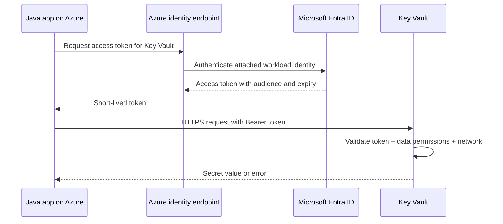

Key points:

1. **Identity** answers "Who is this workload?"
2. **Authentication** proves identity using a valid token.
3. **Authorization** checks "What can that identity do on which resource?"
4. **Network control** determines whether a network path to the service exists.
5. **Auditing** records which permissions and operations were used.

**Managed identity does not grant permissions by itself.** An App Service with a system-assigned identity that has not been assigned the `Key Vault Secrets User` role can still acquire a valid token and then be rejected by Key Vault with `403`.

**Managed identity also does not automatically solve** end-user authorization, row-level security, secrets for non-Azure services, application-level data encryption, or private network connectivity. It is a **workload identity**, not a mechanism to bypass security policies.

## 3. System-Assigned vs. User-Assigned Managed Identity

| Characteristic | **System-assigned** | **User-assigned** |
|---|---|---|
| Attached to | One identity-capable Azure resource | Standalone identity resource attached to one or more workloads |
| Lifecycle | Tied to the owning resource and its identity configuration | Managed independently; can survive workload replacement |
| Sharing | Cannot share the exact same identity across multiple resources | Can be attached to multiple supported resources |
| Principal ID | Belongs to the resource's system identity | Belongs to the standalone identity resource |
| Client ID selection | SDK usually auto-detects when only one suitable identity exists | Must be specified explicitly when multiple identities exist to avoid mismatch |
| Role assignments | Granted to the resource's principal | Granted to the user-assigned identity's principal |
| When to use | Single app whose permissions follow the resource lifecycle | Blue/green deployments, multiple instances sharing a controlled identity |

### Visualizing Both Types

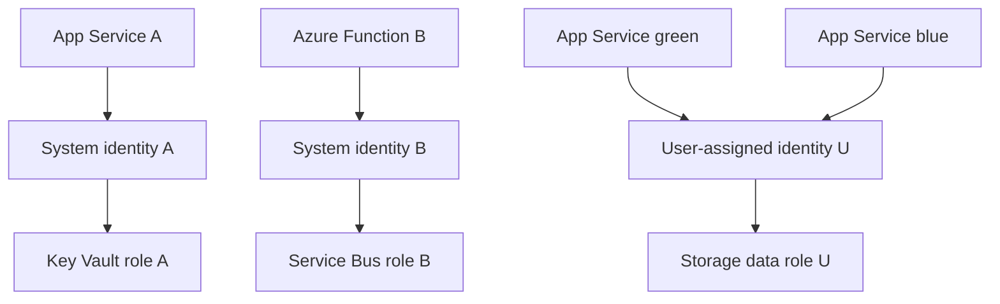

### Which One Should You Choose?

**Start with system-assigned** when an application has a clear lifecycle and does not need to preserve its identity when the resource is replaced. If you recreate the resource, the new identity gets a new principal ID, so permissions must be reassigned.

**Choose user-assigned** when you want to pre-provision permissions before deploying workloads, preserve a stable identity across upgrades/swaps, or allow multiple instances to access the same resources. However, **sharing an identity shares permissions**: if one app is compromised, the shared identity's tokens can access every service granted to that identity. Never default to one user-assigned identity for all microservices.

### Multiple Identities on One Resource

A workload can have a system-assigned identity plus one or more user-assigned identities depending on host support. In that case, Java code must **specify the exact identity**, rather than hoping "Azure will pick the right one." For a user-assigned identity, typically pass the **client ID** to `ManagedIdentityCredentialBuilder.clientId(...)` or configure `AZURE_CLIENT_ID` for the matching credential chain.

## 4. Four IDs That Are Very Easy to Confuse

Suppose a user-assigned identity for the `java-orders-api` application has the following metadata:

```text
Azure resource ID:
  /subscriptions/.../resourceGroups/rg-java-lab/
  providers/Microsoft.ManagedIdentity/userAssignedIdentities/id-orders-api

Client ID (application ID):
  <guid-client-id>

Principal ID (service principal object ID):
  <guid-principal-id>

Tenant ID (Entra tenant):
  <guid-tenant-id>
```

| ID | Common Purpose |
|---|---|
| **Resource ID** | Attach a user-assigned identity to an Azure resource or query via ARM |
| **Client ID** | Select a specific identity when the SDK/runtime has multiple managed identities |
| **Principal ID / object ID** | Assign an Azure RBAC role to a specific Entra object |
| **Tenant ID** | Identify the tenant owning the identity where Microsoft Entra issues tokens |

Do not pass the **client ID** instead of the **object ID** to `--assignee-object-id` assuming the role assignment succeeded properly. Some commands accept different `--assignee` formats, but the clearest approach when you have the principal ID is `--assignee-object-id` combined with `--assignee-principal-type ServicePrincipal`.

### At Which Scope Does Azure RBAC Apply?

Azure Resource Manager uses a hierarchy:

```text
Tenant / Management groups
  └── Subscription
      └── Resource group
          └── Resource
              └── Subresource scope (where supported by the service)
```

Roles granted at a parent scope inherit down to child scopes. **Least-privilege principle**: never grant Reader, Contributor, or Owner across an entire subscription when an app only needs to read a single Key Vault or Blob container. Distinguish **control-plane roles** (managing resources) from **data-plane roles** (reading/writing secrets, blobs, or messages).

## 5. How Managed Identity Differs from a Service Principal with a Client Secret

Before managed identities, a Java service typically used client credentials:

```text
AZURE_TENANT_ID=...
AZURE_CLIENT_ID=...
AZURE_CLIENT_SECRET=...  <-- secret value that must be stored, provisioned, and rotated
```

With managed identity on Azure, the app does not store a **client secret for the workload itself**. The Azure host provides a token acquisition mechanism backed by the attached identity.

| Option | Requires App Secret? | Best Fit |
|---|---|---|
| **System-assigned managed identity** | No (for workload auth) | Single app on Azure whose lifecycle matches the resource |
| **User-assigned managed identity** | No (for workload auth) | Independent identity shared across deployments per policy |
| **Service principal + client secret** | Yes | Environments lacking MI support, with strict secret rotation |
| **Service principal + certificate** | Certificate/private key must be managed | Workloads outside Azure or specialized scenarios |
| **Federated workload identity** | No long-lived client secret needed | Kubernetes/CI platforms supporting OIDC federation |
| **Developer login** | Relies on developer's interactive session | Local dev/test only; never a production credential |

**Do not store a client secret in Key Vault and claim you are using managed identity** if the app still uses another secret to authenticate to Key Vault. The proper pattern is: managed identity acquires a token to read Key Vault; Key Vault holds only the secrets the app genuinely needs for third-party systems.

## 6. Access Tokens, Audiences, Scopes, and Lifetimes

The Java Azure SDK uses the **`com.azure.core.credential.TokenCredential`** interface. A credential is responsible for acquiring an `AccessToken` for the target resource/scope. Example scopes:

```text
Azure Key Vault: https://vault.azure.net/.default
Azure Storage:   https://storage.azure.com/.default
Azure ARM:       https://management.azure.com/.default
```

These are **distinct audiences**. A token issued for Azure Resource Manager is not valid for reading Blobs directly; the application/client must request a token for the matching target.

### Tokens Are Not Passwords

- Access tokens have an **expiration**, and the SDK/identity subsystem manages refresh.
- A token is valid only for the accepted resource/audience and conditions.
- A token **is still a sensitive bearer credential**: anyone obtaining a valid token can exercise its granted permissions until it expires or is rejected.
- Never write `accessToken.getToken()` to console output, diagnostics, exception telemetry, or HTTP access logs.
- Never parse a JWT yourself to make business authorization decisions without validating signature, issuer, and audience; backends authenticate end-user requests through dedicated mechanisms.

### Why Should You Not Cache a Token in a Static String?

If you store a token in `static String TOKEN` and reuse it forever, the app will fail with `401` once the token expires. Azure SDK clients accepting `TokenCredential` request and refresh tokens automatically on time; **reuse the client and credential** and let the library handle token lifecycles. When calling REST APIs outside the SDK, use a safe expiration-aware cache or fetch tokens via `TokenCredential` as needed rather than building an eternal global token variable.

## 7. Java Azure Identity SDK: DefaultAzureCredential

Azure Identity's **`DefaultAzureCredential`** is a **credential chain**: depending on the SDK version and environment, it attempts configured authentication sources such as environment, workload identity, managed identity, or developer tool logins. This allows **the same application code** to:

- On a dev workstation: use Azure CLI login or a valid developer credential.
- On Azure App Service/VMs/Functions: use the resource's managed identity.
- In AKS using Microsoft Entra Workload ID: use the projected OIDC token and federated credential per supported integration.

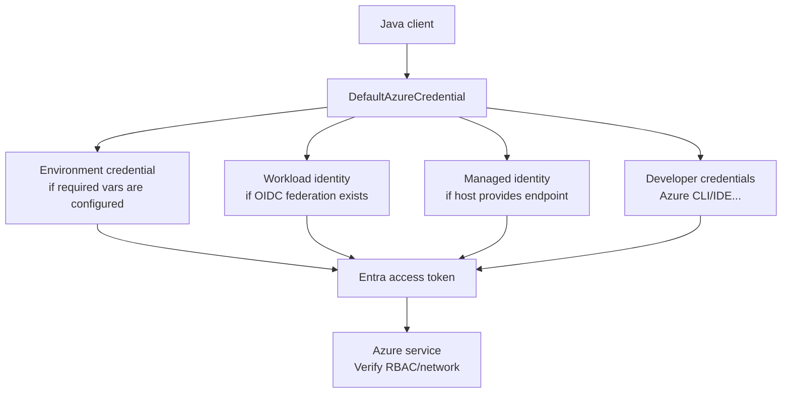

This diagram is a **conceptual model**, not a guarantee of fixed ordering or provider list across every SDK version. Check the documentation for your exact Azure Identity version when diagnosing ordering behavior.

### Production Security Note

**`DefaultAzureCredential` is convenient, yet not always the strictest option** if a production environment accidentally retains `AZURE_CLIENT_SECRET` from an old configuration. The credential chain could select an identity different from your intended managed identity.

For production runtimes guaranteed to use managed identity, you can use **`ManagedIdentityCredential` directly** to prevent fallback to unintended mechanisms. On AKS Workload ID, use **`WorkloadIdentityCredential` or a federation-capable chain**—never force every pod onto a node/VM `ManagedIdentityCredential`.

### Common Mistakes

`DefaultAzureCredential` failing does not mean Entra ID is down. It may simply be that:

- Local dev has not run `az login` or is signed into the wrong tenant.
- Managed identity is not attached to the resource.
- The Java process is running in an environment without an identity endpoint.
- `AZURE_CLIENT_ID` points to an unattached user-assigned identity.
- Workload identity OIDC env vars/token file/ServiceAccount are not configured.

Inspect the **sanitized** exception chain to see which credentials were tried and why each was unavailable.

## 8. Declaring Maven Dependencies and Creating TokenCredential

Examples use the Azure SDK for Java with Microsoft Entra token support. For Maven projects, align versions via an **Azure SDK BOM** or organization-approved releases.

```xml
<!-- Example dependencies; provide versions via a valid Azure SDK BOM
     or declare verified versions explicitly before building. -->
<dependencies>
    <dependency>
        <groupId>com.azure</groupId>
        <artifactId>azure-identity</artifactId>
        <version>REPLACE_WITH_APPROVED_VERSION</version>
    </dependency>
    <dependency>
        <groupId>com.azure</groupId>
        <artifactId>azure-security-keyvault-secrets</artifactId>
        <version>REPLACE_WITH_APPROVED_VERSION</version>
    </dependency>
    <dependency>
        <groupId>com.azure</groupId>
        <artifactId>azure-storage-blob</artifactId>
        <version>REPLACE_WITH_APPROVED_VERSION</version>
    </dependency>
</dependencies>
```

**`REPLACE_WITH_APPROVED_VERSION` is not a real version.** If using a BOM, omit `<version>` per BOM rules. Never put credentials into `pom.xml`, `application.yml`, or source control.

### A Shared Credential Class

```java
import com.azure.core.credential.TokenCredential;
import com.azure.identity.DefaultAzureCredentialBuilder;

public final class AzureCredentials {
    private static final TokenCredential CREDENTIAL =
            new DefaultAzureCredentialBuilder().build();

    private AzureCredentials() {
    }

    public static TokenCredential shared() {
        return CREDENTIAL;
    }
}
```

This is complete Java code suitable for `AzureCredentials.java`. **`TokenCredential` is an interface**, so Key Vault, Blob, and many other Azure SDK clients can share the same instance. You never need to fetch tokens manually and attach `Authorization` headers to each SDK request.

### Choosing a Model by Environment

| Environment | Credential Type to Consider | Notes |
|---|---|---|
| Local developer | `DefaultAzureCredential` with Azure CLI/IDE | Verify tenant/subscription; grant dev-only permissions |
| App Service/Functions/VM | `ManagedIdentityCredential` or controlled `DefaultAzureCredential` | Attach identity to the right resource |
| Container Apps | Host-provided managed identity supported by SDK | Verify revision/identity configuration |
| AKS with Workload Identity | `WorkloadIdentityCredential` or supporting `DefaultAzureCredential` | FIC, OIDC issuer, ServiceAccount token |
| External CI/CD | OIDC federation where supported | Never assume an Azure managed identity exists |

**Using a developer credential to debug locally does not mean the production app has the same permissions.** The developer principal and application principal are distinct identities requiring separate permission grants.

## 9. ManagedIdentityCredential: Selecting an Identity Explicitly

Once the system runs on an Azure host with an identity endpoint, you can restrict authentication strictly to managed identity.

### System-Assigned Identity

```java
import com.azure.core.credential.TokenCredential;
import com.azure.identity.ManagedIdentityCredentialBuilder;

TokenCredential credential =
        new ManagedIdentityCredentialBuilder().build();
```

This is a **snippet inside a method**. The host environment must support identity and have system-assigned identity enabled (or a default identity configured). Never use this as a "local test" on an ordinary laptop, because laptops have no Azure managed identity endpoint.

### User-Assigned Identity by Client ID

```java
import com.azure.core.credential.TokenCredential;
import com.azure.identity.ManagedIdentityCredentialBuilder;

String clientId = System.getenv("AZURE_CLIENT_ID");
if (clientId == null || clientId.isBlank()) {
    throw new IllegalStateException("Missing AZURE_CLIENT_ID");
}

TokenCredential credential = new ManagedIdentityCredentialBuilder()
        .clientId(clientId)
        .build();
```

Here `AZURE_CLIENT_ID` is **not a secret**, yet a wrong client ID causes token acquisition to fail or selects the wrong identity. For a user-assigned identity, **the client ID must belong to an identity actually attached to the target resource**. Never copy the ID of a "similarly named" identity from another subscription.

### Explicit Environment-Based Selection Code

```java
import com.azure.core.credential.TokenCredential;
import com.azure.identity.DefaultAzureCredentialBuilder;
import com.azure.identity.ManagedIdentityCredentialBuilder;

public final class ProductionIdentity {
    private ProductionIdentity() {}

    public static TokenCredential create() {
        String runtime = System.getenv("APP_RUNTIME");
        if ("local".equals(runtime)) {
            return new DefaultAzureCredentialBuilder().build();
        }
        if ("azure-managed-identity".equals(runtime)) {
            String clientId = System.getenv("AZURE_CLIENT_ID");
            ManagedIdentityCredentialBuilder builder =
                    new ManagedIdentityCredentialBuilder();
            return (clientId == null || clientId.isBlank())
                    ? builder.build()
                    : builder.clientId(clientId).build();
        }
        throw new IllegalStateException(
                "APP_RUNTIME must be explicitly configured");
    }
}
```

This pattern **fails closed** when the runtime is unknown; it fits apps that only run locally or on host-managed identity platforms. For AKS Workload ID, add a dedicated branch using a federation-capable credential—**never set `APP_RUNTIME=azure-managed-identity` just to skip pod OIDC setup**.

### Do Not Request Tokens Manually When the SDK Supports It

In most cases, writing:

```java
new SecretClientBuilder()
    .vaultUrl(vaultUrl)
    .credential(credential)
    .buildClient();
```

is simpler and safer than manually calling `getToken()`, caching, refreshing, and injecting headers. Only when calling a custom REST API outside the SDK should you consider manual token acquisition and expiry handling.

## 10. Java Example: Reading a Secret from Azure Key Vault

Suppose App Service has identity `id-orders-api` granted **Key Vault Secrets User** on vault `kv-orders-lab` (using the Azure RBAC authorization model). The app needs to read an `external-api-token` secret to call a partner that does not support Entra ID.

### Architecture

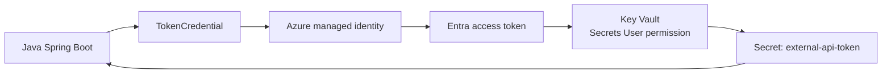

### Complete Code

```java
import com.azure.core.credential.TokenCredential;
import com.azure.identity.DefaultAzureCredentialBuilder;
import com.azure.security.keyvault.secrets.SecretClient;
import com.azure.security.keyvault.secrets.SecretClientBuilder;
import com.azure.security.keyvault.secrets.models.KeyVaultSecret;

public final class KeyVaultReadExample {
    public static void main(String[] args) {
        String vaultUrl = required("AZURE_KEY_VAULT_URL");

        TokenCredential credential =
                new DefaultAzureCredentialBuilder().build();
        SecretClient secretClient = new SecretClientBuilder()
                .vaultUrl(vaultUrl)
                .credential(credential)
                .buildClient();

        KeyVaultSecret secret =
                secretClient.getSecret("external-api-token");

        // Use in memory to call the authorized partner.
        // NEVER print secret.getValue() or return it in an API response.
        System.out.println("Secret retrieved. Name=" + secret.getName());
    }

    private static String required(String key) {
        String value = System.getenv(key);
        if (value == null || value.isBlank()) {
            throw new IllegalArgumentException("Missing env " + key);
        }
        return value;
    }
}
```

Example configuration:

```text
AZURE_KEY_VAULT_URL=https://kv-orders-lab.vault.azure.net/
```

**The endpoint variable is not a secret**. The `external-api-token` value is fetched at runtime; do not write it to logs or intentional crash dumps. When an app reads a secret frequently, it can cache the value **for a bounded TTL** aligned with rotation policy; unlike Entra token caching, caching **secret values** requires proactive invalidation/refresh so stale credentials are not used too long.

### Why Do You Still Need Key Vault If You Have Managed Identity?

Managed identity eliminates **secrets used by the app to authenticate to Entra-enabled Azure services**. However, a third-party system may only accept an API key; Key Vault stores and governs the lifecycle of that API key. Never use Key Vault to store **Storage account keys** when the Java Azure Blob SDK can authenticate directly via Entra tokens, unless a specific approved technical requirement exists.

### When getSecret Returns 403

Check four things:

1. Which **principal ID** is the active identity using?
2. Does the vault use the **Azure RBAC permission model** or **legacy access policies**? Grant permissions in the active model.
3. Does the principal have secret read permission at the **exact scope**?
4. Do the vault firewall, private endpoint, and DNS allow the runtime to connect?

**Key Vault Reader** is typically a metadata-only role, not equivalent to **Key Vault Secrets User** for reading secret values. **Key Vault Secrets Officer** grants broader secret management permissions and should not be assigned to an app that only needs to read.

## 11. Java Example: Writing and Reading Azure Blobs with Managed Identity

For Blob Storage, the Java SDK uses `BlobServiceClientBuilder` and `TokenCredential`. An app uploading reports needs **Storage Blob Data Contributor** at the right scope; a read-only app may only need **Storage Blob Data Reader**.

### Lab Upload Code

```java
import com.azure.core.credential.TokenCredential;
import com.azure.identity.DefaultAzureCredentialBuilder;
import com.azure.storage.blob.BlobClient;
import com.azure.storage.blob.BlobContainerClient;
import com.azure.storage.blob.BlobServiceClient;
import com.azure.storage.blob.BlobServiceClientBuilder;

import java.io.ByteArrayInputStream;
import java.nio.charset.StandardCharsets;

public final class BlobManagedIdentityExample {
    public static void main(String[] args) {
        String endpoint = required("AZURE_STORAGE_BLOB_ENDPOINT");
        String containerName = required("AZURE_STORAGE_CONTAINER");

        TokenCredential credential =
                new DefaultAzureCredentialBuilder().build();

        BlobServiceClient blobService = new BlobServiceClientBuilder()
                .endpoint(endpoint)
                .credential(credential)
                .buildClient();

        BlobContainerClient container =
                blobService.getBlobContainerClient(containerName);

        // Container is pre-provisioned via IaC/portal.
        BlobClient blob = container.getBlobClient(
                "reports/lab-report-001.txt");

        byte[] data = "Test report - no PII"
                .getBytes(StandardCharsets.UTF_8);
        blob.upload(new ByteArrayInputStream(data), data.length, true);

        // Print only non-sensitive metadata.
        System.out.println("Uploaded bytes=" + blob.getProperties().getBlobSize());
    }

    private static String required(String key) {
        String value = System.getenv(key);
        if (value == null || value.isBlank()) {
            throw new IllegalArgumentException("Missing env " + key);
        }
        return value;
    }
}
```

```text
AZURE_STORAGE_BLOB_ENDPOINT=https://storderslab01.blob.core.windows.net
AZURE_STORAGE_CONTAINER=reports-lab
```

**Calling `upload(..., true)` can overwrite the target file**. Use this only with lab names and resources; production requires uniqueness rules, ETag/If-Match checks, checksums, and idempotency. If the app only downloads files, assign a read-only role and use download APIs instead of granting write access.

### Blob Endpoint, DFS Endpoint, and HNS

A Storage account with an ADLS Gen2 hierarchical namespace can expose both **Blob** and **DFS** endpoints. The code above uses the Blob API, so it connects via `blob.core.windows.net`. Switching to `DataLakeServiceClientBuilder` from `azure-storage-file-datalake` uses the DFS endpoint `dfs.core.windows.net` per API, with matching roles/ACLs and Private Endpoint/DNS. **A Blob private endpoint does not automatically ensure DFS operations have a private route**, and vice versa.

### Data-Plane Roles Are Not Management Roles

Azure Resource Manager `Contributor` does not implicitly equal `Storage Blob Data Contributor` when uploading blobs with an Entra token. Roles must match the operation type and data scope. Conversely, granting `Storage Blob Data Contributor` at the account level allows broad writes and should be avoided if only one container is needed.

## 12. Java Example: Sending Azure Service Bus Messages Without Connection Strings

**Azure Service Bus** supports Microsoft Entra ID authentication and data-plane roles. A Java worker that only sends messages to a queue can be assigned **Azure Service Bus Data Sender** at the supported namespace or queue scope instead of storing a connection string with a Shared Access Key.

### Maven Dependency

```xml
<dependency>
    <groupId>com.azure</groupId>
    <artifactId>azure-messaging-servicebus</artifactId>
    <version>REPLACE_WITH_APPROVED_VERSION</version>
</dependency>
```

### Message Sending Code

```java
import com.azure.core.credential.TokenCredential;
import com.azure.identity.DefaultAzureCredentialBuilder;
import com.azure.messaging.servicebus.ServiceBusClientBuilder;
import com.azure.messaging.servicebus.ServiceBusMessage;
import com.azure.messaging.servicebus.ServiceBusSenderClient;

public final class ServiceBusSenderExample {
    public static void main(String[] args) {
        String namespace = required("AZURE_SERVICEBUS_NAMESPACE");
        String queue = required("AZURE_SERVICEBUS_QUEUE");

        TokenCredential credential =
                new DefaultAzureCredentialBuilder().build();

        try (ServiceBusSenderClient sender = new ServiceBusClientBuilder()
                .fullyQualifiedNamespace(namespace)
                .credential(credential)
                .sender()
                .queueName(queue)
                .buildClient()) {
            ServiceBusMessage message =
                    new ServiceBusMessage("OrderCreated:lab-order-001");
            message.setMessageId("lab-order-001-created-v1");
            sender.sendMessage(message);
            System.out.println("Sent test message to queue");
        }
    }

    private static String required(String key) {
        String value = System.getenv(key);
        if (value == null || value.isBlank()) {
            throw new IllegalArgumentException("Missing env: " + key);
        }
        return value;
    }
}
```

```text
AZURE_SERVICEBUS_NAMESPACE=sb-orders-lab.servicebus.windows.net
AZURE_SERVICEBUS_QUEUE=orders-created-lab
```

**Distinguish fully qualified namespace from connection string:** `sb-orders-lab.servicebus.windows.net` is a hostname with no password or SAS. Never use `Endpoint=sb://...;SharedAccessKey=...` in managed-identity code when the SDK supports Entra credentials.

### Roles and Idempotency

| Workload | Role |
|---|---|
| Send-only messages | **Azure Service Bus Data Sender** |
| Receive, complete/abandon/dead-letter | **Azure Service Bus Data Receiver** |
| Broad data-plane entity management | **Azure Service Bus Data Owner** (only when needed) |

Managed identity only solves authentication. It **does not guarantee "exactly-once processing"**: a producer may succeed in sending yet time out before receiving the acknowledgement, and then retry. Use a stable `MessageId`, duplicate detection where supported by the entity, and **consumer idempotency**.

## 13. Azure SQL Database: Identity Token and Database User

**Azure SQL** is the clearest illustration of the difference between **acquiring a token** and **having data permissions**. Java connecting with Microsoft Entra authentication can use managed identity, yet the database still needs a **user, role, and permissions** mapped to that principal.

### Permission Flow

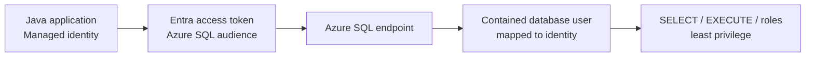

To set this up, an authorized database administrator typically:

1. Configures Microsoft Entra administrator/identity integration for the SQL resource per supported model.
2. Creates a **contained database user** for the managed identity using supported syntax.
3. Grants `SELECT` and `EXECUTE` on required objects/schemas, or assigns a custom database role.
4. Verifies connectivity, TLS/firewall/private endpoint, and token audience.
5. Runs integration tests using **the Java host's actual managed identity**.

### Illustrative T-SQL on a Lab Database

```sql
-- Run in the target database using an authorized admin principal.
-- Identity name is resolved in Entra; supported syntax/mechanisms
-- may vary by Azure SQL offering and tenant configuration.

CREATE USER [id-orders-api] FROM EXTERNAL PROVIDER;

-- Example granting read access to one table only, not db_owner.
GRANT SELECT ON OBJECT::dbo.Orders TO [id-orders-api];
```

If identity names collide or Entra object resolution is complex, use the syntax/identifier supported by your engine and version; never guess identities from display names alone. Azure SQL database roles **differ from Azure RBAC roles** on the SQL server management plane.

### Microsoft JDBC Driver for SQL Server

The driver offers Microsoft Entra authentication modes depending on version, including **`ActiveDirectoryManagedIdentity`** in supported environments. Instead of manually caching access tokens, let the driver handle auth when properly configured.

```properties
# Example JDBC configuration for a lab; verify Microsoft JDBC driver version
# and corresponding user-assigned identity options before use.
spring.datasource.url=jdbc:sqlserver://sql-orders-lab.database.windows.net:1433;database=ordersdb;encrypt=true;authentication=ActiveDirectoryManagedIdentity
spring.datasource.driver-class-name=com.microsoft.sqlserver.jdbc.SQLServerDriver
```

This is a **sample configuration** without username or password. For user-assigned managed identities or different pools/driver versions, check the exact identity-selection parameter (client ID) supported by that driver—never invent undocumented parameters. If a driver version lacks the desired mode, you can supply an access token via Azure Identity through driver-supported JDBC hooks, but you must handle **token refresh and connection pooling**.

### SQL-Specific Failures

- Token acquired yet SQL returns `Login failed`: missing user/permission mapping or wrong database/tenant.
- SQL connection timeout: firewall, VNet, Private Endpoint/DNS, port 1433, or network policy block.
- User exists yet query fails with `SELECT permission denied`: grant least-privilege object rights, never `db_owner`.
- App Service identity changes after recreating the resource: the old database principal references the previous identity and must be reconciled.

## 14. Azure App Service Running Java: Enabling System-Assigned Managed Identity

**Azure App Service** can run Java/Spring Boot WARs, JARs, or containers per supported configuration. Enabling system-assigned identity causes Azure to create and attach a service principal to the web app. The app still needs separate role assignments on target resources.

### Architecture

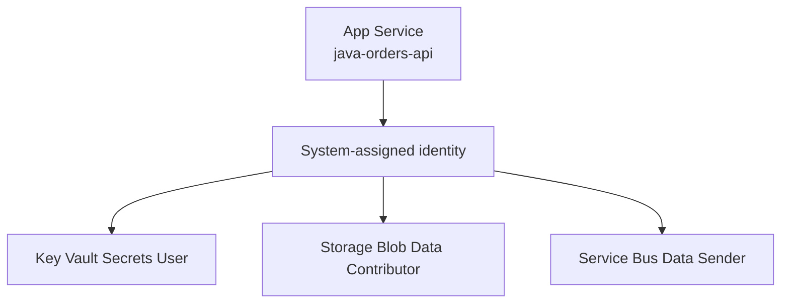

### 14.1. Enabling Identity via the Azure Portal

1. Select the target **App Service** in an authorized subscription/resource group.
2. Open **Identity → System assigned**.
3. Switch status to **On** and Save (this mutates configuration).
4. Record the **Principal ID** and **Tenant ID** provisioned by Azure.
5. On Key Vault, Storage, and Service Bus, assign required data-plane roles to that principal.
6. Restart or redeploy the app if needed for configuration changes, then test access via the SDK.

### 14.2. Azure CLI

```bash
az login
az account set --subscription "<subscription-id>"

RG="rg-java-lab"
APP="java-orders-api"

# Mutation: enable system-assigned managed identity.
az webapp identity assign \
  --resource-group "$RG" \
  --name "$APP"

# Read back identity metadata.
az webapp identity show \
  --resource-group "$RG" \
  --name "$APP" \
  --output json
```

The output typically includes `principalId` and `tenantId`. These IDs are for RBAC; **they are not secrets**. Once identity is enabled, you can assign roles without issuing any secret to the Java app.

### 14.3. Application Settings

```text
APP_RUNTIME=azure-managed-identity
AZURE_KEY_VAULT_URL=https://kv-orders-lab.vault.azure.net/
AZURE_STORAGE_BLOB_ENDPOINT=https://storderslab01.blob.core.windows.net
AZURE_STORAGE_CONTAINER=reports-lab
AZURE_SERVICEBUS_NAMESPACE=sb-orders-lab.servicebus.windows.net
AZURE_SERVICEBUS_QUEUE=orders-created-lab
```

Never set `AZURE_CLIENT_SECRET` or `AZURE_STORAGE_KEY` just to make the app work. With system-assigned identity, `AZURE_CLIENT_ID` is usually unnecessary; if left over from another environment, verify it does not redirect the credential chain to another identity.

### 14.4. Deployment Slots

App Service deployment slots have specific behaviors regarding identities, app settings, and swaps that must be verified for your environment. **Never assume staging and production slots always share the same managed identity or role assignments**. If you need a consistent identity across blue/green swaps, consider a properly governed user-assigned identity and test slot behavior thoroughly.

## 15. App Service with User-Assigned Managed Identity

Suppose an organization deploys `java-orders-api-blue` and `java-orders-api-green` and shifts traffic between them. Using a **user-assigned managed identity `id-orders-runtime`**, permissions can be granted beforehand and attached to the new workload before cutover.

### 15.1. Create the Identity (Lab Environment)

```bash
RG="rg-java-lab"
IDENTITY="id-orders-runtime"

az identity create \
  --resource-group "$RG" \
  --name "$IDENTITY"

az identity show \
  --resource-group "$RG" \
  --name "$IDENTITY" \
  --query "{id:id,clientId:clientId,principalId:principalId,tenantId:tenantId}" \
  --output json
```

### 15.2. Attach Identity to App Service

```bash
IDENTITY_ID=$(az identity show \
  --resource-group "$RG" \
  --name "$IDENTITY" \
  --query id --output tsv)

az webapp identity assign \
  --resource-group "$RG" \
  --name "java-orders-api" \
  --identities "$IDENTITY_ID"

az webapp identity show \
  --resource-group "$RG" \
  --name "java-orders-api" \
  --output json
```

### 15.3. Select the Right Identity from Java

Record the `clientId` of the **user-assigned identity** and configure the app setting:

```text
AZURE_CLIENT_ID=<client-id-of-id-orders-runtime>
APP_RUNTIME=azure-managed-identity
```

In `ProductionIdentity.create()` from section 9, `ManagedIdentityCredentialBuilder.clientId(clientId)` selects the intended identity explicitly. Never pass `principalId` in place of `AZURE_CLIENT_ID`.

### Considerations

A shared identity reduces disruption when swapping workloads, yet it also creates a shared **blast radius**. If Blue and Green belong to environments with different data sensitivity (dev vs. prod, EU vs. US), **do not share the same identity** just to save a few role assignments. Separate identities by trust boundary and data sensitivity.

## 16. Azure Functions Using Java

**Azure Functions** supports Java Functions on Azure-supported hosting plans. Once managed identity is enabled on the Function App, Java code can use `DefaultAzureCredential` or `ManagedIdentityCredential` inside handlers to access Key Vault, Storage, or Service Bus.

### Enable Identity

```bash
az functionapp identity assign \
  --resource-group "rg-java-lab" \
  --name "fn-orders-lab"

az functionapp identity show \
  --resource-group "rg-java-lab" \
  --name "fn-orders-lab" \
  --output json
```

### Handler Logic Example

```java
import com.azure.core.credential.TokenCredential;
import com.azure.identity.DefaultAzureCredentialBuilder;
import com.azure.security.keyvault.secrets.SecretClient;
import com.azure.security.keyvault.secrets.SecretClientBuilder;
import com.microsoft.azure.functions.ExecutionContext;
import com.microsoft.azure.functions.annotation.FunctionName;
import com.microsoft.azure.functions.annotation.HttpTrigger;
import com.microsoft.azure.functions.annotation.AuthorizationLevel;
import com.microsoft.azure.functions.HttpMethod;
import com.microsoft.azure.functions.HttpRequestMessage;
import com.microsoft.azure.functions.HttpResponseMessage;

import java.util.Optional;

public final class ConfigHealthFunction {
    private static final TokenCredential CREDENTIAL =
            new DefaultAzureCredentialBuilder().build();

    private static final SecretClient SECRET_CLIENT =
            new SecretClientBuilder()
                    .vaultUrl(System.getenv("AZURE_KEY_VAULT_URL"))
                    .credential(CREDENTIAL)
                    .buildClient();

    @FunctionName("config-health")
    public HttpResponseMessage run(
            @HttpTrigger(
                name = "req",
                methods = {HttpMethod.GET},
                authLevel = AuthorizationLevel.FUNCTION)
            HttpRequestMessage<Optional<String>> req,
            final ExecutionContext context) {
        // Never include the secret value in the HTTP response.
        SECRET_CLIENT.getSecret("external-api-token");
        context.getLogger().info("Key Vault read succeeded");
        return req.createResponseBuilder(
                com.microsoft.azure.functions.HttpStatus.OK)
                .body("Configuration accessible")
                .build();
    }
}
```

**This is a learning example with the side effect of reading Key Vault on every request** and should not be exposed publicly as-is. In production:

- Health endpoints **should not call Key Vault on every probe**, to avoid unnecessary cost, throttling, and accidental dependency exposure.
- Function-level authorization does not replace OAuth authentication for end users; restrict routes, networking, and access controls appropriately.
- Reuse `TokenCredential` and `SecretClient`, and cache secrets per policy.
- If using Functions triggers and bindings, **binding authentication** may require separate identity-based app settings/connection configurations; a Java SDK credential inside handler code does not automatically authenticate host triggers.

### An Often-Forgotten Boundary

A Function App running on a workload identity still needs host storage connectivity for the Functions runtime and triggers. Those bindings or host storage settings require **dedicated identity-based connection configurations** per Functions runtime, extension, and hosting plan. Do not delete a working storage connection setting merely because your `SecretClient` code now uses managed identity.

## 17. Azure Virtual Machines and VM Scale Sets

A Java service can run on an Azure VM via `systemd`, Docker, or an application server. VMs and VMSS can have managed identities attached; Java applications running inside the VM acquire tokens via the **Azure Instance Metadata Service (IMDS)** supported by the Azure host environment.

### Enable System-Assigned Identity on an Azure VM

```bash
az vm identity assign \
  --resource-group "rg-java-lab" \
  --name "vm-java-worker-lab"

az vm identity show \
  --resource-group "rg-java-lab" \
  --name "vm-java-worker-lab" \
  --output json
```

Then assign data-plane roles to the returned `principalId`; Java SDK code can use:

```java
TokenCredential credential = new ManagedIdentityCredentialBuilder()
        .build();
```

Remember to import `TokenCredential` and `ManagedIdentityCredentialBuilder` as shown in section 9. This code must run **inside the VM with identity enabled**, not on a laptop merely signed into the subscription via Azure CLI.

### IMDS and Process Privileges Inside the VM

On Azure VMs, IMDS is typically accessed at the link-local address `169.254.169.254` with specific metadata headers and protocol rules. The Azure Identity SDK handles these details; **never call IMDS manually** to extract and attach tokens by hand.

Security considerations:

- Any process able to reach the identity endpoint inside the same VM may acquire tokens per host capabilities. **Managed identity does not isolate permissions between two untrusted apps running on the same VM**.
- Restrict SSH/RDP, local OS privileges, container escapes, and endpoints vulnerable to **server-side request forgery (SSRF)** against the metadata endpoint.
- Never grant one VM identity broad access across multiple databases simply because the VM hosts several Java services.
- If stronger trust boundaries are required, separate workloads/VMs or choose a platform supporting workload-specific identities.

### VMSS

With **Virtual Machine Scale Sets (VMSS)**, identity configuration is applied at the scale-set or instance level per deployment model capabilities. Verify that newly autoscaled instances actually receive the intended identity. If the Java app selects a user-assigned client ID, attach that identity to the scale set before rollout.

## 18. Azure Container Apps Running Java

**Azure Container Apps** can run Java containers as apps, revisions, and scale rules. Managed identity is configured on the Container App so containers acquire tokens for Key Vault, Storage, or Service Bus; how identities are assigned **differs** from AKS Kubernetes ServiceAccount Workload Identity.

### Enable System-Assigned Identity

The CLI provides identity commands for Container Apps; reference syntax (verify against your installed Azure CLI/extension):

```bash
az containerapp identity assign \
  --resource-group "rg-java-lab" \
  --name "ca-orders-api-lab" \
  --system-assigned

az containerapp identity show \
  --resource-group "rg-java-lab" \
  --name "ca-orders-api-lab" \
  --output json
```

When using a user-assigned identity, create the standalone identity, attach it to the Container App via supported CLI/IaC, and configure `AZURE_CLIENT_ID` inside the container so Java picks the exact principal.

### Notes on Revisions and Scaling

- Container Apps can scale to zero and recreate replicas/revisions. Code must never rely on persisting access tokens to the local container filesystem.
- Grant only least privilege to the app identity; if old and new revisions share the same identity, both can access data while active concurrently.
- Verify environment, managed identity, and ingress/egress settings on the exact revision and deployment.
- A Container App pulling a private image from a registry using an identity may have separate IAM/registry configuration requirements; a Java SDK credential for Key Vault does not grant ACR pull permissions.
- For Container Apps jobs or Dapr component bindings, authentication may be configured at the **runtime/component level**; never assume every binding uses the same credential as your Java code.

### Java App Running in a Container

```java
TokenCredential credential = new DefaultAzureCredentialBuilder().build();
SecretClient client = new SecretClientBuilder()
        .vaultUrl(System.getenv("AZURE_KEY_VAULT_URL"))
        .credential(credential)
        .buildClient();
```

The code pattern does not change from App Service. The difference lies in the **platform identity endpoint, container deployment, and egress policies**. The SDK detects the host automatically when the identity is attached and the environment is healthy.

## 19. AKS: Node Managed Identity vs. Pod Microsoft Entra Workload ID

**AKS** involves several distinct identities:

- **AKS control plane identity** for managing cluster resources.
- **Kubelet identity** and permissions for node operations and image pulls per configuration.
- **Microsoft Entra Workload ID** for **Kubernetes pods** to exchange projected OIDC service-account tokens for Entra access tokens.

Never assume a Java pod inherits the control plane or kubelet managed identity permissions. On modern AKS, the recommended approach for workloads is **Microsoft Entra Workload ID** using OIDC federation rather than giving every container a broad node-level managed identity.

### Token Exchange Architecture

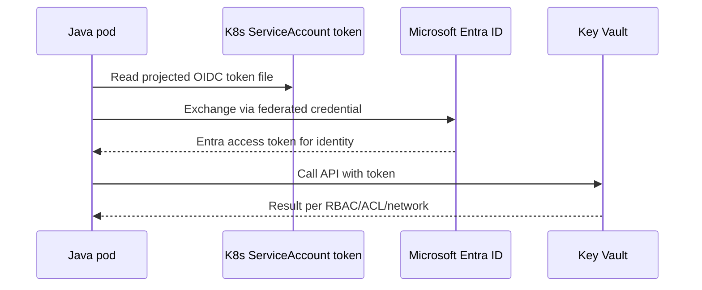

### Core Components

| Component | Role |
|---|---|
| **OIDC issuer** | Configured/trusted issuer for the AKS cluster |
| **Kubernetes ServiceAccount** | Workload identity inside the cluster, scoped to a namespace |
| **ServiceAccount annotation** | Points to the **client ID** of the user-assigned identity or app identity |
| **Federated identity credential (FIC)** | Allows Entra to trust a specific issuer + subject + audience |
| **Projected service account token** | Token presented by the pod for exchange, not a client secret |
| **WorkloadIdentityCredential** | Java credential reading the OIDC token and requesting an Entra access token |

### Enable AKS OIDC and Workload ID (Cluster Mutation)

```bash
az aks update \
  --resource-group "rg-aks-lab" \
  --name "aks-java-lab" \
  --enable-oidc-issuer \
  --enable-workload-identity

OIDC_ISSUER=$(az aks show \
  --resource-group "rg-aks-lab" \
  --name "aks-java-lab" \
  --query "oidcIssuerProfile.issuerUrl" \
  --output tsv)
```

Perform AKS configuration changes only with proper authorization and a change plan. Exact syntax, node pool/cluster prerequisites, and SDK support depend on current versions.

### Create a Federated Identity Credential

Assuming user-assigned identity `id-aks-orders` and Kubernetes ServiceAccount `orders-api` in namespace `apps`:

```bash
az identity federated-credential create \
  --resource-group "rg-aks-lab" \
  --identity-name "id-aks-orders" \
  --name "fc-orders-api" \
  --issuer "$OIDC_ISSUER" \
  --subject "system:serviceaccount:apps:orders-api" \
  --audiences "api://AzureADTokenExchange"
```

**Issuer, subject, and audience must match exactly** what the pod actually presents. If the namespace or ServiceAccount name changes, update the FIC accordingly. An FIC does not grant Key Vault access by itself: you must still assign **data-plane RBAC** to the identity's principal ID.

### Sample ServiceAccount and Pod

```yaml
apiVersion: v1
kind: ServiceAccount
metadata:
  name: orders-api
  namespace: apps
  annotations:
    azure.workload.identity/client-id: "<client-id-of-id-aks-orders>"
---
apiVersion: apps/v1
kind: Deployment
metadata:
  name: orders-api
  namespace: apps
spec:
  replicas: 2
  selector:
    matchLabels:
      app: orders-api
  template:
    metadata:
      labels:
        app: orders-api
        azure.workload.identity/use: "true"
    spec:
      serviceAccountName: orders-api
      containers:
        - name: orders-api
          image: "<approved-registry>/orders-api:<tag>"
          env:
            - name: AZURE_KEY_VAULT_URL
              value: "https://kv-orders-lab.vault.azure.net/"
```

This YAML is **illustrative** and not production-ready as-is, as it omits real registry images, resource requests/limits, readiness probes, network/security policies, and other production settings. When enabled, the AKS Workload ID admission webhook injects the required environment variables and mounted token file.

### Java WorkloadIdentityCredential

```java
import com.azure.core.credential.TokenCredential;
import com.azure.identity.WorkloadIdentityCredentialBuilder;

// Pod configured with OIDC token projection for AKS Workload ID.
TokenCredential credential =
        new WorkloadIdentityCredentialBuilder().build();
```

The SDK reads `AZURE_CLIENT_ID`, `AZURE_TENANT_ID`, and `AZURE_FEDERATED_TOKEN_FILE` provided by the environment per supported integration. If using `DefaultAzureCredential` on AKS, verify it actually selects **WorkloadIdentityCredential** from the federation config rather than accidentally falling back to developer credentials or a node endpoint.

### Mistakes to Avoid

1. Granting Key Vault roles to the **AKS control plane identity** instead of the user-assigned identity linked to the ServiceAccount.
2. Using subject `apps:orders-api` instead of `system:serviceaccount:apps:orders-api`.
3. Configuring the ServiceAccount correctly yet omitting the pod label `azure.workload.identity/use` required by the webhook.
4. Deploying into a namespace different from the FIC.
5. Copying the projected token file into logs, images, or the host filesystem.
6. Using `ManagedIdentityCredentialBuilder` inside an AKS pod just because "the cluster has a managed identity" without understanding the workload's identity endpoint.

## 20. CI/CD: Does a Build Pipeline Need a Managed Identity?

GitHub Actions, Azure DevOps, or other CI pipelines typically run **outside** the Azure resource carrying the managed identity. Simply deploying to an App Service with an MI **does not mean the CI runner holds that identity**.

### Separate Two Principals

```text
Deployment pipeline identity
    -> permissions to deploy images/apps/IaC on the management plane

Runtime application managed identity
    -> permissions to read Key Vault, Blobs, or send to Service Bus on the data plane
```

A pipeline can use **OIDC workload federation** per CI platform and Entra capabilities to avoid long-lived secrets where possible. Still, that is a **separate deployment identity**. When deploying, the pipeline does not need to bake runtime tokens or secrets into the container image.

### What to Ensure

- Pipeline permissions cover only deploying/updating target resources, without default access to read production secrets.
- Role assignments for runtime identities are managed via IaC or an approved workflow step.
- Never run `az account get-access-token` and save tokens into artifacts or job logs.
- Integration tests requiring the runtime identity should run on an appropriate host or test environment granted a dedicated test identity.
- When recreating an App Service with a system-assigned identity, the pipeline must update role assignments for the **new principal ID**.

## 21. Assigning Azure RBAC Roles: From Principal ID to Data-Plane Permissions

Suppose `java-orders-api` runs on App Service using a system-assigned identity to:

- Read secret `external-api-token` from `kv-orders-lab`.
- Upload reports to Blob Storage `storderslab01`.
- Send `OrderCreated` to Service Bus namespace `sb-orders-lab`.

The identity needs **three separate permissions**, each at the narrowest appropriate scope. For simplicity, the lab commands assign roles at resource scope; in production, narrow scopes down to container or queue where supported by the service.

### 21.1. Retrieve the App Service Principal ID

```bash
az login
az account set --subscription "<subscription-id>"

RG="rg-java-lab"
APP="java-orders-api"

PRINCIPAL_ID=$(az webapp identity show \
  --resource-group "$RG" \
  --name "$APP" \
  --query "principalId" --output tsv)

echo "Principal ID: $PRINCIPAL_ID"
```

**If `PRINCIPAL_ID` is empty or `null`**, system-assigned identity may not be enabled yet; do not proceed to assign roles to a nonexistent ID. For user-assigned identities, obtain `principalId` via `az identity show` on the identity actually attached to the app.

### 21.2. Grant Key Vault Secret Read Access

```bash
KV_ID=$(az keyvault show \
  --resource-group "$RG" \
  --name "kv-orders-lab" \
  --query id --output tsv)

az role assignment create \
  --assignee-object-id "$PRINCIPAL_ID" \
  --assignee-principal-type ServicePrincipal \
  --role "Key Vault Secrets User" \
  --scope "$KV_ID"
```

Prerequisite: the vault uses the **Azure RBAC permission model**. If the vault uses the **access policy permission model**, this role will not grant secret read access; adjust permissions in the active vault model through an approved administrative workflow.

### 21.3. Grant Blob Write Access

```bash
STORAGE_ID=$(az storage account show \
  --resource-group "$RG" \
  --name "storderslab01" \
  --query id --output tsv)

az role assignment create \
  --assignee-object-id "$PRINCIPAL_ID" \
  --assignee-principal-type ServicePrincipal \
  --role "Storage Blob Data Contributor" \
  --scope "$STORAGE_ID"
```

If the app only writes to `reports-lab`, scope the assignment to the **container** where supported by Azure RBAC instead of the entire Storage account. If it only reads, use **Storage Blob Data Reader**. **Storage Blob Data Contributor can delete or overwrite data** within scope, so withhold it when the app does not need write access.

### 21.4. Grant Service Bus Send Access

```bash
SB_ID=$(az servicebus namespace show \
  --resource-group "$RG" \
  --name "sb-orders-lab" \
  --query id --output tsv)

az role assignment create \
  --assignee-object-id "$PRINCIPAL_ID" \
  --assignee-principal-type ServicePrincipal \
  --role "Azure Service Bus Data Sender" \
  --scope "$SB_ID"
```

You can restrict permissions down to the specific queue or topic where supported by the service. Data Sender is not intended for receiving or settling messages; a consumer needs **Azure Service Bus Data Receiver**.

### 21.5. Verify Assignments

```bash
az role assignment list \
  --assignee "$PRINCIPAL_ID" \
  --scope "$KV_ID" \
  --include-inherited \
  --output table

az role assignment list \
  --assignee "$PRINCIPAL_ID" \
  --scope "$STORAGE_ID" \
  --include-inherited \
  --output table
```

Some CLI/Graph lookups may require directory read permissions or specific object ID queries. Do not interpret an immediately empty output as "the role assignment wasn't created" when propagation or cache delays exist. Record the timestamp and grantor, wait a reasonable propagation window, and re-check.

### Never Self-Grant Permissions

Java runtime code does not need `Microsoft.Authorization/roleAssignments/write` and must never be allowed to escalate its own permissions upon receiving `403`. Role assignments must be performed by **infrastructure pipelines or authorized administrators**, with review and logging.

## 22. Service-Specific Permissions: The Right Role Instead of "Contributor Everywhere"

| Target Service | Java Authentication | Role/Permission to Verify |
|---|---|---|
| Key Vault secrets | `SecretClient` + Entra token | `Key Vault Secrets User` or access policy per vault model |
| Blob Storage | `BlobServiceClient` + Entra token | `Storage Blob Data Reader/Contributor` |
| Azure Files | Supported SDK/API and auth model | Do not assume Blob data roles apply; verify SMB/REST/Entra integration |
| Service Bus | `ServiceBusClientBuilder` + Entra | `Azure Service Bus Data Sender/Receiver` |
| Event Hubs | Event Hubs SDK + Entra | `Azure Event Hubs Data Sender/Receiver` |
| Azure Cosmos DB for NoSQL | Token-capable Cosmos SDK | Built-in/native data-plane RBAC role per Cosmos account/database/container |
| Azure SQL | JDBC/Entra authentication | Contained database user and `GRANT`/database roles |
| Azure AI Search | Search SDK + Entra | `Search Index Data Reader/Contributor` per function |
| Azure Resource Manager | Management SDK + Entra | ARM RBAC roles/scopes for administrative operations |
| Azure OpenAI | Feature-appropriate SDK/API credential | `Cognitive Services OpenAI User` or matching role |

**Sharing the phrase "Data Reader" does not make roles interchangeable across products.** A Storage Blob role cannot query Azure AI Search, and an Azure SQL server management `Contributor` role does not automatically grant `SELECT` on SQL tables.

### Data Plane vs. Control Plane

```text
Control plane:
  Create Storage account / alter networking / scale SQL
  -> Microsoft Azure Resource Manager RBAC

Data plane:
  Read blob / fetch Key Vault secret / send message
  -> Azure service data RBAC or ACL/SQL permissions
```

User-facing Java apps typically need only **data-plane rights** and **should not create or delete Azure resources**. If containers, queues, or indexes must be provisioned during deployment, separate that logic into a dedicated CI/IaC identity.

### Scope Selection Rules

1. Start from the real operations: read, write, delete, send, receive, manage.
2. Pick the **least-privileged role** supporting those operations.
3. Choose the narrowest reasonable resource or subresource scope.
4. Use separate identities for applications with distinct trust boundaries.
5. Audit inherited role assignments from subscriptions and resource groups to avoid unintended access.
6. Log permission grants at deployment time and periodically review unused permissions.

## 23. Managed Identity Does Not Replace Private Link, DNS, and Firewalls

A Java app with a valid token can still fail to reach Key Vault or Storage if the service accepts only private network traffic. Conversely, reaching a private endpoint over the network does not grant permission to read secrets.

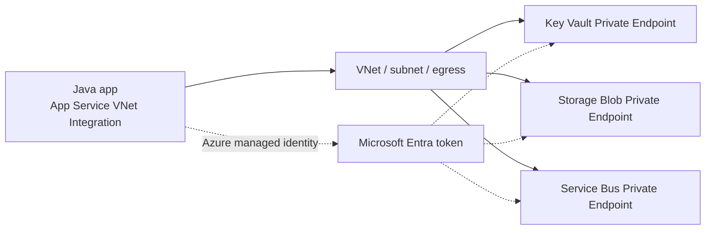

### Common Private DNS Zones

| Service | Standard Public Hostname | Typical Private DNS Zone |
|---|---|---|
| Key Vault | `<vault>.vault.azure.net` | `privatelink.vaultcore.azure.net` |
| Blob Storage | `<account>.blob.core.windows.net` | `privatelink.blob.core.windows.net` |
| ADLS Gen2 DFS | `<account>.dfs.core.windows.net` | `privatelink.dfs.core.windows.net` |
| Service Bus | `<namespace>.servicebus.windows.net` | `privatelink.servicebus.windows.net` |
| Azure SQL Database | `<server>.database.windows.net` | `privatelink.database.windows.net` |

These zones are common examples; verify against your cloud, region, service, and actual configuration. **Keep the standard service hostname** in Java SDK clients; never hard-code private IP addresses into HTTPS URLs, as that breaks TLS hostname validation and breaks whenever endpoints are reconfigured.

### How to Test from the Actual Runtime

```bash
# Run from a VM/container or App Service console when authorized.
nslookup kv-orders-lab.vault.azure.net
nslookup storderslab01.blob.core.windows.net
nslookup sb-orders-lab.servicebus.windows.net
```

Then verify HTTPS/AMQP ports matching your SDK and network policy. The Service Bus Java SDK can use AMQP over TCP or WebSockets depending on configuration; if egress only allows HTTPS 443, configure the supported transport rather than assuming any TCP 443 check proves AMQP works.

### App Service VNet Integration

**App Service VNet Integration** lets the workload reach resources inside a VNet and private endpoints per your networking plan, which is distinct from an App Service inbound Private Endpoint. Enabling identity does not configure VNet integration automatically; verify:

- Outbound routing from the app instance.
- Private DNS resolution for target services.
- Firewalls, NSGs, UDRs, and peering/hub-and-spoke routing.
- Approved service endpoints or private endpoints.
- Reachability of Microsoft Entra token/managed identity endpoints and required dependencies.

**Never open public network access to the entire Internet** just to bypass a `403` error. Separate authorization, DNS, TLS, and connect timeout failures using matching logs and metrics.

## 24. Local Development: Using Azure CLI Without Pretending It Is Managed Identity

An ordinary dev workstation **does not have** an App Service or VM managed identity endpoint. When running the same code locally, `DefaultAzureCredential` can acquire tokens from `az login` or other developer credentials supported by the Azure Identity SDK.

### Local Dev Steps

```bash
az login
az account list --output table
az account set --subscription "<dev-subscription-id>"
az account show \
  --query "{tenantId:tenantId,subscriptionId:id,name:name}" \
  --output json
```

Ensure the developer principal has permissions on **dev Key Vault/Storage/Service Bus** resources, rather than using production permissions by default. When running Java:

```java
TokenCredential credential =
        new DefaultAzureCredentialBuilder().build();
```

If your terminal is signed in properly yet IntelliJ/VS Code still fails, inspect the IDE's shell environment, `PATH` to Azure CLI, active login session, tenant, and the Java process's environment variables.

### Why Is `az login` Not Enough?

`az login` proves the developer signed into the Azure CLI; it **does not grant** `Key Vault Secrets User`, `Storage Blob Data Contributor`, or create a SQL database user. If the SDK acquires a token yet the service returns `403`, fix **authorization** instead of re-running `az login`.

### Where Should You Test Production Identity?

To truly test **managed identity**, deploy to an **authorized** App Service, Function, VM, or Container App with identity enabled. Local developer credentials cannot simulate host-managed identities, token endpoints, VNet egress, or workload identity token projection.

A test matrix:

| Case | Environment | What to Verify |
|---|---|---|
| Local happy path | Dev laptop with Azure CLI | Java SDK uses dev principal with proper dev permissions |
| Azure host happy path | Staging App Service | Java uses the exact system/user-assigned identity |
| Missing role | Staging identity narrowed in test env | Token acquires, yet service denies with `403` |
| Wrong client ID | Staging with user-assigned identity | Credential reports selected identity not found |
| Private-only destination | VNet-connected staging | DNS, routing, and SDK requests succeed |
| Revoke access | Approved lab | After propagation/cache expiry, requests are denied |

## 25. Token Lifecycle, Caching, Timeouts, and Retries

In a Java service handling thousands of requests per second, never instantiate a new `DefaultAzureCredential` or `SecretClient` on **every HTTP request**. Azure SDK clients are designed for reuse, with token acquisition caching and refreshing handled internally.

### Organizing Dependency Injection

Spring Boot example:

```java
import com.azure.core.credential.TokenCredential;
import com.azure.identity.DefaultAzureCredentialBuilder;
import com.azure.security.keyvault.secrets.SecretClient;
import com.azure.security.keyvault.secrets.SecretClientBuilder;
import org.springframework.context.annotation.Bean;
import org.springframework.context.annotation.Configuration;

@Configuration
public class AzureClientConfiguration {

    @Bean
    public TokenCredential azureTokenCredential() {
        return new DefaultAzureCredentialBuilder().build();
    }

    @Bean
    public SecretClient secretClient(TokenCredential credential) {
        String vaultUrl = System.getenv("AZURE_KEY_VAULT_URL");
        if (vaultUrl == null || vaultUrl.isBlank()) {
            throw new IllegalStateException("Missing Key Vault endpoint");
        }
        return new SecretClientBuilder()
                .vaultUrl(vaultUrl)
                .credential(credential)
                .buildClient();
    }
}
```

Spring manages singleton beans by default, avoiding repeated credential creation per incoming request. In production, use `@ConfigurationProperties` and validation rather than raw `System.getenv`; the core rule is **explicit endpoints and identities, with clients never recreated needlessly**.

### Three Distinct Cache Types

| Cache | Subject | What to Watch |
|---|---|---|
| **Access token cache** | Entra access token with expiry | Let the SDK/credential manage this wherever possible |
| **Resource data cache** | Secret values, Blob metadata, configuration | Requires TTL, refresh/rotation, and sensitivity controls |
| **Authorization cache** | User group memberships/entitlements | Revocation lag requires bounded TTLs |

Never call `getSecret()` on every health probe; equally, never cache third-party API secrets forever since they can rotate. Design timeouts and caches around business SLAs and security policies.

### Transient vs. Permanent Errors

| Error Type | Auto-Retry? | Example |
|---|---|---|
| Throttling / brief disconnect | Yes, with **backoff/jitter/deadline** | `429`, `503`, or transient network failure |
| Identity endpoint briefly unavailable | Brief retry per SDK policy | Newly started instance |
| Managed identity not attached | Do not retry infinitely | `CredentialUnavailable` due to config |
| Wrong client ID selected | Do not retry blindly | User-assigned identity not attached to host |
| Missing data RBAC | Do not retry blindly | `403` due to missing role |
| Key Vault secret missing | Do not retry blindly | `404` due to wrong name or path |
| Token wrong audience | Fix code/config | `401` / authentication error |
| ETag / data conflict | Requires business logic | `409`, `412` on supporting services |

### Do Not Multiply Retries Across Layers

Suppose an HTTP API retries 3 times, the Azure SDK retries 3 more times, and a queue worker redelivers messages multiple times. An unrecoverable `403` can trigger a **retry storm**, inflating load/costs and delaying incident detection.

Retry only truly transient errors, enforce an end-to-end retry budget, use idempotency on writes, and monitor retries per dependency. **Never assume every `401` means an expired token**; the SDK normally handles token refresh, whereas `401` can stem from wrong audience, tenant, endpoint, or service auth configuration.

### Rotation and Replacing Identities

When migrating from system-assigned to user-assigned identity:

1. Create the new identity and attach it to the workload.
2. Grant least-privilege permissions to the new principal.
3. Configure Java to select the **new client ID**.
4. Deploy to staging and run end-to-end tests.
5. Shift traffic via standard rollout.
6. Audit and revoke the old identity's role assignments after the rollback window.

Changing `AZURE_CLIENT_ID` without attaching the new identity to the host or granting data roles will break the app. Removing the old system-assigned identity before validating the new user-assigned identity risks downtime.

## 26. Observability: Knowing Which Identity the App Uses Without Leaking Tokens

A frightening failure mode is when a Java app acquires a token cleanly—but it is a **staging identity** running in production due to misconfiguration. Detecting this requires tracking identity metadata and role assignments safely.

### What Should Be Logged?

| Field | Safe to Log? | Reason |
|---|---|---|
| App deployment/environment | Yes, if free of secrets | Isolate affected instance |
| Credential mode (`managed identity`/`workload identity`) | Yes | Confirm expected chain |
| Client ID (approved/internal identifier) | Consider per policy | Debug user-assigned identity selection |
| Principal ID | Acceptable in restricted logs | Cross-check Azure RBAC |
| Tenant ID | Acceptable in restricted logs | Diagnose wrong-tenant issues |
| Target service hostname | Yes | Catch wrong environment/region |
| Operation, duration, status code, request ID | Yes, sanitized of PII | Tracing and SLOs |
| **Raw access token** | **No** | Sensitive bearer credential |
| **Client secret, SAS, storage key** | **No** | Exposes direct access |
| **Key Vault secret value** | **No** | Sensitive secret material |
| User data / password-bearing connection strings | No | PII/credential leakage |

Never query IMDS manually and print the JWT to stdout to "verify identity." Safer workflow:

1. Use Azure CLI or Portal to inspect the **identity metadata** attached to the workload.
2. Inspect the corresponding **role assignments**.
3. From staging, execute a **read-only, non-sensitive operation** against the target service.
4. Log success/failure and operation/request IDs, **never logging tokens**.

### Azure Monitor and Application Insights

- Track `401`, `403`, `429`/`503` error rates per dependency.
- Measure p50/p95 latency for Key Vault, Blob, SQL, and Service Bus SDK operations.
- Record correlation IDs linking API requests to dependency errors.
- Enable diagnostic settings/audit logs for Key Vault, Storage, and Service Bus.
- Monitor **role assignments, identity enable/disable events, and firewall changes** via Azure Activity Logs.
- Alert if production suddenly spikes in `403`s following a deployment or role change.

Never allow logging frameworks to print full `Authorization` headers, exception request headers, or HTTP bodies containing secrets. Review Azure SDK HTTP logging settings before enabling DEBUG/TRACE in production.

### Role Assignment Propagation and Token Cache Delay

New roles take time to propagate, and service token/authorization caches can vary effective delay. Never promise "granting a role makes the app work within two seconds"; record change timestamps, retry within bounds, verify principal and scope, and alert if propagation exceeds expected rollout windows.

## 27. Securing Managed Identity Against Real-World Threats

Managed identity removes one class of static secrets, yet it cannot prevent **every form of unauthorized access**. If an attacker executes code inside the workload or exploits server-side request forgery (SSRF) against the identity endpoint, they can attempt to obtain tokens within whatever permissions the host grants.

### Threat Model

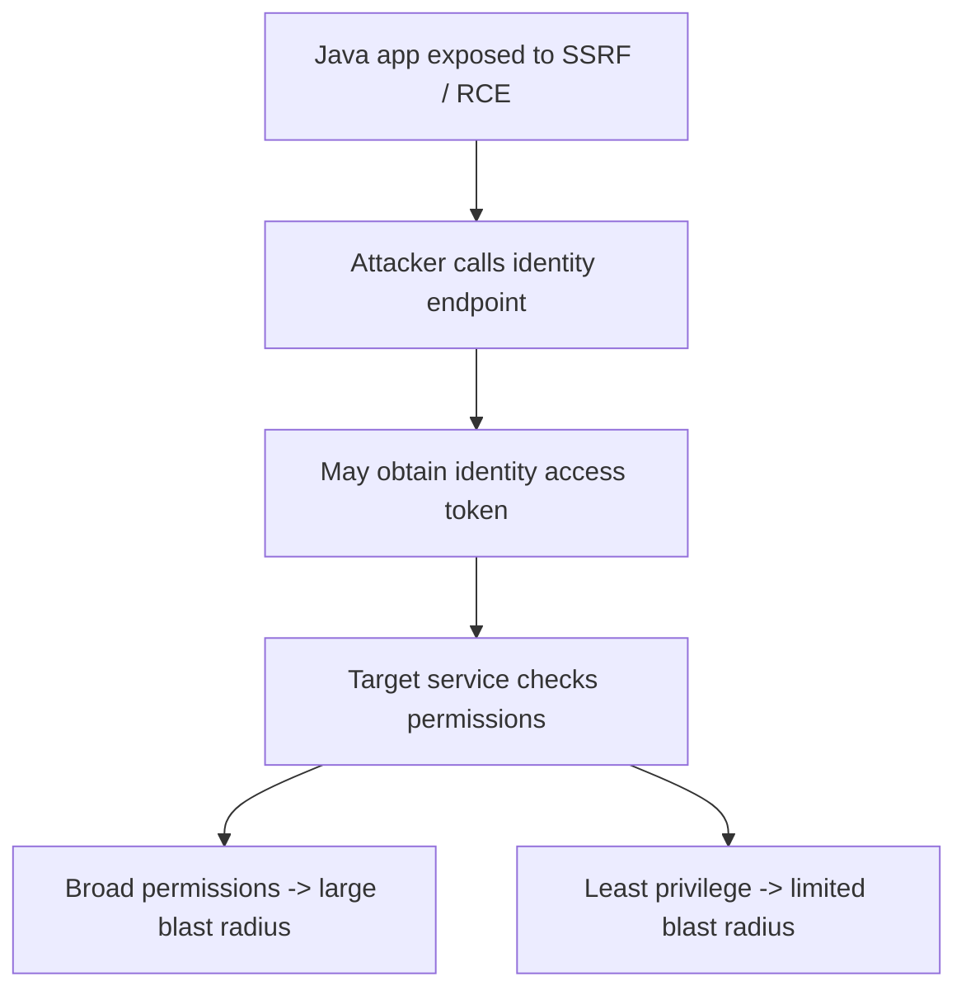

### Key Controls

1. **Prevent SSRF:** validate URLs/domains, block malicious redirects, and deny link-local/internal destinations when fetching user-supplied URLs.
2. **Reduce RCE risk:** patch libraries, restrict shell/process execution, scan dependencies, and harden deployment pipelines.
3. **Avoid org-wide shared identities:** split identities per application, environment, and trust boundary.
4. **Least-privilege roles and scopes:** a compromised identity must never be able to wipe an entire data lake or administer Key Vault.
5. **Separate management and data planes:** runtime workloads rarely need permission to create role assignments or alter network firewalls.
6. **Run processes/containers with minimal OS privileges:** limit abuse of host identity endpoints and token file reads.
7. **Control outbound networking:** restrict workload egress strictly to required destinations.
8. **Monitor anomalies:** unusual access patterns, sudden spikes in token requests, data exfiltration signals.
9. **Guard identity deletion/rebuilds:** deleting/recreating an identity alters principal IDs and breaks role assignments.
10. **Incident response:** maintain procedures to disable/revoke permissions, isolate workloads, and recover safely.

### "No Client Secret" Does Not Mean "No Secrets"

A Java service may still hold in memory:

- Customer or partner OAuth tokens.
- End-user JWTs.
- Partner API keys fetched from Key Vault.
- TLS client certificates or sensitive payloads.

Keep these secrets strictly scoped, never log them, never embed them in exception messages or URL query strings, and rotate them regularly.

### Caution with System-Assigned Identity on Shared VMs

Multiple containers or processes on the same VM can inherit the host's identity reachability. For mutually untrusted apps, do not rely on container boundaries alone as a strong Entra identity boundary; when true workload-level isolation is needed, prefer platforms with per-workload identity mechanisms like AKS Workload ID.

## 28. Troubleshooting: Why Is Java Managed Identity Failing?

When a Java app reports `"Could not acquire token"` or an Azure service denies access, pinpoint **which layer failed**:

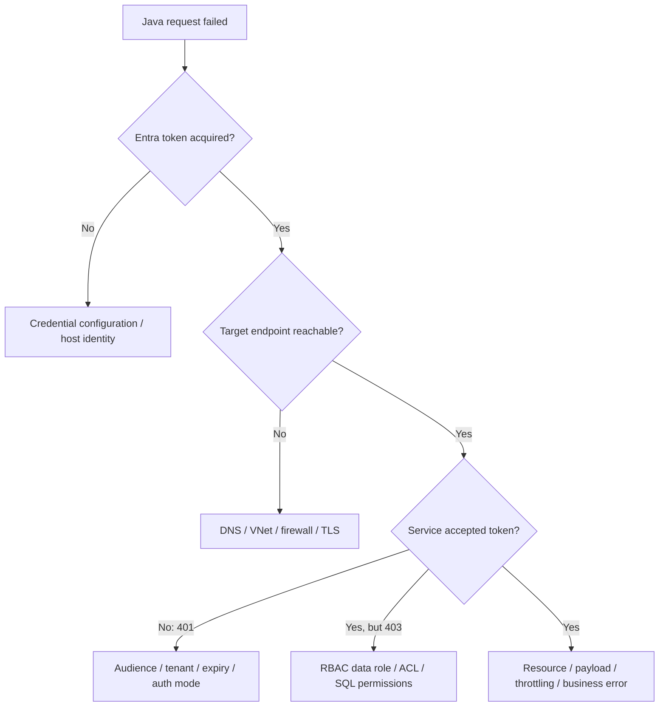

### Error Matrix

| Symptom | Common Root Cause | Check and Remediation |
|---|---|---|
| `ManagedIdentityCredential authentication unavailable` on laptop | No Azure host identity endpoint | Use `DefaultAzureCredential` and `az login` for local dev |
| Credential unavailable on App Service | Identity disabled or app running on wrong host | Check `az webapp identity show`, app settings, instance logs |
| Java picks wrong identity | Wrong `AZURE_CLIENT_ID` or credential chain prefers old config | Verify actual client/principal ID and remove stale env secrets |
| User-assigned identity not found | Identity created but not attached to host | Verify resource ID attachment and client ID |
| Token acquired yet Key Vault `403` | Missing `Key Vault Secrets User`, vault uses access policies, or wrong scope | Verify vault permission model, principal, RBAC/access policy |
| Key Vault `404` | Wrong secret/vault name or path | Verify secret name, version, and vault endpoint for the environment |
| Blob upload returns `403` | Holds management `Contributor` but lacks `Storage Blob Data Contributor` | Assign the proper data-plane role at the right scope |
| Service Bus send `403` | Holds Receiver instead of Sender, or wrong namespace/queue | Verify `Azure Service Bus Data Sender` |
| Azure SQL login failed | Identity lacks database user or permissions | Check `CREATE USER FROM EXTERNAL PROVIDER`, SQL grants, token |
| HTTP `401` | Wrong audience/tenant or service auth policy rejects token | Verify SDK endpoint, scope, and service auth settings |
| Timeout to private Key Vault | Broken VNet integration, DNS, routing, firewall, or PE | Test DNS and network path from the **actual host** |
| App Service public DNS resolves unexpected private IP | Mis-scoped Private DNS link/forwarder | Test DNS from the app's network segment |
| App Service has identity yet Functions trigger fails | Binding/runtime connection uses missing connection string or separate identity config | Check host storage/extension connection settings |
| AKS Java pod fails to get token | Missing/wrong OIDC issuer, FIC, ServiceAccount, or label | Verify issuer/subject/audience and projected token config |
| Workload Identity gets token yet Vault `403` | Role assigned to AKS kubelet/control plane instead of workload principal | Assign role to the **identity linked to the ServiceAccount** |
| All requests `403` after deploying new slot | New slot/resource has a new identity without role assignments | Compare principal IDs and role assignments per slot |
| Works locally, fails in production | Local developer has permissions while runtime MI lacks them | Test using the production identity in staging |
| Only some instances fail | Scale/revision/image/config drift or propagation lag | Compare active identity, config, and region across instances |
| Access continues briefly after revoking role | Token/authorization caching and propagation | Record change time, check cache TTLs and revocation policy |
| Continuous `429`/`503` | Destination throttling, retry amplification, capacity limit | Apply backoff/jitter, lower concurrency, inspect service metrics |
| Token details leaked in logs | DEBUG HTTP logging or code printing tokens | Stop logging immediately, restrict log access, follow incident response |
| Service Bus TCP connection fails | AMQP transport or egress firewall block | Check ports and WebSockets where supported |
| App Service fails to hit private endpoint despite valid token | Outbound VNet integration unconfigured | Verify outbound routing; do not confuse with inbound PE |
| JDBC fails after a few hours | Broken manual token caching or misconfigured connection pool | Use driver-supported managed identity auth, test long-lived pools |

### Sequential Investigation Principles

1. **Right app and environment?** Resource group, subscription, App Service/Function/Container App/pod.
2. **Which identity is attached?** System vs. user-assigned, client ID, principal ID, tenant.
3. **Which credential does the SDK use?** `DefaultAzureCredential` vs. `ManagedIdentityCredential`; never print tokens.
4. **Right target?** Vault URL, Blob endpoint, Service Bus namespace, SQL database.
5. **Networking?** DNS, private endpoint approval, VNet, routes/NSGs, and TLS.
6. **Authorization?** Data-plane RBAC, Key Vault permission model, SQL user/ACLs.
7. **Runtime behavior?** Token cache, retries, scaling, cold starts, role propagation.
8. **Rollback/incident?** If production just broke, roll back per change plan instead of granting broad roles.

### Order for Resolving a 403 Error

**Never start with `az role assignment create --role Owner`.** Instead:

```text
403
  |
  +-- Identify target service and operation
  +-- Identify actual principal ID
  +-- Identify target's permission model
  +-- Identify exact data-plane role/scope (or SQL grants/ACLs)
  +-- Verify network firewall and token audience
  +-- Apply minimal fix, retest, and record audit trail
```

In environments with **deny assignments**, Azure Policies, or conditional access/workload identity restrictions, adding an allow role may not suffice. Inspect service diagnostics and organizational policies rather than assuming every `403` is a missing role.

## 29. Case Study: Java Spring Boot Order-Processing API Without Stored Azure Keys

### Requirements

An order API deployed on Azure App Service must:

1. Read a **shipping partner secret** from Key Vault.
2. Write a dummy PDF invoice file to Blob Storage.
3. Publish an `OrderCreated` event to Service Bus.
4. Emit audit/tracing telemetry **without logging secrets, tokens, or PII**.
5. Support Blue/Green deployments with a controlled user-assigned identity.

### Proposed Architecture

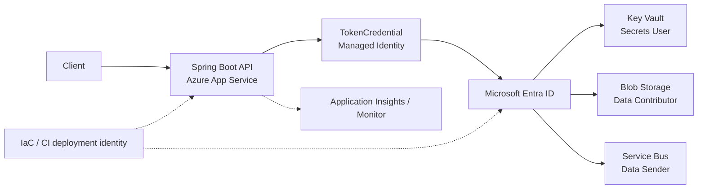

### Identity Choice

For a single App Service that does not need to retain its principal across resource recreation, **system-assigned identity** is simplest.

With deployment slots or Blue/Green cutovers requiring pre-assigned roles, consider **user-assigned identity `id-orders-runtime`**, while respecting security boundaries: staging and production must not share an identity if they handle data of different sensitivity levels.

### Business-Aligned Permission Separation

| Operation | Data-Plane Permission | Unnecessary |
|---|---|---|
| `getSecret("carrier-token")` | Key Vault Secrets User | Secrets Officer, Owner |
| Upload `invoices/...` | Storage Blob Data Contributor on approved container | Storage account key |
| Send `OrderCreated` | Service Bus Data Sender on target queue/topic | Data Owner, Data Receiver |
| View application logs | App Insights/Log Analytics roles for operators | Runtime app able to alter all diagnostics |
| Deploy build/version | CI identity scoped to deploy target resources | Runtime MI able to create role assignments |

### Release Workflow

1. Provision App Service and identity via approved IaC.
2. Assign roles to the exact **principal ID**.
3. Populate the third-party Key Vault secret via secret management procedures.
4. Set `AZURE_KEY_VAULT_URL`, Blob endpoint/container, and Service Bus namespace/queue; **never set account keys or SAS tokens**.
5. Java app initializes one shared `TokenCredential` and reuses clients.
6. Test in staging: read secret, write a **lab** Blob, send a **lab** Service Bus message, and verify statuses/traces.
7. Verify Private Endpoints and DNS if targets disable public access.
8. Measure p95 latency and `401/403` counts at startup and over extended runs (token refresh).
9. Cut over traffic; monitor for incidents and roll back if identity/role mismatches appear.
10. After the rollback window closes, revoke permissions on retired identities.

### Negative Test Verification

A secure design must **fail properly** when:

- Java attempts to **delete a Blob** while the identity only holds Reader (if the app needs no write access).
- Java attempts to read a secret outside the authorized vault.
- Java attempts to send a message to an unauthorized namespace.
- Staging is mispointed at the production Storage account.
- Java configures a user-assigned client ID not attached to the host.

Run negative tests strictly in a **lab environment with dummy resources**, never altering production. Having unauthorized requests denied is the **expected outcome**, not a bug to "fix" with `Owner`.

### Post-Deploy Incident

If the new deployment returns `403` on Key Vault while Blob calls succeed, that tells you:

- Managed identity token acquisition works for at least one Azure resource.
- The fault likely lies in Key Vault role/scope, vault permission model, policy/network, or token audience.
- There is no reason to put client secrets back into application code.

Investigate by checking the new revision/slot's exact `principalId`, the vault's authorization mode, and access logs/request IDs, then apply **one targeted fix** backed by evidence. Never disable security controls wholesale just to get the app running temporarily.

## 30. Exercises and Self-Check Questions

### Exercise A. Choosing Identity Type

A single App Service in staging needs to read one Key Vault; the app may be deleted and recreated without needing to preserve its identity. Which type should you start with?

*Hint:* **System-assigned managed identity** is usually simplest, with a lifecycle tied to the App Service. Remember to update role assignments if the resource is recreated with a new principal.

### Exercise B. Client ID vs. Principal ID

When assigning a role with `--assignee-object-id`, should you pass the user-assigned identity's `clientId` or `principalId`?

*Hint:* **Principal ID / object ID**. Use the **client ID** to select the identity in `ManagedIdentityCredentialBuilder.clientId(...)`.

### Exercise C. 403 Error After Token Success

Java `DefaultAzureCredential` acquires a token, yet `BlobClient.upload()` returns `403`; the principal only holds `Contributor` on the Storage account management plane. What is missing?

*Hint:* **Storage Blob Data Contributor** at the appropriate scope; also check networking/policies if the error persists.

### Exercise D. Wrong Credential in Production

A production container has leftover `AZURE_CLIENT_ID`, `AZURE_TENANT_ID`, and `AZURE_CLIENT_SECRET` variables from an old configuration, even though managed identity is enabled. Why might `DefaultAzureCredential` select the unintended identity?

*Hint:* The credential chain can try environment credentials before/instead of MI; remove stale variables or use an explicit `ManagedIdentityCredential` per runtime.

### Exercise E. Local Development

Java running on a laptop with `ManagedIdentityCredentialBuilder().build()` throws credential unavailable, even though `az login` succeeded. Why?

*Hint:* Laptops have no Azure managed identity endpoint. Use `DefaultAzureCredential` locally, and verify the CLI identity holds data roles on dev resources.

### Exercise F. AKS Workload ID

An AKS pod has a ServiceAccount annotation pointing to the right client ID, yet the FIC subject is `system:serviceaccount:default:orders-api` while the pod runs in namespace `apps`. Will token exchange succeed?

*Hint:* No—subject mismatch. The FIC needs `system:serviceaccount:apps:orders-api` along with matching issuer and audience.

### Exercise G. Key Vault Networking

App Service holds the `Secrets User` role, yet Key Vault is private-only and the app lacks outbound VNet integration. What should you do?

*Hint:* Configure outbound VNet integration, private endpoint, and DNS/routing first. Never grant `Owner` or open public access to the entire Internet.

### Exercise H. Azure SQL

The JDBC driver authenticated via managed identity, yet the database reports missing permissions to read table `dbo.Orders`. Is granting `Owner` on the Azure SQL server the right fix?

*Hint:* No. Verify the contained database user and grant `SELECT` or appropriate least-privilege database roles.

### Exercise I. Token Caching

An app stores an access token in a static variable, and after one hour every request fails with `401`. What fix do you recommend?

*Hint:* Pass `TokenCredential` into Azure SDK clients so they manage token lifecycles, or implement refresh logic based on `expiresAt` if making manual REST calls.

### Exercise J. Identity and CI/CD

A CI pipeline running outside Azure needs to deploy an App Service that has an MI. Does the pipeline automatically receive the App Service MI's token?

*Hint:* No. The pipeline needs its own deployment identity/credentials, such as OIDC federation; runtime MIs apply only to workloads running on supported Azure hosts.

### Exercise K. Role Sharing

Three microservices owned by different teams share one user-assigned identity with read access to an entire Storage account. What is the risk?

*Hint:* Large blast radius and difficult per-service auditing. Split identities and scopes along trust boundaries or business domains.

## 31. End-to-End Lab: Java → Key Vault → Blob Storage

**Goal:** A Java app running on **staging** App Service retrieves a dummy secret from Key Vault and writes a demo file to Blob Storage, **without using account keys, SAS tokens, or service principal secrets**. All steps run inside an authorized subscription/resource group using lab-only resources.

### 31.1. Preparing Resources

| Resource | Illustrative Name | Requirement |
|---|---|---|
| Resource group | `rg-java-lab` | You have permission to deploy lab resources |
| App Service | `java-orders-api` | Supported Java runtime |
| Key Vault | `kv-orders-lab` | Uses RBAC authorization model or configured access policies |
| Test secret | `external-api-token` | Dummy value; never use real partner tokens |
| Storage account | `storderslab01` | Blob service enabled |
| Blob container | `reports-lab` | Pre-provisioned |
| Managed identity | System-assigned or user-assigned | Attached to the App Service |

Before starting, verify **networking**: App Service must have an HTTPS path to Key Vault and Blob Storage. For private-only resources, configure outbound VNet integration and Private DNS per approved administrative processes.

### 31.2. Enable System-Assigned Identity

```bash
az login
az account set --subscription "<lab-subscription-id>"

az webapp identity assign \
  --resource-group "rg-java-lab" \
  --name "java-orders-api"

az webapp identity show \
  --resource-group "rg-java-lab" \
  --name "java-orders-api" \
  --query "{principalId:principalId,tenantId:tenantId}" \
  --output json
```

Record the principal ID per your team's security rules. If the command cannot find the App Service or you lack permissions, **stop and verify lab resources**—never provision an App Service in an unauthorized environment.

### 31.3. Grant Least-Privilege Permissions

Via the Azure Portal or approved CLI:

1. Grant the App Service principal **Key Vault Secrets User** on the lab Key Vault (when using RBAC).
2. Grant the same principal **Storage Blob Data Contributor** scoped to the lab container or Storage account.
3. Do not grant `Owner`, `Key Vault Administrator`, or `Storage Account Contributor` unless required.
4. Do not enable broad public access just to "make the demo work."

Confirm the principal ID in the role assignment output matches the App Service identity, not your personal `az login` user.

### 31.4. Deploy the Java Application

Use the `KeyVaultReadExample` and `BlobManagedIdentityExample` classes above, or integrate both steps into a protected staging Spring Boot handler.

Application settings:

```text
APP_RUNTIME=azure-managed-identity
AZURE_KEY_VAULT_URL=https://kv-orders-lab.vault.azure.net/
AZURE_STORAGE_BLOB_ENDPOINT=https://storderslab01.blob.core.windows.net
AZURE_STORAGE_CONTAINER=reports-lab
```

With system-assigned managed identity, the app can use `new ManagedIdentityCredentialBuilder().build()`. If keeping `DefaultAzureCredential`, confirm no stray environment credential variables contain a client secret. **Never return secret values in test handler responses.**

### 31.5. Verify the Happy Path

1. Read the demo secret and log only `Key Vault read succeeded`.
2. Upload a uniquely named file such as `reports/lab-order-001.txt`.
3. Verify Blob metadata/existence using an authorized test principal.
4. Record HTTP status codes, request IDs, endpoints, and latency for both operations.
5. In the Azure Portal, correlate logs and diagnostics against the actual resources.

Never test with real customer data; a single dummy file containing `lab-order-001` is enough.

### 31.6. Negative Tests

On **dedicated lab resources**, and only when authorized:

- Remove `Secrets User` from the app identity and attempt to read the secret: expect denial after propagation.
- Keep the Key Vault role yet remove `Blob Contributor`: expect `getSecret` to succeed while upload is denied.
- For user-assigned identity, set an unattached `AZURE_CLIENT_ID`: expect a credential error.
- Attempt to access a different Blob container where the principal lacks permissions: expect denial if scopes were properly narrowed.
- If using a private-only lab, verify DNS/routing from App Service and confirm public access is blocked.

**Never intentionally revoke access to shared resources or cause an outage.** After negative testing, restore lab state using recorded IaC/role assignments and verify recovery before concluding.

### 31.7. Sample Lab Report

```text
Test run: mi-java-lab-001
Host: App Service staging
Identity type: system-assigned
Principal ID: [record securely / internal only]
Key Vault getSecret: PASS (no value logged)
Blob upload: PASS
Expected negative test 403: PASS
Private network DNS: VERIFIED / NOT APPLICABLE
Azure SDK versions: [approved versions]
Secrets in source/build artifacts: NONE
Unresolved issues: NONE
```

This is a **report template**, not results from an actual run. Mark PASS only after directly observing each result in an authorized environment. Clean up demo files and **lab-created** resources per procedure without deleting shared resources.

## 32. Production Deployment Checklist for Java Managed Identity

### Identity and Permissions

- [ ] Chose system-assigned vs. user-assigned based on lifecycle and trust boundaries.
- [ ] Recorded exact `clientId`, `principalId`, `tenantId`, and `resourceId` as needed.
- [ ] Avoided sharing one identity across apps with differing data sensitivity without justification and controls.
- [ ] Role assignments scoped as narrowly as possible; avoided subscription-wide `Owner`/`Contributor`.
- [ ] Verified data-plane roles for Key Vault, Storage, Messaging, Search, Cosmos DB, or SQL grants.
- [ ] Never confused management-plane RBAC with data-plane permissions.
- [ ] Verified real managed identity is attached to the target host/slot/revision/VMSS and can acquire tokens.

### Java SDK

- [ ] Using `TokenCredential`, supported SDK versions, and exact service endpoints.
- [ ] `DefaultAzureCredential` used intentionally; production cannot accidentally pick up stale environment secrets.
- [ ] User-assigned identity selected via **client ID**, not principal ID.
- [ ] For AKS Workload ID, FIC, ServiceAccount, OIDC, and `WorkloadIdentityCredential` verified.
- [ ] Zero hard-coded connection strings with keys, SAS tokens, secrets, or JWTs in source or config.
- [ ] Clients and credentials reused; token refresh managed by the SDK.
- [ ] Bounded retries configured; never infinitely retrying `403` or credential config errors.
- [ ] Service Bus/messaging writes implement idempotency and retry strategies.
- [ ] JDBC/SQL driver supports Entra authentication and connection pooling has been tested.

### Networking and Security

- [ ] App has proper outbound routing/VNet integration, not confused with inbound Private Endpoints.
- [ ] Private DNS, firewalls, NSGs, TLS, and required ports verified for every Azure service.
- [ ] Key Vault/Storage/Service Bus enforce network rules per organizational policy.
- [ ] Never opened public network access to the entire Internet to bypass configuration errors.
- [ ] Never log tokens, secret values, SAS tokens, keys, or personal data.
- [ ] Defenses against SSRF/RCE and outbound egress controls in place.
- [ ] Procedures exist for rotating third-party secrets and revoking identity permissions.

### CI/CD and Operations

- [ ] Deployment identity separated from runtime identity.
- [ ] Identities and role assignments defined in IaC or change-managed workflows.
- [ ] App Service slots, recreated resources, and blue/green cutovers include identity migration steps.
- [ ] Integration tests run on real Azure hosts, not only unit tests with local Azure CLI.
- [ ] Negative tests cover permissions, wrong tenant/client ID, private networking, and token lifecycle.
- [ ] Alerts configured for `401/403`, dependency failures, role changes, throttling, and token errors.
- [ ] Audit logging identifies active principal, target service, and correlation IDs.
- [ ] Rollback plan covers mistaken role changes, identity swaps, slot deployments, and network changes.
- [ ] Periodic permission reviews remove role assignments for retired identities.
- [ ] Cost and latency impact of Key Vault calls, token acquisition, retries, and network hops reviewed.

## 33. Conclusion

**Using managed identity from a Java application on Azure** lets applications call **Microsoft Entra ID**-enabled services without storing **client secrets or account keys for workload authentication**. Proper implementation starts with choosing **system-assigned or user-assigned identity**, accurately distinguishing **client ID and principal ID**, using the **Azure Identity SDK (`DefaultAzureCredential` / `ManagedIdentityCredential`)**, and granting **data-plane permissions** on target resources. On **App Service, Functions, VMs, and Container Apps**, the Azure host supplies the workload identity; on **AKS**, distinguish this from **Microsoft Entra Workload ID** using Kubernetes ServiceAccounts and OIDC federation.

Managed identity is only one layer in a trust architecture: **a token can be valid yet still fail due to missing RBAC, SQL grants, or private network routes**. Production Java applications therefore require **least-privilege scopes, verified networking, SDK-managed token lifecycles, zero secret logging, real-host testing, monitoring, and recovery runbooks**. The goal is not merely removing a connection string from configuration, but building a system that is **easy to deploy, supports identity rotation, provides clear access observability, and dramatically reduces credential exposure risk**.
