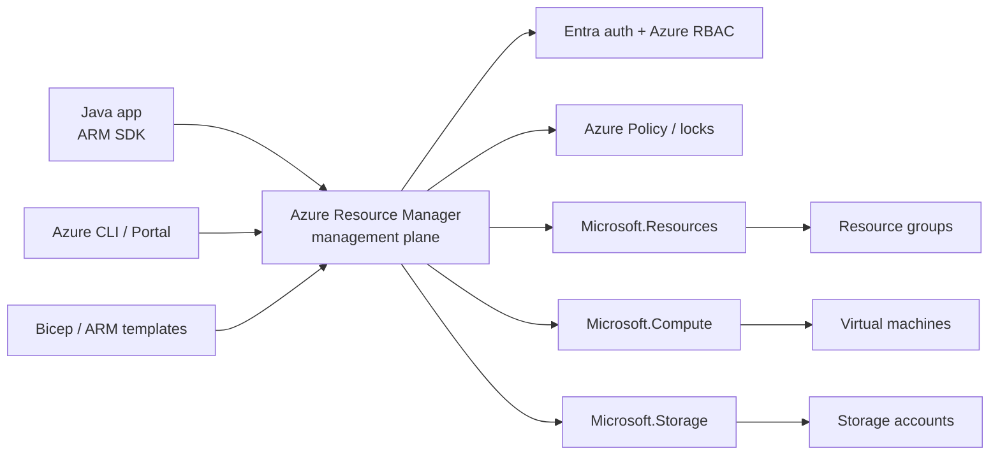
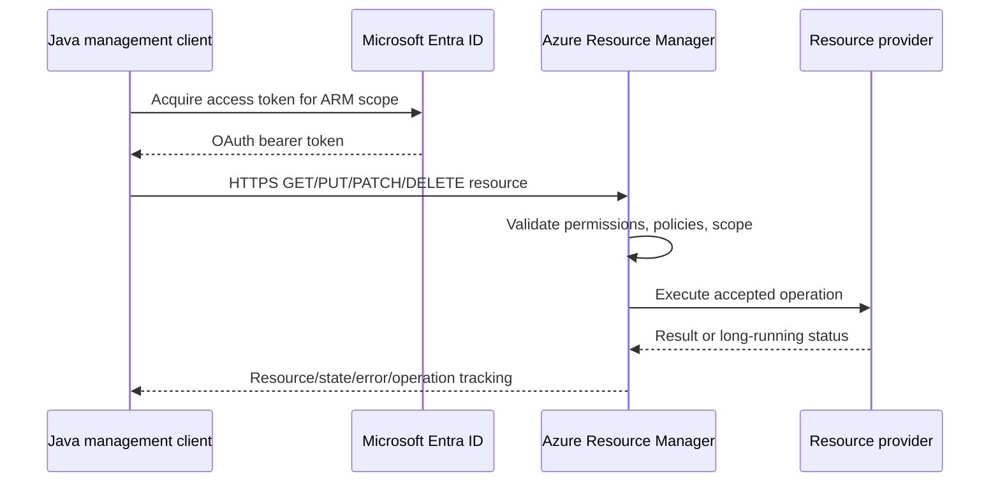
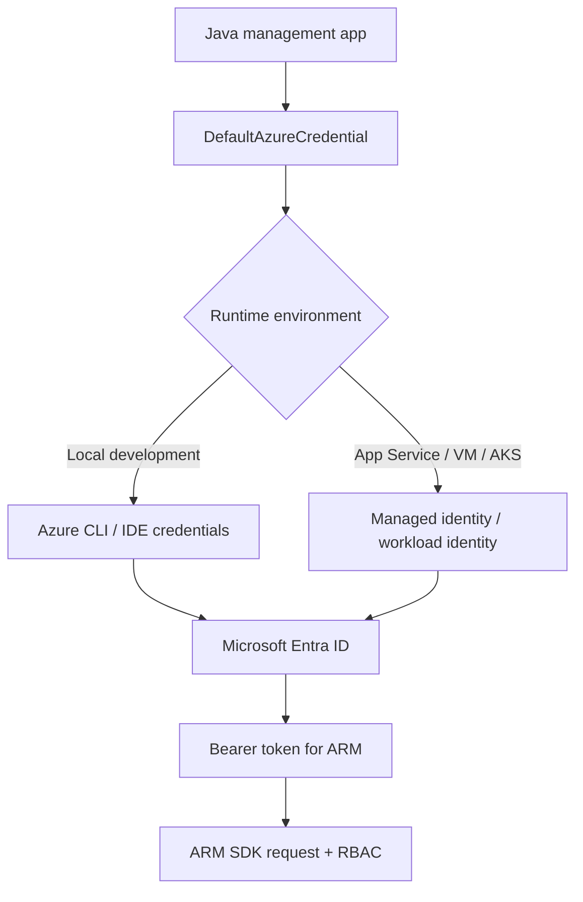
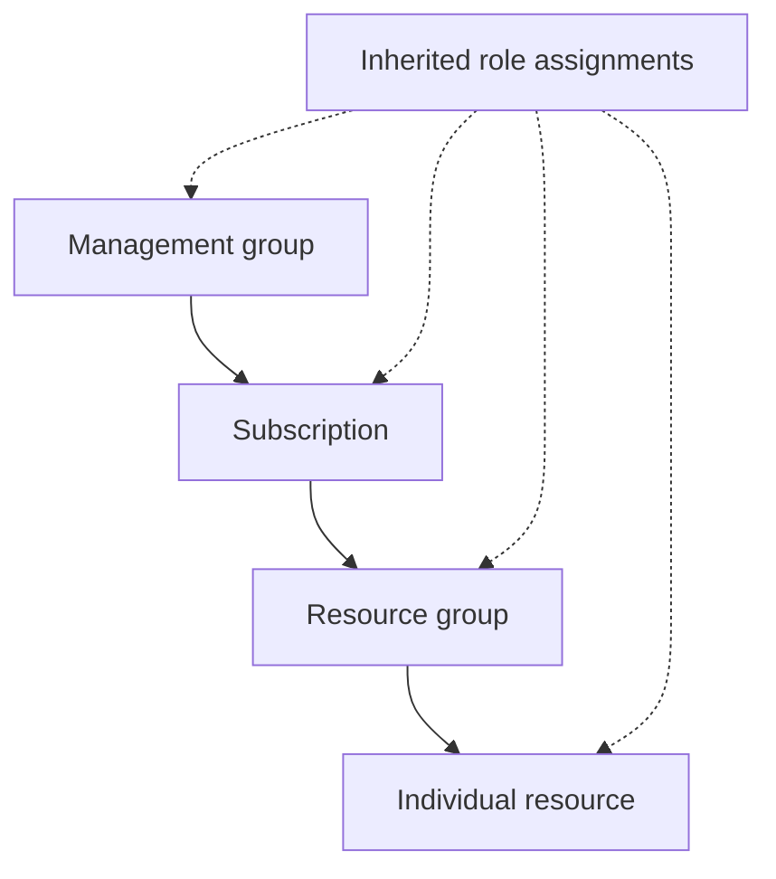
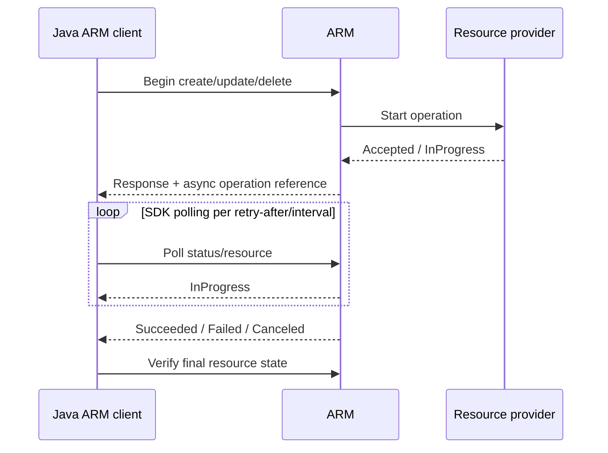
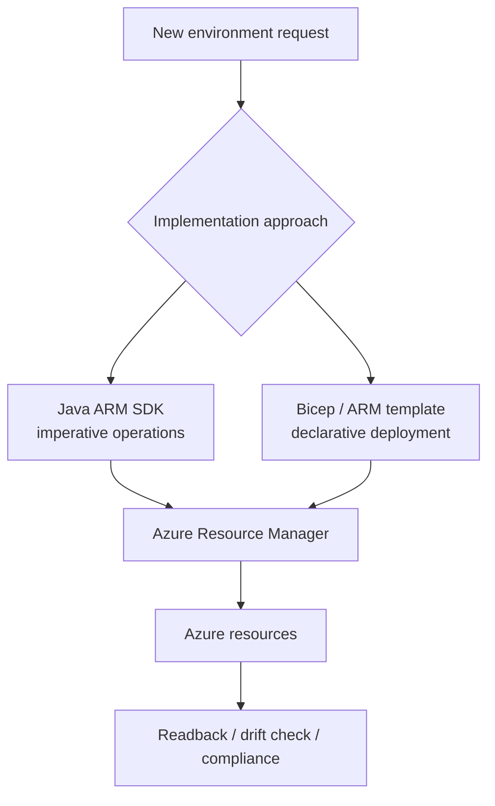
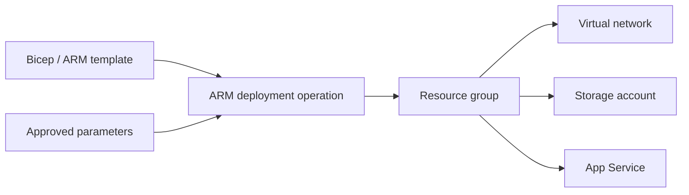
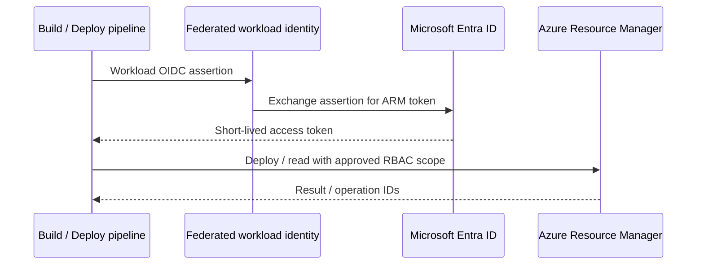
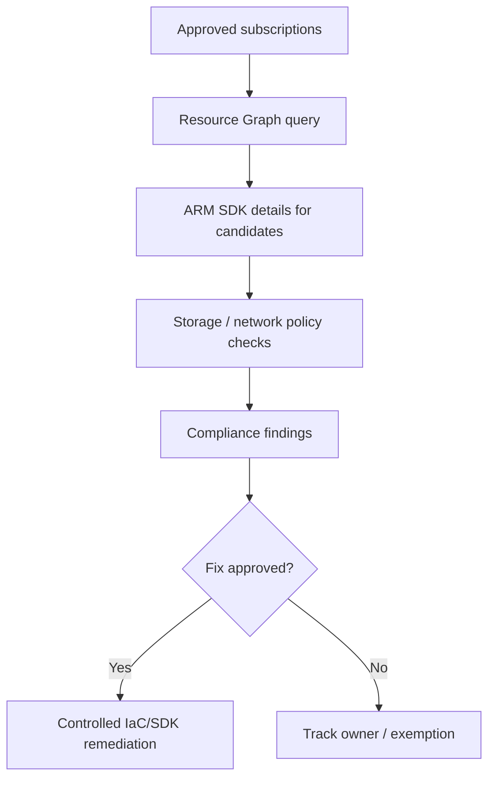

# Managing Infrastructure with the Azure Resource Manager SDK

A company deploys a Java application on **Azure App Service** and stores data in **Azure Storage**. When spinning up test environments for each feature branch, the engineering team must create resource groups, verify storage/network settings, apply tags, enforce security policies, and clean up ephemeral resources afterward. Doing this manually in the Azure Portal leads to configuration drift, poor auditability, and wasted time. A Java program can interact directly with **Azure Resource Manager (ARM)** to perform controlled resource management operations.

The **Azure Resource Manager SDK for Java** is the family of libraries enabling Java applications to work with Azure's **management plane**: reading, creating, updating, listing, or deleting resources such as resource groups, virtual machines, storage accounts, and other supported services. It differs from **data-plane** SDKs used to read blobs, send messages, query SQL, or manipulate data inside resources.

This lesson belongs to the **Azure SDK for Java** chapter of the **CLOUD_PROVIDERS_AZURE** module. The module explores the Microsoft Azure ecosystem from subscriptions, resource groups, and Microsoft Entra ID through virtual networks, compute, storage, and data, while deploying, monitoring, securing, and controlling application architecture costs. Accordingly, this lesson not only introduces the Java APIs, but also explains **permissions, safety during infrastructure changes, retries, auditing, API limits, and resource lifecycle governance**.

**After this lesson, you will be able to:**

- Distinguish the **ARM management plane** from **storage/database/message data planes**.
- Use **`DefaultAzureCredential`, `AzureProfile`, and `AzureResourceManager`** to initialize clients safely.
- Understand the **subscription → resource group → resource provider → resource ID** hierarchy.
- List, query, and create resource groups using the **fluent management SDK** in a guarded lab example.
- Know when to use the **`AzureResourceManager` aggregate client**, single-service `azure-resourcemanager-*` libraries, or low-level ARM REST/management clients.
- Handle **long-running operations (LROs)**, pagination, eventual consistency, retries, and ARM throttling.
- Apply Azure RBAC, managed identity, Azure Policy, resource locks, tags, naming conventions, and auditing.
- Compare direct SDK calls against **ARM/Bicep/Terraform** and select suitable CI/CD workflows.
- Design programs featuring **dry-run, idempotency, approvals, timeouts, logging, rollback, and cost controls**.

## 1. What Role Does Azure Resource Manager Play?

ARM is Azure's unified resource management layer. Whether you use the Azure Portal, Azure CLI, Bicep deployments, or a management SDK, operations ultimately execute through **Azure Resource Manager** and its **resource providers**.



This diagram illustrates functional layers rather than strict sequential execution order or internal routing for every API.

### 1.1. Management Plane vs. Data Plane

| Task | Plane Type | Typical SDK / Operation |
|---|---|---|
| Create a resource group | **Management** | ARM SDK / `Microsoft.Resources` |
| Create a storage account or change replication | **Management** | Storage management client |
| Create a virtual machine, VNet, or NSG | **Management** | Compute/Network management clients |
| Configure tags, properties, diagnostic settings | **Management** | Resource-provider management SDK |
| Upload/download a blob | **Data** | `BlobServiceClient` / Storage Blob SDK |
| Query tables in Azure SQL | **Data** | JDBC / SQL driver / database client |
| Read messages from Azure Service Bus | **Data** | Service Bus client |
| Call model inference | **Data** | Model endpoint SDK/API |

**Important:** the Azure `Contributor` role on a resource group lets a principal manage a storage account, yet **does not automatically grant permission to read individual blobs** when the data plane requires `Storage Blob Data Reader`/`Contributor` or ACLs. Conversely, a principal permitted to write blobs cannot necessarily create or delete storage accounts.

### 1.2. What Steps Does an ARM Request Pass Through?



Some APIs perform **asynchronous provisioning**: the server returns an accepted response before the resource finishes provisioning. The SDK may hide polling behind synchronous methods or expose a **poller/async API**. Therefore, **an accepted HTTP request does not mean the resource is ready to use**.

## 2. Azure Hierarchy and Resource Identifiers

Before coding with the SDK, understand management scopes:

```text
Microsoft Entra tenant
  └─ Management groups (if used)
       └─ Subscription
            └─ Resource group
                 ├─ Storage account
                 ├─ Virtual network
                 └─ Virtual machine
```

- **Tenant**: administers identities and directory policies.
- **Management group**: applies governance, policies, and RBAC across multiple subscriptions.
- **Subscription**: primary boundary for management, billing, and quotas.
- **Resource group**: container grouping resources that share a lifecycle or management scope.
- **Resource provider**: namespace and APIs managing a resource type, e.g., `Microsoft.Storage`.
- **Resource**: a concrete resource identified by an **ARM resource ID**.

### 2.1. ARM Resource ID

A typical resource ID format:

```text
/subscriptions/<subscription-id>
/resourceGroups/<resource-group>
/providers/<resource-provider>/<resource-type>/<resource-name>
```

Single-line example:

```text
/subscriptions/00000000-0000-0000-0000-000000000000/resourceGroups/rg-shop-dev/providers/Microsoft.Storage/storageAccounts/stshopdev001
```

Paths are deeper for nested or extension resources—for example, a virtual machine extension adds extra resource type/name segments. When comparing or referencing resource IDs, **use the ID returned by the SDK/ARM** instead of manually concatenating strings assuming every resource type has the same segment depth.

### 2.2. Resource Group Region vs. Resource Region

A resource group has a `location` for **management metadata**, yet individual resources inside that group can reside in different regions where supported. Never assume every storage account or VM inside `rg-app-prod` lives in the resource group's own region.

### 2.3. One Subscription Does Not Equal One Environment

Dev, test, and prod can be separated by subscriptions or resource groups depending on governance requirements; the right structure depends on billing, permissions, policies, and blast radius. **The SDK client must receive an intentional subscription ID** rather than accidentally targeting an Azure CLI default subscription.

## 3. Selecting Azure SDK for Java Libraries

The Java ecosystem includes these library groups:

| Group | Role | Example |
|---|---|---|
| **`azure-identity`** | Provides credentials to acquire tokens from Entra | `DefaultAzureCredential` |
| **`azure-core`** | HTTP pipeline, exceptions, retries, paging, logging, async primitives | `HttpResponseException`, `PagedIterable` |
| **`azure-core-management`** | Shared types for Azure management | `AzureProfile`, `AzureEnvironment` |
| **`azure-resourcemanager`** | Aggregate/fluent client managing multiple resource types | `AzureResourceManager` |
| **`azure-resourcemanager-resources`** | Management client for resource groups/deployments per SDK support | Resource management API |
| **`azure-resourcemanager-compute`** | Compute/VM management per supported APIs | VM management |
| **`azure-resourcemanager-network`** | Network resource management | VNet, subnet, NSG |
| **`azure-resourcemanager-storage`** | Storage account settings management | Account management |
| **`azure-storage-blob`** | **Data plane** blob operations, not storage account creation | `BlobServiceClient` |

**Version lifecycle note:** versions, transitive dependencies, Java baselines, API versions, and overloads evolve. Never assume legacy blog snippets still exist in the latest SDK release. Choose a **Microsoft-supported, compatible** dependency set, pin versions in your build, and review release notes when upgrading.

### 3.1. When to Use the Aggregate SDK?

`AzureResourceManager` is convenient when an app manages resource groups, VNets, storage, or VMs through a unified **fluent API**:

```text
AzureResourceManager
    .resourceGroups()
    .virtualNetworks()
    .storageAccounts()
    .virtualMachines()
    .genericResources()
```

This does not mean the aggregate library covers 100% of every API or property across every Azure service. New features often land first in **service-specific management SDKs**, generated REST clients, or the ARM REST API.

### 3.2. When to Use a Dedicated Client?

If an app only manages networking, choose the dedicated network management library to shrink dependency footprint and access specialized operations/REST APIs. Inspect the exact client manager, model types, and API version for that library—never assume every service SDK shares identical fluent chains.

### 3.3. What If the SDK Lacks a Brand-New Property?

Follow a sensible priority order:

1. Check a newer supported management SDK release.
2. Use an ARM/Bicep deployment for the desired resource configuration where suitable.
3. Use a low-level management REST API/client at the exact API version with `TokenCredential`.
4. For preview APIs, evaluate stability and governance before production use.

**Never use a data-plane SDK to create or alter subscription-level resources** just because the service name sounds similar.

## 4. Setting Up the Java Project

For modern Java, use a supported LTS Java version such as Java 17 or 21 per the library compatibility matrix.

### 4.1. Maven Dependencies (Version Selection Template)

```xml
<dependencies>
  <dependency>
    <groupId>com.azure</groupId>
    <artifactId>azure-identity</artifactId>
    <version>${azure.identity.version}</version>
  </dependency>
  <dependency>
    <groupId>com.azure.resourcemanager</groupId>
    <artifactId>azure-resourcemanager</artifactId>
    <version>${azure.resourcemanager.version}</version>
  </dependency>
</dependencies>
```

In a real `pom.xml`, define `azure.identity.version` and `azure.resourcemanager.version` using **verified valid releases**, and pin/lock transitive dependencies per policy. This snippet will not build standalone without properties and full Maven project elements; it is an **illustrative** dependency block, not a mandate for fixed version numbers.

### 4.2. Gradle (Template)

```groovy
dependencies {
    implementation "com.azure:azure-identity:${azureIdentityVersion}"
    implementation "com.azure.resourcemanager:azure-resourcemanager:${azureResourceManagerVersion}"
}
```

In Gradle, declare `azureIdentityVersion` and `azureResourceManagerVersion` in a version catalog or build config. Never include both legacy `com.microsoft.azure:*` and modern `com.azure:*` SDKs just because an online sample mixed packages.

### 4.3. Dependency Governance

- Use a BOM or version catalog where artifacts are supported by your chosen versioning model.
- Review CVEs, breaking API changes, and Java runtime compatibility.
- Never upgrade multiple SDKs simultaneously in production without integration tests.
- Strip credentials from container build images and build logs.

## 5. Authenticating with DefaultAzureCredential

**`DefaultAzureCredential`** tries a chain of credential providers based on configuration and version: environment, workload identity, managed identity, and signed-in developer tools. This lets the **same code path** run on a developer workstation and inside Azure workloads while switching identity sources per environment.

### 5.1. Distinguishing Credentials from Permissions

- **Authentication**: Microsoft Entra issues a token for a principal after verifying credentials.
- **Authorization**: Azure RBAC, deny assignments, and Azure Policy determine whether that token/principal may call ARM.
- **Networking**: whether the app can reach the ARM endpoint over TLS/proxies.

Acquiring a token does not guarantee `resourceGroups().list()` is authorized.

### 5.2. Token Acquisition Flow



### 5.3. Never Hard-Code Client Secrets

Avoid this:

```java
// ANTI-PATTERN: illustrates what NEVER to do.
// String clientSecret = "copy-secret-here";
// String subscriptionId = "production-subscription-hardcoded";
```

In production, prefer **system-assigned or user-assigned managed identities**, or **federated workload identities** for CI/CD where supported. If a service principal secret is unavoidable, store it in a secret manager with minimal permissions and a rotation policy.

### 5.4. AzureProfile Specifies Cloud, Tenant, and Subscription

`AzureProfile` supplies the Azure environment, tenant, and subscription context when initializing the SDK. For Azure public cloud, use `AzureEnvironment.AZURE`; **sovereign clouds** use distinct environments and endpoints. Never acquire a public-cloud audience token and send it to a different cloud's management endpoint.

## 6. Java Code: Connecting the ARM SDK and Listing Resource Groups

**Read-only** practical example using the aggregate `AzureResourceManager`:

```java
import com.azure.core.management.AzureEnvironment;
import com.azure.core.management.profile.AzureProfile;
import com.azure.identity.DefaultAzureCredentialBuilder;
import com.azure.resourcemanager.AzureResourceManager;
import com.azure.resourcemanager.resources.models.ResourceGroup;

public final class ListResourceGroups {
    public static void main(String[] args) {
        String tenantId = requireEnv("AZURE_TENANT_ID");
        String subscriptionId = requireEnv("AZURE_SUBSCRIPTION_ID");

        AzureProfile profile = new AzureProfile(
            tenantId,
            subscriptionId,
            AzureEnvironment.AZURE
        );

        AzureResourceManager azure = AzureResourceManager
            .authenticate(new DefaultAzureCredentialBuilder().build(), profile)
            .withSubscription(subscriptionId);

        for (ResourceGroup group : azure.resourceGroups().list()) {
            System.out.printf(
                "name=%s region=%s id=%s%n",
                group.name(), group.regionName(), group.id()
            );
        }
    }

    private static String requireEnv(String name) {
        String value = System.getenv(name);
        if (value == null || value.isBlank()) {
            throw new IllegalArgumentException("Missing environment variable: " + name);
        }
        return value;
    }
}
```

**Prerequisites to run:**

1. Compatible Java and selected dependencies.
2. `AZURE_TENANT_ID` and `AZURE_SUBSCRIPTION_ID` point to an **authorized** tenant and subscription for inventory.
3. Local user is signed in via Azure CLI/IDE, or the Azure workload has a configured managed identity.
4. Principal holds read access to resource groups in the subscription.
5. Host can reach the ARM and Entra token endpoints over TLS.

This code uses standard overloads and types of the fluent library. On different SDK versions, verify package signatures and listing methods. **Do not run create/delete commands during this step**, and never mix outputs across subscriptions.

### 6.1. Why Avoid `withDefaultSubscription()`?

It is convenient for quick experiments, yet on machines or identities with access to multiple subscriptions, the "default" is easy to mis-select. In automation, **pass the subscription ID explicitly from approved configuration** and log it as metadata (without logging tokens).

### 6.2. Java Managing Resources from CI/CD

When running inside build pipelines, never use a personal engineer's Azure CLI token as a long-lived credential. Use managed identity or supported OIDC workload federation, separate identities per environment, scope RBAC tightly, and require approvals before production writes.

## 7. Reading, Filtering, and Inventorying Resources

In operations, always validate **read-only discovery** before writing infrastructure-mutating automation.

### 7.1. Fetching a Resource Group by Name

```java
ResourceGroup group = azure.resourceGroups().getByName("rg-shop-dev");

if (group == null) {
    System.out.println("Resource group does not exist or is not visible.");
} else {
    System.out.println(group.id());
    System.out.println(group.regionName());
    System.out.println(group.tags());
}
```

Here `azure` is the client initialized in section 6. The API may return `null` when a resource does not exist per client semantics; however, **403 Forbidden** due to missing permissions is an authorization error and must never be treated as "the resource group doesn't exist, let's create it."

### 7.2. Listing Resources in a Resource Group

```java
String resourceGroupName = "rg-shop-dev";

azure.genericResources()
    .listByResourceGroup(resourceGroupName)
    .forEach(resource -> {
        System.out.printf(
            "id=%s type=%s location=%s%n",
            resource.id(),
            resource.type(),
            resource.regionName()
        );
    });
```

**Note:** `genericResources()` returns generic management-plane metadata. Service-specific properties like VNet address spaces or storage firewall rules often require dedicated service SDKs. Never dump full `properties` of every resource into logs, as metadata may contain internal addresses, connection settings, or sensitive references.

### 7.3. Pagination and Performance

`list()` methods in the Azure SDK generally return **paged / lazy iterables**. Never assume everything arrives in a single HTTP response. For large subscriptions:

- Narrow scopes by resource group or resource type where supported.
- Use `PagedIterable` or async streams per SDK version.
- Avoid holding hundreds of thousands of resource objects in one `List` if you only need a few fields.
- Respect API throttling and never fire thousands of concurrent list calls.
- Use **Azure Resource Graph** for complex cross-subscription inventory queries when appropriate; it is a separate service/API with its own semantics and quotas.

### 7.4. Inventory Scans Are Not Instantaneous Snapshots

Resources can mutate while a program iterates across multiple pages; the final result is **not an Azure-wide transactional snapshot**. If strict point-in-time compliance is required, record scan timestamps, resource IDs, change logs / Resource Graph queries, and account for eventual consistency.

## 8. Creating a Resource Group with Guardrails

Creating a resource group is an **ARM write operation**. In a lab, you can use the fluent SDK:

```java
import com.azure.core.management.Region;
import com.azure.resourcemanager.resources.models.ResourceGroup;

String subscriptionId = requireEnv("AZURE_SUBSCRIPTION_ID");
String rgName = requireEnv("LAB_RESOURCE_GROUP_NAME");
String expectedPrefix = "rg-java-sdk-lab-";

if (!rgName.startsWith(expectedPrefix)) {
    throw new IllegalArgumentException("Not an approved lab RG name");
}
if (!"true".equalsIgnoreCase(System.getenv("ALLOW_ARM_WRITE"))) {
    throw new IllegalStateException(
        "Write disabled. Set ALLOW_ARM_WRITE=true only in approved lab."
    );
}

ResourceGroup existing = azure.resourceGroups().getByName(rgName);
if (existing != null) {
    System.out.println("Already exists: " + existing.id());
} else {
    ResourceGroup created = azure.resourceGroups()
        .define(rgName)
        .withRegion(Region.fromName("southeastasia"))
        .withTag("environment", "lab")
        .withTag("owner", "java-sdk-training")
        .create();

    System.out.println("Created: " + created.id());
}
```

**Snippet scope:** this is a **fragment** inside the same class/context where `azure` and `requireEnv` exist. To compile standalone, place it inside a class/method with matching imports and SDK signatures.

**Safety:**

- Run only against an **approved lab** subscription and resource group.
- Resource group names and regions here are **illustrative placeholders**, not universal naming policies.
- An `owner` tag is convenient metadata, not a substitute for Azure RBAC or ownership approvals.
- A resource group itself does not incur primary compute/storage charges, yet **resources provisioned inside it do**.
- Verify Azure Policy, quotas, locks, and naming standards before calling `create`.
- **Check-then-create is not atomic**: two processes can both observe absence; handle `409 Conflict` / re-checks in production.

### 8.1. Idempotency Is More Than `if (missing) create`

Suppose an RG already exists yet lacks a `costCenter` tag or sits in the wrong region due to manual creation. Skipping simply because "it already exists" **ignores drift**. Strong automation:

1. Verifies resource identity and scope.
2. Compares current configuration against **desired state**.
3. Modifies only authorized fields.
4. Handles 409/412 concurrency errors.
5. Verifies state after the operation.

Never overwrite all tags on a resource when intending to update a single tag; **merge vs. replace** behavior differs by API and SDK method.

### 8.2. Creating Other Billable Resources

Creating VMs, Azure SQL, public IPs, disks, or managed services incurs charges immediately upon provisioning. This lesson **does not execute commands creating real VMs or storage accounts**. In production automation, require an approved plan / Bicep what-if, SKU/region allowlists, budgets, and approvals before provisioning billable infrastructure.

## 9. Azure Resource Providers and API Versions

ARM resource types use namespaces, for example:

```text
Microsoft.Resources/resourceGroups
Microsoft.Storage/storageAccounts
Microsoft.Compute/virtualMachines
Microsoft.Network/virtualNetworks
Microsoft.Web/sites
```

Resource providers register supported resource types and API versions. When writing Java:

- **Fluent SDKs** select or encapsulate API versions internally.
- **Low-level management SDKs** expose generated clients/models bound to specific versions/features.
- **ARM REST** requires `api-version` in the URL query string.
- Newer API versions can introduce fields or change behavior.

Conceptual REST URI example:

```text
GET https://management.azure.com/subscriptions/{subId}/resourceGroups/{rgName}
    ?api-version={supported-api-version}
```

This illustrates an **ARM resource group REST route**, not a runnable URL before parameter substitution. Always select an API version **supported by the resource provider and target cloud**—do not blindly assume the newest version fits every service.

### 9.1. Resource Provider Registration

A brand-new subscription might not have the needed provider registered yet. When creating a resource type, ARM can return a "provider not registered" error. **Registering a provider** is a subscription-level governance change; perform it only with approval and policy alignment. Never let an ordinary app auto-register arbitrary providers.

### 9.2. Preview APIs and Production

Preview APIs unlock new capabilities, yet schemas and support guarantees can change. If an SDK version relies on a preview API for critical infrastructure, manage risk, run compatibility tests, and maintain a rollback plan.

## 10. Azure SDK Fluent APIs vs. Low-Level Management Clients

**Fluent APIs** express create/update operations as method chains:

```text
azure.resourceGroups()
     .define("rg-java-sdk-lab-demo")
     .withRegion(...)
     .withTag(...)
     .create()
```

**Low-level management clients** expose raw GET/PUT/PATCH parameters, request/response models, pollers, and API-version-specific fields closer to ARM REST.

| Criterion | Fluent `AzureResourceManager` | Service-Specific / Low-Level ARM Client |
|---|---|---|
| Fast onboarding / basic CRUD | Usually convenient | May involve verbose request models |
| Cross-service operations | Easy to orchestrate from one root | Requires multiple clients |
| Newly released properties | May lag behind | Often available sooner per SDK/API version |
| Retries / pipeline | Follows Azure SDK conventions | Finely configurable via client builder |
| Raw REST debugging | Abstracted away | Closer to REST, easier field mapping |
| Signature stability | Tied to SDK version | Also tied to generated API version |

**Never mix two clients on the same mutating operation without clear ownership.** For instance, one SDK editing tags while a Bicep deployment also updates tags causes drift and lost updates.

## 11. Create, Update, and Delete Patterns

On ARM, distinguish:

| HTTP / Operation | Common Meaning | Pitfalls |
|---|---|---|
| `GET` | Read one resource | 404 may mean missing; 403 means denied |
| `LIST` | Enumerate resources | Pagination, throttling, broad scope |
| `PUT` | Create or replace/update per provider contract | Can alter many fields; may be long-running |
| `PATCH` | Update a subset of fields where supported | Not every type supports every patchable field |
| `DELETE` | Delete resource or initiate deletion | Often irreversible; cascades to dependent resources |

**Never assume every PUT is business-idempotent.** Retrying a PUT with the same resource ID is often safe per provider contract, yet when requests rotate keys, mutate secrets, trigger external side effects, or collide with concurrent operations, evaluate safety explicitly.

### 11.1. Resource Tags

Tags organize costs and governance, e.g.:

```json
{
  "environment": "dev",
  "ownerTeam": "payments-platform",
  "costCenter": "cc-420",
  "managedBy": "infrastructure-automation",
  "expiresOn": "2026-12-15"
}
```

Tags **are not secrets**—never store passwords, tokens, PII, or sensitive data in them. An `expiresOn` tag is purely metadata; it **does not delete resources automatically** without dedicated cleanup automation or policies.

### 11.2. Resource Locks

Azure provides locks such as:

- **`CanNotDelete`**: blocks deletion within the locked scope.
- **`ReadOnly`**: blocks control-plane mutations, which can disrupt unexpected operations.

Even a `Contributor` cannot delete a locked resource. Never remove locks automatically to bypass a delete error without owner approval.

### 11.3. Azure Policy

Policies can **deny** deployments in unapproved regions, enforce mandatory tags, restrict SKUs, or apply governance effects. Receiving `RequestDisallowedByPolicy` is not an "SDK bug." Inspect the policy assignment/initiative, request justified exemptions, or comply—**never try renaming resources to evade policy**.

## 12. Azure RBAC and the Principle of Least Privilege

### 12.1. Who Is Calling ARM?

With `DefaultAzureCredential`:

- Local: likely a developer's CLI/IDE account.
- CI/CD: workload identity or service principal.
- App Service / VM / Azure Functions: managed identity.
- AKS: workload identity bound to a Kubernetes service account.

**Key point:** the identity selected by the SDK is not always what the developer expects. Before automation writes or deletes resources, verify the active principal, tenant, and subscription.

### 12.2. RBAC Scope



A role assignment at subscription scope inherits down to all resource groups unless blocked by deny assignments or conditions. If a service only manages resources inside `rg-java-sdk-lab-*`, scope permissions **as narrowly as possible** instead of defaulting to subscription-wide `Owner`.

### 12.3. Sample Roles

| Role | General Meaning | Suitable for Automation? |
|---|---|---|
| **Reader** | Read management metadata | Fits inventory and auditing |
| **Contributor** | Manage resources without granting Azure RBAC | Broad; use only when needed at narrow scope |
| **Owner** | Full control including role assignments | Never use for routine app CRUD |
| **User Access Administrator** / RBAC admin roles | Manage role assignments | Strictly for controlled permission workflows |
| **Custom role** | Specific subset of management actions | Ideal for well-defined, governed scopes |

If a program only lists resource groups, `Reader` at the right scope suffices. Creating new RGs requires RG creation rights at subscription scope; you cannot assign a role solely on a **not-yet-existing** RG and expect to create it.

### 12.4. Identity Does Not Override Azure Policy

A principal with write RBAC can still be blocked by Azure Policy, deny assignments, or locks. Conversely, a compliant resource template does not prove the caller has permission. Always validate all layers.

## 13. Handling ARM Errors in Java

Common errors:

| Signal | What to Check | Action |
|---|---|---|
| `401 Unauthorized` | Invalid/expired token, wrong scope or tenant | Check credential and token audience |
| `403 Forbidden` | RBAC deny, policy, or service restriction | Check principal, role/scope/deny; never retry infinitely |
| `404 Not Found` | Wrong resource ID/name/subscription, or not yet visible | Re-check scope, provisioning state, eventual consistency |
| `409 Conflict` | In-progress operation, name collision, or state conflict | Refresh state, back off appropriately |
| `412 Precondition Failed` | Stale ETag / `If-Match` | Re-read and recompute update |
| `429 Too Many Requests` | ARM throttling / rate budget exceeded | Honor `Retry-After`, reduce concurrency |
| `500/502/503/504` | Transient service/provider outage or timeout | Bounded retry if idempotent and within deadline |
| `RequestDisallowedByPolicy` | Azure Policy denial | Inspect policy assignment; fix config or request exemption |
| `AuthorizationFailed` | Missing action at scope | Fix role/identity; never grant blanket permissions |
| `MissingSubscriptionRegistration` | Provider unregistered | Register provider per approval workflow |

Azure management errors may surface via `HttpResponseException` or `azure-core`/SDK-specific exceptions. Inspect **HTTP status + structured error code + request IDs + scope** rather than just exception messages.

### 13.1. Safe Read Example with Status Classification

```java
import com.azure.core.exception.HttpResponseException;
import com.azure.resourcemanager.resources.models.ResourceGroup;

try {
    ResourceGroup group = azure.resourceGroups().getByName("rg-shop-dev");
    System.out.println(group == null ? "Not found" : group.id());
} catch (HttpResponseException ex) {
    int status = ex.getResponse().getStatusCode();
    if (status == 403) {
        System.err.println("Forbidden: check RBAC and scope");
    } else if (status == 429) {
        System.err.println("ARM throttled: reduce request rate");
    } else {
        System.err.println("ARM request failed with HTTP " + status);
    }
    throw ex;
}
```

This is a **fragment** using the `azure` client from section 6. Never log access tokens, `Authorization` headers, raw request bodies with secrets, or sensitive ARM response properties.

### 13.2. Exception Messages Are Not Stable Contracts

Classify errors by **HTTP status and structured service error codes** where available; never match English substrings like `"Forbidden"` in messages, as wording changes across versions and locales.

## 14. Retries, Backoff, Timeouts, and Throttling

Azure SDKs include HTTP pipeline retry behavior, yet defaults vary by client, operation, and version. If your application also wraps `create` calls in an outer retry loop, total attempts multiply quickly.

### 14.1. Principles

1. **Use the SDK's supported retry policy**, evaluating defaults before adding wrappers.
2. Retry primarily on **429 / 503 / transient network errors**, respecting operation idempotency.
3. Honor **`Retry-After`** or server retry hints when provided.
4. Apply **exponential backoff + jitter**, total deadlines, and max attempt caps.
5. Limit concurrent calls when scanning across many subscriptions or resource groups.
6. Never retry `403` RBAC failures or `RequestDisallowedByPolicy` verbatim.
7. Log correlation IDs, attempt counts, and latency to separate service outages from client retry storms.

### 14.2. Backoff Formula

\[
d_n = \min(d_{\max}, d_0\,2^n),\quad
d_n^{\mathrm{jitter}}\sim U(0,d_n)
\]

For instance, an app might pick a 1-second base delay and 16-second cap, with jitter spreading retries across workers. **This is not an ARM mandate**: service retry headers and SDK policies may enforce different wait intervals.

### 14.3. Enforce an Overall Workflow Timeout

An ARM operation can take minutes while individual HTTP calls have shorter timeouts. Distinguish three time budgets:

| Timeout | Applies To | Does Not Guarantee |
|---|---|---|
| **HTTP / connect / read timeout** | Single round trip in the client pipeline | That the server canceled the operation |
| **Polling timeout** | LRO status tracking window | Resource rollback when polling stops |
| **Business / workflow deadline** | Total time automation can wait | Self-healing or cleanup of Azure resources |

If the client drops during a VM-creation PUT, **never immediately submit another create request under a different name**. Query the resource ID, provisioning state, and operation result to reconcile first.

## 15. Long-Running Operations (LROs)

Creating VMs, deploying networks, reconfiguring certain services, or deleting resources often run asynchronously. ARM/providers return **202 Accepted** or an in-progress status, updating `provisioningState` to `Succeeded`/`Failed`/`Canceled` per contract.



### 15.1. Sync and Async SDKs

In many **fluent APIs**, methods like `create()` block until completion per abstraction. **Async methods** or generated ARM clients return `Mono`, `PollerFlux`, `SyncPoller`, or another result type depending on SDK version:

```text
Fluent synchronous:
  define(...) -> configure(...) -> create()

Fluent asynchronous (if operation supports it):
  define(...) -> configure(...) -> createAsync()

Low-level generated management client:
  beginCreateOrUpdate(...) / beginDelete(...) -> poller
```

This is **pseudocode illustrating patterns**, not a guarantee that an identically named method exists on every resource provider.

### 15.2. Disciplined Polling

- Honor wait intervals supplied by the service/client.
- Enforce total timeouts and avoid infinite blocking.
- Distinguish **operation result** from **resource `provisioningState`**.
- After an LRO succeeds, verify resource configuration, endpoints, networking, and dependencies.
- If the app restarts, persist operation/resource IDs to **resume or reconcile** instead of blindly re-running.
- Use correlation/request IDs to cross-check the Activity Log.

### 15.3. Canceled Does Not Always Mean Rolled Back

A canceled or timed-out LRO does not guarantee all side effects rolled back; resources may remain partially provisioned. Runbooks must inspect lingering resources, dependencies, costs, and approved remediation or cleanup paths.

## 16. Concurrency, ETags, and Lost Updates

A resource can be modified concurrently by:

- IaC pipelines.
- Java ARM SDK programs.
- Operators in the Azure Portal.
- Policy remediation automation.
- Azure itself managing platform properties.

If two processes read an old version and both write updates, one can **silently overwrite the other's changes**.

### 16.1. Optimistic Concurrency

Some management APIs expose **ETags** and support conditional headers like `If-Match` or `If-None-Match` per contract.

```text
T0: Client A GET resource -> ETag "v12"
T1: Client B GET resource -> ETag "v12"
T2: Client A PUT/PATCH If-Match "v12" -> success; ETag "v13"
T3: Client B PUT/PATCH If-Match "v12" -> 412 Precondition Failed
```

Client B must **re-read, re-evaluate desired state, and compute a fresh update** rather than retrying with the stale ETag.

### 16.2. Do Not Assume Every Fluent Method Supports If-Match

ETag and conditional headers are not uniform across all Azure resource types. When strict lost-update protection is needed:

1. Verify whether the ARM provider/API version supports conditional updates.
2. Use low-level clients or REST pipeline hooks to pass ETags per contract.
3. If unsupported, serialize updates or enforce a **single deployment owner**.
4. Audit all writers capable of mutating the same resource.

**Never treat a Redis distributed lock as proof that an external portal operator cannot modify the resource provider.** Locks only coordinate clients participating in that lock.

## 17. Desired State, Drift, and Differences from IaC

There are two ways to think about infrastructure management:

1. **Imperative**: code executes step-by-step `create/update/delete` calls.
2. **Declarative**: desired state is declared in IaC templates/code, and an engine plans and applies changes.



### 17.1. When to Use the SDK Directly?

- Building an **internal platform service** that accepts user requests and provisions via custom workflows.
- Writing **inventory, auditing, reporting**, or policy-reconciliation jobs with complex Java logic.
- Integrating infrastructure lifecycles with approvals, billing, quotas, and internal systems.
- Managing resources that change dynamically with application state under clear single ownership.
- Writing Java onboarding or sandbox-provisioning tools with strong guardrails.

### 17.2. When to Use Bicep / ARM Templates / Terraform?

- Infrastructure definitions need Git review.
- Goal is **reproducible environments** across dev/test/prod.
- You want clear **plan / what-if** previews and dependency graphs.
- Deploying many interdependent resources with relatively stable lifecycles.
- The organization standardized on an IaC tool for drift detection and change approvals.

### 17.3. Combining the SDK and IaC

A Java service can act as orchestrator:

```text
API request from project owner
   -> validate user/tenant/project quota
   -> select approved Bicep template + parameters
   -> request approval
   -> trigger deployment orchestration
   -> observe ARM result / Activity Log
   -> write internal inventory
```

In this model, Java is the **orchestrator**, while Bicep defines **desired state**. You do not have to express every resource in fluent Java calls just because your platform backend is written in Java.

### 17.4. Drift Detection Requires Knowing Resource Ownership

A VM size changing from `Standard_D2s` to `Standard_D4s` might be:

- An unauthorized manual edit.
- Approved auto-tuning.
- A change from another IaC pipeline.
- An emergency incident fix.

Before automatically "fixing drift," verify **owner, version, maintenance windows, and change approvals**. Never overwrite production configs simply because they differ from an old sample template.

## 18. ARM Template Deployments and What-If

When using the SDK to manage **ARM deployments**, the pattern is submitting templates and parameters to a resource group or subscription scope, tracking the long-running deployment, inspecting validation/what-if output, and verifying resource states. Exact APIs depend on `azure-resourcemanager-resources` or ARM REST versions.

### 18.1. A Deployment Is Not Just Any REST PUT

A single deployment can orchestrate many resources:



Distinguish across deployments:

- **Scope:** resource group, subscription, management group, or tenant depending on deployment type.
- **Parameters:** region, names, SKUs, networking, tags.
- **Deployment mode / stack semantics:** can affect existing resources omitted from the template depending on mode.
- **What-if:** previews expected changes, though not a guarantee against all unexpected side effects.
- **Provisioning result:** track individual resource outcomes and dependencies.

### 18.2. Example: Planning in CI Instead of Blindly Creating

```text
Pull request
  -> syntax/contract validation
  -> template/build unit tests
  -> Azure what-if (approved scope)
  -> security/policy/cost review
  -> human approval for production
  -> apply deployment
  -> verify resources and app readiness
```

When Java ARM SDK code calls `create` imperatively, **there is no universal built-in what-if across arbitrary imperative calls**. To review changes prior to writing, the program must generate its own **planned changes** or orchestrate an IaC deployment/what-if.

### 18.3. Deployments and Rollback

A failed ARM deployment can leave behind partially created or updated resources. Azure does not automatically perform an all-or-nothing transactional rollback. Design per-resource compensation/cleanup, data restores, and policies; for stateful resources, deleting a resource to "roll back" can be far riskier than fixing forward.

## 19. Preflight and Dry-Run in Java Programs

A production provisioner should split execution into two phases:

1. **Plan / read-only:** validate caller, scope, resource names, current state, policies/quotas, and estimated cost.
2. **Apply / writes:** execute only after the plan is approved, bound to a plan version/approval ID.

### 19.1. Sample Change Plan Payload

```json
{
  "planId": "plan-rg-lab-0007",
  "subscriptionAlias": "sandbox",
  "resourceGroup": "rg-java-sdk-lab-007",
  "operation": "CREATE_IF_ABSENT",
  "region": "southeastasia",
  "tags": {
    "environment": "lab",
    "ownerTeam": "java-learning",
    "expiresOn": "2026-12-15"
  },
  "estimatedCost": "review-required-for-child-resources",
  "approvalState": "pending"
}
```

This is an **application-defined schema**, not an ARM payload. Approvals must bind to an **exact plan, scope, and version**, never just a user-supplied boolean flag in an HTTP request.

### 19.2. Read-Only Drift Detector in Java

```java
import java.util.Map;
import com.azure.resourcemanager.resources.models.ResourceGroup;

ResourceGroup group = azure.resourceGroups().getByName("rg-shop-dev");
if (group == null) {
    System.out.println("PLAN: resource group missing");
} else {
    Map<String, String> tags =
        group.tags() == null ? Map.of() : group.tags();
    if (!"dev".equals(tags.get("environment"))) {
        System.out.println("PLAN: environment tag drift");
    }
    if (tags.get("costCenter") == null) {
        System.out.println("PLAN: costCenter tag missing");
    }
}

// Do not execute update/delete. Output planned changes for reviewer.
```

This fragment uses the initialized `azure` client. Check tag case-sensitivity and policies in real environments, along with policy-inherited/applied tags. **Tags on an ARM resource group do not automatically propagate to child resources**.

### 19.3. Guardrails to Block Accidental Production Mutations

- Enforce a **subscription allowlist**, never accepting arbitrary IDs from web requests.
- Separate production and non-production identities.
- Constrain resource types, regions, SKUs, and naming conventions.
- Restrict mutations to maintenance windows.
- Require approval tokens for write/delete operations or high-cost SKUs.
- Default new workflows to `dryRun=true`.
- Cap maximum resource counts and estimated cost per request.
- Record actions, resource IDs, results, and correlation IDs in an audit store.
- Abort creation if Azure Policy or RBAC pre-checks fail.

## 20. Tags, Ownership, Azure Policy, and Governance

Azure governance must never rely solely on a single Java application.

### 20.1. Tag Conventions

```text
environment = dev | test | prod
ownerTeam   = <team-code>
application = <service-code>
costCenter  = <approved-code>
managedBy   = bicep | terraform | java-platform
dataClass   = public | internal | confidential
expiresOn   = YYYY-MM-DD  (for lab/ephemeral resources only)
```

These values are illustrative conventions. `dataClass` may itself be governed metadata depending on policy; never put PII in tags. Enforce tag allowlists, naming constraints, and validation at the governance layer.

### 20.2. Managing Costs Up Front

Every provisioning request should check:

1. Does the subscription/billing scope have remaining budget for this workload?
2. Are the region and SKU permitted by policy?
3. Are resource provider quotas sufficient?
4. Does an equivalent shareable resource already exist?
5. When can the resource be stopped or decommissioned?
6. Which owner is accountable for reviewing spend and orphaned infrastructure?

### 20.3. Locks and Delete Operations

Before deleting resources, code must check:

- Does the resource have a **`CanNotDelete` or `ReadOnly` lock** at parent or child scope?
- Does it hold real data, backups, or legal-hold retention?
- How are child resources and dependencies affected?
- Does the managed identity/service principal hold delete permissions?
- Is there a recovery plan if deletion is mistaken?

**Never run production deletes as a "post-test cleanup" without 100% verified subscription and resource IDs.**

## 21. Multi-Subscription and Multi-Tenant Organization

When an application manages multiple subscriptions, **never use one singleton client and mutate its target subscription via a shared global variable**.

A safe pattern:

```text
Incoming request
  -> Authenticate caller
  -> Resolve approved tenant/subscription mapping
  -> Authorize operation and scope
  -> Construct/reuse client bound to exact subscription
  -> Execute read or approved write
  -> Audit resource ID and result
```

### 21.1. Explicit Subscriptions in Internal APIs

For an internal platform service:

```json
{
  "project": "shop-checkout",
  "environment": "dev",
  "requestedResourceGroup": "rg-shop-checkout-dev"
}
```

The backend maps `project + environment` to an authorized subscription. **Never trust an arbitrary `subscriptionId` supplied by the caller** without per-subscription authorization.

### 21.2. Managed Identity Does Not Automatically Span Every Subscription

A user-assigned managed identity can hold RBAC across multiple subscriptions, yet each scope must be granted explicitly. If code calls ARM in subscription B while holding `Reader` only in A, it fails with 403; **never solve that with global permissions**. Grant the exact needed role in B once approved.

### 21.3. Tenant Boundaries

Managing resources in another tenant requires explicit cross-tenant identity, delegation, and trust setup. `DefaultAzureCredential` cannot hop tenants automatically. Never expect a token from tenant A to manage resources in tenant B simply because you know their resource IDs.

## 22. CI/CD with Workload Identity

In production, Java ARM SDK tools may run inside GitHub Actions, Azure DevOps, or internal pipelines. **Avoid storing long-lived service principal client secrets in CI** whenever OpenID Connect federation or managed identity is supported.



### 22.1. Separating Validation Pipelines from Apply Pipelines

| Stage | Identity / Permissions | Goal |
|---|---|---|
| PR / unit tests | No Azure write access; mock SDKs | Verify logic |
| Sandbox integration tests | `Reader` or tightly scoped custom role | Verify ARM reads and lab ops |
| What-if / plan | Read/validate access per deployment type | Produce change plan |
| Production apply | Dedicated identity, least privilege, approvals | Controlled execution |
| Audit / verify | Appropriate `Reader`/diagnostic access | Verify and record audit trail |

**Never run arbitrary PRs from untrusted contributors using credentials with production `Contributor` access.** Lock down fork PRs, workflow permissions, secret exposure, and environment approval gates.

### 22.2. Idempotency in Re-Run Deployments

CI jobs get retried after timeouts, cancellations, or manual re-runs. Provisioning workflows should use **deterministic resource IDs/names**, reconcile current state, and no-op when desired state is already met. Never spawn a new `rg-dev-<random>` on every retry when an earlier attempt may have succeeded.

## 23. Logging and Observability

When the SDK errors or slows down, distinguish:

- Entra token acquisition time.
- Network/TLS latency to ARM.
- ARM/RP throttling or timeouts.
- LRO polling duration.
- Which exact resource was targeted.
- Internal policy/approval wait time.

### 23.1. Structured Log

```json
{
  "correlationId": "prov-request-2741",
  "operation": "CREATE_RESOURCE_GROUP",
  "mode": "dry-run",
  "subscriptionAlias": "sandbox",
  "resourceType": "Microsoft.Resources/resourceGroups",
  "resourceName": "rg-java-sdk-lab-007",
  "principalType": "managed-identity",
  "httpStatus": 200,
  "durationMs": 940,
  "result": "plan-only"
}
```

This is an **application-defined log schema**, not a default ARM response. Here `httpStatus` 200 reflects a successful inventory read—**not** that a create executed, because `mode=dry-run`.

### 23.2. Activity Log

The Azure Activity Log audits management-plane operations by scope and time, yet:

- Does not capture internal Java business workflow details.
- Does not replace approval records, run IDs, or plan hashes.
- Data-plane and diagnostic logs come from separate sources.
- Retention and export must be configured per organizational policy.

During incidents, correlate **caller identity, resource ID, operation, request/correlation ID, Activity Log, and SDK application logs**.

### 23.3. SDK HTTP Logging

Never enable `BODY_AND_HEADERS` or verbose logging carelessly in production. Requests and responses can carry sensitive metadata, configs, or tokens if filters are misconfigured. Prefer redacted logs, header allowlists, and structured telemetry—never send `Authorization` bearer tokens to Application Insights.

### 23.4. OpenTelemetry / Application Insights

Integrate supported distributed tracing in your Java service to track:

```text
User/API request -> Policy approval -> ARM call -> LRO polling -> verification
```

Attach helpful span attributes such as operation category, resource type, and scope alias—never use full payloads or PII as span names. How much automatic instrumentation the Azure SDK emits depends on versions and configuration; verify rather than assuming full tracing out of the box.

## 24. ARM Throttling and Request Optimization

ARM and resource providers enforce **throttling and rate limits** across multiple scopes. Scanning huge numbers of resources or launching hundreds of concurrent threads triggers 429s.

### 24.1. Why Does Rate Limiting Matter?

Suppose 20 workers each scan 100 resource groups making three API calls per group:

```text
20 workers × 100 groups × 3 API calls = 6,000 calls
```

Firing all of those in a few seconds can hit throttling even on a modest resource count. This is an **illustrative load example**, not an official Azure quota figure.

### 24.2. Load Reduction Techniques

1. Scope narrowly: list only required resource groups and types.
2. Cache inventory metadata briefly within freshness SLOs.
3. Use **Azure Resource Graph** for cross-subscription inventory queries where appropriate.
4. Avoid redundant `GET` calls when state hasn't changed and the SDK already returned the object.
5. Poll LROs only at bounded intervals.
6. Bound worker pools and concurrency, and add jitter.
7. Honor `Retry-After` and observe rate-limit headers where present.
8. Use event/change tracking or scheduled reconciliation instead of polling whole subscriptions every minute.

### 24.3. Cached State vs. Authoritative State

Caching inventory for 5 minutes to reduce ARM load makes sense for dashboards, yet is **unsafe** as sole authority for deleting production resources right now. Destructive operations must re-verify resource IDs, ETags/locks, and policies immediately before executing.

## 25. Cost and Ephemeral Resources

**Management API calls** themselves are rarely the primary bill; costs come mainly from **provisioned resources**, data transfer, service tiers, monitoring, and supporting infrastructure. Automation can succeed in provisioning resources and then forget them, accruing daily bills.

### 25.1. Resource Cost Checklist Example

| Type | Cost Risks | Controls |
|---|---|---|
| VM | Compute, disks, public IPs, egress | SKU allowlists, stop/deallocate schedules, cleanup |
| Storage | Capacity, transactions, replication, egress | Tier/replication policies, lifecycle rules |
| Azure SQL | Compute, storage, backups | SKU/auto-pause where supported, budgets |
| App Service | App Service plan capacity | Plan sharing/right-sizing, separate prod |
| Managed Redis | Fixed capacity and network transfer | Right-size SKUs, monitor utilization |
| Monitor / Log Analytics | Data ingestion and retention | Sampling, retention caps, redaction |
| Private Endpoint | Endpoint hours and processed data | Control counts and necessity |

### 25.2. TTL Tags on Lab Environments Do Not Auto-Delete

A tag:

```text
expiresOn = 2026-12-15
```

does not stop VMs or delete resources on its own. Build a scheduled cleanup job with:

1. Scope allowlist restricted strictly to lab environments.
2. Allowlist of deletable resource types.
3. Checks for locks, owners, dependencies, and data retention.
4. Dry-run report → approval (if required) → apply.
5. Auditing and post-cleanup verification that billable resources are gone.

**Never design cleanup to delete any resource group whose name contains `dev`.** Dev teams often keep shared dependencies and critical test data inside dev groups.

## 26. Securing Infrastructure Management Software

A Java management service authorized to create and delete Azure resources is a high-value target. Designs must address both **application security** and **cloud governance**.

### 26.1. Threat Model

| Threat | Example | Control |
|---|---|---|
| Credential theft | Service principal secret leaked in logs | Managed identity/OIDC, Key Vault, log redaction |
| Confused deputy | User alters `subscriptionId` to delete another team's resource | Server-side authorization + scope mapping |
| Resource name injection | User supplies arbitrary resource ID to delete API | Allowlist types/IDs, verify ownership |
| Privilege escalation | Platform app grants itself `Owner` | Separate provisioning identity from RBAC admin |
| Cost abuse | Spinning up hundreds of GPU VMs | SKU/region/quota/rate/budget gates |
| Drift / race | Portal edits policy mid-Java-deploy | ETag/approvals/single owner, serialized writes |
| Secret exposure | SDK HTTP logging captures auth headers | Redaction and secure logging |
| Destructive cleanup | Buggy filter deletes production RG | Default dry-run, dual approval, locks |
| Supply-chain compromise | Compromised dependency or CI workflow | SCA/signing, least-privileged CI identities |

### 26.2. Separate Read-Only and Write Identities

An hourly audit job needs only `Reader`; a provisioning writer uses a scoped custom role activated only after approval. Never give a read-only dashboard subscription-wide `Contributor` "in case we add features later."

### 26.3. Never Return Raw Exceptions to Clients

ARM errors can expose resource IDs, internal naming, or policy configurations. Your API should return **sanitized error codes and correlation IDs**, keeping full ARM error details restricted to authorized operators.

## 27. Testing with the Azure SDK

### 27.1. Unit Tests

Decouple business logic from SDK clients:

```text
ResourcePlanService:
  validate request, naming, region, SKU
  compute desired tags, owner
  authorize scope and decide create/update/no-op

ArmGateway:
  get/list/create/update/delete actual ARM resources
```

Unit test `ResourcePlanService` using a **fake gateway** or interface without Azure tokens. Verify:

- Subscription allowlists.
- Invalid resource group names.
- Missing `ownerTeam` tags.
- Business policies rejecting unapproved SKUs.
- Create-existing/no-op vs. drift updates.
- Zero writes executed when `dryRun=true`.
- Missing or expired approvals.

### 27.2. Integration Tests

Run in a **sandbox subscription** with explicit quotas, budgets, and naming prefixes:

1. Authenticate as the sandbox principal.
2. List/get a lab RG.
3. Test creating a new RG when approved and safe.
4. Verify tags, location, and readback.
5. Test 403 using a `Reader` principal, confirming zero self-escalation.
6. Test 409 from concurrent creation or invalid properties.
7. Test LRO timeout/reconciliation on a long-running resource **if budget permits**.
8. Clean up test resources per approved runbook without touching unrelated groups.

Never use a production subscription to "test create and delete code" merely because the team holds `Contributor`.

### 27.3. Mocking the HTTP Pipeline

Some Azure SDK clients let you inject a custom `HttpClient`/`HttpPipeline` for testing, or use record/playback tools. When simulating:

- Return 429 and `Retry-After` to test rate controls.
- Return 403/404/409/412 to test error classification.
- Simulate paging with next links.
- Simulate LRO poll transitions: `InProgress` → `Succeeded`/`Failed`.
- Never place real tokens into test fixtures.

**Do not assume the aggregate fluent SDK always lets you inject a mock HTTP client via one uniform constructor**; inspect builders for your exact version, or mock your gateway layer instead of SDK internals.

### 27.4. Contract and Policy Tests

For IaC/ARM policies, integration tests should verify:

- Resources deploy in the expected region.
- No unapproved public network access exists.
- Mandatory tags and diagnostic settings are applied.
- Writer/reader RBAC permissions match expectations.
- Deployments stay within quotas and budgets.
- Retries and rollbacks leave no untracked resources.

## 28. Case Study A: Self-Service Provisioning for Java Environments

**Context:** a Java team develops 40 microservices; each feature needs a 48-hour sandbox environment for API and integration testing.

### 28.1. Architecture

```mermaid
flowchart LR
    DEV["Developer portal"] --> API["Java platform API"]
    API --> AUTH["Entra auth + project RBAC"]
    AUTH --> PLAN["Plan + cost + policy validation"]
    PLAN --> APPROVAL["Approval / guardrail"]
    APPROVAL --> ARM["ARM SDK / IaC deployment"]
    ARM --> RES["Resource group + resources"]
    RES --> INV["Inventory + TTL + audit"]
    INV --> CLEAN["Approved cleanup workflow"]
```



### 28.2. Workflow

1. Developer signs in and selects a project/environment.
2. Backend maps the project to a **sandbox subscription**—never letting callers input arbitrary subscriptions.
3. Validates names, tags, SKU/region allowlists, and estimated cost.
4. Produces a plan/dry-run and requires approval if thresholds are exceeded.
5. Java provisioner executes ARM deployments/SDK calls using a scoped identity.
6. Tracks LROs and records resource IDs and statuses.
7. Post-apply, verifies networking, RBAC, tags, policies, and app readiness.
8. Upon TTL expiry, a cleanup job **proposes** deletion, executes per policy, and verifies completion.

### 28.3. Failure Scenarios

- API retried after timeout: never creates a second RG.
- Policy denies public IP: never silently strips the policy.
- Resource already exists under another owner: halts without hijacking ownership.
- One resource succeeds and the next fails: records partial state and runs compensation.
- Azure 429: lowers concurrency, backs off cleanly, stays within quota.
- Cleanup hits a lock: alerts the owner instead of removing locks automatically.

**Metrics to track:** environment provisioning time, orphaned resource count, cost per sandbox, drift frequency, and mis-targeted subscription attempts.

## 29. Case Study B: Auditing Storage Configurations Across Subscriptions

**Context:** an enterprise operates hundreds of storage accounts across many subscriptions and needs to locate public network access or missing tags.

### 29.1. Approach

- Grant the audit identity **`Reader`** and required metadata access.
- Use Azure Resource Graph for cross-subscription queries, paired with the ARM SDK for deeper property checks.
- Never scan millions of resources with an unthrottled multi-threaded `for` loop.
- Persist snapshot timestamps, resource IDs, tags, and inspected config fields.
- Classify noncompliant resources and emit a **remediation plan** before changing anything.

### 29.2. Diagram



### 29.3. Pitfalls

- Storage `publicNetworkAccess` vs. **actual effective network access** can depend on multiple settings, not a single boolean field.
- Resources may sit in different regions than their Resource Group.
- Deny policies or locks can block remediation even when `Reader` sees the resource.
- Shared storage accounts with active dependencies cannot have public access cut off abruptly.
- An audit tool should never hold `Owner` just to generate reports.

**Success criteria:** accurate reporting of resource IDs, compliance reasons, owners, evidence, and proposed changes—making zero unapproved edits.

## 30. Case Study C: Migrating from Imperative Scripts to Bicep

**Context:** an ops team wrote Java code creating VNets, Storage, and App Service across many imperative calls. Six months later, environments drifted due to partial failures, timeouts, and lack of pre-apply plans.

### 30.1. Root Cause Analysis

1. No desired state stored in Git.
2. LRO timeouts caused **retried resource creation** while resources already existed.
3. Tags were updated via overwrite calls instead of intentional merges.
4. Multiple teams mutated the same resources concurrently.
5. No what-if previews or change reviews.
6. Resource IDs and partial operation states were not persisted.

### 30.2. Improved Architecture

```text
Java API:
  - validate project, region, SKU, tenancy
  - authorize and audit
  - select versioned Bicep template
  - inject approved parameters
  - request plan/what-if and approval
  - invoke deployment + monitor LRO

Bicep / deployment:
  - define VNet, Storage, App Service
  - declare dependencies
  - provision repeatably
```

### 30.3. Remaining Role for the ARM SDK

The SDK remains valuable for:

- Reading resource states and provisioning statuses.
- Managing dynamic out-of-band operations when authorized.
- Auditing and reconciling deployment outcomes.
- Building fleet inventory and metadata catalogs.
- Handling application workflows, approvals, and orchestration.

**There is no rule that SDK or Bicep is always superior.** What matters is **single ownership per resource set**, pre-change review, and thorough post-apply verification.

## 31. Runbook: ARM SDK Errors or Half-Provisioned Resources

### 31.1. Step 1 — Verify Scope

1. Record subscription alias, tenant, resource group, resource type, and resource ID.
2. Confirm which **actual principal** `DefaultAzureCredential` selected.
3. Check roles/scopes, Azure Policy, locks, and provider registration.
4. Correlate request/correlation IDs against the Azure Activity Log.
5. Check whether the operation is still polling an LRO or already failed.

### 31.2. Step 2 — Classify HTTP / Error Codes

| Error | What to Do | Avoid |
|---|---|---|
| 401 | Check tenant, cloud, token, credential | Hard-coding new secrets in code |
| 403 | Check RBAC, deny assignments, Policy, scope | Granting subscription-wide `Owner` |
| 404 | Verify subscription/resource ID; bounded read retries if eventual | Creating a new resource under a different name |
| 409 | Inspect concurrent operations and name conflicts | Spamming parallel create calls |
| 412 | Re-read ETag and desired state | Unconditional overwrites |
| 429 | Reduce concurrency; honor `Retry-After` | Tight retry loops without jitter |
| 5xx / timeout | Inspect resource existence and LRO state before retrying | Assuming total failure |
| Policy deny | Adjust desired config or request a valid exemption | Evading compliance rules |

### 31.3. Step 3 — Stabilize

- Pause **write workers** if drift or race conditions occur.
- Throttle API concurrency during 429 bursts.
- Identify half-created resources and affected dependencies.
- Assess cost and security exposure of partial resources.
- Trigger incident/change processes if mistaken deletions or unsafe configs occurred.
- Never run `delete resource group` cleanup without reconciling existing data first.

### 31.4. Step 4 — Recover

1. Re-read live resource state and operation results.
2. Build a **new desired-state plan** from reality.
3. Apply missing steps or execute an approved rollback.
4. Verify properties, tags, endpoints/networking, RBAC, and readiness.
5. Record audit logs, resource IDs, duration/attempts, and cost impact.
6. Update retry policies, timeouts, LRO tracking, CI checks, and runbooks.

## 32. Lab: From Inventory to Guarded Resource Group Creation

### 32.1. Goal

In a **sandbox** Azure subscription, write a Java program to:

1. Authenticate with `DefaultAzureCredential`.
2. List resource groups.
3. Inspect tags on a sample RG.
4. Create **one lab RG** only if approved.
5. Read back the RG to verify location and tags.
6. Log the plan, result, and correlation IDs safely.

### 32.2. Preparation

- LTS JDK and Maven or Gradle.
- Compatible `azure-identity` and `azure-resourcemanager` versions.
- Authorized Azure subscription and tenant IDs.
- Local developer identity with `Reader` for the read-only portion.
- For the create step, a narrowly scoped sandbox permission with approval.
- Policy-approved region and lab-prefixed RG name.

### 32.3. Environment Variables

```text
AZURE_TENANT_ID=<approved-tenant-id>
AZURE_SUBSCRIPTION_ID=<approved-sandbox-subscription-id>
LAB_RESOURCE_GROUP_NAME=rg-java-sdk-lab-007
ALLOW_ARM_WRITE=false
```

**These are placeholders**, not credentials. Never set `ALLOW_ARM_WRITE=true` outside an approved lab environment.

### 32.4. Steps

1. Run the read-only code from section 6 and verify subscription and resources.
2. Run the drift check from section 19 and record planned changes.
3. Inspect sandbox RBAC and Azure Policies.
4. To practice creation, use the guarded code from section 8 with approval.
5. Re-run `getByName` to confirm the RG exists with expected tags.
6. Re-run once more to observe **no-op** behavior when the RG exists.
7. Simulate missing permissions (`Reader` identity) and verify proper 403 handling.
8. Record Activity Log and correlation IDs in the lab.
9. Clean up the RG per approved process; **no automated delete command is included in this lesson**.

### 32.5. Evaluation Criteria

- Zero hard-coded secrets.
- No accidental cross-subscription mutations.
- Reader mode never performs creates.
- Lab creation enforces guardrails/tags without spawning unexpected billable resources.
- HTTP 403, 409, and 429 are classified properly without blind retries.
- Post-create readback confirms real state with an audit trail.
- Able to explain why the management SDK differs from `BlobServiceClient`.

## 33. Common Mistakes

| Misconception | Consequence | Correct Understanding |
|---|---|---|
| "ARM SDK is for reading blob contents" | Wrong APIs and roles | ARM manages accounts; Storage Blob SDK reads/writes blobs |
| "`DefaultAzureCredential` always picks one fixed identity" | Dev/prod permission mismatches | Verify runtime principal and configure chain explicitly |
| "Having a token is enough to create resources" | 403 / Policy denials | Separate auth, RBAC, networking, and Policy |
| "Default subscription is always right" | Mutating the wrong subscription | Pass approved subscription ID explicitly |
| "`create()` succeeding means the app is ready" | Unready dependencies | Track LROs and readiness checks |
| "PUT timeout means resource wasn't created" | Duplicate resources and higher bills | Reconcile resource ID / operation status |
| "Retry all 403s and 400s" | Higher load without fixing errors | Fix permissions, schemas, or policies first |
| "No need to check ETags on updates" | Lost updates | Conditional updates / single owner |
| "`expiresOn` tag deletes resources automatically" | Forgotten lab resources accrue costs | Build separate scheduled cleanup automation |
| "Enable HTTP BODY logging to debug" | Leaks tokens, metadata, and secrets | Redacted structured logging |
| "Direct Java SDK always has built-in what-if" | Unreviewed mutations | Build custom plan phase or use ARM/Bicep what-if |
| "RG region equals every child resource region" | Incorrect residency audits | Check each resource's own location |
| "`Reader` role is enough to create an RG" | `AuthorizationFailed` | Assign proper management actions at subscription scope |
| "`Owner` is the default automation role" | Huge blast radius | Custom roles and least privilege |
| "One SDK covers every new Azure property" | Missing fields / unsupported APIs | Check service-specific SDKs and API versions |
| "Cleanup means deleting any RG named `dev`" | Severe data loss | Allowlists, approvals, locks, and inventories |
| "Activity Log is the entire business audit" | Missing plan/approval history | Combine Activity Log with application audit trails |

## 34. Production Design Checklist

- [ ] Clearly distinguished **management-plane** vs. data-plane operations.
- [ ] Selected valid `com.azure` SDK versions, pinned/locked dependencies, and tested on target Java runtime.
- [ ] `AzureProfile` explicitly specifies tenant, subscription, and cloud environment.
- [ ] Workloads use managed identity/OIDC where supported with zero hard-coded secrets.
- [ ] Backend verifies caller principal and authorizes resource scopes.
- [ ] Callers cannot supply arbitrary subscription or resource IDs outside allowlists.
- [ ] Azure RBAC, deny assignments, Azure Policy, and locks checked before writes.
- [ ] Naming, region, SKU, resource type, and tagging policies enforced.
- [ ] Dry-run/plan separated from apply, backed by approvals/plan hashes where needed.
- [ ] Provisioning apps never receive subscription-wide `Owner`.
- [ ] Deterministic resource IDs used; retries never spawn brand-new resources.
- [ ] Create/update flows implement idempotency and reconciliation per provider contract.
- [ ] ETags and concurrent writers managed where required.
- [ ] LROs implement polling, bounded timeouts, recovery, and final readback.
- [ ] SDK retries bounded; zero stacked retry loops or infinite 403 retries.
- [ ] API concurrency capped and ARM 429/`Retry-After` handled.
- [ ] Resource provider registrations and API versions governed.
- [ ] Single clear owner assigned across SDK, IaC, and operators per resource set.
- [ ] Data and cost impacts reviewed before destructive operations.
- [ ] Logs include correlation IDs without exposing tokens, secrets, or PII.
- [ ] Azure Activity Log and diagnostics integrated with application audit trails.
- [ ] CI/CD separates PR validation, staging, and approved production applies.
- [ ] Sandbox integration tests cover RBAC, Policy, drift, retries, and partial failures.
- [ ] Cost budgets, tags, expiration workflows, and cleanup approvals in place.
- [ ] Runbooks, rollback/compensation plans, and accountable owners documented.

## 35. Self-Check Questions

1. How does Azure Resource Manager differ from the Azure Storage Blob data plane?
2. Which resource groups/types does the Azure SDK for Java `AzureResourceManager` manage?
3. When should you choose the aggregate fluent SDK over a service-specific management SDK?
4. How does `DefaultAzureCredential` behave differently locally versus on App Service?
5. Why should applications load `AZURE_SUBSCRIPTION_ID` from approved configuration?
6. What context does `AzureProfile` carry?
7. What segments make up an ARM resource ID?
8. Does a resource group's location dictate the location of every child resource?
9. Why is `Reader` sufficient for inventory yet insufficient to create new RGs?
10. Why does Azure `Contributor` not guarantee permission to read blob contents?
11. When can Azure Policy block an operation despite valid RBAC?
12. Does checking whether a resource group exists before calling create prevent race conditions?
13. How does true idempotency differ from merely checking `resource != null`?
14. Why does an LRO returning `Accepted` not mean the resource is ready?
15. When an HTTP request creating a VM times out, what should the next step be?
16. Which race condition do ETags and `If-Match` protect against?
17. When are ARM/Bicep templates better suited than imperative fluent create/update calls?
18. How can a Java platform service combine Bicep what-if and deployments?
19. Why is generic resource metadata insufficient to inspect all storage firewall settings?
20. How do `PagedIterable` and pagination help when a subscription holds 100,000 resources?
21. How should ARM API 429 throttling be handled?
22. Why can increasing concurrency actually slow automation down?
23. Can a single managed identity span multiple subscriptions, and under what condition?
24. Why does an `expiresOn` tag not delete resources automatically?
25. Why must deleting a resource group require approvals and an inventory check?
26. Does the Java management SDK provide automatic transactional rollback across all Azure resources?
27. When are OpenTelemetry and the Azure Activity Log both needed?
28. Design a Java self-service API that allows creating resource groups only in a sandbox without letting callers pick production subscriptions.
29. Design tests for 403/409/429/LRO timeouts without touching Azure production.
30. Why should large-scale infrastructure audits consider Azure Resource Graph?

## Conclusion

The **Azure Resource Manager SDK for Java** lets applications interact with Azure's **management plane** to inventory, create, update, and govern resource lifecycles. Core building blocks include **`DefaultAzureCredential` and `AzureProfile`** for selecting exact identities and subscriptions, **`AzureResourceManager` or service-specific management clients** for API calls, **resource IDs/RBAC/Policy/locks** for access boundaries, and **LROs/pagination/retries/ETags** for asynchrony, throttling, and concurrency. In real-world operations, a single `create()` call does not build safe infrastructure: you need **desired-state plans, dry-runs, approvals, idempotency, readback verification, auditing, cost governance, observability, and runbooks**. By combining the Java SDK thoughtfully with Bicep/ARM deployments, managed identities, and controlled CI/CD, teams can automate Azure infrastructure while protecting data, budgets, administrative security, and resilience.
