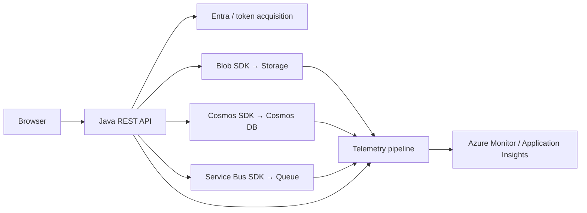
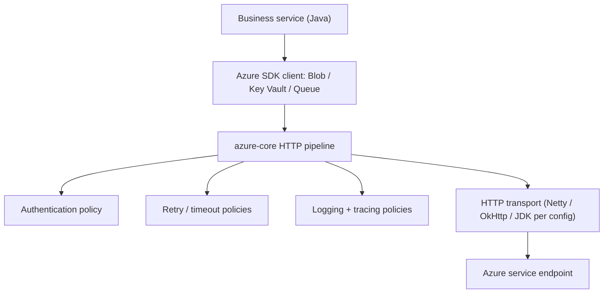
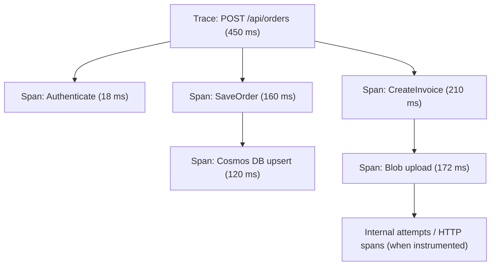
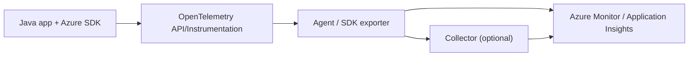
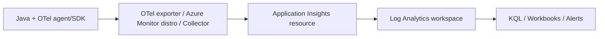
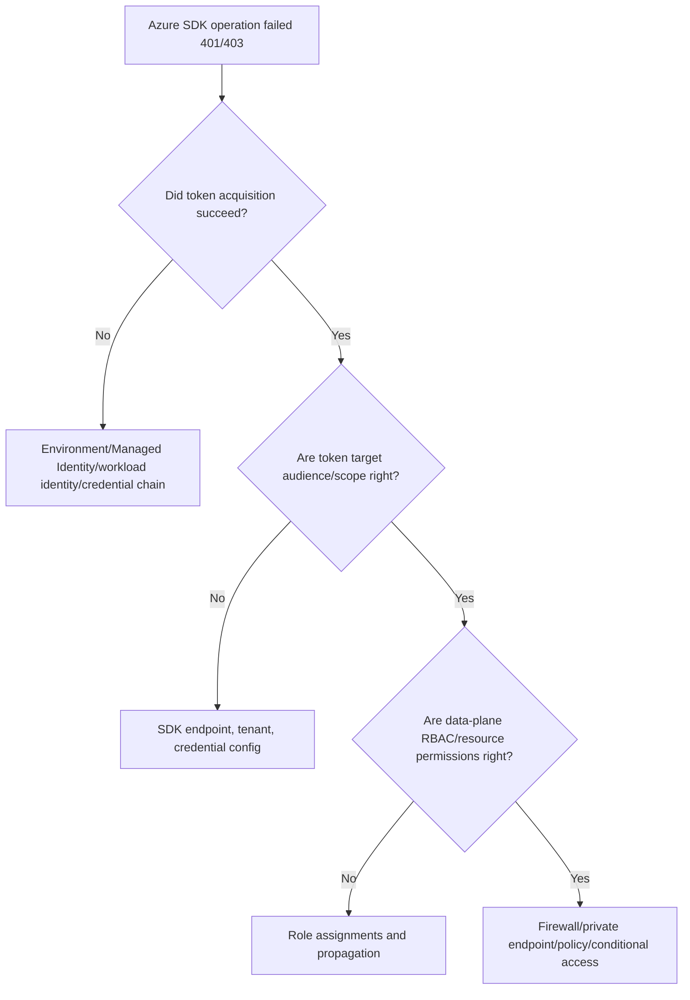
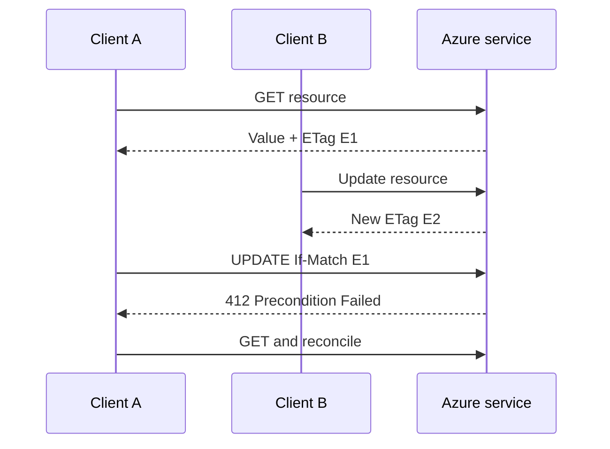
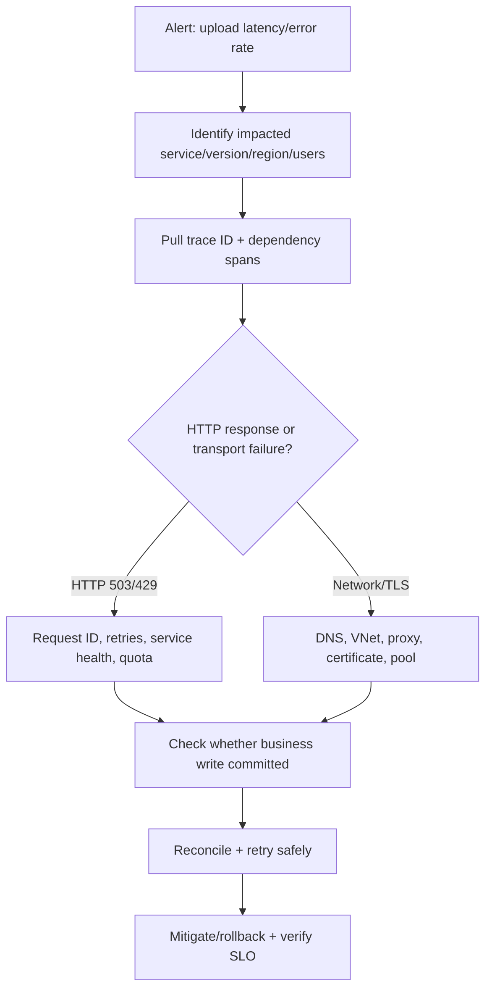
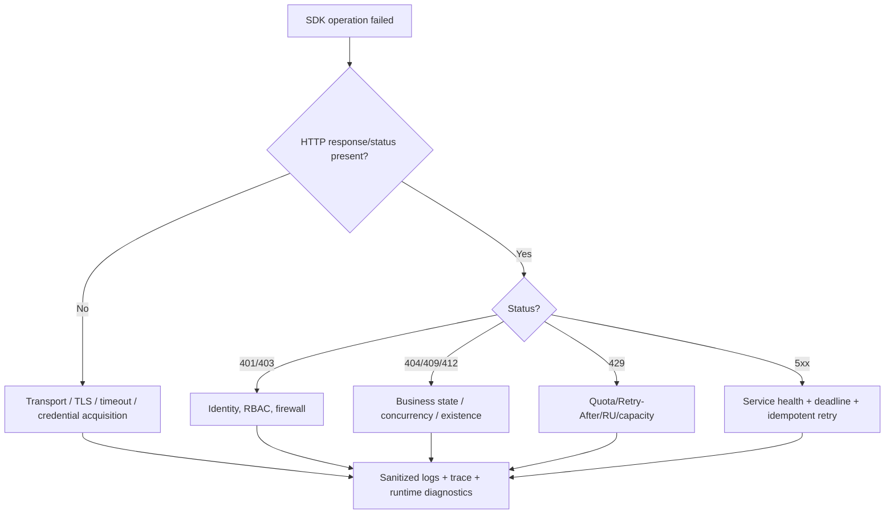
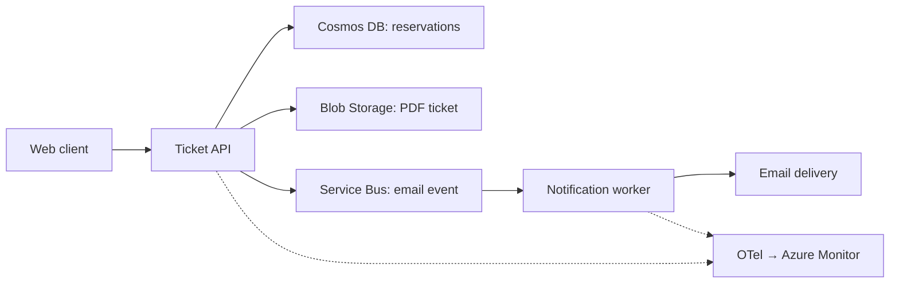

# Azure SDK Tracing, Logging, and Error Handling

A Java application running on Azure App Service receives an order request, writes an invoice to Azure Blob Storage, reads config from Key Vault, and updates Azure Cosmos DB. At 09:15, a customer reports **"Order created, but no invoice found."** Application Insights shows several HTTP `503`s, occasional `429`s, and a few `403`s, yet the log lines fail to show **which request called which service, how many times the SDK retried, or which errors were retryable**. If an engineer blindly raises retry counts, the app may create duplicate invoices, overload downstream services, and drive up costs.

**Tracing, logging, and error handling** are three capabilities that must be designed together to operate the Azure SDK for Java reliably:

- **Logging:** record structured events with severity, context, and root-cause categories.
- **Distributed tracing:** follow an operation across HTTP APIs, business services, Azure SDKs, Azure services, and background workers using **trace/span context**.
- **Error handling:** classify failures, decide whether to retry, enforce timeouts/deadlines, protect idempotency, and return safe responses to users.

This lesson belongs to the **Azure SDK for Java** chapter of the `CLOUD_PROVIDERS_AZURE` module. Along the path covering subscriptions, resource groups, Microsoft Entra ID, networking, compute, storage, and data on Azure, this lesson focuses on **observability and resilience for Java applications using the Azure SDK**. Monitoring backends may include **Azure Monitor, Application Insights, Log Analytics, and OpenTelemetry**, yet Java code must proactively design logs, errors, and business semantics.

> **Version Scope:** The Azure SDK for Java spans many libraries—`azure-core`, `azure-identity`, Storage, Cosmos DB, Key Vault, Service Bus, etc.—each with different tracing, retry, and diagnostic configurations. Examples illustrate common Java APIs; always pin your BOM/dependencies and verify actual Java/SDK/agent versions before production. Never assume identical constructors, exception hierarchies, or auto-instrumentation levels across all services. Never enable HTTP body/secret logging in production "for quick debugging."

## Learning Objectives

After this lesson, you will be able to:

1. Distinguish **logs, metrics, and distributed traces** and their roles in observability.
2. Understand the `azure-core` HTTP pipeline, `ClientLogger`, `HttpLogOptions`, `HttpLogDetailLevel`, and the **SLF4J** logging facade.
3. Design **structured logging** with operation IDs, trace IDs, span IDs, service/resource aliases, and error categories without leaking sensitive data.
4. Enable appropriate HTTP logging levels, understand **allowlists/redaction**, and explain why `BODY_AND_HEADERS` is never a production default.
5. Correlate requests using **W3C Trace Context**, OpenTelemetry spans, correlation identifiers, and server request IDs exposed by Azure services.
6. Distinguish **HTTP SDK diagnostics**, OpenTelemetry instrumentation, and custom **business spans**.
7. Classify common errors: `401`, `403`, `404`, `409`, `412`, `408`, `429`, `5xx`, network, TLS, timeouts, and authentication failures.
8. Build **bounded retry policies** with exponential backoff + jitter, honoring `Retry-After` and avoiding retries on non-idempotent actions.
9. Use **sync and async** Azure SDKs properly, avoiding blocking Reactor event loops or losing trace context.
10. Write a sample Java app using `DefaultAzureCredential` and Azure Blob Storage with categorized exception handling, safe logging, and error span marking.
11. Connect telemetry to Application Insights/Azure Monitor with proper configuration and authorization.
12. Build diagnostic runbooks and pre-production checklists for Java apps with multiple Azure dependencies.

## 1. A Cloud Request Crosses Multiple Layers

Diagram of a business call:



If a user receives HTTP `500`, you must be able to answer:

- Which API route received the request, when, and with what **correlation ID**?
- Did the SDK reach the Storage endpoint, or fail earlier acquiring a token?
- Did Storage return `403`, `429`, or did Java fail TLS setup?
- Is there an `x-ms-request-id` / `activityId` to look up Azure service logs?
- How many times did the SDK **automatically retry**, and what was total elapsed time?
- Did the backend commit to the database before timing out?
- Could client or worker retries cause duplicate business effects?
- Does the error affect one device/user/tenant or an entire region?

Knowing only "`BlobStorageException: failed`" is not enough; you need observability across app and services.

## 2. Three Pillars of Observability: Logs, Metrics, and Traces

| Data Type | Primary Question | Example |
|---|---|---|
| **Log** | What happened, with what context? | `invoice.upload_failed, status=503` |
| **Metric** | How often, how large, or how slow? | `azure_sdk_requests_total{service=blob,status=503}` |
| **Trace** | Which steps did one request traverse? | `POST /orders → CreateInvoice → Blob PUT` |

**Logs** aid deep debugging, **metrics** power dashboards/alerts/SLIs, and **traces** reveal time spent across hops. They complement each other: traces link to logs via `traceId`, and metric spikes guide engineers to failing traces.

### Additional Distinctions: Events and Audits

- **Business event:** `OrderPlaced` or `InvoiceUploaded` is a domain event that may require durable persistence.
- **Operational log:** `blob.upload.retryable_failure` supports debugging.
- **Security audit:** who changed a Key Vault role or Storage firewall, when, and under what authority.

Never replace business events with stdout logs. Logs can be sampled, have short retention, lack exactly-once delivery guarantees, and are unsuitable as transaction ledgers.

### A Minimal Telemetry Baseline

```text
HTTP request:
  route, method, status, duration, traceId
Azure dependency:
  service name, operation, status/errorCode, duration, retryCount
Identity:
  credential type (never log tokens), token acquisition result
Business:
  sanitized order identifier, outcome, idempotency key reference
System:
  JVM memory, thread/connection pools, event-loop lag
```

Do not collect "everything": telemetry costs money, can carry sensitive data, and hurts performance when overly verbose.

## 3. SDK Layer: Client, azure-core, and the HTTP Pipeline

Azure SDK for Java clients are built via **builders** backed by `azure-core`, which defines policies, HTTP transports, logging/tracing hooks, and common exceptions.



This is a conceptual model, **not the exact policy order for every SDK**. Individual libraries configure pipelines, transports, retries, and diagnostics differently.

### Common Components

| Component | Role |
|---|---|
| `azure-core` | Abstractions, HTTP pipeline, core exceptions, `ClientLogger` |
| `azure-identity` | `TokenCredential` and credentials for Microsoft Entra ID |
| Service SDK | `BlobServiceClient`, `SecretClient`, `ServiceBusClientBuilder`, etc. |
| `HttpLogOptions` | HTTP logging detail configuration on supporting builders |
| SLF4J + provider | Routes SDK/app logs to Logback or another logging backend |
| OpenTelemetry API/SDK/agent | Tracers, spans, context propagation, and exporters |
| Application Insights / Azure Monitor | Collects, stores, and queries telemetry when integrated |

### Service SDKs May Have Distinct Retries

The Azure Blob Storage SDK, Cosmos DB SDK, and Service Bus SDK **do not necessarily share the same retry options or exception hierarchies**. For instance, Cosmos DB uses custom request diagnostics and `CosmosException`, while Service Bus uses `ServiceBusException` with message-oriented failure reasons; check the contract of each SDK.

Therefore, **never write a single blanket wrapper retrying every `RuntimeException` across all Azure clients**.

## 4. Standard Java Logging: SLF4J, Logback, and ClientLogger

In Java apps, logging typically has three layers:

1. Application code calls the **SLF4J API** (`LoggerFactory`, `Logger`) to emit events.
2. A **provider/backend** like Logback governs formatting, levels, and destinations.
3. The Azure SDK emits logs through each library's logging mechanism, typically `ClientLogger`/SLF4J or version-specific integrations.

### Common Log Levels

| Level | Use For | Example |
|---|---|---|
| **ERROR** | Operation genuinely failed and needs attention | Invoice could not be saved after retry policy |
| **WARN** | Abnormal yet recoverable condition | Retryable `429`; config nearing expiration |
| **INFO** | Operationally meaningful state transitions | Worker started, batch completed, deployment config |
| **DEBUG** | Detailed troubleshooting, usually short-lived | Client selection, branch taken, sanitized resource |
| **TRACE** | Very fine-grained internal steps; use with extreme care | Internal transitions during controlled investigation |

**Do not log ERROR on every intermediate retry attempt when the SDK retries automatically and ultimately succeeds**; that triggers false alarms. Typically log a `WARN` summary on notable retries and an `ERROR` only when the final outcome fails.

### Parameterized Java Logging

```java
import org.slf4j.Logger;
import org.slf4j.LoggerFactory;

public final class InvoiceService {
    private static final Logger LOG =
        LoggerFactory.getLogger(InvoiceService.class);

    public void recordSuccess(String invoiceId, long elapsedMs) {
        // invoiceId here is assumed to be classified as non-sensitive.
        LOG.info("invoice.upload_succeeded invoiceId={} latencyMs={}",
            invoiceId, elapsedMs);
    }
}
```

Passing arguments via `{}` instead of string concatenation avoids formatting overhead when the level is disabled and preserves clean structure. **Never log raw `Exception.toString()` when messages or URIs might contain SAS query parameters**; review library redaction settings carefully.

## 5. Structured Logs: Which Fields Should an Event Include?

In production, logs should follow a consistent schema rather than ad-hoc prose.

Example **application-defined JSON log**:

```json
{
  "timestamp": "2026-11-20T09:15:07Z",
  "level": "ERROR",
  "service": "orders-api",
  "environment": "production",
  "operation": "UploadInvoice",
  "dependency": "azure-blob",
  "traceId": "4bf92f3577b34da6a3ce929d0e0e4736",
  "spanId": "00f067aa0ba902b7",
  "correlationId": "req-8f21a4",
  "resourceAlias": "invoices-container",
  "outcome": "failed",
  "httpStatus": 503,
  "errorCategory": "transient_server",
  "retryable": true,
  "elapsedMs": 4291,
  "attemptsObserved": 3
}
```

This log shows an **application-defined schema**, not default JSON emitted by the Azure SDK. Record `attemptsObserved` only if your code or SDK actually captures attempt counts; **never guess this number from a final exception**.

### Fields to Consider

- UTC timestamp and clock/timezone policy.
- Service, build, environment, and region.
- Business operation name and dependency type.
- Trace ID, span ID, and correlation ID when context is valid.
- HTTP status or service error code (when available).
- Resource **alias** rather than a full URL with tokens.
- Elapsed duration, retryability, and final outcome.
- Sanitized business ID or permitted internal reference.
- Runbook or incident ID where applicable.

### Fields to Never Log

- `Authorization` headers and bearer access tokens.
- SAS tokens (`sig` in URLs), account keys, and client secrets.
- Connection strings for Storage, Service Bus, or IoT Hub.
- Passwords, X.509 private keys, and Key Vault secret values.
- Raw bodies containing PII, payment cards, or medical data.
- Full URL queries containing tokens, callback codes, or signed download URLs.
- Exception details that could accidentally echo credentials passed by the app.

## 6. Log Correlation: Request IDs, Trace IDs, and Operation IDs

A system can involve several distinct identifiers:

| Identifier | Created By | Purpose |
|---|---|---|
| **Trace ID** | OpenTelemetry / W3C Trace Context in request flow | Links spans belonging to one distributed trace |
| **Span ID** | Each individual span | Identifies one step inside a trace |
| **Application correlation ID** | API gateway / app / worker | Business investigation; may match trace or stay separate |
| **Azure service request ID** | Azure Storage / Key Vault / other services in response | Looks up service-side failure logs for one request |
| **Client request ID** | Azure SDK / client where supported | Correlates outbound requests from the app side |
| **Cosmos activity ID** | Cosmos DB service / SDK | Investigates Cosmos DB operations |
| **Business event ID** | Application / outbox | Deduplicates and audits business events |

**Never use a Storage request ID as a W3C trace ID.** They have different lifecycles and formats. One end-to-end trace can encompass multiple Azure service request IDs due to SDK retries or multiple dependencies.

### W3C Trace Context

HTTP distributed tracing typically propagates:

```text
traceparent: 00-4bf92f3577b34da6a3ce929d0e0e4736-00f067aa0ba902b7-01
tracestate: <vendor-defined values when present>
```

This is a **format example**, not an auth token. `traceparent` carries trace ID, parent span ID, and trace flags; use proper instrumentation to propagate it rather than fabricating identical span IDs across requests.

### Azure Service Headers

With Storage, responses may carry `x-ms-request-id`; some SDKs/services support `x-ms-client-request-id`. Available headers **vary by service and request**. Never dump all headers just to capture a request ID; extract only approved, required headers.

## 7. MDC in SLF4J: Attaching Context to Logs

**Mapped Diagnostic Context (MDC)** attaches fields like `correlationId` inside thread-local logging context for supporting backends.

```java
import org.slf4j.MDC;
import org.slf4j.Logger;
import org.slf4j.LoggerFactory;

public final class RequestLoggingExample {
    private static final Logger LOG =
        LoggerFactory.getLogger(RequestLoggingExample.class);

    public static void handle(String correlationId) {
        String oldId = MDC.get("correlationId");
        try {
            MDC.put("correlationId", correlationId);
            LOG.info("orders.request_started");
            // Business operations...
            LOG.info("orders.request_finished");
        } finally {
            if (oldId == null) {
                MDC.remove("correlationId");
            } else {
                MDC.put("correlationId", oldId);
            }
        }
    }
}
```

### Why Is `finally` Essential?

Web servers reuse thread pools. Without clearing or restoring MDC, subsequent requests can inherit the previous customer's `correlationId`. **Never place user emails, access tokens, or private tenant data into MDC** just for log convenience.

### MDC with Async / Reactor

MDC is normally backed by **`ThreadLocal`**. In Reactor/async flows, execution hops across threads, so:

- MDC does not automatically follow `Mono`/`Flux` across all configurations.
- `contextWrite(...)` uses Reactor Context for subscription-scoped data.
- OpenTelemetry Context uses its own propagation mechanisms.
- Loggers need bridge/instrumentation support to capture trace context reliably.
- Never assume `MDC.get("traceId") == null` proves tracing is broken.

**We will examine context loss with `subscribe()`, `block()`, and thread pools in depth in the async section.**

## 8. Configuring Logback: Appropriate Log Levels

A Spring Boot/Java app can configure `logback-spring.xml` (when Logback is the provider). Condensed example:

```xml
<configuration>
    <appender name="CONSOLE" class="ch.qos.logback.core.ConsoleAppender">
        <encoder>
            <pattern>%d{yyyy-MM-dd'T'HH:mm:ss.SSSX} %-5level [%thread] trace=%X{traceId} corr=%X{correlationId} %logger{36} - %msg%n</pattern>
        </encoder>
    </appender>

    <logger name="com.azure" level="WARN"/>
    <logger name="com.example.orders" level="INFO"/>

    <root level="INFO">
        <appender-ref ref="CONSOLE"/>
    </root>
</configuration>
```

**This pattern** is not full JSON structured logging; use an approved JSON encoder/provider for JSON logs. The `traceId` field appears only if middleware/instrumentation populates it in MDC. Never leave `com.azure=TRACE` enabled long-term in production.

### Goals When Choosing Levels

- Log enough detail for business operations, final failures, and latency.
- Keep dependency loggers at `WARN`/`INFO` per environment; raise to `DEBUG` only temporarily during investigations.
- Keep raw HTTP request/response bodies out of default console output.
- Apply sampling and retention policies so log ingestion bills do not grow unchecked.

## 9. HttpLogOptions and HttpLogDetailLevel

Many Azure SDK HTTP clients for Java support `HttpLogOptions` from `azure-core`.

Azure Blob Storage example:

```java
import com.azure.core.http.policy.HttpLogDetailLevel;
import com.azure.core.http.policy.HttpLogOptions;
import com.azure.identity.DefaultAzureCredentialBuilder;
import com.azure.storage.blob.BlobServiceClient;
import com.azure.storage.blob.BlobServiceClientBuilder;

public final class BlobClientConfiguration {
    public static BlobServiceClient create(String endpoint) {
        HttpLogOptions logOptions = new HttpLogOptions()
            .setLogLevel(HttpLogDetailLevel.BASIC);

        return new BlobServiceClientBuilder()
            .endpoint(endpoint)
            .credential(new DefaultAzureCredentialBuilder().build())
            .httpLogOptions(logOptions)
            .buildClient();
    }
}
```

The sample endpoint is `https://<storage-account>.blob.core.windows.net`. In production, load endpoints from externalized config and use managed identities or controlled credential chains. **Never embed account keys or SAS tokens in Java classes**.

### HTTP Logging Levels

| Level | General Information Logged | Risk |
|---|---|---|
| `NONE` | No HTTP request/response logs from this policy | Harder protocol debugging if traces are absent |
| `BASIC` | Basic request/response/status metadata per SDK policy | Still avoid URLs/queries with secrets in custom logs |
| `HEADERS` | Includes allowlisted headers | Sensitive headers leak if allowlist is misconfigured |
| `BODY` | May log bodies per policy | PII, secrets, business payloads |
| `BODY_AND_HEADERS` | Both headers and bodies | High data-leakage risk and high log costs |

Not every SDK or version behaves identically across levels. **In production, `BASIC` or controlled metadata logging is a much safer starting point than body logging**; raise verbosity only in sandboxes with dummy data and strict time limits.

### Enabling `BODY_AND_HEADERS` Does Not Solve Every Error

On a TLS handshake failure or DNS timeout, **there is no HTTP response body** to log. On a quota-driven `429`, the body matters far less than `status`, `Retry-After`, request duration, and SDK retry diagnostics. Enabling body logging on every request to debug is both dangerous and expensive.

## 10. Redaction and Allowlists: Protecting HTTP Headers and Queries

On supporting `azure-core` versions, `HttpLogOptions` lets you configure **allowed HTTP header and query parameter names**, rather than printing everything. However, **default redaction lists vary by SDK and version**; never assume every custom sensitive header is masked automatically.

### Illustrative Configuration

```java
import com.azure.core.http.policy.HttpLogDetailLevel;
import com.azure.core.http.policy.HttpLogOptions;

HttpLogOptions options = new HttpLogOptions()
    .setLogLevel(HttpLogDetailLevel.HEADERS);

// Only consider enabling the exact header list needed for sandboxes.
// For production, check allowedHeaderNames/allowedQueryParamNames APIs
// on your pinned azure-core version and permit only safe metadata.
```

Because allowlist APIs can evolve across releases, this snippet **avoids expanding default header lists**. If you need to log `x-ms-request-id`, `content-type`, or `retry-after`, check the policy and add only exact safe names—never allowlist `Authorization` or arbitrary query parameters.

### Often-Overlooked Secret Leakage Paths

| Location | Example | Protection |
|---|---|---|
| URL query | `?sv=...&sig=...` in a SAS URL | Redact `sig` or the entire signed query |
| HTTP `Authorization` | `Bearer eyJ...` | Never log headers or tokens |
| Storage connection string | `AccountKey=...` | Never log raw config |
| Copy source header | URL with SAS to source Blob | Mask signed URLs; never print raw headers |
| Exception messages | URI/token echoed in wrapper exceptions | Sanitize business logging |
| Body | JSON with PII, payment data, or Key Vault secrets | Never enable body logging in prod |
| Debug dumps | `clientBuilder.toString()` / config objects | Audit before printing; never dump blindly |

### Core Lesson

**Tracing catches latency and errors without logging customer payloads.** Most SDK incidents are diagnosed from endpoint aliases, status codes, error codes, request IDs, durations, retry counts, and network/identity diagnostics.

## 11. Distributed Tracing: Traces, Spans, and Propagation

A **trace** represents the logical path of a request across components. Each **span** records a step's start/end timestamps, attributes, status, and events.



### What a Span Can Contain

```text
traceId: 4bf92f3577b34da6a3ce929d0e0e4736
spanId: 00f067aa0ba902b7
parentSpanId: <parent when present>
name: InvoiceService.upload
start/end: <timestamps>
duration: 210 ms
attributes:
  business.operation: UploadInvoice
  dependency.name: azure-blob
status: ERROR
events:
  exception (sanitized)
```

**Calling `tracer.spanBuilder(...)` does not automatically instrument every step underneath.** You need Azure SDK/HTTP client instrumentation or explicit child spans. With only a manual span around business code, you see "Blob upload took 172 ms" without seeing DNS, TLS, token acquisition, or internal retries.

### Parent-Child Spans

When the HTTP request span is parent and the Blob dependency span is child, they share a trace ID, have distinct span IDs, and record a clear parent link. In async code, context must propagate explicitly; losing context turns dependency spans into **orphaned root traces**.

### Trace Sampling

Not every trace is stored. Head/tail sampling and collector policies drop traces to control costs. If `traceId` appears in logs yet is missing from Application Insights, check sampling, exporter config, or ingestion lag before assuming span IDs were miscomputed.

## 12. OpenTelemetry in Java: A Common Language for Traces

**OpenTelemetry (OTel)** defines standard APIs, SDKs, semantic conventions, and exporters for application telemetry. In Java:

- **OpenTelemetry API:** `Tracer`, `Span`, `Context`, `Scope`.
- **OpenTelemetry SDK:** sampling, processors, exporter configuration.
- **OpenTelemetry Java agent:** auto-instruments supported frameworks and libraries.
- **Instrumentation libraries:** deeper hooks for HTTP, JDBC, Reactor, and compatible SDKs.
- **Collector:** receives, processes, and forwards telemetry to backends.

### OTel vs. Azure Monitor

OTel **generates and transports** telemetry using open standards; Azure Monitor/Application Insights **ingests, stores, queries, and visualizes** telemetry via supported ingestion paths. They work together:



**Do not confuse an OpenTelemetry span exporter with Azure SDK HTTP logging.** Logs, metrics, and traces follow distinct pipelines, retention rules, and sampling policies even when all land in Azure Monitor.

### Three Common Ways to Instrument Java

| Approach | Strength | Watch Out For |
|---|---|---|
| **Java agent** | Captures inbound/outbound HTTP, JDBC/frameworks with minimal code edits | Pin versions and check SDK instrumentation / duplicate spans |
| **Manual OTel API spans** | Marks key business boundaries and domain context | Does not automatically emit child spans for SDK calls |
| **Azure SDK tracing integration** | Emits SDK-supported spans and diagnostics attributes | Check `azure-core`/tracing modules, builders, and agent compatibility |

For Spring Boot apps already running the OTel agent, **inspect what spans are emitted out of the box first** before layering extra SDK tracing options. Enabling overlapping instrumentation pipelines can produce duplicate spans or inconsistent attributes.

## 13. Creating Manual Business Spans with the OpenTelemetry API

In a Java module configured with the OTel API/SDK or agent, wrap business actions in spans:

```java
import io.opentelemetry.api.GlobalOpenTelemetry;
import io.opentelemetry.api.trace.Span;
import io.opentelemetry.api.trace.StatusCode;
import io.opentelemetry.api.trace.Tracer;
import io.opentelemetry.context.Scope;

public final class InvoiceTracing {
    private static final Tracer TRACER =
        GlobalOpenTelemetry.getTracer("com.example.orders");

    public void uploadInvoice(Runnable uploadAction) {
        Span span = TRACER.spanBuilder("InvoiceService.upload")
            .setAttribute("app.operation", "UploadInvoice")
            .setAttribute("app.dependency", "azure-blob")
            .startSpan();

        try (Scope ignored = span.makeCurrent()) {
            uploadAction.run();
            span.setAttribute("app.outcome", "success");
        } catch (RuntimeException error) {
            span.recordException(error);
            span.setStatus(StatusCode.ERROR, "Invoice upload failed");
            span.setAttribute("app.outcome", "failed");
            throw error; // Do not swallow business errors.
        } finally {
            span.end();
        }
    }
}
```

### Why `finally span.end()`?

Failing to end a span corrupts durations or prevents processors from exporting it. Always close `Scope` even when the SDK throws an exception.

### Do Not Start a New Root Trace in Every Helper

`span.makeCurrent()` activates context on the current thread; when a parent span is already active, the new span links to it automatically per OTel defaults. **If an async callback later runs on another thread after `Scope` closes, context must be propagated explicitly**.

### Is Recording Exceptions Always Safe?

No. `span.recordException(error)` captures the exception type, message, and stack trace, which may include URIs or queries containing tokens. Audit telemetry processors, attribute filters, and exception construction. For highly sensitive flows, record only **sanitized error categories/codes** rather than raw exception details.

### What If No OTel SDK Is Configured?

`GlobalOpenTelemetry.getTracer(...)` still returns a no-op API tracer, emitting zero telemetry if the SDK or agent is missing. **Compiling and running is not proof traces are exported**; always verify exporters, resource attributes, sampling, and backend ingestion.

## 14. Using Trace IDs in Logs Without Leaking Secrets

With a valid OTel context active:

```java
import io.opentelemetry.api.trace.Span;
import io.opentelemetry.api.trace.SpanContext;
import org.slf4j.Logger;
import org.slf4j.LoggerFactory;

public final class TraceAwareLogging {
    private static final Logger LOG =
        LoggerFactory.getLogger(TraceAwareLogging.class);

    public static void logDependencyResult(String outcome, long millis) {
        SpanContext context = Span.current().getSpanContext();
        String traceId = context.isValid()
            ? context.getTraceId()
            : "unavailable";

        LOG.info(
            "azure.dependency_completed traceId={} outcome={} elapsedMs={}",
            traceId, outcome, millis
        );
    }
}
```

A trace ID should contain no personal data, yet **it can still link multiple operations belonging to one user**. Apply appropriate retention and telemetry access controls.

### Trace IDs and MDC

Use OpenTelemetry log-context integration to inject trace/span IDs into structured logs per your framework. Avoid calling `MDC.put(...)` across every helper—especially with Reactor async—as it causes stale state. Whenever manual MDC is unavoidable, restore prior state in `finally` to prevent leaks across requests.

## 15. Azure SDK Native Tracing and HTTP Tracing

Some Azure SDK for Java libraries use **core tracing abstractions** and integrate with OpenTelemetry/tracing modules or Java agents to emit spans for Azure dependency calls. Exact capabilities depend on:

- `azure-core` and service SDK versions;
- compatibility of tracing adapters or agents;
- how the HTTP transport (Netty/OkHttp/JDK) is instrumented;
- whether the service SDK emits spans/attributes for that operation;
- whether the OpenTelemetry SDK/exporter is initialized;
- sampling, suppression, and context propagation.

**Do not assume every HTTP retry creates a separate child span.** Some SDKs emit one span per logical operation while logging retry attempts in diagnostics; other HTTP instrumentations emit per-request spans.

### How to Name Spans

Prefer **low-cardinality names**:

```text
Good:
  InvoiceService.upload
  BlobClient.upload
  CosmosContainer.upsertItem

Bad:
  UploadInvoiceForCustomer_email_user@example.test
  BlobClient.upload/very-long-sensitive-sas-url
```

`span.name` and metric labels are indexed and queried in telemetry backends. Never embed account keys, SAS URLs, customer emails, or raw payloads in span names or attributes.

### Seeing Only HTTP Spans Without Business Spans

A Java agent captures outbound HTTP calls without knowing a Blob PUT represents `"UploadInvoice"`. Adding manual spans at business boundaries clarifies the picture:

```text
POST /orders
  -> ValidateOrder
  -> CreateOrder
  -> InvoiceService.upload
       -> HTTP PUT storage endpoint
  -> SendConfirmation
```

Avoid creating a span for every line of Java code; keep span counts meaningful for performance and troubleshooting.

## 16. Integrating Azure Monitor / Application Insights

A common pipeline:



### Two Configuration Concepts Often Confused

- **Application Insights connection string:** tells the telemetry exporter which target resource receives telemetry; it is not an Azure Storage account connection string.
- **Azure authentication for SDK calls:** `DefaultAzureCredential`/Managed Identity and RBAC used when calling Storage, Cosmos DB, Key Vault, etc.

**Telemetry connection strings and SDK service credentials serve completely different purposes.** Never substitute one for the other.

### Per-Environment Configuration Checklist

Applications should verify:

1. Organization-approved tracing/logging SDK and agent versions.
2. Service name, environment, and version (`service.name`, `deployment.environment`, or matching resource attributes).
3. Exporter, endpoint, and ingestion credentials per Azure Monitor version.
4. Sampling policies retain critical error traces.
5. Resource region and retention align with privacy policies.
6. Java runtime/network can reach the telemetry ingestion endpoint.
7. RBAC restricts who can query logs and traces.
8. SDK dependency spans show accurate target names and services.

### Never Use Application Insights to Store Customer Payloads

Application Insights is built for operational observability, not as a data lake for secrets, invoice PDFs, PII, or business ledgers. **Sampling and retention make telemetry incomplete**, and ingesting large payloads is expensive.

## 17. Observing Dependency Latency Across Layers

Suppose an API call takes 2.4 seconds:

```text
Total request duration:          2400 ms
  Authentication/token lookup:    100 ms
  Cosmos DB operation:            200 ms
  Blob upload operation:         1750 ms
  Application post-processing:    150 ms
  Other/unattributed:             200 ms
```

A **1,750 ms** Blob upload span can include:

- request construction and payload serialization;
- TLS and connection-pool wait time;
- network transfer;
- service-side processing;
- response handling;
- **SDK automatic retries and backoff**.

Never claim "the Storage service took 1,750 ms" **based solely on the total client span**. Separate client/network vs. service time using HTTP attempt metrics, server-side request metrics, and network diagnostics.

### Recommended SLIs

| SLI | Meaning |
|---|---|
| `api_request_duration_p95` | User-perceived API latency |
| `azure_dependency_duration_p95` | Latency by Azure service/operation |
| `dependency_failure_rate` | Final operation failure rate |
| `retry_attempts_per_operation` | SDK/app retry pressure where available |
| `429_rate` | Throttling, quotas, or contention |
| `identity_auth_failure_rate` | Token, RBAC, or credential errors |
| `timeout_rate` | Deadline, network, or downstream latency failures |
| `telemetry_export_failure_rate` | Health of the observability pipeline itself |

Never put per-record `orderId` or `userId` into metric labels: high cardinality inflates costs and management overhead. Use controlled logs and traces to look up individual IDs when needed.

## 18. OpenTelemetry with Spring Boot and Servlet Filters

A Spring Boot app can rely on the Java agent for inbound HTTP and outbound dependencies while adding manual business spans in services.

### Model

```text
Incoming HTTP request span
  → Spring controller
      → OrderService.create
          → Cosmos SDK operation
          → InvoiceService.upload (manual business span)
              → Blob HTTP request (when instrumented)
```

### What to Avoid

- Creating a new root span in every controller when the Java agent already instruments inbound HTTP, causing duplicate roots.
- Inventing custom `traceId` headers outside W3C Trace Context and breaking propagation.
- Attaching access tokens or sensitive payloads/headers as span attributes.
- Logging exceptions at every single layer and rethrowing, turning one error into dozens of stack traces.
- Relying on `log.level=TRACE` as the sole way to trace cross-service flows.

### Use Stable API Error Responses

REST APIs can return:

```json
{
  "error": {
    "code": "DEPENDENCY_UNAVAILABLE",
    "message": "Service is temporarily unavailable.",
    "correlationId": "req-8f21a4"
  }
}
```

Never return raw SDK stack traces, connection strings, or `x-ms-request-id` alongside internal metadata to public clients. Expose a safe correlation ID for support tickets while keeping trace/request-ID links internal with proper retention.

## 19. Logging in Async / Reactive Java

Azure SDKs provide **sync** and **async** clients depending on the service. Async SDKs typically return Reactor `Mono`/`Flux`, not Java `CompletableFuture` across every SDK.

### A Well-Structured Async Operation

```java
// Illustrative Reactor pipeline; publisher must be a Mono from an async SDK
// or provided by business code. Do not assume every API returns a Mono.
Mono<String> result = fetchInvoiceFromAzure()
    .doOnSubscribe(subscription ->
        logger.debug("invoice.fetch_started"))
    .doOnSuccess(value ->
        logger.info("invoice.fetch_succeeded"))
    .doOnError(error ->
        logger.warn("invoice.fetch_failed category={}",
            classify(error)))
    .onErrorMap(error ->
        new InvoiceUnavailableException("Invoice dependency failed", error));
```

Here `fetchInvoiceFromAzure()`, `classify(...)`, and `InvoiceUnavailableException` are **project-defined business helpers/types**, not SDK classes. This shows where to place `doOnError` and `onErrorMap` without **swallowing errors**.

### Avoid Calling `subscribe()` in Services and Returning Early

```java
// Anti-pattern:
asyncUpload().subscribe();
return "Upload complete"; // The operation may not have finished yet!
```

When a REST endpoint depends on the result, compose the publisher into the framework-managed reactive chain. For intentional **fire-and-forget**, use durable outboxes or queues with failure tracking rather than calling `subscribe()` with no error handler.

### Avoid `block()` on the Event Loop

`mono.block()` blocks the calling thread. On a WebFlux/Reactor event loop, blocking collapses throughput or causes deadlocks and starvation. Choose:

- **Sync stack** with blocking clients and an appropriately sized thread pool.
- **Reactive stack** composing `flatMap`/`zip` and propagating context.
- Bridging onto a bounded scheduler when calling blocking APIs inside reactive apps.

### Trace Context Across Async Boundaries

`Span.current()` relies on active thread context. When callbacks execute on another thread without context propagation bridges, the active span becomes **invalid**. With Reactor, use version-compatible OTel instrumentation / Reactor context integration—never copy `ThreadLocal`/MDC manually across callbacks as a global workaround.

## 20. One Error Can Generate Many Log Entries

When an SDK call fails, telemetry may fire in:

1. Azure SDK HTTP policy logger (status/error).
2. Azure SDK exception/warning.
3. Application service `catch` block.
4. Controller exception handler.
5. Gateway/API request logs.
6. OTel span exception event.

If every layer logs `ERROR + stacktrace`, a single fault produces six stack traces, inflating costs and noise.

### Recommended Convention

- **Boundary layer:** log one final error carrying business context and correlation ID.
- **Lower layers:** log extra context only when genuinely useful; generally rethrow typed exceptions.
- **Tracing:** record span status and sanitized exception attributes per privacy rules.
- **Retry middleware:** emit a summary event rather than logging every attempt at `ERROR`.
- **API:** return a stable error code exposing zero internal details.

Two clean log lines are often enough:

```text
WARN  azure.blob.retry_summary operation=UploadInvoice attempts=3 finalStatus=503
ERROR invoice.upload_failed traceId=... errorCategory=transient_server latencyMs=4291
```

Never log `attempts=3` unless the SDK or app actually captured that exact count.

## 21. Exception Taxonomy in the Azure SDK for Java

**The Azure SDK does not throw a single exception class for every error.** Distinguish at least four categories:

| Failure Category | Examples | Response Strategy |
|---|---|---|
| **Service HTTP response** | HTTP `404`, `409`, `429`, `503` | Inspect status, error code, retry hints, and business semantics |
| **Authentication / authorization** | Entra credential unavailable, token failure, HTTP `401/403` | Check identity, scope, RBAC, firewall; never retry blindly |
| **Transport / network** | DNS lookup, TLS handshake, proxy, socket timeout | Inspect routing, certificates, connection pools, deadlines |
| **Client / configuration** | Invalid endpoint, missing env var, serialization bug | Fix config/schema/code; usually non-transient |

### Common Exception Classes

- `com.azure.core.exception.HttpResponseException`: service response carrying status, headers, and error details per API.
- `com.azure.storage.blob.models.BlobStorageException`: Blob Storage-specific exception carrying **storage error codes**.
- `com.azure.cosmos.CosmosException`: Cosmos SDK exception carrying status, substatus, activity ID, and diagnostics per version.
- `com.azure.messaging.servicebus.ServiceBusException`: Service Bus exception with failure reason and messaging semantics.
- `com.azure.core.exception.ClientAuthenticationException` and `com.azure.identity.CredentialUnavailableException`: credential discovery and token acquisition errors in the credential chain.
- Transport/SDK exceptions: `IOException`, timeouts, TLS errors, invalid configs—not every failure carries an HTTP response.

**Never treat an arbitrary `RuntimeException` as an Azure service failure.** Retrying HTTP 10 times will never fix a `NullPointerException` bug in business code.

### An HTTP Response Exception May Not Be a Network Failure

Receiving HTTP `403` proves a service or gateway responded. The cause could be RBAC, a firewall/IP rule, or a policy—not necessarily a blocked TCP port. Conversely, a **TLS handshake failure** yields no HTTP response or status code at all.

### A Service Error Code Can Matter More Than HTTP Status

In Azure Blob Storage, HTTP `404` can distinguish a missing container from a missing blob. In Cosmos DB, `429` reflects RU throughput throttling with distinct diagnostics and retry rules from Storage. Record **status + service error code/substatus** whenever available rather than inferring root cause from status code alone.

## 22. HTTP Status Table: Retry or Not?

| Status | Common Interpretation | Auto-Retry? | What to Check First |
|---|---|---|---|
| **400 Bad Request** | Invalid request syntax or parameters | Generally **no** | Fix schema, endpoint, or parameters |
| **401 Unauthorized** | Missing, invalid, or expired credential/token | Generally **do not retry blindly** | Check credential chain, tenant, token audience |
| **403 Forbidden** | Missing permissions, firewall, or access policy | Generally **no** | Check data-plane RBAC and network rules |
| **404 Not Found** | Resource/object missing or wrong scope | Per business rules | Separate expected absence from config errors |
| **408 Request Timeout** | Service or gateway timeout | Conditional | Is deadline remaining? Is request idempotent? |
| **409 Conflict** | Duplicate resource, state conflict, concurrency | Per business rules | Check idempotency / business preconditions |
| **412 Precondition Failed** | ETag / conditional write mismatch | **Never retry verbatim** | Re-read, merge/version, then decide |
| **429 Too Many Requests** | Quota/throttling, Cosmos RU pressure | Bounded | Honor retry hints, back off, reduce load/hot keys |
| **500 Internal Server Error** | Service-side fault | Conditional | Idempotency, retry budget, service health |
| **502 Bad Gateway** | Gateway/upstream failure | Conditional | Network and dependency diagnostics |
| **503 Service Unavailable** | Service temporarily unavailable | Conditional | `Retry-After`, region/capacity, deadline |
| **504 Gateway Timeout** | Timeout across gateway | Conditional | Operation outcome may be unknown |

This is **general guidance**, not a guarantee that the Azure SDK retries these exact statuses identically across all services. Each service/operation has specific rules: some SDKs retry `429` automatically, while some operations are unsafe for apps to replay blindly.

### 404 Is Not Always an Error

In an app checking for an optional Blob:

```text
GET invoice.pdf → 404
```

This may be a **normal business outcome**: the invoice hasn't been generated yet. Returning `Optional.empty()` and logging `DEBUG`/`INFO` avoids noisy `ERROR` alerts. However, if `invoice.pdf` is guaranteed to exist after a committed transaction, `404` signals workflow corruption needing investigation.

## 23. 401/403: Identity, Authentication, and Network Policies

To diagnose auth failures when using `DefaultAzureCredential`:



### Azure RBAC Control Plane Does Not Always Equal Data Plane

Suppose the runtime identity holds `Contributor` on a resource group:

- It can manage Azure resources via ARM.
- It **cannot necessarily** read Blob data; Storage requires roles like `Storage Blob Data Reader` / `Contributor` at scope.
- It cannot automatically read Cosmos DB for NoSQL items; that requires Cosmos data-plane RBAC.
- It cannot automatically read Key Vault secret values if the vault enforces separate RBAC/access policies.

**401 usually points to authentication**, while **403 usually points to authorization or policy**, yet always inspect response subcodes and environment context rather than guessing from two digits.

### Credential Chains Do Not Mean "Any Credential Will Do"

`DefaultAzureCredential` tries multiple sources—environment, workload identity, managed identity, developer tools—depending on version and runtime. Locally, Azure CLI works; on App Service/AKS, managed/workload identity runs.

If production leaves credential sources uncontrolled, you can unintentionally run under the wrong identity. Always:

1. Verify the exact identity running in production.
2. Grant least-privilege data-plane permissions.
3. Inspect redacted SDK identity diagnostics.
4. Verify tenant, audience, endpoint, and deployment environment.
5. Avoid logging tokens or sensitive credential chain details.

## 24. Separating Application Timeouts from Azure Service Failures

Time breakdown:

```text
User HTTP deadline
  ├─ Request queue time
  ├─ Credential acquisition
  ├─ DNS + TCP + TLS
  ├─ SDK HTTP send/receive
  ├─ Service processing
  ├─ SDK retry + backoff
  └─ Business serialization / response
```

When an API has a 2-second deadline while SDK default timeouts/retries exceed 2 seconds:

1. The API gateway times out and returns `504` to the client.
2. The Java worker **is still uploading** the Blob in the background.
3. The client retries the `POST`.
4. The backend either writes a duplicate or hits `409` because the first upload succeeded.

### Timeout Does Not Prove the Transaction Failed

Especially for `PUT`/`POST`, **losing a connection after sending bytes** leaves an ambiguous outcome: the service may have committed while the response dropped. Enforce **idempotency keys, conditional requests, or read-after-failure reconciliation** instead of blindly retrying non-idempotent operations.

### Layered Deadline Budgeting

An example budget:

```text
API end-to-end deadline:             5.0 s
Business validation/auth:            0.5 s
Storage upload + retry budget:       3.0 s
DB update:                           1.0 s
Reserve/serialization:               0.5 s
```

This is an **illustrative budget**, not a blanket recommendation for every region or network. For large Storage files, offload uploads to asynchronous jobs instead of holding HTTP requests open for tens of seconds.

### Cancellation Does Not Guarantee Rollback

When an async publisher is canceled or a request thread is interrupted, the network request may already have reached the service. Never promise cancellation automatically rolls back Blob uploads, Service Bus sends, or Cosmos writes. Recovery logic must inspect actual backend state.

## 25. Retries: Technical Policies Must Follow Business Semantics

A retry policy should answer:

- **Is the operation idempotent?**
- Which errors are **transient** and retryable?
- What is the total attempt count / retry budget?
- Are **`Retry-After`** / throttling hints honored?
- Is **exponential backoff + jitter** used to prevent synchronized retries?
- Does the deadline stay within user/job SLOs?
- Does the SDK already retry, creating **double retries**?
- Once the budget is exhausted, how does the app fail and recover?

### Backoff Mechanics

For retry attempt \(n\):

\[
d_n=\min(d_{\max},d_0\cdot 2^n)+J
\]

where \(d_0\) is the base delay, \(d_{\max}\) is the cap, and \(J\) is a small random jitter. Tune values around service `Retry-After` headers, quotas, and latency budgets.

### Why Jitter?

If 10,000 instances all hit `429` at 09:00 and retry exactly 1 second later, the service gets hammered by 10,000 simultaneous requests again. Jitter spreads retries out over time. **Never use jitter as an excuse for infinite retries**.

### SDK Retries vs. Application Retries

Suppose:

```text
Azure SDK max attempts: 4
App-level retry max attempts: 3
```

One business operation can generate up to \(4\times3=12\) network attempts if both layers retry independently. This illustrates layered multiplication; real totals depend on error types, cancellation/deadlines, and SDK policies.

**Prefer SDK retry policies for transient transport/service failures where supported; add application-level retries only when business semantics require them and within a shared total budget.**

## 26. Retry-After: Avoiding Service Overload

In HTTP, a service may return:

```text
HTTP/1.1 429 Too Many Requests
Retry-After: 2
```

Standard HTTP `Retry-After` carries integer seconds or an HTTP date; some Azure services emit **custom headers** in milliseconds (e.g., Cosmos DB's `retry-after-ms` depending on API). **Never parse every header as milliseconds** or reuse one parser blindly across all services.

### Why Honor Hints?

- Cuts down requests that worsen throttling.
- Gives the SDK/service room to recover.
- Reduces duplicate retries and log spam.
- Stabilizes cost and latency during traffic spikes.

If the server requests a delay longer than the remaining request deadline, **fail cleanly or defer to async processing** instead of sleeping past the SLO after the user has disconnected.

## 27. Idempotency: The Foundation of Safe Retries

**Idempotent** means executing the same valid action multiple times yields the exact same desired state without multiplying business side effects.

| Action | Safe to Retry? | Design Needed |
|---|---|---|
| **GET object** | Usually yes | Consider consistency and timeout budgets |
| **Create Blob with stable name only if absent** | Conditional | `If-None-Match` / `overwrite=false` + checksum check |
| **Overwrite Blob by ETag** | Conditional | Conditional write / version check |
| **Cosmos upsert with fixed ID** | Not sufficient alone | Can overwrite newer state; control ETag/partition key |
| **POST creating an order** | Not by default | Idempotency key + unique constraint / outbox |
| **Service Bus send event** | Can send duplicates | Stable `messageId`, duplicate detection if supported, idempotent consumer |
| **Wallet credit / debit** | Very dangerous on blind retries | Ledger transactions + unique business operation IDs |

### Invoice Upload Example

Never generate a fresh `UUID.randomUUID()` blob name on every retry:

```text
Attempt 1: invoice-abc-UUID1.pdf → response lost, Blob created
Attempt 2: invoice-abc-UUID2.pdf → second Blob created
```

Use a deterministic name:

```text
invoices/order-501/invoice-v1.pdf
```

If an upload response drops, query object metadata/checksum using valid permissions and policies. **Never treat `409 BlobAlreadyExists` as automatic success if existing bytes do not match the intended invoice.**

## 28. Optimistic Concurrency: ETags and Status 412

Azure Storage and Cosmos DB support **ETag-based conditional requests** to prevent concurrent writers from overwriting each other.



### Why Retrying with the Same ETag Fails

Once `E1` is stale, resending `If-Match: E1` will fail repeatedly. Re-read the latest state and decide whether to **merge, reject, or retry with business logic**. For financial or order records, blindly overwriting after `412` causes lost updates.

### 409 and 412 Are Different

- `409 Conflict` generally indicates duplicate creation or conflicting resource state.
- `412 Precondition Failed` indicates an update precondition like `If-Match` failed.

Still, service-specific error codes and operation semantics determine the **final interpretation**. A bare HTTP status is rarely enough across all Azure SDKs.

## 29. Circuit Breakers, Bulkheads, and Retry Budgets

Retries are one tool, not a complete resilience architecture.

### Circuit Breaker

When a dependency fails persistently, a circuit breaker **temporarily stops sending new requests** and probes recovery per policy, protecting threads and connection pools. Distinguish between:

- service-wide outages;
- `403` permission errors isolated to one identity;
- a single tenant hitting `429` quotas;
- a single region or subresource failure.

Never trip a global circuit breaker just because one user lacks permission to read their own Blob.

### Bulkhead

Bound concurrency per dependency or tenant, e.g.:

```text
Storage upload workers: max 40 concurrent
Cosmos writes:          max 100 concurrent
Key Vault config reads: cached / rate limited
```

These numbers are **examples**, not universal defaults. If Storage slows down, capping upload workers keeps other APIs responsive.

### Retry Budget

Rather than letting every request retry 5 times, cap total retry ratio/counts over short windows and prioritize critical paths. Never let SDK retries **plus** gateway retries **plus** message consumer retries multiply load onto an unhealthy dependency.

### Graceful Degradation

If Key Vault or an auxiliary dependency is temporarily unavailable:

- Serve valid cached configuration where permitted by policy.
- Never use expired credentials indefinitely or ignore secret rotations.
- If an invoice must exist before payment, fail the API cleanly.
- If a notification is non-critical, commit the order and retry notification via an outbox.

**Graceful degradation must be approved by business rules—never silently drop errors just to return HTTP 200.**

## 30. Service-Specific SDK Errors

| Service | Notable Errors / Diagnostics | Rule to Remember |
|---|---|---|
| **Azure Blob Storage** | `BlobStorageException`, HTTP status, storage error code, `x-ms-request-id` | `404`/`409` vary by container/blob/operation |
| **Azure Cosmos DB** | `CosmosException`, `429`, RU charge, `activityId`, substatus, diagnostics | Never raise retries blindly; inspect hot partitions/RU/latency |
| **Azure Key Vault** | Auth `401/403`, secret not found, vault firewall/RBAC | Never log secret values; separate control vs. data plane |
| **Azure Service Bus** | `ServiceBusException`, failure reason, lock/session/transport errors | Lock-lost redelivery requires idempotent consumers |
| **Azure Queue Storage** | Visibility timeouts, queue message lifecycle | Worker retries can duplicate delivery; enforce idempotency |
| **Azure Event Hubs** | Partition/checkpoint/batch/producer errors | Producer send success ≠ consumer processed; replay per retention |
| **Azure Identity** | `CredentialUnavailable` vs. token acquisition failure | Verify credential chain and active principal |
| **Azure AI/Search & other SDKs** | Service-specific exceptions, quotas, throttling | Never reuse error mappings blindly across services |

### Cosmos DB and `429`

Cosmos DB meters **Request Units (RUs)** and throttles excess demand. The SDK retries certain `429`s per policy and exposes rich diagnostics. Slow operations can stem from **`retry-after` delays, hot partitions, or expensive RU queries** rather than network issues. Inspect:

```text
operation
status / substatus
activityId
requestChargeRU (if provided)
diagnostics / retry-related metrics (where supported)
partition key pattern (sanitized of sensitive data)
```

Never log PII-bearing partition keys, document JSON, or endpoint credentials just to troubleshoot `429`s.

### Service Bus and Message Locks

Workers using Peek-Lock can hit **message lock lost** if processing runs too long or lock renewal fails; the message is redelivered. Always:

- design idempotent handlers;
- monitor delivery counts and dead-letter policies;
- track lock renewal and processing durations;
- never assume `complete()` succeeds once the lock is lost.

### Key Vault Credential Failures

If a secret read returns `403`, inspect identity, vault access mode (RBAC vs. access policy), secret `get` permissions, and firewall/private endpoints. Never print secret values into logs to "prove" permissions were granted.

## 31. Java Pattern: Classifying Blob Storage Exceptions Safely

Services should **wrap dependency failures into stable business-facing errors**, keeping the original exception as `cause` for authorized engineering investigation.

### Status Classification

```java
public enum DependencyFailureKind {
    NOT_FOUND,
    CONFLICT,
    PRECONDITION_FAILED,
    AUTHENTICATION_OR_ACCESS,
    THROTTLED,
    TRANSIENT_SERVER,
    CLIENT_REQUEST,
    NETWORK_OR_UNKNOWN
}

public final class DependencyFailureClassifier {
    private DependencyFailureClassifier() { }

    public static DependencyFailureKind fromHttpStatus(int status) {
        return switch (status) {
            case 401, 403 -> DependencyFailureKind.AUTHENTICATION_OR_ACCESS;
            case 404 -> DependencyFailureKind.NOT_FOUND;
            case 409 -> DependencyFailureKind.CONFLICT;
            case 412 -> DependencyFailureKind.PRECONDITION_FAILED;
            case 429 -> DependencyFailureKind.THROTTLED;
            case 408, 500, 502, 503, 504 ->
                DependencyFailureKind.TRANSIENT_SERVER;
            case 400, 405, 413, 415, 422 ->
                DependencyFailureKind.CLIENT_REQUEST;
            default -> DependencyFailureKind.NETWORK_OR_UNKNOWN;
        };
    }
}
```

This is a **general classifier for observability**, not an automatic retry rule. `status = -1` from exceptions lacking an HTTP response maps to `NETWORK_OR_UNKNOWN` for triage rather than being blindly treated as retryable.

### Application Exception

```java
public final class InvoiceStorageException extends RuntimeException {
    private final String publicErrorCode;

    public InvoiceStorageException(
        String publicErrorCode,
        Throwable cause
    ) {
        super("Invoice storage operation failed", cause);
        this.publicErrorCode = publicErrorCode;
    }

    public String publicErrorCode() {
        return publicErrorCode;
    }
}
```

**Never copy `exception.getMessage()` into public JSON responses.** Network/endpoint/query details inside messages can aid attackers or accidentally leak SAS tokens. Return a controlled internal error code to clients and log sanitized telemetry.

## 32. Hands-On Lab — Java + Blob Storage + OpenTelemetry

### Goal

Build a small Java application featuring:

- Azure Blob client using `DefaultAzureCredential`;
- HTTP logging at `BASIC` level;
- a manual OpenTelemetry span for the business action;
- structured log event names and `traceId`;
- `BlobStorageException` classification;
- elapsed duration timed with `System.nanoTime()`;
- zero account keys or SAS tokens in source or logs;
- testing success, missing permissions, conflict, and missing object scenarios.

**This lab does not execute during lesson authoring.** Learners run it in an independent Java sandbox workspace after securing lab Azure access and compatible dependency versions.

### Prerequisites

| Requirement | Details |
|---|---|
| Java | JDK 17+ compatible with chosen SDKs |
| Maven/Gradle | Able to resolve dependencies from organization-approved repos |
| Storage | A lab-only Storage account and `invoice-lab` container |
| Identity | Local Azure CLI developer identity or managed identity with data-plane role |
| Permissions | Read/write Blobs inside the lab container; no subscription `Owner` needed |
| Env var | `AZURE_STORAGE_BLOB_ENDPOINT` as a SAS-free URL |
| Tracing | OpenTelemetry SDK / Java agent / exporter if exporting spans |
| Cost | Small storage transactions/log ingestion/compute still require a budget |

### Endpoint and Credentials

```text
AZURE_STORAGE_BLOB_ENDPOINT=https://<storage-account>.blob.core.windows.net
```

**This endpoint is not a secret**, yet never put a SAS URL in this variable. Code uses Entra identity; Azure CLI login or managed identity and network connectivity must be ready.

### Dependencies to Configure

In Maven, key coordinates:

```xml
<!-- Select genuinely compatible and approved versions.
     Version parameters are placeholders only and will not build as-is. -->
<dependencyManagement>
  <dependencies>
    <dependency>
      <groupId>com.azure</groupId>
      <artifactId>azure-sdk-bom</artifactId>
      <version>REPLACE_WITH_APPROVED_AZURE_SDK_BOM_VERSION</version>
      <type>pom</type>
      <scope>import</scope>
    </dependency>
  </dependencies>
</dependencyManagement>

<dependencies>
  <dependency>
    <groupId>com.azure</groupId>
    <artifactId>azure-storage-blob</artifactId>
  </dependency>
  <dependency>
    <groupId>com.azure</groupId>
    <artifactId>azure-identity</artifactId>
  </dependency>
  <dependency>
    <groupId>io.opentelemetry</groupId>
    <artifactId>opentelemetry-api</artifactId>
    <version>REPLACE_WITH_APPROVED_OTEL_VERSION</version>
  </dependency>
  <dependency>
    <groupId>org.slf4j</groupId>
    <artifactId>slf4j-api</artifactId>
    <version>REPLACE_WITH_APPROVED_SLF4J_VERSION</version>
  </dependency>
  <dependency>
    <groupId>ch.qos.logback</groupId>
    <artifactId>logback-classic</artifactId>
    <version>REPLACE_WITH_COMPATIBLE_LOGBACK_VERSION</version>
  </dependency>
</dependencies>
```

When using Spring Boot, let **Spring dependency management** govern compatible SLF4J/Logback versions rather than importing competing logging providers. If using the OTel Java agent, ensure collector/exporter versions align; adding `opentelemetry-api` alone does not export traces.

### Complete Model Java Code

```java
import com.azure.core.http.policy.HttpLogDetailLevel;
import com.azure.core.http.policy.HttpLogOptions;
import com.azure.identity.DefaultAzureCredentialBuilder;
import com.azure.storage.blob.BlobClient;
import com.azure.storage.blob.BlobContainerClient;
import com.azure.storage.blob.BlobServiceClient;
import com.azure.storage.blob.BlobServiceClientBuilder;
import com.azure.storage.blob.models.BlobStorageException;
import io.opentelemetry.api.GlobalOpenTelemetry;
import io.opentelemetry.api.trace.Span;
import io.opentelemetry.api.trace.StatusCode;
import io.opentelemetry.api.trace.Tracer;
import io.opentelemetry.context.Scope;
import org.slf4j.Logger;
import org.slf4j.LoggerFactory;

import java.io.ByteArrayInputStream;
import java.nio.charset.StandardCharsets;
import java.util.concurrent.TimeUnit;

public final class InvoiceBlobLab {
    private static final Logger LOG =
        LoggerFactory.getLogger(InvoiceBlobLab.class);
    private static final Tracer TRACER =
        GlobalOpenTelemetry.getTracer("lab.invoice-storage");

    public static void main(String[] args) {
        String endpoint = System.getenv("AZURE_STORAGE_BLOB_ENDPOINT");
        if (endpoint == null || endpoint.isBlank()) {
            throw new IllegalArgumentException(
                "AZURE_STORAGE_BLOB_ENDPOINT is required");
        }

        // Do not create the container here: provision the lab container via Portal.
        BlobServiceClient service = new BlobServiceClientBuilder()
            .endpoint(endpoint)
            .credential(new DefaultAzureCredentialBuilder().build())
            .httpLogOptions(
                new HttpLogOptions().setLogLevel(HttpLogDetailLevel.BASIC))
            .buildClient();
        BlobContainerClient container =
            service.getBlobContainerClient("invoice-lab");

        byte[] invoice = "invoice-example-no-pii"
            .getBytes(StandardCharsets.UTF_8);
        uploadOnce(container, "lab-invoice-001.txt", invoice);
    }

    static void uploadOnce(
        BlobContainerClient container,
        String blobName,
        byte[] content
    ) {
        Span span = TRACER.spanBuilder("InvoiceBlobLab.upload")
            .setAttribute("app.operation", "UploadInvoice")
            .setAttribute("app.dependency", "azure-blob")
            .startSpan();
        long start = System.nanoTime();

        try (Scope ignored = span.makeCurrent()) {
            BlobClient blob = container.getBlobClient(blobName);
            blob.upload(
                new ByteArrayInputStream(content),
                content.length,
                false // do not overwrite an existing file
            );

            LOG.info(
                "invoice.upload_succeeded blobAlias={} elapsedMs={}",
                "lab-invoice", elapsedMillis(start)
            );
        } catch (BlobStorageException error) {
            int status = error.getResponse() == null
                ? -1
                : error.getResponse().getStatusCode();
            String serviceCode = error.getErrorCode() == null
                ? "unknown"
                : error.getErrorCode().toString();
            String category = classify(status);

            // Never log error.getMessage(), raw URLs, bodies, or tokens.
            LOG.warn(
                "invoice.upload_failed status={} serviceCode={} category={} elapsedMs={}",
                status, serviceCode, category, elapsedMillis(start)
            );
            span.setAttribute("app.error_category", category);
            span.setAttribute("app.http_status", status);
            span.setStatus(StatusCode.ERROR, "Blob upload failed");
            throw new InvoiceUploadFailure(category, error);
        } catch (RuntimeException error) {
            LOG.error(
                "invoice.upload_failed_non_http exceptionType={} elapsedMs={}",
                error.getClass().getSimpleName(), elapsedMillis(start)
            );
            span.setAttribute("app.error_category", "client_or_transport");
            span.setStatus(StatusCode.ERROR, "Client or transport failed");
            throw new InvoiceUploadFailure("CLIENT_OR_TRANSPORT", error);
        } finally {
            span.end();
        }
    }

    private static long elapsedMillis(long start) {
        return TimeUnit.NANOSECONDS.toMillis(
            System.nanoTime() - start);
    }

    private static String classify(int status) {
        return switch (status) {
            case 401, 403 -> "AUTH_OR_ACCESS";
            case 404 -> "NOT_FOUND";
            case 409 -> "CONFLICT";
            case 412 -> "PRECONDITION";
            case 429 -> "THROTTLED";
            case 408, 500, 502, 503, 504 -> "TRANSIENT_SERVER";
            default -> "UNKNOWN_OR_CLIENT";
        };
    }

    static final class InvoiceUploadFailure extends RuntimeException {
        InvoiceUploadFailure(String category, Throwable cause) {
            super("Invoice upload failed: " + category, cause);
        }
    }
}
```

### Limitations of This Example

- `uploadOnce` illustrates exception mapping; it **does not implement outer application retries**—the SDK client applies its default retry policy.
- `false` prevents overwrites, yet if the first request succeeded and its response dropped, a retry hits a conflict. Check Blob content/hash per policy before treating `409` as success.
- `Span.recordException(...)` is omitted to avoid leaking raw exception messages containing URIs into telemetry; code records only **sanitized categories and statuses**. Add sanitized exception events only when your sanitization pipeline is verified.
- Without configured tracing, `GlobalOpenTelemetry` exports zero spans. Always verify your agent and exporter.
- `InvoiceUploadFailure` preserves `cause` for internal exception handlers, yet must never serialize raw causes into HTTP responses.
- Minor builder/SDK signatures vary by BOM version; pin versions and compile/verify when practicing.

### Re-Running After the First Execution

On the first run, the new Blob uploads cleanly. On the second run, because `overwrite=false`, the call fails with **`409 BlobAlreadyExists`** per service semantics. This is an **expected lab failure**, not an Azure Storage outage.

In production, use business IDs and checksums/ETags to tell an idempotent replay apart from a true data conflict.

## 33. Separating Expected Outcomes from System Errors in APIs

Service APIs need consistent error mapping:

| SDK Result | Business Context | Suggested API Response |
|---|---|---|
| Blob not found `404` | User requests an invoice not yet generated | HTTP `404` / domain `INVOICE_NOT_READY` |
| Blob exists `409` | Retry uploading same invoice ID; checksum matches | Can treat as completed after reconciliation |
| Blob exists `409` | Existing content has different checksum | HTTP `409` / domain `INVOICE_CONFLICT` |
| Storage `403` | App lacks `Blob Data Contributor` | Backend `503/500`, alert ops—never blame the user |
| User lacks invoice permission | App authorization denied | HTTP `403` from app **without calling Blob** |
| Storage `429/503` | Throttling/outage after retry budget | HTTP `503` with stable public code or async job |
| ETag `412` | Concurrent edit to the same object | Re-read/reconcile or report conflict |
| TLS/DNS failure | Client cannot reach Azure | Dependency unavailable; alert infra |

**Never mechanically return HTTP 403 to users just because the Azure Storage SDK returned 403.** A Storage `403` is usually a **backend workload permission bug**, whereas the end user may be fully authorized to download their invoice. Base API statuses on client contracts and threat models.

## 34. Lab: Testing Authentication and Authorization Failures

Run only in a sandbox and **never alter production permissions**.

### Test A — Local Not Signed In

When `DefaultAzureCredential` cannot find a valid credential, token acquisition fails. Observe:

- Is the exception a credential-unavailable or authentication failure?
- Was any HTTP request even sent to the Blob endpoint?
- Do logs contain any access tokens or account keys? **Must be zero.**
- When using local Azure CLI, is the active account/tenant pointed at the right lab subscription?

### Test B — Valid Token, Missing Storage Data-Plane Role

Use a signed-in test identity lacking `Storage Blob Data Contributor` on the lab container/account:

- Token acquisition succeeds.
- The Storage request returns `403`.
- The fix is granting permissions at the **right scope** when authorized and waiting for propagation—not infinite retries.

### Test C — Private Endpoint or Firewall

From an unauthorized network, the SDK hits timeouts, DNS errors, TLS errors, or HTTP `403` depending on policy. Check:

- What IP does the hostname resolve to from the runtime?
- Are VNet integration and private DNS configured properly?
- Do firewalls and storage network rules allow access?
- Is the credential itself still valid?

**Never disable firewalls or TLS validation to test a hypothesis** if doing so violates policy.

## 35. OpenTelemetry Lab: Verifying Parent-Child Links and Sampling

### Prerequisites

1. App includes the manual `InvoiceBlobLab.upload` span.
2. OpenTelemetry SDK/agent is configured with compatible versions.
3. Exporter/collector sends telemetry to Azure Monitor / Application Insights or an approved lab backend.
4. Sampling is temporarily set high enough to capture test traces (never alter production sampling recklessly).

### Procedure

1. Open the trace viewer filtered to your app's service name.
2. Trigger a business request (or run `main` for a console lab).
3. Verify the business span has the expected name, duration, and safe attributes.
4. Check whether real child HTTP/Azure SDK spans appear.
5. If child spans are missing, check whether your instrumentation/agent adapter supports your SDK and transport.
6. Trigger a `409` error via a second upload.
7. Verify span `status=ERROR` and confirm logs share the same trace ID if correlation is enabled.
8. Confirm no error messages/URLs with SAS tokens or customer payloads appear inside spans.

### Results Checklist

```text
App service.name:
Tracing initialization: PASS/FAIL
Business span observed: PASS/FAIL
SDK dependency span observed: PASS/FAIL/NOT_SUPPORTED
Parent-child linkage: PASS/FAIL
traceId in log: PASS/FAIL
HTTP 409 correctly classified: PASS/FAIL
Token/header/body redaction: PASS/FAIL
Exporter ingestion/sampling settings: <record>
```

If logs show a trace ID yet the trace viewer shows nothing, check sampling, ingestion lag, exporter config, agent startup, and resource naming. Never crank Logback to `TRACE` globally as a knee-jerk reaction.

## 36. Reactor Lab: Errors and Context

Suppose a reactive service calls the async Blob client:

```java
// Illustrative Reactor code; assumes blobAsyncClient and LOG are available.
Mono<byte[]> content = blobAsyncClient
    .downloadContent()
    .map(binaryData -> binaryData.toBytes())
    .doOnSuccess(bytes ->
        LOG.info("invoice.download_succeeded bytes={}", bytes.length))
    .doOnError(error ->
        LOG.warn("invoice.download_failed exceptionType={}",
            error.getClass().getSimpleName()));

// A WebFlux controller should return Mono<byte[]> or compose
// into a reactive HTTP response; never call block() on the event loop.
```

**Note:** verify `BlobAsyncClient.downloadContent()` and `BinaryData` conversions against your SDK/transport/BOM version; this snippet focuses on error/signal propagation rather than loading huge files into memory. For large files, use streaming APIs and backpressure per SDK support.

### Checks

- Does a `404` flow through `doOnError`?
- Does `onErrorResume` accidentally turn a `403` into empty content and return success?
- Is the parent OTel span still active inside callbacks?
- Does MDC `traceId` remain accurate when callbacks switch schedulers?
- Is `subscribe()` called anywhere without error handling?
- Is `block()` called anywhere on a Netty event loop?

**Never write `onErrorResume(error -> Mono.empty())` across all exceptions**; that turns permission failures or outages into "empty data" and hides incidents.

## 37. Diagnostic Request IDs and Azure Support Details

When opening a support case, Azure service request IDs pinpoint the exact backend request. Know **where each ID comes from**.

### With Blob Storage

When catching `BlobStorageException` with a response, inspect SDK response headers:

```java
import com.azure.storage.blob.models.BlobStorageException;

public final class BlobRequestIdExample {
    public static String safeRequestId(BlobStorageException error) {
        if (error.getResponse() == null) {
            return "unavailable";
        }
        String value = error.getResponse()
            .getHeaders()
            .getValue("x-ms-request-id");

        return value == null ? "unavailable" : value;
    }
}
```

Not every exception has `getResponse()`. On DNS or TLS failures, the request never reached the service, so no `x-ms-request-id` exists. Never log all of `getHeaders()`; extract only controlled fields.

### With Cosmos DB

A `CosmosException` can expose `activityId`, status, substatus, and request diagnostics. Record:

```text
dependency: cosmos-db
operation: UpsertItem
httpStatus: 429
activityId: <opaque ID>
subStatus: <when available>
retryReason: throttling (if diagnostics support)
latencyMs: <measured>
```

Never fabricate an app-generated GUID and report it as a Cosmos `activityId` to Azure support.

### When Contacting Support

Include:

- Azure resource name, type, and region (per organizational naming rules).
- UTC timestamp and affected time window.
- SDK package/BOM version, Java runtime, and HTTP transport.
- Operation name, HTTP status, and error code/substatus.
- Azure service request ID / `activityId` when available.
- Application correlation ID / trace ID.
- Frequency, blast radius, retry/latency metrics, and recent infrastructure changes.

Never send credentials, SAS URLs, private payloads, customer documents, or full HTTP headers to unauthorized parties.

## 38. KQL / Workbooks: From Metric Spikes to Specific Traces

In workspace-based Azure Monitor / Application Insights, Kusto Query Language (KQL) helps investigate dependency failures. **Table names, schemas, and correlation fields vary by ingestion mode**; examples below use workspace-based Application Insights table names and may differ in custom Log Analytics setups.

### Count Dependency Failures by Service

```kusto
AppDependencies
| where TimeGenerated > ago(1h)
| summarize
    Failures = countif(Success == false),
    Total = count()
    by Target
| extend FailureRate = todouble(Failures) / iif(Total == 0, 1, Total)
| order by Failures desc
```

### Check p95 Latency

```kusto
AppDependencies
| where TimeGenerated > ago(24h)
| summarize
    Requests = count(),
    P95Ms = percentile(DurationMs, 95)
    by Target, Name
| order by P95Ms desc
```

**Note:** the duration column may be `DurationMs` or named differently depending on table/ingestion schema. If a query fails, inspect the actual schema in Logs Explorer first; never conclude telemetry is missing just because a pasted query targeted the wrong table.

### Find Logs by Operation / Correlation ID

```kusto
AppTraces
| where TimeGenerated > ago(2h)
| where Message has "invoice.upload_failed"
| project TimeGenerated, SeverityLevel, Message,
          OperationId, Properties
| order by TimeGenerated desc
```

If an OTel exporter writes to another table such as `OTelTraces` or a custom collector, field names differ. **Never run substring queries across secret data while troubleshooting.**

### From Dependency to End-to-End Trace

In the Application Insights UI, correlate end-to-end transactions by **operation ID / trace** once instrumentation propagates trace context properly. If request logs and dependency logs show different operation IDs, fix context propagation before assuming they are unrelated events.

## 39. SLIs, SLOs, and Noise-Free Alerting

An organization might adopt targets like:

```text
Orders API availability:              99.9% / month
Orders API p95 latency:               < 800 ms
Blob upload final failure rate:       < 0.1% (excluding expected 409)
Cosmos request 429 pressure:          within baseline RU & retry budget
Auth token acquisition failures:      < 0.01% outside deployment windows
Telemetry export failure:             near zero, alert if sustained
```

These are **illustrative internal SLOs**, not Azure SLAs for any service.

### Distinguish Technical Failures from Business Outcomes

In an invoice upload workflow:

- `Blob 409 already exists` may be an expected duplicate in an idempotent path.
- `Blob 404` when checking an optional file may be expected absence.
- `Storage 503` after exhausting retry budgets is a dependency failure.
- `Azure SDK call success` followed by a DB order write failure is a business workflow failure.

Treating every non-2xx status as an "outage" distorts metrics. Separate **expected business outcomes** from **unexpected dependency failures**.

### Useful Alerts

| Condition | Benefit | Avoid |
|---|---|---|
| Sustained rise in dependency `5xx` rate | Detects outages quickly | Alerting on every single request |
| Rising `429`s alongside retry latency | Detects throttling | Raising default retries without measuring load |
| Clustered `403`s right after deployment | Catches RBAC/firewall regressions | Blaming customer permissions |
| Rising p95/p99 latency | Catches tail latency degradation | Watching averages alone |
| Trace export stops completely | Prevents blind spots | Assuming zero errors because logs stopped |
| Retry budget threshold breached | Stops retry storms | Counting each retry as a new business request |
| Error rates broken down by region/service | Isolates blast radius | Opening circuit breakers across all regions |
| Secrets/PII detected in telemetry | Catches policy violations | Logging more raw payloads to debug |

### Sampling Can Hide Rare Errors

At 10% trace sampling, rare failures may be under-represented. Count requests and errors using unsampled metrics alongside SLOs and adjust sampling policies for error events—**never treat sampled trace counts as total traffic** without valid extrapolation.

## 40. Telemetry Costs: Logs, Traces, and Metric Labels

Observability improves resilience yet incurs costs. An app serving 3,000 requests/second emitting 10 logs and 5 spans per request generates:

\[
3\,000\times10=30\,000\ \text{log events/second}
\]

and

\[
3\,000\times5=15\,000\ \text{span records/second}.
\]

These are **theoretical emission volumes**, not guaranteed ingested volumes; sampling, filtering, and aggregation reduce stored records.

### Cost Drivers

| Component | Factors |
|---|---|
| **Log Analytics** | Ingestion volume, retention, table/plan tier |
| **Application Insights** | Telemetry ingestion, retention, sampling configuration |
| **OTel Collector** | Compute, memory, network/egress if self-hosted |
| **Tracing SDK / agent** | CPU and memory instrumentation overhead |
| **Blob diagnostics** | HTTP logs and service-emitted diagnostic logs |
| **Metric labels** | High cardinality explodes time series, cost, and backend load |
| **Alerting / Workbooks** | Query volume, alert rules, downstream automation |

### Optimizing Without Going Blind

1. Pick appropriate log levels; never enable HTTP bodies in production.
2. Use clean structured logs; never repeat the same stack trace across five layers.
3. Apply targeted sampling while keeping full error/metric signals.
4. Use low-cardinality aliases for operations and services.
5. Never put raw `orderId` or `userId` into metric labels.
6. Match retention to data classification and legal requirements.
7. Time-box `DEBUG` logs by resource and incident scope.
8. Set Azure Cost Management and Log Analytics usage alerts.

**Never assume telemetry must be kept forever.** Operational data can hold identifiers, so enforce retention limits and least-privilege access.

## 41. Incident Runbook: Slow Invoice Uploads and `503` Errors

### Context

Right after a new release, p95 latency on `InvoiceService.upload` jumps from 300 ms to 3 seconds; customers report missing invoices and some requests return 504.

### Investigation Flow



### Step A — Isolate Scope

- Is only Blob Storage affected, or Cosmos/Key Vault too?
- Is it one region, instance, pod, or the whole fleet?
- Did errors begin right after a deployment, secret rotation, firewall edit, or traffic surge?
- Is the error rate measuring **post-retry failures** or internal HTTP attempts?
- Are API callers or frontends retrying and amplifying load?

### Step B — Gather Evidence

- Operation/trace IDs in Application Insights.
- Dependency latency, status, and error category.
- Azure request IDs for errors with HTTP responses.
- SDK/BOM/Java versions and HTTP transport.
- Total retry counts and `Retry-After` headers if instrumented.
- Network/DNS tests from the exact failing runtime.
- Request deadlines, connection pools, CPU, and memory.

### Step C — Prevent Duplicates

When an upload times out:

1. Query source-of-truth business state.
2. Check whether the Blob exists under its **deterministic name**.
3. Compare metadata, hash, and version per policy.
4. If the exact content already exists, mark the workflow complete **without uploading a duplicate**.
5. If missing or incomplete, retry with idempotency guards.

### Step D — Mitigate Impact

- Lower concurrency or rate-limit non-urgent uploads.
- Disable double retries in gateways or apps if amplifying load.
- Shift batch uploads to durable queues where appropriate.
- Roll back the release if regressions stem from new HTTP transport or SDK configs.
- Check Azure Service Health and trusted operational feeds.
- Never widen roles or firewalls blindly before identifying root cause.

### Step E — Recover and Learn

- Confirm p95/p99 latency, failure rates, and retry pressure return to baseline.
- Run reconciliation to detect missing or duplicate invoices.
- Write a postmortem covering root cause, trace paths, observability gaps, and mitigations.
- Update SLOs, alerts, SDK tests, and runbooks.

## 42. Troubleshooting: Symptom-to-Failure-Layer Table

| Symptom | Suspected Layer | First Check |
|---|---|---|
| Missing Blob request spans | Tracing config / instrumentation | Agent/module/SDK compatibility and sampling |
| Spans exist yet logs are missing | Logging / export pipeline | SLF4J provider, logger level, log sink |
| Logs missing `traceId` on Reactor threads | Context propagation | Reactor/OTel bridge, MDC `ThreadLocal` |
| `401` acquiring token | Identity | Credential chain, tenant, audience, expiry |
| `403` on Storage yet Portal works | Different data-plane RBAC / principal | App's actual runtime identity, Storage roles, firewall |
| `403` on Key Vault | Vault RBAC / access policy / network | Secret permissions, firewall, private endpoint |
| DNS timeout | Network | DNS resolver, VNet integration, private DNS |
| TLS handshake failed | Certificate / proxy / clock | Truststore, root CA, hostname, JVM TLS |
| `404` on Blob | Object state / path | Container/blob name, expected absence |
| `409` on upload | Conflict / idempotency | Existing Blob content/hash, overwrite flag |
| `412` on update | Optimistic concurrency | ETag, re-read/version merge |
| `429` on Cosmos | RU / hot partition | RU metrics, request diagnostics, query patterns |
| `429` on Storage | Throttling / load | Retry hints, partition traffic, aggregate concurrency |
| `503` on Storage | Availability / deadline | Service health, request IDs, retry budget |
| HTTP `504` from API yet Blob exists | Lost response / deadline mismatch | Reconciliation, idempotent naming |
| Surging retry attempts | Retry storm / double retries | SDK + app + gateway retry budgets |
| Service Bus message reprocessed | Lock / checkpoint / at-least-once | Idempotency, delivery count, handler duration |
| Traces missing in Azure Monitor | Export / sampling / network | Exporter config, resource name, ingestion health |
| Surging log costs | `DEBUG`/`BODY` logging / sampling | Logger levels, payload size, retention |
| Throughput drop after enabling tracing | Instrumentation overhead | CPU allocation, collector/exporter blocking |
| Duplicate HTTP spans in trace graph | Double instrumentation | Overlapping agent + SDK adapters |

### Minimal Triage Flowchart



**Never confuse "no HTTP response" with "the operation never reached the service."** A network timeout after sending the body can still leave a committed write whose response dropped.

## 43. Security Review for the Telemetry Pipeline

### Data That Can Leak

- Azure endpoint URLs carrying signed SAS queries.
- OAuth bearer tokens or credentials from `DefaultAzureCredential` diagnostics depending on logging.
- Key Vault secret values printed during response debugging.
- Storage Blob names containing personal or business-sensitive data.
- Cosmos document payloads containing user profiles.
- HTTP headers carrying `Authorization` or custom tokens.
- Request/response bodies from Azure SDK HTTP logging.
- Exception messages, stack traces, and upstream request logs.

### Review Process

1. Classify data handled by the app and SDK (PII, financial, medical, secrets).
2. Audit `HttpLogOptions` and logging provider configurations.
3. Scan **simulated sandbox log samples** with regex/field checks for potential secret leaks.
4. Audit OTel span attributes and exception events—not just console logs.
5. Verify exporters and collectors enforce required filtering and redaction.
6. Restrict who can query Azure Monitor and Log Analytics.
7. Set retention matching data classification and policy.
8. Maintain a runbook for secrets found in telemetry: revoke/rotate, audit access, and purge via approved mechanisms.

### Using Pseudonymous Identifiers

If debugging requires linking a request to an order, log a **non-sensitive internal ID** or correlation ID—bearing in mind that does not make data truly anonymous if it can be joined back to a user in a database. Still enforce appropriate access and retention controls.

## 44. Pre-Production Review Checklist

### Logging

- [ ] Single SLF4J provider configured with environment-appropriate log levels.
- [ ] Business logs include operation, outcome, duration, and correlation ID.
- [ ] SDK HTTP logging never prints bodies, `Authorization` headers, or SAS tokens.
- [ ] Stack traces are not duplicated across multiple layers.
- [ ] High-cardinality `userId`/`orderId` never used as metric labels.
- [ ] PII/secret filtering verified across both logs and spans.

### Tracing

- [ ] OpenTelemetry SDK/agent/exporter verified as initialized and ingesting.
- [ ] Inbound request spans, meaningful business spans, and supported dependency spans appear.
- [ ] W3C context propagates across HTTP, gRPC, and messaging headers per framework.
- [ ] Reactor/async context survives scheduler and thread switches.
- [ ] Zero duplicate spans from overlapping instrumentation.
- [ ] Sampling and retention aligned with SLOs, privacy, and cost.

### Error Handling

- [ ] Separated HTTP, identity, network, serialization, and business conflict errors.
- [ ] Typed error mapping in place; never swallowing `RuntimeException` or faking success.
- [ ] 404/409/412 handled per business semantics.
- [ ] Retry status sets, `Retry-After`, backoff, and max attempts controlled.
- [ ] No unintended double retries across SDK, gateway, and app.
- [ ] Deadlines and timeouts sized for the end-to-end business workflow.
- [ ] Idempotency keys, ETags, and reconciliation protect non-idempotent actions.
- [ ] Service Bus/Event Hubs consumers handle duplicate deliveries safely.
- [ ] API error responses expose zero service internals or credentials.

### Operations

- [ ] Dashboards and alerts track p95/p99 latency and dependency failure rates.
- [ ] Azure service request IDs/`activityId` preserved safely when available.
- [ ] Runbooks exist for 401/403, TLS, 429/5xx, timeouts, and missing traces.
- [ ] SLOs and error-budget escalation plans defined.
- [ ] Observability overhead and ingestion costs fit within budget.
- [ ] SDK BOM, JDK, HTTP clients, and telemetry agents pinned, versioned, and upgrade-tested.
- [ ] Integration tests cover 404, 409, 412, 429, 503, and dropped connections.
- [ ] Circuit breakers and bulkheads scoped to avoid harming healthy tenants.

## 45. Common Misconceptions

**"Enabling `DEBUG` on `com.azure` gives me distributed tracing."** False. Debug logs do not replace parent-child trace/span hierarchies or context propagation.

**"Application Insights automatically discovers every business operation."** False. Auto-instrumentation knows supported frameworks and libraries; manual business spans and domain error codes are still necessary.

**"Every Azure SDK for Java uses the exact same retry options."** False. Storage, Cosmos DB, and messaging SDKs have distinct retry/diagnostic mechanisms; check versions and operations.

**"HTTP `BODY` logging is safe because `Authorization` is redacted."** False. Payloads can hold PII or secrets, alongside custom headers and query strings.

**"Having `x-ms-request-id` means it is my trace ID."** False. That is an Azure service request identifier; W3C trace IDs are a separate system.

**"Every user request maps to one Azure service request ID."** False. One business request can call multiple services and trigger multiple SDK retry attempts.

**"SDK exceptions always have an HTTP response."** False. DNS, TLS, config, and certain credential errors fail before any HTTP response arrives.

**"HTTP 403 definitely means missing Azure RBAC Contributor."** False. It can come from data-plane roles, firewalls, service policies, credential scopes, or network rules.

**"Since `DefaultAzureCredential` works locally via Azure CLI, production uses that same identity."** False. Credential chains resolve differently per environment and version; always verify the active principal.

**"`404` is always a critical outage."** False. An optional object not existing yet can be a normal business result.

**"`409` on Blob upload should always be retried."** False. The object may already exist; verify identity, content checksum, and idempotency.

**"`412` is a transient network glitch."** False. It usually signals an optimistic concurrency/precondition mismatch requiring re-read and reconciliation.

**"All `5xx` errors can be retried infinitely."** False. Respect deadlines, retry budgets, server hints, and duplicate risks.

**"`429` means the Azure SDK itself is broken."** False. It indicates throttling, quota, or throughput pressure; inspect service diagnostics.

**"App retrying 3 times and SDK retrying 4 times means at most 4 network attempts."** False. Layered retries multiply attempt counts.

**"Whenever `Retry-After` appears, always wait—even past the user deadline."** False. Respect request deadlines and switch to async or fail safely.

**"A timeout proves the request definitely did not commit."** False. The response may drop after the service already committed.

**"If `upload(..., false)` succeeds the first time, getting `409` on the next run is an outage."** False. It protects against overwriting an existing Blob.

**"SDK retries automatically guarantee exactly-once business operations."** False. Idempotency, outboxes, and conditional writes are business architecture responsibilities.

**"MDC automatically follows `Mono` when Reactor switches threads."** False. MDC is usually `ThreadLocal` and needs an appropriate context propagation bridge.

**"Calling `subscribe()` in a service is enough to wait for upload completion."** False. Subscription is asynchronous and subsequent code runs before completion.

**"Calling `block()` on a WebFlux event loop carries no risk."** False. Blocking causes throughput collapse and thread starvation.

**"`span.recordException(error)` cannot leak sensitive data."** False. Exception messages and stack traces can carry URIs, tokens, or payloads.

**"A manual span automatically gets child spans for every HTTP retry."** False. That requires real SDK/transport instrumentation.

**"Missing traces in Azure Monitor mean the request never happened."** False. Sampling, exporter misconfiguration, network drops, or ingestion lag can hide traces.

**"Checking average latency alone proves SLO compliance."** False. Tail latency (p95/p99) and failure rates matter critically.

**"SDK error codes and stack traces can be returned straight to users."** False. APIs must return stable business-facing codes without leaking internals.

**"Logging every retry at `ERROR` makes alerts sharper."** False. It creates noise and inflates bills; separate intermediate attempts from final failures.

**"Putting `orderId` in metric labels makes debugging faster with zero downside."** False. High cardinality explodes time-series counts, bills, and privacy risks.

**"With trace export enabled, I don't need audit logs."** False. Sampled telemetry cannot replace enforced, retained audit logs.

**"If an app has Azure RBAC `Owner`, Key Vault and Blob data planes definitely work."** False. Data-plane permissions and network policies operate independently.

## 46. Self-Check Questions

**Q1.** How do logging, metrics, and tracing differ?

**Answer:** Logs record detailed individual events; metrics measure quantitative rates and distributions; traces capture the end-to-end path and timing of a request across spans.

**Q2.** In what areas does `azure-core` support the Azure SDK for Java?

**Answer:** HTTP pipeline abstractions, policies, core exceptions, logging/tracing hooks, and shared utilities used across service SDKs.

**Q3.** Are `ClientLogger` and SLF4J the same as Azure Monitor?

**Answer:** No. They are Java logging mechanisms/abstractions; a provider, sink, or exporter is required to send logs to Azure Monitor.

**Q4.** Why should `HttpLogDetailLevel.BODY_AND_HEADERS` never be enabled by default in production?

**Answer:** It can expose PII, secrets, `Authorization` headers, SAS queries, and business payloads while spiking ingestion costs.

**Q5.** How do `traceId` and `spanId` differ?

**Answer:** `traceId` identifies the end-to-end flow; `spanId` identifies one individual step within that trace.

**Q6.** Is `x-ms-request-id` a W3C trace ID?

**Answer:** No. It is a service request identifier returned by an Azure resource; record it separately from the app's trace ID.

**Q7.** How does a manual business span help when a Java agent is already active?

**Answer:** It labels business operations and outcomes that auto-instrumentation does not recognize, such as `UploadInvoice`.

**Q8.** Why might an OpenTelemetry span fail to appear in Application Insights?

**Answer:** Missing SDK/agent/exporter config, trace sampling drops, ingestion lag, network/export failures, or misconfigured resource mapping.

**Q9.** What problem does MDC face in Reactor?

**Answer:** MDC is typically `ThreadLocal`; async callbacks switch threads, requiring proper context propagation integration.

**Q10.** What should you inspect when catching `BlobStorageException`?

**Answer:** Response HTTP status when present, Storage error code, request ID, operation semantics, and trace context—never log bodies or secrets.

**Q11.** Why might DNS/TLS errors lack an HTTP status?

**Answer:** They fail before an HTTP response is received, so neither status nor service request ID exists.

**Q12.** When the SDK receives `403` reading a Blob, why not simply raise retries?

**Answer:** It usually indicates data-plane RBAC, identity, network policy, or firewall issues; retries cannot fix missing permissions.

**Q13.** When reading an optional Blob returns `404`, should you log `ERROR` every time?

**Answer:** No. If absence is valid per business rules, return `Optional`/controlled `404` and log at an appropriate lower level.

**Q14.** When uploading a Blob with `overwrite=false` returns `409`, what must you verify?

**Answer:** Whether the object exists from a prior attempt, whether its checksum/metadata match expected content, or whether a conflict occurred.

**Q15.** Why is retrying verbatim after `412` usually wrong?

**Answer:** The ETag/precondition is stale; re-read the latest state and merge or abort per business logic.

**Q16.** When Cosmos DB returns `429`, which three areas should you investigate?

**Answer:** RU/throughput and hot partitions, query/operation cost, and `retry-after`/SDK diagnostics alongside capacity planning.

**Q17.** What does `Retry-After: 2` normally mean in HTTP?

**Answer:** Guidance to wait roughly two seconds per HTTP semantics—never assume it means two milliseconds.

**Q18.** Why are retry budgets and jitter necessary?

**Answer:** To bound load, prevent synchronized retry storms, protect deadlines, and reduce cascading failures.

**Q19.** If the SDK allows 4 attempts and the app retries 3 times, what is the maximum network attempts without cancellation?

**Answer:** Up to 12 attempts if each layer exhausts all retries; real totals depend on SDK policy and operation state.

**Q20.** Does a client timeout prove the Blob was not uploaded?

**Answer:** No. The upload may have finished while the response dropped; reconcile state using idempotent naming and conditions.

**Q21.** Why should you never retry an order-creation POST using a new random ID each time?

**Answer:** It can create multiple orders for one user action; use stable idempotency keys and unique constraints.

**Q22.** Should you return raw SDK stack traces and request headers to REST clients?

**Answer:** No. Return a controlled public error code and correlation ID, keeping internal details restricted per policy.

**Q23.** How does debugging a `DefaultAzureCredential` failure differ from HTTP `403`?

**Answer:** Credential chain/token failures point to credential config; HTTP `403` after acquiring a token points to data-plane authorization or networking.

**Q24.** Why is fire-and-forget `subscribe()` risky?

**Answer:** Business code can return success before completion, and downstream errors go unhandled or unretried.

**Q25.** Why can `Span.current()` be invalid inside an async callback?

**Answer:** OTel context was not propagated across threads/schedulers, the scope closed early, or instrumentation was not configured.

**Q26.** Why must `recordException` also obey redaction rules?

**Answer:** Exception messages and stack traces can carry URLs, query credentials, or sensitive payloads.

**Q27.** How should `ServiceBusException` with message lock lost be handled?

**Answer:** Inspect lock renewal, handler duration, and delivery counts, keep consumers idempotent, and never assume `complete()` succeeded.

**Q28.** Can you use sampled request spans directly to calculate exact system-wide error rates?

**Answer:** Not directly. Rely on unsampled metrics or statistically valid sampling/extrapolation.

**Q29.** Why avoid using `orderId` as a metric dimension?

**Answer:** Nearly unique `orderId` values create high cardinality, inflating time-series counts, costs, and privacy risks.

**Q30.** What items belong in an Azure SDK incident report?

**Answer:** UTC timestamp, operation, dependency, region, SDK/JDK versions, trace ID, service request ID if present, sanitized error code, duration/retries, blast radius, remediation, and verification results.

## 47. Comprehensive Design Exercise

**Scenario:** A Java/Spring Boot ticket-selling app follows this flow:



After a deployment, users occasionally receive two emails for a single ticket; sometimes the API returns `504` even though the ticket PDF was uploaded. Application Insights logs Storage `503`s, Cosmos `429`s, and Service Bus worker message redeliveries.

### Design Requirements

1. Name at least 5 appropriate business and dependency spans.
2. Identify what trace context must propagate between the HTTP API and the Service Bus worker.
3. Propose a structured log schema free of PII, SAS tokens, and access tokens.
4. Explain how to distinguish Cosmos `429` from Storage `503`.
5. Identify which operations are safe to retry vs. which require idempotency.
6. Design an **idempotency key** for `POST /tickets`.
7. Design a deterministic Blob filename and conditional write.
8. Explain why the ticket PDF exists even though the API returned `504`.
9. Choose how to prevent duplicate emails from Service Bus redelivery.
10. Design a retry budget across gateway, SDK, and application.
11. Propose SLIs and alerts to catch timeouts, duplicate emails, and retry pressure.
12. Describe a diagnostic runbook that exposes zero customer data.

### Reference Solution

| Concern | Design |
|---|---|
| **Trace** | `POST /tickets` → `CreateReservation` → `CosmosUpsert` → `GeneratePdf` → `BlobUpload` → `PublishEmailEvent` |
| **Async trace propagation** | Carry W3C trace context via message application properties using framework/SDK carrier support; link parent/span per consumer pattern |
| **Logs** | operation, `traceId`, sanitized ticket alias, dependency, status, error category, duration, final outcome |
| **Cosmos 429** | Inspect RUs/hot partitions, SDK diagnostics, backoff, queries, and provisioned throughput |
| **Storage 503** | Inspect retry hints/deadlines, network/service diagnostics, and deterministic Blob keys |
| **Ticket idempotency** | Client request key scoped to user/operation; unique business constraint |
| **Blob idempotency** | `tickets/<stable-ticket-id>/ticket-v1.pdf` with conditional create / ETag / checksum |
| **API timeout** | Reconcile ticket state and Blob existence after timeout; never mint a new ticket on retry |
| **Duplicate email** | Stable `eventId`/`messageId`, inbox/idempotent notification worker, and delivery status tracking |
| **Retry policy** | Layered SDK/app ownership, bounded attempts, and retry budget inside overall deadline |
| **Alerts** | p95 API/dependency latency, final failure rate, `429/503`, retries, DLQ/duplicates |
| **Security** | Entra managed identity for backend, zero SAS/PDF/PII in logs, least-privilege telemetry access |

### Illustrative Event Contract

```json
{
  "eventId": "ticket-notification-501-v1",
  "eventType": "TicketReady",
  "ticketId": "ticket-501",
  "version": 1,
  "blobAlias": "ticket-pdf",
  "occurredAtUtc": "2026-11-20T09:20:00Z",
  "correlationId": "req-8f21a4"
}
```

**An email provider may accept a send request yet drop the response before the worker records completion.** Completely preventing duplicate emails requires evaluating the provider's delivery semantics, idempotency/outbox records, and ambiguous-timeout handling—never assume a unique `messageId` alone solves every failure window.

## Summary

**Tracing, logging, and error handling in the Azure SDK for Java** must be engineered as a cohesive system. **SLF4J/Logback/`ClientLogger` and `HttpLogOptions`** capture technical events; **OpenTelemetry spans, W3C Trace Context, and Azure Monitor/Application Insights** connect operations from APIs through SDKs to downstream services; and **service exception types, HTTP statuses, request IDs, and diagnostics** separate auth/network faults, concurrency conflicts, throttling, and outages.

A reliable application does not just "retry on error": it enforces **deadlines, bounded retry budgets, `Retry-After`/backoff, idempotency, ETag/conditional writes, reconciliation for ambiguous outcomes**, and domain-appropriate error mapping. In async/Reactor Java, carefully manage **context propagation, avoid blocking event loops, and never swallow errors**. Across the observability pipeline, **never log access tokens, SAS tokens, account keys, secrets, or raw customer payloads**, and continuously monitor SLOs, sampling/telemetry health, and costs.

Start with **structured logs, a working end-to-end trace, safe SDK diagnostics, tests covering 401/403/404/409/412/429/5xx, and clear runbooks**. With those in place, engineering teams can rapidly isolate whether faults stem from app code, identity, networking, Azure services, or business concurrency—and recover without creating duplicate data, leaking secrets, or overloading struggling dependencies.
