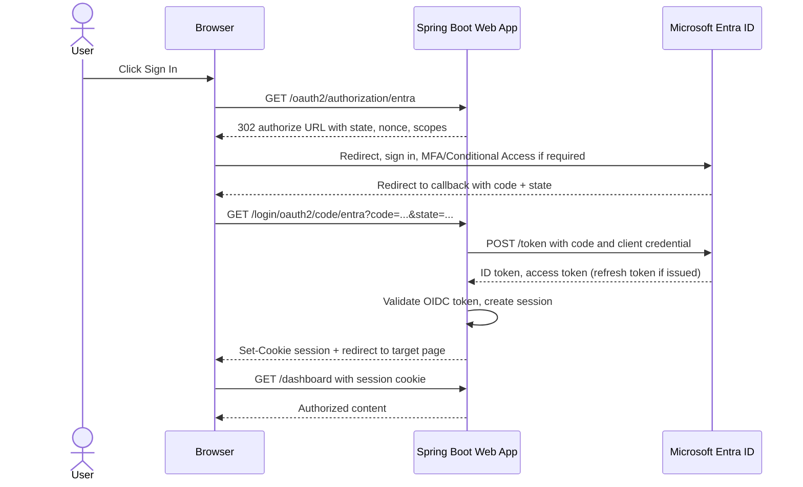
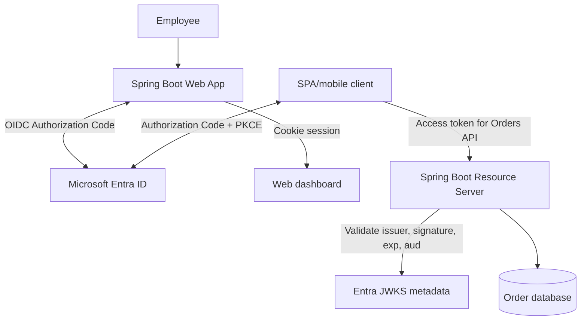
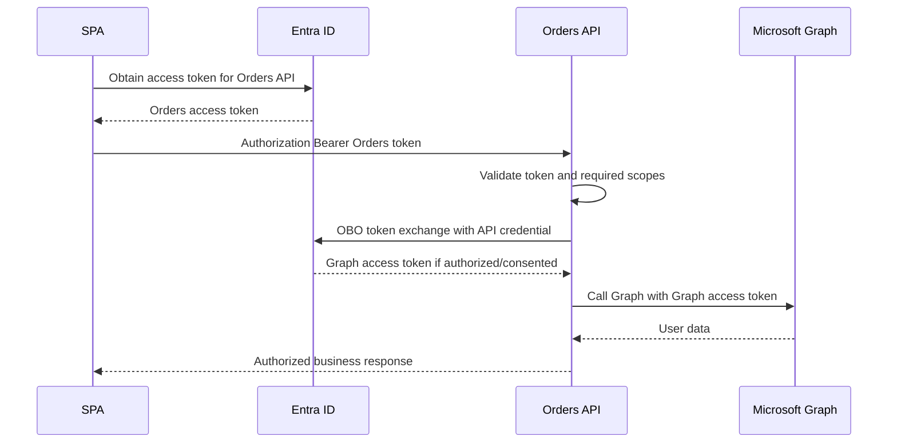
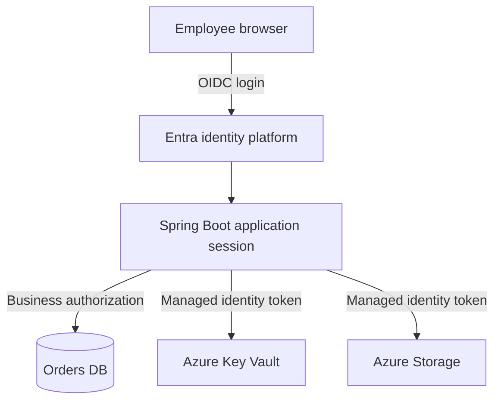
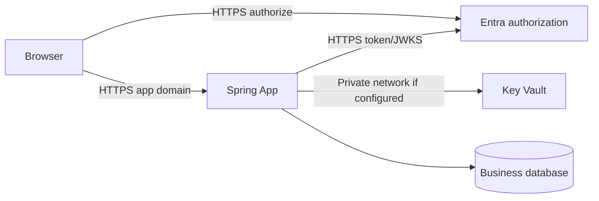
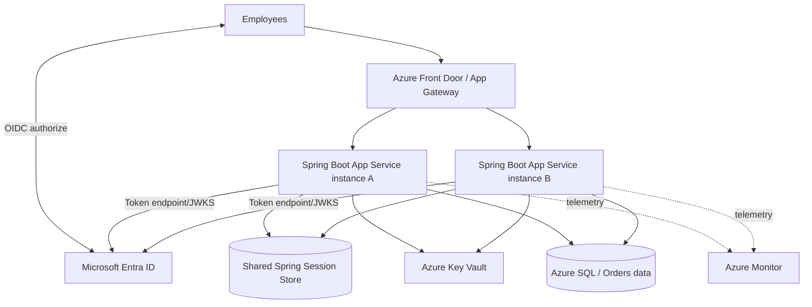

# Signing In to Microsoft Entra ID with Spring Security

A company deploys a **Java Spring Boot** order management portal on Azure App Service. Employees must sign in with organizational accounts, comply with Microsoft Entra ID multi-factor authentication (MFA) policies, hold distinct permissions for accounting and administration, and never have the application store their Microsoft passwords itself. The company also runs a REST API using bearer access tokens and wants to integrate both properly without conflating the two authentication models.

**Microsoft Entra ID** is Microsoft's identity and access management system; **Spring Security** is the Java application security layer. In a server-side web application, we use **OAuth 2.0 Authorization Code** combined with **OpenID Connect (OIDC)**: the browser is redirected to Entra ID, the user completes sign-in/MFA per policy, Entra sends an authorization code back to the callback, and Spring Security exchanges the code for tokens, validates the ID token, and creates an application session. Users then access the web app via a session cookie rather than having the application verify passwords itself.

This lesson belongs to the **Spring Boot on Azure** chapter of the **CLOUD_PROVIDERS_AZURE** module, connecting Entra ID with subscriptions/resource groups, App Service, Azure Key Vault, networking, monitoring, and cost control for systems running on Microsoft Azure. The focus is **"Signing In to Microsoft Entra ID with Spring Security."**

> **Scope:** Primary examples use **Spring Boot 3.x, Spring Security 6.x**, Java 17+, and a **single-tenant web application**; adjust specific configurations and versions to your project. The REST API section is presented as a **separate resource server** to avoid confusing session login with bearer-token authentication. Microsoft Entra, Spring Security, and Portal APIs can change; no live subscriptions, app registrations, or real secrets are created or edited in this lesson. This is STEP 4 authoring, not yet subject-matter QA or a live deployment.

## Learning Objectives

After this lesson, you can:

1. Distinguish authentication/authorization, Entra tenant, app registration, service principal, and app roles.
2. Explain the relationship between OAuth 2.0, OIDC, ID tokens, access tokens, session cookies, and refresh tokens.
3. Trace the Authorization Code flow including `state`, `nonce`, redirect URI, and back-channel token exchange.
4. Create a single-tenant app registration and configure the exact callback URI for Spring Boot.
5. Use `spring-boot-starter-oauth2-client`, `issuer-uri`, and `oauth2Login`.
6. Identify the principal via `OidcUser`, using `tid + oid` rather than email as an immutable key.
7. Map Entra app roles into `GrantedAuthority` instances and protect routes and service methods.
8. Keep CSRF, sessions/cookies, logout, and reverse-proxy HTTPS secure.
9. Distinguish web login from a JWT resource server with **audience validation**.
10. Understand when to use Microsoft Graph delegated access, the OBO flow, or managed identity.
11. Design secret rotation, App Service/AKS configuration, multi-instance sessions, and network policies.
12. Monitor 401/403/redirect mismatch incidents, auditing, and cost control.
13. Complete a hands-on web app with login, profile, and an admin-only route.

## 1. Authentication vs. Authorization

**Authentication (AuthN):** proves who is signing in. **Authorization (AuthZ):** checks what that principal is permitted to do on a specific resource.

| Layer | Example | What it does not prove |
|---|---|---|
| Entra sign-in | User completes sign-in/MFA | Allowed to view every invoice |
| OIDC ID token | Authenticated principal for the web client | Authorized to call every REST API |
| Spring web session | Browser is logged into the app | User can access any arbitrary order |
| Entra app role | `Admin` or `FinanceReviewer` per assignment | Azure subscription Owner rights |
| OAuth access token | Scope/role issued for one specific API | Access to any other API |
| Azure RBAC | Contributor on a resource group | Admin role inside Spring Boot |
| Business authorization | Tenant, ownership, order state | Never skipped just for having an app role |

An account with Azure subscription Owner is not automatically an application administrator. Conversely, `APPROLE_Admin` should only grant rights inside the designed application, not automatically permit managing Key Vault or Azure Resource Manager.

## 2. Microsoft Entra Tenant and App Registration

Key concepts:

- **Tenant:** an organization's directory, identified by a tenant ID.
- **User:** a directory user or a guest under B2B policy.
- **App registration:** defines client/application ID, supported account types, redirect URIs, and API permissions.
- **Enterprise application/service principal:** represents the app inside the tenant; can govern user/group assignments and Conditional Access per configuration.
- **Client ID:** application identifier, not a password.
- **Client secret/certificate:** server-side credential for a confidential web client.
- **Redirect URI:** endpoint permitted to receive authorization responses.
- **App role:** application-defined permission value, e.g. `Admin`, assigned via Entra.
- **Issuer:** the IdP issuing the token; **audience:** the intended recipient of the token.
- **User object ID (`oid`):** identifier of the user object in the tenant as issued in claims.

Example configuration:

```text
Tenant ID:          <TENANT_GUID>
Application ID:     <WEB_CLIENT_GUID>
Authentication:     Web platform
Account types:      Single tenant
Local callback:     http://localhost:8080/login/oauth2/code/entra
Production callback:https://orders.example.com/login/oauth2/code/entra
Spring registration:entra
```

These are placeholders. Never create URIs/secrets or alter production tenant policies without authorization.

## 3. OAuth 2.0 and OIDC Are Not Synonyms

**OAuth 2.0** primarily provides **delegated API authorization** via access tokens. **OIDC** is an identity authentication layer on top of OAuth, typically delivering an ID token.

| Artifact | Purpose | What not to do |
|---|---|---|
| **Authorization code** | Exchanged by the app for tokens at the back-channel token endpoint | Treat the code like a password or cache it long-term |
| **ID token** | Authenticates login for the matching client audience | Send it as a bearer access token to another API |
| **Access token** | Calls an API with matching audience/permissions | Treat every access token as valid for your app |
| **Refresh token** | Acquires fresh tokens per policy/scope | Store in browser `localStorage` or logs |
| **Session cookie** | Accesses an authenticated server-side web app | Treat the cookie as a token usable for Microsoft Graph |
| **App role** | Application/resource authorization | Treat a group's display name as a trusted role |

A **Microsoft Graph access token** is scoped for Graph; a custom API must **reject** it because its audience is not that API. Likewise, an **ID token** meant for the web client cannot replace an access token for the Orders API.

## 4. Authorization Code and OpenID Connect Flow



### Protective Sequence

- `state` binds the response to the request and mitigates login CSRF and mix-up attacks.
- `nonce` protects against replay of the OIDC ID token in the flow.
- `redirect_uri` must match a registered redirect URI.
- The authorization code is short-lived and single-use per protocol.
- The OIDC framework verifies signature, issuer, audience, expiry, and protocol checks.
- The client secret is a **server-side** secret and must never be sent to the browser.
- **PKCE** protects the authorization code; essential for SPA/native public clients and usable with confidential clients where supported.

**Never roll your own JWT validator by decoding the payload and trusting claims.** Use Spring Security/OIDC metadata and validation from compatible libraries.

## 5. A Browser Does Not Need to Hold ID Tokens in localStorage

In a server-side app, the browser holds a session cookie, while Spring Boot maintains the `SecurityContext` and OAuth2 authorized-client state as configured.

```text
Browser:      session cookie (Secure, HttpOnly)
Spring Boot:  authentication principal/session
Entra:        identity provider login/SSO state
Database:     business entitlements, audit, order ownership
```

This pattern is often called **server-rendered/BFF-like** when the backend manages sessions/tokens on behalf of a JavaScript frontend. Do not assume every Spring Boot app uses this model; a pure SPA using **MSAL + Authorization Code with PKCE** has a different token model.

### Cookies to Configure

- `Secure` in HTTPS production.
- `HttpOnly` to prevent JavaScript from reading the session cookie.
- `SameSite` compatible with OIDC redirects and cross-site requirements.
- Session timeout aligned with risk and usability.
- CSRF protection on state-changing cookie-authenticated requests.
- Session fixation protection and session invalidation on logout.

## 6. Single-Tenant or Multi-Tenant?

This lesson uses **single-tenant**:

```text
https://login.microsoftonline.com/<TENANT_ID>/v2.0
```

| Mode | Best fit | Controls required |
|---|---|---|
| Single-tenant | Internal app for one organization | Fixed issuer, tenant/role policy |
| Multi-tenant organizations | SaaS serving multiple Entra directories | Trusted issuer validation, tenant allowlist, onboarding, role isolation |
| Including Microsoft personal accounts | Mixed consumer/business app | Dedicated issuer/account-type and auth policies |

### Pitfalls of `common` / `organizations`

Do not replace `<TENANT_ID>` with `common` and disable issuer validation just to "support any tenant." In multi-tenant apps, token issuers vary by tenant, and the app must **validate every allowed issuer**, handle onboarding/consent properly, and isolate data and role policies. For B2B guests, the object ID in the resource tenant may differ from the home tenant; key principal identity by the **verified issuer/tenant**.

## 7. Registering a Web App in Microsoft Entra

In Microsoft Entra admin center, perform these steps in an authorized **lab tenant**:

1. Open **App registrations** → **New registration**.
2. Enter a name, e.g., `orders-spring-web-lab`.
3. Choose **Accounts in this organizational directory only**.
4. Select the **Web** platform and redirect `http://localhost:8080/login/oauth2/code/entra`.
5. Record the **Application (client) ID** and **Directory (tenant) ID**.
6. Create a time-bounded client secret **only if using a confidential client with a secret**; store it immediately in a secret manager/Key Vault.
7. Review OIDC scopes `openid`, `profile`, `email` and consent policies.
8. If using app roles for authorization, declare the roles and assign users/groups in **Enterprise applications**.
9. When deploying, add the **production HTTPS redirect URI** with the real hostname.
10. Verify organizational app assignment and Conditional Access requirements.

### Distinct URIs

```text
Registered:
http://localhost:8080/login/oauth2/code/entra

Different from:
http://localhost:8081/login/oauth2/code/entra
http://127.0.0.1:8080/login/oauth2/code/entra
https://orders.example.com/login/oauth2/code/entra
https://orders.example.com/login/oauth2/code/azure
```

Host, port, scheme, and path must **match** the app registration. Never enable broad wildcard redirects or redirect to uncontrolled domains just to bypass errors.

## 8. Maven Dependencies for Spring Boot 3.x

A web app using an appropriate Spring Boot Maven parent/BOM:

```xml
<dependencies>
    <dependency>
        <groupId>org.springframework.boot</groupId>
        <artifactId>spring-boot-starter-web</artifactId>
    </dependency>
    <dependency>
        <groupId>org.springframework.boot</groupId>
        <artifactId>spring-boot-starter-security</artifactId>
    </dependency>
    <dependency>
        <groupId>org.springframework.boot</groupId>
        <artifactId>spring-boot-starter-oauth2-client</artifactId>
    </dependency>
</dependencies>
```

For a separate **REST API Resource Server**, add:

```xml
<dependency>
    <groupId>org.springframework.boot</groupId>
    <artifactId>spring-boot-starter-oauth2-resource-server</artifactId>
</dependency>
```

These snippets belong inside a `pom.xml` with compatible dependency management and JDK; do not pin a Spring Security version mismatched with the Spring Boot BOM.

**Spring Cloud Azure is not required** for basic OIDC Login. Spring Security supports standard OAuth2/OIDC natively. Spring Cloud Azure can add integrations, but verify version compatibility and avoid overlapping security filter chains.

## 9. application.yml: Configuring the OIDC Issuer

Example using environment placeholders (rendered as Spring property syntax when saved):

```yaml
server:
  port: 8080

spring:
  security:
    oauth2:
      client:
        registration:
          entra:
            provider: entra
            client-id: ${ENTRA_CLIENT_ID}
            client-secret: ${ENTRA_CLIENT_SECRET}
            authorization-grant-type: authorization_code
            redirect-uri: "{baseUrl}/login/oauth2/code/{registrationId}"
            scope:
              - openid
              - profile
              - email
        provider:
          entra:
            issuer-uri: https://login.microsoftonline.com/${ENTRA_TENANT_ID}/v2.0
```

In the resulting file, placeholders are Spring environment expressions starting with `$` and curly braces—e.g., `ENTRA_CLIENT_ID` read from the environment. Never hardcode secrets in YAML.

### Why Is `registrationId` Set to `entra`?

- Login initiation URL: `/oauth2/authorization/entra`.
- Default callback: `/login/oauth2/code/entra`.

Renaming `entra` to `azure` without updating the app registration redirect causes a mismatch.

### OIDC Metadata

`issuer-uri` lets Spring Security fetch provider discovery metadata (authorization/token/JWKS endpoints). **The issuer must belong to an authorized tenant**; never load metadata URLs dynamically from client requests.

### Local Environment

```bash
# Illustrative variable names only; never commit real values.
export ENTRA_TENANT_ID="<TENANT_GUID>"
export ENTRA_CLIENT_ID="<APP_CLIENT_GUID>"
export ENTRA_CLIENT_SECRET="<VALUE_FROM_SECRET_STORE>"
```

On Windows PowerShell, environment variable syntax differs from Bash; never paste keys where shell history records them. On Azure App Service, use App Settings, Key Vault references, or an approved secret store.

## 10. SecurityFilterChain: oauth2Login and Deny-by-Default

```java
package vn.example.orders.security;

import org.springframework.context.annotation.Bean;
import org.springframework.context.annotation.Configuration;
import org.springframework.security.config.Customizer;
import org.springframework.security.config.annotation.web.builders.HttpSecurity;
import org.springframework.security.web.SecurityFilterChain;

@Configuration
public class WebSecurityConfiguration {

    @Bean
    SecurityFilterChain webSecurityFilterChain(HttpSecurity http)
            throws Exception {

        return http
            .authorizeHttpRequests(auth -> auth
                .requestMatchers("/", "/public/**", "/error")
                    .permitAll()
                .requestMatchers("/admin/**")
                    .hasAuthority("APPROLE_Admin")
                .anyRequest().authenticated()
            )
            .oauth2Login(Customizer.withDefaults())
            .logout(logout -> logout
                .logoutSuccessUrl("/")
                .invalidateHttpSession(true)
                .deleteCookies("JSESSIONID")
            )
            // CSRF is enabled by default for session-based web apps.
            .build();
    }
}
```

### Key Points

- `permitAll` only for genuinely public routes; all other routes require an authenticated principal.
- `APPROLE_Admin` is an application convention **after role mapping**.
- If the role is unmapped or not granted, `/admin/**` must return **403**.
- `logout` in this sample invalidates the Spring session; the Entra SSO session may still remain active.
- Keep Spring Security CSRF protection enabled for cookie-authenticated POST/PUT/PATCH/DELETE requests.
- Protect `/actuator/**`/debug/logging routes; never expose configuration inadvertently.

## 11. Accessing OidcUser in a Controller

```java
package vn.example.orders.web;

import java.util.Map;
import org.springframework.security.core.annotation.AuthenticationPrincipal;
import org.springframework.security.oauth2.core.oidc.user.OidcUser;
import org.springframework.web.bind.annotation.GetMapping;
import org.springframework.web.bind.annotation.RestController;

@RestController
public class ProfileController {

    @GetMapping("/api/me")
    public Map<String, String> me(
            @AuthenticationPrincipal OidcUser user) {

        String tenantId = user.getClaimAsString("tid");
        String objectId = user.getClaimAsString("oid");
        String name = user.getClaimAsString("name");

        if (tenantId == null || objectId == null) {
            throw new IllegalStateException(
                "Missing verified tenant/object ID claims");
        }

        return Map.of(
            "tenantId", tenantId,
            "objectId", objectId,
            "displayName", name == null ? "" : name
        );
    }
}
```

Once `oauth2Login` succeeds, the principal comes from the Spring Security context, not a client-supplied `X-User-Id` header.

### Claims to Understand

| Claim | Meaning | Warning |
|---|---|---|
| `iss` | Identity provider that issued the token | Validate issuer |
| `aud` | Client/token recipient | ID token `aud` must match the web client |
| `sub` | OIDC subject | Semantics depend on issuer/client |
| `tid` | Tenant ID when supplied by Entra | Enforce tenant policy |
| `oid` | User object ID inside the tenant | Commonly combined with `tid` as a key |
| `name` | Display name | Can be missing or change |
| `preferred_username` | Login username hint | Not guaranteed unique/immutable |
| `email` | Email when issued | Not always present or a permanent identifier |
| `roles` | App role values when present in token | Requires a mapper in Spring |
| `groups` | Group identifiers when issued | Subject to group overage |

### Do Not Use Email as an Authorization Key

Someone who changes email or is a guest across tenants remains the same physical person yet has distinct **object IDs** and security contexts. An application key such as `tenantId + objectId` fits most single-tenant scenarios better than `email`.

## 12. Entra App Roles and Enterprise Application Assignment

Example role definitions:

```text
App role value: OrderReader
Description: Read assigned orders

App role value: FinanceReviewer
Description: Review finance documents

App role value: Admin
Description: Manage application settings
```

In the app registration, declare role values and allowed member types appropriately. Then open **Enterprise applications** to assign users/groups per policy.

### Common Scenarios

- User signs in successfully **but has no roles**: authentication does not equal role assignment.
- User belongs to a group yet the ID token lacks `roles`: verify role assignments via supported mechanisms.
- Too many `groups`: tokens may omit the full list; prefer **app roles** over unbounded group lists.
- Entra directory roles like Global Administrator do not automatically confer app `Admin`.
- The `roles` claim carries role values, not display labels.

**App roles grant functional capabilities only**; they do not replace checking owner/tenant on an `OrderId`.

## 13. Mapping App Roles to Spring Security Authorities

Spring Security does not automatically turn the `roles` claim into `APPROLE_Admin`. Define a `GrantedAuthoritiesMapper`:

```java
package vn.example.orders.security;

import java.util.HashSet;
import java.util.Set;
import java.util.stream.Stream;

import org.springframework.context.annotation.Bean;
import org.springframework.context.annotation.Configuration;
import org.springframework.security.core.GrantedAuthority;
import org.springframework.security.core.authority.SimpleGrantedAuthority;
import org.springframework.security.core.authority.mapping.GrantedAuthoritiesMapper;
import org.springframework.security.oauth2.core.oidc.user.OidcUserAuthority;

@Configuration
public class EntraRoleMappingConfiguration {

    @Bean
    GrantedAuthoritiesMapper userAuthoritiesMapper() {
        return input -> {
            Set<GrantedAuthority> result = new HashSet<>(input);

            input.stream()
                .filter(OidcUserAuthority.class::isInstance)
                .map(OidcUserAuthority.class::cast)
                .flatMap(authority -> {
                    var roles = authority.getIdToken()
                        .getClaimAsStringList("roles");

                    return roles == null
                        ? Stream.<String>empty()
                        : roles.stream();
                })
                .filter(role -> role != null && !role.isBlank())
                .forEach(role -> result.add(
                    new SimpleGrantedAuthority("APPROLE_" + role)
                ));

            return result;
        };
    }
}
```

### Conditions

- `roles` is actually emitted in the **ID token** following the corresponding app role assignment.
- Your Spring Security version wires this mapper bean into OAuth2 Login as shown; verify with an integration test.
- The `APPROLE_` prefix is an **application** convention.
- For sensitive permissions, validate role values against an allowlist rather than blindly converting arbitrary claim strings into broad authorities.
- If using custom authority sources outside the ID token, verify those sources explicitly.

### Testing

For a user without the `Admin` role, `GET /admin/dashboard` must return **403** even though Entra sign-in succeeded. For a user with the `Admin` role, the route succeeds; business authorization may still apply further checks.

## 14. Method Security and Business Object Authorization

Enable method-level authorization:

```java
package vn.example.orders.security;

import org.springframework.context.annotation.Configuration;
import org.springframework.security.config.annotation.method.configuration.EnableMethodSecurity;

@Configuration
@EnableMethodSecurity
public class MethodSecurityConfiguration {
}
```

Use it in a service:

```java
package vn.example.orders.service;

import org.springframework.security.access.prepost.PreAuthorize;
import org.springframework.stereotype.Service;

@Service
public class AdminService {

    @PreAuthorize("hasAuthority('APPROLE_Admin')")
    public void updateConfiguration(String configId) {
        // Validate change, persist audit and enforce invariants.
    }
}
```

### Route-Level Security Is Not Enough

An employee holding `APPROLE_OrderReader` still must not read every order:

```text
GET /orders/ORD-1001
 -> Authenticate (tid, oid)
 -> Check functional permission
 -> Check order belongs to same tenant / assigned user
 -> Check object status and field-level permissions
 -> Record audit and return only allowed data
```

If you add a GraphQL endpoint, background job, or new controller, the **business service** must still enforce resource-level permissions. This prevents IDOR/BOLA vulnerabilities.

## 15. Session Cookies, CSRF, and Request Lifecycle

In a server-side web app, the browser sends a session cookie with requests. Security requires:

- `Secure` cookies over HTTPS, `HttpOnly`, and appropriate `SameSite`.
- Idle and absolute session timeouts matching requirements.
- Spring session fixation protection.
- CSRF tokens on state-changing requests.
- Never rendering ID/access/refresh tokens into HTML or logs.
- Never trusting a query parameter like `isAdmin=true` instead of role mapping.
- Controlling caching on sensitive pages and signing out on shared devices.

### Why Keep CSRF?

A malicious site can trick a signed-in user's browser into submitting a cookie-bearing POST to your app. **CSRF protection** validates tokens/origin policies to block unauthorized actions.

```html
<form method="post" action="/logout">
  <input type="hidden" name="_csrf"
         th:value="${_csrf.token}" />
  <button type="submit">Log out</button>
</form>
```

This is a Thymeleaf form example where `th:value` renders using template engine syntax; in the complete file, the placeholder uses a Thymeleaf expression starting with `$` and braces. Some integrations automatically inject the hidden CSRF input with Spring MVC/Thymeleaf; check your actual version.

**CORS is not authorization**, and `SameSite` does not replace all CSRF checks. Never disable CSRF app-wide just to get a test POST working.

## 16. Logout in Spring vs. Entra Single Sign-On

**Local logout** in Spring Boot destroys the application session; the **Entra SSO session** may remain valid. After local logout, clicking Login again may silently sign the user back in via Entra SSO per policy.

### Using OIDC RP-Initiated Logout

Spring Security provides `OidcClientInitiatedLogoutSuccessHandler` (if the provider advertises end-session metadata). Inside `SecurityFilterChain`, configure a suitable `LogoutSuccessHandler`:

```java
import org.springframework.security.oauth2.client.registration.ClientRegistrationRepository;
import org.springframework.security.oauth2.client.oidc.web.logout.OidcClientInitiatedLogoutSuccessHandler;

// Add to a @Configuration class; inject the registrations repository.
static OidcClientInitiatedLogoutSuccessHandler oidcLogoutHandler(
        ClientRegistrationRepository registrations) {

    var handler =
        new OidcClientInitiatedLogoutSuccessHandler(registrations);
    handler.setPostLogoutRedirectUri("{baseUrl}/");
    return handler;
}
```

Then configure `logout(logout -> logout.logoutSuccessHandler(oidcLogoutHandler(registrations)))` in the web security chain wired via dependency injection. **Post-logout redirect URIs** must be allowed by the provider/app registration per policy.

### Do Not Misunderstand Logout

- Logging out of app A does not necessarily log out of every app in the tenant.
- Disabling an account does not immediately revoke all active app sessions unless the app revalidates or handles revocation.
- Spring Boot sessions still require timeouts and revocation when a user's access is removed.
- Never use `GET /logout` as a mutating endpoint in cookie-authenticated web apps with CSRF.
- On shared/kiosk devices, clear application UI state and disable public caching of sensitive pages.

## 17. App Service HTTPS, Reverse Proxy, and Redirect URI

Production URL:

```text
https://orders.example.com/login/oauth2/code/entra
```

If the Java runtime behind App Service/Front Door/Application Gateway receives internal requests over HTTP, the app may miscompute `{baseUrl}` and generate an HTTP redirect URI, causing mismatches or redirect loops.

Recommended configuration:

```yaml
server:
  forward-headers-strategy: framework
  servlet:
    session:
      cookie:
        secure: true
        http-only: true
        same-site: lax
```

### Requirements

- The proxy sets/sanitizes `Forwarded`/`X-Forwarded-*` headers accurately; trust **only controlled proxies**.
- Entra app registration lists the exact redirect URI using the **public HTTPS hostname**.
- Prevent arbitrary clients from spoofing `Host`/`Proto` forwarded headers to avoid open redirects.
- Enable HTTPS-only on App Service/gateway with a valid TLS certificate.
- Health probes must expose only minimal health status, no secrets.
- Never log raw `code`, `state`, or tokens in callbacks or HTTP query strings.

### Local vs. Production Differences

For localhost HTTP testing, `cookie.secure: false` may be needed in a **local profile**; never copy that setting to production. Across multiple domains, check `SameSite`/CORS and cookie domain/path against your actual architecture.

## 18. Multi-Instance Deployments and Spring Session

Across multiple App Service/AKS instances, a user may log in on instance A while the next request routes to B. If sessions live only in instance A's RAM, instance B will not find the `SecurityContext`.

| Option | Pros | Limitations |
|---|---|---|
| Sticky sessions | Simple for some deployments | Failover/scale-in drops sessions |
| Spring Session + Redis-compatible store | Shares sessions across instances | Requires networking, security, TTL, availability, and cost |
| Database-backed sessions | Configurable durability | Latency, cleanup, and schema overhead |
| SPA with bearer tokens | Avoids server web sessions of this kind | Token storage, PKCE, refresh, XSS/CSRF trade-offs |

**Protect the session store** like a credential store, because session data binds to principals and may contain authorized-client state. Apply Redis/network access control, TLS, retention, and encryption. Logout must invalidate the shared session rather than clearing state inside a single pod.

## 19. Web Login vs. REST API JWT Resource Server: Two Roles

A web application where users sign in via Entra is typically an **OAuth2/OIDC client**. A REST API accepting bearer access tokens is an **OAuth2 resource server**.



### Token Distinctions

- **ID token** typically has `aud` equal to the web app's client ID; used for OIDC login.
- **Orders API access token** carries an audience targeting **Orders API** along with appropriate permissions/scopes.
- **Microsoft Graph access token** carries Graph's audience; Orders API must reject it.
- **Session cookie** represents web app login, not a bearer token for external REST APIs.
- **Managed identity token** is used by an Azure workload to call an Azure resource, not proof that a user logged into the web app.

### Can One Application Support Both?

Yes, but it requires **two `SecurityFilterChain` beans** with proper `securityMatcher`/`@Order`, request matchers, and authentication entry points. Without thorough testing, APIs may return HTML login redirects instead of 401s, or web routes may mishandle bearer tokens. The examples below use a **separately deployed API** for clarity.

## 20. Spring Security Resource Server: Validating JWT Audience

For a standalone API, add `spring-boot-starter-oauth2-resource-server`. Configure the tenant issuer for the matching access-token version:

```yaml
spring:
  security:
    oauth2:
      resourceserver:
        jwt:
          issuer-uri: https://login.microsoftonline.com/${ENTRA_TENANT_ID}/v2.0

orders:
  api:
    audience: ${ORDERS_API_AUDIENCE}
```

Spring Security fetches issuer discovery/JWKS and automatically validates many JWT properties. **Do not rely solely on signature and issuer**: the API must also verify `aud` matches its own audience.

### Bean Validating Issuer + Expiry + Audience

```java
package vn.example.orders.api;

import org.springframework.beans.factory.annotation.Value;
import org.springframework.context.annotation.Bean;
import org.springframework.context.annotation.Configuration;
import org.springframework.security.oauth2.core.DelegatingOAuth2TokenValidator;
import org.springframework.security.oauth2.core.OAuth2Error;
import org.springframework.security.oauth2.core.OAuth2TokenValidator;
import org.springframework.security.oauth2.core.OAuth2TokenValidatorResult;
import org.springframework.security.oauth2.jwt.Jwt;
import org.springframework.security.oauth2.jwt.JwtDecoder;
import org.springframework.security.oauth2.jwt.JwtDecoders;
import org.springframework.security.oauth2.jwt.JwtValidators;
import org.springframework.security.oauth2.jwt.NimbusJwtDecoder;

@Configuration
public class OrdersJwtValidationConfiguration {

    @Bean
    JwtDecoder jwtDecoder(
            @Value("${spring.security.oauth2.resourceserver.jwt.issuer-uri}")
            String issuer,
            @Value("${orders.api.audience}")
            String expectedAudience) {

        JwtDecoder discovered = JwtDecoders.fromIssuerLocation(issuer);

        if (!(discovered instanceof NimbusJwtDecoder decoder)) {
            throw new IllegalStateException(
                "Expected a configurable NimbusJwtDecoder");
        }

        OAuth2TokenValidator<Jwt> defaults =
            JwtValidators.createDefaultWithIssuer(issuer);

        OAuth2TokenValidator<Jwt> audienceValidator = token -> {
            if (token.getAudience().contains(expectedAudience)) {
                return OAuth2TokenValidatorResult.success();
            }
            return OAuth2TokenValidatorResult.failure(
                new OAuth2Error(
                    "invalid_token",
                    "Token has unexpected audience",
                    null));
        };

        decoder.setJwtValidator(
            new DelegatingOAuth2TokenValidator<>(
                defaults, audienceValidator));

        return decoder;
    }
}
```

### Conditions for This Example

- `ENTRA_TENANT_ID`, the API access-token version, and the actual issuer must match. Entra v1 vs. v2 access tokens can differ in issuer format; configure the API app registration token version per policy.
- `ORDERS_API_AUDIENCE` must **exactly** match the `aud` claim in access tokens issued for the API. Do not guess whether it is a URI or GUID without verifying controlled token metadata.
- The example obtains a decoder via issuer discovery. After framework upgrades, verify decoder type, APIs, and bean creation.
- Never disable issuer or audience validation to "fix" a 401.
- To avoid confusing ID tokens with access tokens, **separate web client and API app registrations**, require explicit scopes/app roles, and validate claims/permissions per endpoint.
- Never log raw JWTs during testing.

## 21. Stateless REST API: SecurityFilterChain and Scopes

For an API using only bearer tokens and no browser sessions, configure separately:

```java
package vn.example.orders.api;

import org.springframework.context.annotation.Bean;
import org.springframework.context.annotation.Configuration;
import org.springframework.security.config.Customizer;
import org.springframework.security.config.annotation.web.builders.HttpSecurity;
import org.springframework.security.config.http.SessionCreationPolicy;
import org.springframework.security.web.SecurityFilterChain;

@Configuration
public class OrdersApiSecurityConfiguration {

    @Bean
    SecurityFilterChain apiSecurityFilterChain(HttpSecurity http)
            throws Exception {
        return http
            .authorizeHttpRequests(auth -> auth
                .requestMatchers("/health/live").permitAll()
                .requestMatchers(
                    org.springframework.http.HttpMethod.GET,
                    "/api/orders/**")
                    .hasAuthority("SCOPE_Orders.Read")
                .requestMatchers(
                    org.springframework.http.HttpMethod.POST,
                    "/api/orders/**")
                    .hasAuthority("SCOPE_Orders.Write")
                .anyRequest().denyAll()
            )
            .sessionManagement(session -> session
                .sessionCreationPolicy(SessionCreationPolicy.STATELESS))
            .oauth2ResourceServer(oauth ->
                oauth.jwt(Customizer.withDefaults()))
            .build();
    }
}
```

### Items to Verify

- The API app registration must **Expose an API** with declared scopes and proper consent/assignments.
- Entra delegated access tokens typically carry scopes in the `scp` claim; Spring Resource Server's default converter maps them to `SCOPE_...`—verify with an integration test.
- Client credentials / application permission flows typically emit `roles` instead of `scp`, requiring a custom authorization converter/policy.
- Even with `SCOPE_Orders.Read`, the service must still enforce **order owner/tenant checks**.
- `anyRequest().denyAll()` prevents unmapped endpoints from opening accidentally.
- This pattern targets a **bearer-only API with no cookie sessions**. Decisions about CSRF when an API shares an origin with a cookie-based app must reflect trust boundaries—never blindly copy a global CSRF-disable pattern.

### Distinguishing 401 and 403 Responses

**401 Unauthorized** usually means no valid credential was supplied or the token was rejected (signature, issuer, audience, expiry). **403 Forbidden** usually means authentication succeeded, yet the caller lacks permission for the resource, such as missing `Orders.Write`. Entry-point policies can affect exact HTTP responses; inspect safe logs/traces to confirm.

## 22. SPAs: Never Put a Client Secret in the Browser

A pure React/Angular/Vue SPA can use MSAL with **Authorization Code with PKCE** to obtain an **access token for an API**. However, a SPA is a **public client** and must never embed a client secret in JavaScript or `localStorage`.

### Two Patterns

| Pattern | Where do tokens/sessions live? | Best fit |
|---|---|---|
| **Spring Boot server-side OAuth2 Login** | Tokens/authorized-client state on server; browser sends session cookie | Server-rendered UI, BFF |
| **SPA + MSAL + API JWT** | SPA uses PKCE and access tokens; API validates JWTs | Standalone frontend, mobile-like apps |
| **SPA via Spring BFF** | Browser holds only an `HttpOnly` session cookie; BFF holds tokens | Minimizing token exposure in JS |

Do not mix these three flows arbitrarily. For example, having a frontend acquire an ID token via MSAL and send it straight to `/api/orders` is wrong; it must request an **access token for the right resource**.

### CORS and Cookies

CORS governs which browser origins may read responses per policy—it does not replace authentication. A cookie-based BFF needs CSRF, `SameSite`, and secure headers; a bearer-token SPA needs XSS defenses, careful token storage, and refresh handling. Pick one architecture and test it thoroughly.

## 23. Microsoft Graph and Delegated Permissions

After login, an app may want to display a user's profile photo, department, or group info. **Microsoft Graph** is a separate API requiring a **Graph-scoped access token** with matching permissions—you cannot always pull everything from the ID token.

### Common Permissions

- `User.Read` (delegated): read the signed-in user's profile within granted scope.
- Additional scopes depending on functionality and consent policies.
- Sensitive Directory/Group permissions may require **admin consent** and data-minimization review.

### Proper Flow

```text
User logs into Spring Web App
   -> OIDC principal established
   -> App requests Graph delegated scope as needed
   -> OAuth2 authorized client obtains Graph access token
   -> App calls Microsoft Graph /me
   -> App maps only necessary claims to its profile
```

If refresh tokens are required, scopes such as `offline_access`, provider policies, and authorized-client persistence must be configured properly; never assume refresh tokens are always issued. Store Graph tokens in trusted server storage when using BFF/server-side apps.

### Two Questions to Ask

1. Do you actually need to call Graph? If the ID token already provides `name`, `tid`, and `oid`, Graph may be unnecessary.
2. Has the user consented or an admin granted the right delegated permission? Never escalate Graph permissions just to silence an app-level 403.

**Graph `User.Read` is not permission to read the Orders API.** Never send Graph tokens to your own API hoping signature verification alone suffices.

## 24. On-Behalf-Of: When an API Calls Graph for the User

Another scenario: a SPA sends an **Orders API access token** to the Spring REST API, and the API then needs to call Graph on the user's behalf. Evaluate the **OAuth 2.0 On-Behalf-Of (OBO) flow** as supported by Entra and your client library.



### What OBO Does Not Automatically Do

- Does not grant Graph permissions without prior consent/admin approval.
- Does not bypass user authorization or tenant isolation.
- Does not allow passing a raw ID token as the user assertion when an API access token is required.
- Does not let you forward the same Orders API access token directly to Graph because the audience differs.
- Never implement insecure custom token exchanges; use supported libraries/flows and validate credentials and claims properly.

If you only need data from the company database, **you likely need neither Graph nor OBO**. Fewer scopes mean lower risk.

## 25. User Login Differs from Workload Managed Identity

A Spring Boot application on App Service/AKS usually involves two identity layers:



- **User identity:** the employee's Entra OIDC principal, used for login and business authorization.
- **Workload identity/managed identity:** the identity of App Service/AKS/VM, used to access Key Vault, Storage, or other Azure resources per RBAC/data-plane policies.
- **App registration client credential:** used by the confidential web client when exchanging authorization codes; may be a secret, certificate, or provider-supported credential method.

### Common Mistake

Enabling managed identity on App Service **does not automatically** eliminate the Spring OAuth2 Login client credential or change `client_secret` handling. Certificate or federated assertion options for OAuth client authentication must be explicitly supported and configured in both the library and Entra app registration.

### Azure SDK Example for Workload Permissions

```java
import com.azure.identity.DefaultAzureCredentialBuilder;

var credential = new DefaultAzureCredentialBuilder().build();
```

This is the **Azure SDK** credential chain, not the signed-in user principal. When running on App Service with a valid managed identity, it can acquire tokens for authorized resources; you must still assign scoped roles and ensure network connectivity.

## 26. Key Vault, Secret Rotation, and Java Applications

When a confidential web client uses a client secret:

- Store the secret in **Azure Key Vault** or an approved secret manager, never in Git or CI logs.
- App Service can use **Key Vault references**, or the app can read via SDK where supported and authorized.
- Workload secret-read permissions must follow least privilege—e.g., a data-plane role restricted to reading secrets in the proper scope.
- Never print `ENTRA_CLIENT_SECRET` during startup or config debugging.
- Never transmit secrets to the browser or HTML forms.

### Rotation Plan

1. Inventory app registrations and secret expiration dates.
2. Create a **new credential** while the old secret is still valid; store it in Key Vault.
3. Test one instance or a staging deployment with the new credential.
4. Update App Settings/Key Vault references and perform a rolling restart/redeploy per service behavior.
5. Verify **authorization code exchanges** succeed across all instances.
6. Confirm rollback readiness.
7. Revoke the old credential within the change window, avoiding overlapping secrets longer than policy allows.
8. Audit and tune expiration alerts.

### When a Secret Expires

Users may still sign in at Entra, yet Spring Boot **fails to exchange the code for tokens**. This is a **client authentication error at the token endpoint**, not a user password error.

### Certificate-Based Confidential Clients

You can evaluate certificates or advanced credentials if supported by your libraries and provider, but do not switch solely to "avoid secrets" without implementing token exchange configuration, HSM/Key Vault handling, rotation, and security tests.

## 27. Deploying Spring Boot on Azure App Service

A sound workflow:

1. Build the JAR artifact in an authorized CI pipeline.
2. Select an appropriate App Service Java runtime/JDK/SKU and resource group.
3. Enable HTTPS-only, custom domain, and TLS.
4. Assign a managed identity to the workload if using Key Vault/Storage.
5. Grant least-privilege Key Vault/Storage roles to that identity.
6. Configure `ENTRA_TENANT_ID`, `ENTRA_CLIENT_ID`, and `ENTRA_CLIENT_SECRET` (Key Vault reference) via App Settings.
7. Register the exact production redirect URI in Entra.
8. Verify proxy forwarded headers, `Secure` session cookies, and login URLs.
9. Configure Application Insights/Azure Monitor with token/header redaction.
10. Test every role, cookie/session behavior, logout, scale-out, and failed logins before release.

### Azure App Service Has Built-In Authentication/Authorization

App Service offers **built-in Authentication ("Easy Auth")**. That is distinct from Spring Security directly driving OAuth2 Login.

- With **Spring Security `oauth2Login`**, the application handles callbacks, token validation, and sessions.
- With **Easy Auth**, the platform handles identity steps and passes identity metadata headers to the app per configuration.
- **Enabling both** without a clear design can cause redirect loops, double logins, or untrusted header assumptions.

**This lesson chooses Spring Security login.** Never assume turning on Easy Auth alone configures Spring Security properly.

## 28. Deploying on AKS/Containers: Sessions and Secrets

When Spring Boot runs in Kubernetes/AKS, also address:

- Kubernetes Secrets or Azure Key Vault CSI/Workload Identity per supported patterns to supply credentials.
- Multiple Pod replicas → consider Spring Session with a shared Redis-compatible store.
- Ingress Controller/App Gateway/Front Door preserving external `https://` scheme and host via trusted forwarded headers.
- Non-sensitive readiness/liveness probes that do not depend on user login.
- Network egress to Entra authorization/token/JWKS endpoints over DNS/TLS.
- Network policies and secret access scoped only to necessary workloads.
- Never put raw secrets into Helm values, ConfigMaps, or container images.
- Track app registration credential expiry and rotation via pipelines and owners.
- Redact logs/traces so container stdout never captures access tokens.

### Pod Restarts Mid-Login

An OIDC authorization request typically stores `state` in the session. If a browser starts login on Pod A and the callback lands on Pod B without shared session state, Spring may report **invalid state / authorization request not found**. Shared sessions or proper routing strategy matters even before login completes.

## 29. Networking: Even a Private Web App Must Reach Entra ID

An App Service or AKS workload may sit behind a Private Endpoint or network restrictions, yet OIDC login still involves:

1. Browser → web app login start and callback.
2. Browser → Entra authorization endpoint.
3. Spring backend → Entra token endpoint.
4. Spring backend → OIDC discovery/JWKS endpoint (per caching/lifecycle).
5. App → Key Vault/Graph/Storage if used.



### Common Mistakes

- Outbound firewall permits the web domain but blocks token/JWKS endpoints.
- Private DNS/proxies cause the backend to misresolve hostnames.
- OAuth redirects from Entra point to a hostname unreachable by external browsers.
- TLS inspection/proxies break certificate validation.
- The app runs HTTP internally without trusting forwarded scheme headers.
- Server clock skew causes valid tokens to appear expired or not yet valid.
- Key Vault has a Private Endpoint, yet App Service VNet Integration or DNS is missing.

**A Private Endpoint on App Service does not automatically provide a private route to the Entra token endpoint.** Design network paths for every dependency according to current Azure capabilities.

## 30. Token Validation: Issuer, Audience, Expiry, and Permissions

When designing authentication, verify **who a token was issued for and what it authorizes**.

| Check | ID token for login | API access token |
|---|---|---|
| Signature/JWKS | Required via OIDC validation | Required via Resource Server |
| `iss` | Allowed Entra issuer | Valid tenant issuer |
| `aud` | Web client ID | API's expected audience |
| `exp`, `nbf`, `iat` | Time checks per protocol rules | Time checks per protocol rules |
| `nonce` | Critical for OIDC auth requests | Not the same login check |
| `scp`/`roles` | Do not assume API scopes reside in ID tokens | Verify granted API permissions |
| User identity | Establishes principal/session | Used for claims/context per policy |
| Business object auth | Still required | Still required |

### Base64-Decoding a Payload Is Not Validation

A JWT is `header.payload.signature`; anyone can base64-decode the payload. **You must verify signature, issuer, audience, lifetime, key rotation, and permissions.** Never read `alg`, `kid`, or `iss` from an unverified token to dynamically trust an arbitrary issuer.

### JWK Rotation

Microsoft rotates signing keys periodically. Use libraries that cache and refresh JWKS from issuer metadata with proper networking and availability handling—never hardcode a single public key permanently. Never accept tokens when key validation fails just because the JWKS endpoint is unreachable.

## 31. AADSTS and OAuth Callback Errors: Diagnosing the Right Issue

Common Entra integration errors (exact codes and messages vary by policy/version):

| Symptom | Possible cause | What to check |
|---|---|---|
| **AADSTS50011** / redirect mismatch | Callback URI does not match | Scheme, hostname, port, path, proxy forwarded headers |
| **Invalid client secret** / client auth error | Wrong/expired secret or mismatched client ID | Key Vault version, app registration, token endpoint |
| **Application not found** | Wrong client ID/tenant, app not consented in tenant | App registration, supported account types |
| **Consent required** | Missing approval for delegated scopes/API permissions | Consent/tenant policy—do not bypass |
| **User assignment required** | Enterprise app requires assignment | Assign appropriate users/groups |
| **Conditional Access/MFA blocked** | Policy requires extra auth step or blocks sign-in | Entra sign-in logs / IT owner |
| **Invalid state** | Authorization request/session lost or tampered | Cookies, load balancing, callback path, session store |
| **Invalid nonce/ID token** | OIDC validation/protocol mismatch | Issuer, claims, cookies/clock sync |
| **401 on protected API** | Access token wrong issuer/audience/expiry/signature | Resource server logs and sanitized claims |
| **403 on admin URL** | Authenticated but lacking role/entitlement | App roles, mapper, business policy |

**Do not treat an AADSTS code as the sole verdict.** Combine Entra **sign-in logs**, request/correlation IDs, Azure app config, and Spring logs to pinpoint the failing layer.

### Never Disable Security Checks as a Quick Fix

Never drop `state`, `nonce`, certificate validation, audience/issuer checks, Conditional Access, or CSRF just to make a demo pass. Fix the underlying configuration and flows properly.

## 32. Runbook: Redirect Mismatch or Login Loop

Symptom: users are redirected to Entra, return to the app, and immediately bounce back—or hit a redirect URI mismatch error.

1. Identify the URL seen by the browser (`https://orders.example.com`), avoiding logging raw `code`/`state`.
2. Check which callbacks are registered under the **Web** platform in app registration.
3. Verify `registrationId=entra` and Spring's `redirect-uri`.
4. Check whether App Service/Ingress/Front Door rewrites host, path, or scheme.
5. Check `server.forward-headers-strategy` and trust only authorized proxies.
6. Verify cookies are stored and sent on callback: `Secure`, `SameSite`, domain, path.
7. With multiple instances, verify whether authorization request/session state is shared.
8. Check whether browser policies block cookies or cross-site redirects.
9. Check configuration version and recent deployment/secret rotation timestamps.
10. Retest with a valid tenant test user and role; never open public access widely.

### Observability Tip

Log a **correlation ID** at login start and callback alongside tenant, sanitized redirect host, session presence, and exception category. Never log authorization codes, raw redirect queries, or tokens.

## 33. Runbook: Valid ID Token Yet API Returns 401/403

### Case A: Web Login Succeeds, REST API Returns 401

- Did the client send an **ID token instead of an access token**?
- Does the token carry Graph's or the web client's audience instead of Orders API's?
- Do token issuer v1/v2 or tenant ID mismatch the API validator?
- Is the access token expired/missing scopes, or is `Authorization: Bearer` absent?
- Are there JWKS/network issues or server clock drift?
- Is the API hitting the wrong filter chain and issuing a login redirect instead of JSON?

### Case B: API Returns 403 After Token Validation

- Were `Orders.Read`/`Orders.Write` scopes issued in `scp`?
- Is an app-only client using `roles` while policy checks only `SCOPE_`?
- Does the user have an app role that failed to map?
- Does the target resource belong to another tenant or owner?
- Does the method/path policy demand overly broad permissions or was the wrong HTTP method used?

### Case C: Browser Gets 403 Accessing Admin

- Does the Entra Enterprise application role assignment exist?
- Is the `roles` claim present in the **ID token**?
- Is `GrantedAuthoritiesMapper` actually executing?
- If the role value is `Admin`, did the mapper produce `APPROLE_Admin`?
- Did the user log in before the role was assigned and keep an unrefreshed session?

**Never change `hasAuthority("APPROLE_Admin")` to `permitAll()` to fix permission errors.** Reconcile end-to-end from identity provider → token → Spring authorities → business policy.

## 34. Runbook: Expired Client Secret and Unexpected Logouts

A user completes MFA, yet after callback the app reports a login failure; meanwhile, the client secret just expired.

### Analysis

- Authorization succeeded, yet **token exchange** failed because the client credential expired.
- Spring Security fails to establish a session, causing the browser to loop back to login.
- If instances hold **two different secret versions**, logins may succeed intermittently.
- If read via a Key Vault reference, instances may cache the old version until refreshed or restarted per service behavior.

### Controlled Resolution

1. Pause unrelated deployments or rotations.
2. Confirm client ID, tenant, secret metadata, and expiry (without displaying the secret).
3. Create a new secret if authorized as an admin.
4. Store it in Key Vault and update App Settings/references/config.
5. Perform a rolling restart/refresh per plan and measure token exchange success rates.
6. Test login across multiple instances/slots.
7. Revoke the old credential after verification and save the audit record.
8. Add 30/14/7-day pre-expiry alerts per policy.

### Strange Logouts

If users get logged out when switching pods, inspect the Spring Session store, cookie domains, instance affinity, idle timeouts, and Redis failover. Do not assume Entra token expiration automatically destroys every HTTP session immediately; they are separate mechanisms.

## 35. Monitoring: Entra Sign-In Logs and Spring Telemetry

### Observation Sources

| Source | Contents |
|---|---|
| **Entra sign-in logs** | Login attempts, Conditional Access outcomes, tenant/app/user policies |
| **Spring Security events/logs** | OAuth start/success/failure, authenticated principal, access denied |
| **App Service/AKS logs** | Deployments/restarts, instance health, outbound network exceptions |
| **Application Insights/OpenTelemetry** | Request/dependency latency, exceptions, login redirect errors |
| **Key Vault diagnostics** | Secret access failures and rotations |
| **Azure Monitor/Log Analytics** | Metrics/alerts, audit pipelines |
| **Business audit** | Which user performed which action on which order/tenant |

### Safe Logging Rules

**Never log** passwords, client secrets, authorization codes, access tokens, ID tokens, refresh tokens, session cookies, `Authorization` headers, or full callback query strings.

Illustrative safe log entry:

```json
{
  "event": "oidc_login_failed",
  "registrationId": "entra",
  "tenant": "<TENANT_GUID_OR_HASH>",
  "traceId": "trace-8bd1",
  "reasonCategory": "redirect_uri_mismatch",
  "httpStatus": 400,
  "appInstance": "orders-web-02",
  "timestampUtc": "2026-11-20T10:00:00Z"
}
```

This is an application-defined schema, not a built-in Entra or Spring JSON format.

### Example KQL (Once Logs Flow to a Workspace)

```kusto
AppExceptions
| where TimeGenerated > ago(1h)
| summarize Failures = count() by Type
| order by Failures desc
```

Table and column names depend on instrumentation and configuration. If `AppExceptions` is empty, verify workspace wiring, ingestion pipelines, sampling, and schema rather than assuming zero errors.

### Alerting

Alert on rising login failures, expiring Key Vault secrets, 5xx callbacks, JWK discovery failures, anomalous API 401/403 spikes, distributed session errors, and login latency breaching SLOs. Do not treat isolated 403s as attacks: an unprivileged user hitting an admin page is normal behavior.

## 36. Advanced Security: CA, MFA, Sessions, and Auditing

Entra ID lets organizations enforce policies based on capabilities and licensing:

- **MFA** and phishing-resistant authentication based on risk level.
- **Conditional Access** by user, app, location, device, and compliance where licensed.
- User lifecycle and deprovisioning workflows.
- App registration assignment and consent policies.
- Auditing admin role changes and secret creation/rotation.
- Risk-based session controls where supported.

### Do Not Force MFA via a Custom Query String

Apps can declare or respond to authentication contexts via supported Entra/OIDC features, yet **MFA rules live primarily in identity policy**, not a `mfa=true` boolean in a Spring controller.

### Session Revocation

If a user is disabled, existing Spring Boot sessions may **not terminate immediately** unless the app revalidates user status/permissions. For high-risk actions, consider short session lifetimes, step-up re-authentication, revocation events/policies, and server-side authorization rechecks.

### Consent and Least Privilege

Request only needed scopes; never request Graph `Directory.Read.All` for an app that only needs a display name. Manage Azure resources via least-privilege workload identity/RBAC separate from user sessions.

## 37. Cost and Operational Control

Entra OIDC login is not merely a free library; surrounding infrastructure and operations incur costs:

| Component | Cost or limit to evaluate |
|---|---|
| Entra ID | Licensing/tier for Conditional Access, identity governance, or Premium features if required |
| Azure App Service / AKS | Compute, replicas, deployment slots, networking |
| Azure Key Vault | Secret storage/operations, Private Endpoint if used |
| Spring Session backend | Redis-compatible service/DB compute and storage |
| Azure Front Door/App Gateway | Global routing/WAF/TLS per SKU |
| Monitoring | Application Insights/Log Analytics ingestion and retention |
| Networking | VNet integration, Firewall, DNS, egress, Private Link |
| Support/operations | Secret/certificate rotation, incident response, security reviews |

### Optimization

- Avoid calling Graph on every page load if the ID token or DB already holds what is needed.
- Cache non-sensitive profile data with TTLs and invalidation rules; never cache tokens outside secure stores.
- Keep session TTLs reasonable so the session store does not grow unbounded.
- Enable sampling and log redaction; do not log every raw request header.
- Define login/authorization SLOs and fallbacks when Entra/KV/networking degrades.
- Set Azure Cost Management budgets, tags, and alerts for compute, networking, and sessions.
- Compare App Service vs. AKS by scale, operations, and compliance rather than picking AKS just because it sounds "stronger."

**Do not assume every Entra feature is included in the base tier.** Verify current entitlements for MFA, Conditional Access, and governance policies.

## 38. Production Reference Architecture



### End-to-End Checks

- Browser reaches the public HTTPS hostname.
- Redirect URI matches path, host, and protocol across proxies.
- Entra login/MFA policies succeed or fail with clear messaging.
- Back-channel calls to token/JWKS endpoints are not blocked by firewalls.
- Confidential client secret is fetched from Key Vault and never exposed to the frontend.
- Sessions are shared across instances.
- App roles are mapped and object-level authorization is enforced.
- Database and Key Vault use isolated workload identities and network policies.
- Logs exclude unnecessary tokens and PII.
- Rollback exists if a deployment or secret rotation breaks login.

**Never treat a health check returning HTTP 200 as proof that end-to-end OIDC login works.** Run controlled synthetic/periodic checks without storing passwords or automating MFA bypasses.

## 39. Hands-On Exercise: Entra Login in a Spring Boot Web App

### Objectives

Build a web app with:

- Public `/` page.
- `/dashboard` requiring login.
- `/api/me` returning the verified principal identity.
- `/admin/dashboard` requiring the `Admin` app role.
- `POST /logout` invalidating the session.
- Tests covering callbacks, role mapping, CSRF, cookies, and misconfiguration.

### Lab Prerequisites

- An Entra tenant where you can register a **test Web app**.
- One or two **test users**, one assigned the `Admin` app role.
- Compatible Java 17+ and Spring Boot 3.x/Spring Security 6.x versions.
- Local HTTPS or localhost HTTP testing per Entra platform support.
- A Maven project with Spring Web, Security, and OAuth2 Client starters.
- Identity/admin permissions for app registration/assignment inside the lab tenant.
- Secrets stored in environment/secret manager, never in Git.
- Never alter production app registrations.

### Step 1 — App Registration

Create app `orders-spring-web-lab`, single-tenant, redirect URI:

```text
http://localhost:8080/login/oauth2/code/entra
```

Store tenant ID, client ID, and a short-lived test secret securely.

### Step 2 — Application Configuration

Add Maven dependencies from section 8 and `application.yml` from section 9. Ensure `ENTRA_TENANT_ID`, `ENTRA_CLIENT_ID`, and `ENTRA_CLIENT_SECRET` come from the real environment.

### Step 3 — Security Classes

Add `WebSecurityConfiguration` and `EntraRoleMappingConfiguration`. Create `/dashboard` displaying the user's name and required roles without rendering ID or access tokens.

### Step 4 — Run Local Tests

```bash
./mvnw spring-boot:run
```

This command **only applies if your project includes Maven Wrapper and the proper layout**. Without the wrapper, run Maven per your approved setup. This lesson does not execute live commands.

### Step 5 — Verify Login

1. `GET http://localhost:8080/` → public page.
2. `GET /dashboard` → redirects to login.
3. User signs in at Entra and completes MFA per policy.
4. Browser calls back cleanly to `/login/oauth2/code/entra`.
5. `/api/me` displays tenant/object ID and display name.
6. User without `Admin` role visits `/admin/dashboard` → 403.
7. Assign the `Admin` role in Entra per lab policy, **re-login/refresh session per design**, and verify route access succeeds.

### Step 6 — Verify CSRF and Logout

- State-changing POST without a CSRF token → rejected per config.
- Logout via POST with valid CSRF token → local session invalidated.
- Returning to `/dashboard` requires app authentication; if Entra SSO remains active, login may complete seamlessly.
- Verify browser cookies carry `HttpOnly` and `Secure` when deployed over HTTPS.

### Step 7 — Negative Tests

| Scenario | Expected outcome |
|---|---|
| Wrong redirect port/path | Login blocked; never disable redirect validation |
| Wrong client secret | Token exchange fails; secret never logged |
| Wrong tenant | Issuer/tenant mismatch rejected |
| User lacks app role | Web login succeeds, Admin route returns 403 |
| Tampered/invalid `state` in auth response | Spring rejects callback |
| Session lost across two instances | Login fails; requires shared session/routing fix |
| API receives Graph access token | Orders API returns 401 due to wrong audience |
| API receives valid `aud` token missing scope | Orders API returns 403 |
| POST without CSRF token | State-changing request rejected |
| Cannot reach JWKS/token endpoint | Login/validation fails safely; never skip checks |

**Never create overly privileged admin test accounts or disable MFA/CA on a production tenant for lab exercises.**

### Step 8 — Trial Deployment on App Service

- Publish the JAR to the lab App Service.
- Enable HTTPS-only and custom domain if applicable.
- Set App Settings/Key Vault references properly without exposing values.
- Add the HTTPS redirect URI to the app registration.
- Test login/callback behind the frontend and verify forwarded headers.
- If scaled out, verify session persistence and logout.
- Enable logging redaction and observe simulated failures.

### Step 9 — Record Results

| Item | Evidence |
|---|---|
| Tenant/app | Masked IDs and registration settings |
| Redirects | Matching local and HTTPS URIs |
| Framework | Java/Boot/Security versions |
| Auth | Login success/failure with no leaked tokens |
| Claims | Presence/absence of `tid`, `oid`, `roles` per test user |
| Authorization | Admin 403/200 matching assignments |
| Session/CSRF | Cookie flags, state, logout |
| API bearer | Audience/issuer/scope acceptance and rejection |
| Network | HTTPS, issuer/JWKS/token reachability |
| Monitoring | Correlation IDs, sanitized errors |
| Cost | App/Key Vault/session/monitoring resources |
| Blockers | Unrun items or missing permissions |

### Step 10 — Cleanup

Revoke test credentials after the lab and delete resources **only when lab-owned and approved**. Never delete shared app registrations, users, Enterprise applications, or shared Azure resources. Never save screenshots containing authorization codes, tokens, or cookies.

## 40. Production Checklist

- [ ] Clearly choose server-side web OAuth2 Login, SPA+PKCE, or API Resource Server.
- [ ] Single- or multi-tenant mode defined with proper issuer validation.
- [ ] App registration matches platform and exact redirect URIs, no broad wildcards.
- [ ] Never use an ID token as an API access token.
- [ ] Resource server verifies signature, issuer, expiry, audience, and permissions.
- [ ] OAuth2 Login preserves `state`/`nonce`; framework performs token validation.
- [ ] Confidential client secret/certificate secured with rotation and expiry alerts.
- [ ] App Service/AKS managed identity used only for Azure resources, never confused with user login.
- [ ] App roles/assignments properly granted and mapper tested.
- [ ] Business object authorization enforced in service/database, not just URLs.
- [ ] Do not rely on `email`/`displayName` as immutable user keys.
- [ ] Request Graph delegated scopes only when needed, with proper consent.
- [ ] Logout and session revocation semantics documented and tested.
- [ ] CSRF protection enabled for browser cookie sessions.
- [ ] `Secure`/`HttpOnly`/`SameSite` cookies, session timeouts, and fixation protection verified.
- [ ] Reverse proxy forwarded headers trusted only from authorized sources.
- [ ] HTTPS-only, TLS, external hostname, and redirect URI match.
- [ ] Multi-instance deployments use session affinity or a shared session store.
- [ ] Tokens, secrets, cookies, and authorization codes never appear in logs, shared URLs, or exception traces.
- [ ] Key Vault/Storage/SQL have least-privilege data-plane RBAC and network rules.
- [ ] Entra sign-in logs and Spring telemetry correlate safely.
- [ ] Alerts configured for expiring secrets, login failures, and role/assignment anomalies.
- [ ] Runbooks ready for 401/403, callback mismatch, lost sessions, and unreachable token endpoints.
- [ ] Staging/canary, rollback, and tests required before changing security configuration.
- [ ] Clear owners for security, IAM, application, cloud ops, and incident response.
- [ ] Licensing/pricing evaluated for Entra policies, App Service, Key Vault, session backend, and monitoring.
- [ ] Never treat login success as proof that all business permissions are correct.

## 41. Self-Check Questions

1. How do authentication and authorization differ?
2. What are Microsoft Entra ID and Spring Security each responsible for?
3. How does an App registration differ from an Enterprise application/service principal?
4. What roles do Tenant ID, client ID, and client secret play?
5. How does OAuth2 differ from OIDC?
6. Why does OIDC require the `openid` scope?
7. How do ID tokens and access tokens differ in audience and purpose?
8. Why must a Graph access token never be accepted directly by the Orders API?
9. In the Authorization Code flow, what steps pass between the browser and Spring Boot?
10. Which risks do `state`, `nonce`, and PKCE mitigate?
11. Why must the redirect URI match host, port, path, and scheme?
12. How does Spring `registrationId=entra` affect login and callback URLs?
13. Which endpoints does `issuer-uri` help Spring Security discover?
14. Why never hardcode a client secret in `application.yml`?
15. How does `oauth2Login()` differ from `oauth2ResourceServer().jwt()`?
16. Why can a user who logged in successfully still get 403 on an Admin route?
17. How should the Entra `roles` claim be mapped into Spring authorities?
18. Why is `oid + tid` usually better than email as a user key?
19. What does group overage mean for the `groups` claim?
20. Why does `@PreAuthorize` not replace object-level authorization?
21. How does CSRF arise when browsers hold session cookies?
22. Does Spring logout automatically end the Entra SSO session?
23. How can a reverse proxy make Spring misdetect `http` vs. `https`?
24. Why can login state be lost when scaling from one to two pods?
25. What does Spring Session/Redis solve, and what security risks does it introduce?
26. How should a Resource Server validate `aud` in addition to `iss`?
27. How do scopes (`scp`) and app roles (`roles`) differ in API tokens?
28. When is On-Behalf-Of needed to call Microsoft Graph?
29. Does managed identity automatically replace Spring's confidential client secret?
30. If a secret expires, does the error occur at authorization or token exchange?
31. Is Azure App Service Easy Auth equivalent to `oauth2Login`?
32. Does an app's Private Endpoint automatically provide outbound access to Entra?
33. Should a token with a valid signature but wrong audience be accepted?
34. Which items must never be written into authentication logs?
35. Why must 401/403 errors never be "fixed" with `permitAll`?
36. Which negative tests should be run for app roles and redirect mismatches?
37. When a user is disabled, does the application session automatically expire right away?
38. Which costs beyond App Service must be budgeted in an OIDC system?
39. How do you prove an app role is properly assigned and actually mapped?
40. Why does Entra login still require checking permissions on each individual order?

## Conclusion

**Signing in to Microsoft Entra ID with Spring Security** lets Spring Boot offload authentication, OIDC token issuance, and policies like MFA/Conditional Access to a dedicated identity provider, while the application retains control over sessions, routes, method-level security, and **business authorization**. For server-side web apps, the **Authorization Code + OIDC** flow and `oauth2Login` let browsers sign in through Entra without the app managing passwords; for standalone REST APIs, a **Resource Server** must enforce access tokens with the right audience and scopes/roles.

A secure deployment requires **exact redirect URIs, issuer/audience validation, app role mapping, secure CSRF/cookies/sessions, HTTPS reverse proxies, Key Vault credential rotation, Azure workload identities separated from user identities, and token-free observability**. The final outcome is not merely a working "Login" button, but an auditable Spring Boot system with tenant isolation, accurate authorization, and reliable operations on Azure.
